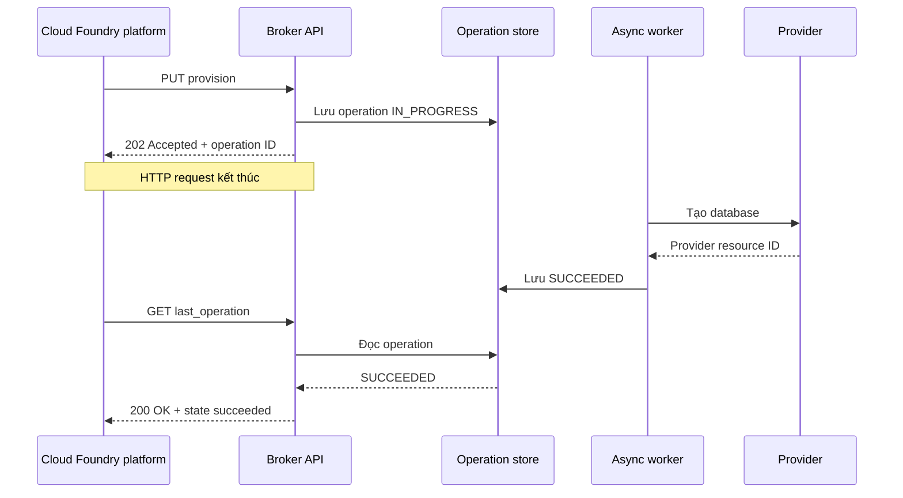
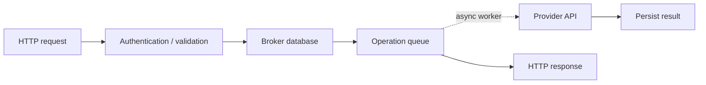

# Đo số lượng yêu cầu, độ trễ và tỷ lệ lỗi từng thao tác

Service broker theo Open Service Broker API (OSB API) xử lý nhiều loại request có đặc tính khác nhau: đọc catalog, provision, update, deprovision, bind, unbind, fetch instance và polling trạng thái operation. Chỉ theo dõi CPU, memory hoặc tổng số HTTP request không đủ để biết broker có đang phục vụ platform đúng cách hay không. Một broker có thể trả HTTP nhanh nhưng provider xử lý chậm; request có thể trả `202 Accepted` thành công nhưng operation bất đồng bộ thất bại sau đó; hoặc một endpoint provision hoạt động tốt trong khi binding liên tục lỗi.

Để quan sát chất lượng từng thao tác, cần đo ít nhất ba nhóm dữ liệu:

1. **Số lượng request:** mỗi operation nhận bao nhiêu request, bao nhiêu thành công, bị từ chối, được chấp nhận bất đồng bộ hoặc thất bại.
2. **Độ trễ request:** thời gian broker xử lý HTTP request từ lúc nhận đến lúc trả response.
3. **Tỷ lệ lỗi:** tỷ lệ request lỗi ở tầng HTTP và tỷ lệ operation nghiệp vụ thất bại sau khi được chấp nhận.

Hai loại độ trễ và lỗi này không giống nhau. Với operation bất đồng bộ, HTTP request có thể hoàn tất trong vài mili giây bằng `202 Accepted`, trong khi việc tạo database mất vài phút. Vì vậy, broker cần theo dõi cả thời gian chấp nhận request lẫn thời gian hoàn tất operation.

## 1. Những thao tác cần được đo riêng

Một broker nên xác định danh sách operation ổn định và gắn metric với từng operation. Có thể nhóm như sau:

| Operation | HTTP endpoint điển hình | Mục đích |
|---|---|---|
| `catalog` | `GET /v2/catalog` | Trả danh sách service offering và plan |
| `provision` | `PUT /v2/service_instances/{instance_id}` | Tạo service instance |
| `update` | `PATCH /v2/service_instances/{instance_id}` | Cập nhật cấu hình instance |
| `deprovision` | `DELETE /v2/service_instances/{instance_id}` | Thu hồi instance |
| `bind` | `PUT /v2/service_instances/{instance_id}/service_bindings/{binding_id}` | Tạo binding cho consumer |
| `unbind` | `DELETE /v2/service_instances/{instance_id}/service_bindings/{binding_id}` | Thu hồi binding |
| `fetch_instance` | `GET /v2/service_instances/{instance_id}` | Truy xuất thông tin instance khi broker công bố capability |
| `fetch_binding` | `GET /v2/service_instances/{instance_id}/service_bindings/{binding_id}` | Truy xuất thông tin binding khi được hỗ trợ |
| `last_operation` | `GET .../last_operation` | Trả trạng thái operation bất đồng bộ |

Không nên gộp tất cả vào metric `http_requests_total` rồi chỉ xem tổng. Nếu tổng request tăng nhưng không biết operation nào tăng, khó xác định đó là platform polling bình thường, retry do timeout hay một đợt provision mới.

Ngoài operation, có thể phân loại theo một số chiều có tập giá trị hữu hạn:

- Kết quả: `success`, `accepted_async`, `client_error`, `server_error`, `conflict`, `cancelled`.
- HTTP status family: `2xx`, `4xx`, `5xx`.
- Provider type: `postgres`, `kubernetes`, `object_storage`.
- Loại execution: `sync`, `async`.

Chỉ thêm tag nếu nó giúp trả lời một câu hỏi vận hành cụ thể. Mỗi tag mới làm tăng số time series mà hệ thống monitoring phải lưu.

## 2. Phân biệt HTTP request với operation nghiệp vụ

Một HTTP request là một lần platform gọi broker. Một operation nghiệp vụ có thể kéo dài qua nhiều request và worker:



Trong ví dụ này:

- Request `provision` được tính một lần khi broker nhận `PUT`.
- HTTP request duration đo thời gian từ lúc broker nhận `PUT` đến lúc trả `202`.
- Operation duration đo thời gian từ lúc operation bắt đầu đến lúc worker ghi trạng thái terminal `SUCCEEDED` hoặc `FAILED`.
- Mỗi lần platform gọi `last_operation` là một HTTP request riêng; nó không phải một provision mới.

Nếu chỉ đo `http.server.requests`, dashboard có thể cho thấy provision rất nhanh vì broker trả `202` ngay. Điều đó không cho biết provider có hoàn thành trong SLA hay không. Cần có metric riêng cho lifecycle operation.

## 3. Bộ metric tối thiểu

Một bộ metric hữu ích cho từng operation gồm:

| Metric logic | Loại | Câu hỏi |
|---|---|---|
| Request count | Counter | Có bao nhiêu request được nhận và kết quả ra sao? |
| Request duration | Timer/Histogram | Broker mất bao lâu để trả HTTP response? |
| Operation started | Counter | Có bao nhiêu operation nghiệp vụ được tạo? |
| Operation duration | Timer/Histogram | Operation mất bao lâu từ lúc bắt đầu đến lúc kết thúc? |
| Operation outcome | Counter | Có bao nhiêu operation thành công hoặc thất bại? |
| Active operations | Gauge | Hiện có bao nhiêu operation đang chạy? |
| Provider call duration | Timer/Histogram | Broker mất bao lâu khi gọi provider? |
| Provider call errors | Counter | Provider call lỗi theo loại nào? |

Không phải metric nào cũng cần được tạo ngay trong phiên bản đầu tiên. Có thể bắt đầu bằng request count, request duration, operation duration và outcome, sau đó bổ sung provider metrics khi cần phân tích nguyên nhân.

### 3.1. Tên metric đề xuất

Ví dụ tên metric Micrometer:

```text
broker.osb.requests
broker.osb.request.duration
broker.osb.operations.started
broker.osb.operations.completed
broker.osb.operation.duration
broker.provider.requests
broker.provider.request.duration
broker.provider.errors
```

Khi xuất sang Prometheus, tên metric thường được chuẩn hóa thành dạng underscore; Timer thường có hậu tố `_seconds`, Counter thường có hậu tố `_total`. Ví dụ:

```text
broker_osb_requests_total
broker_osb_request_duration_seconds_bucket
broker_osb_operations_completed_total
broker_osb_operation_duration_seconds_bucket
```

Tên cụ thể có thể phụ thuộc registry và convention đang cấu hình. Hãy kiểm tra endpoint `/actuator/prometheus` của ứng dụng để dùng đúng tên thực tế trong PromQL.

## 4. Đếm request theo operation và kết quả

Counter phù hợp để đếm số lần một sự kiện xảy ra. Với OSB broker, nên tăng counter cho từng request và gắn tag operation cùng kết quả đã phân loại.

Ví dụ metric logic:

```text
broker.osb.requests{
  operation="provision",
  result="accepted_async"
}
```

Một bộ kết quả có thể được chuẩn hóa như sau:

| Result | Ý nghĩa |
|---|---|
| `success` | Request hoàn tất đồng bộ thành công |
| `accepted_async` | Broker chấp nhận operation bất đồng bộ và trả `202` |
| `client_error` | Request không hợp lệ hoặc không được phép, thường là `4xx` |
| `conflict` | Request xung đột trạng thái hoặc concurrency |
| `server_error` | Broker không xử lý được request, thường là `5xx` |
| `cancelled` | Request bị client hủy hoặc kết nối đóng trước khi hoàn tất |

`accepted_async` không phải lỗi. `AsyncRequired` hoặc `ConcurrencyError` có thể được biểu diễn bằng `422` theo OSB, nhưng dashboard nên phân biệt lỗi protocol/validation với lỗi hệ thống. Có thể thêm một tag `error_type` với tập giá trị nhỏ, chẳng hạn `validation`, `not_found`, `concurrency`, `provider_unavailable`, `internal`; không dùng exception message làm tag.

### 4.1. Đếm theo HTTP layer và business layer

Spring Boot Actuator với Micrometer tự động tạo metric HTTP server, thường là `http.server.requests` cho MVC/WebFlux khi instrumentation tương ứng được bật. Metric này giúp theo dõi method, route template, status, outcome và exception ở tầng web.

Metric nghiệp vụ `broker.osb.requests` bổ sung chiều `operation` theo ngữ nghĩa OSB. Không nên bỏ metric HTTP mặc định; hai metric phục vụ hai câu hỏi khác nhau:

- HTTP metric: endpoint nào chậm hoặc trả status lỗi?
- OSB operation metric: provision, bind hay deprovision đang có vấn đề?

Nếu tự thêm một WebFilter/Servlet filter đếm toàn bộ request, hãy xác định rõ có đang đếm trùng với HTTP server metric hay không. Có thể giữ HTTP metric tự động và chỉ instrument operation tại service/use case.

## 5. Đo độ trễ request

Timer của Micrometer ghi nhận thời gian và số lần thực hiện. Đối với HTTP request, Spring Boot đã có instrumentation tự động. Với metric nghiệp vụ, có thể đo thời gian chạy của service method hoặc use case.

Ví dụ với một use case reactive:

```java
import java.util.concurrent.atomic.AtomicReference;

import io.micrometer.core.instrument.MeterRegistry;
import io.micrometer.core.instrument.Timer;
import org.springframework.stereotype.Service;
import reactor.core.publisher.Mono;
import reactor.core.publisher.SignalType;

@Service
public class InstrumentedProvisionUseCase {

    private final ProvisionUseCase delegate;
    private final MeterRegistry registry;

    public InstrumentedProvisionUseCase(
            ProvisionUseCase delegate,
            MeterRegistry registry) {
        this.delegate = delegate;
        this.registry = registry;
    }

    public Mono<ProvisionResult> execute(ProvisionCommand command) {
        return Mono.defer(() -> {
            Timer.Sample sample = Timer.start(registry);
            AtomicReference<String> result = new AtomicReference<>("success");

            return Mono.defer(() -> delegate.execute(command))
                    .doOnNext(provisionResult -> {
                        if (provisionResult.acceptedAsync()) {
                            result.set("accepted_async");
                        }
                    })
                    .doOnError(error -> result.set(classify(error)))
                    .doFinally(signal -> {
                        if (signal == SignalType.CANCEL) {
                            result.set("cancelled");
                        }

                        sample.stop(Timer.builder("broker.osb.request.duration")
                                .tag("operation", "provision")
                                .tag("result", result.get())
                                .register(registry));

                        registry.counter("broker.osb.requests",
                                "operation", "provision",
                                "result", result.get()).increment();
                    });
        });
    }

    private String classify(Throwable error) {
        if (error instanceof BrokerConcurrencyException) {
            return "conflict";
        }
        if (error instanceof BrokerValidationException) {
            return "client_error";
        }
        return "server_error";
    }
}
```

`ProvisionUseCase`, `ProvisionCommand`, `ProvisionResult` và các exception là abstraction của ứng dụng; ví dụ giả định `ProvisionResult.acceptedAsync()` cho biết broker đã chấp nhận xử lý bất đồng bộ. Lớp `Mono.defer()` bên trong cũng bảo đảm lỗi phát sinh đồng bộ khi gọi `delegate.execute()` được đưa vào reactive chain để timer và counter vẫn được ghi. Nếu operation đã được chuyển sang worker, request timer chỉ dừng khi HTTP request hoàn tất; không giữ timer request mở trong toàn bộ thời gian worker chạy.

Với các endpoint khác, có thể dùng decorator hoặc helper chung nhận operation name từ một enum cố định. Không lấy operation name trực tiếp từ URL tùy ý.

### 5.1. Đo thời gian ở đúng ranh giới

Đối với một request provision, các khoảng thời gian có thể được đo riêng:

| Khoảng thời gian | Bắt đầu | Kết thúc |
|---|---|---|
| HTTP request | Web server nhận request | Response được ghi/xử lý xong |
| Broker use case | Service method bắt đầu | Use case trả kết quả đồng bộ hoặc async acceptance |
| Provider call | Trước khi gọi provider | Nhận response hoặc timeout |
| Async operation | Operation được lưu `IN_PROGRESS` | Operation chuyển `SUCCEEDED`/`FAILED` |
| Queue wait | Worker enqueue | Worker bắt đầu xử lý |

Nếu chỉ đo tổng request duration, không thể biết thời gian chậm nằm ở authentication, database, queue hay provider. Instrument các dependency quan trọng giúp tìm nguyên nhân mà không cần ghi quá nhiều log.

## 6. Đo độ trễ operation bất đồng bộ

Với operation async, thời điểm bắt đầu và kết thúc phải được lưu bền vững. Worker có thể chạy trên replica khác hoặc process khác với HTTP request ban đầu, nên không thể chỉ giữ `Timer.Sample` trong memory của controller.

Operation record nên lưu:

| Field | Mục đích |
|---|---|
| `operation_id` | Định danh operation |
| `operation_type` | `provision`, `update`, `deprovision`, `bind`, `unbind` |
| `started_at` | Thời điểm operation được chấp nhận/đưa vào xử lý |
| `completed_at` | Thời điểm đạt trạng thái terminal |
| `state` | `IN_PROGRESS`, `SUCCEEDED`, `FAILED` hoặc state nội bộ tương đương |
| `provider_operation_id` | Job ID phía provider nếu có |
| `failure_code` | Mã lỗi chuẩn hóa nếu thất bại |

Khi worker hoàn tất, tính duration từ timestamp bền vững và ghi Timer/counter với tag operation và outcome. Nếu broker restart, operation duration vẫn có thể được tính đúng vì timestamp không nằm trong bộ nhớ process.

Ví dụ:

```java
public Mono<Void> recordOperationCompletion(OperationRecord operation) {
    return Mono.fromRunnable(() -> {
        Duration duration = Duration.between(
                operation.startedAt(), operation.completedAt());

        Timer.builder("broker.osb.operation.duration")
                .tag("operation", operation.type().metricName())
                .tag("outcome", operation.state().metricName())
                .register(meterRegistry)
                .record(duration);

        meterRegistry.counter("broker.osb.operations.completed",
                "operation", operation.type().metricName(),
                "outcome", operation.state().metricName()).increment();
    });
}
```

`OperationRecord`, `OperationType` và `OperationState` là model của ứng dụng. Đoạn code chỉ minh họa việc ghi metric tại thời điểm operation chuyển sang trạng thái cuối. Hãy bảo đảm logic completion chỉ chạy một lần cho mỗi transition terminal; nếu worker retry sau crash, cần idempotency hoặc event/outbox deduplication để không tăng counter và ghi Timer hai lần.

### 6.1. Theo dõi operation đang chạy

Một gauge có thể cho biết số operation hiện đang `IN_PROGRESS`. Có hai cách:

- Gauge cục bộ đếm số task đang chạy trong một process, hữu ích cho worker utilization.
- Gauge tổng hợp từ operation store, hữu ích cho tổng backlog của toàn broker.

Không để mọi replica cùng query một tổng số toàn cục rồi expose cùng giá trị dưới metric không phân biệt instance; Prometheus sẽ scrape mỗi replica và có thể cộng lặp số liệu. Nếu cần tổng toàn cục, dùng một exporter/collector chuyên biệt hoặc metric được phân vùng rõ ràng.

Có thể bổ sung metric tuổi operation lâu nhất hoặc số operation quá SLA. Đây thường là tín hiệu tốt hơn một gauge tổng đơn thuần vì backlog nhỏ nhưng bị kẹt lâu vẫn là vấn đề.

## 7. Định nghĩa và tính tỷ lệ lỗi

Không nên gộp mọi HTTP `4xx` và `5xx` vào một tỷ lệ lỗi duy nhất. Platform gửi parameters sai, request không được phép hoặc operation conflict là những sự kiện khác với broker crash hay provider outage.

Nên theo dõi ít nhất ba tỷ lệ:

1. **HTTP server error rate:** request kết thúc bằng `5xx` trên tổng request liên quan.
2. **Client/protocol rejection rate:** request kết thúc bằng `4xx`, chia theo error type.
3. **Operation failure rate:** operation đã được chấp nhận nhưng cuối cùng chuyển sang `FAILED` trên tổng operation đã kết thúc.

Ví dụ phân loại:

| Tình huống | HTTP result | Operation result |
|---|---|---|
| Provision đồng bộ thành công | `2xx` | `succeeded` |
| Provision async được chấp nhận | `202` | Chưa terminal |
| Parameters không hợp lệ | `4xx` | Không có operation được bắt đầu hoặc validation failed theo policy |
| Concurrency conflict | `422` theo OSB error mapping | Operation hiện tại có thể vẫn đang chạy; không tính operation đó là failed chỉ vì retry bị từ chối |
| Provider timeout sau khi đã nhận request | Có thể `5xx` hoặc async operation tiếp tục `IN_PROGRESS` | `unknown`/retrying trước khi có kết luận |
| Async provision kết thúc failed | Polling response phản ánh `failed` | `failed` |
| Deprovision tài nguyên đã biến mất | `410 Gone` theo OSB delete semantics | Mục tiêu xóa đã đạt; không coi là lỗi hệ thống |

`202 Accepted` không phải lỗi và không nên nằm trong numerator của server error rate. `410 Gone` trong delete semantics có thể biểu thị trạng thái đích đã đạt. `ConcurrencyError` hoặc `AsyncRequired` là protocol/business outcome cần theo dõi riêng, không tự động được tính là lỗi hạ tầng.

## 8. Histogram và percentile latency

Average latency có thể che giấu một nhóm request rất chậm. Ví dụ 99 request hoàn tất trong 50 ms và một request mất 10 giây; average không cho biết rõ trải nghiệm của request chậm nhất.

Percentile giúp quan sát phân phối:

- **p50:** một nửa request nhanh hơn hoặc bằng giá trị này.
- **p90:** 90% request nhanh hơn hoặc bằng giá trị này.
- **p95:** 95% request nhanh hơn hoặc bằng giá trị này.
- **p99:** 99% request nhanh hơn hoặc bằng giá trị này.

Với Prometheus, histogram bucket cho phép tổng hợp percentile giữa nhiều broker replica. Micrometer Timer có thể publish histogram theo cấu hình:

```yaml
management:
  metrics:
    distribution:
      percentiles-histogram:
        broker.osb.request.duration: true
        broker.osb.operation.duration: true
        http.server.requests: true
```

Bucket cần phù hợp với SLA. Request HTTP có thể dùng các ngưỡng mili giây đến vài giây; operation provision/deprovision có thể cần ngưỡng từ vài giây đến nhiều phút. Không dùng cùng một bucket range cho request nhanh và operation dài nếu điều đó khiến phân phối khó đọc.

Percentile tính trực tiếp trong từng process không thể cộng hoặc lấy trung bình chính xác giữa các replica. Nếu dùng Prometheus, ưu tiên histogram bucket và tính quantile ở server bằng `histogram_quantile()`.

## 9. Truy vấn PromQL cơ bản

Giả sử Micrometer xuất counter và histogram theo tên đã chuẩn hóa như sau.

### 9.1. Số request mỗi giây theo operation

```promql
sum by (operation) (
  rate(broker_osb_requests_total[5m])
)
```

`rate()` tính tốc độ tăng counter trung bình trong cửa sổ 5 phút. Có thể dùng `increase()` để xem tổng số request trong khoảng thời gian:

```promql
sum by (operation, result) (
  increase(broker_osb_requests_total[1h])
)
```

### 9.2. Tỷ lệ HTTP server error

Metric custom `broker_osb_requests_total` chỉ phản ánh những request đi qua điểm instrumentation nghiệp vụ. Để bao gồm lỗi xảy ra trước service layer, chẳng hạn authentication, routing hoặc request parsing, dùng HTTP server metric tự động của Spring Boot:

```promql
sum(rate(http_server_requests_seconds_count{status=~"5.."}[5m]))
/
clamp_min(sum(rate(http_server_requests_seconds_count[5m])), 1)
```

Tên metric/tag có thể thay đổi theo phiên bản và registry; kiểm tra `/actuator/prometheus` trước khi dùng query. Nếu cần tính error rate riêng cho OSB endpoint, lọc theo route template `uri` sau khi xác nhận tag thực tế.

Tỷ lệ từ business metric có thể tính riêng như sau:

```promql
sum(rate(broker_osb_requests_total{result="server_error"}[5m]))
/
clamp_min(sum(rate(broker_osb_requests_total[5m])), 1)
```

Nếu counter chỉ ghi sau khi request kết thúc, mẫu số là các request đã được phân loại. Nếu muốn tính mọi request đã bắt đầu kể cả request bị process kill, cần metric ingress/gateway hoặc instrumentation tăng counter tại thời điểm nhận request.

### 9.3. p95 request duration theo operation

```promql
histogram_quantile(
  0.95,
  sum by (le, operation) (
    rate(broker_osb_request_duration_seconds_bucket[5m])
  )
)
```

Kết quả cho biết p95 của HTTP/use-case request duration theo operation. Xác nhận Timer được cấu hình publish histogram và tên bucket đúng với endpoint Prometheus.

### 9.4. Tỷ lệ operation thất bại

```promql
sum(rate(broker_osb_operations_completed_total{outcome="failed"}[15m]))
/
clamp_min(sum(rate(broker_osb_operations_completed_total[15m])), 1)
```

Tỷ lệ này chỉ xét operation đã hoàn tất. Nếu nhiều operation vẫn đang chạy, hãy hiển thị thêm active operation count và tuổi operation để tránh kết luận hệ thống khỏe chỉ vì chưa có kết quả cuối.

### 9.5. p99 operation duration

```promql
histogram_quantile(
  0.99,
  sum by (le, operation) (
    rate(broker_osb_operation_duration_seconds_bucket[1h])
  )
)
```

Dùng cửa sổ đủ dài để có số mẫu phù hợp. Khi lượng operation thấp, percentile có thể dao động mạnh; nên hiển thị sample count cùng percentile.

## 10. Tránh metric cardinality cao

Metric label tạo thành các chiều time series. Nếu gắn mỗi service instance ID hoặc binding ID làm tag, số series có thể tăng theo số lượng resource và thời gian.

Không dùng các giá trị sau làm label mặc định:

- `service_instance_id`, `binding_id`, `app_guid`.
- Organization, space, tenant hoặc user ID.
- Provider resource ID, database name hoặc volume ID.
- Raw URL có path parameter hoặc query string.
- Exception message, stack trace hoặc request body.
- Credentials, token hoặc email.

Ví dụ không an toàn:

```java
Counter.builder("broker.osb.requests")
        .tag("operation", "provision")
        .tag("service_instance_id", request.getServiceInstanceId())
        .register(registry)
        .increment();
```

Ví dụ an toàn hơn:

```java
Counter.builder("broker.osb.requests")
        .tag("operation", "provision")
        .tag("result", "success")
        .tag("provider", "postgres")
        .register(registry)
        .increment();
```

Nếu cần truy vết một instance cụ thể, dùng structured log hoặc distributed trace với access control và retention phù hợp. Metric dành cho thống kê tổng hợp, không phải kho lưu danh sách mọi resource.

## 11. Tích hợp Micrometer và Spring Boot Actuator

Spring Boot Actuator cung cấp endpoint để quan sát metric. Với Prometheus, thêm registry tương ứng và expose endpoint cần thiết.

Ví dụ Gradle:

```groovy
dependencies {
    implementation "org.springframework.boot:spring-boot-starter-actuator"
    runtimeOnly "io.micrometer:micrometer-registry-prometheus"
}
```

Quản lý version thông qua Spring Boot dependency management/BOM đang dùng. Cấu hình:

```yaml
management:
  endpoints:
    web:
      exposure:
        include: health,info,prometheus
  endpoint:
    health:
      probes:
        enabled: true
  metrics:
    distribution:
      percentiles-histogram:
        broker.osb.request.duration: true
        broker.osb.operation.duration: true
```

Endpoint Prometheus thường là `/actuator/prometheus`. Không expose endpoint này công khai nếu chưa có network policy hoặc authentication phù hợp. Endpoint health và metrics có thể cần security rule riêng.

### 11.1. Tạo custom metric bằng MeterRegistry

Ví dụ ghi counter và timer:

```java
@Component
public class BrokerMetrics {

    private final MeterRegistry registry;

    public BrokerMetrics(MeterRegistry registry) {
        this.registry = registry;
    }

    public void requestCompleted(String operation, String result,
                                 Duration duration) {
        registry.counter("broker.osb.requests",
                "operation", operation,
                "result", result).increment();

        Timer.builder("broker.osb.request.duration")
                .tag("operation", operation)
                .tag("result", result)
                .register(registry)
                .record(duration);
    }

    public void operationStarted(String operation) {
        registry.counter("broker.osb.operations.started",
                "operation", operation).increment();
    }

    public void operationCompleted(String operation, String outcome,
                                   Duration duration) {
        registry.counter("broker.osb.operations.completed",
                "operation", operation,
                "outcome", outcome).increment();

        Timer.builder("broker.osb.operation.duration")
                .tag("operation", operation)
                .tag("outcome", outcome)
                .register(registry)
                .record(duration);
    }
}
```

`BrokerMetrics` là component do ứng dụng định nghĩa. Nên tập trung tên metric và tag trong một class hoặc convention để các service không tự tạo tag khác nhau cho cùng operation. Nếu request có thể bị cancel, hãy quyết định rõ có đếm request bị cancel và cách phân loại duration.

### 11.2. Tận dụng metric HTTP tự động

Với Spring MVC/WebFlux, Spring Boot tích hợp Micrometer để ghi nhận request HTTP. Trước khi tự viết filter đo toàn bộ HTTP request, kiểm tra `/actuator/metrics/http.server.requests` hoặc `/actuator/prometheus` đã có metric chưa.

Metric tự động hữu ích cho:

- Phân phối latency theo route template.
- HTTP status và outcome.
- Method và exception category.
- Phát hiện endpoint cụ thể có p95/p99 tăng.

Custom OSB metrics nên bổ sung operation name, operation outcome và lifecycle duration mà HTTP instrumentation không thể tự suy ra.

## 12. Phân biệt provider latency và broker latency

Một request provision có thể mất thời gian ở nhiều bước:



Với synchronous operation, provider latency có thể nằm trực tiếp trong request duration. Với asynchronous operation, provider latency nằm trong operation duration và worker metrics.

Nên instrument provider call riêng theo provider type và operation:

```java
Timer.Sample sample = Timer.start(registry);

return providerClient.createDatabase(command)
        .doOnError(error -> providerErrors.increment())
        .doFinally(signal -> sample.stop(
                Timer.builder("broker.provider.request.duration")
                        .tag("provider", "postgres")
                        .tag("operation", "create_database")
                        .register(registry)));
```

Đoạn code là ví dụ trong một reactive method; `providerErrors` và `providerClient` là dependency do ứng dụng định nghĩa. Trong production, nên phân loại lỗi provider theo nhóm hữu hạn như `timeout`, `rate_limited`, `auth`, `not_found`, `server_error`, thay vì tag theo exception message.

Khi request duration tăng nhưng provider duration ổn định, hãy kiểm tra authentication, database, queue wait hoặc serialization. Khi provider duration tăng đồng thời operation duration tăng, nguyên nhân có thể nằm ở provider hoặc network.

## 13. Dashboard cho service broker

Dashboard nên giúp người trực vận hành trả lời nhanh các câu hỏi:

1. Operation nào đang nhận nhiều request nhất?
2. p95/p99 request latency của provision, bind và delete có vượt ngưỡng không?
3. HTTP 5xx rate có tăng không?
4. Operation async nào thất bại hoặc bị kẹt?
5. Provider nào đang chậm hoặc trả lỗi?
6. Request polling có tăng bất thường do operation kéo dài không?

Một dashboard có thể chia thành các hàng:

| Panel | Nội dung |
|---|---|
| Traffic | Request/s theo operation và result |
| Latency | p50/p95/p99 request duration theo operation |
| HTTP errors | 4xx và 5xx rate, phân loại theo operation |
| Operation lifecycle | Started/completed, success/failure, active và oldest pending |
| Async duration | p95/p99 provision/update/deprovision/bind duration |
| Provider | Request latency, error rate, timeout và rate limit theo provider |
| Saturation | CPU, memory, database pool, worker queue depth và concurrency |

Đặt traffic, latency và errors ở phần đầu dashboard. Các metric saturation và provider dependency giúp tìm nguyên nhân ở phần dưới.

## 14. SLO và cảnh báo

SLO nên phản ánh trải nghiệm của platform và kết quả nghiệp vụ. Không nên đặt một ngưỡng duy nhất cho tất cả operation vì catalog, bind và provision có đặc tính khác nhau.

Ví dụ mục tiêu minh họa, cần điều chỉnh theo SLA thực tế:

| Chỉ số | Mục tiêu mẫu | Phạm vi |
|---|---|---|
| Catalog p95 | Dưới 300 ms | HTTP request `catalog` |
| Provision acceptance p95 | Dưới 1 s | Thời gian trả `200/202`, không phải hoàn tất provider |
| Bind p95 | Dưới 2 s | Binding đồng bộ hoặc acceptance async |
| HTTP 5xx rate | Dưới 1% | Request OSB trong cửa sổ đo |
| Async provision completion | 99% hoàn tất trong 10 phút | Operation lifecycle |
| Operation stuck | Không có operation `IN_PROGRESS` quá deadline | Operation store |

### 14.1. Cảnh báo latency

Cảnh báo khi p95 hoặc p99 tăng liên tục qua nhiều cửa sổ, thay vì alert chỉ từ một spike ngắn. Có thể dùng cả latency threshold và error budget burn rate.

### 14.2. Cảnh báo error rate

Tách alert:

- HTTP 5xx rate cao trên provision/bind/deprovision.
- Operation failure rate cao sau khi async job kết thúc.
- Provider timeout/rate limit tăng.
- `UNKNOWN` operation hoặc queue retry tăng bất thường.
- `4xx` tăng đột biến có thể cho thấy platform gửi request sai version, catalog mismatch hoặc credential bị lỗi.

Không alert ở mức nghiêm trọng chỉ vì `202 Accepted`, `410 Gone` trong delete semantics hoặc một số `4xx` expected như validation/concurrency. Cần phân loại theo outcome và business semantics.

### 14.3. Alert fatigue

Mỗi alert cần có:

- Điều kiện kích hoạt và thời gian duy trì.
- Mức độ nghiêm trọng.
- Dashboard hoặc log query liên quan.
- Hành động điều tra đầu tiên.
- Owner hoặc kênh xử lý.

Tránh alert cho từng service instance ID vì số lượng lớn và dễ tạo nhiễu. Alert theo operation/provider/environment với cardinality thấp.

## 15. Theo dõi polling và retry

Platform có thể polling `last_operation` nhiều lần cho một async operation. Nếu operation hoàn tất chậm, số request polling có thể tăng dù số operation mới không tăng.

Nên đo riêng:

- Số request `last_operation` mỗi giây.
- Số operation async đang hoạt động.
- Số lần poll trung bình trên mỗi operation.
- Thời gian từ `202 Accepted` đến terminal state.
- Số operation vượt deadline.
- Số request retry/idempotency replay nếu broker có instrumentation.

Không tính mỗi lần polling như một operation provision mới. Có thể tạo metric `broker.osb.polls` với tag `operation` và `result` để phân tích hành vi platform.

Nếu polling rate tăng đột biến, kiểm tra operation duration và response state. Platform có thể polling theo lịch bình thường, nhưng operation stuck hoặc trả `in progress` quá lâu cũng khiến request count tăng. Broker cần trả `last_operation` nhất quán và cập nhật terminal state kịp thời.

## 16. Kiểm thử metric và instrumentation

Metric cần được kiểm thử như một phần của behavior, đặc biệt với reactive flow và async worker.

| Tình huống | Kết quả mong đợi |
|---|---|
| Provision đồng bộ thành công | Request counter tăng với `operation=provision`, `result=success`; request timer ghi duration |
| Provision trả `202` | Request result là `accepted_async`; operation started tăng |
| Async operation hoàn tất | Operation completed counter và operation duration được ghi một lần |
| Async operation thất bại | Outcome `failed`; không ghi thành success |
| Validation trả 4xx | Client error được phân loại riêng, không tính là server error |
| Provider timeout | Provider error/duration ghi nhận; operation có thể `UNKNOWN` hoặc retrying |
| Request bị cancel | Có outcome `cancelled` nếu policy instrumentation theo dõi cancellation |
| Platform polling | Tăng metric `last_operation`/poll, không tăng provision operation count |
| Hai replica xử lý cùng completion event | Counter/timer terminal không bị ghi hai lần |
| Instance ID khác nhau | Không tạo metric time series riêng theo instance ID |
| Route path chứa ID | HTTP metric dùng route template, không dùng raw path |

Ví dụ test với `SimpleMeterRegistry`:

```java
class BrokerMetricsTests {

    private final SimpleMeterRegistry registry = new SimpleMeterRegistry();
    private final BrokerMetrics metrics = new BrokerMetrics(registry);

    @Test
    void recordsProvisionRequestAndDuration() {
        metrics.requestCompleted("provision", "success", Duration.ofMillis(120));

        Counter counter = registry.get("broker.osb.requests")
                .tag("operation", "provision")
                .tag("result", "success")
                .counter();

        Timer timer = registry.get("broker.osb.request.duration")
                .tag("operation", "provision")
                .tag("result", "success")
                .timer();

        assertThat(counter.count()).isEqualTo(1.0);
        assertThat(timer.count()).isEqualTo(1L);
        assertThat(timer.totalTime(TimeUnit.MILLISECONDS)).isEqualTo(120.0);
    }
}
```

Test minh họa giả định `BrokerMetrics` là class ở phần trước. Cần thêm test cho async lifecycle, failure classification, cancellation và idempotent completion. `SimpleMeterRegistry` hữu ích cho unit test; integration test nên kiểm tra format thực tế của Prometheus registry và endpoint Actuator.

## 17. Lỗi thiết kế thường gặp

| Lỗi | Hậu quả | Cách xử lý |
|---|---|---|
| Chỉ đo tổng HTTP request | Không biết operation nào đang có vấn đề | Gắn metric nghiệp vụ theo operation |
| Xem `202` là thành công cuối cùng | Bỏ sót async failure và operation stuck | Đo acceptance và lifecycle riêng |
| Xem mọi `4xx` là lỗi broker | Alert sai với validation hoặc concurrency expected | Phân loại client/protocol outcome |
| Chỉ dùng average latency | Không thấy tail latency | Dùng histogram và p95/p99 |
| Đo operation duration trong memory | Mất thời gian khi worker restart/đổi replica | Lưu started/completed timestamp bền vững |
| Ghi metric terminal nhiều lần | Counter và duration bị nhân đôi | Deduplicate terminal transition |
| Tag theo instance/binding ID | Cardinality tăng rất lớn | Dùng log/trace để truy vết resource cụ thể |
| Dùng raw URL làm tag | Mỗi path parameter tạo series mới | Dùng route template hoặc operation enum |
| Gộp provider và broker latency | Khó tìm dependency chậm | Đo provider call riêng |
| Để mọi replica expose cùng global gauge | Prometheus cộng lặp giá trị | Dùng exporter chuyên biệt hoặc gauge theo instance |
| Expose Actuator public | Lộ metric và thông tin runtime | Giới hạn network và authentication |
| Không đo polling | Không phát hiện operation async chậm | Đo last-operation request và poll count riêng |

## 18. Checklist triển khai

- [ ] Xác định operation list ổn định: catalog, provision, update, deprovision, bind, unbind, fetch và last operation.
- [ ] Bật Micrometer HTTP server metrics cho MVC/WebFlux.
- [ ] Bổ sung business counter theo operation và result.
- [ ] Đo request duration riêng với operation lifecycle duration.
- [ ] Lưu timestamp bắt đầu/kết thúc operation trong store bền vững.
- [ ] Phân biệt `success`, `accepted_async`, `client_error`, `conflict`, `server_error` và `cancelled`.
- [ ] Phân loại HTTP 4xx/5xx theo OSB semantics, không xem 202/410 expected là lỗi hệ thống.
- [ ] Bật histogram cho request và operation Timer; chọn bucket phù hợp SLA.
- [ ] Dùng p50/p95/p99 và sample count trên dashboard.
- [ ] Đo provider latency/error và queue wait nếu có async worker.
- [ ] Đo polling rate riêng; không tính poll là operation mới.
- [ ] Tránh tag instance ID, binding ID, tenant ID, raw URL, secret hoặc exception message.
- [ ] Expose `/actuator/prometheus` chỉ trên mạng monitoring được bảo vệ.
- [ ] Tạo dashboard traffic, latency, error, operation lifecycle và provider dependency.
- [ ] Thiết lập SLO/alert riêng cho request acceptance và async completion.
- [ ] Kiểm thử metrics với success, failure, async, cancellation, retry và multi-replica.

## 19. Tài liệu tham khảo

- [Spring Boot — Metrics](https://docs.spring.io/spring-boot/reference/actuator/metrics.html)
- [Spring Boot — HTTP Server Metrics](https://docs.spring.io/spring-boot/reference/actuator/metrics.html#actuator.metrics.supported.spring-mvc)
- [Spring Boot — Prometheus Endpoint](https://docs.spring.io/spring-boot/reference/actuator/metrics.html#actuator.metrics.export.prometheus)
- [Micrometer — Counters](https://docs.micrometer.io/micrometer/reference/concepts/counters.html)
- [Micrometer — Timers](https://docs.micrometer.io/micrometer/reference/concepts/timers.html)
- [Micrometer — Histograms and Percentiles](https://docs.micrometer.io/micrometer/reference/concepts/histogram-quantiles.html)
- [Prometheus — Histograms and Summaries](https://prometheus.io/docs/practices/histograms/)
- [Prometheus — Naming and Labels](https://prometheus.io/docs/practices/naming/)
- [Open Service Broker API v2.17 Specification](https://github.com/openservicebrokerapi/servicebroker/blob/v2.17/spec.md)
- [Spring Cloud Open Service Broker 4.4.1 — Reference Guide](https://docs.spring.io/spring-cloud-open-service-broker/docs/4.4.1/reference/)

Metric names và cấu hình trong bài là convention đề xuất cho broker. Metric HTTP tự động và cách export phụ thuộc web stack, Spring Boot và Micrometer registry đang dùng. Trước khi viết dashboard hoặc alert, kiểm tra tên metric, tag và histogram bucket thực tế tại endpoint Prometheus của môi trường triển khai.
