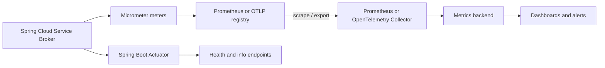

# Actuator, Micrometer và xuất số liệu giám sát

Spring Cloud Service Broker là một dịch vụ nền tảng xử lý các request có tác động trực tiếp đến tài nguyên: đọc catalog, provision, update, deprovision, tạo binding, thu hồi binding và theo dõi operation bất đồng bộ. Khi broker chạy production, đội vận hành cần biết ứng dụng còn sống hay không, có sẵn sàng nhận request không, endpoint nào đang chậm, provider nào đang lỗi, operation nào bị kẹt và queue có đang tăng hay không. Spring Boot Actuator và Micrometer cung cấp nền tảng để thu thập và xuất các tín hiệu này.

Actuator cung cấp các endpoint quản trị như health, info, metrics và prometheus. Micrometer cung cấp API đo lường thống nhất cho counter, gauge, timer và distribution summary. Registry chuyển những số đo đó sang định dạng của hệ thống giám sát, ví dụ Prometheus scrape endpoint hoặc OTLP gửi đến OpenTelemetry Collector. Khi kết hợp đúng, broker có thể theo dõi cả sức khỏe ứng dụng lẫn các chỉ số nghiệp vụ OSB mà không phải tự xây dựng một hệ thống metrics riêng.

## 1. Ba lớp: Actuator, Micrometer và hệ thống giám sát

Ba thành phần có vai trò khác nhau:

| Thành phần | Trách nhiệm | Ví dụ |
|---|---|---|
| Spring Boot Actuator | Cung cấp endpoint và thông tin vận hành của ứng dụng | health, info, metrics, prometheus |
| Micrometer | API ghi nhận số liệu trong code và tích hợp instrumentation | Counter, Timer, Gauge, Observation |
| Metrics registry/exporter | Chuyển số liệu sang giao thức của backend | Prometheus registry, OTLP registry |
| Monitoring backend | Lưu trữ, truy vấn, dashboard và alert | Prometheus, Grafana, hệ thống nhận OTLP |

Actuator không tự thay thế Prometheus hoặc Grafana. Endpoint metrics của Actuator chủ yếu phục vụ chẩn đoán một metric cụ thể; endpoint Prometheus cung cấp exposition format để Prometheus scrape. Micrometer là API mà code ứng dụng dùng để ghi số liệu, còn registry quyết định cách số liệu được xuất.

Luồng dữ liệu thường gặp:



## 2. Thêm dependency cho Actuator và Prometheus

Với ứng dụng Spring Boot dùng Maven, dependency cơ bản:

```xml
<dependencies>
    <dependency>
        <groupId>org.springframework.boot</groupId>
        <artifactId>spring-boot-starter-actuator</artifactId>
    </dependency>

    <dependency>
        <groupId>io.micrometer</groupId>
        <artifactId>micrometer-registry-prometheus</artifactId>
        <scope>runtime</scope>
    </dependency>
</dependencies>
```

Spring Boot dependency management nên quản lý phiên bản tương thích của Micrometer. Không tự chọn một phiên bản registry khác xa phiên bản Micrometer do Spring Boot BOM quản lý, vì có thể gây lỗi linkage hoặc thiếu tính năng.

Nếu dự án dùng Gradle:

```groovy
dependencies {
    implementation 'org.springframework.boot:spring-boot-starter-actuator'
    runtimeOnly 'io.micrometer:micrometer-registry-prometheus'
}
```

Khi ứng dụng khởi động với Prometheus registry, Actuator có thể cung cấp endpoint /actuator/prometheus nếu endpoint được expose qua web. Không thêm dependency Prometheus chỉ để gọi /actuator/metrics; endpoint này có thể hoạt động với Actuator và Micrometer core nhưng không phải định dạng scrape của Prometheus.

## 3. Cấu hình Actuator endpoints

Mặc định, Spring Boot chỉ expose một tập endpoint web giới hạn. Chỉ expose những endpoint thật sự cần thiết:

```yaml
management:
  endpoints:
    web:
      exposure:
        include: health,info,prometheus
  endpoint:
    health:
      show-details: never
      probes:
        enabled: true
    info:
      access: read-only
  metrics:
    tags:
      application: service-broker
```

Đây là cấu hình minh họa cho các phiên bản Spring Boot hiện đại; một số thuộc tính endpoint access hoặc health probe có thể khác theo phiên bản. Kiểm tra reference documentation đúng phiên bản Spring Boot đang dùng trước khi áp dụng.

Các endpoint thường gặp:

| Endpoint | Mục đích | Khuyến nghị |
|---|---|---|
| /actuator/health | Tổng hợp trạng thái health | Có thể expose có kiểm soát cho health checker |
| /actuator/health/liveness | Kiểm tra process có còn sống | Dùng cho liveness probe nếu triển khai phù hợp |
| /actuator/health/readiness | Kiểm tra khả năng nhận traffic | Dùng cho readiness probe |
| /actuator/info | Metadata đã chọn lọc | Chỉ đưa thông tin không nhạy cảm |
| /actuator/metrics | Liệt kê và xem một meter cụ thể | Hạn chế cho chẩn đoán nội bộ |
| /actuator/prometheus | Xuất toàn bộ metrics theo Prometheus format | Chỉ cho monitoring collector truy cập |

Ví dụ cấu hình ở trên không expose /actuator/metrics. Nếu cần endpoint này để chẩn đoán, chỉ bật trong profile hoặc management network nội bộ:

    management:
      endpoints:
        web:
          exposure:
            include: health,info,metrics,prometheus

Không nhất thiết expose metrics endpoint cho Prometheus; collector nên scrape /actuator/prometheus. Việc bật metrics endpoint chỉ mở API truy vấn từng meter và vẫn phải có kiểm soát truy cập.

Không expose wildcard * cho tất cả Actuator endpoints trên public interface. Các endpoint như env, configprops, heapdump, threaddump, logfile hoặc mappings có thể tiết lộ cấu hình, biến môi trường, đường dẫn và chi tiết nội bộ.

## 4. Health: liveness, readiness và trạng thái dependency

Health trả lời câu hỏi ứng dụng có thể tiếp tục chạy và nhận request hay không. Với service broker, cần phân biệt:

- **Liveness:** process còn hoạt động và không bị deadlock nghiêm trọng hay không.
- **Readiness:** instance có thể nhận request OSB mới hay không.
- **Startup:** ứng dụng đã hoàn tất khởi động, nạp cấu hình và sẵn sàng tham gia health checks hay chưa.

Kubernetes có thể dùng health groups do Spring Boot Actuator cung cấp:

```yaml
management:
  endpoint:
    health:
      probes:
        enabled: true
      show-details: never
```

Khi bật probes, các path health group thường là /actuator/health/liveness và /actuator/health/readiness. Xác nhận path thực tế và cấu hình probe của cluster trước khi triển khai.

### 4.1. Liveness không nên phụ thuộc provider

Nếu database provider hoặc cloud API tạm thời lỗi, điều đó không nhất thiết có nghĩa process broker cần restart. Đưa mọi provider dependency vào liveness có thể tạo vòng lặp restart khi provider outage: broker restart, mất cache hoặc worker state tạm thời, rồi tiếp tục lỗi.

Liveness nên tập trung vào trạng thái process và các điều kiện nội bộ khiến ứng dụng không thể tự phục hồi. Readiness có thể kiểm tra những dependency bắt buộc để xử lý request, ví dụ broker database không truy cập được thì broker có thể không ghi operation bền vững và không nên nhận mutation mới.

### 4.2. Readiness theo chức năng

Một broker có thể vẫn trả catalog từ cache khi provider tạm thời unavailable, nhưng không thể provision tài nguyên mới. Vì vậy, readiness không nên được thiết kế quá thô. Cần xác định:

- Broker database có sẵn sàng không?
- Cấu hình và credential platform có được nạp không?
- Operation store hoặc queue có hoạt động không?
- Provider nào là bắt buộc cho loại service đang công bố?
- Broker có thể nhận request và trả lỗi có kiểm soát khi provider lỗi không?

Nếu một provider lỗi riêng lẻ, có thể giữ broker ready nhưng phát metric/alert theo provider. Nếu dependency cốt lõi như database operation store hỏng, readiness có thể chuyển false để load balancer ngừng gửi mutation đến instance đó.

### 4.3. Custom HealthIndicator

Có thể viết HealthIndicator cho dependency quan trọng:

```java
@Component
public class BrokerDatabaseHealthIndicator implements HealthIndicator {

    private final DataSource dataSource;

    public BrokerDatabaseHealthIndicator(DataSource dataSource) {
        this.dataSource = dataSource;
    }

    @Override
    public Health health() {
        try (Connection connection = dataSource.getConnection()) {
            if (connection.isValid(2)) {
                return Health.up().build();
            }
            return Health.down().withDetail("database", "not-valid").build();
        } catch (SQLException ex) {
            return Health.down()
                    .withDetail("database", "unavailable")
                    .build();
        }
    }
}
```

Health check phải nhẹ, có timeout ngắn và không tạo side effect. Không gọi provision/deprovision để kiểm tra provider. Tránh đưa exception message hoặc connection string vào health details vì có thể chứa hostname, username hoặc thông tin nội bộ.

## 5. Info endpoint và build metadata

Endpoint /actuator/info có thể hiển thị phiên bản ứng dụng, commit ID hoặc build time để hỗ trợ điều tra sự cố. Ví dụ:

```yaml
management:
  info:
    env:
      enabled: false
    build:
      enabled: true
    git:
      enabled: true
```

Chỉ đưa thông tin cần thiết vào info. Không bật hiển thị toàn bộ environment hoặc system properties. Không đưa broker credentials, provider tokens, private URL, tenant identifiers hoặc binding credentials vào metadata.

Có thể cấu hình application info tĩnh:

```yaml
info:
  app:
    name: spring-cloud-service-broker
    team: platform-engineering
```

Các trường được trả về phụ thuộc info contributors đã bật. Endpoint info nên được expose nội bộ hoặc qua hệ thống giám sát đã xác thực.

## 6. Micrometer meter: Counter, Gauge, Timer và DistributionSummary

Micrometer cung cấp các loại meter cơ bản:

| Meter | Dùng khi nào | Ví dụ trong broker |
|---|---|---|
| Counter | Đếm sự kiện tích lũy | Số provision thành công hoặc thất bại |
| Gauge | Đọc giá trị hiện tại | Số operation đang chờ xử lý |
| Timer | Đo thời gian và số lần thực hiện | Thời gian xử lý provision hoặc provider request |
| DistributionSummary | Phân phối giá trị số | Kích thước request parameters hoặc số item trong batch |
| LongTaskTimer | Theo dõi tác vụ dài đang chạy | Operation provision kéo dài |

Counter chỉ tăng; không dùng counter để mô tả số operation đang active vì giá trị đó có thể tăng và giảm. Với giá trị hiện tại, dùng gauge hoặc tính từ nguồn dữ liệu có thể truy vấn.

Timer ghi nhận count và tổng thời gian; tùy registry có thể xuất histogram hoặc percentile. Để đo latency, Timer thường phù hợp hơn việc tự ghi timestamp và tạo Gauge.

## 7. Đặt tên metric và thiết kế tags

Metric name nên thể hiện đại lượng đo, dùng tên ổn định và tuân theo convention của Micrometer. Ví dụ:

- broker.osb.requests
- broker.operations.completed
- broker.operation.duration
- broker.provider.requests
- broker.provider.duration
- broker.operation.pending
- broker.operation.retries
- broker.catalog.refresh

Micrometer chuyển đổi tên theo quy tắc của registry. Prometheus thường hiển thị tên dạng snake_case, ví dụ broker_osb_requests_total.

Tags (labels) dùng để phân tách chuỗi số liệu:

| Tag | Giá trị nên dùng | Giá trị cần tránh |
|---|---|---|
| operation | provision, update, bind, deprovision | Tên operation tùy ý theo request |
| outcome | success, failure, retry | Exception message |
| provider | postgres, redis, kubernetes | URL endpoint động |
| status | 2xx, 4xx, 5xx | Mỗi status body/message riêng |
| service | service ID thuộc catalog có giới hạn | Tên do người dùng tự nhập không giới hạn |
| plan | plan ID thuộc catalog có giới hạn | Parameters tùy ý |

Không đưa service_instance_id, binding_id, operation_id, username, tenant ID, resource name, raw URL hoặc exception message vào metric tag. Mỗi giá trị mới tạo một time series mới; nếu có hàng triệu ID thì số lượng time series tăng nhanh, gây tốn RAM, storage và làm Prometheus chậm.

Đây là vấn đề cardinality. Dùng log hoặc trace để truy vấn từng instance/operation; dùng metrics để quan sát xu hướng và phân bố theo nhóm có giới hạn.

## 8. Tự ghi nhận metric cho OSB request

Spring Boot và Micrometer có thể tự instrument HTTP server request. Tuy vậy, broker nên có thêm metric nghiệp vụ để biết thao tác OSB cụ thể đang thành công hay thất bại.

Ví dụ đếm kết quả operation:

```java
@Service
public class BrokerOperationMetrics {

    private final MeterRegistry registry;

    public BrokerOperationMetrics(MeterRegistry registry) {
        this.registry = registry;
    }

    public void recordCompleted(String operation, String outcome) {
        Counter.builder("broker.operations.completed")
                .description("Completed broker operations")
                .tag("operation", operation)
                .tag("outcome", outcome)
                .register(registry)
                .increment();
    }
}
```

Chỉ truyền các giá trị operation và outcome đã chuẩn hóa từ enum hoặc allowlist. Không lấy tag trực tiếp từ request parameter.

Đo thời gian provider request:

```java
public <T> T measureProviderCall(
        MeterRegistry registry,
        String provider,
        String operation,
        Supplier<T> action) {

    return Timer.builder("broker.provider.duration")
            .description("Duration of calls to service providers")
            .tag("provider", provider)
            .tag("operation", operation)
            .register(registry)
            .record(action);
}
```

Trong thực tế, nên đặt instrumentation tại provider adapter hoặc decorator dùng chung để không quên ghi metric ở một nhánh lỗi. Timer.record(Supplier) đo cả thời gian khi supplier ném exception; cần ghi thêm outcome bằng một counter riêng hoặc dùng Observation để gắn kết quả.

## 9. Theo dõi asynchronous operations

Asynchronous operation là phần quan trọng của service broker. Platform có thể nhận 202 Accepted rồi polling last_operation trong khi broker worker tiếp tục provision, update hoặc deprovision.

Các metric hữu ích:

| Metric | Loại | Ý nghĩa |
|---|---|---|
| broker.operation.pending | Gauge | Số operation chưa terminal |
| broker.operation.duration | Timer | Thời gian từ nhận đến terminal state |
| broker.operation.retries | Counter | Tổng số lần retry worker |
| broker.operation.age | Gauge hoặc histogram theo nhóm | Tuổi operation đang chờ |
| broker.operation.completed | Counter | Số operation succeeded/failed |
| broker.operation.polls | Counter | Số lần platform polling last_operation |

Không tạo gauge riêng cho từng operation ID. Có thể tính số operation pending từ database hoặc queue metrics, nhưng tránh query nặng trên mỗi lần scrape. Một cách tốt là cập nhật gauge từ event/worker state hoặc dùng metric của queue backend.

Đo thời gian operation:

```java
Timer.Sample sample = Timer.start(meterRegistry);
try {
    provisionService.provision(command);
    sample.stop(Timer.builder("broker.operation.duration")
            .tag("operation", "provision")
            .tag("outcome", "success")
            .register(meterRegistry));
} catch (RuntimeException ex) {
    sample.stop(Timer.builder("broker.operation.duration")
            .tag("operation", "provision")
            .tag("outcome", "failure")
            .register(meterRegistry));
    throw ex;
}
```

Đoạn trên chỉ phù hợp nếu provisionService.provision đại diện toàn bộ thời gian muốn đo trong cùng process. Nếu operation được enqueue rồi worker chạy sau, hãy lưu startedAt trong operation record và đo từ lúc nhận đến lúc terminal; không giữ Timer.Sample trong bộ nhớ qua restart. Khi worker hoàn tất, ghi duration từ timestamp bền vững đã lưu.

Các chỉ số giúp phát hiện operation kẹt:

- Số operation pending theo operation type.
- Tuổi lớn nhất hoặc histogram tuổi operation pending.
- Số operation vượt deadline.
- Tỷ lệ operation failed.
- Số lần retry trung bình.
- Thời gian queue wait và thời gian provider call.

## 10. Theo dõi provider và lỗi tích hợp

Provider lỗi có thể ảnh hưởng một service plan hoặc toàn broker. Nên đo:

- Request count theo provider và operation.
- Latency provider theo p50/p95/p99 hoặc histogram.
- Error count theo nhóm 4xx, 429, 5xx, timeout.
- Retry count và circuit breaker state.
- Số request đang in-flight.
- Quota/capacity failure theo nhóm provider nếu có ý nghĩa vận hành.

Không gắn raw provider error message hoặc resource identifier làm tag. Chuẩn hóa error category như timeout, rate_limited, unauthorized, not_found, conflict, unavailable hoặc invalid_response.

Khi dùng Resilience4j hoặc circuit breaker tương tự, có thể xuất metric về trạng thái breaker, số lần mở/đóng, rejected calls và slow calls. Những metric này giúp phân biệt provider outage với lỗi logic broker.

## 11. Histogram và percentile cho latency

Percentile latency giúp hiểu request nhanh/chậm ở phân phối, nhưng cách tính phụ thuộc registry:

- Client-side percentile được tính trong process và không thể cộng gộp chính xác giữa nhiều instance.
- Histogram buckets có thể được tổng hợp ở Prometheus để tính quantile hoặc tỷ lệ request dưới ngưỡng.
- Histogram tiêu tốn thêm memory và time series; chỉ bật cho metric cần thiết.

Ví dụ bật histogram cho HTTP server requests:

```yaml
management:
  metrics:
    distribution:
      percentiles-histogram:
        http.server.requests: true
        broker.provider.duration: true
      slo:
        broker.provider.duration: 100ms,250ms,500ms,1s,3s
```

Các giá trị SLO trong ví dụ chỉ minh họa; cần chọn theo latency budget của broker/provider. Không bật histogram cho mọi metric một cách mặc định. Với Prometheus, bucket boundaries được xuất để backend tính phân vị có thể tổng hợp.

## 12. Xuất metrics qua Prometheus

Khi có Prometheus registry và endpoint được expose, Prometheus có thể scrape /actuator/prometheus.

Cấu hình Prometheus scrape minh họa:

```yaml
scrape_configs:
  - job_name: spring-cloud-service-broker
    metrics_path: /actuator/prometheus
    scheme: https
    static_configs:
      - targets:
          - broker.example.com:443
```

Trong production, cách cấu hình target có thể dùng Kubernetes service discovery, Cloud Foundry discovery hoặc service monitor operator thay vì static target. Nếu endpoint yêu cầu Basic Authentication hoặc bearer token, cấu hình credentials trong secret file/secret manager của Prometheus; không commit password vào prometheus.yml.

Nếu Prometheus scrape qua internal management port:

```yaml
management:
  server:
    port: 8081
  endpoints:
    web:
      exposure:
        include: health,prometheus
```

Management port riêng có thể giúp tách traffic quản trị khỏi public OSB traffic. Tuy nhiên, port đó vẫn cần firewall/network policy, authentication hoặc mTLS phù hợp. Không expose management port ra Internet.

## 13. Xuất metrics qua OTLP

Trong hệ thống đã dùng OpenTelemetry Collector, broker có thể export metrics qua OTLP thay vì để Prometheus scrape trực tiếp. Spring Boot/Micrometer hỗ trợ các registry tương ứng; dependency và property cụ thể phụ thuộc phiên bản Spring Boot và cách tổ chức telemetry.

Ví dụ dependency registry:

```xml
<dependency>
    <groupId>io.micrometer</groupId>
    <artifactId>micrometer-registry-otlp</artifactId>
    <scope>runtime</scope>
</dependency>
```

Một cấu hình OTLP minh họa:

```yaml
management:
  otlp:
    metrics:
      export:
        url: http://otel-collector:4318/v1/metrics
        step: 30s
```

Property name, endpoint và protocol cần xác minh theo phiên bản Micrometer/Spring Boot đang dùng. OTLP có thể chạy qua HTTP hoặc gRPC tùy cấu hình registry/collector. Trong production, dùng TLS và authentication khi telemetry đi qua network không tin cậy.

Không nên export cùng một metric qua nhiều pipeline mà không có mục đích rõ, vì có thể tạo dữ liệu trùng, chi phí cao hoặc khó so sánh. Chọn một đường metrics chính hoặc thiết kế pipeline collector có chủ đích.

## 14. Metrics, logs và traces bổ sung cho nhau

Ba loại telemetry trả lời các câu hỏi khác nhau:

| Tín hiệu | Câu hỏi | Ví dụ |
|---|---|---|
| Metrics | Hệ thống đang có xu hướng gì? | Tỷ lệ 5xx tăng, p95 provision tăng |
| Logs | Một sự kiện cụ thể đã xảy ra gì? | Provider trả 429 cho operation |
| Traces | Request đi qua các thành phần nào và chậm ở đâu? | OSB request → broker service → provider client |

Với service broker, một trace có thể nối HTTP request từ platform, transaction lưu operation, message queue, worker và provider API. Dùng trace ID/correlation ID để liên kết log và trace; không dùng trace ID làm metric label.

Micrometer Observation có thể kết hợp metrics và tracing. Spring Boot hỗ trợ observation cho nhiều thành phần tự động; custom observation có thể bao quanh provider call hoặc operation handler. Khi instrument custom flow, tránh tạo span quá lớn hoặc gắn parameters/credentials vào span attributes.

## 15. Bảo vệ Actuator và metrics endpoint

Metrics và health endpoints có thể tiết lộ topology, tên dependency, throughput, lỗi và trạng thái nội bộ. Chúng cần được bảo vệ giống các endpoint quản trị khác.

Các nguyên tắc:

- Chỉ expose health và prometheus endpoint cần thiết.
- Chỉ cho monitoring collector và operator network được phép truy cập.
- Dùng management port riêng nếu phù hợp với topology.
- Áp dụng Spring Security hoặc mTLS cho endpoint quản trị nếu cần.
- Không expose env, configprops, heapdump hoặc threaddump công khai.
- Health details nên ẩn hoặc giới hạn; không trả connection string và exception message.
- Không đưa secrets, credentials, raw parameters hoặc tenant IDs vào info/metrics.
- Rà soát reverse proxy để không route public traffic vào management port.

Ví dụ chỉ cho phép monitoring network truy cập endpoint prometheus có thể triển khai bằng NetworkPolicy, firewall hoặc ingress rule riêng. Không dựa vào việc endpoint có tên /actuator để coi nó đã được bảo vệ.

## 16. Dashboard và cảnh báo cho Service Broker

Dashboard nên tập trung vào các chỉ số giúp vận hành và xử lý sự cố:

**Sức khỏe ứng dụng**

- Instance broker đang up/ready.
- HTTP request rate, 4xx/5xx và latency.
- JVM heap/non-heap, garbage collection, thread pool.
- Database connection pool active/idle/pending.

**OSB lifecycle**

- Provision/update/deprovision/bind/unbind request rate.
- Operation succeeded/failed.
- Pending operation count và tuổi operation.
- Operation duration và queue wait.
- Số operation retry hoặc vượt deadline.

**Provider**

- Request rate, latency và error rate theo provider.
- 429/5xx/timeout.
- Circuit breaker state.
- In-flight requests và retry backlog.

**Catalog và platform**

- Catalog refresh success/failure.
- Lần refresh thành công gần nhất.
- Authentication failure rate.
- Last operation polling rate.

Alert nên gắn với hành động:

| Alert | Điều kiện gợi ý | Hành động |
|---|---|---|
| Broker unavailable | Không có instance ready hoặc scrape target down liên tục | Kiểm tra deployment, network, database |
| HTTP 5xx tăng | Tỷ lệ 5xx vượt ngưỡng trong cửa sổ thời gian | Xem endpoint, exception category và trace |
| Operation pending quá lâu | Tuổi operation vượt deadline theo loại operation | Kiểm tra worker, queue và provider operation |
| Provider error spike | 429/5xx/timeout tăng theo provider | Kiểm tra quota, rate limit và provider health |
| Queue backlog tăng | Queue depth tăng liên tục, worker throughput thấp | Kiểm tra worker capacity và retry loop |
| Catalog sync stale | Quá lâu chưa có lần refresh thành công | Kiểm tra broker endpoint, credential và TLS |
| DB pool exhausted | Connection pending tăng, active gần max | Kiểm tra query, pool sizing và database |

Không đặt alert chỉ dựa trên một sample lỗi đơn lẻ. Dùng cửa sổ thời gian, tỷ lệ và ngưỡng theo SLA để giảm false positive. Với operation, ngưỡng phải khác nhau theo loại tài nguyên; provision database lớn có thể lâu hơn bind credential.

## 17. Cấu hình tham khảo cho broker

Một cấu hình minh họa tổng hợp:

```yaml
spring:
  application:
    name: spring-cloud-service-broker

management:
  server:
    port: 8081
  endpoints:
    web:
      exposure:
        include: health,info,prometheus
  endpoint:
    health:
      show-details: never
      probes:
        enabled: true
  metrics:
    tags:
      application: service-broker
    distribution:
      percentiles-histogram:
        http.server.requests: true
        broker.operation.duration: true
  info:
    env:
      enabled: false
    build:
      enabled: true
```

Đây là điểm khởi đầu, không phải cấu hình production áp dụng nguyên trạng. Cần xác định management port có được expose trong network riêng hay không, xác thực collector, bật histogram có chọn lọc, và rà soát các endpoint thực tế theo phiên bản Spring Boot.

## 18. Kiểm thử Actuator và metrics

Kiểm thử nên xác nhận cả số liệu được ghi và cách chúng được expose:

1. Ứng dụng khởi động và /actuator/health trả trạng thái hợp lệ.
2. Liveness/readiness phản ánh đúng dependency và không restart broker chỉ vì provider outage tạm thời.
3. /actuator/info chỉ chứa metadata đã cho phép.
4. /actuator/metrics liệt kê meter cần thiết trong môi trường chẩn đoán.
5. /actuator/prometheus trả định dạng Prometheus khi registry đã được cấu hình.
6. Một provision thành công tăng counter operation success đúng một lần.
7. Một operation thất bại tăng counter failure và không bị ghi thành success.
8. Provider timer ghi nhận cả request thành công và exception.
9. Async operation duration đo từ thời điểm nhận đến terminal state, kể cả qua worker restart.
10. Pending operation gauge phản ánh số lượng hiện tại, không tăng mãi như counter.
11. Metric tags chỉ chứa giá trị hữu hạn và không chứa instance/binding/operation ID.
12. Histogram được bật có chọn lọc và xuất đúng buckets.
13. Prometheus scrape được endpoint từ network cho phép.
14. Request từ public network không truy cập được management port.
15. Actuator endpoint nhạy cảm không được expose.
16. Log, trace và metrics không chứa Basic credentials hoặc binding secrets.
17. OTLP exporter gửi số liệu đến collector và xử lý lỗi collector theo policy.
18. Dashboard và alert phát hiện operation pending quá lâu hoặc provider error spike.

Có thể dùng MockMvc/WebTestClient cho endpoint health, integration test với MeterRegistry test implementation để xác nhận meter, và test scrape endpoint với Prometheus registry. Không chỉ kiểm tra HTTP 200; cần xác nhận metric name, tags và giá trị tăng đúng khi nghiệp vụ chạy.

## 19. Lỗi thường gặp và cách khắc phục

| Lỗi | Hậu quả | Cách khắc phục |
|---|---|---|
| Expose tất cả Actuator endpoints | Lộ cấu hình và thông tin nội bộ | Chỉ expose endpoint cần thiết |
| Dùng /actuator/metrics làm Prometheus scrape target | Backend không nhận format scrape mong muốn | Dùng /actuator/prometheus với registry |
| Không thêm Prometheus registry | Endpoint prometheus không khả dụng | Thêm micrometer-registry-prometheus |
| Liveness phụ thuộc provider | Broker restart liên tục khi provider outage | Tách liveness và readiness |
| Dùng Counter cho số operation pending | Giá trị chỉ tăng, không phản ánh số hiện tại | Dùng Gauge hoặc queue/database metric |
| Gắn operation ID vào tag | Cardinality bùng nổ | Dùng log/trace cho ID chi tiết |
| Bật histogram cho mọi meter | Tốn bộ nhớ và time series | Chỉ bật cho latency quan trọng |
| Đo operation async bằng Timer trong một request thread | Không đo được thời gian qua queue/restart | Lưu timestamp bền vững và ghi duration khi terminal |
| Đưa exception message vào tag | Cardinality cao và có thể lộ dữ liệu | Chuẩn hóa error category |
| Expose management port public | Lộ health/metrics và bề mặt quản trị | Private network, auth, firewall/NetworkPolicy |
| Health details trả connection string | Lộ thông tin truy cập dependency | Ẩn details hoặc chỉ expose cho operator |
| Không phân biệt metric/log/trace | Dashboard quá chi tiết hoặc thiếu ngữ cảnh | Metrics cho xu hướng, logs/traces cho điều tra |

## 20. Quy trình triển khai

1. Thêm Spring Boot Actuator và registry phù hợp.
2. Chọn endpoint health/info/prometheus cần expose.
3. Cấu hình liveness/readiness theo dependency thực sự bắt buộc.
4. Bảo vệ management port bằng network policy, firewall và authentication phù hợp.
5. Xác định metric nghiệp vụ OSB cần theo dõi.
6. Thiết kế tên metric và tags có cardinality hữu hạn.
7. Thêm counter/timer/gauge ở service hoặc provider adapter.
8. Bật histogram có chọn lọc cho latency quan trọng.
9. Cấu hình Prometheus scrape hoặc OTLP export.
10. Tạo dashboard cho HTTP, operation, provider và queue.
11. Đặt alert theo SLA và deadline operation.
12. Kiểm thử số liệu, endpoint exposure và không rò rỉ secret trước khi phát hành.

## 21. Kết luận

Actuator giúp Spring Cloud Service Broker cung cấp health, info và endpoint quản trị; Micrometer giúp ghi nhận các meter chuẩn hóa trong code; Prometheus hoặc OTLP registry đưa số liệu đến monitoring backend. Hãy tách liveness khỏi readiness, bảo vệ management endpoints, theo dõi riêng HTTP request, OSB lifecycle, asynchronous operation và provider call. Counter phù hợp để đếm sự kiện, gauge cho trạng thái hiện tại và timer cho latency. Thiết kế tags có cardinality hữu hạn, dùng logs/traces cho định danh chi tiết, bật histogram có chọn lọc và đặt alert theo SLA. Với cách tổ chức đó, đội vận hành có thể phát hiện broker chậm, provider lỗi, operation bị kẹt hoặc backlog tăng trước khi ảnh hưởng lan rộng đến người dùng.
