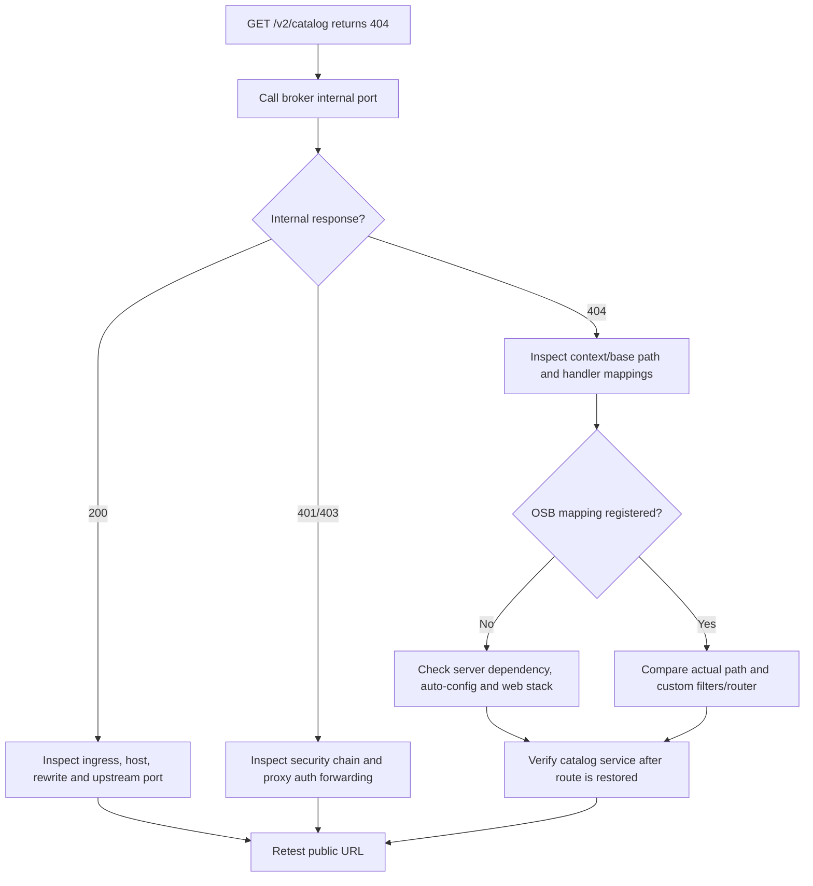

# Broker khởi động nhưng endpoint /v2/catalog trả 404

Một Spring Cloud Service Broker có thể khởi động thành công, health check trả `UP`, nhưng Cloud Foundry hoặc OSB client vẫn nhận `404 Not Found` khi gọi `GET /v2/catalog`. Tình huống này thường khiến người vận hành nghi ngờ catalog service hoặc dữ liệu service/plan. Tuy nhiên, HTTP 404 trước hết cho biết request không tới được handler mà client mong đợi. Nguyên nhân có thể nằm ở ingress/reverse proxy, route hoặc context path, web stack, auto-configuration của Spring Cloud Open Service Broker, hay một security/router rule tùy chỉnh.

Với `SPRING_CLOUD_SERVICE_BROKER`, cần xác định chính xác request đang tới thành phần nào và path thực tế mà ứng dụng nhận được. Health endpoint hoạt động chỉ chứng minh một phần ứng dụng đang chạy; nó không chứng minh OSB controller đã được đăng ký. Tương tự, catalog rỗng thường là vấn đề nội dung response hoặc cấu hình catalog, không nên tự động giải thích thành 404. Bài này trình bày quy trình chẩn đoán từ ngoài vào trong, các kiểm tra cụ thể và cách khôi phục an toàn.

## 1. Hiểu đúng endpoint và ý nghĩa của 404

OSB API định nghĩa catalog endpoint:

```http
GET /v2/catalog HTTP/1.1
Host: broker.example.internal
X-Broker-API-Version: 2.14
Accept: application/json
Authorization: Basic <broker-credentials>
```

Broker thường trả `200 OK` cùng JSON catalog nếu request được định tuyến và xử lý thành công. Catalog có thể có danh sách service rỗng tùy nội dung broker công bố; điều đó khác với endpoint không tồn tại.

Phân biệt các kết quả:

| Kết quả | Điều cần kiểm tra |
|---|---|
| `200 OK` với `services: []` | Endpoint hoạt động; kiểm tra catalog implementation và dữ liệu service/plan. |
| `401 Unauthorized` | Request đã tới lớp xác thực; kiểm tra broker credentials/auth scheme. |
| `403 Forbidden` | Caller đã được nhận diện nhưng không được phép theo policy. |
| `404 Not Found` | Host/path/route không ánh xạ tới handler mong đợi, hoặc lớp proxy/security chủ động che giấu endpoint. |
| `405 Method Not Allowed` | Path có thể tồn tại nhưng method không được hỗ trợ hoặc proxy rewrite sai. |
| `500 Internal Server Error` | Handler đã được gọi nhưng xử lý bên trong thất bại; xem log và exception. |
| `502/503/504` | Gateway không kết nối được backend, backend không healthy hoặc timeout. |

Mã lỗi thực tế còn phụ thuộc ingress, gateway và security configuration. Đừng kết luận rằng catalog bean bị thiếu chỉ từ status 404; trước hết hãy tìm thành phần đã tạo response đó.

## 2. Khoanh vùng: 404 do ingress hay do Spring Boot?

Đây là bước quan trọng nhất. Gọi cùng một endpoint qua hai đường:

1. URL công khai mà Cloud Foundry/OSB client đang sử dụng.
2. Port nội bộ của broker, bỏ qua ingress/load balancer nếu có thể.

Ví dụ kiểm tra public endpoint:

```bash
curl -i -v \
  -H 'X-Broker-API-Version: 2.14' \
  -H 'Accept: application/json' \
  -u "$BROKER_USERNAME:$BROKER_PASSWORD" \
  https://broker.example.internal/v2/catalog
```

Ví dụ kiểm tra trực tiếp trong container hoặc trên host:

```bash
curl -i -v \
  -H 'X-Broker-API-Version: 2.14' \
  -H 'Accept: application/json' \
  http://127.0.0.1:8080/v2/catalog
```

Không đặt password thật trực tiếp trong command line nếu môi trường có thể lưu shell history hoặc process arguments; dùng secret injection, prompt hoặc cơ chế an toàn của hệ thống vận hành. Ví dụ trên chỉ minh họa các header và URL cần kiểm tra.

Diễn giải kết quả:

- **Public 404, internal 200:** tập trung vào ingress, router, reverse proxy, host/path rewrite và service target port.
- **Public 404, internal 404:** tập trung vào context path, controller mapping, dependency/auto-configuration và web stack.
- **Public 502/503, internal 200:** kiểm tra backend Service/target port, readiness và routing của gateway.
- **Internal 401/403 nhưng public 404:** proxy hoặc security layer có thể đang thay đổi response; kiểm tra auth forwarding và custom error handling.
- **Cả hai 200 nhưng platform báo lỗi:** so sánh URL, credentials, API version header và response thực tế mà platform nhận được.

Nếu không thể gọi trực tiếp localhost, dùng port-forward hoặc lệnh exec trong môi trường triển khai. Ví dụ với Kubernetes:

```bash
kubectl port-forward deployment/service-broker 18080:8080 -n broker-system
curl -i http://127.0.0.1:18080/v2/catalog
```

Tên deployment, namespace và port cần thay bằng giá trị của môi trường thực tế. Không mở port-forward hoặc actuator ra mạng public chỉ để chẩn đoán.

## 3. Nhận diện response đến từ thành phần nào

Response 404 từ NGINX, ingress controller, API gateway và Spring Boot có thể khác nhau về header, body và log. Thu thập:

- Status code và response body.
- `Server`, `Via`, request ID hoặc header đặc trưng của gateway nếu có.
- Access log của ingress và application log cùng timestamp.
- Host header, path gốc, path sau rewrite và backend target.
- Trace/correlation ID nếu gateway và broker truyền tiếp.

Ví dụ, một trang HTML mặc định của ingress có thể cho thấy request chưa tới Spring Boot. Một JSON error body hoặc trang lỗi do ứng dụng tạo có thể cho thấy request đã tới application, nhưng không đủ để khẳng định OSB handler đã được gọi. Header `Server` có thể bị proxy xóa hoặc ghi đè nên chỉ là manh mối, không phải bằng chứng duy nhất.

Đối chiếu log theo cùng một request:

```text
Ingress access log:
  method=GET path=/v2/catalog status=404 upstream=broker-service

Broker access log:
  requestId=... method=GET path=/v2/catalog status=404
```

Nếu ingress ghi 404 nhưng không có request tương ứng ở broker, kiểm tra route và upstream. Nếu broker ghi nhận request và trả 404, kiểm tra path mapping trong ứng dụng hoặc security handler. Nếu broker không ghi access log, xác minh logging có bao phủ request hay không trước khi kết luận request chưa tới app.

## 4. Kiểm tra host, route và backend port

Một broker có thể chạy bình thường nhưng platform gọi nhầm hostname, route cũ hoặc port. Kiểm tra cấu hình registration của platform và deployment:

- Hostname đăng ký có đúng broker đang chạy không?
- DNS có trỏ tới ingress/load balancer hiện tại không?
- Route có trỏ tới đúng service/deployment không?
- Backend service có target port đúng với `server.port` không?
- Có route rule khác bắt `/v2/**` trước route broker không?
- TLS termination có chuyển tiếp đúng Host và path không?
- Broker có chạy dưới subpath như `/broker` trong khi platform gọi `/v2/catalog` ở root không?

Với Kubernetes, kiểm tra Service selector và target port. Pod `Running` không đồng nghĩa Service chọn đúng Pod hoặc port:

```bash
kubectl get pods -n broker-system -o wide
kubectl get service -n broker-system
kubectl get endpointslice -n broker-system
kubectl describe ingress -n broker-system
```

Với Cloud Foundry, kiểm tra route của application và URL được dùng trong broker registration bằng CLI/API tương ứng với phiên bản foundation. Đảm bảo platform đang gọi route hiện tại sau khi app được restage hoặc đổi domain. Không sửa registration bằng cách đoán URL; đối chiếu với route mà app thực sự đang nhận traffic.

## 5. Kiểm tra context path và servlet path

Đây là nguyên nhân phổ biến khi app có health endpoint nhưng OSB endpoint nằm ở một prefix khác.

Ví dụ cấu hình:

```yaml
server:
  servlet:
    context-path: /broker
```

Trong Spring MVC, context path này làm URL thực tế trở thành:

```text
/broker/v2/catalog
```

Nếu platform gọi `/v2/catalog`, app có thể trả 404 dù controller tồn tại.

Một cấu hình khác có thể thay đổi servlet mapping:

```yaml
spring:
  mvc:
    servlet:
      path: /api
```

Tùy cấu hình và stack, endpoint có thể được phục vụ dưới prefix `/api`. Đối với WebFlux, kiểm tra `spring.webflux.base-path` nếu ứng dụng đặt base path riêng. Không áp dụng property của MVC cho WebFlux hoặc ngược lại.

Các bước kiểm tra:

1. Đọc cấu hình runtime thực tế, bao gồm profile đang active và environment variables override.
2. Kiểm tra `server.servlet.context-path`, `spring.mvc.servlet.path` hoặc `spring.webflux.base-path` tùy web stack.
3. Kiểm tra prefix rewrite của ingress/reverse proxy.
4. Gọi thử URL có và không có prefix trên internal port.
5. Chọn một nơi duy nhất chịu trách nhiệm thêm/bỏ prefix; tránh rewrite hai lần.

Không đổi context path trong production trước khi xác minh các endpoint khác và broker registration có phụ thuộc prefix đó không.

## 6. Kiểm tra Spring Cloud Open Service Broker dependency

Spring Cloud Open Service Broker cung cấp server-side adapter để ánh xạ OSB API vào service implementation của ứng dụng. Nếu dependency server không có trong runtime classpath, bị exclude hoặc không tương thích với Spring Boot/web stack, các endpoint OSB có thể không được đăng ký.

Kiểm tra:

- Dependency Spring Cloud Open Service Broker server có trong artifact runtime được deploy không?
- Dependency có bị đánh dấu `test`/`provided` hoặc bị loại bởi packaging/shading không?
- Spring Boot và Spring Cloud Open Service Broker versions có tương thích theo release train đang dùng không?
- Auto-configuration của thư viện có bị exclude bằng annotation/property hoặc cấu hình custom không?
- Ứng dụng có khởi tạo đúng web application type (Servlet hay Reactive) không?
- Có dependency conflict khiến class hoặc auto-configuration không được load không?

Đừng chỉ nhìn build file ở source; hãy xác minh artifact thực tế và startup log của đúng phiên bản đang chạy. Một số lỗi dependency incompatibility sẽ làm app fail startup; một số cấu hình có thể khiến endpoint adapter không được đăng ký. Cần đọc log để phân biệt.

Nếu ứng dụng dùng custom `@SpringBootApplication(exclude = ...)`, kiểm tra danh sách auto-configuration bị loại. Nếu có `@EnableWebMvc` hoặc `@EnableWebFlux` tùy chỉnh, kiểm tra xem cấu hình đó có làm thay đổi auto-configuration mà thư viện OSB dựa vào không. Chỉ bỏ cấu hình custom sau khi xác nhận nó là nguyên nhân và đánh giá ảnh hưởng tới các endpoint khác.

## 7. Kiểm tra MVC và WebFlux có khớp nhau không

Spring MVC và WebFlux dùng web stack và security/filter infrastructure khác nhau. Một ứng dụng có thể khởi động nhưng endpoint không được ánh xạ như mong đợi nếu dependency và application type bị trộn lẫn.

| Dấu hiệu | Điều cần kiểm tra |
|---|---|
| App chạy Servlet container | Spring MVC dependencies, `DispatcherServlet` và MVC security configuration. |
| App chạy Reactor Netty | WebFlux dependencies, reactive OSB adapter và `SecurityWebFilterChain`. |
| Có cả `spring-boot-starter-web` và `spring-boot-starter-webflux` | Xác định application type thực tế; Boot có thể chọn MVC khi cả hai cùng có mặt theo quy tắc auto-configuration. |
| Security chain không khớp stack | Kiểm tra chain được đăng ký và matcher có bao phủ `/v2/catalog` không. |
| Custom servlet/filter/router | Kiểm tra thứ tự và path matcher không chặn hoặc rewrite OSB endpoint. |

Không thêm `@RestController` thủ công cho `/v2/catalog` chỉ để làm mất 404. Khi dùng Spring Cloud Open Service Broker, thư viện server adapter chịu trách nhiệm công bố endpoint; ứng dụng cung cấp catalog/service implementation theo abstraction của thư viện. Tự tạo controller trùng path có thể che lỗi cấu hình và tạo response không đúng OSB contract.

## 8. Xác minh OSB controller mapping

Nếu đã xác nhận request tới đúng Spring Boot process, kiểm tra mapping của endpoint. Với Spring Boot Actuator, endpoint `mappings` có thể cho biết handler mapping hiện tại:

```yaml
management:
  endpoints:
    web:
      exposure:
        include: health,info,mappings
```

Sau khi cấu hình exposure tạm thời trong môi trường chẩn đoán được bảo vệ, kiểm tra:

```bash
curl -i http://127.0.0.1:8080/actuator/mappings
```

Tìm mapping tương ứng với `/v2/catalog` và xác nhận nó được đăng ký. Endpoint `mappings` có thể tiết lộ cấu trúc ứng dụng; không expose công khai. Chỉ bật tạm thời, giới hạn network/authorization, thu thập bằng chứng cần thiết rồi tắt lại.

Nếu mapping không có:

- Kiểm tra server dependency và auto-configuration.
- Kiểm tra application type và conditional configuration.
- Kiểm tra context path/servlet path/base path.
- Kiểm tra custom MVC/WebFlux configuration hoặc component scan.
- Kiểm tra log startup xem OSB adapter có được khởi tạo không.

Nếu mapping có nhưng request vẫn 404, so sánh path mà framework ghi nhận với path mapping, servlet path, context path và forwarded prefix. Kiểm tra custom filter/security handler có trả 404 thay cho handler hay không.

## 9. Kiểm tra catalog service và service/plan definitions

Catalog implementation chịu trách nhiệm cung cấp các service và plan mà broker công bố. Nhưng cần tách hai tình huống:

- **Route `/v2/catalog` trả 404:** request chưa tới catalog handler hoặc handler không được đăng ký/định tuyến đúng.
- **Route trả 200 nhưng catalog rỗng hoặc thiếu service:** endpoint đã hoạt động; kiểm tra catalog implementation, profile, feature flag, dữ liệu service/plan và điều kiện công bố.

Spring Cloud Open Service Broker có abstraction catalog service; tên interface/model và kiểu blocking/reactive tùy phiên bản thư viện. Xác minh implementation của ứng dụng được Spring tạo thành bean đúng kiểu mà server adapter yêu cầu. Nếu implementation nằm ngoài component scan hoặc profile không active, startup log/condition report có thể cho thấy bean bị thiếu. Thông thường lỗi catalog implementation sẽ thể hiện qua startup/bean error hoặc lỗi server khi gọi handler; không nên mặc định nó luôn tạo 404.

Kiểm tra các nội dung:

- Service ID và plan ID ổn định, không null.
- Service có plan phù hợp và metadata hợp lệ.
- Catalog bean được đăng ký trong application context.
- Profile/environment đúng với deployment đang kiểm tra.
- Không có exception khi build catalog hoặc truy vấn cấu hình.
- Catalog response được serialize đúng JSON và có `services` theo OSB API.

Ví dụ cấu trúc JSON thành công:

```json
{
  "services": [
    {
      "id": "postgres-service-id",
      "name": "managed-postgresql",
      "description": "PostgreSQL database service",
      "bindable": true,
      "plans": [
        {
          "id": "postgres-small-plan",
          "name": "small",
          "description": "Small PostgreSQL plan"
        }
      ]
    }
  ]
}
```

Đây là ví dụ rút gọn để minh họa response thành công, không phải catalog đầy đủ cho mọi capability. Khi endpoint trả 200 nhưng dữ liệu sai, xử lý như lỗi catalog/configuration chứ không phải route 404.

## 10. Kiểm tra security filter và authorization matcher

Security thường trả `401` hoặc `403` khi authentication/authorization thất bại. Tuy nhiên, ứng dụng có thể cấu hình custom entry point, access denied handler hoặc gateway policy để cố ý trả 404 nhằm che giấu endpoint. Vì vậy cần kiểm tra security sau khi đã xác minh route.

Kiểm tra:

- Security chain có matcher cho `/v2/**` không?
- Chain nào có `@Order` ưu tiên cao nhất cho path này?
- Có fallback chain `denyAll()` hoặc custom handler trả 404 không?
- Reverse proxy có loại bỏ hoặc không forward `Authorization` header không?
- Có rule chỉ cho phép một host/path/method nhất định không?
- CSRF filter có áp dụng nhầm lên machine-to-machine API không? Thông thường CSRF sai cấu hình gây 403, không phải 404, nhưng cần đọc response thực tế.

Không tắt toàn bộ Spring Security để kiểm tra trong production. Dùng test profile hoặc môi trường staging, rồi xác minh security chain và credentials. Nếu endpoint được cố ý ẩn với unauthenticated caller, hãy kiểm tra bằng credential hợp lệ từ đường truy cập được phép.

## 11. API version header không phải path prefix

OSB client thường gửi `X-Broker-API-Version` để khai báo phiên bản API. Header này không thay thế path `/v2/catalog` và không biến endpoint thành `/v2.14/catalog`.

Ví dụ:

```http
GET /v2/catalog HTTP/1.1
X-Broker-API-Version: 2.14
```

Nếu version header không được hỗ trợ, broker có thể trả lỗi version/validation theo contract và implementation. Điều đó thường khác với route 404. Hãy kiểm tra header trong request thực tế và không thêm version vào URL trừ khi reverse proxy/adapter riêng của tổ chức định nghĩa rõ như vậy.

## 12. Kiểm tra log startup và condition report

Khởi động thành công không có nghĩa mọi auto-configuration đã được áp dụng. Tìm log liên quan:

- Spring Cloud Open Service Broker server auto-configuration.
- Web application type và server port/context path.
- Controller/handler mappings.
- Bean creation cho catalog service và service implementations.
- Security filter chain và matcher (không bật log quá chi tiết ở production nếu có nguy cơ lộ dữ liệu).
- Conditional configuration được match hoặc không match.
- Dependency/version conflict hoặc class loading warning.

Trong môi trường local/staging, có thể bật debug condition report để xem lý do auto-configuration được kích hoạt hoặc bị bỏ qua. Không bật trace/debug security hoặc HTTP wire logging dài hạn trong production nếu có thể ghi lại credential hoặc request chứa secret.

Nếu ứng dụng không có mapping `/v2/catalog`, hãy xác định điều kiện nào khiến adapter không được đăng ký. Không thêm controller thủ công hoặc trả một JSON giả để che vấn đề; cần khôi phục server adapter đúng phiên bản và cấu hình.

## 13. Kiểm tra ingress path rewrite

Ingress có thể nhận `/v2/catalog` nhưng chuyển tiếp thành path khác, ví dụ `/catalog`, `/broker/v2/catalog` hoặc `/v2/v2/catalog`. Cấu hình rewrite sai có thể tạo 404 dù ứng dụng hoạt động.

Kiểm tra ba giá trị:

1. **Client path:** URL platform gửi.
2. **Upstream path:** path ingress gửi tới backend sau rewrite.
3. **Application mapping:** path mà Spring handler đăng ký.

Ba giá trị cần khớp theo đúng quy tắc prefix. Ví dụ nếu app không có context path và mapping là `/v2/catalog`, upstream path phải là `/v2/catalog`. Nếu app có context path `/broker`, upstream path phải bao gồm prefix đó hoặc proxy phải cấu hình tương ứng.

Không cấu hình rewrite regex rộng như xóa mọi prefix `/v2` nếu nó làm mất version path mà OSB adapter cần. Kiểm tra cả trailing slash và path normalization; proxy có thể phân biệt hoặc chuẩn hóa `/v2/catalog/` và `/v2/catalog` khác nhau.

## 14. Ma trận nguyên nhân và hướng xử lý

| Dấu hiệu | Nguyên nhân có thể | Hành động xác minh |
|---|---|---|
| Public 404, internal 200 | Ingress route/rewrite/host sai | Đọc ingress access log và upstream path. |
| Public và internal đều 404 | Mapping không có hoặc context path sai | Kiểm tra `/actuator/mappings`, runtime properties và startup log. |
| `/actuator/health` 200, `/v2/catalog` 404 | Health controller hoạt động nhưng OSB adapter không đăng ký hoặc path khác | Xác minh dependency, auto-configuration, web stack và catalog handler mapping. |
| `/broker/v2/catalog` 200, `/v2/catalog` 404 | App có context/base path `/broker` | Điều chỉnh registration hoặc proxy prefix theo kiến trúc. |
| App log không có request nhưng ingress ghi 404 | Request không tới backend | Kiểm tra host, route, service selector, target port và rewrite. |
| Mapping tồn tại nhưng request 404 | Path thực tế khác mapping hoặc custom filter/handler | Ghi path sau proxy và path trong app; kiểm tra security/router. |
| `/v2/catalog` 200 nhưng services rỗng | Catalog configuration/bean trả danh sách rỗng | Kiểm tra service/plan definitions, profile và feature flags. |
| 401/403 thay đổi thành 404 sau proxy | Auth forwarding hoặc concealment policy | Kiểm tra security entry point và gateway error mapping. |
| Sau deployment mới mới xuất hiện 404 | Artifact/version/config/route thay đổi | So sánh dependency, image, active profile, context path và ingress revision. |

## 15. Quy trình chẩn đoán từng bước

Thực hiện theo thứ tự để tránh thay đổi nhiều lớp cùng lúc:

1. **Ghi nhận request:** URL đầy đủ, method, Host, API version header, thời điểm, status và response body đã làm sạch.
2. **Xác nhận đúng broker:** đối chiếu DNS/route/registration với deployment đang chạy.
3. **Gọi public URL:** dùng `curl -i -v` và credential hợp lệ; lưu request ID.
4. **Gọi internal port:** bỏ qua ingress để phân biệt lỗi gateway và lỗi ứng dụng.
5. **Đối chiếu log:** ingress access log, broker access log và startup log cùng timestamp.
6. **Kiểm tra path prefix:** context path, servlet path/base path, ingress rewrite và trailing slash.
7. **Kiểm tra handler mapping:** dùng Actuator mappings trong môi trường được bảo vệ hoặc log mapping startup.
8. **Kiểm tra auto-configuration:** dependency runtime, version compatibility, web stack và custom configuration.
9. **Kiểm tra catalog bean:** chỉ sau khi route tồn tại, xác minh service/plan và response body.
10. **Kiểm tra security:** xác thực matcher, entry point, authorization và forwarded Authorization header.
11. **Sửa một nguyên nhân đã xác định:** thay đổi route/config/dependency tối thiểu, không đồng thời tắt security và đổi path.
12. **Regression test:** kiểm tra endpoint nội bộ, public route, catalog JSON và các endpoint OSB lifecycle cần thiết.

Sơ đồ quyết định:



## 16. Kiểm thử hồi quy cho `/v2/catalog`

Sau khi sửa, không chỉ kiểm tra endpoint trả 200 trên localhost. Cần có kiểm thử ở các tầng:

### Web/contract test

- Gọi đúng `GET /v2/catalog`.
- Gửi header `X-Broker-API-Version` phù hợp.
- Kiểm tra authentication theo contract đã cấu hình.
- Kiểm tra status `200` và JSON có field `services`.
- Kiểm tra service/plan ID và capability cần công bố.
- Kiểm tra request sai auth nhận response phù hợp, không bị custom handler đổi thành response khó hiểu.

### Deployment smoke test

- Gọi endpoint qua URL nội bộ của app.
- Gọi endpoint qua ingress/router public mà platform sử dụng.
- Xác nhận host/path rewrite giống nhau giữa staging và production.
- Xác nhận readiness chỉ báo sẵn sàng khi ứng dụng có thể phục vụ OSB API theo policy.
- Xác nhận Actuator mapping/health không bị expose ngoài phạm vi cho phép.

Ví dụ smoke test:

```bash
curl --fail-with-body -sS \
  -H 'X-Broker-API-Version: 2.14' \
  -H 'Accept: application/json' \
  -u "$BROKER_USERNAME:$BROKER_PASSWORD" \
  https://broker.example.internal/v2/catalog
```

Nếu CI không có credential thật, dùng secret test và broker test environment. Không đưa credential production vào pipeline log hoặc command arguments.

## 17. Các cách sửa sai cần tránh

- **Không tạo controller giả cho `/v2/catalog`:** có thể làm endpoint trả 200 nhưng response không tuân thủ OSB API và che mất lỗi auto-configuration.
- **Không trả catalog tĩnh từ ingress:** catalog cần phản ánh broker service/plan và capability thật.
- **Không đổi URL registration trước khi xác định path app:** có thể chỉ chuyển lỗi sang endpoint khác hoặc làm sai các thao tác provision/bind.
- **Không tắt toàn bộ security:** 404 có thể do routing; tắt auth không sửa mapping và làm lộ broker.
- **Không expose `/actuator/mappings` công khai:** endpoint này có thể tiết lộ cấu trúc ứng dụng.
- **Không thêm prefix `/v2` hai lần:** OSB version path đã nằm trong endpoint chuẩn.
- **Không coi health `UP` là bằng chứng OSB API sẵn sàng:** health và handler mapping là hai kiểm tra khác nhau.
- **Không restart liên tục khi chưa thu thập log:** restart có thể xóa bằng chứng tạm thời và không sửa cấu hình route.

## 18. Checklist hoàn tất xử lý sự cố

- Xác định được response 404 do ingress/proxy hay Spring Boot.
- Xác nhận platform gọi đúng hostname, route, port và path.
- Context path, servlet path/base path và rewrite khớp với `/v2/catalog`.
- Spring Cloud Open Service Broker server dependency có trong runtime artifact.
- Auto-configuration và handler mapping OSB được đăng ký.
- MVC/WebFlux stack và security chain đúng với runtime.
- Catalog service được tạo và trả service/plan hợp lệ.
- API version header được gửi đúng nhưng không bị ghép vào URL.
- Security/authorization không che giấu route ngoài chủ đích.
- Public endpoint và internal endpoint đều được kiểm tra sau thay đổi.
- Không expose actuator diagnostic endpoint hoặc secret trong log.
- Có regression/smoke test để phát hiện lỗi tương tự sau deployment.

Khi broker khởi động nhưng `/v2/catalog` trả 404, hãy bắt đầu bằng việc gọi endpoint qua internal port để tách lỗi ingress khỏi lỗi ứng dụng. Sau đó kiểm tra path prefix, handler mapping, dependency/auto-configuration và web stack; chỉ kiểm tra catalog data sau khi route đã tồn tại. Quy trình này giúp sửa đúng lớp gây lỗi, giữ nguyên security và bảo đảm endpoint được khôi phục vẫn tuân thủ OSB API.
