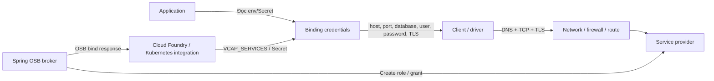

# Binding được tạo nhưng ứng dụng không kết nối được dịch vụ

## Phân biệt bind thành công với kết nối ứng dụng thành công

Trong Open Service Broker API (OSB API), thao tác bind yêu cầu broker tạo thông tin truy cập cho một consumer cụ thể. Broker có thể tạo database role, user, credential, grant hoặc policy rồi trả dữ liệu kết nối trong response `credentials`. Platform nhận response đó và chuyển thông tin đến ứng dụng theo cơ chế riêng của nền tảng.

Một binding được tạo thành công chỉ chứng minh rằng bước bind theo hợp đồng broker đã hoàn tất. Nó không tự chứng minh rằng ứng dụng có thể phân giải hostname, mở kết nối mạng, hoàn tất TLS handshake, xác thực với provider hoặc sử dụng đúng database/schema. Lỗi có thể nằm ở bất kỳ mắt xích nào giữa provider, broker, platform và runtime của ứng dụng.

Với `SPRING_CLOUD_SERVICE_BROKER`, broker được xây dựng bằng Spring Cloud Open Service Broker. Khi nhận bind request, ứng dụng broker cần tạo binding gắn với `instance_id` và `binding_id`, lưu mapping cần thiết, rồi trả credentials theo contract của service. Khi ứng dụng không kết nối được, cần kiểm tra toàn bộ đường đi của dữ liệu và kết nối thay vì kết luận rằng bind response thành công đồng nghĩa dịch vụ đã sẵn sàng cho consumer.

Luồng dữ liệu khái quát:



## Thu thập thông tin trước khi thay đổi binding

Trước khi restart, rotate hoặc unbind, hãy ghi lại thông tin định danh để có thể liên kết log ở các lớp:

| Thông tin | Nguồn | Mục đích |
|---|---|---|
| `service_instance_id` | Platform và broker | Xác định tài nguyên dịch vụ được bind. |
| `binding_id` | Platform và broker | Xác định consumer binding cụ thể. |
| Application ID/GUID | Platform | Xác định ứng dụng nhận credentials. |
| Service/plan ID | Catalog và broker | Xác nhận đúng loại dịch vụ và plan. |
| Operation/request ID | Broker log và provider request | Ghép sự kiện bind với provider. |
| Thời điểm tạo/cập nhật binding | Platform, broker, Secret store | Phát hiện credentials cũ hoặc rotation chưa đồng bộ. |
| Provider resource/role reference | Broker/provider | Kiểm tra user, role, grant và trạng thái tài nguyên. |

Ghi lại lỗi nguyên văn đã được loại bỏ secret, thời điểm xảy ra, runtime/namespace/space, phiên bản ứng dụng và việc lỗi có xuất hiện với mọi replica hay chỉ một replica. Không dán password, token, private key, toàn bộ `VCAP_SERVICES` hoặc nội dung Secret vào ticket/log/chat.

Không vội xóa binding đang lỗi. Binding record có thể là đầu mối duy nhất để xác định provider role và credential đã tạo. Xóa binding sớm có thể làm mất mapping cần thiết cho unbind hoặc rotation.

## Bước 1: Xác nhận trạng thái binding ở platform

Đầu tiên xác nhận platform đã ghi nhận đúng binding và liên kết nó với đúng service instance, ứng dụng và namespace/space.

### Với Cloud Foundry

Kiểm tra service instance và ứng dụng đã bind:

```bash
cf services
cf service orders-db
cf apps
```

Nếu cần xem các service được gắn vào ứng dụng, kiểm tra thông tin app trong đúng org/space. `cf service` cho biết trạng thái instance và operation liên quan; việc app có binding không nhất thiết chứng minh app process đã nhận environment mới.

### Với Kubernetes

Nếu cluster dùng một integration tạo Kubernetes Secret từ OSB binding, kiểm tra resource binding và Secret trong đúng namespace. Với Kubernetes Service Catalog lịch sử, có thể dùng:

```bash
kubectl -n payments get servicebindings
kubectl -n payments describe servicebinding orders-api-database
kubectl -n payments get secret orders-database-credentials
```

Các resource Service Catalog chỉ tồn tại nếu CRD/controller tương ứng đã được cài. Với integration khác, dùng resource/condition và tên Secret do integration đó quy định. Kiểm tra Secret tồn tại trong cùng namespace mà workload tham chiếu; Secret ở namespace khác không thể được Pod sử dụng trực tiếp bằng `secretKeyRef`.

**Kết quả cần xác nhận:** binding có trạng thái hoàn tất, tham chiếu đúng instance, đúng consumer và Secret/environment mapping đã được tạo. Nếu binding chưa hoàn tất hoặc controller còn retry, xử lý operation/binding status trước khi điều tra JDBC hoặc network.

## Bước 2: Kiểm tra credentials đã được chuyển đến ứng dụng

Đây là nguyên nhân phổ biến: broker đã trả credentials nhưng runtime chưa nhận, đang dùng binding cũ hoặc ánh xạ sai tên key.

### Kiểm tra hợp đồng credentials của broker

Broker quyết định schema của object `credentials`. Ví dụ broker có thể trả:

```json
{
  "credentials": {
    "host": "postgres.internal.example",
    "port": 5432,
    "database": "orders",
    "username": "orders_api",
    "password": "<redacted>",
    "sslmode": "verify-full"
  }
}
```

Các key ở ví dụ là hợp đồng riêng của service, không phải tên field bắt buộc chung của OSB API. Ứng dụng và broker phải thống nhất chính xác tên key, kiểu dữ liệu và ý nghĩa. Ví dụ ứng dụng đọc `DB_HOST` trong khi binding chỉ cung cấp `host` thì app sẽ không tự suy ra mapping.

Kiểm tra các trường không nhạy cảm trước:

- Hostname và port có đúng endpoint của instance không?
- Database/schema/service name có khớp với cấu hình ứng dụng không?
- Username có thuộc binding đang điều tra không?
- SSL mode có khớp với chính sách provider không?
- Credentials có được gắn vào đúng application/namespace không?

Chỉ kiểm tra password/token thông qua secret manager hoặc quy trình bảo mật được phê duyệt. So sánh version/reference hoặc fingerprint có kiểm soát thay vì in secret ra terminal.

### Cloud Foundry: kiểm tra `VCAP_SERVICES`

Cloud Foundry cung cấp thông tin service binding cho ứng dụng qua biến môi trường `VCAP_SERVICES`. Dùng:

```bash
cf env orders-api
```

Lệnh này có thể hiển thị credentials. Chỉ xem trong terminal được bảo vệ, không copy toàn bộ output vào issue, log hoặc chat. Xác nhận:

- Service label và plan tương ứng với instance mong muốn.
- Binding xuất hiện trong đúng nhóm service.
- Các key ứng dụng cần đọc có mặt và đúng kiểu.
- Host/port/database không trỏ đến môi trường khác.
- App process đã được restart/restage sau khi binding hoặc environment thay đổi theo cách platform yêu cầu.

Nếu app được bind sau lần staging trước, runtime có thể chưa nạp environment mới. Thực hiện restart/restage theo workflow của Cloud Foundry và loại ứng dụng, sau đó xác minh process mới đọc được binding. Không restage liên tục trước khi xác định app đang dùng biến môi trường nào.

### Kubernetes: kiểm tra Secret và Pod reference

Kiểm tra tên Secret và key mà Pod tham chiếu:

```bash
kubectl -n payments describe secret orders-database-credentials
kubectl -n payments get deployment orders-api -o yaml
kubectl -n payments get pods -l app=orders-api
```

`describe secret` cho biết các key và kích thước dữ liệu mà không cần in giá trị secret. Kiểm tra `secretKeyRef`/`envFrom.secretRef`, namespace và tên key trong Deployment. Nếu dùng volume mount, kiểm tra `mountPath` và file name được ứng dụng đọc.

Lưu ý về cập nhật Secret:

- Secret được đưa vào container dưới dạng environment variable không tự cập nhật trong process đang chạy. Cần tạo Pod/process mới để nạp giá trị mới.
- Secret mount dưới dạng volume có cơ chế cập nhật file eventual, nhưng ứng dụng phải đọc lại file; một số kiểu mount như `subPath` không nhận cập nhật theo cách thông thường.
- Nếu ứng dụng cache credentials hoặc khởi tạo connection pool một lần, cần reload cấu hình hoặc rollout workload phù hợp.

Không dùng `kubectl get secret -o yaml` để gửi dữ liệu lên hệ thống ticket; trường `data` chỉ được base64-encode, không phải mã hóa bí mật.

## Bước 3: Xác minh endpoint từ chính môi trường chạy ứng dụng

Kiểm tra từ laptop hoặc máy broker không đủ để kết luận network của app. Pod/CF app có thể chạy trong subnet, security group, namespace hoặc egress policy khác.

Thực hiện phép thử từ đúng runtime hoặc một debug container được phép chạy cùng network context:

1. DNS phân giải hostname.
2. TCP kết nối được đến port.
3. TLS handshake và certificate validation thành công nếu dùng TLS.
4. Protocol/client thực hiện được bước xác thực và mở session.

### Kiểm tra DNS

```bash
getent hosts postgres.internal.example
```

Nếu không có `getent`, dùng `nslookup` hoặc `dig` nếu image có cài. Kiểm tra hostname trong credentials, search domain, private DNS zone và DNS policy của namespace/space. Địa chỉ IP thay đổi không nhất thiết là lỗi nếu provider dùng load balancer; không hard-code IP thay cho hostname TLS nếu certificate được phát hành cho DNS name.

### Kiểm tra TCP

```bash
nc -vz postgres.internal.example 5432
```

Nếu image không có `nc`, dùng công cụ network được tổ chức phê duyệt hoặc một client test tương ứng. Kết quả:

- `succeeded/open`: TCP handshake thành công, chưa chứng minh database authentication thành công.
- `connection refused`: host đã trả lời nhưng không có listener/port đúng hoặc firewall chủ động reject.
- `timed out`: có thể bị drop bởi firewall, route, network policy, security group hoặc provider endpoint không phản hồi.
- `no route to host`: route/network path không khả dụng từ runtime.

### Kiểm tra TLS

```bash
openssl s_client \
  -connect postgres.internal.example:5432 \
  -servername postgres.internal.example \
  -verify_return_error
```

Lệnh trên minh họa kiểm tra TLS; với PostgreSQL, TLS negotiation có thể cần client mode phù hợp hoặc dùng `psql` với `sslmode=verify-full`. Kiểm tra CA chain, certificate expiry, SAN hostname, SNI và trust store trong image. Không tắt certificate verification như một cách sửa lỗi lâu dài.

Nếu TLS handshake lỗi, so sánh CA bundle và SSL mode mà broker trả với yêu cầu provider. `require` chỉ mã hóa đường truyền; `verify-ca`/`verify-full` có kiểm tra certificate theo mức độ tương ứng. Chọn mode theo chính sách bảo mật và endpoint thực tế.

## Bước 4: Kiểm tra network policy và quyền truy cập provider

Khi DNS đúng nhưng TCP timeout/refused, kiểm tra đường đi mạng:

- Kubernetes NetworkPolicy có cho phép egress từ Pod đến namespace/IP/port provider không?
- Cloud Foundry app security group hoặc egress policy có chặn đích không?
- Firewall/security group của provider có allow source CIDR/NAT gateway của workload không?
- Private endpoint, VPC peering, VPN hoặc route table đã cấu hình đúng chưa?
- Provider có allowlist source IP không và egress IP có thay đổi sau scale không?
- Proxy/service mesh có intercept traffic hoặc yêu cầu cấu hình TLS riêng không?

Với Kubernetes, NetworkPolicy chỉ có hiệu lực nếu CNI hỗ trợ và policy được áp dụng. Kiểm tra policy ở namespace:

```bash
kubectl -n payments get networkpolicy
kubectl -n payments describe networkpolicy allow-database-egress
```

Đừng mở egress toàn bộ cluster chỉ để thử. Tạo rule hẹp theo namespace/pod selector, destination và port cần thiết; sau kiểm thử, giữ đúng policy tối thiểu.

Với Cloud Foundry, xác minh app security group và routing/egress policy theo cách triển khai foundation. Kiểm tra source IP thực tế mà provider nhìn thấy, nhất là khi traffic đi qua NAT hoặc proxy.

## Bước 5: Xác minh user, role và quyền ở provider

TCP/TLS thành công nhưng database trả `authentication failed`, `permission denied` hoặc `database does not exist` thường cho thấy lỗi nằm ở credentials hoặc provider state.

Kiểm tra theo thứ tự:

1. Provider resource/instance vẫn tồn tại và đang sẵn sàng.
2. Binding user/role tồn tại, chưa bị disable hoặc expire.
3. User được cấp quyền kết nối đến đúng database/schema.
4. Password/token trong platform khớp với credential version hiện tại ở provider.
5. Role có quyền cần thiết (CONNECT, schema usage, table privileges hoặc quyền tương đương).
6. Provider không giới hạn số connection hoặc session theo user/plan.
7. Credential chưa bị rotation/revocation bởi thao tác khác.

Không cấp quyền admin/root cho ứng dụng để “thử xem có kết nối được không”. Dùng một phép kiểm tra tối thiểu, ví dụ đăng nhập và truy vấn metadata không thay đổi dữ liệu, bằng đúng binding user. Sau đó kiểm tra quyền cụ thể theo chức năng ứng dụng cần.

Nếu broker tạo user thành công nhưng trả sai password hoặc lưu sai mapping `binding_id` sang provider role, lỗi nằm ở bind implementation. Kiểm tra operation log và provider request reference; không ghi secret vào log để so sánh.

## Bước 6: Kiểm tra cấu hình client và connection pool

Khi DNS, TCP, TLS và authentication đều thành công, ứng dụng vẫn có thể lỗi do cấu hình driver:

- JDBC URL dùng sai scheme hoặc sai tên database.
- Port/driver version không tương thích.
- SSL mode bị ghi đè bởi biến môi trường khác.
- Ứng dụng đọc nhầm `VCAP_SERVICES`/Secret key.
- Pool giữ connection cũ sau khi credential rotation.
- Connection timeout, socket timeout hoặc max lifetime không phù hợp.
- App chạy nhiều replica nhưng provider giới hạn tổng số connection thấp.
- Transaction hoặc schema migration khiến connection bị giữ quá lâu.

Ví dụ cấu hình Spring Boot cho PostgreSQL:

```yaml
spring:
  datasource:
    url: jdbc:postgresql://${DB_HOST}:${DB_PORT}/${DB_NAME}?sslmode=verify-full
    username: ${DB_USERNAME}
    password: ${DB_PASSWORD}
    hikari:
      connection-timeout: 3000
      validation-timeout: 1000
      maximum-pool-size: 10
```

Đây là ví dụ minh họa. Đảm bảo CA certificate và hostname verification được cấu hình phù hợp với driver. Không ghi password vào URL hoặc source control; lấy secret từ binding environment/Secret store. `maximum-pool-size` cần được tính trên tổng replica ứng dụng và quota provider, không chỉ trên một Pod.

Khi nghi connection pool giữ credential cũ, thực hiện rollout/restart có kiểm soát để tạo pool mới. Nếu rotation đang diễn ra, bảo đảm credential mới đã được cấp và truyền đến mọi replica trước khi thu hồi credential cũ.

## Bảng triệu chứng và nguyên nhân thường gặp

| Triệu chứng | Nguyên nhân có thể | Cách xác minh |
|---|---|---|
| `UnknownHostException` / DNS lookup failed | Host sai, private DNS chưa được cấu hình hoặc runtime không truy cập DNS zone. | Resolve hostname từ đúng Pod/CF app. |
| Connection timeout | Egress policy, firewall, route, allowlist hoặc provider không phản hồi. | TCP test từ workload, kiểm tra flow log/security group. |
| Connection refused | Port sai, service chưa listen hoặc endpoint không đúng. | Kiểm tra host/port và provider listener. |
| TLS handshake/certificate error | CA thiếu, cert hết hạn, hostname/SAN không khớp hoặc SSL mode sai. | `openssl s_client`, driver TLS diagnostics và CA bundle. |
| Authentication failed | Password cũ, username sai, credential rotation chưa đồng bộ hoặc user bị khóa. | Kiểm tra credential version/reference và provider role status. |
| Database/schema not found | Sai tên database/schema hoặc provider resource chưa provision hoàn tất. | So sánh credentials với provider metadata. |
| Permission denied | User tồn tại nhưng thiếu CONNECT/schema/table privilege. | Kiểm tra grants bằng provider admin/read-only audit. |
| Too many connections / pool exhausted | Pool tổng vượt quota, connection leak hoặc connection không được trả. | Provider session count, Hikari active/idle/pending và max replica. |
| Chỉ một số replica lỗi | Secret/env không đồng nhất, rollout chưa hoàn tất hoặc DNS/cache khác nhau. | So sánh Pod revision, Secret version và runtime config đã che secret. |
| App không thấy binding mới | App chưa restart/restage hoặc Pod vẫn dùng Secret/env cũ. | Kiểm tra process start time, Deployment revision và binding metadata. |

## Kiểm tra phía broker bằng operation và binding ledger

Nếu network và runtime config đúng, quay lại broker để kiểm tra quá trình tạo binding.

Broker nên lưu các metadata sau:

```text
service_binding
---------------
binding_id
instance_id
service_id
plan_id
consumer_reference
provider_binding_id
credential_reference
credential_version
binding_state
created_at
updated_at
```

Không lưu password dạng rõ trong binding ledger. `credential_reference` trỏ đến secret store; `credential_version` giúp phát hiện app đang dùng version cũ.

Kiểm tra:

1. Binding ID trong platform có khớp record broker không?
2. Binding có trỏ đúng instance ID không?
3. Consumer context/app GUID có đúng ứng dụng không?
4. Provider role/credential ID có khớp mapping không?
5. Bind operation đã terminal thành công và kết quả đã persist chưa?
6. Response credentials có đầy đủ key theo contract service không?
7. Platform có nhận đúng response và lưu/truyền credentials không?
8. Credential reference có bị rotation/revoke sau thời điểm bind không?

Spring Cloud Open Service Broker cung cấp request/response model và service interface cho binding theo phiên bản thư viện. Phần mapping provider resource, credential store và binding state là trách nhiệm ứng dụng. Không giả định framework tự kiểm tra khả năng kết nối từ application đến provider.

## Khi nào cần unbind và bind lại?

Rebind có thể hữu ích khi credential bị tạo sai hoặc đã bị thu hồi, nhưng không phải bước đầu tiên cho mọi lỗi kết nối. Trước khi làm, xác định nguyên nhân:

- Nếu lỗi DNS/firewall/route, bind lại sẽ trả cùng endpoint và không giải quyết được network.
- Nếu app chưa nhận Secret/environment mới, rollout app có thể đủ.
- Nếu provider user thiếu grant, sửa grant hoặc tạo lại binding theo chính sách.
- Nếu credential bị lộ hoặc không thể xác minh, rotation/rebind có thể cần thiết.

Quy trình rotation an toàn:

1. Xác nhận provider và broker hỗ trợ rotation hoặc tạo binding mới song song.
2. Tạo credential mới với quyền tối thiểu và lưu reference/version mới.
3. Cập nhật platform binding/Secret/environment theo quy trình được hỗ trợ.
4. Rollout app để tất cả replica dùng credential mới.
5. Kiểm tra kết nối và lỗi authentication trên toàn bộ replica.
6. Chỉ sau khi xác nhận consumer đã chuyển, thu hồi credential cũ.
7. Ghi audit và cập nhật binding ledger.

Không thu hồi credential cũ trước khi app đã chuyển hoàn toàn nếu điều đó gây downtime. Nếu binding mới được tạo bằng binding ID khác, phải theo dõi cả hai binding và cleanup đúng binding cũ bằng unbind.

## Quy trình chẩn đoán từ ngoài vào trong

Thứ tự dưới đây giúp khoanh vùng mà không thay đổi trạng thái tài nguyên quá sớm:

1. **Platform binding:** xác nhận binding đã hoàn tất và đúng instance/consumer.
2. **Credential delivery:** xác nhận runtime nhận đúng key, endpoint và credential version.
3. **DNS:** hostname phân giải từ đúng runtime.
4. **TCP:** kết nối được đến đúng port.
5. **TLS:** certificate, hostname và trust chain hợp lệ.
6. **Authentication:** provider chấp nhận đúng binding user/token.
7. **Authorization:** role có quyền trên database/schema/resource.
8. **Client config:** driver, URL, SSL mode và connection pool đúng.
9. **Capacity:** provider quota và tổng connection từ mọi replica không vượt giới hạn.
10. **Broker consistency:** binding ledger, provider mapping và credential version nhất quán.

Sau mỗi bước, lưu kết quả và correlation ID. Khi một bước thất bại, xử lý lớp đó rồi lặp lại từ bước phù hợp. Không đổi nhiều cấu hình cùng lúc vì sẽ khó xác định nguyên nhân gốc.

## Ví dụ: PostgreSQL bind thành công nhưng ứng dụng báo timeout

Giả sử Cloud Foundry báo service instance `orders-db` đã được bind với app `orders-api`, nhưng app log có `Connection timed out`.

1. `cf service orders-db` cho thấy instance đã provision; kiểm tra app binding trong đúng space.
2. `cf env orders-api` xác nhận `VCAP_SERVICES` có binding tương ứng; không copy credential ra ticket.
3. Kiểm tra hostname trong binding từ runtime app; DNS phân giải thành IP private dự kiến.
4. Dùng TCP probe từ app container đến port `5432`; kết nối timeout.
5. Vì TCP chưa mở, chưa cần rotate password hoặc sửa JDBC URL.
6. Kiểm tra egress security group/NAT IP và provider firewall allowlist; phát hiện source CIDR của app space chưa được cho phép.
7. Cập nhật rule hẹp cho đúng source và destination, sau đó kiểm tra TCP lại.
8. Thực hiện TLS/client connection bằng binding user; xác nhận authentication và database query thành công.
9. Theo dõi các app instance để bảo đảm mọi replica kết nối được.

Trong ví dụ này, bind thành công và credentials đúng; lỗi nằm ở network path. Rebind sẽ không sửa được lỗi vì endpoint/credential không thay đổi.

## Kiểm tra bằng log, metric và trace

Broker và ứng dụng nên có correlation ID xuyên suốt:

- `instance_id`, `binding_id`, app/consumer reference.
- OSB request ID hoặc trace ID.
- Provider request ID và credential version/reference.
- Timestamp bind, rotation, app restart và lần kết nối đầu tiên.
- Mã lỗi đã chuẩn hóa: DNS, TCP, TLS, authentication, authorization, quota.

Metric nên theo dõi:

- Số binding create/delete/rotate thành công và thất bại.
- Thời gian bind operation.
- Tỷ lệ lỗi kết nối theo provider/plan.
- DNS/TCP/TLS/auth failure count.
- Provider active connections và quota usage.
- Connection pool active/idle/pending, timeout và leak detection.
- Tuổi credential và số binding đang dùng credential version cũ.

Không đưa `binding_id`, username, hostname tùy biến hoặc tenant ID có cardinality cao vào metric label nếu không cần thiết. Không log credential value hoặc full environment dump. Dùng log/trace có kiểm soát và mask các trường nhạy cảm.

## Kiểm thử để ngăn lỗi tái diễn

Kiểm thử integration nên xác minh cả response bind lẫn khả năng tiêu thụ credentials:

1. Bind trả credentials theo schema đã tài liệu hóa.
2. Binding ID map đúng với provider role/credential.
3. Platform chuyển credentials đến app environment hoặc Secret.
4. App đọc đúng key names và endpoint.
5. DNS/TCP/TLS test chạy từ network context tương ứng.
6. Credential có quyền tối thiểu và kết nối thành công.
7. Rotation cập nhật mọi replica trước khi revoke credential cũ.
8. Unbind thu hồi đúng credential của binding và không ảnh hưởng binding khác.
9. Retry bind không tạo user/role trùng.
10. Secret hoặc environment cũ không bị dùng sau rollout hoàn tất.

Trong test environment, có thể cố ý tạo các lỗi như hostname sai, port đóng, CA không tin cậy, password cũ, grant thiếu và Secret key mismatch để xác nhận log/metric chỉ ra đúng lớp lỗi. Không dùng production credential trong test và không lưu secret vào fixture repository.

## Checklist xử lý sự cố

1. Ghi lại instance ID, binding ID, consumer/app ID và thời điểm lỗi.
2. Xác nhận binding hoàn tất ở platform và broker.
3. Kiểm tra runtime đã nhận binding mới hay chưa.
4. So sánh endpoint, port, database và credential version mà không in secret.
5. Kiểm tra DNS từ đúng workload.
6. Kiểm tra TCP và route/firewall/network policy.
7. Kiểm tra TLS CA, certificate, hostname và SSL mode.
8. Kiểm tra provider user, role, grants và trạng thái credential.
9. Kiểm tra driver/JDBC URL và connection pool.
10. Kiểm tra provider connection quota và số replica.
11. Chỉ rotate/rebind khi nguyên nhân liên quan credential/binding đã được xác nhận.
12. Rollout app để nạp credentials mới trước khi revoke credentials cũ.
13. Xác nhận mọi replica kết nối được và ghi audit kết quả.
14. Giữ secret khỏi log, ticket, terminal capture và chat.

## Kết luận

Binding được tạo thành công chỉ xác nhận broker đã hoàn tất bước cấp quyền truy cập theo OSB API. Để ứng dụng kết nối được, credentials còn phải được platform chuyển đúng, runtime phải đọc đúng key, network phải phân giải và mở được endpoint, TLS phải hợp lệ, provider phải chấp nhận user và client phải cấu hình đúng. Với Spring Cloud Service Broker, hãy chẩn đoán từ platform binding qua credential delivery, DNS, TCP, TLS, authentication, authorization đến connection pool và provider quota. Chỉ rotate hoặc bind lại khi đã xác định lỗi nằm ở binding/credential; xử lý đúng lớp giúp tránh downtime và không tạo thêm credential hoặc binding không cần thiết.
