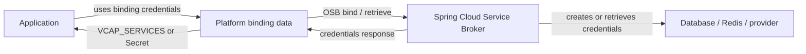

# Credentials đã luân chuyển nhưng ứng dụng vẫn dùng thông tin cũ

Sau khi quản trị viên xoay vòng mật khẩu hoặc tạo credential mới cho một service, ứng dụng có thể tiếp tục kết nối bằng thông tin cũ. Tình huống này thường xuất hiện khi broker đã cập nhật credential ở provider nhưng platform chưa phân phối lại binding data, Kubernetes Secret chưa được đồng bộ vào Pod, ứng dụng chỉ đọc cấu hình lúc khởi động hoặc connection pool vẫn giữ các kết nối cũ.

Với Spring Cloud Service Broker theo Open Service Broker API (OSB API), cần xác định credential thuộc lớp nào trước khi xử lý. Credential platform dùng để gọi broker, credential broker dùng để gọi provider và credential ứng dụng nhận qua service binding có vòng đời khác nhau. Nếu nhầm ba lớp này, người vận hành có thể đổi sai secret, restart sai thành phần hoặc thu hồi credential đang được workload sử dụng.

## 1. Phân biệt ba loại credential

Một hệ thống service broker thường có ít nhất ba nhóm thông tin xác thực:

| Loại credential | Luồng sử dụng | Ví dụ | Thành phần cần cập nhật khi xoay vòng |
|---|---|---|---|
| Broker API credentials | Platform gọi broker | HTTP Basic username/password | Cấu hình broker registration của platform |
| Provider credentials | Broker gọi provider | Cloud API token, database admin account, Kubernetes service account | Secret/configuration của broker và provider adapter |
| Service binding credentials | Ứng dụng gọi service được cấp phát | Database username/password, Redis password, endpoint token | Binding data, platform environment hoặc Kubernetes Secret và ứng dụng |

Bài này tập trung vào tình huống service binding credentials đã được thay đổi nhưng ứng dụng vẫn gửi credential cũ. Tuy nhiên, bước đầu tiên luôn là xác nhận đúng loại credential:

- Nếu Cloud Controller không gọi được broker và nhận 401, kiểm tra broker API credentials.
- Nếu broker gọi provider thất bại, kiểm tra provider credentials.
- Nếu broker và binding đều báo thành công nhưng ứng dụng không kết nối được database hoặc queue, kiểm tra service binding credentials và cách ứng dụng nạp chúng.

Không dùng password của database làm Basic password cho broker. Không xoay provider token chỉ vì một ứng dụng consumer nhận lỗi authentication. Không thay broker registration credentials để sửa lỗi đăng nhập của ứng dụng vào database.

## 2. Hiểu đường đi của service binding credentials

Khi platform tạo service binding, broker trả về thông tin kết nối trong response OSB. Với application binding, response thường chứa object credentials:

```json
{
  "credentials": {
    "hostname": "db.internal.example",
    "port": 5432,
    "database": "orders",
    "username": "orders_app_v2",
    "password": "<secret-issued-for-this-binding>"
  }
}
```

Platform lưu hoặc phân phối những giá trị này cho ứng dụng theo cách riêng của nền tảng. Cloud Foundry thường đưa thông tin binding vào biến môi trường VCAP_SERVICES. Kubernetes operator/controller có thể ghi credentials vào Kubernetes Secret rồi mount vào Pod hoặc inject thành environment variables.

Luồng tổng quát:



Khi credential thay đổi ở provider hoặc broker, việc thay đổi đó không tự động làm tiến trình ứng dụng đang chạy đọc lại giá trị mới. Cần kiểm tra từng bước:

1. Provider đã chấp nhận credential mới chưa?
2. Broker đã cập nhật hoặc có thể truy xuất binding credentials mới chưa?
3. Platform đã nhận dữ liệu binding mới chưa?
4. Environment variable hoặc Secret của workload đã thay đổi chưa?
5. Process ứng dụng đã nạp lại cấu hình chưa?
6. Connection pool đã tạo kết nối mới bằng credential mới chưa?

Một bước chưa hoàn tất có thể khiến ứng dụng tiếp tục dùng thông tin cũ dù bước trước đó đã thành công.

## 3. OSB API và giới hạn của thao tác xoay binding

OSB API định nghĩa các thao tác chính để tạo và thu hồi binding:

- PUT service binding để tạo binding và nhận credentials.
- DELETE service binding để thu hồi binding.
- GET service binding nếu broker công bố capability bindings_retrievable.

OSB API không định nghĩa một endpoint update binding chung tương đương PATCH service instance. Vì vậy, không thể giả định rằng thay đổi password tại provider hoặc gọi cf update-service sẽ tự động thay credential của mọi binding hiện có.

Nếu broker hỗ trợ binding retrieval, controller/platform có thể gọi GET service binding để lấy dữ liệu binding theo capability và contract tương ứng. Điều này không đồng nghĩa mọi platform tự động gọi lại endpoint hoặc tự cập nhật environment của ứng dụng. Phải xác minh hành vi của platform đang dùng.

Một số broker cung cấp quy trình rotation riêng, ví dụ tạo credential version mới, phát hành service key mới, tạo binding thay thế hoặc cho phép người vận hành kích hoạt rotation. Đây là behavior phụ thuộc implementation. Cần đọc hợp đồng broker và tài liệu platform trước khi dùng.

Không gọi lại PUT bind với cùng binding ID chỉ với kỳ vọng broker sẽ sinh password mới. OSB yêu cầu xử lý request lặp theo semantics idempotency; broker có thể trả lại binding hiện có. Nếu cần credential mới, dùng cơ chế rotation được broker hỗ trợ hoặc một binding identity mới theo quy trình cutover.

## 4. Dấu hiệu nhận biết ứng dụng vẫn dùng credential cũ

Các biểu hiện thường gặp:

- Ứng dụng báo authentication failed, password authentication failed hoặc invalid credentials sau một đợt rotation.
- Một số replica hoạt động, replica khác liên tục lỗi.
- Pod mới kết nối được nhưng Pod cũ không kết nối được.
- Restart ứng dụng tạm thời khắc phục nhưng lỗi quay lại sau khi autoscaling.
- Secret trong Kubernetes đã đổi nhưng environment variable trong container vẫn là giá trị cũ.
- Cloud Foundry service binding đã được cập nhật ở broker nhưng VCAP_SERVICES của app chưa phản ánh thay đổi.
- Kết nối hiện tại vẫn chạy, nhưng connection pool báo lỗi khi mở connection mới.
- Worker hoặc batch process chạy lâu vẫn dùng cấu hình cũ trong memory.

Phân biệt lỗi xác thực với lỗi mạng hoặc cấu hình:

| Triệu chứng | Khả năng cần kiểm tra |
|---|---|
| Connection refused | Host, port, network policy, service availability |
| DNS resolution failed | DNS, endpoint hoặc search domain |
| TLS certificate error | CA, hostname, certificate rotation |
| Authentication failed | Username/password, credential version, secret injection |
| Permission denied sau khi login | Role, grant, database/schema permission |
| Chỉ một số replica lỗi | Rollout không đồng đều, secret mount hoặc config cache |
| Kết nối cũ hoạt động, kết nối mới lỗi | Credential mới chưa được nạp hoặc provider chỉ cho phép credential khác |

Không kết luận credential cũ chỉ từ HTTP 401 của broker. Cần xác định response đến từ broker, provider hay service mà ứng dụng đang gọi.

## 5. Quy trình chẩn đoán theo từng lớp

### Bước 1: Xác nhận credential nào đã được xoay

Ghi nhận thay đổi thuộc loại nào:

- Broker API credential được cập nhật trong Cloud Foundry service broker registration hoặc controller configuration.
- Provider credential được cập nhật trong secret store của broker.
- Binding credential được provider hoặc broker thay mới cho một service instance/binding cụ thể.

Ghi lại thời điểm rotation, hệ thống thực hiện, service instance, binding identity và credential version. Không ghi password, token hoặc giá trị secret vào ticket hay log.

### Bước 2: Kiểm tra provider đã chấp nhận credential mới

Thử xác thực bằng cơ chế an toàn từ một client kiểm soát được, dùng secret manager hoặc secret injection. Không đặt password trực tiếp trong command line, shell history hoặc log CI.

Xác nhận:

- Username/principal mới tồn tại.
- Credential mới được cấp đúng provider, database, schema hoặc tenant.
- Role/grant cần thiết đã được gán.
- Credential cũ còn hiệu lực trong thời gian chuyển đổi nếu quy trình yêu cầu overlap.
- Provider không giới hạn một kết nối hoặc một credential version theo policy ngoài dự kiến.

Nếu provider chưa chấp nhận credential mới, dừng việc rollout ứng dụng và sửa rotation ở provider trước. Không buộc ứng dụng đổi sang một credential chưa hoạt động.

### Bước 3: Kiểm tra broker đã lưu hoặc truy xuất binding mới

Xác định broker đang lưu credentials theo mô hình nào:

- Lưu binding record trong database broker.
- Lưu secret reference đến secret manager.
- Truy xuất credentials từ provider khi gọi binding retrieval.
- Sinh credential riêng cho từng binding.

Kiểm tra binding record bằng metadata không nhạy cảm: binding ID, instance ID, credential version, trạng thái rotation và thời điểm cập nhật. Không SELECT hoặc in password rõ ra terminal để so sánh.

Nếu broker chỉ lưu credentials tại thời điểm bind, thay đổi ở provider không tự sửa bản ghi binding. Cần chạy quy trình rotation của broker để cập nhật binding metadata hoặc tạo binding thay thế.

### Bước 4: Kiểm tra platform đã nhận dữ liệu binding mới

Platform có thể giữ bản sao credentials sau khi nhận response bind. Việc broker đã có giá trị mới không bảo đảm platform đã refresh bản sao đó.

Kiểm tra theo cơ chế platform:

- Cloud Foundry: kiểm tra service binding và VCAP_SERVICES của một process được khởi động mới theo quy trình phù hợp.
- Kubernetes: kiểm tra Secret resourceVersion hoặc metadata version, sau đó xác định Pod có đang mount/inject phiên bản mới không.
- Operator riêng: kiểm tra trạng thái reconcile, event và thời điểm Secret sync gần nhất.

Không in toàn bộ VCAP_SERVICES hoặc Kubernetes Secret ra log. Nếu cần xác minh, chỉ kiểm tra tên binding, tên Secret, key hiện diện, version/timestamp và kết quả authentication từ ứng dụng thử nghiệm.

### Bước 5: Kiểm tra ứng dụng đã nạp lại cấu hình

Ứng dụng có thể đọc credentials một lần khi khởi động:

- Spring Boot binding qua environment variables hoặc application properties thường được nạp vào configuration objects khi ApplicationContext khởi tạo.
- Kubernetes Secret dùng làm environment variable chỉ được đưa vào container khi container được tạo.
- Secret mount dạng volume có thể được cập nhật sau đó, nhưng ứng dụng phải đọc lại file; file được mount qua subPath có hành vi cập nhật khác và thường không nhận thay đổi tự động.
- Config client hoặc secret manager SDK có thể cache credentials cho đến khi refresh/lease hết hạn.

Kiểm tra thời điểm process khởi động, pod creation timestamp, config reload event và credential version mà ứng dụng đã nạp. Không log giá trị secret để xác nhận.

### Bước 6: Kiểm tra connection pool và client cache

Ngay cả khi ứng dụng đã nạp credential mới, connection pool có thể giữ các connection được tạo bằng credential cũ. Một số provider không kiểm tra lại password trên connection đã xác thực; lỗi chỉ xuất hiện khi pool mở connection mới.

Kiểm tra:

- Pool có đang tái sử dụng connection cũ không?
- Có connection creation failure sau rotation không?
- Pool có được recycle hoặc drain không?
- Client SDK có cache authentication token không?
- Worker/background thread có giữ singleton client tạo từ credential cũ không?

Sau khi nạp credential mới, cần tạo connection mới và xác nhận truy vấn kiểm tra thành công. Với hệ thống có traffic, dùng rolling restart hoặc pool rotation có kiểm soát để tránh đóng đồng loạt mọi connection.

## 6. Cloud Foundry: VCAP_SERVICES và restart/restage

Cloud Foundry cung cấp service binding credentials cho ứng dụng qua biến môi trường VCAP_SERVICES. Nội dung được platform đưa vào environment của application instance khi instance được khởi chạy.

Ví dụ cấu trúc rút gọn:

```json
{
  "postgresql": [
    {
      "name": "orders-db",
      "instance_name": "orders-db",
      "binding_name": null,
      "credentials": {
        "hostname": "db.internal.example",
        "port": 5432,
        "username": "orders_app_v2",
        "password": "<redacted>"
      }
    }
  ]
}
```

Nếu binding credentials được cập nhật sau khi ứng dụng đã chạy, process hiện tại không tự thay đổi environment variable. Cần làm mới application instance theo behavior của platform:

- Kiểm tra service binding đã được platform cập nhật.
- Khởi động lại hoặc restage ứng dụng theo yêu cầu của quy trình và cách platform phân phối environment.
- Với ứng dụng cần staging/buildpack đọc service data, dùng restage khi cần tái staging.
- Xác minh các instance mới đều nhận cùng binding version.
- Theo dõi health và kết nối database trước khi thu hồi credential cũ.

Restart thường tạo process mới và nạp environment hiện tại; restage còn thực hiện lại giai đoạn staging. Không chạy restage hàng loạt một cách mù quáng nếu ứng dụng có build hoặc staging dài. Chọn thao tác phù hợp với thay đổi và kiểm tra hành vi Cloud Foundry CLI/platform version đang dùng.

Một số lệnh hữu ích:

```bash
cf services
cf service orders-db
cf env orders-api
cf restart orders-api
```

Lệnh cf env có thể hiển thị dữ liệu nhạy cảm trong VCAP_SERVICES. Chỉ người có quyền phù hợp mới được chạy; không copy output vào ticket, chat hoặc log. Nếu cần kiểm tra, chỉ xác nhận service name, binding presence và metadata không nhạy cảm, hoặc dùng một công cụ nội bộ đã mask secret.

Nếu broker đã đổi credentials nhưng Cloud Foundry binding chưa được cập nhật, restart ứng dụng chỉ nạp lại dữ liệu cũ. Hãy xử lý binding/rotation ở broker và platform trước, sau đó mới restart/restage.

## 7. Kubernetes: Secret, environment variable và volume mount

Kubernetes controller có thể lấy credentials từ OSB binding response rồi tạo Secret:

```yaml
apiVersion: v1
kind: Secret
metadata:
  name: orders-db-credentials
  namespace: production
type: Opaque
stringData:
  username: orders_app_v2
  password: managed-outside-git
```

Manifest trên chỉ minh họa cấu trúc. Không commit secret thật vào Git hoặc GitOps repository. Dùng external secret manager, sealed/encrypted secret workflow hoặc cơ chế bảo vệ phù hợp. Kubernetes Secret được encode Base64 trong API representation; Base64 không phải encryption.

### 7.1. Secret được inject qua environment variable

Ví dụ Deployment:

```yaml
env:
  - name: DB_USERNAME
    valueFrom:
      secretKeyRef:
        name: orders-db-credentials
        key: username
  - name: DB_PASSWORD
    valueFrom:
      secretKeyRef:
        name: orders-db-credentials
        key: password
```

Environment variable được gắn vào container khi container được tạo. Khi Secret thay đổi, environment của container đang chạy không tự cập nhật. Cần tạo Pod mới để nạp giá trị mới, thường bằng rollout restart hoặc controller tự động restart khi Secret version thay đổi.

Lệnh vận hành:

```bash
kubectl rollout restart deployment/orders-api -n production
kubectl rollout status deployment/orders-api -n production
```

Chỉ restart sau khi xác nhận Secret mới đã được đồng bộ và provider chấp nhận credential mới. Theo dõi rollout status và readiness trước khi thu hồi credential cũ.

### 7.2. Secret được mount dưới dạng volume

Khi Secret được mount thành volume thông thường, kubelet có thể cập nhật projected files sau một khoảng trễ. Tuy nhiên:

- Ứng dụng phải đọc lại file để nhận giá trị mới.
- Nếu ứng dụng chỉ đọc file lúc startup, cần restart hoặc reload config.
- Mount qua subPath không nhận cập nhật Secret theo cách volume projection thông thường.
- Thời gian cập nhật phụ thuộc kubelet sync và cache strategy.

Ví dụ:

```yaml
volumes:
  - name: db-credentials
    secret:
      secretName: orders-db-credentials
containers:
  - name: orders-api
    volumeMounts:
      - name: db-credentials
        mountPath: /var/run/secrets/orders-db
        readOnly: true
```

Ứng dụng có thể đọc username/password từ các file trong /var/run/secrets/orders-db. Nếu có cơ chế reload, cần xác nhận nó theo dõi file projection và thay thế connection pool/client đúng cách. Không giả định file thay đổi nghĩa là client đã dùng credential mới.

### 7.3. External Secrets Operator hoặc secret sync controller

Nếu dùng External Secrets Operator hoặc controller tương tự, có thêm một bước đồng bộ từ secret manager vào Kubernetes Secret. Kiểm tra:

- External secret resource đã reconcile thành công chưa.
- Refresh interval đã đến chưa.
- Secret store provider có trả version mới không.
- Kubernetes Secret resourceVersion đã thay đổi chưa.
- Pod được restart/reload theo policy nào.

Nếu secret manager đã có version mới nhưng Kubernetes Secret chưa đổi, lỗi nằm ở secret sync layer. Nếu Secret đã đổi nhưng Pod environment cũ, lỗi nằm ở Pod lifecycle. Nếu Pod đã nhận giá trị mới nhưng kết nối vẫn lỗi, kiểm tra ứng dụng và provider.

## 8. Ứng dụng Spring Boot và cấu hình được cache

Ứng dụng Spring Boot thường nạp cấu hình lúc ApplicationContext khởi tạo. Ví dụ:

```yaml
spring:
  datasource:
    url: jdbc:postgresql://db.internal.example:5432/orders
    username: "${DB_USERNAME}"
    password: "${DB_PASSWORD}"
```

Trong ví dụ, DB_USERNAME và DB_PASSWORD đại diện cho giá trị được inject từ environment hoặc secret source. Nếu nguồn secret thay đổi, giá trị trong process đang chạy không tự thay đổi. Các bean như DataSource, HikariDataSource hoặc client SDK đã được tạo có thể giữ cấu hình cũ.

Có ba cách phổ biến:

1. **Restart process:** cách đơn giản và dễ kiểm chứng nhất khi cấu hình chỉ đọc lúc startup.
2. **Refresh có kiểm soát:** dùng configuration refresh mechanism nếu ứng dụng đã thiết kế để refresh datasource/client và đóng connection cũ an toàn.
3. **Credential provider động:** dùng SDK hoặc secret manager client hỗ trợ refresh/lease, có callback cập nhật connection pool.

Không bật một endpoint refresh công khai để giải quyết rotation. Nếu dùng Spring Cloud refresh, phải bảo vệ endpoint quản trị, xác định bean nào refresh được và kiểm thử việc thay thế DataSource/connection pool. Refresh một Environment property không tự bảo đảm connection pool đã đổi credential.

Với HikariCP hoặc pool tương tự, cần xem xét:

- Tạo pool/client mới với credential mới.
- Chuyển traffic sang pool mới.
- Drain pool cũ và đóng connection cũ.
- Theo dõi lỗi connection creation.
- Chỉ thu hồi credential cũ sau khi không còn consumer sử dụng.

Không đặt maxLifetime quá thấp như biện pháp duy nhất. Pool lifetime có thể giúp recycle connection, nhưng không bảo đảm configuration object được nạp lại. Credential cũ trong datasource vẫn được dùng khi pool tạo connection mới.

## 9. Quy trình rotation an toàn có thời gian overlap

Với hệ thống production, nên thiết kế rotation để credential cũ và mới cùng hoạt động trong một khoảng chuyển đổi nếu provider hỗ trợ nhiều principal hoặc nhiều password đồng thời.

Quy trình đề xuất:

1. **Chuẩn bị:** xác định tất cả service instance, binding, application, batch job và consumer đang dùng credential.
2. **Tạo mới:** tạo principal/credential version mới tại provider với quyền tối thiểu cần thiết.
3. **Kiểm chứng:** xác thực bằng credential mới từ một client kiểm soát được.
4. **Cập nhật broker:** ghi version mới vào binding store hoặc kích hoạt quy trình rotation của broker.
5. **Phân phối:** cập nhật platform binding data, Kubernetes Secret hoặc secret manager.
6. **Rollout:** restart/reload từng application instance hoặc Pod theo rolling strategy.
7. **Xác minh:** kiểm tra các instance mới mở được connection bằng credential mới và health/traffic ổn định.
8. **Drain:** chờ connection pool cũ và background workers chuyển sang credential mới.
9. **Thu hồi:** revoke credential cũ sau khi hết overlap window và không còn consumer hợp lệ dùng nó.
10. **Audit:** lưu credential version, thời điểm, operator, scope và kết quả; không lưu secret value.

Nếu provider chỉ cho phép một password trên một user, cân nhắc tạo user thứ hai có cùng quyền tối thiểu, chuyển ứng dụng sang user mới, rồi disable user cũ. Đây thường an toàn hơn đổi password ngay trên một user đang có nhiều consumer.

Overlap window cần có thời hạn rõ ràng. Không để credential cũ tồn tại vô thời hạn vì sẽ làm mất ý nghĩa rotation.

## 10. Cutover khi OSB broker không hỗ trợ thay binding trực tiếp

Khi broker không có rotation extension và platform không tự refresh binding credentials, có thể cần tạo binding thay thế. Quy trình cụ thể phụ thuộc khả năng platform:

**Mô hình binding song song:**

1. Tạo credential mới hoặc binding mới với binding ID riêng nếu platform và broker cho phép.
2. Phân phối credentials mới đến ứng dụng qua Secret/configuration mới.
3. Ứng dụng mở connection mới và chuyển traffic.
4. Xác nhận không còn request dùng binding cũ.
5. Unbind binding cũ và thu hồi credential cũ.

Nếu platform không cho phép hai binding tương đương trên cùng consumer, có thể dùng service key, service instance thay thế hoặc quy trình maintenance/cutover theo khả năng platform. Không tự giả định một lệnh CLI hoặc endpoint OSB có thể tạo binding song song.

Service key thường dành cho client bên ngoài ứng dụng được platform quản lý; nó không tự thay thế VCAP_SERVICES hoặc Kubernetes Secret đang được workload sử dụng. Phải xác định credential mới sẽ được đưa đến đúng consumer bằng cách nào.

Đối với database, một chiến lược khác là tạo user mới trên cùng database, cấp quyền tương đương, chuyển ứng dụng sang user mới, rồi thu hồi user cũ. Điều này tránh phải tạo database mới và giảm gián đoạn.

## 11. Các tình huống cụ thể và cách khắc phục

| Tình huống | Nguyên nhân thường gặp | Cách xử lý |
|---|---|---|
| Provider đã đổi password, broker vẫn trả credentials cũ | Binding record chưa được cập nhật | Chạy rotation flow hoặc cập nhật binding store theo thiết kế broker |
| Broker trả credentials mới, Cloud Foundry app vẫn lỗi | Process còn VCAP_SERVICES cũ | Xác minh binding state rồi restart/restage theo platform |
| Kubernetes Secret mới nhưng Pod vẫn dùng password cũ | Credentials inject qua environment variable | Rollout restart workload |
| Secret volume đã cập nhật nhưng app lỗi | Ứng dụng không đọc lại file | Bật reload an toàn hoặc restart |
| Một số Pod mới, một số Pod cũ | Rollout chưa hoàn tất hoặc replica ngoài Deployment | Kiểm tra toàn bộ workload, Job, CronJob và worker |
| Pod dùng Secret mới nhưng connection vẫn lỗi | DataSource/client cache hoặc pool chưa đổi | Recreate client/pool và kiểm tra connection mới |
| Credential mới login được nhưng query bị từ chối | Thiếu grant/role hoặc sai database/schema | Cấp quyền đúng và xác minh scope |
| Rotation làm tất cả ứng dụng lỗi cùng lúc | Thu hồi credential cũ trước khi rollout | Khôi phục/credential mới, dùng overlap và rolling cutover |
| Restart xong vẫn dùng giá trị cũ | Secret source chưa cập nhật hoặc config precedence ghi đè | Truy vết secret source, env, config file và mounted path |
| Chỉ batch job lỗi | Job chạy dài hoặc Pod không được rollout | Cập nhật CronJob template và xử lý Job đang chạy |

## 12. Kiểm tra nguồn cấu hình bị ghi đè

Spring Boot có thể nhận cùng một property từ nhiều nguồn: command line, environment variable, system property, config file, Config Server hoặc secret manager. Nguồn có precedence cao hơn có thể ghi đè giá trị vừa cập nhật ở nơi khác.

Khi ứng dụng vẫn dùng credential cũ sau restart, kiểm tra:

- Environment variable có được set từ Secret khác không?
- Deployment có khai báo env trực tiếp ghi đè envFrom không?
- ConfigMap hoặc application.yml có chứa giá trị cũ không?
- Helm values hoặc GitOps manifest có reconcile lại secret reference cũ không?
- Config Server có trả version cũ không?
- Có nhiều profile như dev/staging/prod và profile đang chạy có trỏ sai secret không?
- Container image có vô tình chứa file cấu hình với credential cũ không?

Không in toàn bộ environment hoặc Actuator env endpoint ra log. Dùng metadata không nhạy cảm như tên nguồn, key reference, secret version và thời điểm load để xác định precedence.

## 13. Xác minh toàn bộ replica đã dùng credential mới

Một ứng dụng có nhiều Pod/instance có thể rollout không đồng đều. Chỉ kiểm tra một Pod là chưa đủ.

Checklist:

- Desired replicas và available replicas đã bằng nhau.
- Không còn Pod cũ hoặc ReplicaSet cũ nhận traffic.
- CronJob template đã tham chiếu Secret mới.
- Các Job đang chạy dài đã được xử lý theo kế hoạch.
- Worker deployments và consumer deployments đã được rollout.
- Secret version được mount/inject giống nhau ở mọi replica.
- Mỗi replica đã mở ít nhất một connection mới thành công.
- Metric authentication failure trở về baseline.

Có thể ghi credential version dạng metadata không bí mật vào application startup log, ví dụ credential_version=v7. Không ghi hash của password yếu hoặc password rõ để đối chiếu. Nếu cần fingerprint, dùng version ID do secret manager cấp thay vì tự băm giá trị secret.

## 14. Rollback và xử lý khi credential cũ đã bị thu hồi

Nếu credential cũ đã bị revoke trước khi ứng dụng chuyển đổi, rollback không đơn giản là khôi phục environment cũ. Provider sẽ tiếp tục từ chối credential đó.

Quy trình phục hồi:

1. Tạo credential mới khác hoặc khôi phục principal cũ theo policy provider.
2. Cấp quyền tối thiểu cần thiết.
3. Kiểm tra credential mới bằng một client thử nghiệm.
4. Cập nhật broker/platform secret source.
5. Rollout/reload ứng dụng và connection pool.
6. Theo dõi authentication errors và service availability.
7. Sau khi hệ thống ổn định, phân tích thứ tự rotation để tránh lặp lại.

Không bật lại credential cũ đã bị compromise chỉ để giảm thời gian khắc phục nếu chưa đánh giá rủi ro. Nếu rotation là phản ứng với sự cố bảo mật, ưu tiên credential mới và kiểm tra audit logs.

## 15. Logging, audit và bảo mật

Credential rotation cần có khả năng truy vết nhưng không được lưu secret value.

Thông tin audit nên gồm:

- Service instance ID và binding ID.
- Platform/namespace/consumer identity.
- Credential version cũ và mới (chỉ version ID).
- Người hoặc automation khởi tạo rotation.
- Thời điểm bắt đầu, cutover và revoke.
- Trạng thái từng bước: provider updated, broker updated, platform synced, app rolled out, old credential revoked.
- Kết quả kiểm tra kết nối và số consumer còn dùng version cũ.

Không log:

- Password, API token hoặc private key.
- Authorization header.
- Toàn bộ VCAP_SERVICES.
- Kubernetes Secret data.
- Raw bind response hoặc provider response có credentials.
- Environment dump hoặc connection string đầy đủ.

Nếu phát hiện credential cũ bị sử dụng sau thời điểm revoke, xem đó là tín hiệu cần điều tra: có thể còn replica, worker, cron job hoặc consumer ngoài hệ thống chưa được cập nhật.

## 16. Metric và cảnh báo cho credential rotation

Có thể theo dõi trạng thái rotation bằng metric có label giới hạn:

| Metric | Ý nghĩa |
|---|---|
| broker.binding.rotation.started | Số lần bắt đầu rotation |
| broker.binding.rotation.completed | Số lần rotation hoàn tất |
| broker.binding.rotation.failed | Số lần rotation thất bại |
| broker.binding.rotation.pending | Số rotation chưa terminal |
| broker.binding.credential_version_active | Số binding theo version đã chuẩn hóa nếu cardinality được kiểm soát |
| application.auth.failures | Lỗi xác thực từ consumer |
| provider.auth.failures | Lỗi xác thực từ broker đến provider |

Không đưa binding ID, application ID, username hoặc secret value vào metric labels. Dùng log/trace có kiểm soát để truy vấn từng rotation.

Alert hữu ích:

- Rotation chưa hoàn tất sau thời hạn dự kiến.
- Authentication failure tăng sau cutover.
- Vẫn còn consumer dùng credential version cũ gần thời điểm revoke.
- Provider từ chối credential mới.
- Một nhóm Pod không hoàn tất rollout.
- Secret sync controller báo lỗi hoặc version không thay đổi.

## 17. Checklist xử lý sự cố

Khi ứng dụng vẫn dùng credential cũ, thực hiện theo thứ tự:

1. Xác nhận đây là service binding credential, không phải broker API hoặc provider credential.
2. Xác nhận provider đã chấp nhận credential mới.
3. Xác nhận broker binding store hoặc retrieval flow trả đúng credential version mới.
4. Xác nhận platform đã nhận binding update hoặc Secret sync thành công.
5. Xác nhận Pod/process mới được tạo sau thời điểm cập nhật.
6. Xác nhận ứng dụng đọc đúng secret source, key và profile.
7. Xác nhận mọi replica, worker, Job và CronJob đã được cập nhật.
8. Recreate connection pool/client và kiểm tra connection mới.
9. Theo dõi authentication errors và traffic trong overlap window.
10. Chỉ revoke credential cũ khi không còn consumer hợp lệ sử dụng.
11. Ghi audit kết quả và đóng rotation.

## 18. Kiểm thử trước khi áp dụng rotation production

Nên có kiểm thử tích hợp cho toàn bộ luồng:

1. Tạo service instance và binding ban đầu.
2. Xác minh broker trả binding credentials version đầu.
3. Thay provider credential và kích hoạt broker rotation flow.
4. Xác minh binding retrieval hoặc binding replacement trả version mới theo contract.
5. Xác minh platform/controller cập nhật VCAP_SERVICES hoặc Kubernetes Secret.
6. Xác minh environment variables chỉ đổi sau khi tạo process mới.
7. Xác minh Secret volume cập nhật và ứng dụng có thể reload nếu dùng file mount.
8. Xác minh connection pool mở kết nối mới bằng credential mới.
9. Giữ credential cũ trong overlap và xác nhận consumer đang rollout không bị gián đoạn.
10. Revoke credential cũ và xác nhận không còn consumer cần nó.
11. Kiểm tra Pod/worker cũ bị bỏ sót sẽ phát hiện qua metric hoặc audit.
12. Kiểm tra rollback khi provider không chấp nhận credential mới.
13. Kiểm tra response/log/event không chứa secret.
14. Kiểm tra rotation lặp lại không tạo binding hoặc credential resource trùng.

Kiểm thử nên có cả một consumer đang chạy lâu, một Pod được tạo mới, một worker nền và một Job theo lịch. Các nhóm này thường có vòng đời khác nhau và dễ bị bỏ sót khi rotation.

## 19. Lỗi thiết kế cần tránh

| Lỗi | Hậu quả | Cách khắc phục |
|---|---|---|
| Đổi password provider nhưng không cập nhật binding record | Broker tiếp tục trả credential cũ | Có rotation workflow đồng bộ provider và binding store |
| Giả định OSB có endpoint update binding chung | Dùng sai API hoặc thao tác không được hỗ trợ | Dùng retrieval/rotation extension hoặc binding replacement |
| PUT bind lại cùng binding ID để lấy password mới | Broker có thể trả lại binding idempotent cũ | Dùng cơ chế rotation hoặc binding ID mới theo contract |
| Revoke credential cũ ngay sau khi tạo mới | Pod/process cũ mất kết nối | Dùng overlap và rolling cutover |
| Chỉ cập nhật Kubernetes Secret | Environment variables trong Pod vẫn cũ | Rollout Pod hoặc dùng volume reload đúng cách |
| Chỉ restart một replica | Các replica khác vẫn dùng secret cũ | Theo dõi toàn bộ Deployment, Job và worker |
| Refresh Spring Environment nhưng giữ DataSource cũ | Connection pool tiếp tục dùng credential cũ | Recreate pool/client và drain connection cũ |
| Kiểm tra bằng cách in password | Rò rỉ secret qua log và terminal | Kiểm tra version metadata và authentication result |
| Chỉ kiểm tra login, không kiểm tra quyền | Ứng dụng đăng nhập được nhưng query bị từ chối | Kiểm tra role/grant/database scope |
| Không có audit credential version | Khó tìm consumer chưa cutover | Theo dõi version và trạng thái rotation |

## 20. Kết luận

Khi credentials đã được luân chuyển nhưng ứng dụng vẫn dùng thông tin cũ, hãy truy vết từ provider đến broker, platform binding, secret injection, process configuration và connection pool. OSB API cung cấp bind, unbind và khả năng retrieve binding khi broker công bố; không có thao tác update binding chung để mọi platform tự động thay credential. Cloud Foundry có thể cần khởi động lại hoặc restage ứng dụng để nạp lại VCAP_SERVICES. Kubernetes cần tạo Pod mới nếu Secret được inject qua environment variable; Secret volume cần ứng dụng đọc lại file, và connection pool vẫn phải được thay thế hoặc drain. Quy trình rotation an toàn tạo credential mới, xác minh, phân phối, rollout, kiểm tra mọi consumer rồi mới revoke credential cũ. Cách làm này giảm nguy cơ gián đoạn và giúp xác định chính xác lớp nào chưa nhận credential mới.
