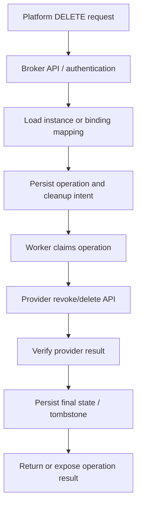

# Hủy binding hoặc xóa instance thất bại và để lại tài nguyên mồ côi

Khi platform yêu cầu hủy binding (unbind) hoặc xóa service instance (deprovision), broker phải thu hồi đúng tài nguyên đã tạo ở provider và cập nhật trạng thái nội bộ nhất quán. Trong thực tế, request có thể timeout, provider từ chối xóa, worker dừng giữa chừng hoặc database không ghi được kết quả sau khi provider đã thực hiện side effect. Khi đó broker có thể báo lỗi nhưng database vẫn còn resource, hoặc database đánh dấu đã xóa trong khi credential/database/network resource vẫn tồn tại bên ngoài. Những tài nguyên còn sót lại như vậy được gọi là **orphan resources** (tài nguyên mồ côi).

Với `SPRING_CLOUD_SERVICE_BROKER`, cần phân biệt rõ binding resource và service instance resource, lưu mapping external ID, xác minh ownership trước thao tác phá hủy, và thiết kế unbind/deprovision idempotent. Không xóa thủ công chỉ dựa vào tên hoặc tag; trước hết phải xác định operation nào thất bại, provider đã thực hiện tới đâu và tài nguyên còn tồn tại có thực sự thuộc instance/binding đó hay không. Bài này hướng dẫn chẩn đoán từ OSB request tới provider, phục hồi operation và dọn tài nguyên an toàn.

## 1. Phân biệt unbind và deprovision

OSB API có hai thao tác vòng đời riêng:

- **Unbind:** thu hồi quyền truy cập hoặc credential được tạo cho một binding cụ thể giữa service instance và consumer.
- **Deprovision:** thu hồi service instance và các tài nguyên riêng của instance theo hợp đồng service/plan.

Một instance có thể có nhiều binding. Hủy một binding không được xóa database hoặc queue dùng chung của instance nếu service contract chỉ yêu cầu revoke user/credential riêng cho binding đó. Ngược lại, deprovision cần xử lý các binding còn tồn tại theo semantics của platform và policy broker trước khi xóa tài nguyên instance.

| Thao tác | Định danh chính | Side effect thường gặp | Tài nguyên cần bảo vệ |
|---|---|---|---|
| Unbind | `instance_id` + `binding_id` | Revoke database user, token, role hoặc ACL của binding | Database/queue chính và các binding khác của instance |
| Deprovision | `instance_id` | Xóa database, cluster, queue, endpoint, backup hoặc tài nguyên riêng của instance | Tài nguyên dùng chung, instance khác và dữ liệu ngoài phạm vi broker |

Platform thường yêu cầu unbind trước deprovision đối với các binding đang tồn tại, nhưng broker vẫn phải xử lý retry, request trùng và tình huống vận hành không theo thứ tự lý tưởng. Không giả định rằng platform luôn gửi đúng một lần hoặc worker luôn chạy đến cuối.

## 2. Dấu hiệu nhận biết tài nguyên mồ côi

Một resource có thể bị bỏ sót ở nhiều lớp:

- Binding record đã chuyển `REVOKED`, nhưng database user hoặc provider token vẫn hoạt động.
- Service instance đã chuyển `DEPROVISIONED`, nhưng database, queue hoặc network endpoint vẫn còn.
- Broker trả `202 Accepted`, nhưng operation không bao giờ rời `IN_PROGRESS`.
- Provider xóa resource thành công nhưng broker timeout, sau đó operation bị retry vô hạn.
- Broker database mất mapping external ID nên không tìm được resource cần cleanup.
- Một worker xóa resource con nhưng thất bại trước khi xóa resource cha.
- Resource được tạo ở provider nhưng transaction lưu external ID bị rollback.

Các dấu hiệu vận hành có thể gồm:

| Dấu hiệu | Điều cần đối chiếu |
|---|---|
| Chi phí provider không giảm sau deprovision | Resource inventory, billing tags, external ID và thời điểm delete. |
| Binding đã xóa nhưng consumer vẫn kết nối được | Credential/user/ACL ở provider và thời điểm revoke. |
| `last_operation` vẫn `in progress` quá lâu | Worker lease, retry schedule, queue backlog và provider operation status. |
| Instance không còn trong broker DB nhưng resource vẫn tồn tại | Audit log, tombstone, provider ownership tags và backup/restore history. |
| Retry deprovision trả lỗi not found | Kiểm tra provider resource đã được xóa trước đó hay ID mapping sai. |
| Một instance có nhiều resource cùng ownership tag | Kiểm tra duplicate create, retry sau timeout hoặc collision naming. |

Không kết luận resource là orphan chỉ vì không thấy một bản ghi trong một bảng. Cần kiểm tra mapping, operation history, binding records, provider inventory và audit trail trong cùng một phạm vi tenant/account/region.

## 3. Thu thập thông tin trước khi xử lý

Trước khi retry hoặc cleanup thủ công, ghi nhận một bộ định danh nhất quán:

- `service_instance_id` và `binding_id` (nếu là unbind).
- `service_id`, `plan_id`, tenant/organization/space hoặc namespace context.
- `operation_id`, operation type, trạng thái hiện tại và số lần retry.
- Provider name, account/project, region và `external_resource_id`.
- Resource name, ownership tags/labels và provider request ID.
- Correlation/trace ID, timestamp request và lỗi đã chuẩn hóa.
- Phiên bản broker, provider adapter và policy cleanup đang chạy.

Ví dụ log có cấu trúc:

```json
{
  "event": "broker.cleanup.failed",
  "operation_id": "op-unbind-456",
  "instance_id": "instance-123",
  "binding_id": "binding-789",
  "operation_type": "UNBIND",
  "provider": "example-cloud",
  "resource_type": "database-user",
  "external_resource_id": "user-42",
  "attempt": 3,
  "error_code": "PROVIDER_TIMEOUT",
  "correlation_id": "corr-abc"
}
```

Không ghi password, token, connection string, private key hoặc raw provider response chứa secret. Nếu thiếu external ID, không tự đoán từ tên; hãy dùng operation metadata, provider request ID hoặc ownership tag để tìm lại resource theo quy trình xác minh.

## 4. Xác định cleanup thất bại ở lớp nào

Luồng cleanup đi qua nhiều thành phần:



Tìm điểm dừng bằng cách đối chiếu log và state:

1. **Không có request ở broker:** kiểm tra platform route, authentication, network và URL.
2. **Có request nhưng không có operation:** kiểm tra validation, instance/binding lookup và transaction tạo operation.
3. **Có operation nhưng worker không claim:** kiểm tra outbox, queue, scheduler, lease và worker health.
4. **Worker gọi provider nhưng nhận lỗi:** phân loại auth, permission, quota, rate limit, dependency hoặc resource conflict.
5. **Provider đã xóa nhưng broker chưa cập nhật:** kiểm tra timeout, transaction result recorder, database failover và worker restart.
6. **Broker báo thành công nhưng provider resource còn:** kiểm tra mapping cleanup thiếu bước, adapter trả success quá sớm hoặc provider API có semantics async riêng.

Không chỉ dựa vào HTTP status cuối cùng. Với thao tác async, response `202` có nghĩa broker đã chấp nhận operation; cần kiểm tra `last_operation` và trạng thái provider để biết cleanup đã thực sự hoàn tất chưa.

## 5. Kiểm tra trạng thái operation và `last_operation`

Khi unbind hoặc deprovision được xử lý bất đồng bộ, broker cần lưu operation bền vững. Platform có thể polling `last_operation` nhiều lần hoặc gửi lại request sau timeout.

Kiểm tra các trường:

| Trường | Câu hỏi chẩn đoán |
|---|---|
| `operation_id` | Có đúng operation cho instance/binding đang cleanup không? |
| `state` | Đang `PENDING`, `RUNNING`, `RETRY`, `UNKNOWN`, `SUCCEEDED` hay `FAILED`? |
| `attempt_count` | Có retry tăng liên tục không? |
| `next_retry_at` | Worker có đang chờ backoff hợp lệ không? |
| `claimed_by` / `lease_until` | Worker nào đang sở hữu; lease đã hết hạn chưa? |
| `current_step` | Đã revoke credential, xóa resource hay verify provider chưa? |
| `last_error_code` | Lỗi có phân loại được và có thể retry không? |
| `external_resource_id` | Worker đang xóa đúng tài nguyên không? |

Ví dụ truy vấn chẩn đoán minh họa:

```sql
SELECT operation_id, resource_id, operation_type, state,
       attempt_count, next_retry_at, claimed_by, lease_until,
       current_step, last_error_code
FROM broker_operation
WHERE resource_id = :instance_or_binding_id
ORDER BY created_at DESC;
```

Tên bảng/cột cần điều chỉnh theo schema thực tế. Không sửa trực tiếp operation thành `SUCCEEDED` chỉ để platform ngừng polling. Trạng thái cuối phải dựa trên bằng chứng cleanup đã đạt mục tiêu ở provider.

## 6. Kiểm tra provider resource trước khi retry

Timeout không chứng minh provider chưa thực hiện delete/revoke. Ví dụ provider đã xóa database user nhưng response bị mất; lần retry có thể trả `404 Not Found` vì user không còn tồn tại. Nếu broker coi mọi 404 là lỗi vĩnh viễn, operation có thể bị kẹt dù trạng thái mong muốn đã đạt.

Trước khi retry:

1. Tra cứu resource theo external ID đã lưu.
2. Xác minh account/project và region.
3. Đọc ownership metadata và so sánh instance/binding ID.
4. Kiểm tra provider operation/request ID nếu API hỗ trợ.
5. Xác định resource còn tồn tại, đã xóa hoặc trạng thái chưa xác định.
6. Chọn retry hoặc ghi nhận thành công theo semantics của provider.

Với DELETE, `not found` có thể được xem là idempotent success nếu broker xác minh đúng external resource identity và việc không tồn tại chính là trạng thái đích. Không áp dụng quy tắc này cho một resource ID chưa xác minh hoặc khi provider có thể trả 404 vì sai account/region/endpoint.

Với revoke credential, cần kiểm tra token/user/role thực sự không còn quyền. Nếu provider không cho lookup, có thể cần thử revoke idempotent theo contract, hoặc chạy quy trình xác minh thay thế. Không đánh dấu binding `REVOKED` chỉ vì request revoke đã được gửi.

## 7. Phân loại lỗi provider và quyết định retry

Không phải lỗi nào cũng nên retry theo cùng cách:

| Lỗi provider | Cách xử lý |
|---|---|
| Connect timeout trước khi request tới provider | Retry có giới hạn với cùng idempotency key. |
| Read timeout sau khi provider có thể đã xóa | Lookup/verify trước khi retry. |
| HTTP 429/rate limit | Tôn trọng `Retry-After`, backoff và jitter. |
| HTTP 5xx tạm thời | Retry có giới hạn nếu delete/revoke idempotent hoặc có thể xác minh. |
| HTTP 401/403 | Dừng retry nhanh; sửa credential hoặc IAM policy. |
| HTTP 400/validation | Sửa request/adapter; retry cùng payload không giải quyết được. |
| Resource lock/in-use | Kiểm tra dependency và thứ tự cleanup. |
| Resource not found | Xác minh identity/scope; có thể coi là đạt trạng thái đích với DELETE idempotent. |
| Ownership mismatch | Dừng tự động cleanup, yêu cầu reconcile hoặc operator xác minh. |

Dùng exponential backoff có jitter và giới hạn attempt. Retry lâu dài nên được lưu bền vững trong database/queue thay vì giữ một HTTP request hoặc vòng lặp trong memory. Sau khi vượt retry budget, chuyển operation sang trạng thái cần can thiệp, giữ đủ metadata để tiếp tục.

## 8. Xử lý unbind thất bại

Unbind cần thu hồi quyền truy cập của đúng binding. Quy trình nên xác định chính xác provider resource nào đại diện cho binding, ví dụ database user, role, API key hoặc ACL entry.

### Các bước chẩn đoán

1. Tìm binding record theo `binding_id` và `instance_id`.
2. Xác minh consumer identity, trạng thái binding và provider credential reference.
3. Kiểm tra external binding resource ID (user ID, token ID, role ID) đã được lưu chưa.
4. Đọc operation history để biết bước revoke đã bắt đầu hoặc hoàn tất chưa.
5. Tra cứu provider để xác minh credential còn hoạt động hay đã bị revoke.
6. Kiểm tra permission của provider principal dùng để revoke.
7. Retry revoke bằng cùng binding identity/idempotency key nếu trạng thái cho phép.
8. Chỉ chuyển binding sang `REVOKED` khi provider xác nhận hoặc đã xác minh credential không còn hiệu lực.

### Những lỗi thường gặp

- Broker xóa binding row trước khi provider revoke, làm mất external ID cần cleanup.
- Binding ID bị ánh xạ nhầm sang credential của consumer khác.
- Provider credential hết hạn hoặc không có quyền revoke user/token.
- Worker retry tạo credential mới thay vì tiếp tục revoke credential cũ.
- Broker xóa cả database instance khi chỉ cần thu hồi một binding.
- Provider trả timeout sau revoke, broker đánh dấu thất bại dù credential đã bị thu hồi.

Giữ binding record hoặc tombstone đủ lâu để retry/reconciliation. Có thể xóa secret material sau khi revoke, nhưng vẫn giữ ID, state, operation reference và audit metadata không nhạy cảm.

## 9. Xử lý deprovision thất bại

Deprovision có thể gồm nhiều bước: xác minh binding, thu hồi credential còn sót, xóa resource chính và các resource phụ thuộc, xác minh provider đã cleanup, sau đó cập nhật instance/tombstone.

Ví dụ thứ tự cleanup cho một managed database:

```text
1. Stop accepting new bindings
2. Confirm/unbind active bindings according to policy
3. Revoke instance-scoped credentials
4. Remove dependent network/endpoint configuration
5. Delete database instance
6. Verify database is absent
7. Persist DEPROVISIONED + tombstone
```

Thứ tự thật phụ thuộc provider và service contract. Một số tài nguyên cần xóa network sau database; một số cần detach trước khi xóa. Hãy mô tả dependency graph rõ ràng trong adapter thay vì xóa theo thứ tự ngẫu nhiên.

Nếu một bước thất bại, lưu `current_step` và tiếp tục từ bước đó sau khi xử lý lỗi. Nếu provider đã xóa database nhưng bước xóa backup policy thất bại, không tạo lại database để “rollback”; tiếp tục cleanup phần còn lại hoặc đưa operation vào trạng thái cần can thiệp.

## 10. Database transaction không bao trùm provider API

`@Transactional` chỉ quản lý transaction của resource manager được cấu hình. HTTP call tới provider không tự tham gia transaction database. Vì vậy có thể xảy ra:

- Provider xóa resource thành công, nhưng database rollback khi lưu kết quả.
- Broker commit trạng thái `DEPROVISIONED` quá sớm, nhưng provider delete thất bại.
- Worker dừng sau provider side effect nhưng trước khi ghi operation state.
- Event được publish hai lần và hai worker cùng thử cleanup.

Thiết kế an toàn nên:

1. Trong transaction ngắn, lưu cleanup intent và operation.
2. Commit trước khi gọi provider.
3. Worker claim operation bằng lease/optimistic lock.
4. Gọi provider ngoài transaction với idempotency key ổn định.
5. Xác minh kết quả provider.
6. Mở transaction local khác để cập nhật operation, binding/instance state và tombstone.

Không giữ row lock hoặc database connection trong lúc chờ provider HTTP. Nếu transaction ghi kết quả thất bại sau khi provider đã xóa, retry/reconcile phải tra cứu resource và ghi nhận kết quả cũ, không gọi side effect không kiểm soát.

## 11. Idempotency cho DELETE và revoke

Platform có thể gửi lại cùng DELETE sau timeout. Broker cần bảo đảm request lặp không gây lỗi phụ hoặc xóa nhầm resource:

- Cùng `instance_id`/`binding_id` và cùng operation logic phải nhận diện được operation cũ.
- Provider idempotency key giữ nguyên qua các lần retry.
- `external_resource_id` lấy từ mapping đã xác minh, không tính lại tùy tiện.
- Nếu provider resource đã biến mất, xác minh đúng account/region/owner rồi ghi nhận đạt trạng thái đích.
- Nếu ID không tồn tại trong broker DB nhưng resource provider còn tồn tại, dùng ownership metadata để reconcile.
- Nếu cùng ID nhưng tenant/fingerprint khác, không xem là retry hợp lệ.

Không tạo operation ID mới cho mỗi lần retry của cùng một operation. Nếu platform tạo một request mới sau khi operation cũ đã hoàn tất, broker cần áp dụng semantics OSB và tombstone để không tái tạo/xóa tài nguyên ngoài ý muốn.

## 12. Tìm tài nguyên mồ côi khi mất external ID

Một lỗi khó là provider đã tạo resource nhưng broker chưa lưu external ID, hoặc mapping bị mất sau restore. Khi đó cần tìm resource theo nhiều dấu vết:

1. `provider_request_id` hoặc idempotency key từ log/operation metadata.
2. Ownership tags/labels như `managed-by`, `broker-instance-id`, `broker-binding-id`.
3. Deterministic resource name đã dùng lúc tạo.
4. Provider account/project, region và resource type.
5. Timestamp tạo gần thời điểm provision/bind.
6. Audit event từ provider.

Nếu tìm thấy một resource duy nhất và ownership khớp, có thể khôi phục mapping sau khi xác minh. Nếu tìm thấy nhiều resource, không chọn ngẫu nhiên và không xóa hàng loạt. Ghi nhận conflict, đối chiếu operation và chuyển sang quy trình manual review.

Tên hoặc tag không phải bằng chứng authorization duy nhất. Trước khi xóa phải xác minh external ID, owner, tenant scope và loại tài nguyên. Không dùng lệnh bulk delete chỉ dựa trên prefix `sb-` hoặc tag `managed-by`.

## 13. Reconciliation và orphan cleanup

Reconciliation so sánh trạng thái mong muốn trong broker với trạng thái thật của provider. Có thể chạy theo lịch hoặc theo queue riêng, nhưng phải có giới hạn tải và idempotency.

Một reconcile job có thể phân loại:

| Broker state | Provider state | Hành động |
|---|---|---|
| `DEPROVISIONING` | Resource tồn tại và owner khớp | Tiếp tục delete theo cleanup step. |
| `DEPROVISIONING` | Resource không tồn tại, identity đã xác minh | Ghi nhận delete đã đạt mục tiêu. |
| `DEPROVISIONED` | Resource vẫn tồn tại và owner khớp | Tạo cleanup operation/review theo policy; không âm thầm bỏ qua. |
| Không có mapping | Resource có ownership tag | Xác minh audit/owner rồi khôi phục mapping hoặc đưa vào orphan review. |
| `REVOKING` | Credential vẫn hoạt động | Retry revoke hoặc escalate permission/provider issue. |
| `REVOKED` | Credential vẫn hoạt động | Security incident; ưu tiên revoke khẩn cấp và audit. |
| `AVAILABLE` | Resource không tồn tại | Đánh dấu drift và áp dụng recovery policy; không tự tạo lại nếu có nguy cơ mất dữ liệu. |

Reconciliation cần:

- Batch size và rate limit để không quá tải provider.
- Lease/claim để nhiều replica không cùng xử lý một resource.
- Ownership verification trước mọi thao tác phá hủy.
- Dry-run/report mode trước khi bật automatic cleanup diện rộng.
- Audit record cho mỗi hành động và lý do.
- Cơ chế pause/resume và allowlist resource type/account.
- Cảnh báo khi phát hiện resource có owner không rõ hoặc metadata mâu thuẫn.

## 14. Phục hồi bằng thao tác thủ công có kiểm soát

Khi cần operator cleanup, hãy tạo runbook có bước xác minh trước khi thực hiện:

1. Xác định instance/binding/operation và tenant owner.
2. Đọc mapping external ID từ broker database hoặc audit.
3. Xác minh provider account/project/region và resource type.
4. Query provider để đọc resource hiện tại, owner và dependency.
5. So sánh ownership tags/labels và timestamp.
6. Kiểm tra resource có được chia sẻ với instance khác hay không.
7. Nếu đúng owner và không còn dependency, thực hiện revoke/delete theo provider API.
8. Query lại provider để xác minh trạng thái sau cleanup.
9. Cập nhật broker state/tombstone bằng operation/audit có reference.
10. Chạy reconciliation lần nữa để bảo đảm không còn drift.

Không xóa trực tiếp row database để làm mất dấu resource. Không chỉnh operation thành success trước khi provider state được xác minh. Nếu phải can thiệp DB, dùng migration/maintenance procedure có backup, transaction và audit; ưu tiên application service hoặc công cụ vận hành đã được kiểm soát.

## 15. Bảo vệ dữ liệu và credential khi cleanup

Cleanup có thể tác động dữ liệu không thể khôi phục. Trước deprovision production cần xác minh retention, backup và yêu cầu xóa dữ liệu theo hợp đồng service. Unbind thường chỉ thu hồi quyền truy cập của consumer, không đồng nghĩa xóa dữ liệu database.

Các nguyên tắc:

- Không log secret khi revoke credential.
- Xóa/rotate secret material theo policy sau khi credential đã bị thu hồi.
- Giữ audit metadata không nhạy cảm để điều tra.
- Không xóa backup/snapshot dùng chung hoặc bị retention policy bảo vệ.
- Xác minh owner và dependency trước khi xóa network, volume hoặc database.
- Với dữ liệu cần giữ, dùng backup/export/migration workflow đã được phê duyệt trước deprovision.
- Phân biệt revoke binding credential với xóa credential quản trị của instance.

Nếu phát hiện binding đã `REVOKED` nhưng credential còn hiệu lực, xử lý như vấn đề bảo mật: revoke khẩn cấp, xác minh consumer access và lưu audit. Không chờ chu kỳ orphan cleanup định kỳ.

## 16. Ví dụ mô hình cleanup worker trong Spring

Ví dụ sau minh họa worker xử lý từng bước với idempotency và result recording. Repository/port là abstraction do ứng dụng định nghĩa:

```java
public void processUnbind(String operationId) {
    CleanupOperation operation = operationRepository.claim(operationId)
            .orElse(null);
    if (operation == null || operation.isTerminal()) {
        return;
    }

    BindingResource binding = bindingRepository
            .findById(operation.bindingId())
            .orElseThrow(BindingNotFoundException::new);

    ProviderDeleteResult result = providerClient.revokeBinding(
            binding.externalCredentialId(),
            operation.providerIdempotencyKey());

    providerVerifier.assertCredentialRevoked(binding, result);
    cleanupResultRecorder.markBindingRevoked(
            operationId, binding.bindingId());
}
```

Đoạn code minh họa không bao gồm toàn bộ exception/retry/lease handling. Trong production:

- Claim operation phải nguyên tử và có lease.
- `externalCredentialId` phải được xác minh thuộc binding hiện tại.
- `providerIdempotencyKey` ổn định qua retry.
- `revokeBinding` timeout cần lookup/verify trước khi gọi lại.
- `markBindingRevoked` mở transaction local ngắn và kiểm tra state/version.
- Nếu operation đã terminal, worker không lặp side effect.

Với deprovision nhiều bước, lưu `current_step` sau mỗi bước thành công để worker tiếp tục từ bước còn lại. Không lưu tiến độ chỉ trong memory.

## 17. Kiểm thử lỗi cleanup và orphan resource

Test nên mô phỏng lỗi ở từng cửa sổ:

1. Provider revoke thành công nhưng response timeout; retry xác minh credential đã bị thu hồi.
2. Provider delete thành công nhưng DB result transaction rollback; worker sau tìm thấy resource không còn và ghi nhận success.
3. Worker dừng sau bước xóa resource con; lần tiếp theo tiếp tục từ `current_step`.
4. Provider trả 429/5xx; retry theo backoff và giới hạn.
5. Provider trả 403; operation dừng và cảnh báo cấu hình IAM, không retry vô hạn.
6. External ID không có trong DB; lookup theo ownership tag tìm đúng resource.
7. Lookup trả nhiều resource cùng tag; hệ thống không tự xóa và tạo cảnh báo.
8. Ownership tag không khớp; cleanup bị chặn.
9. Unbind một binding không xóa database hoặc binding khác.
10. Deprovision khi còn binding active tuân thủ policy đã định nghĩa.
11. DELETE lặp không tạo resource side effect trùng hoặc lỗi giả khi resource đã biến mất.
12. Hai worker cùng nhận operation; chỉ một worker claim thành công và provider side effect vẫn idempotent.
13. Reconciliation chạy hai lần cho cùng resource không gây tác động ngoài dự kiến.
14. Log/audit không chứa password, token hoặc connection string.

Provider fake cần hỗ trợ các tình huống “thực hiện side effect rồi mới timeout” và “resource đã biến mất trước lần retry”. Test chỉ mock `thenThrow(timeout)` trước side effect sẽ không phát hiện được lỗi quan trọng nhất của cleanup phân tán.

## 18. Observability và cảnh báo

Theo dõi các metric sau:

| Metric | Mục đích |
|---|---|
| `broker_unbind_failed_total` | Số lần unbind thất bại theo provider/error category. |
| `broker_deprovision_failed_total` | Số lần deprovision thất bại. |
| `broker_cleanup_operation_age_seconds` | Tuổi operation đang cleanup. |
| `broker_orphan_resource_detected_total` | Số orphan candidate được phát hiện. |
| `broker_ownership_mismatch_total` | Số resource có owner metadata không khớp. |
| `broker_cleanup_retry_total` | Số lần retry cleanup. |
| `broker_active_binding_after_unbind_total` | Số binding được yêu cầu revoke nhưng credential còn hoạt động. |

Log/trace cần nối `instance_id`, `binding_id`, `operation_id`, provider request ID và external resource ID đã được kiểm soát. Không dùng các ID có cardinality cao làm metric labels không giới hạn; dùng log có cấu trúc để tra cứu chi tiết.

Cảnh báo nên kích hoạt khi:

- Operation cleanup vượt thời gian SLA.
- Retry vượt budget hoặc lease hết hạn nhiều lần.
- Deprovision đã thành công trong broker nhưng provider resource vẫn tồn tại.
- Credential còn hiệu lực sau unbind.
- Ownership mismatch hoặc duplicate external resource xuất hiện.
- Chi phí provider tiếp tục tăng bất thường sau deprovision.

## 19. Checklist xử lý sự cố

- Phân biệt đang xử lý unbind hay deprovision.
- Xác định đúng instance ID, binding ID và operation ID.
- Kiểm tra operation state, retry count, worker lease và current step.
- Xác minh provider account/project/region và external resource ID.
- Tra cứu provider state trước khi retry sau timeout.
- Phân loại lỗi transient, permanent, permission, quota và ownership mismatch.
- Dùng idempotency key ổn định qua retry.
- Unbind chỉ revoke credential của binding tương ứng.
- Deprovision đi theo dependency order và policy về binding/backup.
- Không đánh dấu success trước khi provider state được xác minh.
- Nếu mất external ID, tìm bằng request ID/tags/name rồi xác minh owner.
- Chạy reconciliation theo batch, rate limit, lease và audit.
- Manual cleanup có bước dry-run/verify và không xóa theo prefix đơn thuần.
- Giữ tombstone/audit đủ lâu để ngăn request lặp và hỗ trợ điều tra.
- Có test cho timeout sau side effect, worker restart và cleanup lặp.

Khi unbind hoặc deprovision thất bại, hãy giữ operation và mapping đủ lâu để biết chính xác tài nguyên nào đã được thu hồi. Xác minh trạng thái provider trước mỗi retry, dùng idempotency và ownership metadata, rồi ghi nhận kết quả bằng transaction local. Với resource mồ côi, reconciliation và manual cleanup phải có xác minh owner, dependency và audit; tuyệt đối không xóa hàng loạt chỉ dựa vào tên hoặc tag. Cách làm này giúp broker thu hồi đúng credential/tài nguyên, phục hồi được sau lỗi một phần và tránh ảnh hưởng tới instance hoặc tenant khác.
