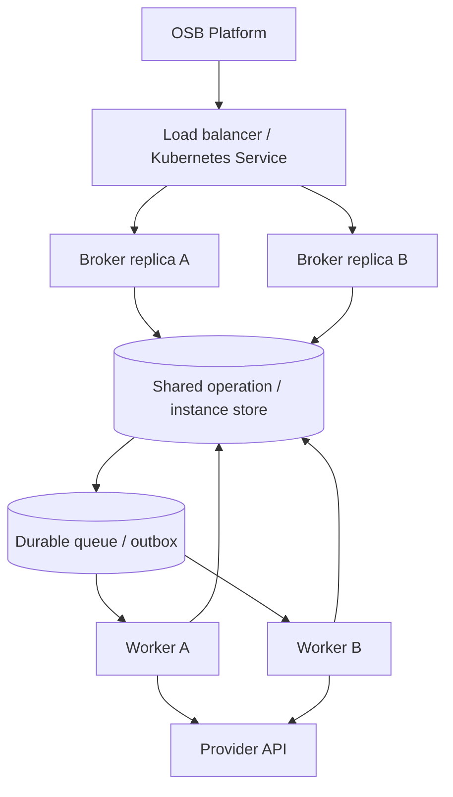
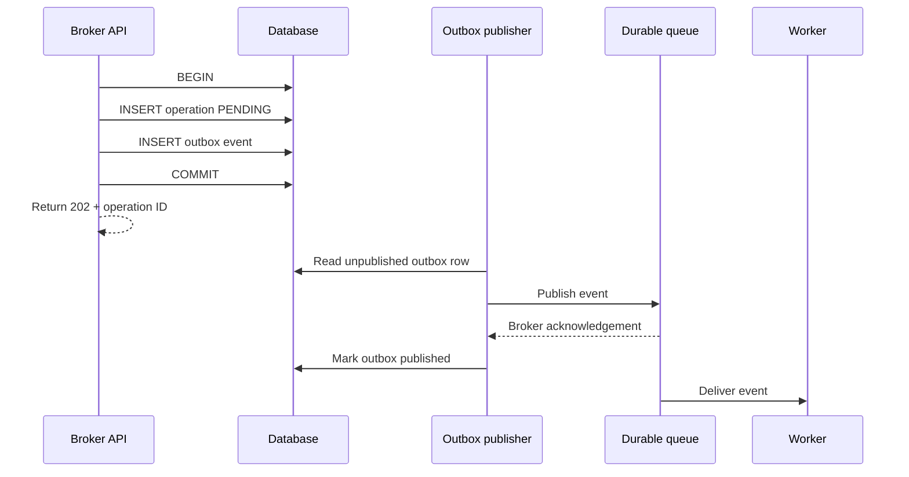
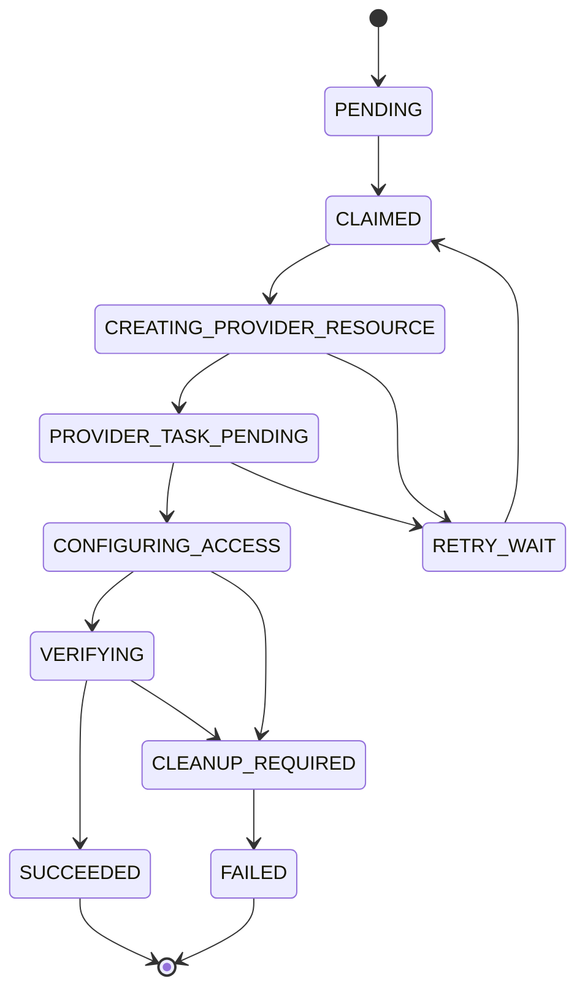
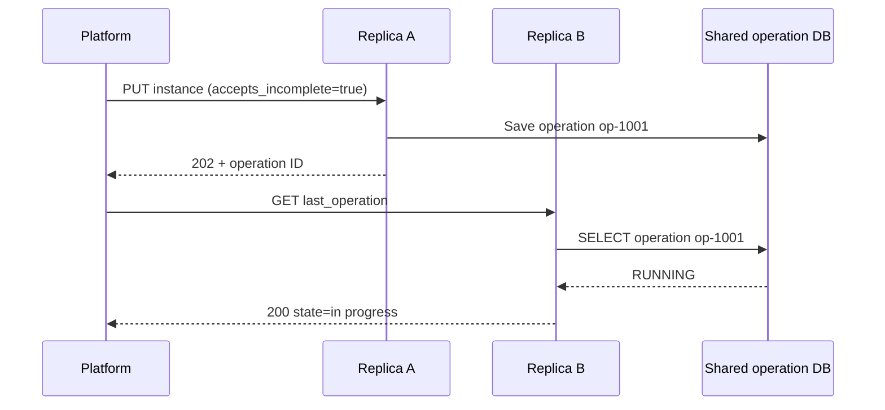

# Broker khởi động lại mất trạng thái hoặc nhiều bản sao xử lý trùng

## 1. Nhận diện hai nhóm sự cố

Một Spring Cloud Service Broker có thể chạy nhiều replica để tăng khả năng sẵn sàng. Mỗi replica nhận request OSB, ghi nhận service instance/binding, tạo operation bất đồng bộ và gọi provider để cấp phát hoặc thu hồi tài nguyên. Nếu trạng thái chỉ nằm trong bộ nhớ của một process, broker có thể mất dấu công việc sau khi Pod restart. Nếu nhiều replica cùng xử lý một operation mà không có cơ chế điều phối, chúng có thể tạo database, credential hoặc provider task trùng nhau.

Hai biểu hiện thường gặp:

- **Mất trạng thái sau restart:** platform đã nhận `202 Accepted` nhưng sau khi broker restart, `last_operation` không tìm thấy operation hoặc trả trạng thái cũ; worker không tiếp tục công việc; tài nguyên provider đã tạo nhưng broker không còn mapping.
- **Xử lý trùng giữa nhiều replica:** hai request retry hoặc hai worker cùng claim một operation; provider nhận nhiều lệnh create/delete; trạng thái bị ghi đè; có nhiều resource cùng thuộc một service instance.

Hai sự cố có thể xảy ra đồng thời. Ví dụ replica A gọi provider tạo database thành công nhưng bị kill trước khi lưu provider resource ID. Replica B nhận lại message và gọi create lần nữa. Kết quả là một service instance có hai database, trong khi operation store chỉ biết một hoặc không biết database nào đã được tạo.

Trong module `SPRING_CLOUD_SERVICE_BROKER`, cần xem broker là một hệ thống phân tán: HTTP request, operation store, queue, worker, provider API và nhiều replica có thể gặp timeout, restart hoặc xử lý lại cùng một thông điệp. Trạng thái nghiệp vụ phải bền vững; mọi side effect cần idempotency hoặc cơ chế đối soát; quyền xử lý operation phải được điều phối bằng storage dùng chung.



## 2. Phân biệt dữ liệu tạm và trạng thái nghiệp vụ

Không phải mọi dữ liệu trong process đều phải persist. Điều quan trọng là phân biệt dữ liệu có thể tạo lại với dữ liệu cần tồn tại qua restart.

| Dữ liệu | Có thể chỉ ở memory? | Lý do |
|---|---|---|
| HTTP request object đang xử lý | Có, trong thời gian request | Nếu process dừng, client có thể retry; request phải được xử lý idempotent. |
| Cache catalog có thể tải lại | Có thể, nếu có nguồn chuẩn và cơ chế refresh | Cache không phải nguồn dữ liệu duy nhất. |
| Service instance mapping | Không | Cần retrieve, update, binding và deprovision đúng provider resource. |
| Binding record và credential reference | Không | Cần unbind, rotate và thu hồi credential chính xác. |
| Operation ID, state và loại operation | Không | Platform polling `last_operation` sau restart. |
| Provider task/resource ID | Không | Cần truy vấn trạng thái hoặc đối soát provider sau timeout. |
| Retry count, checkpoint và lease | Không nếu dùng để điều phối worker | Giúp tránh chạy trùng và phục hồi đúng bước. |
| Trace/span đang mở | Không cần giữ nguyên span object | Trace context cần thiết có thể persist; span runtime kết thúc cùng process. |
| Metric counter cục bộ | Không phải nguồn nghiệp vụ | Metric có thể reset; không dùng để khôi phục operation. |

Một nguyên tắc quan trọng: process có thể restart bất cứ lúc nào, vì vậy không được để khả năng hoàn tất một operation phụ thuộc vào một object Java, `Map`, scheduler hoặc `Mono` chỉ tồn tại trong heap của một replica.

## 3. Kiến trúc lưu trạng thái bền vững

Broker nên lưu instance, binding và operation trong database dùng chung cho tất cả replica. Worker có thể chạy ở process riêng hoặc cùng application, nhưng trạng thái phải nằm ngoài vòng đời của process.

Một operation record thường cần có:

```text
operation_id
instance_id
binding_id
operation_type
state
payload_version
request_fingerprint
provider_name
provider_task_id
provider_resource_id
current_step
retry_count
lease_owner
lease_until
fencing_token
version
last_error_code
created_at
updated_at
completed_at
```

Đây là các trường minh họa. Thiết kế thực tế cần giới hạn dữ liệu nhạy cảm, xác định index, retention và quan hệ khóa ngoại. Không lưu raw password, token hoặc private key trong operation payload. Hãy lưu secret reference tới secret manager hoặc kho credential được mã hóa.

Ví dụ schema rút gọn:

```sql
CREATE TABLE service_instance (
    platform_id VARCHAR(100) NOT NULL,
    instance_id VARCHAR(100) NOT NULL,
    service_id VARCHAR(100) NOT NULL,
    plan_id VARCHAR(100) NOT NULL,
    state VARCHAR(30) NOT NULL,
    provider_resource_id VARCHAR(255),
    version BIGINT NOT NULL DEFAULT 0,
    created_at TIMESTAMP NOT NULL,
    updated_at TIMESTAMP NOT NULL,
    PRIMARY KEY (platform_id, instance_id)
);

CREATE TABLE broker_operation (
    operation_id VARCHAR(100) PRIMARY KEY,
    platform_id VARCHAR(100) NOT NULL,
    instance_id VARCHAR(100) NOT NULL,
    operation_type VARCHAR(40) NOT NULL,
    state VARCHAR(30) NOT NULL,
    provider_task_id VARCHAR(255),
    current_step VARCHAR(80),
    retry_count INTEGER NOT NULL DEFAULT 0,
    lease_owner VARCHAR(120),
    lease_until TIMESTAMP,
    fencing_token BIGINT NOT NULL DEFAULT 0,
    version BIGINT NOT NULL DEFAULT 0,
    last_error_code VARCHAR(100),
    created_at TIMESTAMP NOT NULL,
    updated_at TIMESTAMP NOT NULL
);

CREATE INDEX idx_operation_instance
    ON broker_operation(platform_id, instance_id, created_at);
```

Khóa chính và unique constraint phải phản ánh đúng phạm vi ID của platform. Nếu broker phục vụ nhiều platform, không giả định `instance_id` do client gửi là duy nhất trên toàn bộ broker trừ khi hệ thống đã quy định như vậy.

## 4. Vì sao lưu operation trong memory gây mất trạng thái?

Một triển khai đơn giản có thể lưu operation vào `ConcurrentHashMap`:

```java
Map<String, Operation> operations = new ConcurrentHashMap<>();
```

Cách này hữu ích cho demo hoặc unit test, nhưng không phù hợp làm nguồn trạng thái production. Khi process restart:

- Map bị tạo lại và mọi operation đang chạy biến mất.
- Replica khác không thể đọc operation do replica đầu tiên tạo.
- Platform polling có thể đến một replica khác và nhận not found.
- Worker restart không biết bước nào đã hoàn thành.
- Provider resource có thể tồn tại nhưng broker mất ID để quản lý.

Nếu response ban đầu đã là `202 Accepted`, broker đã cam kết tiếp nhận công việc. Vì vậy, trước khi trả `202`, operation và thông tin đủ để phục hồi phải được commit vào durable store.

Trình tự an toàn:

1. Validate request và xác định `instance_id`/`binding_id`.
2. Tạo hoặc tìm instance record theo idempotency key.
3. Tạo operation record với state `PENDING`.
4. Ghi outbox event để dispatch công việc trong cùng transaction.
5. Commit transaction.
6. Trả `202 Accepted` cùng operation ID.
7. Outbox publisher gửi message tới queue; worker tiếp nhận sau đó.

Nếu transaction thất bại, không trả `202`. Nếu queue tạm thời không khả dụng sau commit, outbox publisher có thể gửi lại khi hệ thống phục hồi.

## 5. Transactional outbox tránh mất công việc

Một lỗi phổ biến là ghi operation vào database rồi publish message trong hai thao tác không liên kết:

```text
Save operation -> process crash -> publish message never happens
```

Hoặc publish trước rồi database rollback:

```text
Publish message -> worker starts -> database transaction rolls back
```

Transactional outbox giải quyết khoảng trống này bằng cách ghi operation và event dispatch trong cùng một transaction database.



Outbox publisher có thể gửi cùng một event nhiều lần nếu process dừng sau khi queue nhận message nhưng trước khi database đánh dấu published. Vì vậy, outbox không tạo exactly-once side effect ở provider. Worker vẫn phải idempotent và chống xử lý trùng.

## 6. Vì sao nhiều replica xử lý trùng?

Các nguyên nhân thường gặp:

- Hai worker đọc cùng một message do queue redelivery hoặc visibility timeout hết hạn.
- Hai replica cùng chạy scheduled poller và cùng chọn operation `PENDING`.
- Platform retry PUT sau khi response bị mất; request đến replica khác.
- Một worker chậm nhưng lease đã hết hạn; worker thứ hai claim operation trong khi worker đầu vẫn chạy.
- Provider đã thực hiện side effect nhưng broker chưa lưu kết quả; retry tạo thêm resource.
- Queue consumer commit offset/ack sai thời điểm khiến message được giao lại.
- Không có unique constraint hoặc transaction boundary cho instance/operation.

Không thể giả định một message chỉ được giao một lần. Hầu hết queue và distributed worker sử dụng mô hình at-least-once; message có thể được redeliver. Mục tiêu thực tế là xử lý lặp an toàn bằng idempotency, durable state và fencing.

## 7. Claim operation bằng database lock hoặc lease

Worker cần cơ chế claim operation để một thời điểm chỉ có một worker hợp lệ thực hiện bước cập nhật state.

Một cách là claim bằng câu lệnh cập nhật có điều kiện:

```sql
UPDATE broker_operation
SET state = 'RUNNING',
    lease_owner = :workerId,
    lease_until = :leaseUntil,
    fencing_token = fencing_token + 1,
    version = version + 1,
    updated_at = CURRENT_TIMESTAMP
WHERE operation_id = :operationId
  AND state IN ('PENDING', 'RETRY_WAIT')
  AND (lease_until IS NULL OR lease_until < CURRENT_TIMESTAMP);
```

Worker chỉ được xử lý nếu số row cập nhật bằng 1. Nếu bằng 0, operation đã được worker khác claim, đã hoàn tất hoặc chưa đủ điều kiện chạy.

Một cách khác là dùng `SELECT ... FOR UPDATE SKIP LOCKED` trong transaction ngắn để nhiều worker lấy các operation khác nhau. Cú pháp và hành vi phụ thuộc database. Không giữ row lock trong lúc gọi provider qua mạng vì transaction dài có thể gây contention và lock timeout.

### 7.1. Lease cần thời hạn và gia hạn

Lease giúp worker khác tiếp tục khi process bị chết. Tuy nhiên, lease có thể hết hạn trong khi worker cũ vẫn đang thực hiện provider call chậm. Worker mới có thể claim cùng operation. Vì vậy, lease cần kết hợp heartbeat, timeout và fencing token.

- Worker gia hạn lease khi còn sở hữu operation.
- Nếu không thể gia hạn, worker phải ngừng ghi kết quả và không bắt đầu side effect mới.
- Mỗi lần claim tăng `fencing_token`.
- Mọi cập nhật state phải kiểm tra worker còn giữ fencing token hiện tại.
- Provider call nên có timeout và idempotency key riêng.

### 7.2. Fencing token ngăn worker cũ ghi đè

Giả sử worker A claim token 7, bị pause lâu và lease hết hạn. Worker B claim lại token 8 và hoàn tất operation. Khi worker A thức dậy, nó không được phép ghi state bằng token 7.

Ví dụ:

```sql
UPDATE broker_operation
SET state = 'SUCCEEDED',
    updated_at = CURRENT_TIMESTAMP
WHERE operation_id = :operationId
  AND lease_owner = :workerId
  AND fencing_token = :fencingToken
  AND state = 'RUNNING';
```

Nếu update không ảnh hưởng row nào, worker đã mất quyền sở hữu. Fencing token bảo vệ database state; để ngăn side effect trùng tại provider, vẫn cần provider idempotency hoặc tra cứu resource trước khi tạo.

## 8. Idempotency ở request OSB

Platform có thể gửi lại request PUT khi không nhận được response, dù broker đã commit operation. Broker phải nhận diện request lặp dựa trên định danh nghiệp vụ và nội dung có ý nghĩa.

Với provision, các khóa thường gồm:

- Platform identity.
- `service_instance_id` trong URL.
- `service_id` và `plan_id`.
- Parameters đã chuẩn hóa và các context field có ảnh hưởng tới tài nguyên.

Hành vi cần kiểm thử:

| Request lặp | Hành vi mong đợi |
|---|---|
| Cùng instance ID, cùng service/plan và parameters | Trả response hoặc operation hiện tại theo OSB contract; không tạo instance/resource mới. |
| Cùng instance ID nhưng service/plan khác | Trả conflict phù hợp; không âm thầm thay đổi instance. |
| Cùng instance ID nhưng parameters xung đột | Phát hiện fingerprint khác và từ chối theo policy/API contract. |
| Request đến replica khác | Đọc cùng record trong shared store; không phụ thuộc memory cục bộ. |

Tạo unique constraint cho `(platform_id, instance_id)`. Dùng transaction và fingerprint của request đã chuẩn hóa để so sánh request retry. Không hash raw JSON tùy ý nếu thứ tự key hoặc biểu diễn số khác nhau có thể tạo fingerprint sai; cần canonicalize trước.

## 9. Idempotency ở provider adapter

Idempotency ở HTTP layer chưa đủ. Broker có thể gửi provider request, provider thực hiện xong nhưng response bị mất. Khi retry, broker không biết side effect đã xảy ra hay chưa.

Ưu tiên theo thứ tự:

1. Dùng provider idempotency key ổn định được tạo từ operation ID.
2. Gắn tag/metadata ownership vào provider resource, ví dụ `broker_instance_id` và `broker_operation_id`.
3. Trước khi tạo lại, tra cứu provider resource/task theo key hoặc tag.
4. Nếu provider không hỗ trợ lookup hoặc idempotency, dùng lock/ledger nội bộ và reconciliation; không retry mù quáng sau kết quả không xác định.

Ví dụ header provider:

```http
POST /v1/databases HTTP/1.1
Idempotency-Key: op-provision-1001-01
Content-Type: application/json
```

Header này chỉ là ví dụ; tên và semantics phụ thuộc provider. Không tự thêm `Idempotency-Key` nếu provider không hỗ trợ. Một số provider yêu cầu token trong body hoặc metadata riêng.

Nếu provider không có idempotency, broker có thể tra resource theo tag trước khi tạo. Resource phải được tag từ đầu hoặc có một external request record để đối chiếu. Nếu không thể xác định provider đã tạo tài nguyên hay chưa, giữ operation ở trạng thái cần reconciliation thay vì tạo resource thứ hai.

## 10. State machine và checkpoint cho operation

Operation dài nên chia thành các bước có thể phục hồi. Ví dụ provisioning database:



Lưu `current_step` và các ID đã nhận được sau mỗi side effect quan trọng. Ví dụ, sau khi provider trả `provider_task_id`, lưu nó ngay trước khi chuyển sang bước polling. Nếu worker restart, nó tiếp tục truy vấn task hiện tại thay vì gửi lại create request.

Checkpoint phải phản ánh sự kiện đã xác minh. Không đánh dấu `RESOURCE_CREATED` trước khi provider xác nhận hoặc có thể tra cứu tài nguyên. Nếu provider timeout và không rõ kết quả, dùng trạng thái `OUTCOME_UNKNOWN`/`RECONCILIATION_REQUIRED` thay vì giả định create thất bại.

## 11. Khôi phục operation sau khi broker restart

Khi application khởi động lại, không nên chạy lại tất cả operation `RUNNING` ngay lập tức. Một worker khác có thể vẫn đang xử lý hoặc lease còn hiệu lực.

Quy trình recovery:

1. Khởi tạo kết nối database, queue và provider adapter.
2. Chờ readiness của các dependency bắt buộc.
3. Tìm operation `PENDING`, `RETRY_WAIT` hoặc `RUNNING` có lease hết hạn.
4. Claim bằng transaction/lease và tăng fencing token.
5. Đọc `current_step`, `provider_task_id` và provider resource mapping.
6. Tra cứu trạng thái provider trước khi lặp side effect không idempotent.
7. Tiếp tục bước còn thiếu hoặc chuyển sang reconciliation.
8. Cập nhật operation state và instance state trong transaction phù hợp.
9. Đưa operation quá số lần retry hoặc quá thời hạn vào dead-letter/manual review theo policy.

Không reset mọi operation `RUNNING` thành `PENDING` khi startup. Làm như vậy có thể khiến một tác vụ đã được provider thực hiện bị chạy lại. Cần kiểm tra lease, heartbeat và provider state.

## 12. Last-operation phải đọc từ shared store

Sau khi broker trả `202 Accepted`, platform có thể gửi polling tới bất kỳ replica nào. Endpoint `last_operation` không được đọc trạng thái từ cache cục bộ hoặc map trong process.

Ví dụ luồng:



Test quan trọng là gửi request create tới replica A và polling tới replica B. Kết quả phải nhất quán. Nếu mỗi replica có database riêng hoặc cache không đồng bộ, broker sẽ trả trạng thái không ổn định.

Operation terminal cần được lưu đủ lâu theo retention policy để platform retry polling, support và audit. Không xóa operation ngay khi worker hoàn tất nếu platform còn có thể hỏi `last_operation`.

## 13. Kubernetes replicas, readiness và graceful shutdown

Trong Kubernetes, Deployment có thể chạy nhiều Pod. Một số cấu hình vận hành giúp giảm sự cố khi rollout hoặc restart:

- Tất cả replica dùng chung database, queue và secret store phù hợp.
- Readiness chỉ thành công khi Pod có thể phục vụ request an toàn.
- Liveness phản ánh process còn hoạt động, không phụ thuộc mọi provider bên ngoài.
- Graceful shutdown ngừng claim công việc mới và cho request đang xử lý thời gian kết thúc.
- Worker lease và durable queue cho phép Pod khác tiếp tục khi Pod cũ bị dừng.
- PodDisruptionBudget hỗ trợ hạn chế voluntary disruption nhưng không thay thế idempotency hoặc persistence.

Ví dụ cấu hình:

```yaml
apiVersion: apps/v1
kind: Deployment
metadata:
  name: service-broker
spec:
  replicas: 3
  strategy:
    type: RollingUpdate
    rollingUpdate:
      maxSurge: 1
      maxUnavailable: 0
  selector:
    matchLabels:
      app: service-broker
  template:
    metadata:
      labels:
        app: service-broker
    spec:
      terminationGracePeriodSeconds: 60
      containers:
        - name: broker
          image: registry.example.com/service-broker:2.4.0
          readinessProbe:
            httpGet:
              path: /actuator/health/readiness
              port: 8080
          livenessProbe:
            httpGet:
              path: /actuator/health/liveness
              port: 8080
```

Đây là manifest minh họa. Cần cấu hình service account, secret, resources, port, probe và storage theo môi trường thật. Không dùng `replicas: 1` như cách xử lý lâu dài cho duplicate processing; một replica vẫn có thể restart và mất trạng thái nếu persistence sai.

## 14. Graceful shutdown của worker

Khi Pod nhận SIGTERM:

1. Chuyển readiness sang false để không nhận request mới.
2. Ngừng claim operation mới.
3. Cho request HTTP đang xử lý hoàn tất trong grace period.
4. Worker đang chạy có thể hoàn tất bước an toàn hoặc persist checkpoint.
5. Nhả lease nếu có thể; nếu process bị kill, lease hết hạn để worker khác claim.
6. Không ACK message trước khi state/side effect đã được ghi bền vững theo contract xử lý.

Với Spring Boot, có thể bật graceful shutdown:

```yaml
server:
  shutdown: graceful

spring:
  lifecycle:
    timeout-per-shutdown-phase: 45s
```

Thời gian này cần nhỏ hơn `terminationGracePeriodSeconds` để process có thời gian dừng trước khi Kubernetes gửi SIGKILL. Worker xử lý tác vụ dài cần checkpoint và lease; không nên phụ thuộc vào việc luôn được chạy đến hết trong một lần shutdown.

## 15. Phân biệt lỗi mất trạng thái và lỗi xử lý trùng

| Triệu chứng | Nguyên nhân khả dĩ | Bằng chứng cần tìm |
|---|---|---|
| `last_operation` trả not found sau restart | Operation chỉ lưu memory hoặc replica khác không dùng chung store. | DB không có record, log có request 202 trước restart. |
| Operation mãi `in progress` | Worker chết, queue message mất, lease không hết hạn hoặc không có recovery job. | State, lease_until, heartbeat, queue lag và worker log. |
| Provider có resource nhưng broker không có mapping | Process chết sau provider success trước khi commit kết quả. | Provider tag/task ID, audit và operation checkpoint. |
| Hai database cùng được tạo | Retry không idempotent hoặc nhiều worker cùng xử lý. | Provider audit, idempotency key, worker owner và operation history. |
| Operation state quay ngược | Worker cũ ghi đè state mới hoặc không dùng version/fencing. | Updated version, fencing token, concurrent update logs. |
| Một replica trả succeeded, replica khác trả in progress | State nằm ở memory/cache cục bộ hoặc cache invalidation lỗi. | DB endpoint/config, cache key và request routing. |
| Queue redeliver liên tục | Worker crash trước ACK, poison message hoặc lỗi không retry được. | Delivery count, DLQ, consumer exception và ack timing. |

Chẩn đoán cần đối chiếu cả database broker và provider. Không kết luận provider chưa tạo resource chỉ vì broker không có provider resource ID; có thể side effect đã xảy ra nhưng commit bị mất.

## 16. Quy trình xử lý operation bị mất sau restart

Khi platform polling không tìm thấy operation hoặc operation biến mất sau restart:

1. Lấy `instance_id`, `operation_id`, platform ID và thời điểm request được tiếp nhận.
2. Tìm operation record trong shared database theo đúng platform scope.
3. Kiểm tra database có phải cùng endpoint/schema mà các replica sử dụng không.
4. Kiểm tra log trước restart để xác nhận broker đã trả `202` hay chưa.
5. Kiểm tra outbox/queue xem event có được commit và publish không.
6. Tra provider theo idempotency key, tag hoặc provider task ID để biết side effect đã xảy ra chưa.
7. Nếu resource tồn tại, phục hồi mapping và tiếp tục operation theo workflow có audit.
8. Nếu resource chưa tồn tại và kết quả chắc chắn, enqueue lại operation theo idempotency key cũ.
9. Nếu không xác định được, chuyển sang reconciliation/manual review; không tạo resource mới một cách mù quáng.

Nếu operation record thực sự không được persist dù đã trả `202`, đây là lỗi thiết kế cần sửa ở transaction boundary. Không khắc phục bằng cách chỉ tăng thời gian polling của platform.

## 17. Quy trình xử lý nhiều replica xử lý trùng

Khi phát hiện duplicate provider resource hoặc operation:

1. Tạm dừng consumer/worker hoặc giới hạn concurrency nếu side effect trùng còn tiếp diễn.
2. Xác định các operation và provider resource liên quan bằng `instance_id`, `operation_id`, provider task ID và tag.
3. Kiểm tra có nhiều worker claim cùng operation hay nhiều request tạo instance trùng.
4. Kiểm tra unique constraint, lease, fencing token và transaction boundaries.
5. Xác định resource nào là canonical theo mapping và audit; không xóa resource chỉ dựa trên tên gần giống.
6. Revoke credential hoặc cleanup resource dư theo workflow có kiểm soát và chính sách dữ liệu.
7. Khôi phục worker sau khi đã triển khai idempotency/claim fix.
8. Reconcile database broker với provider để xác nhận chỉ còn resource mong muốn.

Không sửa trực tiếp state thành `SUCCEEDED` để làm platform ngừng polling nếu provider state chưa được xác minh. Cũng không xóa operation history trước khi hoàn tất điều tra.

## 18. Kiểm thử restart và concurrency

Kiểm thử phải tái hiện được các cửa sổ lỗi, không chỉ gọi service method tuần tự.

### 18.1. Restart sau khi trả 202

1. Gửi provision request và nhận `202` cùng operation ID.
2. Xác minh operation và outbox đã commit.
3. Dừng worker hoặc application context.
4. Khởi động replica khác dùng cùng database/queue.
5. Poll `last_operation` từ replica mới.
6. Xác minh worker tiếp tục từ checkpoint và operation kết thúc đúng.

### 18.2. Hai worker claim cùng operation

1. Tạo một operation `PENDING`.
2. Dùng barrier để hai worker cùng cố claim.
3. Xác minh chỉ một claim thành công.
4. Xác minh provider create chỉ được thực hiện theo idempotency contract.
5. Cho worker thắng lease bị dừng và hết hạn lease.
6. Worker khác claim lại với fencing token lớn hơn.
7. Xác minh worker cũ không thể ghi đè state mới.

### 18.3. Provider thành công nhưng response bị mất

1. Fake provider tạo resource và ghi nhận idempotency key.
2. Giả lập timeout trước khi broker nhận response.
3. Worker retry hoặc recovery chạy lại.
4. Xác minh broker tra lại resource/task thay vì tạo mới.
5. Xác minh chỉ có một provider resource và mapping được phục hồi.

### 18.4. Request retry tới replica khác

Gửi cùng PUT request hai lần qua load balancer, bảo đảm hai request có thể tới hai Pod khác nhau. Kiểm tra unique constraint, response idempotent và operation ID nhất quán. Không chỉ test gọi hai lần trên cùng một object service trong một process.

## 19. Quan sát và cảnh báo

Để phát hiện sớm mất trạng thái hoặc duplicate processing, theo dõi:

| Metric/log | Dấu hiệu bất thường |
|---|---|
| Số operation `PENDING`/`RUNNING` | Tăng liên tục hoặc có operation quá tuổi. |
| Operation lease expired | Worker chết hoặc không gia hạn lease. |
| Claim conflict count | Nhiều worker cùng tranh chấp một operation; tăng đột biến cần điều tra. |
| Duplicate idempotency hit | Retry được nhận diện; tăng cao có thể phản ánh timeout/client retry. |
| Provider resource per instance | Một instance có nhiều resource ngoài thiết kế. |
| Queue redelivery/DLQ | Worker crash hoặc message poison. |
| Outbox unpublished age | Publisher không gửi được event. |
| Operation state regression | State bị ghi đè hoặc version check thiếu. |
| Provider task succeeded but operation pending | Finalize/update database thất bại. |

Structured log nên có `operation_id`, `instance_id`, operation type, worker ID, fencing token, provider task ID và correlation ID. Không dùng các ID duy nhất theo request làm metric label có cardinality cao. Không ghi credential hoặc toàn bộ provider response.

## 20. Checklist phòng ngừa

1. Instance, binding và operation state được lưu trong database dùng chung.
2. `202 Accepted` chỉ trả sau khi operation và outbox đã commit.
3. Queue bền vững và worker xử lý at-least-once an toàn.
4. Unique constraint bảo vệ instance và operation trong phạm vi platform.
5. Worker claim operation bằng transaction/lease/lock có thời hạn.
6. Lease có heartbeat, fencing token và kiểm tra quyền sở hữu khi update.
7. Provider request dùng idempotency key hoặc cơ chế tra cứu resource theo tag.
8. Operation có checkpoint và provider task/resource ID để resume.
9. Last-operation đọc shared store, không đọc memory cục bộ.
10. Worker recovery không reset mọi RUNNING operation một cách mù quáng.
11. Graceful shutdown ngừng claim mới và cho phép checkpoint/lease recovery.
12. Retry, timeout, restart, queue redelivery và multi-replica được kiểm thử.
13. Reconciliation phát hiện resource mồ côi, mapping thiếu và operation bị kẹt.
14. Operation history, audit và secret references có retention/backup phù hợp.

## 21. Nguyên tắc cần ghi nhớ

- Restart là tình huống bình thường của process; trạng thái nghiệp vụ không được phụ thuộc heap của một replica.
- Nhiều replica và queue redelivery khiến cùng một operation có thể được giao nhiều lần; worker phải idempotent.
- Persist operation và outbox trong cùng transaction trước khi trả `202 Accepted`.
- Dùng shared database, unique constraint và operation ID ổn định để mọi replica nhìn thấy cùng trạng thái.
- Lease/lock giúp claim công việc; fencing token ngăn worker cũ ghi đè state mới.
- Provider idempotency hoặc lookup theo tag bảo vệ khỏi side effect trùng khi timeout không xác định.
- Lưu checkpoint, provider task ID và resource mapping để resume sau restart.
- `last_operation` luôn đọc trạng thái bền vững; không xóa operation trước khi hết thời gian polling/retention.
- Reconciliation là bước cần thiết để phát hiện và sửa sai lệch giữa broker database và provider.
- Kiểm thử restart, concurrency và provider timeout phải bao phủ cả HTTP, persistence, worker và provider adapter.

## Nguồn tham khảo

- [Open Service Broker API v2.17](https://github.com/openservicebrokerapi/servicebroker/blob/v2.17/spec.md): idempotency, asynchronous operations và last-operation contract.
- [Spring Cloud Open Service Broker 4.4.1 Reference](https://docs.spring.io/spring-cloud-open-service-broker/docs/4.4.1/reference/): service instance/binding lifecycle và asynchronous operation support.
- [Kubernetes Deployments – Rolling updates](https://kubernetes.io/docs/concepts/workloads/controllers/deployment/#rolling-update-deployment): quản lý nhiều replica trong rollout.
- [Kubernetes Pod lifecycle](https://kubernetes.io/docs/concepts/workloads/pods/pod-lifecycle/): termination và graceful shutdown behavior.
- [PostgreSQL – Explicit Locking](https://www.postgresql.org/docs/current/explicit-locking.html): row-level locking và transaction concurrency.
- [Microservices.io – Transactional Outbox](https://microservices.io/patterns/data/transactional-outbox.html): lưu business state và event dispatch trong cùng transaction.
