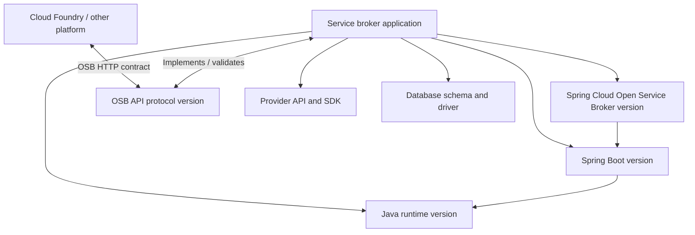
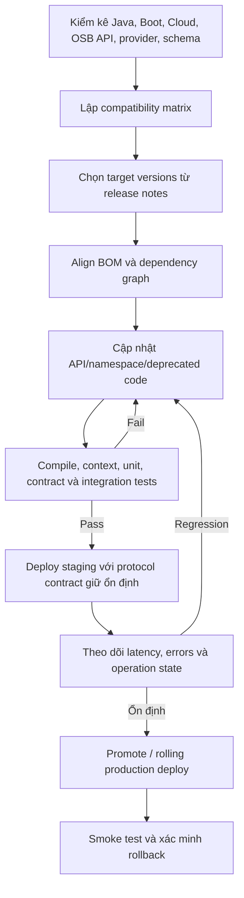

# Phân biệt phiên bản framework, Spring Boot và OSB API

Khi nâng cấp một service broker dùng Spring Cloud Open Service Broker, có ít nhất ba trục phiên bản cần theo dõi độc lập: phiên bản thư viện/framework, phiên bản Spring Boot và phiên bản giao thức Open Service Broker API (OSB API). Ba trục này có quan hệ tương thích nhưng không đồng nghĩa với nhau.

Ví dụ, ứng dụng có thể dùng Spring Cloud Open Service Broker 4.4.1, chạy trên một phiên bản Spring Boot tương thích và giao tiếp với Cloud Foundry bằng OSB API 2.17. Nâng cấp thư viện lên bản mới không tự động có nghĩa broker đã chuyển sang protocol version mới; đổi Spring Boot cũng không tự thay đổi request/response mà platform gửi; và cấu hình OSB API version không quyết định Java runtime hay dependency framework.

Nếu gộp ba khái niệm thành một, quá trình nâng cấp dễ gây lỗi ở nhiều lớp: ứng dụng không khởi động vì dependency không tương thích, auto-configuration thay đổi, controller xử lý request khác trước hoặc platform không chấp nhận API contract. Bài học này giúp lập ma trận tương thích và nâng cấp từng trục có kiểm soát.

## 1. Ba trục phiên bản độc lập

| Trục | Phiên bản đại diện cho | Ví dụ | Ai kiểm soát? |
|---|---|---|---|
| Framework/library | API Java, auto-configuration, service interfaces và dependency của Spring Cloud Open Service Broker | `spring-cloud-starter-open-service-broker:4.4.1` | Build/dependency management của ứng dụng |
| Spring Boot | Runtime application, auto-configuration, embedded server, Actuator, cấu hình và integration test | Một phiên bản Spring Boot 3.x tương thích với thư viện | Build/dependency management và runtime |
| OSB API | Contract HTTP giữa platform và broker: endpoint, header, request/response, status code và semantics | OSB API `2.17` trong `X-Broker-API-Version` | Platform và broker configuration/implementation |

Ngoài ba trục chính, broker còn phụ thuộc vào Java runtime, Spring Framework, Spring Security, Reactor, database driver, provider SDK, schema database và các extension của platform như Cloud Foundry profile. Những yếu tố này tạo thành một ma trận tương thích rộng hơn.



Các mối liên hệ trong sơ đồ không có nghĩa các phiên bản phải giống nhau. Chúng phải tương thích theo contract và ma trận hỗ trợ của từng thành phần.

## 2. Phiên bản Spring Cloud Open Service Broker

Spring Cloud Open Service Broker là thư viện/framework giúp xây dựng broker theo OSB API. Phiên bản của artifact như `spring-cloud-starter-open-service-broker` quyết định những gì ứng dụng có thể dùng ở tầng Java và Spring:

- Interface service cho service instance và service binding.
- Request/response model và validation.
- Controller cho Spring MVC hoặc Spring WebFlux.
- Auto-configuration và bean mặc định.
- Event flow registry và operation handling.
- Tích hợp với Spring Boot, Reactor và các thư viện liên quan.

Ví dụ khai báo dependency Gradle:

```groovy
dependencies {
    implementation "org.springframework.cloud:spring-cloud-starter-open-service-broker:4.4.1"
}
```

Số `4.4.1` là phiên bản thư viện, không phải OSB API version. Nó không có nghĩa platform phải gửi `X-Broker-API-Version: 4.4.1`.

Khi nâng cấp framework, cần đọc release notes và API docs của đúng phiên bản để kiểm tra:

1. Interface hoặc method có đổi tên, thêm tham số hoặc thay kiểu trả về không.
2. Request/response model có thay đổi constructor, builder, field hoặc validation không.
3. Auto-configuration có thêm/bỏ bean mặc định hoặc đổi điều kiện không.
4. Event flow registry có đổi thứ tự hoặc semantics không.
5. Spring MVC/WebFlux controller mapping có thay đổi không.
6. Dependency Spring Boot, Spring Framework, Reactor và Java tối thiểu có thay đổi không.
7. Các lỗi và HTTP status được ánh xạ khác trước không.

Một nâng cấp patch có thể chỉ sửa bug, nhưng không nên mặc định mọi patch đều không ảnh hưởng hành vi. Cần xem release notes, dependency changes và test broker thực tế.

## 3. Phiên bản Spring Boot

Spring Boot quản lý vòng đời ứng dụng Spring: auto-configuration, embedded web server, logging, Actuator, configuration binding, dependency management và test support.

Phiên bản Spring Boot ảnh hưởng đến:

- Phiên bản Spring Framework nền tảng.
- Java baseline và runtime compatibility.
- Namespace API như `javax.*` hoặc `jakarta.*` ở các thế hệ Spring tương ứng.
- Cách xử lý configuration properties và auto-configuration.
- Security defaults, embedded server và HTTP stack.
- Micrometer, Actuator và observation APIs.
- Test framework và test slices.

Ví dụ, một lần chuyển từ Spring Boot 2 sang Spring Boot 3 thường đi kèm Spring Framework 6 và Jakarta namespace. Các import Java EE cũ như `javax.servlet.*` trong phần servlet có thể phải đổi sang `jakarta.servlet.*`. Đây là thay đổi ở tầng nền tảng Spring/Java API, không phải thay đổi OSB protocol.

Khi nâng Boot, kiểm tra tối thiểu:

| Thành phần | Câu hỏi tương thích |
|---|---|
| Java | Runtime/build tool có đáp ứng Java baseline của Boot không? |
| Spring Framework | Các bean, lifecycle, web configuration và API có còn tương thích không? |
| Spring Cloud Open Service Broker | Phiên bản thư viện có hỗ trợ Boot version đích không? |
| Web stack | MVC hay WebFlux; server adapter và security chain có đúng không? |
| Spring Security | DSL, filter chain, authentication provider và defaults có thay đổi không? |
| Actuator/Micrometer | Tên metric, health group, endpoint exposure và observation có đổi không? |
| Persistence | Spring Data, Hibernate/JPA, JDBC driver và migration tool có tương thích không? |
| Build plugin | Maven/Gradle plugin và compiler target có hỗ trợ JDK mới không? |

Không nâng riêng `spring-boot-starter-*` lên một version tùy ý trong khi các module Spring Boot khác vẫn ở version khác. Nên để Spring Boot parent hoặc BOM quản lý các dependency thuộc Boot.

## 4. Phiên bản OSB API

OSB API version là phiên bản contract HTTP giữa platform và service broker. Nó quy định cách platform gọi broker và cách broker trả kết quả, bao gồm:

- Endpoint catalog, provision, update, deprovision, bind và unbind.
- Header `X-Broker-API-Version`.
- Cấu trúc JSON request/response.
- Các field optional/required và semantics của context/parameters.
- HTTP status code và error response.
- Hành vi asynchronous operation và last-operation polling.
- Capability như binding retrieval, instance retrieval, plan updateability và context update.

Ví dụ request có header:

```http
PUT /v2/service_instances/pg-orders-01 HTTP/1.1
Host: broker.example.com
Content-Type: application/json
X-Broker-API-Version: 2.17
Authorization: Basic <redacted>
```

Header `X-Broker-API-Version` thể hiện phiên bản protocol platform sử dụng. Nó không phải version của Spring Boot, Spring Cloud Open Service Broker, Java hoặc provider SDK.

Một thư viện framework có thể hỗ trợ nhiều OSB API versions hoặc một tập semantics của protocol; broker cần xác định version mà platform gửi và behavior mà ứng dụng thực sự triển khai. Chỉ đặt header/version config không tự động bổ sung business behavior cho một capability.

### 4.1. OSB API version không phải endpoint version

Path `/v2/...` là version segment của API route. Header `X-Broker-API-Version` mang protocol version cụ thể, ví dụ `2.17`. Không nên suy luận rằng mọi request đến `/v2` đều dùng cùng một feature set chỉ dựa vào path.

Trong OSB API, version header giúp platform và broker thống nhất contract. Broker cần kiểm tra header theo chính sách tương thích mà mình công bố và framework hỗ trợ. Nếu bật strict version validation, request gửi version không được chấp nhận có thể bị trả `412 Precondition Failed` theo implementation/framework configuration. Cần kiểm thử behavior thực tế thay vì giả định mọi broker đều validate theo cùng một cách.

### 4.2. OSB API version và Cloud Foundry profile

Cloud Foundry bổ sung profile-specific fields và behavior, ví dụ context chứa organization/space GUID, service plan access, service instance sharing và originating identity. Những extension này không biến phiên bản thư viện Spring Cloud Open Service Broker thành một phiên bản Cloud Foundry.

Broker cần kiểm tra riêng:

- OSB API version mà platform gửi.
- Cloud Foundry profile fields mà foundation thực tế cung cấp.
- Cloud Controller version và khả năng hỗ trợ các field/feature liên quan.
- Cách broker xử lý optional metadata khi platform cũ không gửi.

Một broker có thể hỗ trợ OSB API version nhưng không triển khai mọi extension của Cloud Foundry profile. Tương tự, Cloud Foundry có thể hỗ trợ một feature nhưng broker chưa công bố hoặc chưa triển khai feature đó.

## 5. Bảng so sánh: thay đổi phiên bản nào ảnh hưởng điều gì?

| Thay đổi | Tầng chịu ảnh hưởng trực tiếp | Có tự đổi OSB contract không? | Ví dụ rủi ro |
|---|---|---|---|
| Spring Cloud Open Service Broker 4.4.1 → bản mới | Java API, controller, auto-configuration, dependency | Không tự động | Service interface hoặc bean condition đổi |
| Spring Boot 3.x → bản mới tương thích | Runtime, Spring Framework, web/security, Actuator | Không tự động | Security chain hoặc health endpoint thay đổi |
| OSB API 2.16 → 2.17 | HTTP contract và semantics platform/broker | Có, nếu broker chọn hỗ trợ behavior mới | Request field hoặc capability mới |
| Java 17 → Java runtime mới | Runtime, compiler và dependency compatibility | Không | Bytecode, TLS provider hoặc library behavior |
| Provider SDK/API version | Broker-to-provider integration | Không đổi OSB protocol trực tiếp | Provider response/error schema thay đổi |
| Database schema migration | Persistence và recovery | Không đổi HTTP contract trực tiếp | Operation cũ không đọc được sau deploy |
| Cloud Foundry foundation upgrade | Platform profile, context và control plane behavior | Có thể tác động integration | Field context/feature availability thay đổi |

Khi review một pull request nâng cấp, hãy ghi rõ trục nào đang được thay đổi. Một pull request nâng Spring Boot không nên được mô tả là “upgrade OSB API” nếu không có thay đổi protocol contract.

## 6. Lập ma trận tương thích trước khi nâng cấp

Không chọn version chỉ vì nó là bản mới nhất. Trước tiên, lập compatibility matrix cho các thành phần đang dùng và version mục tiêu.

Ví dụ ma trận minh họa:

| Thành phần | Hiện tại | Mục tiêu | Điều kiện cần xác minh |
|---|---|---|---|
| Java runtime | Java 17 | Java 21 | Tất cả plugin và provider SDK hỗ trợ runtime đích |
| Spring Boot | 3.x minor hiện tại | Minor/patch mới tương thích | Release notes, Java baseline, Spring Framework |
| Spring Cloud Open Service Broker | 4.4.1 | Bản tương thích với Boot mục tiêu | API docs, auto-config và dependency graph |
| Spring Security | BOM-managed | BOM-managed cùng Boot | Authentication chain và test security |
| OSB API | 2.17 | 2.17 hoặc version mới được platform hỗ trợ | Protocol contract, header validation và capabilities |
| Provider SDK | Version đang dùng | Version tương thích | API behavior, retry và error mapping |
| Database schema | Schema N | Schema N+1 | Migration tương thích rolling deployment |
| Platform | Cloud Foundry foundation hiện tại | Foundation target | Context profile, service access và sharing |

Đây không phải ma trận phiên bản khuyến nghị cho mọi project. Các ô phải được điền bằng version thật từ build và platform đang chạy. Nếu chưa xác minh được một quan hệ, đánh dấu `unknown` và không coi là tương thích.

### 6.1. Phân loại mức độ tương thích

Có thể đánh giá từng quan hệ theo các lớp:

- **Source compatibility:** code có compile sau nâng cấp không?
- **Binary compatibility:** artifact đã compile có chạy được với dependency mới không?
- **Runtime compatibility:** application context, server và provider client có khởi động/chạy đúng không?
- **Protocol compatibility:** platform và broker hiểu cùng request/response semantics không?
- **Data compatibility:** phiên bản mới đọc được state, operation và schema do phiên bản cũ tạo ra không?
- **Operational compatibility:** health check, metrics, logs, secrets, rolling deployment và rollback có hoạt động không?

Build thành công chỉ chứng minh một phần source compatibility. Nó không chứng minh protocol, data hoặc operational compatibility.

## 7. Quản lý dependency bằng BOM và dependency management

Spring Boot BOM quản lý các dependency thuộc hệ sinh thái Boot. Spring Cloud có release train/BOM riêng để quản lý các module Spring Cloud có liên quan. Ứng dụng nên dùng các BOM tương thích thay vì tự chọn version cho từng Spring library.

Ví dụ Gradle dùng Spring Boot plugin và Spring Cloud BOM:

```groovy
plugins {
    id "java"
    id "org.springframework.boot" version "<boot-version>"
    id "io.spring.dependency-management" version "<dependency-management-plugin-version>"
}

dependencyManagement {
    imports {
        mavenBom "org.springframework.cloud:spring-cloud-dependencies:<compatible-cloud-release>"
    }
}

dependencies {
    implementation "org.springframework.boot:spring-boot-starter-actuator"
    implementation "org.springframework.cloud:spring-cloud-starter-open-service-broker:<osb-library-version>"
}
```

Các placeholder phải được thay bằng version tương thích được xác minh từ tài liệu release train và release notes. Không sao chép một bộ version ví dụ từ project khác mà không kiểm tra ma trận Boot/Cloud tương ứng.

Nếu BOM không quản lý artifact Spring Cloud Open Service Broker trong cấu hình cụ thể, cần pin version artifact rõ ràng. Không xóa version một cách máy móc và cũng không giả định mọi release train quản lý mọi Spring Cloud subproject.

### 7.1. Maven dependency management

Với Maven, có thể import BOM trong `dependencyManagement`:

```xml
<dependencyManagement>
    <dependencies>
        <dependency>
            <groupId>org.springframework.boot</groupId>
            <artifactId>spring-boot-dependencies</artifactId>
            <version>${spring-boot.version}</version>
            <type>pom</type>
            <scope>import</scope>
        </dependency>
        <dependency>
            <groupId>org.springframework.cloud</groupId>
            <artifactId>spring-cloud-dependencies</artifactId>
            <version>${spring-cloud.release}</version>
            <type>pom</type>
            <scope>import</scope>
        </dependency>
    </dependencies>
</dependencyManagement>
```

Khi parent POM đã là `spring-boot-starter-parent`, một phần dependency management của Boot đã được kế thừa. Tránh khai báo BOM/parent lặp lại không cần thiết. Nếu import nhiều BOM, hiểu rõ thứ tự và precedence của dependency management để tránh version bị override ngoài ý muốn.

### 7.2. Không trộn version tùy ý

Ví dụ cấu hình rủi ro:

```groovy
dependencies {
    implementation "org.springframework:spring-context:6.x.y"
    implementation "org.springframework:spring-webflux:6.a.b"
    implementation "org.springframework.boot:spring-boot-starter-webflux:3.c.d"
}
```

Các version Spring Framework không đồng bộ có thể tạo `NoSuchMethodError`, `ClassNotFoundException` hoặc lỗi khởi tạo context. Hãy để BOM quản lý các module cùng release train trừ khi có override được kiểm chứng và ghi rõ lý do.

## 8. Kiểm tra dependency graph thực tế

Khai báo dependency trong build file không cho biết đầy đủ version cuối cùng được resolve. Dependency bắc cầu có thể kéo một version khác với dự kiến.

Với Gradle:

```bash
./gradlew dependencies --configuration runtimeClasspath
./gradlew dependencyInsight --dependency spring-boot --configuration runtimeClasspath
./gradlew dependencyInsight --dependency spring-cloud-open-service-broker --configuration runtimeClasspath
./gradlew dependencyInsight --dependency spring-framework --configuration runtimeClasspath
```

Với Maven:

```bash
./mvnw dependency:tree
./mvnw dependency:tree -Dincludes=org.springframework.boot
./mvnw dependency:tree -Dincludes=org.springframework.cloud
./mvnw help:effective-pom
```

Kiểm tra:

- Có nhiều version Spring Framework trong runtime classpath không?
- Spring Boot modules có cùng version không?
- Spring Security có được BOM quản lý đúng không?
- Reactor và Netty có version tương thích không?
- Spring Cloud Open Service Broker kéo dependency nào và version nào?
- Có dependency cũ dùng `javax.*` trong ứng dụng đã chuyển sang Jakarta không?
- Provider SDK có kéo logging, Jackson hoặc HTTP client version gây conflict không?

Nếu có override, ghi rõ dependency nào cần override, vì sao, phạm vi ảnh hưởng và test nào chứng minh an toàn.

## 9. Quản lý OSB API version trong broker

Protocol version phải được xem là một cấu hình/contract riêng. Platform gửi `X-Broker-API-Version`; broker xác định các version được hỗ trợ và cách xử lý request.

Ví dụ cấu hình framework:

```yaml
spring:
  cloud:
    openservicebroker:
      api-version: 2.17
```

Trong Spring Cloud Open Service Broker, có thể cấu hình `BrokerApiVersion` bean để điều khiển version check theo API của phiên bản framework đang dùng:

```java
@Configuration(proxyBeanMethods = false)
public class BrokerProtocolConfiguration {

    @Bean
    BrokerApiVersion brokerApiVersion() {
        return new BrokerApiVersion("2.17");
    }
}
```

Property và bean API cần được đối chiếu với đúng version Spring Cloud Open Service Broker trong project. Khi cấu hình version cụ thể, framework có thể kiểm tra header platform và từ chối version không khớp theo behavior của phiên bản đó. Nếu không cấu hình strict version, behavior mặc định có thể khác; không dựa vào mặc định mà không kiểm thử.

### 9.1. Version check không phải feature implementation

Giả sử broker cấu hình version `2.17`. Điều đó không tự động có nghĩa:

- Broker hỗ trợ mọi optional field của OSB 2.17.
- Catalog đã công bố đúng capabilities.
- Provision/update/bind xử lý đúng mọi request mới.
- Async operation tuân thủ mọi semantics.
- Platform đã bật hoặc hỗ trợ extension riêng.

Ứng dụng phải implement và kiểm thử behavior tương ứng trước khi chấp nhận protocol version. Nếu chỉ hỗ trợ một tập con, cần công bố capabilities và xử lý unsupported feature đúng contract.

### 9.2. Chấp nhận nhiều protocol version

Nếu broker phục vụ nhiều platform hoặc platform nâng cấp không đồng thời, có thể cần hỗ trợ nhiều OSB API versions trong một giai đoạn chuyển tiếp. Cần xác định rõ:

1. Framework có hỗ trợ version negotiation/range hay chỉ exact version check.
2. Request model có giữ được khác biệt field giữa các version không.
3. Broker có thể xử lý request cũ và mới bằng cùng domain model không.
4. Response có tương thích với từng platform version không.
5. Khi nào ngừng hỗ trợ version cũ và cách thông báo platform owner.

Không tự viết version parser bằng so sánh chuỗi như `"2.9" > "2.17"`. Nếu cần so sánh version, dùng parser/version type có semantics rõ ràng. Protocol compatibility cũng không chỉ là so sánh số; cần kiểm tra feature và semantics.

## 10. OSB protocol compatibility khi thêm hoặc đổi field

Khi nâng OSB API version hoặc hỗ trợ platform profile mới, đánh giá từng field:

| Thay đổi | Khả năng tương thích | Hướng xử lý |
|---|---|---|
| Thêm field optional trong request | Thường tương thích nếu broker bỏ qua field chưa biết và platform cũ không gửi | Deserialize/validate linh hoạt, thêm test với field vắng mặt |
| Thêm field required | Có thể phá platform cũ | Chỉ yêu cầu khi protocol version/capability bảo đảm platform gửi |
| Đổi tên field hoặc kiểu dữ liệu | Breaking change | Duy trì compatibility adapter hoặc version-specific mapping |
| Bỏ field response platform đang dùng | Có thể phá consumer | Deprecate, quan sát usage và có kế hoạch loại bỏ |
| Đổi HTTP status semantics | Có thể làm platform retry hoặc polling sai | Contract test và migration theo platform |
| Thay async behavior | Ảnh hưởng operation polling và timeout | Test `accepts_incomplete`, operation ID và last operation |
| Đổi catalog capability | Thay đổi hành vi platform | Cập nhật catalog có kiểm soát và test platform |

Với Cloud Foundry profile, field như annotations có thể optional và chỉ xuất hiện ở foundation/Cloud Controller version hỗ trợ. Broker nên xử lý field vắng mặt theo compatibility policy thay vì giả định mọi foundation đều gửi đầy đủ.

## 11. Nâng cấp Spring Boot và thư viện mà không đổi OSB contract

Một chiến lược an toàn là giữ nguyên OSB API version trong khi nâng runtime/framework. Khi đó, nếu test contract vẫn pass, ta có thể quy nguyên nhân regression cho thay đổi Java/Spring/dependency dễ hơn.

Trình tự gợi ý:

1. Chọn Spring Boot version đích được hỗ trợ bởi Java runtime và Spring Cloud Open Service Broker.
2. Chọn Spring Cloud release train/BOM tương thích.
3. Chọn Spring Cloud Open Service Broker artifact version tương ứng.
4. Giữ OSB API version và catalog contract không đổi trong lần nâng cấp đầu.
5. Cập nhật code cho API deprecation, namespace hoặc auto-configuration changes.
6. Chạy unit, context, integration và OSB contract tests.
7. Deploy staging với cùng catalog và protocol version.
8. Canary/rolling deploy và quan sát operation failure, latency, provider errors.
9. Sau khi runtime ổn định, mới xem xét nâng OSB API version hoặc bật capability mới trong thay đổi riêng.

Tách thay đổi runtime và protocol giúp giảm số biến số trong một lần release.

## 12. Nâng OSB API version có kiểm soát

Khi cần nâng protocol version, hãy làm theo quy trình riêng:

1. Đọc spec/release notes của OSB API version mục tiêu.
2. Xác định field, endpoint, header, status code và behavior mới/thay đổi.
3. Xác định platform đang chạy version nào và có thể nâng ở thời điểm nào.
4. Kiểm tra framework version có model/controller hỗ trợ contract cần thiết không.
5. Bổ sung adapter cho request cũ/mới nếu cần.
6. Cập nhật catalog capability chỉ khi implementation hoàn tất.
7. Thêm contract test cho version cũ và mới.
8. Rollout broker trước hoặc theo trình tự platform hỗ trợ.
9. Theo dõi header version thực tế và request compatibility.
10. Chỉ ngừng hỗ trợ version cũ sau khi platform owner xác nhận migration hoàn tất.

Không nâng version header/config chỉ để “theo kịp số mới”. Cần có lý do về feature, security, interoperability hoặc platform support.

## 13. Database schema và operation compatibility

Broker lưu state lâu dài qua nhiều phiên bản ứng dụng. Nâng framework hoặc protocol có thể làm thay đổi cách serialize request, operation state, provider metadata hoặc catalog snapshot. Cần bảo đảm phiên bản mới đọc được dữ liệu do phiên bản cũ ghi.

Ví dụ schema có thể chứa:

| Dữ liệu | Rủi ro khi nâng cấp |
|---|---|
| Service instance state | Enum mới/đổi tên khiến deserialize thất bại |
| Binding credentials reference | Secret store path hoặc key version thay đổi |
| Operation record | State mới không được worker cũ hiểu |
| Request fingerprint | Canonicalization thay đổi làm retry cũ bị nhận nhầm là request mới |
| Provider resource metadata | SDK mới đổi response model hoặc ID mapping |
| Catalog snapshot | Plan/service ID hoặc capability thay đổi |

### 13.1. Expand-and-contract migration

Một quy trình an toàn:

1. **Expand:** thêm cột/bảng/field mới ở trạng thái tương thích với code cũ.
2. **Dual read/write hoặc backfill:** code mới đọc dữ liệu cũ và mới, ghi theo format tương thích trong giai đoạn chuyển tiếp.
3. **Migrate:** chuyển dữ liệu cũ theo batch và xác minh kết quả.
4. **Switch:** chuyển mọi replica sang format mới.
5. **Contract:** chỉ xóa field cũ sau khi không còn code/worker nào cần nó.

Không deploy schema breaking trước khi phiên bản ứng dụng cũ đã được loại khỏi cluster. Với broker có async worker, phải tính cả worker cũ đang xử lý operation trước khi bỏ state format cũ.

### 13.2. Giữ tương thích idempotency

Nếu thay đổi thuật toán fingerprint hoặc idempotency scope, request retry từ platform có thể không còn khớp record cũ. Nên lưu `fingerprint_version` và giữ logic đọc version cũ trong thời gian retention của operation. Không thay đổi canonicalization mà không có migration hoặc compatibility adapter.

## 14. Kiểm thử tương thích theo nhiều lớp

Một chiến lược kiểm thử cần xác nhận cả dependency/runtime lẫn OSB protocol.

| Lớp kiểm thử | Nội dung | Phát hiện |
|---|---|---|
| Dependency resolution | Kiểm tra BOM và runtimeClasspath | Version conflict, dependency bắc cầu ngoài dự kiến |
| Compile/source | Compile toàn bộ module | API bị xóa/đổi chữ ký, namespace mismatch |
| Application context | Khởi động Spring context và kiểm tra bean | Auto-configuration back-off, missing bean, duplicate bean |
| Unit | Test service/use case và mapper | Thay đổi business behavior |
| OSB contract | Gửi request/response theo spec version | Endpoint, JSON field, status code và async semantics |
| Platform integration | Chạy với Cloud Foundry hoặc platform test harness | Profile fields, authentication, plan access và binding |
| Persistence compatibility | Đọc record cũ, migration và rollback | Schema/state không tương thích |
| Runtime smoke | Startup, health, catalog và provider sandbox | Lỗi config, TLS, secret hoặc provider SDK |
| Load/resilience | Retry, timeout, concurrent request và multi-replica | Regression latency, duplicate side effect, deadlock |

### 14.1. Contract test cho protocol version

Một test nên xác minh:

- Request có `X-Broker-API-Version` được hỗ trợ được chấp nhận.
- Version không được hỗ trợ bị xử lý theo policy đã công bố.
- Request field optional vắng mặt không làm broker crash.
- Request field mới không làm mất dữ liệu khi mapping vào domain model.
- HTTP status và error body phù hợp OSB semantics.
- Async response trả operation ID và last operation có thể polling.
- Catalog chỉ công bố capability mà broker thực sự hỗ trợ.

### 14.2. Test ma trận phiên bản

Khi có nhiều platform version, có thể chạy contract suite theo ma trận:

| Broker build | Platform OSB version | Kết quả cần xác minh |
|---|---|---|
| Build hiện tại | Version đang production | Baseline không regression |
| Build mới | Version đang production | Nâng framework không phá protocol cũ |
| Build mới | Version mục tiêu | Protocol mới hoạt động |
| Build rollback | Version đang production | Rollback vẫn đọc được state và operation |

Không cần kiểm thử mọi tổ hợp có thể tưởng tượng. Ưu tiên các version đang production, version mục tiêu và phiên bản rollback thực tế.

## 15. Quy trình nâng cấp từng bước

Một lần nâng cấp có thể chia thành các giai đoạn:



### 15.1. Trước khi nâng cấp

- Ghi lại version hiện tại từ build và runtime, không suy từ tên module.
- Lưu dependency tree/effective POM làm baseline.
- Xác định platform OSB API version qua cấu hình và request log đã redact.
- Ghi lại catalog, service IDs, plan IDs và capabilities đang công bố.
- Kiểm tra schema, active operation và queue backlog.
- Xác nhận backup/restore và rollback artifact.
- Đọc breaking changes và deprecation notes của từng thành phần.

### 15.2. Trong khi nâng cấp

- Nâng từng nhóm dependency có quan hệ rõ ràng.
- Không đồng thời thay protocol behavior nếu mục tiêu chỉ là nâng framework/runtime.
- Sửa deprecated API và namespace theo compile errors.
- Kiểm tra auto-configuration condition và bean graph.
- Chạy contract test sau mỗi thay đổi có thể tác động endpoint.
- Giữ schema tương thích với phiên bản ứng dụng cũ trong rolling deploy.

### 15.3. Sau khi nâng cấp

- Kiểm tra startup, readiness và dependency health.
- Gọi catalog bằng platform credential/test client.
- Thử provision/bind/unbind/deprovision trên sandbox.
- Thử async operation và polling.
- Quan sát HTTP 4xx/5xx, operation failure và provider latency.
- Kiểm tra request version header thực tế.
- Xác minh các replica cùng chạy đúng image/dependency version.
- Lưu kết quả test và compatibility matrix đã cập nhật.

## 16. Deprecation và chính sách hỗ trợ version

Một service broker nên công bố rõ các version đang hỗ trợ và thời điểm ngừng hỗ trợ. Chính sách có thể gồm:

- Framework version được build và kiểm thử.
- Spring Boot/Java runtime được hỗ trợ.
- OSB API versions được chấp nhận.
- Platform versions đã integration test.
- Provider API/SDK versions được xác nhận.
- Database schema migration compatibility window.

Khi loại bỏ một protocol version hoặc capability:

1. Xác định consumer/platform nào còn dùng.
2. Ghi nhận version header và request patterns không chứa dữ liệu nhạy cảm.
3. Thông báo platform owner và lịch migration.
4. Có thời gian chạy song song hoặc compatibility adapter nếu cần.
5. Chỉ loại bỏ khi đã xác minh không còn consumer phụ thuộc.

Không dùng một version number duy nhất trong tài liệu phát hành để đại diện cho toàn bộ compatibility matrix.

## 17. Lỗi thường gặp

| Lỗi | Hậu quả | Cách xử lý |
|---|---|---|
| Nhầm Spring Cloud Open Service Broker version với OSB API version | Cấu hình header sai hoặc hiểu sai contract | Ghi rõ tên artifact và protocol version riêng |
| Nghĩ nâng Boot tự nâng OSB API | Platform có thể vẫn gửi version cũ; behavior không đổi như kỳ vọng | Quản lý protocol version riêng |
| Chọn Boot và Cloud version độc lập | Dependency conflict hoặc context không khởi động | Dùng release train/BOM tương thích |
| Ghi đè Spring Framework module lẻ | `NoSuchMethodError`, `ClassNotFoundException` | Để BOM quản lý, override có lý do và test |
| Chỉ compile sau nâng cấp | Runtime hoặc protocol có thể vẫn lỗi | Context, integration và contract tests |
| Chỉ đổi `api-version` property | Không tự implement field/capability mới | Bổ sung behavior và test trước khi công bố |
| So sánh version bằng chuỗi | So sánh sai `2.9` và `2.17` | Dùng version parser và semantics rõ ràng |
| Bỏ qua Cloud Foundry profile | Thiếu context hoặc sharing behavior | Test foundation/CAPI version và optional fields |
| Migration schema breaking trong rolling deploy | Replica cũ không đọc được dữ liệu mới | Expand-and-contract |
| Đổi fingerprint không version hóa | Retry cũ có thể tạo side effect trùng | Lưu fingerprint version và hỗ trợ đọc format cũ |
| Bỏ API version cũ quá sớm | Platform chưa nâng cấp không gọi được broker | Deprecation window và telemetry |

## 18. Checklist tương thích

- [ ] Ghi riêng phiên bản Java, Spring Boot, Spring Cloud Open Service Broker và OSB API.
- [ ] Ghi cả Spring Cloud release train/BOM và provider SDK/database schema version.
- [ ] Xác minh Java baseline và Boot/Cloud compatibility matrix.
- [ ] Để BOM quản lý dependency cùng hệ sinh thái; tránh override version rời rạc.
- [ ] Kiểm tra runtime dependency graph sau khi resolve.
- [ ] Đọc release notes, migration guide và deprecation notes của từng version.
- [ ] Xác minh OSB API version qua `X-Broker-API-Version` và broker policy.
- [ ] Không coi version check là bằng chứng broker đã implement mọi capability.
- [ ] Kiểm tra Cloud Foundry profile và platform-specific fields riêng với OSB core version.
- [ ] Giữ protocol contract ổn định khi chỉ nâng framework/Boot.
- [ ] Dùng contract tests cho version cũ và version mục tiêu.
- [ ] Giữ database và operation state tương thích trong rolling deployment.
- [ ] Version hóa fingerprint nếu thay đổi idempotency semantics.
- [ ] Có staging, canary, monitoring và rollback plan.
- [ ] Công bố support matrix và deprecation window rõ ràng.

## 19. Tài liệu tham khảo

- [Open Service Broker API v2.17 Specification](https://github.com/openservicebrokerapi/servicebroker/blob/v2.17/spec.md)
- [Spring Cloud Open Service Broker 4.4.1 — Reference Guide](https://docs.spring.io/spring-cloud-open-service-broker/docs/4.4.1/reference/)
- [Spring Cloud Open Service Broker — API Documentation](https://docs.spring.io/spring-cloud-open-service-broker/docs/4.4.1/apidocs/)
- [Spring Boot — System Requirements](https://docs.spring.io/spring-boot/system-requirements.html)
- [Spring Boot — Upgrading](https://docs.spring.io/spring-boot/how-to/upgrading.html)
- [Spring Cloud — Supported Versions](https://spring.io/projects/spring-cloud#overview)
- [Spring Cloud — Release Train Reference](https://docs.spring.io/spring-cloud-release/reference/)
- [Spring Framework — Upgrading](https://docs.spring.io/spring-framework/reference/overview.html)

Các version `4.4.1` và `2.17` trong ví dụ chỉ minh họa hai trục độc lập. Khi chọn version thật, cần đối chiếu release notes, system requirements, Spring Cloud compatibility matrix và khả năng của platform đang vận hành. Không nâng một trục chỉ dựa vào số version của trục còn lại.
