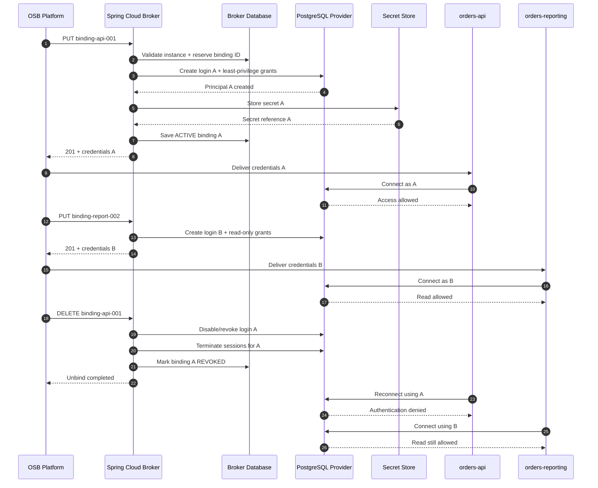
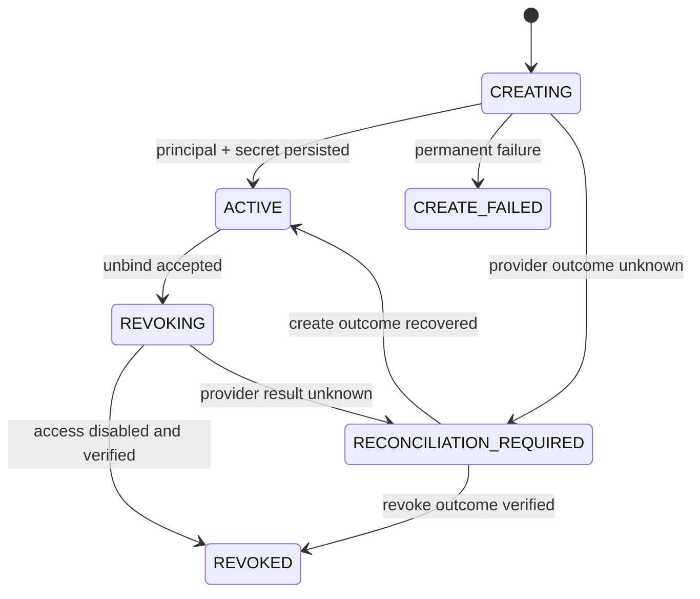

# Thêm binding với credentials riêng và kiểm chứng thu hồi quyền truy cập

Trong bài thực hành tổng hợp này, bạn sẽ mở rộng một Spring Cloud Service Broker đã có service instance PostgreSQL để hỗ trợ nhiều consumer cùng sử dụng một instance nhưng mỗi consumer có một bộ credentials riêng. Bạn sẽ tạo binding cho hai ứng dụng, xác minh mỗi binding chỉ cấp quyền cần thiết, sau đó unbind một ứng dụng và chứng minh credentials của ứng dụng đó không còn truy cập được trong khi binding còn lại vẫn hoạt động.

Đây là một bài capstone về toàn bộ vòng đời binding trong Open Service Broker API (OSB API): nhận request, kiểm tra instance, tạo principal/credential ở provider, lưu binding state, trả thông tin kết nối, thu hồi credential khi unbind và đối soát kết quả sau lỗi. Với `SPRING_CLOUD_SERVICE_BROKER`, mục tiêu không chỉ là trả về JSON có username/password. Broker phải chứng minh credential được tạo riêng cho từng `binding_id`, không cấp quyền quá mức, không làm lộ secret và thực sự bị vô hiệu hóa khi binding bị thu hồi.

## 1. Kịch bản và mục tiêu

Giả sử platform đã provision một service instance PostgreSQL có tên `orders-db`. Hai ứng dụng cần truy cập instance này:

- `orders-api` cần quyền đọc/ghi dữ liệu nghiệp vụ.
- `orders-reporting` chỉ cần quyền đọc để chạy báo cáo.

Broker tạo hai binding độc lập:

| Thành phần | Binding A | Binding B |
|---|---|---|
| Consumer | `orders-api` | `orders-reporting` |
| `binding_id` | `binding-api-001` | `binding-report-002` |
| Database role/login | `sb_ba_...` | `sb_bb_...` |
| Quyền | SELECT, INSERT, UPDATE trên schema ứng dụng | SELECT trên schema ứng dụng |
| Secret | Mật khẩu riêng A | Mật khẩu riêng B |
| Trạng thái ban đầu | `ACTIVE` | `ACTIVE` |

Khi unbind Binding A, broker phải vô hiệu hóa login A và chấm dứt session đang tồn tại theo policy. Binding B tiếp tục truy cập được. Service instance `orders-db` vẫn ở trạng thái `AVAILABLE`; dữ liệu và các consumer khác không bị xóa.

### Kết quả cần đạt

1. Hai binding có `binding_id`, principal và secret riêng.
2. Quyền của từng principal đúng với policy của consumer.
3. Retry cùng binding ID không tạo thêm user hoặc credential.
4. Unbind A thu hồi quyền A và không ảnh hưởng B.
5. Kiểm thử xác nhận A bị từ chối, B vẫn truy cập được và instance vẫn tồn tại.

## 2. Điều kiện đầu vào và phạm vi

Trước khi bắt đầu, cần có:

- Một Spring Cloud Open Service Broker server đã công bố catalog và service PostgreSQL.
- Một service instance đã provision thành công, có external database ID/endpoint và state `AVAILABLE`.
- Provider adapter có thể tạo, kiểm tra và thu hồi database user hoặc credential.
- Một database thử nghiệm có schema `app` và bảng dữ liệu không nhạy cảm.
- Cấu hình broker credentials và provider credentials lấy từ secret store/environment an toàn.
- Một môi trường test riêng, ví dụ PostgreSQL Testcontainers hoặc database staging không chứa dữ liệu production.

Bài thực hành tập trung vào binding credentials. Không thực hiện deprovision instance trong lúc kiểm chứng unbind. Không dùng tài khoản database owner/superuser làm credentials cho ứng dụng.

## 3. Kiến trúc và luồng dữ liệu

Broker đóng vai trò trung gian giữa platform và provider. Platform gửi `PUT` để tạo binding; broker xác minh instance, tạo principal riêng ở provider, lưu mapping và trả credentials. Khi platform gửi `DELETE`, broker thu hồi principal đó và cập nhật binding state.



Secret store là thành phần tùy chọn theo kiến trúc. Nếu broker không cần lấy lại password sau khi trả response, có thể chỉ lưu secret reference và không lưu password dạng rõ trong database. Tuy nhiên, broker cần có cách xử lý retry cùng `binding_id` mà không tạo credential thứ hai hoặc trả về một secret không còn tồn tại.

## 4. Hiểu request bind và unbind của OSB API

### Tạo binding

Platform gọi endpoint có dạng:

```http
PUT /v2/service_instances/{instance_id}/service_bindings/{binding_id}
X-Broker-API-Version: 2.14
Content-Type: application/json
```

Body có thể chứa các trường như `service_id`, `plan_id`, `app_guid`, `bind_resource`, `parameters` và `context`, tùy phiên bản API và kiểu binding. Ví dụ rút gọn:

```json
{
  "service_id": "postgres-service-id",
  "plan_id": "postgres-standard-plan",
  "app_guid": "orders-api-guid",
  "bind_resource": {
    "app": "orders-api"
  },
  "parameters": {
    "access": "read-write"
  }
}
```

`binding_id` nằm trong URL và là định danh ổn định của binding. Broker không được tạo một ID mới cho cùng request logic chỉ vì platform retry. `app_guid`/consumer context phải được validate theo contract platform; không tin một tên app do client tự gửi như bằng chứng authorization.

### Response binding

Khi tạo binding thành công, broker trả thông tin cần thiết để consumer kết nối. Ví dụ:

```json
{
  "credentials": {
    "hostname": "postgres.example.internal",
    "port": 5432,
    "database": "orders",
    "username": "sb_ba_a1b2c3d4",
    "password": "<generated-secret>",
    "sslmode": "verify-full"
  }
}
```

Không dùng password trong ví dụ làm credential thật. Không ghi response body này vào log. Nếu broker cung cấp endpoint retrieval cho binding, phải bảo vệ nó theo capability và semantics của OSB API đang hỗ trợ.

### Thu hồi binding

Platform gọi:

```http
DELETE /v2/service_instances/{instance_id}/service_bindings/{binding_id}
X-Broker-API-Version: 2.14
```

Broker phải thu hồi đúng principal/credential gắn với `binding_id`. Không xóa database hoặc credential của binding khác. Unbind và deprovision là hai thao tác khác nhau; bài thực hành kết thúc sau khi Binding A đã bị revoke và Binding B vẫn hoạt động.

## 5. Mô hình dữ liệu binding

Broker cần lưu mapping giữa binding ID, service instance, consumer, provider principal và secret reference. Không lưu password thô trong bảng binding.

Ví dụ schema khái niệm:

```sql
CREATE TABLE service_binding (
    binding_id VARCHAR(255) PRIMARY KEY,
    instance_id VARCHAR(255) NOT NULL,
    consumer_id VARCHAR(255) NOT NULL,
    service_id VARCHAR(255) NOT NULL,
    plan_id VARCHAR(255) NOT NULL,
    access_profile VARCHAR(40) NOT NULL,
    provider_principal_id VARCHAR(255),
    provider_username VARCHAR(128) NOT NULL,
    secret_reference VARCHAR(512),
    state VARCHAR(40) NOT NULL,
    request_fingerprint VARCHAR(128) NOT NULL,
    version BIGINT NOT NULL DEFAULT 0,
    created_at TIMESTAMP NOT NULL,
    updated_at TIMESTAMP NOT NULL
);

CREATE INDEX ix_binding_instance
    ON service_binding(instance_id);

CREATE UNIQUE INDEX uq_provider_binding_principal
    ON service_binding(provider_principal_id);
```

Schema thực tế cần quy định `provider_principal_id` có thể null trong lúc tạo, uniqueness scope theo provider/account và cách lưu fingerprint. Nếu provider username phải unique trong một database server, tạo unique constraint tương ứng. Không đưa `password`, token hoặc connection string đầy đủ vào bảng này.

### State machine



Không chuyển sang `ACTIVE` trước khi provider principal và secret reference đã được lưu thành công. Không chuyển sang `REVOKED` chỉ vì request revoke đã được gửi; cần xác minh trạng thái truy cập theo policy.

## 6. Tạo credentials riêng cho từng binding

Mỗi binding cần có principal độc lập. Không dùng chung một database username/password cho tất cả ứng dụng, kể cả khi chúng truy cập cùng một service instance.

### Tạo username ổn định

Username có thể được tạo từ binding ID đã chuẩn hóa kết hợp hash ngắn để tránh ký tự không hợp lệ và tránh lộ thông tin consumer:

```text
sb_{binding-prefix}_{stable-hash}
```

Ví dụ:

```text
binding-api-001     -> sb_ba_a1b2c3d4
binding-report-002  -> sb_bb_7e8f9a10
```

Không cắt binding ID tùy tiện vì hai ID khác nhau có thể tạo cùng username. Dùng hash đủ dài theo quy mô hệ thống, lưu mapping đầy đủ trong database và xử lý unique conflict. Username không nên chứa email, tên người dùng hoặc dữ liệu tenant nhạy cảm.

### Sinh password ngẫu nhiên

Dùng cryptographically secure random generator, không dùng timestamp, UUID đơn giản hoặc tên binding làm password.

```java
public final class BindingSecretGenerator {
    private final SecureRandom secureRandom = new SecureRandom();
    private static final char[] ALPHABET =
            "ABCDEFGHJKLMNPQRSTUVWXYZabcdefghijkmnopqrstuvwxyz23456789-_".toCharArray();

    public String generate(int length) {
        if (length < 32) {
            throw new IllegalArgumentException("Secret length must be at least 32");
        }
        char[] value = new char[length];
        for (int i = 0; i < length; i++) {
            value[i] = ALPHABET[secureRandom.nextInt(ALPHABET.length)];
        }
        return new String(value);
    }
}
```

Đây là ví dụ minh họa. Trong ứng dụng thật, kiểm tra yêu cầu charset của provider, lưu secret qua secret manager, giới hạn thời gian truy cập và bảo đảm không log giá trị trả về. Nếu dùng password generator của thư viện bảo mật đã được kiểm chứng, ưu tiên tái sử dụng thay vì tự xây thuật toán.

## 7. Áp dụng least privilege ở provider

Hai binding không chỉ cần password khác nhau; quyền truy cập cũng phải phù hợp consumer.

Ví dụ với PostgreSQL:

```sql
-- Role nhóm chỉ chứa quyền đọc/ghi mà ứng dụng API cần.
CREATE ROLE orders_app_rw NOLOGIN;
GRANT CONNECT ON DATABASE orders TO orders_app_rw;
GRANT USAGE ON SCHEMA app TO orders_app_rw;
GRANT SELECT, INSERT, UPDATE ON ALL TABLES IN SCHEMA app TO orders_app_rw;
GRANT USAGE, SELECT ON ALL SEQUENCES IN SCHEMA app TO orders_app_rw;

-- Role nhóm chỉ đọc cho ứng dụng báo cáo.
CREATE ROLE orders_app_ro NOLOGIN;
GRANT CONNECT ON DATABASE orders TO orders_app_ro;
GRANT USAGE ON SCHEMA app TO orders_app_ro;
GRANT SELECT ON ALL TABLES IN SCHEMA app TO orders_app_ro;

-- Principal riêng cho từng binding.
CREATE ROLE sb_ba_a1b2c3d4 LOGIN PASSWORD '<random-secret-A>';
GRANT orders_app_rw TO sb_ba_a1b2c3d4;

CREATE ROLE sb_bb_7e8f9a10 LOGIN PASSWORD '<random-secret-B>';
GRANT orders_app_ro TO sb_bb_7e8f9a10;
```

Ví dụ cần được điều chỉnh theo database, schema và policy thực tế. Role login của binding không nên sở hữu database, schema hoặc bảng. Quyền sở hữu nên nằm ở role quản trị riêng không dùng để kết nối từ ứng dụng. Với bảng tạo trong tương lai, cấu hình default privileges cho owner role phù hợp; nếu không, quyền của binding có thể chỉ áp dụng lên các bảng hiện tại.

Ví dụ default privileges cho bảng mới do `orders_owner` tạo:

```sql
ALTER DEFAULT PRIVILEGES FOR ROLE orders_owner IN SCHEMA app
    GRANT SELECT, INSERT, UPDATE ON TABLES TO orders_app_rw;

ALTER DEFAULT PRIVILEGES FOR ROLE orders_owner IN SCHEMA app
    GRANT SELECT ON TABLES TO orders_app_ro;
```

Không cấp `SUPERUSER`, `CREATEDB`, `CREATEROLE` hoặc quyền owner cho binding login. Không cấp quyền trên schema khác nếu consumer không cần. Nếu provider không phải PostgreSQL, adapter cần ánh xạ access profile sang IAM role, API key scope hoặc ACL tương đương.

## 8. Thiết kế provider adapter

Application service không nên tự ghép SQL hoặc gọi HTTP provider trực tiếp trong controller. Tạo port mô tả nghiệp vụ binding:

```java
public interface BindingCredentialProvider {
    CreatedBindingPrincipal createPrincipal(
            BindingPrincipalSpec spec,
            String idempotencyKey);

    RevocationResult revokePrincipal(
            String providerPrincipalId,
            String idempotencyKey);

    AccessVerification verifyAccess(
            String providerPrincipalId);
}
```

Các record là mô hình nội bộ minh họa. Adapter PostgreSQL triển khai bằng JDBC/R2DBC hoặc provider API phù hợp; adapter cloud khác có thể tạo IAM user, scoped token hoặc role binding. Đừng để service layer phụ thuộc vào tên API riêng của một provider.

Provider adapter phải:

- Xác minh instance external ID và account/region trước khi tạo principal.
- Tạo principal từ binding ID ổn định.
- Chỉ gán access profile đã được broker cho phép.
- Dùng parameterized query cho giá trị dữ liệu; identifier phải được validate/quote an toàn vì SQL parameter không thay thế được identifier.
- Không ghi password vào log hoặc exception message.
- Hỗ trợ lookup/reconciliation nếu provider timeout sau side effect.
- Thu hồi principal đúng binding và xác minh quyền đã mất.

## 9. Application service cho bind

Luồng bind nên tách validation, ghi trạng thái, side effect provider và hoàn tất mapping. Pseudocode dưới đây minh họa orchestration; tên class/API cụ thể cần ánh xạ theo phiên bản Spring Cloud Open Service Broker đang dùng.

```java
public BindingResult bind(CreateBindingCommand command) {
    ServiceInstance instance = instanceRepository
            .findById(command.instanceId())
            .orElseThrow(InstanceNotFoundException::new);

    validateBindable(instance, command);
    validateConsumerScope(instance, command.consumer());

    String fingerprint = fingerprint(command);
    Optional<ServiceBinding> existing =
            bindingRepository.findById(command.bindingId());

    if (existing.isPresent()) {
        return replayOrReject(existing.get(), fingerprint);
    }

    ServiceBinding binding = bindingRepository.reserve(
            command, fingerprint, BindingState.CREATING);

    String idempotencyKey = "bind:" + command.bindingId();
    String password = secretGenerator.generate(40);
    String username = usernameFactory.forBinding(command.bindingId());

    CreatedBindingPrincipal principal = provider.createPrincipal(
            new BindingPrincipalSpec(
                    instance.externalResourceId(),
                    username,
                    password,
                    command.accessProfile()),
            idempotencyKey);

    SecretReference secretRef = secretStore.put(
            command.bindingId(), password);

    ServiceBinding active = binding.activate(
            principal.id(), username, secretRef);
    bindingRepository.save(active);

    return BindingResult.from(active, secretStore.read(secretRef));
}
```

Đây là pseudocode để thể hiện trình tự, không phải code có thể copy nguyên trạng. Cần giải quyết các transaction boundary và lỗi cạnh tranh:

1. Reserve binding ID bằng unique constraint trước provider side effect.
2. Nếu insert bị duplicate-key, đọc record đã có rồi so sánh fingerprint.
3. Không giữ transaction DB mở trong lúc gọi provider hoặc secret manager.
4. Dùng idempotency key ổn định cho provider.
5. Nếu provider tạo principal nhưng secret store/DB thất bại, chuyển sang reconciliation; không tạo principal mới khi retry.
6. Chỉ trả response sau khi principal, secret reference và binding state được lưu đủ để phục hồi.
7. Nếu response bị mất sau khi binding ACTIVE, retry cùng binding ID phải replay kết quả theo chính sách secret retrieval đã thiết kế.

Nếu không thể lưu secret dạng rõ, secret manager cần cho phép lấy lại giá trị theo reference trong thời gian hợp lệ hoặc có quy trình rotation/reissue rõ ràng. Không tạo credential thứ hai mỗi lần platform retry.

## 10. Tích hợp với Spring Cloud Open Service Broker

Spring Cloud Open Service Broker cung cấp abstraction cho service instance binding và chuyển HTTP request OSB thành lời gọi service implementation. Tùy phiên bản thư viện, request/response model và interface method có thể khác nhau. Hãy dùng đúng SPI của dependency trong dự án; giữ business logic ở application service và để adapter chuyển request OSB sang command nội bộ.

Luồng adapter nên:

- Lấy `instance_id` và `binding_id` từ path.
- Đọc service ID/plan ID/consumer/parameters từ request model.
- Validate capability `bindable` và trạng thái instance.
- Gọi `BindingApplicationService.bind(...)`.
- Map credentials và binding metadata sang response model của thư viện.
- Với unbind, gọi `BindingApplicationService.unbind(...)` và map kết quả theo contract OSB.

Không tự tạo controller trùng `/v2/service_instances/**/service_bindings/**` nếu đang dùng server adapter của Spring Cloud. Cách đó có thể bỏ qua validation, API version negotiation hoặc response mapping của framework.

## 11. Xử lý retry và idempotency của bind

Platform có thể gửi lại PUT binding nếu response bị mất. Broker cần xác định request lặp bằng `binding_id` và fingerprint của nội dung có ý nghĩa nghiệp vụ.

| Trường hợp | Hành vi mong đợi |
|---|---|
| Cùng binding ID, cùng instance/consumer/access profile | Trả kết quả binding hiện có hoặc tiếp tục operation đang tạo; không tạo principal mới. |
| Cùng binding ID nhưng instance khác | Conflict; không chuyển binding sang instance mới. |
| Cùng binding ID nhưng consumer khác | Conflict; không trả credential của consumer trước. |
| Cùng binding ID nhưng access profile khác | Xử lý như request khác nội dung; yêu cầu update flow hoặc trả conflict theo policy. |
| Provider timeout sau khi tạo principal | Lookup theo idempotency key/username/ownership tag trước khi retry. |
| Secret store đã lưu nhưng DB chưa commit | Đối soát secret reference và provider principal; không tạo credential mới. |

Fingerprint nên bao gồm instance ID, service/plan, consumer identity và access profile đã chuẩn hóa. Không đưa password vào fingerprint. Dùng unique constraint cho `binding_id`; `SELECT` trước `INSERT` không đủ chống hai request đồng thời.

## 12. Lưu và trả credentials an toàn

Binding response chứa thông tin nhạy cảm. Hãy áp dụng các nguyên tắc:

- Password được sinh bằng CSPRNG và có entropy đủ cao.
- Chỉ secret manager hoặc encrypted secret store giữ giá trị cần phục hồi.
- Database binding chỉ lưu `secret_reference`, không lưu password dạng rõ.
- Không log response JSON, request body, SQL chứa password hoặc Authorization header.
- TLS được bật giữa platform, broker và provider.
- Credentials có scope và thời hạn phù hợp; không dùng provider admin credential làm app credential.
- Chỉ consumer được phép mới nhận binding credentials.
- Secret reference không được coi là secret nếu nó có thể truy cập mà không qua authorization.
- Có quy trình rotation/revoke khi nghi ngờ lộ credential.

Nếu platform lưu credentials trong service binding của nó, broker vẫn phải quản lý provider-side principal và cleanup. Việc platform xóa Secret/credential local không tự thu hồi quyền ở database provider.

## 13. Unbind: thu hồi quyền truy cập thực sự

Khi nhận DELETE cho Binding A, broker cần:

1. Tìm binding theo `binding_id` và xác minh nó thuộc `instance_id` trong path.
2. Kiểm tra state; nếu đã `REVOKED`, xử lý idempotent theo OSB contract.
3. Chuyển binding sang `REVOKING` và ghi operation/audit intent.
4. Gọi provider revoke đúng `provider_principal_id`.
5. Ngăn login mới, revoke role/token/ACL và chấm dứt session nếu policy yêu cầu.
6. Xác minh principal không còn quyền truy cập.
7. Xóa/expire secret reference hoặc đánh dấu không thể đọc lại.
8. Chuyển binding sang `REVOKED` và lưu timestamp.
9. Trả response unbind theo OSB API version.

### PostgreSQL: vô hiệu hóa login và chấm dứt session

Với role login riêng cho binding, một quy trình minh họa:

```sql
ALTER ROLE sb_ba_a1b2c3d4 NOLOGIN;

SELECT pg_terminate_backend(pid)
FROM pg_stat_activity
WHERE usename = 'sb_ba_a1b2c3d4'
  AND pid <> pg_backend_pid();

REVOKE orders_app_rw FROM sb_ba_a1b2c3d4;
DROP ROLE sb_ba_a1b2c3d4;
```

`NOLOGIN` ngăn tạo session mới; terminate session giúp chặn kết nối đã mở trước đó. `REVOKE` bỏ membership của role nhóm. `DROP ROLE` chỉ thành công khi role không còn sở hữu object hoặc dependency cần xử lý. Trong thiết kế này, binding login không được sở hữu database/schema/table. Nếu provider không cho terminate session hoặc revoke tức thời, phải mô tả rõ giới hạn và thời gian thu hồi trong service contract.

Không chạy SQL bằng cách nối chuỗi username tùy ý từ request. Tên role cần được tạo bởi factory có kiểm tra ký tự và quote identifier đúng cách; parameter binding thường không áp dụng trực tiếp cho SQL identifier.

### Vì sao chỉ xóa Secret là chưa đủ?

Nếu broker chỉ xóa Kubernetes Secret hoặc trả response unbind thành công nhưng database user vẫn tồn tại, credential đã bị lộ trước đó vẫn có thể được dùng. Thu hồi phải diễn ra ở provider. Việc xóa Secret ở platform là cleanup bổ sung, không phải bằng chứng provider access đã bị revoke.

## 14. Kiểm chứng quyền truy cập sau unbind

Đây là phần bắt buộc của capstone. Không chỉ kiểm tra binding record chuyển sang `REVOKED`; cần thử kết nối thật tới provider bằng credentials trước và sau unbind.

### Trước unbind

Với Binding A (read-write), xác minh:

- Kết nối thành công tới database `orders`.
- Có thể SELECT dữ liệu test.
- Có thể INSERT/UPDATE một bản ghi trong schema test nếu policy cho phép.
- Không thể thực hiện quyền quản trị như tạo role hoặc tạo database.

Với Binding B (read-only), xác minh:

- Kết nối thành công.
- SELECT thành công.
- INSERT/UPDATE/DELETE bị từ chối.

### Sau unbind Binding A

- Kết nối mới bằng username/password A bị từ chối.
- Nếu policy yêu cầu thu hồi session đang mở, session cũ của A đã bị terminate và query tiếp theo thất bại.
- Binding B vẫn kết nối và SELECT thành công.
- Binding B vẫn bị từ chối khi thử ghi.
- Service instance vẫn `AVAILABLE`.
- Database và dữ liệu không bị xóa.
- Broker không còn trả secret A qua retry/retrieval path.

Ví dụ kiểm tra bằng `psql`:

```bash
PGPASSWORD="$BINDING_A_PASSWORD" psql \
  "host=$DB_HOST port=5432 dbname=orders user=$BINDING_A_USER sslmode=verify-full" \
  -c 'SELECT 1'
```

Sau unbind, lệnh dùng credentials A phải thất bại khi tạo kết nối mới. Dùng biến môi trường test hoặc secret injection; không đặt password thật trực tiếp trong shell history, source code hoặc CI log.

Kiểm tra Binding B:

```bash
PGPASSWORD="$BINDING_B_PASSWORD" psql \
  "host=$DB_HOST port=5432 dbname=orders user=$BINDING_B_USER sslmode=verify-full" \
  -c 'SELECT count(*) FROM app.orders'
```

Để kiểm tra quyền read-only, thử một thao tác ghi trên bảng test và xác nhận provider từ chối. Không dùng câu lệnh phá hủy dữ liệu thật để kiểm tra quyền.

## 15. Phân biệt revoke credential với terminate session

Một số provider chỉ ngăn kết nối mới khi credential bị revoke; session đã xác thực trước đó có thể tiếp tục chạy. Với yêu cầu bảo mật cao, broker cần xác định rõ semantics:

| Biện pháp | Tác dụng | Giới hạn |
|---|---|---|
| Đổi password | Credential cũ không dùng để xác thực session mới | Session đã mở có thể còn hoạt động. |
| Disable login/user | Ngăn đăng nhập mới | Có thể không chấm dứt session hiện tại. |
| Revoke role/ACL | Bỏ quyền được cấp qua role/ACL | Session hiện tại và cache authorization phụ thuộc provider. |
| Terminate active session | Chấm dứt kết nối đang mở | Cần quyền quản trị phù hợp; session pool có thể reconnect nếu credential còn hợp lệ. |
| Delete principal | Xóa identity | Có thể thất bại nếu identity sở hữu object hoặc còn dependency. |

Acceptance criteria phải nói rõ “thu hồi” có nghĩa là ngăn login mới hay cả session đang tồn tại bị chấm dứt. Với database, hãy test cả hai nếu service contract cam kết thu hồi tức thời.

## 16. Kiểm thử tự động

### Unit test cho application service

Các test cần có:

1. Instance không tồn tại thì bind bị từ chối và provider không được gọi.
2. Instance không `AVAILABLE` thì bind bị từ chối.
3. Service không bindable thì bind bị từ chối.
4. Binding A và B tạo hai provider principal khác nhau.
5. Binding A nhận access profile read-write, B nhận read-only.
6. Cùng binding ID và cùng fingerprint không tạo principal lần hai.
7. Cùng binding ID nhưng consumer khác bị conflict.
8. Provider timeout sau side effect dẫn tới reconciliation, không tạo principal trùng.
9. Unbind A gọi revoke với principal ID A, không phải B.
10. Unbind lặp không làm lỗi hoặc xóa principal khác.
11. Provider revoke thất bại thì binding không bị đánh dấu `REVOKED`.
12. Secret không xuất hiện trong log/error response.

Ví dụ Mockito:

```java
@Test
void unbind_revokes_only_the_requested_binding_principal() {
    ServiceBinding bindingA = activeBinding(
            "binding-api-001", "instance-123", "principal-a");
    when(bindingRepository.findById("binding-api-001"))
            .thenReturn(Optional.of(bindingA));

    bindingService.unbind("instance-123", "binding-api-001");

    verify(provider).revokePrincipal(
            eq("principal-a"), eq("unbind:binding-api-001"));
    verify(provider, never()).revokePrincipal(
            eq("principal-b"), anyString());
}
```

Tên method và kiểu tham số là minh họa; điều quan trọng là assertion chứng minh đúng principal bị revoke.

### Integration test với PostgreSQL

Dùng PostgreSQL Testcontainers hoặc database test riêng để xác minh quyền thật:

- Tạo database/schema test và role group read-write/read-only.
- Gọi bind service để tạo principal A và B.
- Mở connection A/B bằng credentials được trả.
- Xác minh quyền đọc/ghi tương ứng.
- Gọi unbind A.
- Thử kết nối mới bằng A và xác nhận bị từ chối.
- Nếu cam kết terminate session, giữ một session A mở trước unbind và xác nhận nó bị đóng.
- Kết nối lại bằng B và xác nhận vẫn đọc được.
- Kiểm tra instance còn tồn tại và state không đổi.
- Dọn database test sau khi test kết thúc.

Không dùng mock provider để tuyên bố đã chứng minh access bị thu hồi. Mock chỉ xác minh broker gọi đúng port; integration test mới xác minh provider thực sự từ chối credentials.

## 17. Xử lý lỗi một phần và phục hồi

Bind/unbind gồm nhiều hệ thống nên không có một transaction ACID bao trùm database broker, secret manager và provider. Hãy chuẩn bị cho các cửa sổ lỗi:

| Điểm lỗi | Trạng thái có thể xảy ra | Cách phục hồi |
|---|---|---|
| Provider tạo principal, broker timeout trước khi lưu ID | Principal tồn tại nhưng mapping thiếu | Lookup bằng idempotency key/username/ownership tag rồi lưu mapping. |
| Provider tạo principal, secret store ghi lỗi | Principal tồn tại nhưng chưa có secret reference | Retry cùng provider key hoặc revoke principal đã tạo; không tạo user mới. |
| Secret store ghi thành công, DB commit lỗi | Secret mồ côi hoặc binding chưa ACTIVE | Reconcile secret reference với binding reservation và provider principal. |
| Provider revoke thành công, broker không lưu state | Credential đã mất hiệu lực nhưng binding vẫn `REVOKING` | Verify provider state rồi ghi `REVOKED`. |
| Provider revoke timeout | Kết quả chưa rõ | Lookup/verify; không đánh dấu thành công hoặc tạo credential mới. |
| Broker trả response nhưng platform không nhận | Platform retry cùng binding ID | Replay binding đã lưu theo chính sách secret retrieval. |

Dùng operation/audit record và idempotency key ổn định. Nếu trạng thái provider chưa xác định, đánh dấu `RECONCILIATION_REQUIRED` thay vì giả định thành công/thất bại. Reconciliation cần xác minh owner trước mọi thao tác revoke.

## 18. Checklist bảo mật và vận hành

- Mỗi `binding_id` có provider principal và credentials riêng.
- Credentials được sinh bằng CSPRNG và không chứa thông tin định danh nhạy cảm.
- Access profile được allowlist theo service/plan; không cho consumer tự yêu cầu quyền tùy ý.
- Database login không sở hữu schema/table và không có quyền quản trị.
- Binding record chỉ lưu secret reference, không lưu password rõ.
- Provider credential dùng bởi broker tách biệt với app binding credentials.
- Broker xác minh instance, consumer và tenant scope trước bind/unbind.
- Retry cùng binding ID không tạo principal mới.
- Unbind chỉ revoke principal của binding được yêu cầu.
- `NOLOGIN`/revoke được kết hợp với session termination nếu service contract yêu cầu.
- Broker chỉ đánh dấu `REVOKED` sau khi provider state được xác minh.
- Secret A không thể được lấy lại sau khi binding đã revoke.
- Binding B vẫn hoạt động sau khi unbind A.
- Service instance không bị deprovision khi chỉ unbind một consumer.
- Log, trace và event không chứa password/token/connection string.
- Có audit event cho bind, unbind, principal ID và actor/scope.
- Có alert khi revoke thất bại hoặc binding ở `REVOKING` quá lâu.

## 19. Tiêu chí nghiệm thu capstone

Capstone được xem là hoàn thành khi có thể trình diễn đầy đủ các bước sau trong môi trường test:

| ID | Tiêu chí | Bằng chứng cần có |
|---|---|---|
| AC-01 | Instance PostgreSQL ở trạng thái sẵn sàng | Instance record và provider resource tồn tại. |
| AC-02 | Tạo Binding A cho `orders-api` | OSB bind response có credentials A. |
| AC-03 | Tạo Binding B cho `orders-reporting` | OSB bind response có credentials B khác A. |
| AC-04 | Hai principal độc lập | Provider query cho thấy hai user/identity khác nhau. |
| AC-05 | Least privilege đúng | A đọc/ghi theo policy; B chỉ đọc; cả hai không có quyền admin. |
| AC-06 | Retry Binding A | Cùng binding ID không tạo principal thứ hai. |
| AC-07 | Unbind A | Binding A chuyển `REVOKED` sau provider verification. |
| AC-08 | Credential A bị từ chối | Kết nối mới bằng A thất bại; session cũ bị terminate nếu policy cam kết. |
| AC-09 | Binding B không bị ảnh hưởng | B vẫn kết nối và SELECT thành công. |
| AC-10 | Instance vẫn hoạt động | Instance vẫn `AVAILABLE`; database và dữ liệu còn nguyên. |
| AC-11 | Secret được bảo vệ | Không có password trong database thường, log, Git hoặc test report. |
| AC-12 | Có phục hồi lỗi một phần | Test timeout sau provider side effect và reconciliation pass. |

## 20. Báo cáo kết quả thực hành

Khi hoàn tất, ghi lại các thông tin không nhạy cảm:

- Broker version và OSB API version dùng trong test.
- Service ID, plan ID và instance ID giả lập.
- Hai binding ID và access profile tương ứng.
- Provider principal ID đã tạo (không ghi password).
- Kết quả kiểm thử quyền trước unbind.
- Operation ID và kết quả unbind.
- Kết quả kết nối mới bằng credentials A sau revoke.
- Kết quả kết nối bằng credentials B sau revoke A.
- Trạng thái cuối của instance và hai binding.
- Kết quả test retry, timeout và reconciliation.

Không đính kèm password, token, connection string đầy đủ hoặc output chứa secret vào báo cáo. Nếu cần chứng minh credential khác nhau, chỉ báo username/principal ID hoặc fingerprint đã được làm sạch; không in secret ra màn hình.

## 21. Mở rộng sau capstone

Sau khi hoàn thành bài cơ bản, có thể mở rộng:

- Hỗ trợ credential rotation cho một binding mà không làm gián đoạn binding khác.
- Tự động phát hiện binding không còn consumer và đề xuất cleanup.
- Hỗ trợ nhiều provider adapter như PostgreSQL, Redis ACL hoặc cloud IAM scoped token.
- Thêm audit trail và policy approval cho quyền write/admin.
- Thực hiện unbind theo workflow bất đồng bộ nội bộ nếu provider revoke kéo dài, nhưng vẫn tuân thủ semantics OSB endpoint/version.
- Thêm chaos test cho timeout sau revoke, database failover và secret manager unavailable.
- Tạo dashboard cho binding count, revoke latency, active credential và reconciliation backlog.

Điểm quan trọng nhất của capstone là chứng minh quyền truy cập được cấp và thu hồi ở provider, không chỉ thay đổi một record trong broker. Khi mỗi binding có principal riêng, policy least privilege, secret reference an toàn và quy trình unbind có xác minh, broker có thể thu hồi một consumer mà không ảnh hưởng những consumer còn lại hoặc service instance đang dùng chung.
