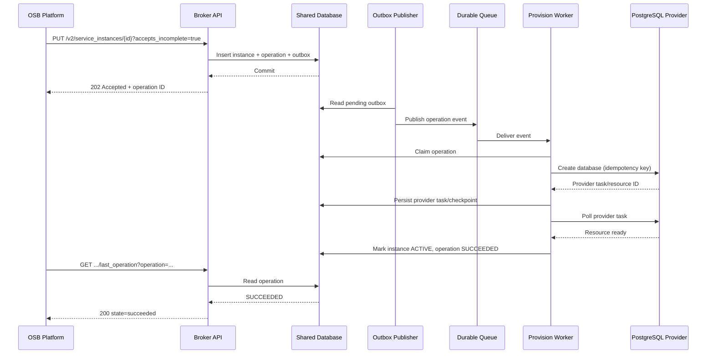
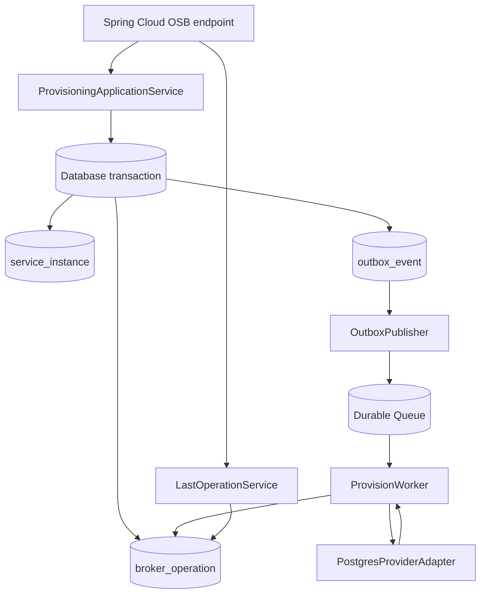
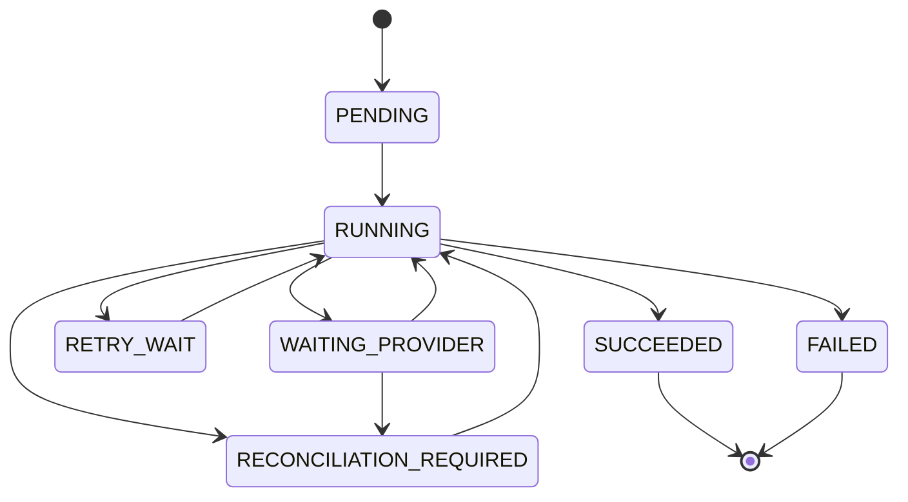

# Chuyển cấp phát sang bất đồng bộ và lưu trạng thái bền vững

## 1. Mục tiêu capstone

Trong bài thực hành này, bạn sẽ nâng cấp một Spring Cloud Service Broker để cấp phát service instance theo mô hình bất đồng bộ của Open Service Broker API (OSB API). Thay vì giữ HTTP request mở trong suốt thời gian tạo tài nguyên, broker tiếp nhận request, lưu operation bền vững, trả `202 Accepted`, sau đó worker thực hiện công việc và nền tảng truy vấn trạng thái qua `last_operation`.

Capstone mô phỏng một broker cung cấp managed PostgreSQL. Khi platform yêu cầu provision một instance, broker cần:

1. Xác thực và validate request OSB.
2. Kiểm tra platform đã chấp nhận xử lý bất đồng bộ hay chưa.
3. Tạo instance record, operation record và outbox event trong một transaction.
4. Trả `202 Accepted` cùng operation ID sau khi transaction commit.
5. Đưa công việc tới worker qua durable queue/outbox publisher.
6. Worker claim operation, gọi provider adapter và lưu tiến độ.
7. Endpoint `last_operation` đọc trạng thái từ database dùng chung.
8. Khôi phục operation sau restart mà không tạo database trùng.

Đây là bài thực hành tổng hợp của module `SPRING_CLOUD_SERVICE_BROKER`: kết hợp OSB API, Spring Cloud Open Service Broker, reactive service layer, database persistence, asynchronous processing, idempotency, bảo mật và vận hành nhiều replica.

<badge color="success">Kết quả cần đạt</badge>

Một request provision có thể trả `202` nhanh, tiếp tục xử lý ở background, được polling đến `succeeded` hoặc `failed`, và vẫn phục hồi chính xác khi broker hoặc worker restart.

## 2. Bối cảnh và phạm vi bài toán

Giả sử platform gửi yêu cầu tạo PostgreSQL database với service ID `managed-postgresql` và plan ID `standard`. Provider có thể mất từ vài giây đến vài phút để tạo database và cấu hình user.

Broker không nên giữ HTTP connection mở trong toàn bộ thời gian đó. Nó cần tách hai khái niệm:

- **Request được tiếp nhận:** broker đã validate, persist operation và cam kết theo dõi công việc.
- **Provisioning hoàn tất:** provider đã tạo tài nguyên, broker đã lưu mapping và instance có thể được sử dụng.

`202 Accepted` chỉ biểu thị request đã được tiếp nhận để xử lý bất đồng bộ. Nó không có nghĩa database đã sẵn sàng.

### 2.1. Luồng tổng quan



### 2.2. Những gì cần hoàn thành

- OSB provisioning endpoint hỗ trợ async theo `accepts_incomplete`.
- Operation store dùng database, không dùng `Map` trong process làm nguồn trạng thái.
- Transactional outbox bảo đảm operation và yêu cầu dispatch được ghi cùng transaction.
- Worker có claim/lease và cơ chế chống ghi đè từ worker cũ.
- Provider adapter dùng idempotency key hoặc cơ chế tra cứu resource để tránh tạo trùng.
- `last_operation` đọc được operation từ bất kỳ replica nào.
- Có recovery job xử lý operation bị kẹt sau restart.
- Có integration test cho success, failure, retry, restart và concurrency.

## 3. Hợp đồng OSB API cần triển khai

### 3.1. Provision request

Platform gọi:

```http
PUT /v2/service_instances/inst-1001?accepts_incomplete=true HTTP/1.1
Host: broker.example.com
Authorization: Basic <broker-credentials>
X-Broker-API-Version: 2.17
Content-Type: application/json

{
  "service_id": "managed-postgresql",
  "plan_id": "standard",
  "organization_guid": "org-01",
  "space_guid": "space-01",
  "parameters": {
    "database_name": "orders",
    "storage_gb": 50,
    "backup_enabled": true
  }
}
```

`accepts_incomplete=true` cho biết platform chấp nhận xử lý bất đồng bộ. Broker cần kiểm tra service/plan, parameters, quyền caller và idempotency trước khi tạo operation.

### 3.2. Response khi tiếp nhận thành công

Broker trả `202 Accepted`:

```http
HTTP/1.1 202 Accepted
Content-Type: application/json

{
  "operation": "op-provision-inst-1001-01"
}
```

Operation ID là mã ổn định để platform poll đúng lần xử lý. Broker phải lưu operation trước khi trả response. Nếu trả `202` nhưng không có operation record bền vững, platform có thể không bao giờ tra được kết quả sau khi process restart.

### 3.3. Khi platform không chấp nhận async

Nếu request không gửi `accepts_incomplete=true` và broker không thể hoàn tất đồng bộ, broker phải trả lỗi `422 Unprocessable Entity` với error `AsyncRequired` theo OSB contract. Không được lặng lẽ enqueue một operation nền rồi trả `202` khi client chưa chấp nhận async.

### 3.4. Poll last operation

Platform gọi:

```http
GET /v2/service_instances/inst-1001/last_operation?service_id=managed-postgresql&plan_id=standard&operation=op-provision-inst-1001-01 HTTP/1.1
Authorization: Basic <broker-credentials>
X-Broker-API-Version: 2.17
Accept: application/json
```

Khi đang chạy:

```json
{
  "state": "in progress",
  "description": "Đang tạo PostgreSQL database"
}
```

Khi hoàn tất:

```json
{
  "state": "succeeded",
  "description": "PostgreSQL database đã sẵn sàng"
}
```

Khi thất bại:

```json
{
  "state": "failed",
  "description": "Provider không thể tạo database theo cấu hình yêu cầu"
}
```

Các state OSB cần trả là `in progress`, `succeeded` và `failed`. State nội bộ có thể chi tiết hơn, nhưng phải được ánh xạ nhất quán sang contract này.

## 4. Kiến trúc ứng dụng đề xuất

Chia trách nhiệm theo các thành phần sau:

| Thành phần | Trách nhiệm |
|---|---|
| OSB Controller / Spring Cloud endpoint | Nhận HTTP, xác thực, chuyển request model sang application command. |
| `ProvisioningApplicationService` | Validate nghiệp vụ, idempotency, tạo instance/operation/outbox. |
| `OperationRepository` | Đọc/ghi operation và thực hiện claim/lease/state transition. |
| `OutboxRepository` | Lưu event cần dispatch trong cùng transaction với operation. |
| `OutboxPublisher` | Publish event chưa gửi và đánh dấu đã publish sau acknowledgement. |
| `ProvisionWorker` | Claim operation, điều phối các bước provision và cập nhật checkpoint. |
| `PostgresProviderAdapter` | Gọi API provider, tạo database và truy vấn provider task. |
| `LastOperationService` | Đọc operation bền vững và ánh xạ sang OSB response. |
| `OperationRecoveryJob` | Tìm operation bị kẹt, lease hết hạn hoặc outbox chưa dispatch. |



Không giữ transaction database mở trong lúc gọi provider qua mạng. Transaction chỉ bao quanh việc persist/claim/checkpoint; provider call là một bước bên ngoài và phải có idempotency/reconciliation.

## 5. Thiết kế schema bền vững

Schema dưới đây là một điểm khởi đầu cho PostgreSQL. Có thể điều chỉnh kiểu dữ liệu, index và naming theo hệ quản trị database của dự án.

### 5.1. Bảng service instance

```sql
CREATE TABLE service_instance (
    platform_id          VARCHAR(100) NOT NULL,
    instance_id          VARCHAR(100) NOT NULL,
    service_id           VARCHAR(100) NOT NULL,
    plan_id              VARCHAR(100) NOT NULL,
    organization_id      VARCHAR(100),
    space_id             VARCHAR(100),
    state                VARCHAR(30) NOT NULL,
    request_fingerprint  VARCHAR(128) NOT NULL,
    provider_name        VARCHAR(100) NOT NULL,
    provider_resource_id VARCHAR(255),
    created_at           TIMESTAMP NOT NULL,
    updated_at           TIMESTAMP NOT NULL,
    version              BIGINT NOT NULL DEFAULT 0,
    PRIMARY KEY (platform_id, instance_id)
);
```

Khóa chính bao gồm `platform_id` để tránh va chạm nếu broker phục vụ nhiều platform và ID chỉ duy nhất trong từng platform. `request_fingerprint` giúp nhận diện request retry có nội dung tương đương hay request xung đột.

### 5.2. Bảng operation

```sql
CREATE TABLE broker_operation (
    operation_id      VARCHAR(120) PRIMARY KEY,
    platform_id       VARCHAR(100) NOT NULL,
    instance_id       VARCHAR(100) NOT NULL,
    operation_type    VARCHAR(40) NOT NULL,
    state             VARCHAR(40) NOT NULL,
    current_step      VARCHAR(80),
    provider_task_id  VARCHAR(255),
    provider_resource_id VARCHAR(255),
    retry_count       INTEGER NOT NULL DEFAULT 0,
    next_attempt_at   TIMESTAMP,
    lease_owner       VARCHAR(120),
    lease_until       TIMESTAMP,
    fencing_token     BIGINT NOT NULL DEFAULT 0,
    version           BIGINT NOT NULL DEFAULT 0,
    error_code        VARCHAR(100),
    error_description VARCHAR(500),
    created_at        TIMESTAMP NOT NULL,
    updated_at        TIMESTAMP NOT NULL,
    completed_at      TIMESTAMP,
    FOREIGN KEY (platform_id, instance_id)
        REFERENCES service_instance(platform_id, instance_id)
);

CREATE INDEX idx_operation_instance_created
    ON broker_operation(platform_id, instance_id, created_at);

CREATE INDEX idx_operation_recovery
    ON broker_operation(state, next_attempt_at, lease_until);
```

Không lưu password, access token hoặc private key trực tiếp trong operation. Nếu worker cần credential provider, hãy lưu reference tới secret manager hoặc encrypted credential store.

### 5.3. Bảng transactional outbox

```sql
CREATE TABLE outbox_event (
    event_id       VARCHAR(120) PRIMARY KEY,
    aggregate_id   VARCHAR(120) NOT NULL,
    event_type     VARCHAR(80) NOT NULL,
    payload        TEXT NOT NULL,
    created_at     TIMESTAMP NOT NULL,
    published_at   TIMESTAMP,
    publish_attempts INTEGER NOT NULL DEFAULT 0
);

CREATE INDEX idx_outbox_unpublished
    ON outbox_event(published_at, created_at);
```

`aggregate_id` trong bài này là operation ID. Payload nên có version để worker đọc được event do phiên bản broker trước tạo. Không đặt secret vào payload queue/outbox.

## 6. Định nghĩa state machine

### 6.1. Operation state



Ý nghĩa:

| State nội bộ | Ý nghĩa | OSB last-operation |
|---|---|---|
| `PENDING` | Đã commit, chờ worker claim. | `in progress` |
| `RUNNING` | Worker đang thực hiện một bước. | `in progress` |
| `WAITING_PROVIDER` | Provider trả task ID; chờ provider hoàn tất. | `in progress` |
| `RETRY_WAIT` | Lỗi tạm thời, chờ thời điểm retry. | `in progress` |
| `RECONCILIATION_REQUIRED` | Kết quả provider chưa xác định; cần tra cứu trước khi tiếp tục. | `in progress` |
| `SUCCEEDED` | Tất cả bước bắt buộc đã hoàn tất và persist. | `succeeded` |
| `FAILED` | Operation thất bại cuối cùng hoặc đã cleanup theo policy. | `failed` |

Không chuyển sang `SUCCEEDED` chỉ vì provider trả HTTP 2xx ở bước đầu. Cần xác minh resource đã sẵn sàng và broker đã lưu provider resource ID/mapping.

### 6.2. Instance state

```text
REQUESTED -> PROVISIONING -> ACTIVE
                         -> FAILED
```

Instance state mô tả vòng đời tài nguyên; operation state mô tả một lần thực hiện. Không gộp hai khái niệm này vào một cột duy nhất vì instance có thể có nhiều operation trong vòng đời như provision, update và deprovision.

## 7. Xử lý request trong application service

Controller Spring Cloud Open Service Broker gọi service interface tương ứng. Phần nghiệp vụ nên được đặt trong application service để có thể kiểm thử độc lập.

Pseudocode:

```java
public Mono<AcceptedOperation> acceptProvision(ProvisioningCommand command) {
    return transactionOperator.transactional(
        instanceRepository.find(command.platformId(), command.instanceId())
            .flatMap(existing -> handleDuplicateOrConflict(existing, command))
            .switchIfEmpty(Mono.defer(() ->
                instanceRepository.insertProvisioning(command)
                    .then(operationRepository.insertPending(command))
                    .flatMap(operation ->
                        outboxRepository.insertProvisionEvent(operation)
                            .thenReturn(operation))
            ))
    );
}
```

Đây là skeleton minh họa, cần điều chỉnh cách xử lý `switchIfEmpty`, transaction operator và duplicate race theo repository thực tế. Unique constraint trong database vẫn là hàng rào cuối cùng khi hai request đồng thời cùng kiểm tra “chưa tồn tại”.

Trình tự bắt buộc:

1. Chuẩn hóa request và tính fingerprint.
2. Kiểm tra service ID, plan ID, parameters và authorization.
3. Tìm instance theo platform scope.
4. Nếu đã tồn tại, so sánh fingerprint và áp dụng OSB idempotency semantics.
5. Nếu chưa tồn tại, insert instance `PROVISIONING`.
6. Insert operation `PENDING`.
7. Insert outbox event trong cùng transaction.
8. Commit rồi mới trả kết quả tiếp nhận.

Nếu insert instance gặp unique constraint do request cạnh tranh, đọc lại record đã thắng và xử lý như duplicate/conflict. Không bắt exception rồi tạo một instance khác bằng ID ngẫu nhiên.

## 8. Kết nối với Spring Cloud Open Service Broker

Trong lớp adapter framework, triển khai `ServiceInstanceService` để nhận request provision và trả response theo OSB API. Method cụ thể thường có dạng reactive:

```java
@Service
class BrokerServiceInstanceService implements ServiceInstanceService {

    private final ProvisioningApplicationService provisioning;
    private final AsyncAcceptancePolicy asyncPolicy;

    BrokerServiceInstanceService(
            ProvisioningApplicationService provisioning,
            AsyncAcceptancePolicy asyncPolicy) {
        this.provisioning = provisioning;
        this.asyncPolicy = asyncPolicy;
    }

    @Override
    public Mono<CreateServiceInstanceResponse> createServiceInstance(
            CreateServiceInstanceRequest request) {

        ProvisioningCommand command = ProvisioningCommand.from(request);

        return asyncPolicy.acceptsIncomplete(request)
            .flatMap(accepted -> {
                if (!accepted) {
                    return Mono.error(new AsyncRequiredException());
                }
                return provisioning.acceptProvision(command);
            })
            .map(operation -> CreateServiceInstanceResponse.builder()
                .async(true)
                .operation(operation.operationId())
                .build());
    }
}
```

`AsyncAcceptancePolicy` và `AsyncRequiredException` là abstraction của ứng dụng trong ví dụ. Hãy ánh xạ chúng sang request accessor và exception/error mapping đúng với phiên bản Spring Cloud Open Service Broker đang dùng. Response builder ở framework cần được cấu hình để phát `202 Accepted`, cờ async và operation ID theo API version tương ứng.

Điểm quan trọng là service method chỉ persist và tiếp nhận operation; nó không chờ provider tạo xong database. Không gọi `.block()` hoặc `.subscribe()` bên trong service để chạy background task. Việc dispatch thuộc outbox/worker pipeline.

## 9. Transactional outbox và dispatch worker

Nếu ứng dụng ghi operation và publish message bằng hai thao tác độc lập, có thể mất công việc khi process crash giữa hai thao tác. Outbox khắc phục vấn đề này bằng cách ghi operation và event dispatch trong cùng transaction database.

Outbox publisher:

1. Đọc một batch event chưa publish.
2. Publish message chứa `event_id`, `operation_id` và `payload_version`.
3. Chờ queue acknowledgement.
4. Đánh dấu `published_at` và tăng attempt count.
5. Nếu publisher crash trước bước 4, event có thể được gửi lại; worker phải xử lý idempotent.

Không đánh dấu event đã publish trước khi queue nhận message. Không xóa event ngay sau publish; giữ lại theo retention để điều tra và đối soát.

Ví dụ message:

```json
{
  "event_id": "evt-1001-01",
  "event_type": "PROVISION_SERVICE_INSTANCE",
  "payload_version": 1,
  "operation_id": "op-provision-inst-1001-01",
  "platform_id": "cf-prod",
  "instance_id": "inst-1001"
}
```

Message không cần mang toàn bộ parameters nếu worker có thể đọc command đã persist từ database. Cách này giảm dữ liệu nhạy cảm trên queue và tránh payload lệch so với operation record.

## 10. Worker claim operation an toàn

Worker nhận event không có nghĩa nó sở hữu operation. Nó phải claim operation trong database. Có thể dùng update có điều kiện:

```sql
UPDATE broker_operation
SET state = 'RUNNING',
    lease_owner = :worker_id,
    lease_until = :lease_until,
    fencing_token = fencing_token + 1,
    version = version + 1,
    updated_at = CURRENT_TIMESTAMP
WHERE operation_id = :operation_id
  AND state IN ('PENDING', 'RETRY_WAIT')
  AND (lease_until IS NULL OR lease_until < CURRENT_TIMESTAMP);
```

Chỉ worker có số row update bằng 1 mới được thực hiện bước tiếp theo. Nếu bằng 0, worker cần đọc lại operation: có thể operation đã được worker khác claim, đã hoàn tất hoặc chưa tới thời điểm retry.

Lease có thời hạn để operation không bị khóa vĩnh viễn khi process chết. Worker cần heartbeat/gia hạn lease trong lúc thực hiện. Nếu lease hết hạn và worker khác claim lại, `fencing_token` mới phải lớn hơn token cũ.

Mọi cập nhật operation state cần kiểm tra `lease_owner` và `fencing_token`. Worker cũ không được ghi đè kết quả của worker mới sau khi lease đã bị thu hồi.

Không giữ database row lock trong lúc gọi provider. Claim và checkpoint trong transaction ngắn; provider call chạy bên ngoài transaction.

## 11. Provider adapter và idempotency

Provider adapter chịu trách nhiệm chuyển command nghiệp vụ thành request API của hệ thống cung cấp PostgreSQL.

Ví dụ abstraction:

```java
public interface DatabaseProvider {
    Mono<ProviderProvisionResult> createDatabase(
            ProvisioningCommand command,
            String idempotencyKey);

    Mono<ProviderTaskStatus> getTaskStatus(String providerTaskId);
}
```

`idempotencyKey` nên ổn định theo operation, ví dụ operation ID. Nếu provider hỗ trợ idempotency key, retry cùng operation không tạo database mới. Nếu provider không hỗ trợ, broker cần gắn tag/metadata ownership và tra cứu resource trước khi gửi create lần nữa.

Kết quả provider có thể thuộc một trong các dạng:

- **Completed:** database đã sẵn sàng và có resource ID.
- **Accepted:** provider trả task ID; broker lưu task ID và chuyển operation sang `WAITING_PROVIDER`.
- **Retryable failure:** timeout, rate limit hoặc lỗi tạm thời; lên lịch retry với backoff.
- **Permanent failure:** quota/policy/parameters không hợp lệ; chuyển `FAILED` sau khi cleanup cần thiết.
- **Unknown outcome:** request timeout nhưng không biết provider đã tạo resource hay chưa; chuyển `RECONCILIATION_REQUIRED` và tra cứu trước khi retry.

Không coi mọi timeout là “provider chưa làm gì”. Đây là nguyên nhân phổ biến gây duplicate resource.

## 12. Hoàn tất provisioning và cập nhật trạng thái

Khi provider báo database sẵn sàng, worker cần:

1. Xác minh provider task ở trạng thái terminal thành công.
2. Lấy provider resource ID, endpoint và metadata cần thiết.
3. Lưu provider resource mapping vào instance record.
4. Cập nhật instance `ACTIVE`.
5. Cập nhật operation `SUCCEEDED` và `completed_at`.
6. Giải phóng lease.
7. Ghi audit/metric theo operation ID.

Các cập nhật database có liên quan nên được commit trong một transaction để tránh instance `ACTIVE` nhưng operation vẫn `RUNNING`, hoặc ngược lại. Nếu cần lưu dữ liệu provider qua nhiều bước, persist checkpoint sau mỗi side effect đã xác minh.

Khi provider task vẫn đang chạy, worker không cần giữ một thread chiếm dụng liên tục. Lưu `provider_task_id`, đặt `next_attempt_at` và kết thúc lượt xử lý. Scheduler/queue sẽ đưa operation trở lại khi đến thời điểm poll tiếp theo.

## 13. Triển khai last_operation từ shared store

Endpoint polling phải đọc operation bằng platform ID, instance ID và operation ID. Không đọc từ local cache làm nguồn chuẩn.

Pseudo implementation:

```java
public Mono<LastOperationView> getLastOperation(
        String platformId,
        String instanceId,
        String operationId) {

    return operationRepository
        .findByPlatformAndInstanceAndOperation(
            platformId, instanceId, operationId)
        .switchIfEmpty(Mono.error(new OperationNotFoundException()))
        .map(operation -> new LastOperationView(
            toOsbState(operation.state()),
            safeDescription(operation)));
}
```

Đây là application-layer pseudocode; adapter framework sẽ ánh xạ sang request/response model last-operation tương ứng. Không trả operation của instance khác nếu caller đoán được operation ID. Cần xác minh platform scope và quyền truy cập.

Mapping:

| Internal state | OSB state |
|---|---|
| `PENDING` | `in progress` |
| `RUNNING` | `in progress` |
| `WAITING_PROVIDER` | `in progress` |
| `RETRY_WAIT` | `in progress` |
| `RECONCILIATION_REQUIRED` | `in progress` |
| `SUCCEEDED` | `succeeded` |
| `FAILED` | `failed` |

Description cần ngắn, ổn định và không chứa provider secret, SQL, stack trace hoặc thông tin nội bộ nhạy cảm.

## 14. Recovery sau restart

Sau khi broker restart, operation store là nguồn dữ liệu để worker tiếp tục. Recovery job cần tìm:

- Outbox event chưa publish.
- Operation `PENDING` chưa được claim.
- Operation `RUNNING` có lease đã hết hạn.
- Operation `WAITING_PROVIDER` đã đến `next_attempt_at`.
- Operation `RETRY_WAIT` đã đến thời điểm retry.
- Operation `RECONCILIATION_REQUIRED` cần kiểm tra provider state.

Quy trình recovery:

1. Đọc operation và checkpoint hiện tại.
2. Claim operation bằng lease/fencing token mới.
3. Nếu đã có provider task ID, poll task đó; không gửi create mới.
4. Nếu provider outcome không xác định, tra resource theo idempotency key/tag.
5. Tiếp tục bước còn thiếu.
6. Commit state và checkpoint mới.
7. Nếu vượt retry/time limit, phát cảnh báo hoặc chuyển manual review.

Không reset toàn bộ operation `RUNNING` thành `PENDING` khi startup. Điều đó có thể chạy lại side effect đã hoàn tất.

## 15. Kiểm thử bắt buộc

Capstone cần có unit test, integration test và fault-injection test. Ưu tiên kiểm thử hành vi xuyên suốt thay vì chỉ kiểm tra method được gọi.

| Kịch bản | Thiết lập | Kết quả mong đợi |
|---|---|---|
| Provision async thành công | Provider hoàn tất sau một khoảng trễ. | HTTP `202`, operation được lưu, polling `in progress` rồi `succeeded`, instance `ACTIVE`. |
| Không chấp nhận async | Request không có `accepts_incomplete=true`, provider cần async. | `422 AsyncRequired`, không enqueue operation chạy nền. |
| Provider thất bại | Provider trả lỗi cuối cùng. | Operation `FAILED`, last-operation `failed`, instance không `ACTIVE`. |
| Provider timeout không rõ kết quả | Provider tạo resource nhưng response bị mất. | Broker tra cứu theo idempotency key/tag, không tạo resource thứ hai. |
| Duplicate PUT | Gửi cùng request nhiều lần. | Một instance/operation logic, response nhất quán theo OSB contract. |
| Hai replica nhận cùng request | Gửi request đồng thời qua load balancer. | Unique constraint và transaction ngăn tạo instance trùng. |
| Hai worker claim cùng event | Dùng barrier để cạnh tranh claim. | Chỉ một claim hợp lệ; fencing token bảo vệ state. |
| Crash sau commit trước publish | Dừng publisher sau transaction. | Outbox publisher gửi event khi khởi động lại. |
| Crash sau provider success trước DB commit | Provider đã tạo resource nhưng worker chết. | Recovery tra provider và phục hồi mapping, không create lại. |
| Poll từ replica khác | PUT ở A, GET last-operation ở B. | B đọc cùng operation từ shared database. |
| Queue redelivery | Giao lại event đã xử lý. | Worker nhận diện operation terminal/đang được claim, không lặp side effect. |
| Operation quá hạn | Giữ provider task pending quá deadline. | Alert/reconciliation kích hoạt; không treo vô hạn. |

### 15.1. HTTP integration test

Dùng `WebTestClient` nếu ứng dụng WebFlux hoặc `MockMvc` nếu ứng dụng Servlet. Test cần đi qua controller và security filter chain thật.

Ví dụ khung:

```java
webTestClient.put()
    .uri("/v2/service_instances/inst-1001?accepts_incomplete=true")
    .headers(headers -> headers.setBasicAuth("broker-client", "test-secret"))
    .header("X-Broker-API-Version", "2.17")
    .contentType(MediaType.APPLICATION_JSON)
    .bodyValue(validProvisionRequest())
    .exchange()
    .expectStatus().isAccepted()
    .expectBody()
    .jsonPath("$.operation").isNotEmpty();
```

Sau request, test phải query repository để xác minh operation và outbox đã commit. Chỉ assert `202` là chưa đủ.

### 15.2. Test concurrency

Tạo một operation `PENDING`, sau đó dùng hai thread hoặc hai worker instance cùng claim bằng barrier. Assert chỉ một transaction claim thành công. Cho worker thắng lease bị dừng, đợi lease hết hạn, rồi cho worker khác claim token mới. Cuối cùng, cố tình cho worker cũ ghi state và xác minh update bị từ chối do fencing token không còn hợp lệ.

### 15.3. Test restart

1. Gửi request và nhận `202`.
2. Xác minh operation/outbox đã commit.
3. Dừng worker hoặc application context.
4. Khởi động worker mới dùng cùng database/queue.
5. Poll last operation.
6. Xác minh operation được tiếp tục và kết thúc đúng.

Không dùng `Thread.sleep()` với thời gian cố định làm điều kiện duy nhất. Dùng fake provider có thể điều khiển, `StepVerifier`, Awaitility hoặc test scheduler với deadline hữu hạn.

## 16. Các lỗi thiết kế cần tránh

- **Trả 202 trước khi commit:** platform tin broker đã tiếp nhận nhưng operation có thể biến mất.
- **Chỉ lưu operation trong memory:** restart hoặc load balancing làm `last_operation` không nhất quán.
- **Ghi database rồi publish queue rời rạc:** crash ở giữa khiến operation không bao giờ được worker xử lý.
- **Giữ transaction mở khi gọi provider:** gây lock lâu và làm giảm throughput.
- **Không có unique constraint:** request đồng thời có thể tạo hai instance record.
- **Không có provider idempotency:** timeout sau provider success có thể tạo tài nguyên trùng khi retry.
- **Lease không có fencing:** worker cũ có thể ghi đè kết quả worker mới.
- **ACK message quá sớm:** message bị mất trong khi operation chưa persist checkpoint.
- **Polling từ cache cục bộ:** replica khác trả trạng thái cũ hoặc not found.
- **Reset mọi RUNNING operation khi startup:** side effect đã hoàn tất có thể chạy lại.
- **Trả description chứa exception thô:** có thể làm lộ credential hoặc thông tin provider.
- **Không có retention:** platform polling operation cũ nhưng record đã bị xóa.

## 17. Các giai đoạn thực hiện capstone

### Giai đoạn A — Chuẩn bị nền tảng

- Xác định OSB API version và Spring Cloud Open Service Broker version.
- Tạo database schema cho instance, operation và outbox.
- Xác định platform identity, service ID, plan ID và request fingerprint.
- Tạo fake PostgreSQL provider có chế độ success, pending, failure và timeout.

**Kết quả:** application khởi động, migration chạy được và repository có test cơ bản.

### Giai đoạn B — Tiếp nhận async request

- Implement provision command và validation.
- Kiểm tra `accepts_incomplete`.
- Ghi instance, operation và outbox trong transaction.
- Trả `202` cùng operation ID sau commit.
- Xử lý duplicate request và request conflict.

**Kết quả:** HTTP integration test chứng minh operation tồn tại ngay sau response.

### Giai đoạn C — Dispatch và worker

- Implement outbox publisher.
- Implement worker claim bằng lease.
- Thêm fencing token và state transition guard.
- Gọi provider adapter với idempotency key.
- Lưu provider task ID và checkpoint.

**Kết quả:** operation chạy được qua queue và worker có thể retry an toàn.

### Giai đoạn D — Polling và recovery

- Implement last-operation endpoint từ shared store.
- Ánh xạ state nội bộ sang OSB state.
- Thêm recovery job cho outbox/operation quá hạn.
- Test restart và polling từ replica khác.

**Kết quả:** operation vẫn có thể theo dõi và tiếp tục sau restart.

### Giai đoạn E — Fault injection và hoàn thiện

- Giả lập provider success nhưng response bị mất.
- Giả lập hai worker claim cùng operation.
- Giả lập queue redelivery và publisher crash.
- Kiểm tra secret redaction, audit và metrics.
- Viết runbook xử lý operation bị kẹt hoặc provider resource mồ côi.

**Kết quả:** hoàn thành acceptance criteria và có bằng chứng kiểm thử.

## 18. Acceptance criteria

Capstone được xem là hoàn thành khi tất cả điều kiện sau được chứng minh bằng test hoặc log kiểm thử:

1. Request provision có `accepts_incomplete=true` trả `202` và operation ID.
2. Operation và outbox được commit trước khi response được gửi.
3. Request không chấp nhận async nhận `AsyncRequired` nếu broker không thể hoàn tất đồng bộ.
4. Worker nhận event và claim operation an toàn.
5. Provider success làm instance chuyển `ACTIVE` và operation `SUCCEEDED`.
6. Provider failure làm operation `FAILED`, không để instance `ACTIVE` sai.
7. `last_operation` trả `in progress`, `succeeded` hoặc `failed` đúng theo trạng thái bền vững.
8. Polling từ replica khác trả cùng trạng thái.
9. Duplicate request không tạo instance hoặc provider resource trùng.
10. Hai worker cạnh tranh không cùng sở hữu một operation hợp lệ.
11. Worker cũ không ghi đè state sau khi fencing token thay đổi.
12. Outbox publisher có thể phục hồi sau crash mà không mất event.
13. Provider timeout không xác định được xử lý bằng lookup/reconciliation trước khi create lại.
14. Restart không làm mất operation hoặc provider mapping.
15. Log/response không chứa password, token hoặc provider secret.
16. Có cảnh báo cho operation quá hạn, queue backlog và reconciliation cần xử lý.

## 19. Bàn giao và vận hành

Khi hoàn thành, cần chuẩn bị một bộ bằng chứng kỹ thuật:

- Sơ đồ kiến trúc và sequence flow từ OSB request đến provider completion.
- Migration/schema cho instance, operation và outbox.
- Code service adapter, application service, repository, publisher, worker và provider adapter.
- HTTP examples cho provision và last-operation.
- Test report cho success, failure, retry, restart và concurrency.
- Cấu hình timeout, lease, retry/backoff, retention và queue delivery.
- Dashboard/alert cho operation age, worker backlog, provider error và outbox delay.
- Runbook điều tra operation bị kẹt, provider resource mồ côi và duplicate allocation.

Runbook phải hướng dẫn người vận hành đối chiếu `platform_id`, `instance_id`, `operation_id`, provider task/resource ID và worker lease. Không hướng dẫn sửa trực tiếp database state thành `SUCCEEDED` nếu chưa xác minh provider resource.

## 20. Nguyên tắc cần ghi nhớ

- `202 Accepted` là cam kết broker đã persist công việc để xử lý tiếp, không phải thông báo tài nguyên đã sẵn sàng.
- Ghi instance, operation và outbox trong cùng transaction trước khi trả `202`.
- Dùng shared database để mọi replica đọc cùng một trạng thái.
- Outbox và queue thường có at-least-once delivery; worker phải idempotent.
- Claim/lease/fencing token điều phối worker và ngăn stale worker ghi đè state.
- Provider idempotency key hoặc lookup theo tag bảo vệ khỏi side effect trùng khi timeout.
- Lưu provider task ID và checkpoint để tiếp tục công việc sau restart.
- `last_operation` chỉ đọc trạng thái bền vững và phải kiểm tra đúng platform/instance/operation.
- Test phải bao phủ cả crash window, retry, duplicate request, worker concurrency và provider unknown outcome.
- Trạng thái nghiệp vụ không được phụ thuộc vòng đời của một Pod, thread hoặc object trong memory.

## Nguồn tham khảo

- [Open Service Broker API v2.17](https://github.com/openservicebrokerapi/servicebroker/blob/v2.17/spec.md): provisioning, `accepts_incomplete`, asynchronous operation và last-operation contract.
- [Spring Cloud Open Service Broker 4.4.1 Reference](https://docs.spring.io/spring-cloud-open-service-broker/docs/4.4.1/reference/): service interfaces, request/response model và hỗ trợ asynchronous operation.
- [Spring Framework – Reactive Transactions](https://docs.spring.io/spring-framework/reference/data-access/transaction/programmatic.html): transaction management cho reactive application.
- [PostgreSQL – Explicit Locking](https://www.postgresql.org/docs/current/explicit-locking.html): row-level locking và transaction concurrency.
- [Microservices.io – Transactional Outbox](https://microservices.io/patterns/data/transactional-outbox.html): ghi business state và event dispatch trong cùng transaction.
- [Kubernetes – Pod Lifecycle](https://kubernetes.io/docs/concepts/workloads/pods/pod-lifecycle/): termination và graceful shutdown của worker chạy trong Pod.
