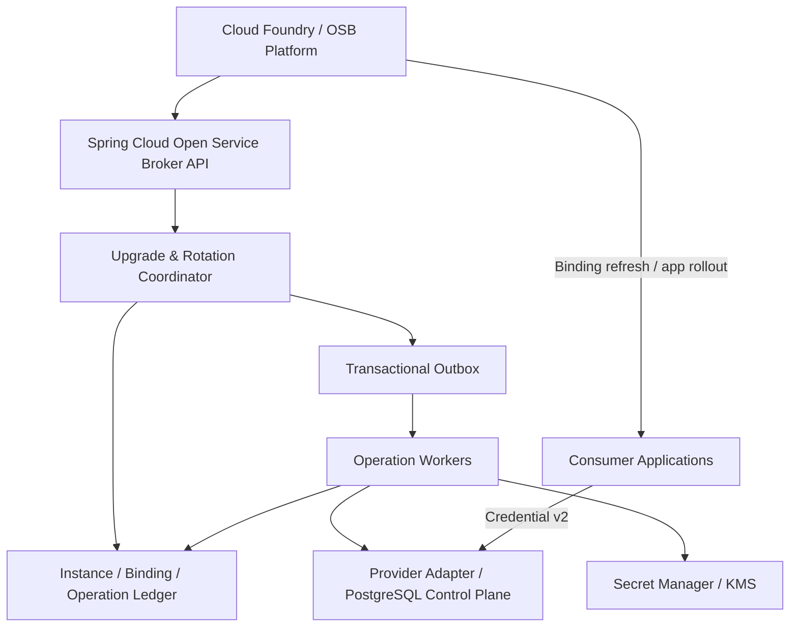
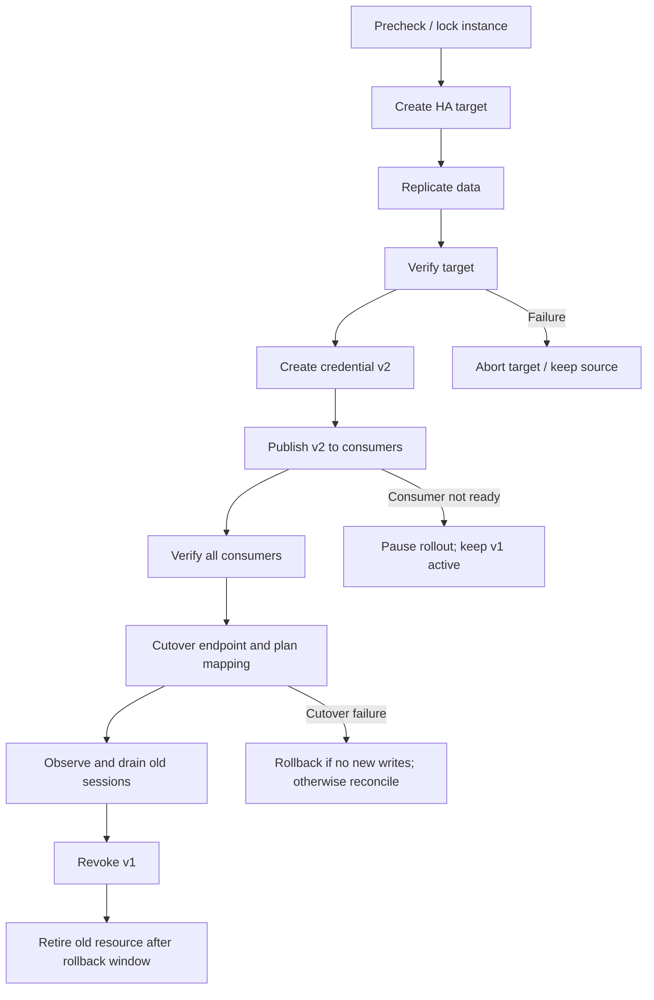

# Thiết kế kế hoạch nâng cấp gói và luân chuyển credentials không gián đoạn

## Bài toán capstone

Bạn vận hành một Spring Cloud Service Broker cung cấp PostgreSQL cho nhiều ứng dụng. Một nhóm khách hàng đang dùng plan `standard` và cần nâng cấp lên `ha` để có standby, backup tốt hơn và khả năng phục hồi cao hơn. Cùng đợt đó, chính sách bảo mật yêu cầu luân chuyển credentials của các binding đang hoạt động.

Yêu cầu của bài thực hành:

- Giữ nguyên service instance và binding identity mà platform đang quản lý.
- Nâng cấp plan theo hợp đồng Open Service Broker API (OSB API), kiểm tra khả năng update và xử lý bất đồng bộ khi cần.
- Chuyển dữ liệu/cấu hình sang hạ tầng đích mà không làm mất mapping provider.
- Cấp credentials mới, phân phối đến consumer, xác nhận consumer đã chuyển rồi mới thu hồi credentials cũ.
- Duy trì khả năng kết nối trong suốt quá trình cutover, có rollback hoặc roll-forward rõ ràng.
- Không tạo database, role hoặc binding trùng khi request được retry hoặc worker restart.
- Có audit, metrics, kiểm thử failure injection và tiêu chí hoàn tất.

Đây là thiết kế mẫu cho module `SPRING_CLOUD_SERVICE_BROKER`, không phải cam kết rằng mọi provider hoặc platform đều hỗ trợ rotation nóng. Zero downtime chỉ khả thi khi provider cho phép credentials cũ và mới cùng tồn tại trong một khoảng thời gian, ứng dụng có thể chuyển cấu hình an toàn, và platform có cách phân phối binding update phù hợp. Nếu một điều kiện không đáp ứng, cần thiết kế maintenance window với gián đoạn được giới hạn và thông báo rõ.

## Phân biệt ba loại nâng cấp

Trước khi lập kế hoạch, hãy xác định đang thay đổi lớp nào. Một đợt release có thể kết hợp nhiều lớp nhưng phải theo dõi trạng thái riêng.

| Loại thay đổi | Ví dụ | Cách quản lý |
|---|---|---|
| Broker software upgrade | Nâng Spring Boot hoặc Spring Cloud Open Service Broker. | Schema compatibility, rolling deployment, API version và backward compatibility. |
| Service plan upgrade | `standard` sang `ha`, tăng quota hoặc thêm standby. | OSB update request, `plan_updateable`, plan transition policy và provider workflow. |
| Provider engine/platform upgrade | PostgreSQL major version, cluster topology hoặc storage backend. | Backup, replication, data migration, validation và provider cutover. |
| Credential rotation | Đổi password, user, certificate hoặc token của binding. | Credential versioning, overlap, consumer rollout và revoke. |

Không dùng một `PATCH` plan update để che giấu việc broker software cần deploy; cũng không coi credential rotation là hệ quả tự động của plan upgrade. Tách operation giúp xác định bước nào thất bại, có thể retry hay cần compensation.

## Kiến trúc mục tiêu

Thiết kế dùng một service instance identity ổn định, một operation coordinator và các adapter tách biệt cho provider, database và secret manager.



Các thành phần có trách nhiệm:

- **OSB API layer:** validate request, xác định version, trả response đồng bộ hoặc `202 Accepted` theo hợp đồng.
- **Upgrade coordinator:** điều phối plan transition, precheck, data migration, cutover và rollback/roll-forward.
- **Rotation coordinator:** quản lý credential version theo từng binding và theo dõi trạng thái consumer rollout.
- **Operation ledger:** lưu checkpoint, idempotency key, provider job ID và state transition.
- **Transactional outbox:** bảo đảm operation và job được ghi cùng transaction trước khi worker xử lý.
- **Provider adapter:** tạo standby/cluster, thay đổi plan, tạo role/credential và kiểm tra provider state.
- **Secret manager adapter:** tạo version mới, quản lý ACL, reference và rotation metadata.

Không để API handler tự thực hiện toàn bộ workflow dài trong một HTTP request. Với operation dài, lưu operation trước rồi để worker tiếp tục; platform polling `last_operation`.

## Giữ ổn định identity và contract OSB

Service instance đang tồn tại có `instance_id`, `service_id`, `plan_id` và provider resource mapping. Khi nâng plan:

- Giữ nguyên `instance_id` để platform tiếp tục quản lý cùng một instance.
- Không tái sử dụng service/plan ID cho một offering có ngữ nghĩa khác.
- Chỉ đổi plan ID khi broker thực sự hỗ trợ transition đó.
- Lưu `previous_values` và request fingerprint để kiểm tra trạng thái trước khi update.
- Giữ provider resource ID cũ trong ledger cho đến khi cutover được xác nhận.
- Dùng operation ID và idempotency key ổn định trong mọi lần retry.

Catalog cần công bố đúng capability. `plan_updateable` cho biết service/plan hỗ trợ cập nhật plan nói chung; nó không có nghĩa mọi cặp plan đều được phép. Broker vẫn phải kiểm tra ma trận chuyển đổi cụ thể. Nếu plan không thể nâng cấp tại chỗ, trả lỗi theo OSB contract trước side effect hoặc thiết kế workflow thay thế đã được tài liệu hóa.

Nếu broker hỗ trợ binding rotation, chỉ công bố capability `binding_rotatable` khi platform integration và provider adapter thực sự thực hiện được quy trình rotation an toàn. Cờ này không tự động cập nhật cấu hình trong process consumer; ứng dụng vẫn cần nhận, nạp và xác minh credential mới.

## Lập ma trận tương thích trước khi nâng plan

Không bắt đầu migration khi chưa biết khác biệt giữa plan hiện tại và plan đích.

| Hạng mục | `standard` hiện tại | `ha` mục tiêu | Cần xác minh |
|---|---|---|---|
| PostgreSQL version | 14.x | 14.x hoặc 16.x | Có phải major version upgrade không? |
| Topology | Một primary | Primary + standby | Replication mode và failover behavior. |
| Storage | 100 GB | 200 GB | Provider có hỗ trợ tăng online không? |
| Backup | Daily | PITR + retention dài hơn | Backup có được restore thử không? |
| Endpoint | `db-01.internal` | Endpoint ổn định hoặc proxy | Có thể giữ DNS/VIP để consumer không đổi URL không? |
| Connection quota | 100 | 300 | Tổng connection từ mọi app replica có phù hợp không? |
| Credential policy | Một binding user | User/credential có thể overlap | Provider có cho phép hai user hoặc hai credential cùng hoạt động không? |
| SLA | Best effort | HA target | Có cần failover drill và health check không? |

Nếu plan upgrade chỉ thêm standby và tăng storage, có thể không cần đổi database major version. Tránh gộp thay đổi engine version vào cùng cutover nếu không cần thiết; mỗi thay đổi tăng thêm một nguồn rủi ro.

### Ma trận transition

| Plan hiện tại | Plan đích | Chính sách | Kết quả |
|---|---|---|---|
| `standard` | `ha` | Cho phép upgrade | Chạy precheck và workflow nâng cấp. |
| `ha` | `standard` | Không cho downgrade tự động | Trả lỗi update phù hợp trước provider call. |
| `standard` | `archive` | Khác loại engine, cần migration riêng | Chỉ cho phép qua workflow được hỗ trợ. |
| `ha` | `ha` | Cùng plan, chỉ update tham số | Validate parameters và apply update. |

## Thiết kế operation và state machine

Nâng plan và rotation có thể chạy nối tiếp hoặc song song theo chính sách, nhưng phải có operation riêng và checkpoint riêng. Không dùng một boolean `upgrading=true` để đại diện cho mọi giai đoạn.

### Plan upgrade operation

```text
PENDING
  -> PRECHECK
  -> PREPARING_TARGET
  -> COPYING_DATA
  -> VERIFYING_TARGET
  -> CUTOVER_PENDING
  -> CUTOVER
  -> SUCCEEDED

Any non-terminal state
  -> FAILED_COMPENSATING
  -> FAILED
  -> RECONCILIATION_REQUIRED
```

| State | Điều kiện vào | Việc worker thực hiện |
|---|---|---|
| `PRECHECK` | Request hợp lệ và operation đã persist. | Kiểm tra plan transition, quota, backup, provider health và binding dependencies. |
| `PREPARING_TARGET` | Precheck đạt. | Tạo standby/cluster đích, storage hoặc network cần thiết. |
| `COPYING_DATA` | Target sẵn sàng. | Replicate dữ liệu, theo dõi lag và đồng bộ schema/config. |
| `VERIFYING_TARGET` | Replication gần hội tụ. | Kiểm tra row count, checksum/consistency phù hợp, extension, role và query smoke test. |
| `CUTOVER_PENDING` | Target đạt điều kiện. | Chờ lock/fencing và xác nhận không có operation xung đột. |
| `CUTOVER` | Được phép chuyển traffic. | Chuyển endpoint/VIP/proxy hoặc promote target, cập nhật mapping. |
| `SUCCEEDED` | Endpoint mới hoạt động và mapping đã persist. | Hoàn tất operation, giữ old resource trong rollback window. |
| `RECONCILIATION_REQUIRED` | Provider outcome không xác định. | Tra cứu provider, không tạo target hoặc cutover trùng. |

### Binding rotation operation

```text
ACTIVE_OLD
  -> NEW_CREDENTIAL_CREATED
  -> NEW_SECRET_PUBLISHED
  -> CONSUMER_REFRESH_PENDING
  -> NEW_CREDENTIAL_VERIFIED
  -> OLD_CREDENTIAL_REVOKED
  -> ROTATION_SUCCEEDED

Failure before revoke
  -> RETRY_OR_RECONCILE
Failure after revoke
  -> RECOVERY_REQUIRED
```

Rotation state phải theo từng `binding_id`. Một instance có thể có nhiều consumer; không được thu hồi credential cũ của tất cả binding chỉ vì một app đã xác nhận chuyển thành công.

## Giai đoạn 1: Precheck và đóng băng thay đổi xung đột

Trước khi tạo tài nguyên mới, coordinator cần xác minh:

1. Instance tồn tại, state cho phép update và không có operation mutation xung đột.
2. `previous_values.plan_id` khớp plan hiện tại trong broker ledger.
3. Plan đích thuộc cùng service offering và transition được cho phép.
4. Provider có quota, capacity và API cần thiết.
5. Backup gần nhất hợp lệ và đã có restore evidence.
6. Replication/data migration có thể chạy với version hiện tại.
7. Mọi binding đang hoạt động đã được liệt kê và consumer reference còn hợp lệ.
8. Provider cho phép credential overlap hoặc có chiến lược dual-user.
9. Secret manager và KMS sẵn sàng, ACL cho consumer/runtime đúng.
10. Có cutover window, rollback criteria và người chịu trách nhiệm.

Dùng optimistic concurrency hoặc resource lock để ngăn hai update cùng instance chạy đồng thời. Nếu phát hiện operation đang chạy, trả `ConcurrencyError` theo OSB contract khi điều kiện áp dụng; không bắt đầu provider side effect.

### Ví dụ request update plan bất đồng bộ

```http
PATCH /v2/service_instances/inst-orders-001?accepts_incomplete=true HTTP/1.1
Content-Type: application/json
X-Broker-API-Version: 2.17
```

```json
{
  "service_id": "svc-postgresql",
  "plan_id": "plan-ha",
  "previous_values": {
    "service_id": "svc-postgresql",
    "plan_id": "plan-standard"
  },
  "parameters": {
    "storage_gb": 200,
    "backup_policy": "point-in-time"
  }
}
```

Đây là request minh họa; các field và parameters phải khớp catalog/service contract thực tế. Khi thao tác cần thời gian dài và platform cho phép async, broker ghi operation/outbox bền vững rồi trả:

```http
HTTP/1.1 202 Accepted
Content-Type: application/json
```

```json
{
  "operation": "upgrade-op-9001"
}
```

Nếu request không có `accepts_incomplete=true` nhưng broker chỉ hỗ trợ async cho thao tác đó, xử lý theo error contract `AsyncRequired` trước khi tạo side effect.

## Giai đoạn 2: Chuẩn bị target và di chuyển dữ liệu

Với nâng cấp topology hoặc provider engine, ưu tiên mô hình blue-green khi provider hỗ trợ:

1. Giữ database cũ là **blue/source** và tiếp tục phục vụ traffic.
2. Tạo database/cluster mới là **green/target** theo plan đích.
3. Cấu hình network, TLS, backup, monitoring và provider role cần thiết.
4. Khởi tạo target từ snapshot hoặc backup nhất quán.
5. Thiết lập replication/CDC từ source sang target.
6. Theo dõi replication lag, transaction backlog và lỗi apply.
7. Đồng bộ schema, extension, collation, timezone và cấu hình cần thiết.
8. Chạy read-only validation trên target.

Nếu chỉ tăng storage hoặc bật standby trong cùng provider resource, có thể dùng thao tác in-place theo provider. Nhưng phải xác định rõ thao tác có thể rollback hay không. Một số thay đổi storage không thể thu nhỏ lại; một số thay đổi engine có thể yêu cầu downtime.

### Expand-contract cho schema ứng dụng

Nếu plan mới yêu cầu thay đổi schema database mà ứng dụng sử dụng, triển khai theo expand-contract:

- Expand: thêm cột/bảng/index tương thích với code cũ.
- Deploy code có thể đọc cả schema cũ và mới.
- Backfill dữ liệu theo batch có checkpoint.
- Chuyển reader/writer sang schema mới.
- Contract: xóa field cũ sau khi mọi consumer đã chuyển và rollback window kết thúc.

Không thực hiện migration phá hủy trước khi toàn bộ ứng dụng tương thích. Nếu broker quản lý nhiều consumer không thể deploy đồng thời, phải giữ backward compatibility lâu hơn.

### Tiêu chí target sẵn sàng

| Kiểm tra | Tiêu chí ví dụ |
|---|---|
| Replication lag | Dưới ngưỡng đã thống nhất và tiếp tục giảm. |
| Data consistency | Snapshot/checksum hoặc đối chiếu nghiệp vụ đạt. |
| Schema | Version, extension và migration level đúng. |
| Access | Provider roles và grants cần thiết tồn tại. |
| TLS | Certificate, hostname và trust chain hợp lệ. |
| Performance | Query latency và connection capacity đáp ứng mục tiêu. |
| Backup | Target có backup/restore path được xác minh. |
| Observability | Metrics/log/alert của target đã hoạt động. |

Không cutover chỉ vì provider báo resource `AVAILABLE`; cần kiểm tra dữ liệu và khả năng phục vụ thực tế.

## Giai đoạn 3: Tạo credentials mới theo mô hình overlap

Mục tiêu là để credentials cũ và mới cùng hoạt động trong một khoảng thời gian đủ cho consumer chuyển đổi. Có hai mẫu thường dùng.

### Mẫu A: Hai user/role song song

Nếu provider không cho phép hai password cùng hợp lệ cho một user, tạo user mới:

| Thời điểm | User cũ | User mới | Consumer |
|---|---|---|---|
| Trước rotation | Active | Chưa có | Dùng user cũ. |
| Sau create | Active | Active | Vẫn dùng user cũ. |
| Publish v2 | Active | Active | Bắt đầu chuyển sang user mới. |
| Verify | Active | Active | Kết nối mới thành công trên mọi replica. |
| Revoke old | Disabled | Active | Chỉ dùng user mới. |

Hai user cần có quyền tương đương nhưng theo nguyên tắc least privilege. Với PostgreSQL, có thể tạo role/login riêng cho mỗi binding và cấp đúng quyền trên database/schema. Không chia sẻ một superuser giữa các ứng dụng.

### Mẫu B: Hai version credential của cùng provider identity

Nếu provider hỗ trợ nhiều credential/token/certificate đồng thời cho cùng identity, tạo version mới mà không vô hiệu hóa version cũ. Lưu metadata version và thời hạn overlap. Xác minh provider thực sự chấp nhận cả hai trong cùng thời gian; không giả định API `rotate` giữ credential cũ nếu tài liệu provider không cam kết.

### Lưu secret version mới

Secret manager có thể lưu theo version:

```text
secret reference: broker/bindings/bind-101/credentials
version v1: active-old
version v2: active-new
```

Broker ledger lưu reference/version, không lưu password:

```text
binding_id: bind-101
credential_active_version: v1
credential_pending_version: v2
rotation_state: NEW_SECRET_PUBLISHED
```

Không chuyển `credential_active_version` sang v2 trước khi secret mới tồn tại, ACL đúng và consumer có cách nhận version đó. Có thể giữ cả v1/v2 trong secret manager trong suốt overlap.

## Giai đoạn 4: Phân phối credential mới đến consumer

Credential rotation chỉ hoàn tất khi consumer thực sự dùng được credential mới. Secret đã được ghi vào secret manager chưa đủ.

### Cloud Foundry

Cloud Foundry thường cung cấp binding credentials qua `VCAP_SERVICES`. Việc cập nhật dữ liệu binding và việc process app nạp biến môi trường là hai việc riêng. Tùy phiên bản Cloud Foundry và service broker integration, platform có thể hỗ trợ flow rotation khác nhau; không giả định mọi thay đổi trong broker tự cập nhật môi trường của process đang chạy.

Kế hoạch triển khai cần:

1. Xác minh platform có hỗ trợ binding rotation cho service/plan và broker đã công bố capability tương ứng hay chưa.
2. Xác định thao tác nào cập nhật binding data và cách app process nhận dữ liệu mới.
3. Dùng rolling restart/restage theo workflow platform nếu cần nạp lại environment.
4. Giữ đủ app instances khỏe mạnh trong khi thay thế từng process.
5. Chờ readiness và kiểm tra kết nối thật bằng credential v2 trước khi chuyển sang instance tiếp theo.

Nếu platform không có cơ chế refresh binding không gián đoạn, ứng dụng phải hỗ trợ rollout với nhiều instance và provider phải giữ credential cũ hợp lệ trong suốt thời gian chuyển. Với app chỉ có một instance hoặc không có readiness/rolling replacement, không thể cam kết zero downtime bằng cách đổi `VCAP_SERVICES` đơn thuần.

### Kubernetes

Với integration ghi credentials vào Kubernetes Secret:

- Nếu Pod dùng Secret qua environment variable, giá trị trong process không tự cập nhật; cần rollout Pod mới.
- Nếu Pod mount Secret volume, nội dung file được cập nhật eventual theo cơ chế Kubernetes, nhưng ứng dụng phải đọc lại file và thay connection pool an toàn.
- Nếu dùng `subPath`, không dựa vào cập nhật Secret tự động cho file mount đó.
- Nếu Secret được quản lý bởi external secret controller, xác minh sync status, refresh interval và secret version ở nguồn.

Rolling update cần có nhiều replica, readiness probe và PodDisruptionBudget phù hợp. Mỗi Pod mới phải tạo connection pool bằng credential v2, chạy smoke query rồi mới nhận traffic. Giữ Pod cũ hoạt động cho đến khi Pod mới healthy.

### Consumer phải hỗ trợ chuyển credentials

Ứng dụng consumer nên có một cơ chế chuyển connection pool:

1. Đọc credential version mới.
2. Tạo pool mới và mở thử connection.
3. Chạy health query hoặc kiểm tra quyền tối thiểu.
4. Chuyển traffic/DAO sang pool mới.
5. Drain pool cũ để transaction đang chạy hoàn tất.
6. Đóng pool cũ.
7. Gửi tín hiệu xác nhận version mới đã được sử dụng nếu integration có kênh acknowledgment.

Nếu ứng dụng chỉ đọc credential khi startup, cần rolling restart thay cho hot reload. Không thay password trên provider trước rồi mới tìm cách cập nhật pool; điều đó sẽ làm connection mới thất bại.

## Giai đoạn 5: Xác minh consumer và thu hồi credentials cũ

Không thu hồi v1 chỉ vì một health check thành công. Cần kiểm tra tất cả consumer và replica thuộc binding:

- Mọi Pod/CF process đã nhận version v2.
- Kết nối mới bằng v2 thành công.
- Query/operation cần thiết hoạt động với quyền tối thiểu.
- Connection pool cũ đã drain hoặc hết session.
- Không còn traffic/connection sử dụng user hoặc certificate cũ trong khoảng quan sát.
- Secret reference và binding ledger đều ghi nhận v2 là active.
- Có audit event xác nhận người/operation khởi tạo rotation.

Sau khi đạt điều kiện:

1. Chuyển ledger `credential_active_version=v2`.
2. Đánh dấu rotation operation thành công.
3. Thu hồi v1 tại provider.
4. Xóa hoặc disable secret version cũ theo retention/security policy.
5. Kiểm tra provider không còn session/credential cũ.

Nếu phát hiện consumer vẫn dùng v1, hoãn revoke và tìm replica/worker chưa cập nhật. Đặt deadline overlap để tránh giữ credentials cũ vô thời hạn, nhưng deadline phải đủ dài cho rollout và có escalation khi quá hạn.

## Giai đoạn 6: Cutover plan và endpoint

Sau khi target đã đồng bộ và credentials mới sẵn sàng, thực hiện cutover theo một trình tự có thể quan sát:

1. Giảm hoặc dừng các write ngắn hạn nếu provider yêu cầu consistency window.
2. Chờ replication lag về ngưỡng đã định.
3. Fence operation khác đang thay đổi cùng instance.
4. Chuyển endpoint ổn định (proxy/VIP/DNS) sang target hoặc promote target theo provider workflow.
5. Cập nhật provider resource mapping và plan ID trong một transaction broker.
6. Kiểm tra kết nối bằng consumer credential v2.
7. Mở lại write và theo dõi lỗi/latency.
8. Giữ source cũ read-only hoặc ở trạng thái rollback-ready trong cửa sổ đã định.

Nếu endpoint thay đổi, broker phải phân phối endpoint mới tới tất cả binding liên quan. Một endpoint ổn định qua proxy/DNS giúp giảm số consumer phải cập nhật, nhưng TTL, connection pool và DNS cache vẫn cần được tính đến. Không đổi DNS và thu hồi source ngay lập tức.

## Mẫu request/response và operation tracking

Khi plan update là bất đồng bộ, broker trả operation ID:

```json
{
  "operation": "upgrade-op-9001"
}
```

Platform polling:

```http
GET /v2/service_instances/inst-orders-001/last_operation?operation=upgrade-op-9001 HTTP/1.1
X-Broker-API-Version: 2.17
```

Trong lúc chuẩn bị target:

```json
{
  "state": "in progress",
  "description": "Đang đồng bộ dữ liệu sang plan ha."
}
```

Khi hoàn tất:

```json
{
  "state": "succeeded",
  "description": "Instance đã chuyển sang plan ha."
}
```

Nếu update thất bại, broker cần phản ánh chính xác instance còn usable hay không và cùng request có thể retry hay không bằng các trường OSB API phù hợp cho update failure (`instance_usable`, `update_repeatable`). Không đưa hai trường này vào response cho operation không thuộc phạm vi đặc tả.

Rotation có thể là workflow nội bộ hoặc được platform kích hoạt qua capability/extension được hỗ trợ. Không tự tạo endpoint OSB không chuẩn rồi giả định mọi platform hiểu nó. Hợp đồng rotation phải được thống nhất giữa broker, platform integration và consumer.

## Operation ledger, idempotency và concurrency

Mỗi lần nâng plan hoặc rotation phải có operation ID riêng. Một bảng nội bộ có thể lưu:

```text
broker_operation
----------------
operation_id
instance_id
binding_id
operation_type
request_fingerprint
idempotency_key
state
current_step
provider_job_id
source_resource_id
target_resource_id
credential_old_version
credential_new_version
attempt_count
lease_until
fencing_token
created_at
updated_at
```

Các bất biến:

- Retry cùng operation dùng lại idempotency key.
- Một instance không chạy hai plan update xung đột cùng lúc.
- Rotation của hai binding khác nhau có thể chạy song song nếu provider quota cho phép; cùng một binding phải được serialize.
- Worker phải claim operation bằng lease và fencing token.
- Queue redelivery kiểm tra operation terminal trước khi gọi provider.
- Provider result và broker mapping phải được persist trước khi đánh dấu thành công.
- Operation không rõ kết quả chuyển sang reconciliation, không tạo key mới.

Dùng transactional outbox để commit operation cùng job. Không giữ transaction database mở trong lúc chờ provider. Các bước provider có side effect phải có checkpoint và compensation policy.

## Kế hoạch rollback và điểm không thể quay lại

### Rollback plan upgrade

Trước cutover, rollback thường đơn giản hơn vì source vẫn là primary. Sau cutover, target có thể đã nhận write mới; không thể chỉ chuyển endpoint về source cũ nếu dữ liệu đã diverge.

| Giai đoạn | Rollback |
|---|---|
| Precheck/preparing target | Xóa target phụ nếu chắc chắn chưa nhận dữ liệu/traffic cần giữ. |
| Copying data | Dừng replication và cleanup target; source vẫn phục vụ. |
| Verifying target | Giữ source primary; sửa lỗi target hoặc hủy upgrade. |
| Cutover chưa nhận write mới | Có thể chuyển endpoint về source nếu provider xác nhận an toàn. |
| Target đã nhận write | Cần reverse replication/restore/roll-forward; không rollback DNS đơn thuần. |
| Old resource đã xóa | Phục hồi từ backup hoặc roll-forward; có thể không còn rollback nhanh. |

### Rollback credential rotation

Trước khi revoke v1, nếu v2 lỗi có thể chuyển consumer về v1 và sửa v2. Sau khi v1 đã bị revoke, rollback chỉ khả thi nếu provider cho phép tạo lại credential cũ hoặc tạo version thay thế. Không giả định secret value cũ có thể được khôi phục từ hash hoặc provider.

Vì vậy, điểm không thể quay lại thường là:

- Provider đã promote target và nhận write mới mà không còn replication ngược.
- Credential cũ đã bị revoke và provider không cho tái kích hoạt.
- Source resource đã bị xóa sau rollback window.
- Schema contract đã xóa field mà phiên bản app cũ cần.

Trước các điểm này, yêu cầu precondition và approval rõ ràng. Sau điểm này, ưu tiên roll-forward và reconciliation.

## Kế hoạch triển khai theo giai đoạn

| Giai đoạn | Công việc | Điều kiện hoàn tất |
|---|---|---|
| 0. Discover | Inventory instance, plan, binding, consumer, provider resource và secret version. | Không còn binding/consumer chưa xác định. |
| 1. Precheck | Kiểm tra transition, quota, backup, provider overlap và app rollout. | Tất cả precondition đạt. |
| 2. Prepare | Tạo target, standby, replication và credential v2. | Target và v2 sẵn sàng, source/v1 vẫn hoạt động. |
| 3. Verify | Kiểm tra data consistency, TLS, grants, query và consumer readiness. | Test đạt, replication lag trong ngưỡng. |
| 4. Publish | Phân phối endpoint/credential v2 đến từng consumer. | Tất cả consumer có thể dùng v2. |
| 5. Cutover | Chuyển endpoint/plan mapping và traffic. | Traffic hoạt động trên target, broker ledger đã persist. |
| 6. Stabilize | Theo dõi error/latency, drain old sessions. | Không còn consumer dùng endpoint/v1 cũ. |
| 7. Revoke | Thu hồi v1 và cleanup source theo retention. | Không còn dependency cũ; audit hoàn tất. |

Nếu plan upgrade và rotation được chạy song song, cần có dependency graph. Ví dụ credential v2 có thể được tạo trên target trước cutover, nhưng consumer chỉ chuyển endpoint/credential cùng một thời điểm. Tránh trường hợp app dùng username v2 nhưng endpoint vẫn trỏ source không có user đó, hoặc app dùng endpoint target nhưng credential chưa được cấp quyền.

## Ví dụ dependency graph



## Kiểm thử trước production

### Functional tests

- `standard` → `ha` được chấp nhận; transition không hỗ trợ bị từ chối trước provider call.
- `previous_values` không khớp state hiện tại trả conflict phù hợp.
- `accepts_incomplete=true` tạo operation bền vững và trả `202`.
- Platform polling nhận `in progress`, `succeeded` hoặc `failed` đúng trạng thái.
- Service/plan capability trong catalog khớp handler thật.
- Binding giữ đúng `binding_id`, consumer reference và secret version.

### Credential rotation tests

- Tạo v2 không làm v1 mất hiệu lực trong overlap window.
- Mỗi app replica nhận được v2 và mở được connection.
- Consumer chuyển pool mà không đóng session cũ quá sớm.
- Revoke v1 chỉ diễn ra sau khi tất cả consumer xác nhận.
- Rotation retry không tạo nhiều user/role hoặc secret version rác.
- Unbind sau rotation thu hồi cả credential hiện hành và tài nguyên phụ thuộc theo policy.

### Failure injection

| Điểm chèn lỗi | Kết quả mong đợi |
|---|---|
| Worker chết sau khi tạo target | Retry nhận ra target qua idempotency/marker, không tạo target thứ hai. |
| Replication lag không giảm | Không cutover; source vẫn phục vụ. |
| KMS/secret manager không truy cập được | Không publish reference chưa đọc được. |
| Một app replica không nhận v2 | Giữ v1 active, dừng revoke và điều tra replica. |
| Provider từ chối credential v2 | Chuyển consumer về v1 hoặc giữ nguyên, không cắt v1. |
| Cutover timeout | Tra cứu provider endpoint/primary state trước khi retry. |
| Broker DB lỗi sau provider cutover | Reconcile provider state và persist mapping; không tạo resource mới. |
| Worker chạy trùng | Lease/fencing và idempotency ngăn side effect trùng. |
| Revoke v1 thất bại | Rotation có thể đã hoạt động nhưng chưa cleanup; giữ operation ở trạng thái cleanup pending. |

### Load and compatibility tests

- Nhiều binding rotation đồng thời nhưng không vượt provider quota.
- Rolling restart không làm tất cả app replica mất kết nối cùng lúc.
- API version platform gửi tương thích với broker.
- Phiên bản broker cũ và mới cùng đọc schema trong expand-contract window.
- DB connection pool và provider connection quota đủ cho overlap period, khi cả source/target và v1/v2 cùng tồn tại.

## Observability và tiêu chí hoàn tất

Theo dõi:

- Số instance theo plan cũ/mới và state upgrade.
- Operation age, checkpoint, retry count và reconciliation backlog.
- Replication lag, failover status và target health.
- Số binding theo credential version.
- Số consumer đã xác nhận v2, số consumer còn v1.
- Authentication failure, connection error, TLS error và provider 429/5xx.
- Active sessions theo user cũ/mới.
- Thời gian từ publish v2 đến consumer verification.
- Thời gian overlap và số lần rollback/roll-forward.

Không dùng password/token hoặc full connection string làm log/metric label. Dùng operation ID, binding ID, secret version và provider request ID đã được kiểm soát.

Chỉ đánh dấu capstone hoàn tất khi:

1. Instance vẫn có cùng identity và plan ID hiện tại là plan đích.
2. Provider resource mới được xác minh healthy và dữ liệu nhất quán.
3. Endpoint ứng dụng dùng là endpoint đã cutover.
4. Tất cả binding active có credential version hợp lệ.
5. Mọi consumer/replica đã chuyển sang credential mới.
6. Không còn connection/session dùng credential cũ trong thời gian quan sát đã chọn.
7. Credential cũ đã được revoke và secret cũ được retire theo policy.
8. Operation ledger, provider mapping, audit và metrics nhất quán.
9. Rollback window đã kết thúc hoặc source cũ được giữ theo quyết định vận hành.

## Deliverables của bài thực hành

Người học cần tạo các tài liệu và bằng chứng sau trong môi trường thực hành của mình:

- Plan transition matrix và danh sách capability OSB cần công bố.
- Sơ đồ blue-green/replication và dependency graph.
- Runbook precheck, cutover, rollback và roll-forward.
- State machine cho upgrade operation và binding rotation.
- Inventory instance/binding/consumer/provider resource và secret reference (không chứa secret value).
- Test evidence cho credential overlap, consumer rollout và revoke.
- Failure-injection report và reconciliation result.
- Dashboard/metric snapshot cho replication lag, operation progress và credential version adoption.
- Audit record xác nhận thời điểm cutover và revoke.

## Checklist vận hành cuối cùng

1. Plan transition được hỗ trợ và catalog flags đúng.
2. Instance/binding identity không thay đổi ngoài hợp đồng.
3. Backup/restore đã diễn tập và source vẫn rollback-ready.
4. Target đã đồng bộ và vượt qua validation.
5. Provider hỗ trợ overlap credentials hoặc đã có dual-user strategy.
6. Secret v2 được lưu an toàn và ACL đúng.
7. Consumer rollout có readiness và không thay mọi replica cùng lúc.
8. Tất cả consumer đã xác nhận kết nối bằng v2.
9. Endpoint/plan mapping được cutover trong một bước có fencing.
10. V1 chỉ bị revoke sau khi không còn consumer sử dụng.
11. Retry và worker restart không tạo tài nguyên/credential trùng.
12. Rollback/roll-forward có điều kiện và điểm không thể quay lại.
13. Audit, metrics và reconciliation xác nhận trạng thái cuối.

## Kết luận

Nâng cấp plan và luân chuyển credentials không gián đoạn là hai workflow có liên quan nhưng cần state machine và checkpoint riêng. Giữ instance/binding identity ổn định, chuẩn bị target theo blue-green, đồng bộ dữ liệu trước cutover, tạo credential mới có overlap, phân phối và xác minh ở từng consumer, rồi mới chuyển endpoint và thu hồi credential cũ. Với Spring Cloud Service Broker, OSB API điều phối update/binding lifecycle, còn provider adapter, secret manager và consumer rollout quyết định việc chuyển đổi có thực sự an toàn. Chỉ gọi là zero downtime khi mọi consumer duy trì được kết nối trong toàn bộ overlap và cutover; nếu platform hoặc provider không hỗ trợ điều đó, hãy công bố maintenance window và giới hạn gián đoạn thay vì hứa một khả năng không có.
