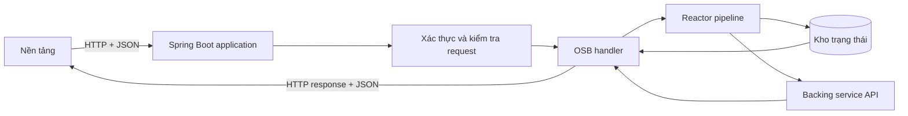
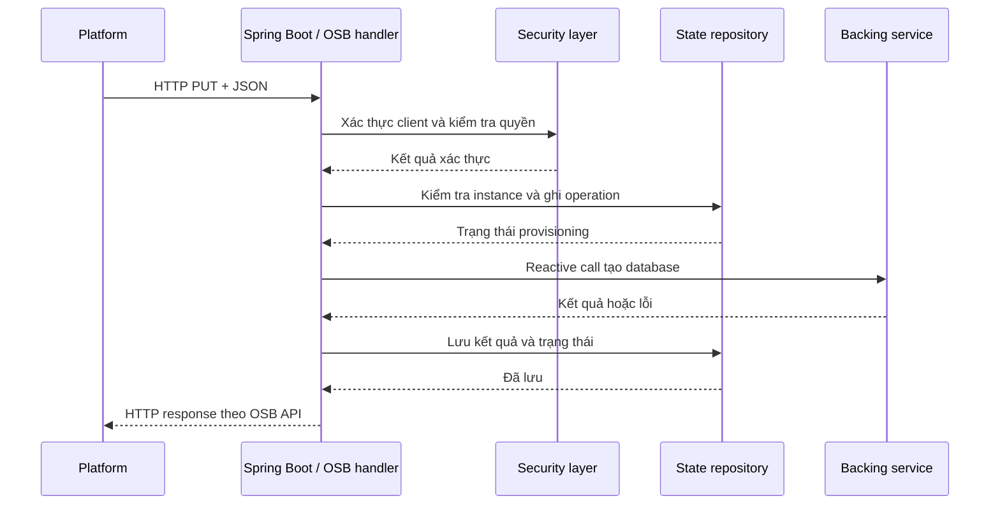

# Kiến thức cần có: Spring Boot, HTTP, JSON, bảo mật và Reactor

Để xây dựng một service broker theo Open Service Broker API (OSB API) bằng Spring Cloud, bạn cần hiểu một số nền tảng trước khi đi vào các handler catalog, provision, update, deprovision, bind và unbind. Broker là một ứng dụng backend nhận request HTTP từ nền tảng, đọc dữ liệu JSON, xác thực bên gọi, điều phối thao tác tới hệ thống cung cấp tài nguyên và trả kết quả đồng bộ hoặc bất đồng bộ. Vì vậy, kiến thức Spring Boot, HTTP, JSON, bảo mật và Reactor liên kết trực tiếp với từng phần của công việc.

Module `SPRING_CLOUD_SERVICE_BROKER` sử dụng hệ sinh thái Spring để triển khai hợp đồng OSB API, công bố catalog và quản lý vòng đời tài nguyên. Bạn không cần phải là chuyên gia về mọi công nghệ ngay từ đầu, nhưng cần nắm được những khái niệm và kỹ năng thực hành trong bài này để hiểu được cách broker hoạt động và có thể đọc, viết mã tích hợp một cách an toàn.

## Mục tiêu học tập

Sau khi hoàn thành bài này, bạn có thể:

- Giải thích cấu trúc cơ bản của một ứng dụng Spring Boot và vai trò của dependency injection, cấu hình và bean.
- Đọc một request HTTP, hiểu method, path, query parameter, header, body và status code.
- Hiểu cách JSON được ánh xạ sang object Java và ngược lại, cũng như cách kiểm tra dữ liệu đầu vào.
- Phân biệt xác thực với phân quyền, biết cách bảo vệ credentials, secret và dữ liệu nhạy cảm.
- Hiểu `Mono`, `Flux` và cách kết hợp các thao tác bất đồng bộ bằng Reactor.
- Liên hệ các kiến thức trên với quy trình xử lý một request OSB API trong Spring Cloud Service Broker.

## 1. Bức tranh tổng thể: một request đi qua broker như thế nào?

Giả sử nền tảng muốn cấp một PostgreSQL service instance cho ứng dụng. Nền tảng gửi một HTTP request đến broker. Ứng dụng Spring nhận request, kiểm tra thông tin xác thực và dữ liệu JSON, chuyển request vào thành phần xử lý nghiệp vụ. Thành phần này có thể gọi API của nhà cung cấp database, chờ kết quả bất đồng bộ, lưu trạng thái operation và trả response theo hợp đồng OSB API.



Mỗi kiến thức nền đảm nhiệm một phần của luồng:

| Kiến thức | Vai trò trong broker |
|---|---|
| Spring Boot | Khởi động ứng dụng, quản lý bean, cấu hình môi trường và tích hợp các thành phần Spring. |
| HTTP | Định nghĩa cách nền tảng gọi broker và cách broker trả mã trạng thái, header, response. |
| JSON | Biểu diễn catalog, tham số provision/update và credentials của binding. |
| Bảo mật | Bảo vệ endpoint broker, xác minh nền tảng, giới hạn quyền và giữ an toàn secret. |
| Reactor | Kết hợp các thao tác bất đồng bộ và biểu diễn kết quả bằng `Mono` hoặc `Flux`. |

## 2. Spring Boot: nền tảng chạy ứng dụng broker

Spring Boot giúp tạo và vận hành ứng dụng Spring với cấu hình khởi tạo thuận tiện. Thay vì tự lắp ráp mọi thành phần, ứng dụng sử dụng dependency được khai báo, auto-configuration và các bean do Spring quản lý.

### 2.1. Cấu trúc ứng dụng và điểm khởi động

Một ứng dụng Spring Boot thường có một lớp khởi động:

```java
package com.example.broker;

import org.springframework.boot.SpringApplication;
import org.springframework.boot.autoconfigure.SpringBootApplication;

@SpringBootApplication
public class BrokerApplication {

    public static void main(String[] args) {
        SpringApplication.run(BrokerApplication.class, args);
    }
}
```

`@SpringBootApplication` kết hợp cấu hình, auto-configuration và component scanning. Khi chạy `main`, Spring Boot tạo application context, khởi tạo các bean phù hợp và khởi động máy chủ web nếu ứng dụng có web starter.

Trong service broker, các thành phần thường được tách theo trách nhiệm: cấu hình ứng dụng, khai báo catalog, xử lý yêu cầu vòng đời, tích hợp backing service, lưu trạng thái và bảo mật. Cách chia lớp cụ thể tùy dự án, nhưng nên giữ ranh giới rõ ràng để logic OSB không phụ thuộc trực tiếp vào chi tiết của một nhà cung cấp database hoặc cloud.

### 2.2. Bean và dependency injection

Bean là đối tượng được Spring tạo và quản lý trong application context. Dependency injection (DI) cho phép một lớp nhận các thành phần nó cần từ Spring thay vì tự tạo chúng bằng `new` ở mọi nơi.

Ví dụ một dịch vụ nghiệp vụ nhận một adapter để gọi nhà cung cấp:

```java
import org.springframework.stereotype.Service;

@Service
public class DatabaseProvisioningService {

    private final DatabaseProvider provider;

    public DatabaseProvisioningService(DatabaseProvider provider) {
        this.provider = provider;
    }
}
```

`DatabaseProvider` ở đây là một abstraction do ứng dụng định nghĩa. Một bean triển khai abstraction đó có thể gọi API của PostgreSQL service hoặc nhà cung cấp cloud. Constructor injection làm rõ dependency, thuận tiện cho kiểm thử và giúp thay thế implementation khi cần.

Khi có nhiều implementation, cần cấu hình rõ bean nào được sử dụng, ví dụ qua `@Qualifier` hoặc cấu hình theo profile. Tránh tạo vòng phụ thuộc giữa các service vì chúng làm application context khó khởi tạo và khó hiểu.

### 2.3. Cấu hình và môi trường chạy

Spring Boot hỗ trợ cấu hình qua `application.yml`, biến môi trường, tham số dòng lệnh và các nguồn cấu hình khác. Ví dụ cấu hình không nhạy cảm:

```yaml
server:
  port: 8080

spring:
  application:
    name: service-broker

broker:
  provider:
    connect-timeout: 3s
    request-timeout: 20s
```

Giá trị như địa chỉ endpoint, timeout, giới hạn retry hoặc tên môi trường có thể thay đổi giữa local, test và production. Hãy tách cấu hình theo môi trường bằng profile khi cần, nhưng không commit password, API token hay private key vào file cấu hình được quản lý trong source control. Secret nên được cấp qua secret manager hoặc cơ chế quản lý secret của nền tảng.

Bạn cũng nên hiểu cách Spring Boot bind cấu hình vào `@ConfigurationProperties`, cách kiểm tra cấu hình bắt buộc khi khởi động và cách sử dụng logging. Với broker, timeout và giới hạn kết nối cần được cấu hình có chủ đích vì chúng ảnh hưởng trực tiếp đến các thao tác gọi nhà cung cấp.

### 2.4. Dependency và auto-configuration

Spring Boot quản lý dependency thông qua Maven hoặc Gradle. Starter gom nhóm các thư viện thường dùng và auto-configuration tạo các bean dựa trên classpath cùng cấu hình. Trong dự án broker, thư viện Spring Cloud Open Service Broker cung cấp các thành phần hỗ trợ triển khai OSB API. Ứng dụng bổ sung các adapter, kho lưu trạng thái và client cần thiết cho backing service.

Không nên thêm thư viện chỉ vì tên gọi có vẻ phù hợp. Cần hiểu dependency cung cấp chức năng gì, tương thích với phiên bản Spring Boot/Spring Cloud nào và có được quản lý bởi dependency management của dự án hay không. Phiên bản cụ thể phải theo bộ tương thích mà dự án lựa chọn; không suy ra một phiên bản cố định từ ví dụ trong bài này.

Điểm cần nhớ: khi dùng Spring Cloud Open Service Broker, hãy triển khai các extension point hoặc handler mà thư viện cung cấp theo phiên bản dự án. Không tự viết lại toàn bộ endpoint OSB bằng controller thông thường nếu framework đã đảm nhiệm phần giao thức, trừ khi có yêu cầu tích hợp đặc biệt và bạn hiểu rõ hợp đồng cần tuân thủ.

## 3. HTTP: hợp đồng giao tiếp giữa platform và broker

HTTP là giao thức nền tảng của OSB API. Bạn cần đọc được một request và biết thông tin nào nằm trong URL, header, query parameter hoặc body.

### 3.1. Cấu trúc request và response

Một HTTP request thường gồm:

- **Method:** hành động mà client yêu cầu, ví dụ `GET`, `PUT`, `PATCH`, `DELETE`.
- **Path:** tài nguyên hoặc endpoint được gọi, ví dụ `/v2/catalog`.
- **Query parameter:** tùy chọn được đặt sau dấu `?` trong URL.
- **Header:** metadata như phiên bản API, kiểu nội dung và thông tin xác thực.
- **Body:** dữ liệu gửi lên, thường là JSON với các thao tác provision, update hoặc bind.

Response gồm status code, header và có thể có body. Status code cho biết request thành công, được tiếp nhận xử lý hay thất bại. Client không nên chỉ kiểm tra body mà bỏ qua status code.

### 3.2. Các method thường gặp trong OSB API

| Method | Ý nghĩa HTTP | Ví dụ trong broker |
|---|---|---|
| `GET` | Đọc tài nguyên, không yêu cầu thay đổi trạng thái. | Lấy catalog hoặc trạng thái operation. |
| `PUT` | Tạo hoặc thay thế trạng thái của tài nguyên tại URI xác định; có tính idempotent theo ngữ nghĩa HTTP. | Provision instance hoặc tạo binding theo ID do platform cung cấp. |
| `PATCH` | Yêu cầu cập nhật một phần tài nguyên. | Cập nhật plan hoặc tham số service instance. |
| `DELETE` | Yêu cầu xóa hoặc thu hồi tài nguyên. | Deprovision instance hoặc unbind. |

HTTP method cho biết ý định ở tầng giao thức. Broker vẫn phải kiểm tra trạng thái nghiệp vụ, quyền và các quy tắc của OSB API trước khi thực hiện thao tác. Ví dụ, một request `DELETE` có thể hợp lệ về cú pháp nhưng không được phép xóa instance thuộc tenant khác.

### 3.3. Status code cần nhận biết

| Status | Ý nghĩa tổng quát | Tình huống có thể gặp |
|---|---|---|
| `200 OK` | Request thành công; response có thể chứa kết quả. | Trả catalog hoặc trạng thái operation. |
| `201 Created` | Tài nguyên được tạo thành công. | Provision hoặc binding hoàn tất đồng bộ theo response của API. |
| `202 Accepted` | Request đã được tiếp nhận nhưng xử lý chưa hoàn tất. | Provision/update/deprovision chạy bất đồng bộ khi được chấp nhận. |
| `204 No Content` | Thành công, không có response body. | Một số thao tác xóa hoặc thu hồi hoàn tất. |
| `400 Bad Request` | Request sai cấu trúc hoặc tham số không hợp lệ. | Thiếu field bắt buộc hoặc tham số không đúng miền giá trị. |
| `401 Unauthorized` | Chưa xác thực được client. | Thiếu hoặc sai thông tin xác thực. |
| `403 Forbidden` | Đã nhận diện client nhưng không có quyền thực hiện. | Client không được phép thao tác trên tài nguyên. |
| `404 Not Found` | Không tìm thấy tài nguyên hoặc endpoint. | Instance/binding không tồn tại theo ngữ cảnh request. |
| `409 Conflict` | Request xung đột với trạng thái hiện tại. | Một thao tác không thể thực hiện do trạng thái đang có. |
| `5xx` | Lỗi phía server hoặc dependency. | Broker hoặc backing service gặp sự cố. |

Đây là cách đọc status ở mức HTTP tổng quát; khi triển khai, phải ánh xạ chính xác từng tình huống theo phiên bản OSB API và thư viện đang dùng. Không trả `200 OK` cho mọi trường hợp chỉ để báo rằng controller đã nhận được request.

### 3.4. Header, content type và phiên bản API

OSB API dùng header `X-Broker-API-Version` để nền tảng và broker thống nhất phiên bản hợp đồng. Request và response có body JSON thường dùng `Content-Type: application/json` và `Accept: application/json`. Broker cần kiểm tra phiên bản được hỗ trợ theo quy tắc của API, thay vì giả định mọi client luôn gửi cùng một phiên bản.

Ví dụ request minh họa:

```http
PUT /v2/service_instances/instance-123?accepts_incomplete=true HTTP/1.1
Host: broker.example.internal
X-Broker-API-Version: 2.17
Content-Type: application/json
Accept: application/json
Authorization: Basic <credentials>

{
  "service_id": "postgres-service",
  "plan_id": "small-plan",
  "organization_guid": "org-42",
  "space_guid": "space-dev",
  "parameters": {
    "database_name": "orders"
  }
}
```

Đây là ví dụ cấu trúc, không phải thông tin xác thực hay endpoint production. Giá trị phiên bản trong ví dụ chỉ minh họa vị trí header; client và broker phải sử dụng phiên bản được hai bên hỗ trợ.

### 3.5. Timeout, retry và idempotency

Gọi một backing service có thể mất nhiều thời gian. HTTP client cần timeout kết nối và timeout phản hồi phù hợp. Nếu timeout, client không thể kết luận chắc chắn rằng phía server chưa thực hiện thao tác: server có thể đã hoàn thành nhưng response bị mất trên đường truyền.

Vì vậy, trước khi retry một request thay đổi trạng thái, broker cần tra cứu định danh instance hoặc binding, trạng thái operation và kết quả đã lưu. Không retry mù quáng một lệnh tạo tài nguyên. Tính idempotent ở tầng nghiệp vụ giúp cùng một request được gửi lại mà không tạo database, user hoặc secret trùng lặp.

## 4. JSON: định dạng dữ liệu của OSB API

JSON là định dạng văn bản thường dùng để trao đổi dữ liệu trong OSB API. Bạn cần nhận biết object, array, string, number, boolean, `null` và cách các kiểu dữ liệu được lồng nhau.

Ví dụ một phần catalog:

```json
{
  "services": [
    {
      "id": "postgres-service",
      "name": "postgresql",
      "description": "Managed PostgreSQL",
      "bindable": true,
      "plans": [
        {
          "id": "small-plan",
          "name": "small",
          "description": "Development database"
        }
      ]
    }
  ]
}
```

`services` là một array. Mỗi phần tử là một object; `id`, `name` và `description` là string; `bindable` là boolean; `plans` là một array object khác. Khi đọc JSON, hãy chú ý phân biệt string với number, `false` với `null`, object với array và field bị thiếu với field có giá trị `null`.

### 4.1. Ánh xạ JSON sang Java object

Trong ứng dụng Spring, Jackson thường được dùng để serialize và deserialize JSON. Framework web có thể tự chuyển request body thành object Java dựa trên kiểu tham số của handler.

Ví dụ DTO cho một phần request:

```java
public record ProvisionRequest(
        String service_id,
        String plan_id,
        String organization_guid,
        String space_guid
) {}
```

Ví dụ trên minh họa ánh xạ dữ liệu, không phải DTO bắt buộc của Spring Cloud Open Service Broker. Trong code thực tế, hãy ưu tiên kiểu dữ liệu và naming convention phù hợp với dự án; có thể dùng `@JsonProperty("service_id")` để ánh xạ tên field JSON sang thuộc tính Java như `serviceId`.

```java
import com.fasterxml.jackson.annotation.JsonProperty;

public record ProvisionInput(
        @JsonProperty("service_id") String serviceId,
        @JsonProperty("plan_id") String planId
) {}
```

Không nên nhận toàn bộ JSON thành `Map<String, Object>` nếu cấu trúc đã biết rõ và có thể biểu diễn bằng DTO. DTO giúp thể hiện hợp đồng dữ liệu, hỗ trợ validation, giảm ép kiểu thủ công và làm code dễ đọc hơn. `Map` vẫn hữu ích cho `parameters` mở rộng hoặc dữ liệu động, nhưng phải kiểm tra kiểu và nội dung trước khi sử dụng.

### 4.2. Kiểm tra dữ liệu đầu vào

JSON hợp lệ về cú pháp chưa chắc hợp lệ về nghiệp vụ. Ví dụ, request có thể chứa `service_id` là một chuỗi nhưng ID đó không có trong catalog; `plan_id` có thể không thuộc service được chọn; `storage_gb` có thể âm hoặc vượt quota.

Hãy kiểm tra theo nhiều lớp:

1. **Cú pháp và kiểu dữ liệu:** JSON parse được, field có kiểu phù hợp.
2. **Ràng buộc cấu trúc:** field bắt buộc có mặt, độ dài chuỗi và định dạng hợp lệ.
3. **Quy tắc nghiệp vụ:** service và plan tồn tại, plan thuộc service, parameters được hỗ trợ.
4. **Chính sách và quyền:** tenant có quota, client có quyền và trạng thái hiện tại cho phép thao tác.

Có thể dùng Bean Validation với các annotation như `@NotBlank`, `@Min`, `@Max` hoặc validator tùy chỉnh. Không dựa vào validation phía giao diện; broker phải tự kiểm tra vì request có thể đến từ bất kỳ client nào.

### 4.3. JSON response và credentials

Khi bind thành công, broker có thể trả object `credentials` chứa URL, username, password hoặc thông tin kết nối phù hợp với loại dịch vụ. Cấu trúc cụ thể phụ thuộc vào backing service và hợp đồng đã công bố.

```json
{
  "credentials": {
    "uri": "postgresql://db.example.internal:5432/orders",
    "username": "orders_app",
    "password": "<secret>",
    "sslmode": "require"
  }
}
```

Trong ví dụ, `<secret>` chỉ là placeholder. Không hard-code mật khẩu vào source code, catalog, fixture dùng chung hoặc log. Hãy kiểm soát nơi credentials được tạo, lưu, trả về và thu hồi. Cũng cần tránh serialize các thuộc tính nội bộ không thuộc response contract chỉ vì chúng đang tồn tại trên entity Java.

## 5. Bảo mật: xác thực, phân quyền và quản lý secret

Service broker là thành phần có thể tạo, thay đổi và xóa tài nguyên; một lỗi bảo mật có thể ảnh hưởng đến dữ liệu và chi phí của nhiều ứng dụng. Cần hiểu một số khái niệm cơ bản trước khi triển khai.

### 5.1. Xác thực và phân quyền

**Xác thực (authentication)** trả lời câu hỏi “client là ai?”. **Phân quyền (authorization)** trả lời câu hỏi “client đó được phép làm gì?”. Hai bước này bổ sung cho nhau.

OSB API yêu cầu broker hỗ trợ HTTP Basic Authentication cho giao tiếp broker-platform. Thông tin xác thực được gửi qua header `Authorization`; vì vậy endpoint phải được bảo vệ bằng HTTPS để tránh lộ credentials trên đường truyền. Trong hệ thống thực tế, thông tin xác thực cần được quản lý như secret, có quy trình thay đổi và giới hạn người được truy cập.

Sau khi xác thực, broker vẫn phải áp dụng chính sách quyền. Không nên mặc định rằng một client đã đăng nhập được phép thao tác với mọi instance. Cần kiểm tra quyền trên tenant hoặc phạm vi tương ứng, mối liên hệ giữa instance và chủ sở hữu, cũng như quyền thực hiện thao tác đang yêu cầu.

### 5.2. Nguyên tắc quyền tối thiểu

Tài khoản broker dùng để gọi backing service chỉ nên có quyền cần thiết. Nếu broker chỉ cần tạo database và user trong một cluster, không nên cấp quyền quản trị toàn bộ cloud account nếu nhà cung cấp có thể cung cấp quyền hẹp hơn.

Khi tạo binding, credentials cấp cho ứng dụng cũng cần quyền tối thiểu. Ví dụ, ứng dụng đọc báo cáo có thể chỉ cần quyền `SELECT`; ứng dụng ghi đơn hàng có thể cần quyền đọc và ghi trên một schema cụ thể. Việc tách credentials theo binding giúp thu hồi quyền của một ứng dụng mà không làm ảnh hưởng đến các consumer khác.

### 5.3. Quản lý secret

Secret gồm password, token, private key, client secret và các thông tin cho phép truy cập tài nguyên. Các nguyên tắc cơ bản:

- Không commit secret vào Git hoặc đưa secret thật vào ví dụ, tài liệu và log.
- Lấy secret từ secret manager hoặc cơ chế cấp phát an toàn của môi trường triển khai.
- Hạn chế quyền đọc secret và mã hóa dữ liệu nhạy cảm khi lưu trữ.
- Có quy trình xoay vòng, thu hồi và thay thế credentials.
- Không đưa secret vào exception message, trace, metric label hoặc nội dung mô tả operation.
- Che dữ liệu nhạy cảm trong log và kiểm soát thời gian lưu log.

### 5.4. Kiểm tra input và bảo vệ ranh giới tin cậy

Các field như `organization_guid`, `space_guid`, `instance_id` và `parameters` là dữ liệu do request cung cấp. Chúng giúp xác định ngữ cảnh nhưng tự thân không chứng minh client có quyền sở hữu tài nguyên. Broker cần đối chiếu chúng với danh tính đã xác thực và dữ liệu sở hữu đã lưu.

Không ghép trực tiếp parameters vào SQL, shell command hoặc URL mà không kiểm tra. Dùng API hoặc thư viện có tham số an toàn, kiểm tra miền giá trị, giới hạn kích thước request và đặt timeout cho dependency. Với lỗi trả về client, chỉ cung cấp thông tin cần thiết để xử lý; chi tiết nội bộ và secret phải được giữ trong hệ thống quan sát có kiểm soát.

## 6. Reactor: xử lý bất đồng bộ trong Spring

Một thao tác broker có thể cần gọi nhiều dịch vụ từ xa: tạo database, tạo user, lưu bản ghi instance và cập nhật trạng thái operation. Nếu các lời gọi này chặn thread trong thời gian dài, khả năng phục vụ request đồng thời có thể giảm. Reactor cung cấp mô hình lập trình reactive để biểu diễn một hoặc nhiều kết quả bất đồng bộ.

### 6.1. `Mono` và `Flux`

Reactor có hai kiểu publisher thường gặp:

| Kiểu | Số phần tử | Ví dụ |
|---|---|---|
| `Mono<T>` | Không có hoặc tối đa một phần tử `T`, sau đó kết thúc. | Tạo một service instance, đọc một operation hoặc lấy một binding. |
| `Flux<T>` | Không có, một hoặc nhiều phần tử `T`, sau đó kết thúc. | Đọc một luồng sự kiện hoặc danh sách phần tử từ nguồn reactive. |

`Mono` và `Flux` mô tả một pipeline sẽ phát dữ liệu, lỗi hoặc tín hiệu hoàn tất. Việc khai báo một pipeline không đồng nghĩa thao tác đã chạy ngay; publisher thường được thực thi khi có subscription từ thành phần điều phối như WebFlux hoặc khi một subscriber khác đăng ký.

Ví dụ một phương thức gọi provider trả về một kết quả:

```java
import reactor.core.publisher.Mono;

public Mono<DatabaseInstance> provision(ProvisionCommand command) {
    return provider.createDatabase(command)
            .map(providerResult -> new DatabaseInstance(
                    command.instanceId(),
                    providerResult.resourceId()
            ));
}
```

`provider.createDatabase` được giả định trả về `Mono<ProviderResult>`. `map` chuyển kết quả từ kiểu này sang kiểu khác mà không tự tạo một tầng publisher mới.

### 6.2. Các toán tử quan trọng

| Toán tử | Công dụng | Cách hiểu |
|---|---|---|
| `map` | Biến đổi phần tử đồng bộ. | Từ `ProviderResult` tạo `DatabaseInstance`. |
| `flatMap` | Chuyển phần tử thành publisher khác và nối pipeline. | Sau khi tạo database, gọi tiếp API tạo user. |
| `filter` | Chỉ phát phần tử thỏa điều kiện. | Tiếp tục khi plan đang được hỗ trợ. |
| `switchIfEmpty` | Chọn publisher thay thế nếu nguồn hoàn tất mà không có phần tử. | Trả lỗi nghiệp vụ khi không tìm thấy instance. |
| `onErrorResume` | Chuyển sang publisher khác khi có lỗi. | Ánh xạ lỗi provider sang lỗi nghiệp vụ phù hợp. |
| `doOnNext` / `doOnError` | Thực hiện tác vụ phụ khi có tín hiệu. | Ghi log trạng thái đã loại bỏ dữ liệu nhạy cảm. |
| `timeout` | Giới hạn thời gian chờ publisher. | Không chờ provider vô hạn. |

Ví dụ nối hai lời gọi bất đồng bộ:

```java
public Mono<BindingResult> bind(BindCommand command) {
    return provider.createDatabaseUser(command)
            .flatMap(user -> provider.grantPermissions(command, user)
                    .map(ignored -> new BindingResult(
                            user.username(),
                            user.password()
                    )));
}
```

`flatMap` cần thiết vì `createDatabaseUser` và `grantPermissions` đều trả publisher. Nếu dùng `map` trong trường hợp này, kết quả có thể trở thành `Mono<Mono<...>>` thay vì một pipeline phẳng.

### 6.3. Xử lý lỗi và timeout

Lỗi có thể xảy ra khi provider không sẵn sàng, request hết thời gian chờ, credentials không hợp lệ hoặc thao tác xung đột với trạng thái hiện tại. Pipeline nên ánh xạ lỗi ở đúng ranh giới: lỗi kết nối, lỗi xác thực provider, lỗi tham số và lỗi nghiệp vụ cần có cách xử lý khác nhau.

```java
return provider.createDatabase(command)
        .timeout(Duration.ofSeconds(20))
        .onErrorResume(ProviderUnavailableException.class,
                error -> Mono.error(new ProvisionFailedException(
                        "Nhà cung cấp dịch vụ hiện không khả dụng", error
                )));
```

Đoạn mã minh họa cách đặt timeout và ánh xạ một loại lỗi. Trong code thật, cần xác định timeout nào áp dụng cho kết nối, thao tác provider và toàn bộ operation; không phải mọi lỗi đều nên retry. Nếu provider đã thực hiện tác vụ nhưng response bị timeout, phải tra cứu trạng thái hoặc dùng định danh idempotent trước khi gửi lại lệnh tạo tài nguyên.

### 6.4. Tránh chặn thread trong reactive pipeline

Các lời gọi như `block()`, `blockFirst()` hoặc `blockLast()` chờ kết quả một cách đồng bộ. Gọi chúng trong request path reactive có thể chiếm thread và làm mất lợi ích của mô hình non-blocking. Hãy nối publisher bằng `map`, `flatMap` và các toán tử phù hợp để pipeline được điều phối tự nhiên.

Nếu phải tích hợp một thư viện blocking không có API reactive, hãy cô lập lời gọi đó và điều phối trên scheduler phù hợp, đồng thời giới hạn số tác vụ đồng thời. Không tùy tiện chuyển mọi thao tác sang scheduler khác vì việc đó có thể làm tăng tài nguyên và che giấu vấn đề thiết kế.

### 6.5. Backpressure và giới hạn đồng thời

Backpressure là cơ chế để consumer báo cho publisher biết khả năng tiếp nhận dữ liệu, đặc biệt hữu ích với luồng nhiều phần tử. Trong service broker, nó có ý nghĩa khi xử lý stream sự kiện, tác vụ hàng loạt hoặc danh sách tài nguyên lớn. Với các thao tác tạo/xóa tài nguyên, bạn cũng cần giới hạn số lời gọi provider đồng thời để tránh làm quá tải backing service.

Reactive không tự động làm cho một thao tác trở nên an toàn hoặc idempotent. Broker vẫn phải lưu trạng thái bền vững, xác định operation, xử lý lỗi một phần và kiểm soát retry. Reactor giúp biểu diễn luồng bất đồng bộ; tính đúng đắn của vòng đời tài nguyên vẫn là trách nhiệm của thiết kế nghiệp vụ.

## 7. Kết hợp các kiến thức trong một thao tác provision

Xem xét quy trình cấp một PostgreSQL instance:

1. Nền tảng gửi HTTP `PUT` tới endpoint service instance, kèm API version header và JSON body.
2. Lớp giao tiếp của ứng dụng Spring xác thực client, kiểm tra phiên bản API và chuyển request đến handler tương ứng của Spring Cloud Open Service Broker.
3. Handler kiểm tra service ID, plan ID, parameters, quyền và trạng thái instance.
4. Ứng dụng tạo operation và lưu trạng thái `provisioning` vào kho lưu trữ.
5. Reactor pipeline gọi provider để tạo database, sau đó lưu resource ID và cập nhật trạng thái.
6. Nếu thao tác hoàn tất đồng bộ, broker trả response thành công theo hợp đồng. Nếu được chấp nhận bất đồng bộ, broker trả trạng thái tiếp nhận và operation ID để nền tảng polling.
7. Nếu có lỗi, broker lưu trạng thái lỗi có thể vận hành, ánh xạ lỗi sang response phù hợp và không để lộ secret.



Trong luồng này, Spring Boot quản lý ứng dụng và dependency; HTTP định nghĩa giao tiếp; JSON mang dữ liệu; bảo mật xác minh bên gọi và bảo vệ thông tin; Reactor điều phối các lời gọi bất đồng bộ. Thiếu một trong các nền tảng này, việc triển khai broker sẽ khó hiểu và khó vận hành hơn.

## 8. Checklist tự đánh giá trước khi học phần triển khai

Bạn đã sẵn sàng đi tiếp khi có thể thực hiện các việc sau:

- [ ] Tạo và chạy một ứng dụng Spring Boot đơn giản.
- [ ] Giải thích `@SpringBootApplication`, bean, component scanning và constructor injection.
- [ ] Đọc cấu hình YAML, hiểu profile và biết cách đưa secret từ môi trường vào ứng dụng.
- [ ] Dùng một HTTP client để gửi `GET`, `PUT`, `PATCH`, `DELETE` và đọc status code, header, body.
- [ ] Giải thích sự khác nhau giữa `200`, `201`, `202`, `204`, `400`, `401`, `403`, `404`, `409` và `5xx`.
- [ ] Đọc JSON lồng nhau và ánh xạ JSON sang DTO Java bằng Jackson.
- [ ] Kiểm tra dữ liệu đầu vào ở cả mức cấu trúc và nghiệp vụ.
- [ ] Phân biệt authentication với authorization và giải thích vì sao cần HTTPS.
- [ ] Nêu được cách lưu, xoay vòng và thu hồi secret mà không ghi secret vào log.
- [ ] Viết một pipeline `Mono` có `map`, `flatMap`, timeout và xử lý lỗi cơ bản.
- [ ] Giải thích vì sao không nên gọi `block()` trong request path reactive.
- [ ] Mô tả cách retry an toàn khi một lời gọi tạo tài nguyên bị timeout.

Nếu chưa vững một mục, hãy thực hành mục đó bằng một ứng dụng nhỏ trước khi kết hợp các thành phần vào service broker. Không cần xây dựng toàn bộ broker trong bước ôn tập này; mục tiêu là hiểu cách các công nghệ nền phối hợp trong một request.

## 9. Bài tập thực hành ngắn

### Bài tập 1: Đọc một request HTTP

Cho request:

```http
GET /v2/catalog HTTP/1.1
Host: broker.local
X-Broker-API-Version: 2.17
Accept: application/json
Authorization: Basic <credentials>
```

Hãy xác định method, path, hai header thể hiện phiên bản/định dạng, header xác thực và lý do request này không cần body JSON.

### Bài tập 2: Kiểm tra JSON

Cho dữ liệu:

```json
{
  "service_id": "postgres-service",
  "plan_id": "small-plan",
  "parameters": {
    "storage_gb": -5
  }
}
```

JSON này hợp lệ về cú pháp nhưng có thể không hợp lệ về nghiệp vụ. Hãy đề xuất kiểm tra để từ chối dung lượng âm, xác minh service/plan tồn tại và bảo đảm plan thuộc service tương ứng.

### Bài tập 3: Nối Reactor pipeline

Giả sử `createDatabase(command)` trả về `Mono<Database>`, còn `saveInstance(database)` trả về `Mono<InstanceRecord>`. Hãy viết pipeline gọi lần lượt hai phương thức và trả về `Mono<InstanceRecord>`. Sau đó bổ sung timeout và ánh xạ lỗi provider thành lỗi nghiệp vụ.

Gợi ý: dùng `flatMap` để nối hai publisher; dùng `timeout` để giới hạn thời gian; dùng `onErrorResume` hoặc cơ chế ánh xạ lỗi phù hợp để chuyển lỗi.

## Kết luận

Spring Boot cung cấp nền tảng chạy và cấu hình ứng dụng broker; HTTP là hợp đồng giao tiếp với platform; JSON là định dạng dữ liệu của catalog và các thao tác vòng đời; bảo mật bảo vệ client, tài nguyên và credentials; Reactor giúp phối hợp các lời gọi bất đồng bộ tới backing service. Khi hiểu cách năm phần này kết hợp trong một request, bạn có nền tảng để học các handler OSB API, quản lý trạng thái operation, provision/update/deprovision và binding bằng Spring Cloud Open Service Broker.
