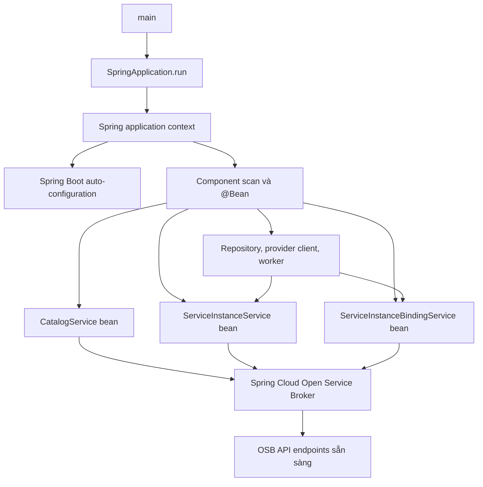

# Khởi tạo ứng dụng và đăng ký các Spring bean nghiệp vụ

Một service broker dùng Spring Cloud Open Service Broker thường được triển khai như một ứng dụng Spring Boot. Khi ứng dụng khởi động, Spring tạo application context, nạp cấu hình, khởi tạo các thành phần tích hợp của framework và đăng ký những bean do broker cung cấp. Các bean này đảm nhiệm catalog, vòng đời service instance, service binding và những nghiệp vụ hỗ trợ như lưu trạng thái, gọi nhà cung cấp hạ tầng hoặc phát tác vụ nền.

Khởi tạo ứng dụng vì thế không chỉ là viết hàm `main`. Cần tổ chức package để component scan tìm thấy các lớp, khai báo dependency tương thích, cung cấp cấu hình môi trường và đăng ký đúng các implementation mà framework cần. Khi những phần này được tách rõ, ứng dụng có thể khởi động ổn định, kiểm thử độc lập và mở rộng từng nghiệp vụ mà không làm lớp giao tiếp OSB API trở nên phức tạp.

## 1. Luồng khởi động của một broker Spring Boot

Ở mức tổng quát, quá trình khởi động diễn ra theo các bước sau:

1. JVM gọi phương thức `main` của lớp ứng dụng.
2. `SpringApplication.run(...)` tạo và khởi động Spring application context.
3. Spring Boot đọc cấu hình, xử lý auto-configuration và component scan theo package của lớp ứng dụng.
4. Các bean được khai báo bằng annotation như `@Component`, `@Service`, `@Repository`, `@Configuration` hoặc phương thức `@Bean` được phát hiện và đăng ký.
5. Spring giải quyết dependency qua constructor, tạo các bean theo thứ tự phụ thuộc và thực hiện các bước khởi tạo vòng đời.
6. Các thành phần của Spring Cloud Open Service Broker kết nối với những service bean mà broker cung cấp để xử lý các yêu cầu OSB API.
7. Ứng dụng hoàn tất khởi động và sẵn sàng nhận request theo cấu hình máy chủ, bảo mật và readiness.

Sơ đồ dưới đây mô tả mối quan hệ giữa lớp khởi động, cấu hình, bean nghiệp vụ và framework:



Framework đảm nhiệm lớp tích hợp giao thức và cung cấp các điểm mở rộng. Spring quản lý vòng đời object và dependency. Ứng dụng broker cung cấp những bean triển khai nghiệp vụ cụ thể. Cả ba phần phải được cấu hình đúng để endpoint có thể hoạt động.

## 2. Khai báo dependency và điểm bắt đầu ứng dụng

### 2.1 Thêm dependency của Spring Cloud Open Service Broker

Ứng dụng cần có Spring Boot và dependency của Spring Cloud Open Service Broker. Với Maven, dependency starter thường được khai báo như sau; phiên bản cụ thể cần lấy từ Spring Cloud release train tương thích với phiên bản Spring Boot của dự án:

```xml
<dependency>
    <groupId>org.springframework.cloud</groupId>
    <artifactId>spring-cloud-starter-open-service-broker</artifactId>
</dependency>
```

Nếu dự án quản lý phiên bản bằng Spring Cloud BOM, hãy import BOM phù hợp trong `dependencyManagement` và tránh tự đặt một phiên bản thư viện broker không tương thích. Không nên trộn tùy tiện các phiên bản Spring Boot, Spring Framework và Spring Cloud vì có thể gây lỗi classpath, lỗi auto-configuration hoặc lỗi khi khởi tạo application context.

Starter giúp đưa các thành phần tích hợp cần thiết vào classpath. Tuy nhiên, dependency không tự định nghĩa catalog hay chính sách cấp phát. Ứng dụng vẫn phải cung cấp các implementation nghiệp vụ mà broker cần. Khi nâng cấp thư viện, cần kiểm tra release notes và chữ ký interface của phiên bản đang dùng, đặc biệt với các API đồng bộ hoặc reactive.

### 2.2 Tạo lớp ứng dụng

Lớp chứa `@SpringBootApplication` thường được đặt ở package gốc của broker để component scan bao phủ các package con.

```java
package com.example.broker;

import org.springframework.boot.SpringApplication;
import org.springframework.boot.autoconfigure.SpringBootApplication;

@SpringBootApplication
public class ServiceBrokerApplication {

    public static void main(String[] args) {
        SpringApplication.run(ServiceBrokerApplication.class, args);
    }
}
```

`@SpringBootApplication` kết hợp cấu hình ứng dụng, auto-configuration và component scan. Đặt lớp này trong package `com.example.broker` giúp Spring tìm thấy các lớp ở `com.example.broker.catalog`, `com.example.broker.instance`, `com.example.broker.binding`, `com.example.broker.persistence` và các package con khác.

Nếu đặt lớp ứng dụng quá sâu, các bean nằm ngoài nhánh package được scan có thể không được phát hiện. Khi cần scan một package khác, có thể cấu hình `scanBasePackages`, nhưng nên cân nhắc lại cấu trúc package trước khi mở rộng phạm vi scan quá rộng. Scan nhầm package có thể kéo bean không liên quan vào context hoặc tạo xung đột bean.

## 3. Phân loại các bean cần có trong broker

Không phải mọi lớp Java đều cần đăng ký trực tiếp với Spring. Nên phân chia bean theo vai trò để dễ hiểu luồng xử lý và dễ kiểm thử.

| Nhóm bean | Vai trò | Cách đăng ký thường dùng |
|---|---|---|
| Catalog | Cung cấp danh sách service và plan | `@Service` triển khai `CatalogService` |
| Service instance | Xử lý provision, update, deprovision và truy vấn trạng thái | `@Service` triển khai `ServiceInstanceService` |
| Service binding | Xử lý bind và unbind | `@Service` triển khai `ServiceInstanceBindingService` khi service hỗ trợ binding |
| Application service / use case | Thực hiện quy tắc nghiệp vụ độc lập với giao thức | `@Service` |
| Repository | Đọc và ghi instance, binding, operation | `@Repository` hoặc bean do Spring Data tạo |
| Provider client / adapter | Gọi API của database, storage, network hoặc nền tảng khác | `@Component` hoặc `@Bean` |
| Worker / publisher / listener | Thực hiện hoặc điều phối công việc bất đồng bộ | `@Component`, `@Service` hoặc cấu hình listener chuyên biệt |
| Cấu hình | Khai báo client, serializer, policy hoặc bean dùng chung | `@Configuration` và `@Bean` |

Các interface của framework là điểm nối với OSB API. Application service chứa quy tắc miền. Repository và provider adapter phụ trách tích hợp hạ tầng. Cách chia này giúp một use case có thể được gọi từ handler OSB API, tác vụ nền hoặc công cụ quản trị mà không phải sao chép logic.

## 4. Đăng ký bean xử lý catalog

Catalog mô tả những dịch vụ và plan mà broker công bố. Framework cần một bean cung cấp catalog để endpoint tương ứng có thể trả lời nền tảng. Có thể dùng `@Service` cho implementation:

```java
package com.example.broker.catalog;

import org.springframework.stereotype.Service;
import org.springframework.cloud.servicebroker.model.catalog.Catalog;
import org.springframework.cloud.servicebroker.service.CatalogService;

@Service
public class BrokerCatalogService implements CatalogService {

    private final CatalogFactory catalogFactory;

    public BrokerCatalogService(CatalogFactory catalogFactory) {
        this.catalogFactory = catalogFactory;
    }

    @Override
    public Catalog getCatalog() {
        return catalogFactory.createCatalog();
    }
}
```

`CatalogFactory` là thành phần của ứng dụng, chịu trách nhiệm tạo đối tượng catalog từ cấu hình hoặc nguồn dữ liệu đã được quản lý. Cách tạo `Catalog`, `ServiceDefinition` và `Plan` cần theo builder và model của phiên bản thư viện đang dùng. Ví dụ trên tập trung vào cách Spring phát hiện bean và cách bean phụ thuộc vào factory, không cố định chi tiết builder giữa các phiên bản.

Catalog nên được kiểm tra khi khởi động hoặc trong kiểm thử để phát hiện sớm các lỗi như ID service bị trùng, plan thiếu định danh, plan không hợp lệ hoặc khai báo khả năng binding không khớp với implementation. Nếu catalog ít thay đổi, có thể tạo một lần và tái sử dụng thay vì dựng lại từ nguồn dữ liệu trong mọi request.

## 5. Đăng ký bean cho vòng đời service instance

Service instance đại diện cho một tài nguyên đã được nền tảng yêu cầu broker quản lý. Các thao tác phổ biến gồm tạo instance, đọc thông tin instance, cập nhật, thu hồi và truy vấn trạng thái thao tác. Bean xử lý các thao tác này nên đóng vai trò adapter giữa model request của OSB API và use case của ứng dụng.

Một cấu trúc minh họa:

```java
package com.example.broker.instance;

import org.springframework.stereotype.Service;
import org.springframework.cloud.servicebroker.service.ServiceInstanceService;

@Service
public class BrokerServiceInstanceService implements ServiceInstanceService {

    private final ProvisionInstanceUseCase provisionInstance;
    private final UpdateInstanceUseCase updateInstance;
    private final DeleteInstanceUseCase deleteInstance;
    private final InstanceQueryService instanceQuery;

    public BrokerServiceInstanceService(
            ProvisionInstanceUseCase provisionInstance,
            UpdateInstanceUseCase updateInstance,
            DeleteInstanceUseCase deleteInstance,
            InstanceQueryService instanceQuery) {
        this.provisionInstance = provisionInstance;
        this.updateInstance = updateInstance;
        this.deleteInstance = deleteInstance;
        this.instanceQuery = instanceQuery;
    }

    // Cài đặt các phương thức của ServiceInstanceService theo phiên bản thư viện.
    // Mỗi phương thức chuyển request OSB thành command và gọi use case tương ứng.
}
```

Đoạn mã thể hiện cách tổ chức bean; phần phương thức được lược bỏ vì kiểu trả về và chữ ký có thể khác giữa các phiên bản thư viện, đặc biệt khi dùng API reactive. Khi triển khai thật, lớp phải cài đặt đầy đủ các phương thức mà interface của dependency đang sử dụng yêu cầu.

Không nên đặt toàn bộ quy tắc cấp phát tài nguyên vào bean adapter này. Ví dụ, `ProvisionInstanceUseCase` có thể kiểm tra service và plan, kiểm tra quota, ghi nhận instance ở trạng thái `provisioning` rồi gửi job cho worker. Bean `BrokerServiceInstanceService` chỉ chuyển đổi request và kết quả giữa framework với use case.

## 6. Đăng ký bean cho service binding

Nếu service hỗ trợ binding, broker cần implementation xử lý vòng đời binding. Bean này phối hợp với use case để tạo credential, gán quyền truy cập, lưu thông tin binding cần thiết và thu hồi quyền khi unbind.

```java
package com.example.broker.binding;

import org.springframework.stereotype.Service;
import org.springframework.cloud.servicebroker.service.ServiceInstanceBindingService;

@Service
public class BrokerServiceInstanceBindingService
        implements ServiceInstanceBindingService {

    private final CreateBindingUseCase createBinding;
    private final DeleteBindingUseCase deleteBinding;

    public BrokerServiceInstanceBindingService(
            CreateBindingUseCase createBinding,
            DeleteBindingUseCase deleteBinding) {
        this.createBinding = createBinding;
        this.deleteBinding = deleteBinding;
    }

    // Cài đặt các phương thức bind/unbind theo phiên bản thư viện.
}
```

Bean binding chỉ nên được đăng ký khi broker thực sự hỗ trợ hành vi binding đã công bố trong catalog. Nếu catalog khai báo service có thể bind nhưng ứng dụng thiếu handler tương ứng, nền tảng có thể gọi một thao tác mà broker không xử lý được. Ngược lại, nếu service không hỗ trợ binding, catalog và hành vi endpoint cần nhất quán với giới hạn đó.

Credential phải được tạo và lưu theo chính sách bảo mật. Không đưa secret vào log hoặc exception message. Nếu cần lưu credential để trả lại trong trường hợp request lặp, cần dùng kho lưu trữ phù hợp và giới hạn người có thể đọc dữ liệu đó.

## 7. Đăng ký dependency nghiệp vụ bằng constructor injection

Spring quản lý các bean và tự cung cấp dependency qua constructor. Đây là cách nên dùng cho các thành phần bắt buộc vì đối tượng không thể được tạo hợp lệ nếu thiếu dependency.

```java
@Service
public class ProvisionInstanceUseCase {

    private final PlanRegistry planRegistry;
    private final InstanceRepository instanceRepository;
    private final ProviderProvisioner providerProvisioner;

    public ProvisionInstanceUseCase(
            PlanRegistry planRegistry,
            InstanceRepository instanceRepository,
            ProviderProvisioner providerProvisioner) {
        this.planRegistry = planRegistry;
        this.instanceRepository = instanceRepository;
        this.providerProvisioner = providerProvisioner;
    }

    public ProvisionResult execute(ProvisionCommand command) {
        ServicePlan plan = planRegistry.require(command.planId());
        // Kiểm tra chính sách, ghi trạng thái và điều phối cấp phát.
        return providerProvisioner.provision(command, plan, instanceRepository);
    }
}
```

Các thành phần như `PlanRegistry`, `InstanceRepository` và `ProviderProvisioner` cũng phải là bean mà Spring có thể tìm thấy hoặc được cung cấp qua cấu hình. Nếu một dependency không được đăng ký, ứng dụng thường thất bại ngay trong lúc tạo application context với lỗi không tìm thấy bean phù hợp.

Constructor injection có một số lợi ích thực tế:

- Thể hiện rõ dependency bắt buộc của lớp.
- Cho phép khai báo field `final`, hạn chế trạng thái thay đổi ngoài ý muốn.
- Giúp unit test tạo đối tượng với dependency giả lập mà không cần khởi động Spring.
- Giúp Spring phát hiện sớm dependency bị thiếu hoặc vòng phụ thuộc giữa các bean.

Tránh field injection vì nó che giấu dependency và khiến unit test khó kiểm soát. Cũng không nên tự gọi `new` cho repository, provider client hoặc use case mà Spring cần quản lý; làm vậy sẽ bỏ qua dependency injection, proxy transaction, cấu hình và các cơ chế vòng đời của Spring.

## 8. Dùng `@Configuration` và `@Bean` cho thành phần cần khởi tạo tường minh

Không phải mọi dependency đều có thể gắn annotation lên lớp. Với HTTP client, SDK của nhà cung cấp hoặc một object cần tham số cấu hình, có thể khai báo bean trong lớp `@Configuration`.

```java
package com.example.broker.config;

import org.springframework.context.annotation.Bean;
import org.springframework.context.annotation.Configuration;

@Configuration
public class ProviderConfiguration {

    @Bean
    ProviderClient providerClient(ProviderProperties properties) {
        return ProviderClient.builder()
                .endpoint(properties.endpoint())
                .connectTimeout(properties.connectTimeout())
                .readTimeout(properties.readTimeout())
                .build();
    }

    @Bean
    ProviderProvisioner providerProvisioner(
            ProviderClient providerClient) {
        return new ProviderProvisioner(providerClient);
    }
}
```

`ProviderClient`, `ProviderProperties` và builder trong ví dụ là kiểu minh họa thuộc ứng dụng. Trong dự án thật, thay chúng bằng client và cấu hình của nhà cung cấp đang tích hợp. Spring gọi phương thức `@Bean`, quản lý object trả về và tiêm nó vào các bean cần dùng.

Nên dùng `@Configuration` khi việc tạo object có logic hoặc cần kết hợp nhiều cấu hình. Dùng `@Component` hoặc `@Service` khi lớp là thành phần ứng dụng có thể được phát hiện trực tiếp qua component scan. Không đăng ký cùng một implementation bằng cả annotation và một phương thức `@Bean` nếu điều đó tạo ra hai bean trùng vai trò.

## 9. Quản lý cấu hình theo môi trường

Thông tin như endpoint nhà cung cấp, timeout, giới hạn tài nguyên, tên hàng đợi và chế độ vận hành nên nằm trong cấu hình thay vì hard-code trong lớp nghiệp vụ. Có thể nhóm cấu hình bằng `@ConfigurationProperties`:

```java
package com.example.broker.config;

import java.time.Duration;
import org.springframework.boot.context.properties.ConfigurationProperties;

@ConfigurationProperties(prefix = "broker.provider")
public record ProviderProperties(
        String endpoint,
        Duration connectTimeout,
        Duration readTimeout) {
}
```

Đăng ký configuration properties bằng `@ConfigurationPropertiesScan` trên lớp ứng dụng hoặc `@EnableConfigurationProperties(ProviderProperties.class)` trong một lớp cấu hình. Sau đó có thể khai báo giá trị trong `application.yml`:

```yaml
spring:
  application:
    name: service-broker

server:
  port: 8080

broker:
  provider:
    endpoint: ${PROVIDER_ENDPOINT}
    connect-timeout: 3s
    read-timeout: 15s
```

Ví dụ dùng biến môi trường cho endpoint để cùng một artifact có thể chạy ở nhiều môi trường. Token, mật khẩu và private key cũng cần lấy từ secret manager hoặc cơ chế quản lý secret của nền tảng triển khai; không commit secret vào repository hay đặt giá trị bí mật mặc định trong file cấu hình.

Có thể dùng profile như `application-local.yml`, `application-test.yml` và `application-prod.yml` để điều chỉnh endpoint, logging hoặc adapter phù hợp. Profile không nên trở thành cách che giấu các dependency bắt buộc: ứng dụng production vẫn cần cấu hình đầy đủ để khởi động và kiểm tra readiness.

## 10. Tổ chức package và tránh lỗi đăng ký bean

Một cấu trúc package ban đầu có thể như sau:

```text
com.example.broker
├── ServiceBrokerApplication.java
├── config
│   ├── ProviderConfiguration.java
│   └── ProviderProperties.java
├── catalog
│   ├── BrokerCatalogService.java
│   └── CatalogFactory.java
├── instance
│   ├── BrokerServiceInstanceService.java
│   ├── ProvisionInstanceUseCase.java
│   └── DeleteInstanceUseCase.java
├── binding
│   ├── BrokerServiceInstanceBindingService.java
│   └── CreateBindingUseCase.java
├── domain
│   ├── ServicePlan.java
│   └── OperationState.java
├── persistence
│   └── InstanceRepository.java
└── provider
    ├── ProviderClient.java
    └── ProviderProvisioner.java
```

Các package nằm dưới package gốc nên được component scan mặc định tìm thấy. Với cấu trúc này, lớp tích hợp OSB API ở `catalog`, `instance` và `binding` phụ thuộc vào use case; use case phụ thuộc vào abstraction lưu trữ và provider. Domain không cần phụ thuộc vào Spring MVC hoặc JSON của OSB API.

Một số lỗi thường gặp khi đăng ký bean:

- **Không tìm thấy bean:** lớp nằm ngoài component scan, thiếu annotation hoặc quên khai báo phương thức `@Bean`.
- **Có nhiều bean cùng kiểu:** hai implementation cùng được scan hoặc một lớp được đăng ký lặp bằng annotation và `@Bean`. Khi có chủ ý dùng nhiều implementation, cần xác định rõ bean được chọn bằng `@Qualifier` hoặc một cơ chế lựa chọn phù hợp.
- **Vòng phụ thuộc:** bean A cần B trong khi B lại cần A. Nên tách phần trách nhiệm chung sang một service thứ ba hoặc điều chỉnh hướng phụ thuộc.
- **Khởi tạo có side effect:** constructor gọi API tạo tài nguyên, mở job dài hoặc thực hiện thao tác không thể lặp an toàn. Constructor nên chủ yếu lưu dependency; các thao tác nghiệp vụ phải diễn ra khi use case được gọi.
- **Cấu hình thiếu:** endpoint hoặc credential không tồn tại ở môi trường triển khai. Dùng validation cho configuration properties để báo lỗi rõ ràng ngay khi khởi động.
- **Sai chữ ký interface:** code được viết theo ví dụ của phiên bản thư viện khác. Cần biên dịch với đúng dependency và cài đặt đầy đủ phương thức của phiên bản đang dùng.

Không nên dùng `@Lazy` hoặc `@Primary` chỉ để che một lỗi thiết kế bean. Chúng hữu ích trong trường hợp có chủ đích, nhưng không thay thế việc xác định rõ trách nhiệm và dependency của từng thành phần.

## 11. Khởi tạo worker và các thành phần bất đồng bộ

Nếu broker hỗ trợ provision hoặc update kéo dài, ứng dụng có thể cần worker hoặc message listener để xử lý tác vụ nền. Worker cũng là bean Spring và nên nhận repository, provider adapter, transaction manager và các dependency khác qua constructor.

```java
@Component
public class ProvisioningWorker {

    private final OperationRepository operationRepository;
    private final ProviderProvisioner providerProvisioner;

    public ProvisioningWorker(
            OperationRepository operationRepository,
            ProviderProvisioner providerProvisioner) {
        this.operationRepository = operationRepository;
        this.providerProvisioner = providerProvisioner;
    }

    public void process(ProvisioningJob job) {
        // Đọc operation, thực hiện hoặc đối soát tài nguyên,
        // sau đó lưu trạng thái thành công hay thất bại.
    }
}
```

Đoạn mã chỉ minh họa cách đăng ký worker. Cơ chế gọi `process` có thể là message listener, scheduler hoặc executor tùy kiến trúc. Cần cấu hình rõ concurrency, retry, backoff, dead-letter handling và shutdown. Không nên khởi chạy một vòng lặp vô hạn trong constructor hoặc `@PostConstruct`.

Việc ghi trạng thái operation và phát message cần được phối hợp để tránh trường hợp bản ghi đã commit nhưng message không được gửi. Với hệ thống cần độ tin cậy cao, có thể dùng transactional outbox hoặc cơ chế tương đương. Worker phải có khả năng nhận lại message và xử lý idempotent, vì hàng đợi thường có thể giao lại một message sau timeout hoặc lỗi kết nối.

## 12. Bảo mật và readiness trong giai đoạn khởi tạo

Đăng ký bean handler không tự động bảo vệ broker. Ứng dụng cần cấu hình cơ chế xác thực và phân quyền phù hợp với nền tảng gọi OSB API, giới hạn endpoint quản trị, bật TLS ở nơi phù hợp và quản lý secret an toàn. Nếu dùng Spring Security, cấu hình filter chain phải khớp với endpoint broker và chính sách xác thực của môi trường triển khai.

Không nên công khai các endpoint quản trị hoặc actuator nhạy cảm chỉ vì chúng được bật trong môi trường phát triển. Chỉ công bố các health indicator cần thiết; readiness nên phản ánh những dependency thiết yếu để broker nhận request, chẳng hạn cơ sở dữ liệu trạng thái hoặc kết nối cần thiết đến provider. Một provider tạm thời không khả dụng có thể ảnh hưởng thao tác provision mà không nhất thiết làm mọi endpoint đọc catalog ngừng hoạt động, vì vậy health policy nên phản ánh mục tiêu vận hành thực tế.

Các kiểm tra lúc khởi động có thể xác minh cấu hình bắt buộc, schema database và khả năng kết nối tối thiểu. Chúng nên có timeout và thông báo lỗi rõ ràng. Không thực hiện provision thật hoặc tạo credential thật chỉ để kiểm tra application context.

## 13. Kiểm tra việc khởi tạo và đăng ký bean

Có thể kiểm tra theo nhiều lớp:

1. **Biên dịch:** xác nhận dependency và các implementation khớp với phiên bản Spring Cloud Open Service Broker đã chọn.
2. **Unit test:** kiểm thử use case với repository và provider giả lập, không cần khởi động toàn bộ Spring context.
3. **Context test:** dùng `@SpringBootTest` để xác minh application context khởi động và các bean bắt buộc được đăng ký.
4. **Kiểm tra catalog:** gọi bean catalog và xác minh service ID, plan ID, thuộc tính bindable cùng các tính năng công bố.
5. **Kiểm thử tích hợp:** gọi endpoint OSB API với request mẫu để xác minh framework kết nối đúng handler và phản hồi đúng hợp đồng.
6. **Kiểm tra môi trường:** xác minh cấu hình, secret, bảo mật, readiness và worker trong profile triển khai dự kiến.

Ví dụ kiểm tra sự tồn tại của các bean nghiệp vụ:

```java
@SpringBootTest
class BrokerApplicationContextTest {

    @Autowired
    ApplicationContext context;

    @Test
    void registersBrokerServices() {
        assertThat(context.getBeansOfType(CatalogService.class))
                .hasSize(1);
        assertThat(context.getBeansOfType(ServiceInstanceService.class))
                .hasSize(1);
    }
}
```

Ví dụ trên giả định broker có đúng một implementation cho mỗi interface được kiểm tra và dùng AssertJ. Nếu kiến trúc có nhiều catalog hoặc nhiều implementation có chủ đích, điều chỉnh assertion theo cấu hình thực tế. Có thể kiểm tra thêm bean binding khi service công bố khả năng binding.

Một context test thành công chưa chứng minh thao tác cấp phát hoạt động với nhà cung cấp thật. Nó chỉ xác nhận rằng ứng dụng có thể tạo context và các bean được đăng ký. Cần kiểm thử tích hợp riêng để xác minh lời gọi provider, lưu trạng thái, xử lý request lặp và thu hồi tài nguyên.

## 14. Trình tự triển khai khuyến nghị

Khi bắt đầu một broker mới, có thể thực hiện theo thứ tự sau:

1. Chọn phiên bản Spring Boot và Spring Cloud tương thích, sau đó khai báo starter Open Service Broker và BOM tương ứng.
2. Tạo lớp `@SpringBootApplication` ở package gốc, kiểm tra component scan.
3. Định nghĩa cấu hình có kiểu cho endpoint, timeout, quota và các tham số môi trường; đưa secret ra khỏi mã nguồn.
4. Đăng ký bean catalog và xác minh catalog được tạo hợp lệ.
5. Đăng ký bean service instance, sau đó tách các use case provision, update, deprovision và query thành thành phần riêng.
6. Nếu service hỗ trợ binding, đăng ký bean binding và triển khai việc cấp, thu hồi credential.
7. Đăng ký repository, provider adapter, worker và các dependency cần thiết qua constructor injection hoặc `@Bean`.
8. Cấu hình bảo mật, health/readiness và logging phù hợp với môi trường.
9. Viết context test và integration test để xác minh framework gọi đúng các bean nghiệp vụ.

Khi ứng dụng khởi động thành công, Spring application context đã tạo được các thành phần cần thiết và framework có thể sử dụng những bean handler mà broker đăng ký. Từ nền tảng này, nhóm phát triển có thể triển khai sâu từng nghiệp vụ cấp phát, cập nhật, binding và thu hồi, đồng thời giữ phần tích hợp OSB API gọn và dễ kiểm thử.
