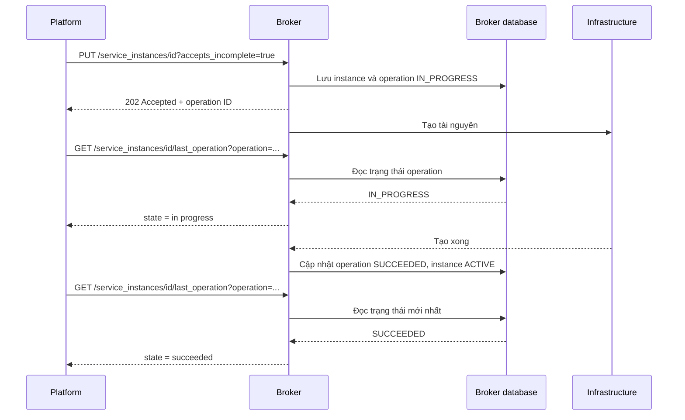
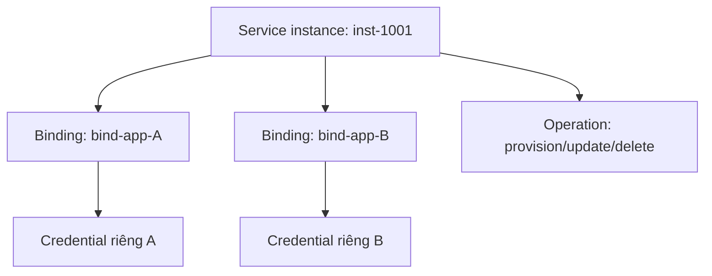

# Nhóm endpoint catalog, service_instances, service_bindings và last_operation

## 1. Cách OSB API tổ chức endpoint

Open Service Broker API (OSB API) là hợp đồng HTTP/JSON giữa một nền tảng triển khai ứng dụng và service broker. Nền tảng dùng hợp đồng này để khám phá dịch vụ, yêu cầu tạo một service instance, cấp thông tin kết nối cho ứng dụng và thu hồi tài nguyên khi không còn sử dụng. Trong module `SPRING_CLOUD_SERVICE_BROKER`, Spring Cloud Open Service Broker cung cấp hạ tầng để xây dựng broker theo hợp đồng đó; ứng dụng vẫn chịu trách nhiệm triển khai nghiệp vụ và quản lý tài nguyên thật.

Các endpoint chuẩn có tiền tố `/v2`. Nhìn theo tài nguyên, chúng được chia thành ba nhóm lớn:

- **Catalog** mô tả những service và plan mà broker cung cấp.
- **Service instances** quản lý vòng đời của một tài nguyên dịch vụ được cấp cho consumer.
- **Service bindings** quản lý thông tin truy cập mà một consumer nhận được khi sử dụng instance.

Endpoint **last operation** nằm dưới tài nguyên service instance, cho phép nền tảng theo dõi những thao tác vòng đời được broker xử lý bất đồng bộ.

```mermaid
flowchart TB
    Platform[Nền tảng: Cloud Foundry hoặc client OSB]
    Catalog[GET /v2/catalog]
    Instances[/v2/service_instances/{instance_id}]
    Bindings[/v2/service_instances/{instance_id}/service_bindings/{binding_id}]
    LastOp[/v2/service_instances/{instance_id}/last_operation]
    Broker[Service Broker]
    Platform --> Catalog
    Platform --> Instances
    Platform --> Bindings
    Platform --> LastOp
    Catalog --> Broker
    Instances --> Broker
    Bindings --> Broker
    LastOp --> Broker
```

Các URL trong sơ đồ là đường dẫn tương đối tính từ broker base URL. Ví dụ, nếu base URL là `https://broker.example.com`, catalog sẽ được gọi tại `https://broker.example.com/v2/catalog`.

## 2. Quy ước chung của request và response

OSB API dùng HTTP method để biểu diễn hành động trên tài nguyên. Request và response thường trao đổi JSON với `Content-Type: application/json` và `Accept: application/json`. Các request cần mang thông tin phiên bản OSB API mà nền tảng sử dụng thông qua header `X-Broker-API-Version`.

Broker thường được bảo vệ bằng HTTP Basic Authentication. Nền tảng gửi thông tin xác thực đã được cấu hình khi đăng ký broker; broker phải xác thực request trước khi xử lý. Không ghi header `Authorization`, password hay token vào log.

Một số header đáng chú ý:

| Header | Mục đích |
|---|---|
| `X-Broker-API-Version` | Phiên bản OSB API mà client muốn sử dụng; broker cần kiểm tra khả năng tương thích. |
| `X-Broker-API-Originating-Identity` | Danh tính của người dùng hoặc thành phần khởi tạo request theo định dạng nền tảng. |
| `X-Broker-API-Request-Identity` | Định danh request do nền tảng cung cấp, hữu ích cho log và truy vết khi có hỗ trợ. |
| `Authorization` | Thông tin xác thực broker client, thường được cấu hình bằng HTTP Basic Authentication. |

`X-Broker-API-Originating-Identity` là dữ liệu do nền tảng chuyển tiếp. Broker chỉ nên tin dữ liệu này khi request đã được xác thực và chỉ dùng nó theo chính sách đã định nghĩa. Không dùng header này thay cho cơ chế xác thực broker client.

Các ID như `service_id`, `plan_id`, `instance_id` và `binding_id` là định danh trong hợp đồng. Chúng nên ổn định trong suốt vòng đời tài nguyên. Không nên dùng tên hiển thị của service, plan, organization hoặc application làm ID vì tên có thể đổi và có thể trùng nhau.

### 2.1. Các mã HTTP thường gặp

| Mã HTTP | Ý nghĩa thường gặp trong broker |
|---|---|
| `200 OK` | Request đọc hoặc thao tác đồng bộ hoàn tất thành công. |
| `201 Created` | Tài nguyên hoặc binding mới đã được tạo thành công. |
| `202 Accepted` | Broker đã nhận thao tác bất đồng bộ và sẽ tiếp tục xử lý. |
| `400 Bad Request` | Request sai định dạng hoặc thiếu dữ liệu giao thức bắt buộc. |
| `401 Unauthorized` | Thiếu hoặc sai thông tin xác thực. |
| `404 Not Found` | Endpoint hoặc tài nguyên được yêu cầu không tồn tại. |
| `409 Conflict` | Trạng thái hiện tại xung đột với request, ví dụ cùng ID nhưng nội dung tạo khác nhau. |
| `412 Precondition Failed` | Phiên bản API được yêu cầu không được broker hỗ trợ. |
| `422 Unprocessable Entity` | Request đúng cấu trúc nhưng không thể thực hiện theo quy tắc hoặc khả năng hiện tại. |
| `410 Gone` | Instance hoặc binding đã không còn tồn tại theo ngữ nghĩa của thao tác. |
| `500 Internal Server Error` | Lỗi không mong đợi trong broker. |
| `502` / `503` / `504` | Lỗi gateway, dependency tạm thời không khả dụng hoặc timeout, tùy vị trí phát sinh. |

Response lỗi của OSB API thường có dạng JSON chứa `error` và/hoặc `description`. Nội dung trả về cần đủ để client hiểu lỗi nhưng không được tiết lộ stack trace, SQL, credential hay thông tin nội bộ nhạy cảm.

## 3. Endpoint catalog: khám phá dịch vụ

### 3.1. Đọc catalog

```http
GET /v2/catalog HTTP/1.1
Host: broker.example.com
Authorization: Basic <broker-credentials>
X-Broker-API-Version: 2.17
Accept: application/json
```

`GET /v2/catalog` cho phép nền tảng khám phá các service definition và plan mà broker công bố. Endpoint này không tạo tài nguyên và cũng không trả danh sách các instance đang được cấp phát. Nó mô tả khả năng cung cấp dịch vụ tại thời điểm nền tảng đọc catalog.

Response thành công có cấu trúc cấp cao gồm mảng `services`. Mỗi service definition thường có các trường như:

- `id`: định danh ổn định của service.
- `name`, `description`: tên và mô tả hiển thị.
- `bindable`: service instance có thể được binding hay không.
- `plans`: danh sách plan thuộc service.
- `tags`, `metadata`, `requires`: thông tin phân loại, metadata và yêu cầu bổ sung nếu có.
- Các cờ năng lực như `plan_updateable`, `instances_retrievable` hoặc `bindings_retrievable` khi broker hỗ trợ các khả năng tương ứng của phiên bản API.

Ví dụ response rút gọn:

```json
{
  "services": [
    {
      "id": "managed-database",
      "name": "Managed Database",
      "description": "Cơ sở dữ liệu được quản lý",
      "bindable": true,
      "plan_updateable": true,
      "plans": [
        {
          "id": "small",
          "name": "Small",
          "description": "Gói cơ bản cho môi trường thử nghiệm",
          "free": false
        }
      ]
    }
  ]
}
```

Đây là ví dụ minh họa đã lược bỏ nhiều trường tùy chọn. ID service và plan phải được giữ ổn định sau khi nền tảng đã tạo instance dựa trên chúng. Nếu đổi hoặc xóa ID cũ mà không có kế hoạch chuyển đổi, các request update, delete và binding về sau có thể không còn được định tuyến đúng.

### 3.2. Catalog là cam kết về năng lực

Nền tảng dùng catalog để quyết định thao tác nào có thể cung cấp cho người dùng. Vì vậy, broker chỉ nên công bố `bindable: true` nếu có thể xử lý binding; chỉ công bố khả năng update hoặc retrieval khi endpoint tương ứng thực sự được triển khai.

Catalog có thể được cache hoặc làm mới theo lịch của nền tảng. Nếu broker thay đổi plan, cần tính đến các instance hiện hữu vẫn đang tham chiếu đến ID cũ. Một plan ngừng cung cấp cho instance mới không có nghĩa broker có thể quên cách xử lý những instance đã được tạo theo plan đó.

## 4. Nhóm endpoint service_instances

`service_instances` đại diện cho tài nguyên dịch vụ được provision cho một consumer. `{instance_id}` là ID do nền tảng truyền vào trong path và được dùng lại cho các thao tác tiếp theo. Nhóm endpoint này bao gồm provisioning, update, deprovisioning, truy xuất instance nếu có hỗ trợ và last operation.

| Hành động | Method và path | Mục đích |
|---|---|---|
| Provision | `PUT /v2/service_instances/{instance_id}` | Tạo instance theo service và plan. |
| Update | `PATCH /v2/service_instances/{instance_id}` | Thay đổi plan hoặc tham số được phép cập nhật. |
| Deprovision | `DELETE /v2/service_instances/{instance_id}` | Thu hồi instance và tài nguyên phía sau. |
| Retrieve | `GET /v2/service_instances/{instance_id}` | Đọc trạng thái hoặc thông tin instance khi broker công bố hỗ trợ. |
| Last operation | `GET /v2/service_instances/{instance_id}/last_operation` | Đọc tiến độ của thao tác bất đồng bộ. |

### 4.1. Provisioning: PUT service instance

Nền tảng gửi `PUT` khi muốn broker tạo một instance. Body chứa service và plan đã chọn, cùng ngữ cảnh và tham số cần thiết.

```http
PUT /v2/service_instances/inst-1001?accepts_incomplete=true HTTP/1.1
Host: broker.example.com
Authorization: Basic <broker-credentials>
X-Broker-API-Version: 2.17
Content-Type: application/json
Accept: application/json

{
  "service_id": "managed-database",
  "plan_id": "small",
  "organization_guid": "org-01",
  "space_guid": "space-01",
  "parameters": {
    "database_name": "orders"
  },
  "context": {
    "platform": "example-platform"
  }
}
```

Các trường quan trọng:

- `service_id` và `plan_id` xác định loại dịch vụ và cấu hình được yêu cầu.
- `organization_guid` và `space_guid` cung cấp ngữ cảnh tổ chức/không gian nếu nền tảng gửi.
- `parameters` chứa cấu hình riêng của service hoặc plan; broker phải kiểm tra kiểu, giá trị và quyền sử dụng.
- `context` chứa ngữ cảnh nền tảng. Cấu trúc cụ thể phụ thuộc nền tảng, vì vậy broker không nên giả định mọi client đều gửi cùng một tập trường.
- `accepts_incomplete` là query parameter, không phải trường JSON. Nó cho biết client có chấp nhận xử lý bất đồng bộ hay không.

Nếu tạo thành công đồng bộ, broker trả `201 Created` và response có thể chứa `dashboard_url` khi dịch vụ có dashboard. Nếu broker cần tiếp tục xử lý bất đồng bộ và client đã cho phép, broker trả `202 Accepted`, thường kèm một chuỗi `operation` để phân biệt thao tác.

Ví dụ response đồng bộ:

```http
HTTP/1.1 201 Created
Content-Type: application/json

{
  "dashboard_url": "https://console.example.com/databases/inst-1001"
}
```

Ví dụ response bất đồng bộ:

```http
HTTP/1.1 202 Accepted
Content-Type: application/json

{
  "operation": "provision-op-1001"
}
```

Nếu broker không thể hoàn thành đồng bộ trong khi client không chấp nhận bất đồng bộ, broker phải từ chối theo quy tắc OSB API (thường là `422 Unprocessable Entity` với mã lỗi phù hợp như `AsyncRequired`). Không được trả thành công giả trong khi tài nguyên chưa sẵn sàng.

`PUT` có ngữ nghĩa tạo theo một định danh xác định. Khi nền tảng retry vì timeout, broker phải nhận diện `instance_id` đã tồn tại. Nếu request lặp có cùng ý nghĩa, broker trả kết quả nhất quán; nếu cùng ID nhưng service, plan hoặc cấu hình mâu thuẫn, broker trả lỗi xung đột phù hợp thay vì tạo tài nguyên thứ hai.

### 4.2. Update: PATCH service instance

`PATCH` dùng để cập nhật một instance đã tồn tại. Nó thường được dùng khi người dùng thay đổi plan hoặc các tham số mà broker cho phép thay đổi. Broker phải công bố khả năng cập nhật tương ứng trong catalog và kiểm tra điều kiện chuyển đổi giữa cấu hình cũ với cấu hình mới.

Ví dụ request:

```http
PATCH /v2/service_instances/inst-1001?accepts_incomplete=true HTTP/1.1
Host: broker.example.com
Authorization: Basic <broker-credentials>
X-Broker-API-Version: 2.17
Content-Type: application/json

{
  "service_id": "managed-database",
  "plan_id": "medium",
  "parameters": {
    "storage_gb": 100
  },
  "previous_values": {
    "plan_id": "small",
    "service_id": "managed-database",
    "organization_guid": "org-01",
    "space_guid": "space-01"
  }
}
```

`previous_values` cung cấp dữ liệu trước cập nhật mà nền tảng biết, giúp broker kiểm tra chuyển đổi. Broker không nên tin rằng dữ liệu này thay thế được trạng thái lưu nội bộ; hãy đối chiếu với bản ghi instance hiện tại trước khi thực hiện.

Update có thể hoàn tất đồng bộ hoặc bất đồng bộ theo khả năng được công bố và `accepts_incomplete`. Response đồng bộ thường là `200 OK`; nếu được chấp nhận xử lý nền, response là `202 Accepted` kèm `operation`. Nếu plan không hỗ trợ chuyển đổi, tham số không hợp lệ hoặc instance không ở trạng thái cho phép update, broker trả lỗi phù hợp và giữ trạng thái nhất quán.

### 4.3. Deprovisioning: DELETE service instance

`DELETE` yêu cầu broker thu hồi instance và tài nguyên được tạo trong provisioning. Khác với PUT/PATCH, thông tin `service_id` và `plan_id` được gửi qua query string để broker xác định service/plan liên quan.

```http
DELETE /v2/service_instances/inst-1001?service_id=managed-database&plan_id=medium&accepts_incomplete=true HTTP/1.1
Host: broker.example.com
Authorization: Basic <broker-credentials>
X-Broker-API-Version: 2.17
```

Nếu thu hồi hoàn tất ngay, broker trả response thành công đồng bộ. Nếu thao tác cần thời gian và client chấp nhận xử lý bất đồng bộ, broker có thể trả `202 Accepted` cùng `operation`. Broker phải xử lý retry an toàn: request xóa lặp không được xóa nhầm tài nguyên khác hoặc gây lỗi dây chuyền. Nếu instance đã không còn tồn tại, phản hồi cần tuân theo ngữ nghĩa OSB API cho tài nguyên đã bị thu hồi.

Trước khi xóa, broker cần áp dụng chính sách đối với các binding còn hoạt động. Tùy thiết kế service, broker có thể yêu cầu unbind trước, thu hồi binding theo quy trình nội bộ hoặc từ chối deprovision khi vẫn còn consumer. Điều quan trọng là trạng thái instance và binding phải nhất quán, tránh để credential còn hiệu lực sau khi instance đã bị xóa.

### 4.4. Retrieve service instance

Một số phiên bản OSB API hỗ trợ endpoint đọc instance bằng `GET /v2/service_instances/{instance_id}`. Broker chỉ nên cung cấp và công bố khả năng này khi implementation đáp ứng đúng hợp đồng của phiên bản API đang sử dụng. Khi nền tảng dựa vào cờ `instances_retrievable`, catalog và endpoint phải thống nhất với nhau.

Query string của request retrieve có thể chứa `service_id` và `plan_id` để xác định tài nguyên. Endpoint này phục vụ việc đọc lại thông tin instance, chẳng hạn trong quy trình đồng bộ hoặc khôi phục trạng thái của nền tảng. Response không nên làm lộ dữ liệu nội bộ hoặc bí mật của broker.

## 5. Endpoint last_operation: theo dõi xử lý bất đồng bộ

Provisioning, update hoặc deprovisioning có thể cần gọi hệ thống bên ngoài và kéo dài hơn thời gian chờ HTTP. OSB API cho phép broker xác nhận đã nhận thao tác bằng `202 Accepted`, sau đó nền tảng truy vấn trạng thái qua:

```http
GET /v2/service_instances/{instance_id}/last_operation?service_id={service_id}&plan_id={plan_id}&operation={operation} HTTP/1.1
```

Các query parameter quan trọng:

- `service_id` và `plan_id` nhận diện service/plan của instance.
- `operation` là mã thao tác mà broker đã trả về trong response bất đồng bộ, nếu có. Broker dùng nó để phân biệt thao tác cụ thể, nhất là khi instance có nhiều lần cập nhật theo thời gian.

Response thành công có trường `state` với một trong các giá trị giao thức `in progress`, `succeeded` hoặc `failed`; có thể kèm `description` để giải thích tiến độ hoặc lỗi.

```json
{
  "state": "in progress",
  "description": "Đang tạo cơ sở dữ liệu"
}
```

Khi hoàn tất:

```json
{
  "state": "succeeded",
  "description": "Cơ sở dữ liệu đã sẵn sàng"
}
```

Khi thất bại:

```json
{
  "state": "failed",
  "description": "Nhà cung cấp không còn đủ quota"
}
```

`state` trong response last operation là tập giá trị giao thức. Broker có thể lưu nhiều trạng thái chi tiết nội bộ như `PROVISIONING`, `WAITING_FOR_CAPACITY`, `ACTIVE`, `DELETE_FAILED`, nhưng phải ánh xạ chúng về trạng thái OSB API. Không trả thẳng một enum nội bộ như `WAITING_FOR_CAPACITY` trong trường `state`.

Luồng polling điển hình:



Broker cần lưu operation bền vững để polling vẫn hoạt động khi process restart hoặc khi request tiếp theo được xử lý bởi replica khác. Nên có timeout, retry có backoff, cơ chế xử lý thao tác bị kẹt và log gắn với `instance_id`, `operation` cùng request identity. Nếu broker trả `202` nhưng không lưu được operation hoặc không thể truy vấn trạng thái, nền tảng sẽ không có cách đáng tin cậy để biết tài nguyên đã sẵn sàng hay chưa.

## 6. Nhóm endpoint service_bindings

Service instance biểu diễn tài nguyên dùng chung; binding biểu diễn một consumer được cấp quyền sử dụng tài nguyên đó. Một instance có thể có nhiều binding. Mỗi binding có `{binding_id}` riêng do nền tảng cung cấp, vì vậy broker có thể cấp credential độc lập và thu hồi quyền của từng consumer.

| Hành động | Method và path | Mục đích |
|---|---|---|
| Create binding | `PUT /v2/service_instances/{instance_id}/service_bindings/{binding_id}` | Cấp thông tin kết nối hoặc quyền sử dụng cho consumer. |
| Delete binding | `DELETE /v2/service_instances/{instance_id}/service_bindings/{binding_id}` | Thu hồi binding và credential liên quan. |
| Retrieve binding | `GET /v2/service_instances/{instance_id}/service_bindings/{binding_id}` | Đọc thông tin binding khi broker công bố hỗ trợ. |

### 6.1. Create binding

Nền tảng gọi `PUT` khi một ứng dụng hoặc consumer cần kết nối tới instance. Body xác định service, plan và thông tin consumer.

```http
PUT /v2/service_instances/inst-1001/service_bindings/bind-app-01 HTTP/1.1
Host: broker.example.com
Authorization: Basic <broker-credentials>
X-Broker-API-Version: 2.17
Content-Type: application/json

{
  "service_id": "managed-database",
  "plan_id": "medium",
  "app_guid": "app-01",
  "bind_resource": {
    "app_guid": "app-01"
  },
  "parameters": {
    "access_role": "read-write"
  },
  "context": {
    "platform": "example-platform"
  }
}
```

Các trường thường gặp:

- `service_id`, `plan_id`: service và plan của instance được binding.
- `app_guid`: định danh ứng dụng nếu nền tảng có khái niệm application.
- `bind_resource`: mô tả tài nguyên consumer cần binding; hình dạng phụ thuộc loại service và khả năng API.
- `parameters`: tham số riêng cho binding, ví dụ vai trò truy cập hoặc phạm vi quyền.
- `context`: ngữ cảnh nền tảng.

Nếu thành công, broker thường trả `201 Created`. Response có thể chứa `credentials` và các trường đặc thù tùy loại service, ví dụ `syslog_drain_url`, `route_service_url`, `volume_mounts` hoặc `endpoints` khi phù hợp.

Ví dụ response cho database:

```http
HTTP/1.1 201 Created
Content-Type: application/json

{
  "credentials": {
    "hostname": "db.internal.example",
    "port": 5432,
    "database": "orders",
    "username": "app_bind_01",
    "password": "<generated-secret>"
  }
}
```

Credential nên được tạo theo từng binding với quyền tối thiểu cần thiết. Nếu hai ứng dụng dùng chung một instance, mỗi ứng dụng nên có credential riêng để broker có thể thu hồi một binding mà không ảnh hưởng ứng dụng còn lại. Nếu binding ID đã tồn tại, broker cần kiểm tra request có tương đương với binding hiện tại hay không; không cấp credential mới ngoài ý muốn hoặc ghi đè quyền của consumer khác.

### 6.2. Delete binding (unbind)

Nền tảng gọi `DELETE` khi consumer không còn cần thông tin kết nối. `service_id` và `plan_id` được truyền qua query string:

```http
DELETE /v2/service_instances/inst-1001/service_bindings/bind-app-01?service_id=managed-database&plan_id=medium HTTP/1.1
Host: broker.example.com
Authorization: Basic <broker-credentials>
X-Broker-API-Version: 2.17
```

Broker cần thu hồi credential hoặc quyền truy cập ở hệ thống đích, đánh dấu binding đã thu hồi và bảo đảm credential cũ không còn sử dụng được. Chỉ xóa bản ghi binding trong database mà không thu hồi quyền ở hệ thống đích sẽ để lại một lỗ hổng truy cập.

Unbind phải an toàn khi nền tảng gửi lại request. Nếu binding đã được thu hồi, broker cần trả kết quả nhất quán theo ngữ nghĩa OSB API. Không được xóa credential của binding khác hoặc thu hồi tài khoản dùng chung ngoài phạm vi binding hiện tại.

### 6.3. Retrieve binding

Một số phiên bản OSB API cho phép `GET /v2/service_instances/{instance_id}/service_bindings/{binding_id}` để đọc lại binding. Khả năng này cần được broker công bố đúng trong catalog, chẳng hạn thông qua `bindings_retrievable`, và chỉ triển khai khi response đáp ứng yêu cầu của phiên bản API mà broker hỗ trợ.

Thông tin credential cần được xử lý đặc biệt cẩn trọng. Việc retrieve không được vô tình trả bí mật đã hết hiệu lực, credential thuộc binding khác hoặc dữ liệu nội bộ không dành cho nền tảng. Nếu broker không hỗ trợ retrieval, không công bố khả năng này và trả lỗi theo hợp đồng khi endpoint được gọi.

## 7. Quan hệ giữa instance, binding và operation

Ba nhóm tài nguyên có vòng đời liên quan nhưng khác nhau:

| Thành phần | Định danh | Vòng đời | Dữ liệu quan trọng |
|---|---|---|---|
| Service instance | `instance_id` | Provision → Update → Deprovision | Service, plan, consumer context, trạng thái và ID tài nguyên thật. |
| Service binding | `binding_id` kết hợp `instance_id` | Bind → Unbind | Consumer, credential reference, phạm vi quyền và trạng thái thu hồi. |
| Operation | `operation` do broker định nghĩa | Accepted → In progress → Succeeded/Failed | Loại thao tác, tiến độ, thời gian, lỗi và instance liên quan. |

Ví dụ một database instance có thể được hai ứng dụng binding. Khi ứng dụng A unbind, broker chỉ thu hồi credential của A. Instance vẫn hoạt động và binding của ứng dụng B vẫn còn hiệu lực. Khi nền tảng deprovision instance, broker thực hiện chính sách xử lý tất cả binding còn tồn tại rồi mới thu hồi database.



Trong mô hình lưu trữ, broker nên có khóa duy nhất cho `instance_id` và cặp `instance_id`/`binding_id`, đồng thời lưu operation riêng để hỗ trợ retry và polling. Không nên chỉ lưu trạng thái trong bộ nhớ của một controller hoặc một process vì ứng dụng có thể restart hoặc chạy nhiều replica.

## 8. Idempotency và xử lý lỗi theo endpoint

Nền tảng có thể gửi lại request khi response bị mất, kết nối bị ngắt hoặc timeout. Vì vậy, idempotency là yêu cầu xuyên suốt cả nhóm endpoint.

- **Catalog:** GET không làm thay đổi trạng thái; cùng request nên trả catalog nhất quán trong cùng một phiên bản cấu hình.
- **Provision:** cùng `instance_id` và cùng nội dung có ý nghĩa phải được nhận diện là request lặp; không tạo thêm instance.
- **Update:** kiểm tra trạng thái hiện tại và dữ liệu trước cập nhật để không áp dụng cùng một thay đổi theo cách gây tác dụng phụ nhiều lần.
- **Deprovision:** retry không được xóa nhầm tài nguyên hoặc thất bại chỉ vì lần gọi trước đã hoàn tất việc xóa.
- **Bind:** cùng cặp instance/binding ID phải ánh xạ tới một binding; không phát sinh nhiều credential ngoài ý muốn.
- **Unbind:** retry phải tiếp tục đưa binding về trạng thái đã thu hồi mà không ảnh hưởng binding khác.
- **Last operation:** truy vấn chỉ đọc trạng thái của operation tương ứng, không khởi chạy lại thao tác tạo hoặc xóa tài nguyên.

Khi xử lý lỗi, broker cần phân biệt lỗi xác thực, lỗi phiên bản giao thức, request không hợp lệ, xung đột trạng thái và lỗi tạm thời từ hạ tầng. Lỗi tạm thời có thể retry với backoff; lỗi dữ liệu hoặc quyền truy cập cần được trả về rõ ràng để nền tảng hoặc người vận hành sửa nguyên nhân. Không trả `500` cho mọi lỗi vì điều đó khiến client khó quyết định có nên retry hay không.

## 9. Checklist khi triển khai các endpoint

1. Xác minh mọi endpoint dùng đúng tiền tố `/v2`, HTTP method, path variable, query parameter và header theo phiên bản OSB API đã chọn.
2. Bảo vệ endpoint bằng HTTPS và xác thực broker client; không ghi thông tin xác thực vào log.
3. Giữ ổn định service ID, plan ID, instance ID và binding ID trong suốt vòng đời tài nguyên.
4. Đồng bộ catalog với năng lực thực tế: bindable, updateable và các khả năng retrieval.
5. Kiểm tra `service_id`, `plan_id`, `parameters`, `context` và định danh consumer trước khi thao tác trên tài nguyên.
6. Trả đúng mã HTTP và cấu trúc response; không tiết lộ stack trace hoặc credential trong lỗi.
7. Hỗ trợ idempotency cho create, update, delete, bind và unbind.
8. Lưu operation bền vững cho xử lý bất đồng bộ; ánh xạ trạng thái nội bộ sang `in progress`, `succeeded` hoặc `failed` tại last operation.
9. Cấp credential riêng theo binding, giới hạn quyền và thu hồi khi unbind.
10. Kiểm thử request lặp, timeout, lỗi hạ tầng, instance không tồn tại, binding không tồn tại và phiên bản API không được hỗ trợ.

Khi hiểu các endpoint theo nhóm tài nguyên, người phát triển có thể theo dõi chính xác một request từ lúc nền tảng đọc catalog đến khi instance được tạo, ứng dụng nhận binding và tài nguyên được thu hồi. Đây là nền tảng để triển khai service broker bằng Spring Cloud có giao thức nhất quán, trạng thái bền vững và khả năng phục hồi trước retry hoặc thao tác kéo dài.
