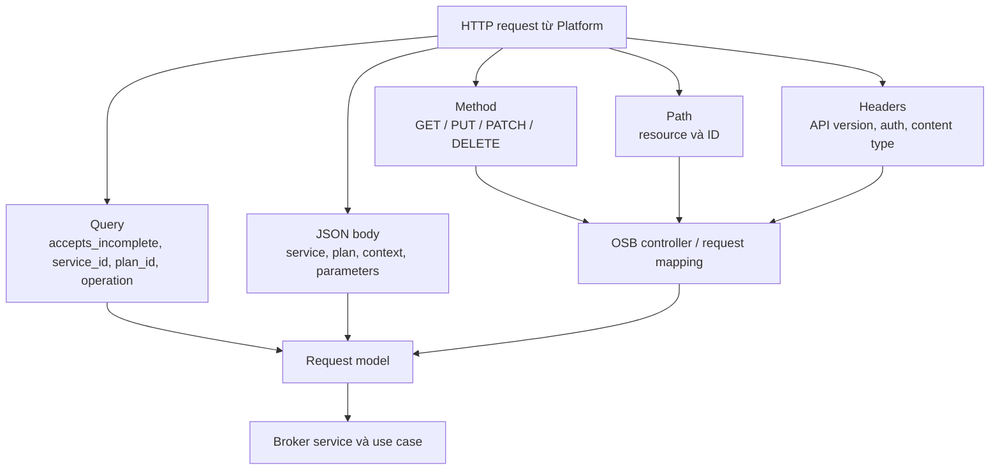

# HTTP method, đường dẫn định danh, query parameter và JSON body

Open Service Broker API (OSB API) định nghĩa giao tiếp HTTP(S) giữa cloud platform và service broker. Mỗi request được tạo từ bốn phần có vai trò khác nhau: **HTTP method** xác định hành động, **path** xác định tài nguyên, **query parameter** bổ sung tùy chọn hoặc ngữ cảnh của thao tác, còn **JSON body** mang dữ liệu nghiệp vụ cần xử lý. HTTP header truyền phiên bản giao thức, thông tin xác thực và metadata của request.

Trong Spring Cloud Service Broker, controller của thư viện nhận request OSB, ánh xạ path, query, header và JSON thành request model tương ứng, sau đó gọi service interface. Khi triển khai broker, hiểu đúng vị trí của từng dữ liệu giúp tránh các lỗi như đặt `service_id` vào path, gửi `accepts_incomplete` trong JSON body hoặc gửi credentials trong query string.

## 1. Cấu trúc tổng thể của một request OSB

Một request có thể được hình dung như sau:

```text
HTTP_METHOD /v2/{resource}/{resource_id}?option=value
Host: broker.example.com
X-Broker-API-Version: 2.16
Authorization: Basic <credentials>
Content-Type: application/json

{
  "service_id": "postgresql",
  "plan_id": "standard",
  "parameters": {
    "storage_gb": 20
  }
}
```

Mỗi thành phần trả lời một câu hỏi:

| Thành phần | Vai trò | Ví dụ |
|---|---|---|
| HTTP method | Thực hiện hành động gì trên tài nguyên? | `PUT`, `GET`, `PATCH`, `DELETE` |
| Path | Tài nguyên hoặc operation nào đang được nhắm đến? | `/v2/service_instances/instance-123` |
| Query parameter | Có tùy chọn xử lý hoặc định danh bổ sung nào? | `accepts_incomplete=true` |
| JSON body | Broker cần nhận dữ liệu nghiệp vụ nào? | `service_id`, `plan_id`, `parameters` |
| HTTP header | Phiên bản API, xác thực và thông tin theo request là gì? | `X-Broker-API-Version` |

Không phải request nào cũng có đủ cả năm phần. Ví dụ, `GET /v2/catalog` không cần JSON body; request `DELETE` thường truyền `service_id` và `plan_id` qua query string; còn request provision cần JSON body để chỉ rõ service và plan muốn tạo.



## 2. HTTP method và ý nghĩa trong vòng đời OSB

OSB API dùng các HTTP method theo ngữ nghĩa của tài nguyên. `PUT` tạo instance hoặc binding tại URI có ID do platform chỉ định; `PATCH` cập nhật một instance; `GET` đọc catalog, instance, binding hoặc trạng thái operation; `DELETE` thu hồi binding hoặc instance.

| Method | Endpoint | Nghiệp vụ | Có JSON request body? |
|---|---|---|---|
| `GET` | `/v2/catalog` | Lấy catalog dịch vụ và plan | Không |
| `PUT` | `/v2/service_instances/{instance_id}` | Provision service instance | Có |
| `GET` | `/v2/service_instances/{instance_id}` | Fetch service instance nếu catalog công bố capability | Không |
| `PATCH` | `/v2/service_instances/{instance_id}` | Update plan hoặc parameters của instance | Có |
| `DELETE` | `/v2/service_instances/{instance_id}` | Deprovision service instance | Không |
| `GET` | `/v2/service_instances/{instance_id}/last_operation` | Poll trạng thái provision, update hoặc deprovision | Không |
| `PUT` | `/v2/service_instances/{instance_id}/service_bindings/{binding_id}` | Tạo service binding | Có |
| `GET` | `/v2/service_instances/{instance_id}/service_bindings/{binding_id}` | Fetch binding nếu catalog công bố capability | Không |
| `DELETE` | `/v2/service_instances/{instance_id}/service_bindings/{binding_id}` | Unbind, thu hồi quyền truy cập | Không |
| `GET` | `/v2/service_instances/{instance_id}/service_bindings/{binding_id}/last_operation` | Poll trạng thái bind hoặc unbind | Không |

### 2.1. PUT để tạo instance và binding

Platform chọn ID trước khi gửi request. Vì vậy, URI đã xác định tài nguyên mà broker cần tạo:

```http
PUT /v2/service_instances/instance-7f31
Content-Type: application/json

{
  "service_id": "postgresql",
  "plan_id": "standard"
}
```

`PUT` có tính chất idempotent theo ngữ nghĩa HTTP: gửi lại cùng yêu cầu cho cùng URI không được tạo thêm một instance khác. Tuy nhiên, broker vẫn phải kiểm tra request lặp có cùng ý nghĩa với tài nguyên đã tồn tại hay không. Nếu ID đã tồn tại nhưng các thuộc tính xung đột, broker trả `409 Conflict` theo quy tắc OSB.

Tạo binding cũng dùng `PUT`, nhưng URI chứa cả `instance_id` và `binding_id`. Hai ID này xác định binding thuộc instance nào và giúp broker tra cứu binding khi unbind hoặc fetch về sau.

### 2.2. PATCH để cập nhật instance

OSB sử dụng `PATCH /v2/service_instances/{instance_id}` cho thao tác update. Request chỉ mô tả những thông tin cần thay đổi, chẳng hạn plan mới hoặc parameters mới. Nếu không có `plan_id` trong body, broker không được đổi plan của instance do request đó.

```http
PATCH /v2/service_instances/instance-7f31?accepts_incomplete=true
Content-Type: application/json

{
  "service_id": "postgresql",
  "plan_id": "production",
  "parameters": {
    "storage_gb": 100
  },
  "previous_values": {
    "plan_id": "standard"
  }
}
```

`previous_values` cung cấp thông tin trước khi cập nhật để broker đối chiếu và thực hiện chuyển đổi. Broker cần xác thực thay đổi plan có được catalog công bố hỗ trợ hay không, đồng thời xác định parameters nào thực sự được yêu cầu thay đổi.

### 2.3. GET để đọc tài nguyên và trạng thái

`GET` không tạo side effect nghiệp vụ. Catalog được lấy bằng `GET /v2/catalog`; instance và binding chỉ được fetch khi service offering công bố `instances_retrievable=true` hoặc `bindings_retrievable=true`.

Hai endpoint `last_operation` cũng dùng `GET`. Chúng không thực hiện provision hoặc bind lần nữa mà trả trạng thái operation đã được broker ghi nhận. Khi trạng thái là `in progress`, platform tiếp tục polling; `succeeded` hoặc `failed` kết thúc vòng polling.

### 2.4. DELETE để unbind và deprovision

`DELETE` thu hồi tài nguyên được định danh bởi path. Xóa binding thu hồi credentials, tài khoản hoặc quyền truy cập của binding đó; xóa instance thu hồi tài nguyên được tạo trong quá trình provision.

Platform phải xóa các binding của instance trước khi deprovision instance. OSB không quy định broker phải làm gì nếu vẫn còn binding khi nhận yêu cầu deprovision, vì vậy broker nên kiểm tra trạng thái và trả lỗi phù hợp khi chưa thể xóa an toàn.

## 3. Path và các định danh tài nguyên

Path trả lời câu hỏi broker đang thao tác với tài nguyên nào. Các placeholder trong đặc tả thường viết theo dạng `:instance_id`, `:binding_id`; khi gửi request thực tế, thay placeholder bằng giá trị ID cụ thể.

```text
/v2/service_instances/{instance_id}
/v2/service_instances/{instance_id}/service_bindings/{binding_id}
```

`instance_id` là định danh của service instance do platform tạo và phải là chuỗi không rỗng, duy nhất toàn cục theo yêu cầu của OSB. `binding_id` định danh binding trong phạm vi instance tương ứng và cũng phải là chuỗi không rỗng, duy nhất. Broker lưu các ID này để liên kết với tài nguyên thật ở provider.

Ví dụ:

```text
/v2/service_instances/inst-7f31
/v2/service_instances/inst-7f31/service_bindings/bind-a902
```

Trong ví dụ trên, `inst-7f31` xác định database đã provision; `bind-a902` xác định quyền truy cập riêng được tạo trên database đó. Không dùng `service_id` hoặc `plan_id` thay cho `instance_id`: service và plan là metadata của catalog, còn instance là một tài nguyên cụ thể đã được provision.

### 3.1. Quy tắc mã hóa path segment

OSB khuyến nghị các định danh chỉ sử dụng ký tự không cần mã hóa theo RFC 3986: chữ cái, chữ số, dấu gạch ngang, dấu chấm, dấu gạch dưới và dấu ngã. Nếu ID có ký tự khác, client phải percent-encode trước khi đưa vào URL.

Ví dụ, khoảng trắng được mã hóa thành `%20`; ký tự `/` nằm trong ID phải được mã hóa thành `%2F` để không bị hiểu thành dấu phân tách path. Trong thực tế, nên dùng ID dạng UUID hoặc chuỗi opaque chỉ gồm ký tự an toàn cho URL. Không tự tách hoặc diễn giải cấu trúc bên trong ID do platform cấp.

Các ID cần được giữ ổn định trong toàn bộ vòng đời instance/binding. Khi nhận request, broker phải kiểm tra đúng quan hệ giữa `instance_id` và `binding_id`; không được tìm binding chỉ bằng `binding_id` rồi bỏ qua instance cha.

## 4. Query parameter: tùy chọn và ngữ cảnh của request

Query parameter xuất hiện sau dấu `?`, các cặp key-value được phân tách bằng `&`. OSB dùng query để truyền tùy chọn điều khiển xử lý hoặc bổ sung ID của service và plan cho một số endpoint.

| Query parameter | Kiểu | Endpoint thường dùng | Ý nghĩa |
|---|---|---|---|
| `accepts_incomplete` | Boolean | Provision, update, bind, unbind, deprovision | Platform và client có chấp nhận operation bất đồng bộ hay không |
| `service_id` | String | Fetch, unbind, deprovision, last operation | ID của service offering liên quan |
| `plan_id` | String | Fetch, unbind, deprovision, last operation | ID của plan liên quan |
| `operation` | String | Last operation | ID operation do broker trả về trong response bất đồng bộ |

### 4.1. accepts_incomplete

`accepts_incomplete=true` cho biết platform có thể chấp nhận việc thao tác tiếp tục chạy sau khi HTTP request ban đầu kết thúc. Đây là query parameter, không phải field của JSON body.

Ví dụ:

```http
PUT /v2/service_instances/inst-7f31?accepts_incomplete=true
```

Nếu broker chỉ có thể hoàn tất operation theo cách bất đồng bộ mà request không gửi `accepts_incomplete=true`, broker phải trả `422 Unprocessable Entity` với error code `AsyncRequired`. Nếu request có chấp nhận bất đồng bộ và broker thực hiện operation theo cách này, broker trả `202 Accepted`; platform sau đó polling endpoint `last_operation` tương ứng.

`accepts_incomplete=true` không bắt buộc broker phải chạy bất đồng bộ. Nếu broker hoàn tất operation ngay trong request, broker vẫn có thể trả response đồng bộ. Query parameter chỉ thể hiện khả năng chấp nhận của client.

### 4.2. service_id và plan_id trong query string

Với các thao tác `DELETE` instance và `DELETE` binding, `service_id` và `plan_id` là query parameter bắt buộc. Hai giá trị này giúp broker xác định offering và plan liên quan đến tài nguyên đang thu hồi.

Ví dụ deprovision:

```http
DELETE /v2/service_instances/inst-7f31?service_id=postgresql&plan_id=standard&accepts_incomplete=true
```

Ví dụ unbind:

```http
DELETE /v2/service_instances/inst-7f31/service_bindings/bind-a902?service_id=postgresql&plan_id=standard&accepts_incomplete=true
```

Ở các endpoint fetch instance, fetch binding và polling last operation, `service_id`/`plan_id` là thông tin gợi ý hữu ích cho broker; đặc tả khuyến nghị platform gửi chúng khi có thể. Cần phân biệt yêu cầu bắt buộc của từng endpoint thay vì áp dụng một quy tắc cho mọi request.

### 4.3. operation khi polling

Khi broker trả `202 Accepted`, response có thể kèm một trường `operation` để định danh operation đang chạy. Platform phải gửi lại đúng giá trị này trong query parameter `operation` của request polling tiếp theo. Giá trị phải được URL-encode.

Ví dụ:

```http
GET /v2/service_instances/inst-7f31/last_operation?service_id=postgresql&plan_id=standard&operation=provision%3Ajob-92
```

Nếu broker không trả `operation`, việc phân biệt nhiều operation bất đồng bộ trên cùng tài nguyên sẽ bị giới hạn; broker và platform phải tuân thủ quy tắc tuần tự operation của OSB. Do đó, broker nên tạo operation ID ổn định và lưu nó cùng tài nguyên, loại operation và trạng thái.

## 5. JSON body: dữ liệu nghiệp vụ của thao tác

JSON body được dùng ở những request cần gửi dữ liệu để tạo hoặc thay đổi tài nguyên. Các field chính của body OSB có cấu trúc chuẩn; `parameters` là object riêng theo từng service/plan và cần được mô tả bằng schema trong catalog khi thích hợp.

### 5.1. Body provision instance

`PUT /v2/service_instances/{instance_id}` yêu cầu `service_id` và `plan_id` trong body. `parameters` chứa cấu hình do người dùng chọn; `context` chứa thông tin theo platform; `maintenance_info` có thể mang phiên bản bảo trì được catalog công bố.

```json
{
  "service_id": "postgresql",
  "plan_id": "standard",
  "context": {
    "platform": "cloudfoundry",
    "organization_guid": "org-82",
    "space_guid": "space-31"
  },
  "organization_guid": "org-82",
  "space_guid": "space-31",
  "parameters": {
    "storage_gb": 20,
    "high_availability": false
  }
}
```

`organization_guid` và `space_guid` là các field cũ đã được đánh dấu deprecated để chuyển sang `context`; trong schema request provision của đặc tả hiện hành, hai field này vẫn được đánh dấu bắt buộc nhằm duy trì tương thích. Vì vậy, ví dụ gửi cả `context` lẫn hai field cũ. Khi hỗ trợ nhiều phiên bản OSB, broker cần tuân theo phiên bản API mà hai phía đã thỏa thuận và profile của platform.

### 5.2. Body update instance

`PATCH /v2/service_instances/{instance_id}` yêu cầu `service_id`; `plan_id` chỉ có mặt khi muốn đổi plan. `previous_values` mô tả trạng thái trước đó. `parameters` chỉ nên có các giá trị mà người dùng thực sự yêu cầu thay đổi; nếu field `parameters` không có, broker không được thay đổi parameters của instance do request này.

```json
{
  "service_id": "postgresql",
  "plan_id": "production",
  "parameters": {
    "storage_gb": 100
  },
  "previous_values": {
    "plan_id": "standard"
  },
  "context": {
    "platform": "cloudfoundry",
    "organization_guid": "org-82",
    "space_guid": "space-31"
  }
}
```

Broker cần kiểm tra plan mới có hỗ trợ nâng cấp hoặc hạ cấp từ plan cũ hay không. Không phải mọi cặp plan đều có thể chuyển đổi. Nếu thao tác không được hỗ trợ hoặc chưa thể thực hiện với trạng thái hiện tại, broker trả lỗi thích hợp và không áp dụng một phần thay đổi ngoài quy tắc của giao thức.

### 5.3. Body tạo binding

`PUT /v2/service_instances/{instance_id}/service_bindings/{binding_id}` yêu cầu `service_id` và `plan_id`. `bind_resource` mang thông tin platform về consumer hoặc route; `parameters` chứa tùy chọn riêng của binding.

```json
{
  "service_id": "postgresql",
  "plan_id": "standard",
  "context": {
    "platform": "cloudfoundry",
    "organization_guid": "org-82",
    "space_guid": "space-31"
  },
  "bind_resource": {
    "app_guid": "app-orders-17"
  },
  "parameters": {
    "role": "read-write"
  }
}
```

`app_guid` ở cấp cao nhất là field deprecated; với request mới, thông tin ứng dụng nên nằm trong `bind_resource.app_guid`. `bind_resource` có thể chứa `route` cho route service. Broker phải xác thực dữ liệu consumer và chỉ cấp quyền trong phạm vi được yêu cầu.

### 5.4. Body của response

Response body cũng là JSON nhưng cấu trúc tùy operation:

| Operation | Thành công đồng bộ | Thành công bất đồng bộ |
|---|---|---|
| Provision | `201 Created`, có thể có `dashboard_url` | `202 Accepted`, có thể có `operation` |
| Update | `200 OK` | `202 Accepted`, có thể có `operation` |
| Bind | `201 Created` và thông tin binding như `credentials` | `202 Accepted`, có thể có `operation`; chưa trả credentials |
| Unbind | `200 OK`, body `{}` | `202 Accepted`, có thể có `operation` |
| Deprovision | `200 OK`, body `{}` | `202 Accepted`, có thể có `operation` |
| Last operation | `200 OK` và `state` | Không có trạng thái 202 cho lần polling; body báo `in progress`, `succeeded` hoặc `failed` |

Khi binding được tạo bất đồng bộ, broker không trả credentials trong response `202`. Sau khi polling nhận `succeeded`, platform có thể gọi endpoint fetch binding nếu catalog khai báo `bindings_retrievable=true` để lấy credentials hoặc thông tin binding cần thiết.

## 6. HTTP headers và xác thực

Header là metadata của giao thức HTTP, không phải query parameter hay JSON body. OSB định nghĩa một số header quan trọng:

| Header | Bắt buộc? | Ý nghĩa |
|---|---|---|
| `X-Broker-API-Version` | Có | Phiên bản OSB API mà platform sử dụng |
| `Authorization` | Có theo mặc định nếu không có thỏa thuận xác thực ngoài băng | Thông tin xác thực platform gửi đến broker; mặc định dùng HTTP Basic Authentication |
| `Content-Type: application/json` | Nên có khi request/response có body | Khai báo định dạng JSON |
| `X-Broker-API-Originating-Identity` | Tùy platform | Danh tính người dùng khởi tạo thao tác, phục vụ audit hoặc authorization |
| `X-Broker-API-Request-Identity` | Tùy platform | Định danh request để trace qua các thành phần |
| `Retry-After` | Broker có thể trả khi polling | Gợi ý thời gian platform chờ trước khi polling tiếp |

`X-Broker-API-Version` phải xuất hiện trong request OSB từ platform đến broker. Broker cần kiểm tra phiên bản được gửi có nằm trong phạm vi hỗ trợ hay không; nếu không hỗ trợ, có thể trả `412 Precondition Failed` theo đặc tả. Không suy ra phiên bản API chỉ từ path `/v2`: path biểu thị major version, còn header truyền version cụ thể.

Nếu không có thỏa thuận xác thực khác, platform dùng HTTP Basic Authentication trong header `Authorization` trên mỗi request. Giao tiếp nên được bảo vệ bằng TLS. Ví dụ cURL dùng `--user` để tách thông tin xác thực khỏi URL:

```bash
curl --request GET \
  "https://broker.example.com/v2/catalog" \
  --user "$BROKER_USERNAME:$BROKER_PASSWORD" \
  --header "X-Broker-API-Version: 2.16" \
  --header "Accept: application/json"
```

Không đặt username/password, token hoặc credentials trong path hay query string. URL có thể xuất hiện trong access log, proxy log, browser history và telemetry. Cũng không ghi giá trị `Authorization` hoặc secret trong log ứng dụng.

## 7. Ví dụ request hoàn chỉnh

### 7.1. Provision một PostgreSQL instance

```bash
curl --request PUT \
  "https://broker.example.com/v2/service_instances/inst-7f31?accepts_incomplete=true" \
  --user "$BROKER_USERNAME:$BROKER_PASSWORD" \
  --header "X-Broker-API-Version: 2.16" \
  --header "Content-Type: application/json" \
  --data '{
    "service_id": "postgresql",
    "plan_id": "standard",
    "context": {
      "platform": "cloudfoundry",
      "organization_guid": "org-82",
      "space_guid": "space-31"
    },
    "organization_guid": "org-82",
    "space_guid": "space-31",
    "parameters": {
      "storage_gb": 20
    }
  }'
```

Trong request này:

- `PUT` yêu cầu tạo instance.
- `inst-7f31` là ID nằm trong path.
- `accepts_incomplete=true` nằm trong query để cho phép broker trả kết quả bất đồng bộ.
- `service_id`, `plan_id`, `context` và `parameters` nằm trong JSON body.
- `X-Broker-API-Version` và `Authorization` nằm trong HTTP header.

Nếu broker trả `202 Accepted` với `operation` là `provision-job-92`, platform polling:

```http
GET /v2/service_instances/inst-7f31/last_operation?service_id=postgresql&plan_id=standard&operation=provision-job-92
X-Broker-API-Version: 2.16
```

Response polling có thể là:

```json
{
  "state": "in progress",
  "description": "Đang tạo database PostgreSQL"
}
```

Khi broker trả `state: succeeded` hoặc `state: failed`, platform dừng polling. Nếu operation ID chứa ký tự đặc biệt, client phải URL-encode giá trị query `operation`.

### 7.2. Tạo binding cho ứng dụng

```bash
curl --request PUT \
  "https://broker.example.com/v2/service_instances/inst-7f31/service_bindings/bind-a902?accepts_incomplete=true" \
  --user "$BROKER_USERNAME:$BROKER_PASSWORD" \
  --header "X-Broker-API-Version: 2.16" \
  --header "Content-Type: application/json" \
  --data '{
    "service_id": "postgresql",
    "plan_id": "standard",
    "bind_resource": {
      "app_guid": "app-orders-17"
    },
    "parameters": {
      "role": "read-write"
    }
  }'
```

Nếu thao tác hoàn tất ngay, broker có thể trả `201 Created` cùng `credentials`. Nếu trả `202 Accepted`, broker trả operation ID để platform polling endpoint last operation của binding. Sau khi binding thành công, platform fetch binding nếu capability `bindings_retrievable` được công bố.

### 7.3. Unbind và deprovision

Unbind:

```http
DELETE /v2/service_instances/inst-7f31/service_bindings/bind-a902?service_id=postgresql&plan_id=standard&accepts_incomplete=true
X-Broker-API-Version: 2.16
```

Deprovision:

```http
DELETE /v2/service_instances/inst-7f31?service_id=postgresql&plan_id=standard&accepts_incomplete=true
X-Broker-API-Version: 2.16
```

Hai request không cần JSON body. Path xác định binding hoặc instance cần xóa; query xác định service và plan liên quan, đồng thời cho phép xử lý bất đồng bộ. Platform gửi unbind trước, sau đó mới deprovision instance.

## 8. HTTP status code và error body

HTTP status code cho biết request được tiếp nhận, hoàn thành hay bị từ chối. Không nên chỉ kiểm tra response body để suy ra thành công.

| Status | Ý nghĩa thường gặp trong OSB |
|---|---|
| `200 OK` | Đọc thành công; update hoàn tất; unbind hoặc deprovision hoàn tất; provision/bind có thể trả 200 khi tài nguyên đã tồn tại với cùng nội dung và thao tác đồng bộ |
| `201 Created` | Provision hoặc binding đã được tạo thành công |
| `202 Accepted` | Operation đang chạy bất đồng bộ; cần polling last operation |
| `400 Bad Request` | Request thiếu field bắt buộc, JSON sai hoặc dữ liệu không hợp lệ |
| `401 Unauthorized` | Xác thực thất bại |
| `404 Not Found` | Tài nguyên không tồn tại hoặc endpoint fetch không tìm thấy tài nguyên |
| `409 Conflict` | ID đã tồn tại nhưng request tạo có thuộc tính xung đột |
| `410 Gone` | Instance hoặc binding không còn tồn tại khi delete; trong một số luồng polling delete, platform cũng có thể xem đây là hoàn tất |
| `412 Precondition Failed` | Phiên bản API client yêu cầu không được broker hỗ trợ |
| `422 Unprocessable Entity` | Operation cần async nhưng client không chấp nhận, xung đột concurrency hoặc request không thể thực hiện theo trạng thái hiện tại |
| `5xx` | Lỗi phía broker hoặc hệ thống phụ thuộc |

Error response thường là JSON:

```json
{
  "error": "AsyncRequired",
  "description": "Service plan này cần client hỗ trợ operation bất đồng bộ."
}
```

Một số error code được OSB quy định rõ:

| Error code | Khi sử dụng |
|---|---|
| `AsyncRequired` | Broker chỉ có thể hoàn tất thao tác bất đồng bộ nhưng request không gửi `accepts_incomplete=true` |
| `ConcurrencyError` | Broker không thể xử lý request vì một thao tác khác đang thay đổi cùng tài nguyên |
| `RequiresApp` | Broker yêu cầu `app_guid` nhưng request binding không cung cấp thông tin ứng dụng |
| `MaintenanceInfoConflict` | `maintenance_info.version` trong request không khớp catalog hiện tại |

Với lỗi `4xx`, broker phải bảo đảm tài nguyên không bị thay đổi về mặt ngữ nghĩa do request bị từ chối, trừ khi đặc tả có quy định khác. Với lỗi `5xx`, broker nên cố gắng giữ trạng thái không đổi; tuy nhiên, nếu provider đã thực hiện side effect trước khi kết nối bị lỗi, broker cần operation record và cơ chế đối soát để xử lý kết quả không chắc chắn.

## 9. Quy tắc thiết kế request và xử lý dữ liệu

### 9.1. Đặt đúng dữ liệu vào đúng vị trí

| Dữ liệu | Vị trí đúng | Lý do |
|---|---|---|
| `instance_id`, `binding_id` | Path | Định danh tài nguyên đích |
| `accepts_incomplete` | Query | Điều khiển khả năng xử lý bất đồng bộ của request |
| `service_id`, `plan_id` | JSON body ở provision/update/bind; query ở delete và một số request fetch/poll | Phụ thuộc định nghĩa của từng endpoint |
| `parameters`, `context`, `bind_resource`, `previous_values` | JSON body | Dữ liệu nghiệp vụ và ngữ cảnh của operation |
| `X-Broker-API-Version` | Header | Phiên bản giao thức được client sử dụng |
| `Authorization` | Header | Xác thực platform |
| `operation` | Query của last operation | Tương quan operation bất đồng bộ |

Không tự chuyển field giữa các vị trí vì tên field giống nhau không có nghĩa là endpoint nào cũng nhận nó ở cùng vị trí. Ví dụ, `service_id` nằm trong JSON body của provision nhưng nằm trong query string của deprovision.

### 9.2. Validate JSON body

Broker nên validate request theo nhiều lớp:

1. Kiểm tra JSON hợp lệ và `Content-Type` phù hợp.
2. Kiểm tra field bắt buộc của endpoint như `service_id`, `plan_id`.
3. Xác minh ID service và plan có tồn tại trong catalog.
4. Validate `parameters` theo schema của plan và quy tắc nghiệp vụ.
5. Xác thực `context` và `bind_resource` theo platform đã đăng ký.
6. Kiểm tra trạng thái hiện tại, quyền thao tác và operation đang chạy.

Không xem `parameters` là cấu trúc cố định của OSB. Đây là object tùy theo dịch vụ, do broker định nghĩa schema và xử lý. Ngược lại, các field giao thức như `service_id`, `plan_id`, `previous_values` và `bind_resource` có ý nghĩa chuẩn, phải được xử lý theo đặc tả.

### 9.3. Idempotency và request lặp

Platform có thể gửi lại request do timeout hoặc mất kết nối. Broker nên lưu fingerprint của request cùng ID tài nguyên và operation ID để nhận diện retry:

- Cùng `instance_id`, cùng service/plan/parameters và provision đã hoàn tất: trả response phù hợp cho tài nguyên đã tồn tại.
- Cùng `instance_id` nhưng body khác với tài nguyên hiện tại: trả `409 Conflict`.
- Cùng `binding_id` và cùng instance với request tương đương: trả kết quả phù hợp với binding đã tồn tại.
- Cùng `binding_id` nhưng request có consumer hoặc parameters xung đột: từ chối thay vì thay đổi quyền đã cấp.
- Request được gửi lại trong khi operation vẫn chạy: trả `202 Accepted` với cùng operation ID theo yêu cầu của OSB.

Khi triển khai nhiều replica, kiểm tra ID và ghi trạng thái phải có tính nguyên tử, thường thông qua unique constraint hoặc transaction. Nếu chỉ kiểm tra bằng code rồi mới insert, hai request đồng thời có thể cùng vượt qua bước kiểm tra và tạo tài nguyên trùng.

### 9.4. Không để lộ dữ liệu nhạy cảm

Không đưa password, token, connection URI có credentials hoặc secret vào path/query. Query string thường được lưu trong access log và hệ thống giám sát. Credentials chỉ nên xuất hiện trong response body của binding hoặc được tham chiếu qua secret store theo thiết kế broker; luôn bảo vệ response bằng TLS và xác thực.

## 10. Ánh xạ request HTTP vào Spring Cloud Open Service Broker

Spring Cloud Open Service Broker cung cấp controller và request model để ánh xạ giao thức OSB. Ứng dụng tập trung triển khai các service interface thay vì tự phân tích thủ công toàn bộ URL và JSON.

| HTTP request | Request model tiêu biểu | Service interface |
|---|---|---|
| `GET /v2/catalog` | Không có request body nghiệp vụ | `CatalogService` |
| `PUT /v2/service_instances/{id}` | `CreateServiceInstanceRequest` | `ServiceInstanceService` |
| `PATCH /v2/service_instances/{id}` | `UpdateServiceInstanceRequest` | `ServiceInstanceService` |
| `DELETE /v2/service_instances/{id}` | `DeleteServiceInstanceRequest` | `ServiceInstanceService` |
| `GET /v2/service_instances/{id}/last_operation` | `GetLastServiceOperationRequest` | `ServiceInstanceService` |
| `PUT /v2/service_instances/{id}/service_bindings/{bindingId}` | `CreateServiceInstanceBindingRequest` | `ServiceInstanceBindingService` |
| `DELETE /v2/service_instances/{id}/service_bindings/{bindingId}` | `DeleteServiceInstanceBindingRequest` | `ServiceInstanceBindingService` |
| `GET .../service_bindings/{bindingId}/last_operation` | `GetLastServiceBindingOperationRequest` | `ServiceInstanceBindingService` |

Các controller của thư viện chịu trách nhiệm nhận HTTP request, chuyển đổi path/query/body thành model và tạo HTTP response. Khi cần kiểm tra chi tiết mapping hoặc version cụ thể, đối chiếu API docs của đúng phiên bản Spring Cloud Open Service Broker đang dùng vì tên field Java, constructor và default method có thể thay đổi giữa các phiên bản.

## 11. Lỗi thường gặp khi xây dựng client hoặc broker

| Lỗi | Hậu quả | Cách xử lý |
|---|---|---|
| Dùng `PUT` để update instance | Sai method của endpoint update | Dùng `PATCH` |
| Gửi `accepts_incomplete` trong JSON body | Broker không nhận được query option chuẩn | Đưa vào query string |
| Đặt `instance_id` trong JSON thay vì path | Không khớp route OSB | Đưa ID vào path segment |
| Đưa `service_id` vào path | Sai cấu trúc endpoint | Đưa vào body hoặc query theo endpoint |
| Gửi `parameters` trong query | Mất cấu trúc object và có nguy cơ lộ dữ liệu | Gửi trong JSON body |
| Gửi body cho `GET` hoặc `DELETE` như một quy ước riêng | Dễ gây khác biệt giữa HTTP client, proxy và server | Tuân thủ schema endpoint; DELETE dùng query và path theo đặc tả |
| Bỏ `X-Broker-API-Version` | Request không tuân thủ header bắt buộc | Gửi version mà hai bên hỗ trợ |
| Coi `202 Accepted` là hoàn tất | Platform có thể cấp credentials hoặc xóa tài nguyên quá sớm | Poll last operation đến trạng thái kết thúc |
| Không encode ID hoặc `operation` | URL bị phân tích sai khi có ký tự đặc biệt | Percent-encode path segment và query value |
| Ghi credentials vào URL | Secret xuất hiện trong log và telemetry | Dùng Authorization header và response body được bảo vệ |

## 12. Checklist đọc và triển khai một request OSB

- [ ] Xác định đúng HTTP method theo operation: `PUT`, `PATCH`, `GET` hay `DELETE`.
- [ ] Xác định đúng path và ID của instance/binding.
- [ ] Kiểm tra query parameter có áp dụng cho endpoint đó không; đặc biệt là `accepts_incomplete`.
- [ ] Đặt `service_id` và `plan_id` trong JSON body hoặc query string theo đúng endpoint.
- [ ] Kiểm tra JSON body, `Content-Type` và schema parameters.
- [ ] Gửi `X-Broker-API-Version` và header xác thực.
- [ ] Xử lý đúng HTTP status code, error code và response body.
- [ ] Nếu nhận `202 Accepted`, lưu operation ID và polling đúng endpoint.
- [ ] URL-encode path ID và query value khi cần.
- [ ] Không để credentials trong URL, log hoặc thông báo lỗi.

## 13. Tài liệu tham khảo

- [Open Service Broker API Specification — cloudfoundry/servicebroker](https://github.com/cloudfoundry/servicebroker/blob/master/spec.md)
- [Open Service Broker API — Repository và các bản phát hành](https://github.com/cloudfoundry/servicebroker)
- [RFC 3986 — Uniform Resource Identifier (URI): Generic Syntax](https://www.rfc-editor.org/rfc/rfc3986)
- [Spring Cloud Open Service Broker — Reference Guide](https://docs.spring.io/spring-cloud-open-service-broker/docs/current/reference/)

Ví dụ header trong bài dùng `X-Broker-API-Version: 2.16` để minh họa. Khi tích hợp thật, platform và broker phải dùng phiên bản API được hai phía hỗ trợ; broker cần kiểm tra header thay vì mặc định mọi client đều sử dụng cùng một phiên bản.
