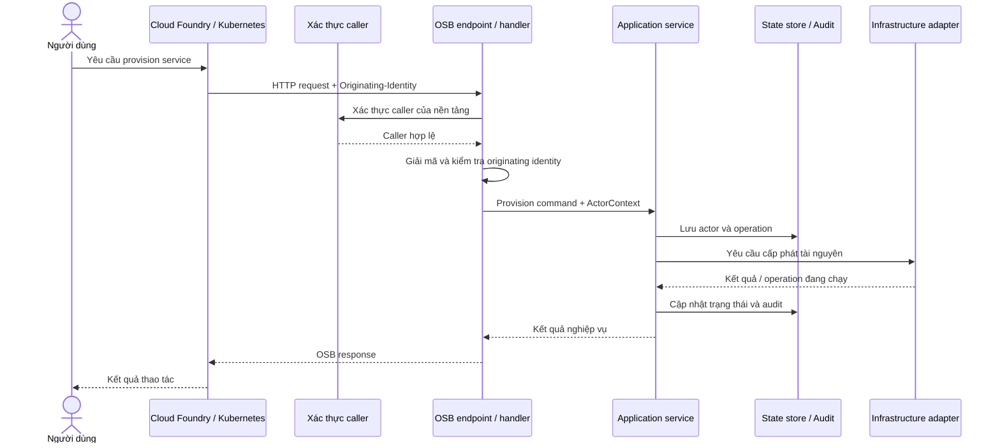
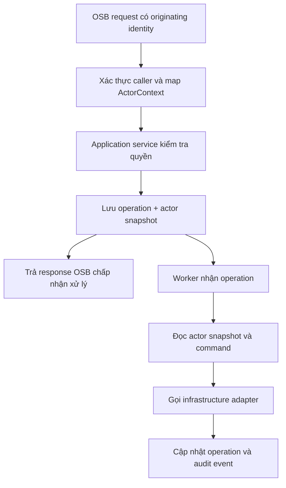

# X-Broker-API-Originating-Identity và danh tính người khởi tạo

Một nền tảng thường gọi service broker thay mặt cho người dùng đang tạo hoặc quản lý dịch vụ. Vì vậy, broker cần phân biệt **ai đang kết nối đến endpoint của broker** với **người dùng đã khởi tạo hành động trên nền tảng**. Hai danh tính này có thể khác nhau: caller trực tiếp là Cloud Foundry hoặc Kubernetes, trong khi người khởi tạo là một người dùng, tài khoản dịch vụ hoặc danh tính được nền tảng đại diện.

Open Service Broker API (OSB API) định nghĩa header `X-Broker-API-Originating-Identity` để nền tảng truyền thông tin về người dùng khởi tạo request. Broker có thể dùng thông tin này cho kiểm toán, áp dụng chính sách theo người dùng và gắn chủ thể thực hiện vào operation bất đồng bộ. Header là dữ liệu nhận diện do nền tảng cung cấp; bản thân nó không thay thế cơ chế xác thực request và không tự chứng minh người gửi là người dùng được nêu trong payload.

Trong module `SPRING_CLOUD_SERVICE_BROKER`, cần xử lý header này ở biên giao thức OSB, chuyển nó thành ngữ cảnh danh tính nội bộ rồi truyền ngữ cảnh đó qua application service. Các thành phần nghiệp vụ không nên phụ thuộc trực tiếp vào chuỗi HTTP header hoặc cấu trúc riêng của một nền tảng.

## 1. Phân biệt caller và originating identity

Khi nền tảng gọi broker, thường có ít nhất hai vai trò cần nhận diện:

| Danh tính | Câu hỏi được trả lời | Nguồn thông tin điển hình | Mục đích |
|---|---|---|---|
| Caller của request | Thành phần nào đang kết nối và được phép gọi endpoint broker? | Cơ chế xác thực OSB như thông tin xác thực client, TLS hoặc cơ chế triển khai | Xác thực nền tảng, bảo vệ endpoint và giới hạn quyền tích hợp |
| Originating identity | Người dùng hoặc chủ thể nào đã khởi tạo hành động trên nền tảng? | Header `X-Broker-API-Originating-Identity` do nền tảng chuyển tiếp | Kiểm toán, chính sách theo người dùng và truy vết hành động được ủy quyền |

Ví dụ, Alice đăng nhập vào Cloud Foundry và yêu cầu tạo một service instance. Cloud Foundry gửi HTTP request đến broker bằng thông tin xác thực tích hợp của nền tảng. Broker xác thực caller là nền tảng Cloud Foundry; header originating identity mang thông tin người dùng mà Cloud Foundry xác định là Alice. Broker cần giữ hai thông tin riêng để có thể trả lời cả câu hỏi “request đến từ nền tảng nào?” và “ai đã yêu cầu thao tác này?”.

Không nên lấy `user_id` từ `parameters`, `context`, query string hoặc body rồi xem đó là danh tính người khởi tạo. Những trường này có thể là dữ liệu cấu hình do người gọi cung cấp. Danh tính người khởi tạo phải đến từ kênh mà broker tin cậy và được kiểm soát theo ranh giới xác thực của nền tảng.

## 2. Cấu trúc của header

Giá trị header OSB có hai phần, được phân tách bằng khoảng trắng:

```text
X-Broker-API-Originating-Identity: <platform> <base64-encoded-json>
```

- `<platform>` là tên nền tảng phát ra thông tin nhận diện, chẳng hạn `cloudfoundry` hoặc `kubernetes`.
- `<base64-encoded-json>` là một JSON object được mã hóa Base64. Nội dung và các thuộc tính cụ thể phụ thuộc vào nền tảng.

Ví dụ minh họa với một payload giả định:

```http
POST /v2/service_instances/instance-123?accepts_incomplete=true HTTP/1.1
Host: broker.example.test
X-Broker-API-Version: 2.17
X-Broker-API-Originating-Identity: cloudfoundry eyJ1c2VyX2lkIjoiYWxpY2UtMTAwIiwidXNlcm5hbWUiOiJhbGljZUBleGFtcGxlLnRlc3QifQ==
Content-Type: application/json
```

Sau khi giải mã Base64, JSON minh họa ở trên có dạng:

```json
{
  "user_id": "alice-100",
  "username": "alice@example.test"
}
```

Đây chỉ là payload ví dụ để minh họa cấu trúc. Không được giả định mọi nền tảng đều gửi `user_id`, `username`, `email` hoặc cùng một schema. Adapter phải hiểu schema của nền tảng tương ứng và chuyển các thuộc tính cần thiết sang mô hình nội bộ. Nếu broker hỗ trợ nhiều nền tảng, mỗi nền tảng có thể cần một bộ giải mã hoặc mapper riêng.

Base64 chỉ là cách biểu diễn dữ liệu nhị phân dưới dạng văn bản. Nó không mã hóa bí mật, không ký payload và không chứng minh dữ liệu là xác thực. Bất kỳ client nào có thể tự gửi HTTP request cũng có thể tự tạo một chuỗi Base64 nếu broker không bảo vệ ranh giới tin cậy.

## 3. Luồng truyền danh tính qua broker

Nền tảng xác định người dùng đang thao tác, tạo header theo định dạng OSB rồi gửi request đến broker. Broker xác thực caller trước, sau đó mới xem header là một nguồn dữ liệu originating identity được nền tảng khẳng định. Lớp OSB chuyển header thành kiểu dữ liệu nội bộ; application service sử dụng ngữ cảnh đó để áp dụng chính sách và ghi nhận operation.



Trình tự này thể hiện một điểm quan trọng: xác thực caller phải diễn ra độc lập với việc phân tích header. Nếu caller không được phép gọi broker, broker không được tin header chỉ vì payload giải mã thành JSON hợp lệ. Header có thể bị thiếu, sai định dạng hoặc không được nền tảng gửi trong một số luồng; broker cần có chính sách rõ ràng cho từng trường hợp.

## 4. Tiếp nhận header tại biên Spring Cloud Open Service Broker

Spring Cloud Open Service Broker cung cấp lớp tích hợp OSB và các request model để ứng dụng triển khai catalog, service instance và binding. Khi tích hợp, hãy kiểm tra đúng phiên bản framework đang sử dụng để xác định header được framework chuyển vào request model ở đâu và kiểu dữ liệu nào biểu diễn originating identity.

Nguyên tắc phân lớp nên là:

1. **OSB adapter** nhận request theo framework, đọc originating identity đã được framework cung cấp hoặc phân tích header tại biên nếu phiên bản tích hợp yêu cầu ứng dụng thực hiện bước này.
2. **Identity mapper** kiểm tra platform, giải mã payload theo schema tương ứng và chuyển thành mô hình nội bộ.
3. **Application service** nhận `ActorContext` cùng command nghiệp vụ. Nó không đọc `HttpServletRequest`, WebFlux exchange hoặc chuỗi header.
4. **Infrastructure adapter** chỉ nhận dữ liệu cần thiết để thao tác với backend. Nó không cần biết header OSB được truyền như thế nào.

Không nên tự viết một filter toàn cục để phân tích lại header nếu Spring Cloud Open Service Broker đã cung cấp originating identity trong request. Việc parse hai lần dễ tạo ra hai nguồn sự thật và khiến hành vi khác nhau giữa các endpoint. Hãy dùng một điểm chuyển đổi thống nhất ở biên giao thức.

Mô hình nội bộ có thể giữ platform và các thuộc tính đã chuẩn hóa:

```java
public record ActorContext(
        String platform,
        String subjectId,
        String username,
        List<String> groups,
        String tenantId,
        boolean present) {
}

public record ProvisionServiceCommand(
        String instanceId,
        String serviceId,
        String planId,
        Map<String, Object> parameters,
        ActorContext actor) {
}
```

Đây là kiểu dữ liệu nội bộ minh họa. `subjectId`, `username`, `groups` và `tenantId` chỉ được điền khi schema của nền tảng cung cấp các thuộc tính đó và broker đã xác định ý nghĩa của chúng. Không tự suy ra `tenantId` từ username hoặc email. Trường `present` giúp phân biệt request có originating identity với request không có header; trong triển khai thực tế có thể dùng `Optional<ActorContext>` hoặc một kiểu biểu diễn rõ ràng tương đương.

Mapper theo nền tảng có thể được thiết kế bằng interface:

```java
public interface OriginatingIdentityMapper {
    String platform();

    ActorContext map(JsonNode identityPayload);
}
```

Một registry chọn mapper theo token platform. Ví dụ, mapper Cloud Foundry chỉ hiểu schema do Cloud Foundry gửi; mapper Kubernetes chỉ hiểu schema Kubernetes. Nếu platform không nằm trong allowlist, broker phải áp dụng chính sách đã cấu hình thay vì diễn giải payload bằng mapper tùy ý.

## 5. Phân tích và kiểm tra dữ liệu an toàn

Việc parse header cần được xem là xử lý dữ liệu đầu vào từ một ranh giới mạng. Một chuỗi Base64 giải mã thành JSON không có nghĩa nội dung đã đáng tin. Trước khi chuyển thành ActorContext, cần kiểm tra cấu trúc và chính sách nền tảng.

Các bước xử lý thường gồm:

1. Kiểm tra header có tồn tại hay không và áp dụng chính sách cho trường hợp thiếu.
2. Giới hạn chiều dài header trước khi giải mã để tránh tiêu thụ bộ nhớ không cần thiết.
3. Tách token platform và phần Base64 theo định dạng header; từ chối giá trị thiếu một trong hai phần hoặc chứa cấu trúc phân tách không hợp lệ.
4. Kiểm tra platform có nằm trong danh sách nền tảng được broker tin cậy và hỗ trợ hay không.
5. Giải mã Base64 bằng decoder phù hợp, bắt lỗi dữ liệu không hợp lệ và giới hạn kích thước payload sau giải mã.
6. Parse JSON, yêu cầu root là object và kiểm tra schema riêng của platform.
7. Chuẩn hóa các thuộc tính cần thiết, loại bỏ dữ liệu không được sử dụng và tạo ActorContext.

Ví dụ parser dưới đây minh họa cách tách hai phần và giải mã. Nó không thay thế mapper theo từng nền tảng hoặc xác thực caller:

```java
public record DecodedOriginatingIdentity(
        String platform,
        JsonNode payload) {
}

public final class OriginatingIdentityHeaderParser {
    private static final int MAX_HEADER_LENGTH = 12_000;
    private static final int MAX_PAYLOAD_BYTES = 8_192;

    private final ObjectMapper objectMapper;
    private final Set<String> supportedPlatforms;

    public OriginatingIdentityHeaderParser(
            ObjectMapper objectMapper,
            Set<String> supportedPlatforms) {
        this.objectMapper = objectMapper;
        this.supportedPlatforms = Set.copyOf(supportedPlatforms);
    }

    public Optional<DecodedOriginatingIdentity> parse(String header) {
        if (header == null || header.isBlank()) {
            return Optional.empty();
        }
        if (header.length() > MAX_HEADER_LENGTH) {
            throw new IllegalArgumentException("Originating identity header is too large");
        }

        String[] parts = header.trim().split("\\s+", 2);
        if (parts.length != 2 || parts[1].isBlank()) {
            throw new IllegalArgumentException("Invalid originating identity format");
        }

        String platform = parts[0];
        if (!supportedPlatforms.contains(platform)) {
            throw new IllegalArgumentException("Unsupported originating identity platform");
        }

        try {
            byte[] decoded = Base64.getDecoder().decode(parts[1]);
            if (decoded.length > MAX_PAYLOAD_BYTES) {
                throw new IllegalArgumentException("Originating identity payload is too large");
            }

            JsonNode payload = objectMapper.readTree(decoded);
            if (payload == null || !payload.isObject()) {
                throw new IllegalArgumentException("Originating identity must be a JSON object");
            }
            return Optional.of(new DecodedOriginatingIdentity(platform, payload));
        } catch (IllegalArgumentException ex) {
            throw ex;
        } catch (IOException ex) {
            throw new IllegalArgumentException("Invalid originating identity JSON", ex);
        }
    }
}
```

Để đoạn mã có thể biên dịch, cần các import tương ứng từ Jackson và Java Base64, `Optional`, `Set`, `IOException`. Giới hạn kích thước chỉ là giá trị minh họa; hệ thống cần chọn ngưỡng theo hợp đồng và hạ tầng triển khai. Sau parser, mapper vẫn phải xác thực kiểu dữ liệu, trường bắt buộc và quy tắc riêng của từng platform. Không chuyển toàn bộ `JsonNode` xuống domain chỉ vì parse thành công.

## 6. Ranh giới tin cậy: header không phải bằng chứng xác thực

Đây là điểm bảo mật quan trọng nhất khi sử dụng originating identity. Header không tự có chữ ký mật mã. Nếu broker nhận request trực tiếp từ một client không đáng tin và chấp nhận header do client tự đặt, client có thể giả danh người dùng khác bằng cách tạo payload Base64 tùy ý.

Một thiết kế an toàn cần bảo đảm:

- Broker xác thực caller theo cơ chế bảo vệ endpoint OSB đã cấu hình. Chỉ sau khi xác thực caller thành công mới sử dụng header theo chính sách tin cậy.
- Nền tảng hoặc gateway đáng tin cậy phải loại bỏ header do client bên ngoài tự gửi và tự thiết lập giá trị originating identity từ phiên đăng nhập đã xác thực.
- Đường truyền giữa nền tảng và broker phải được bảo vệ, thường bằng TLS; dùng mTLS hoặc cơ chế xác thực client khi phù hợp với mô hình triển khai.
- Nếu broker có thể được gọi qua nhiều gateway, cần xác định rõ gateway nào được phép khẳng định originating identity và ngăn đường truy cập vòng qua gateway tin cậy.
- Platform token phải được đối chiếu với allowlist và cấu hình tích hợp. Không cho phép payload tự khai báo một platform bất kỳ rồi dùng mapper tương ứng.
- Không coi Base64 là mã hóa, chữ ký hoặc cơ chế chống giả mạo. Không dùng header này như một bearer token.

Nếu nền tảng và broker không có một kênh tin cậy để xác nhận header, broker chỉ nên xem payload là metadata chưa xác minh hoặc không sử dụng nó cho quyết định cấp quyền. Việc quyết định một người dùng có được tạo, cập nhật hay thu hồi instance phải dựa trên một mô hình xác thực và ủy quyền có thể tin cậy.

## 7. Dùng originating identity cho authorization và audit

Originating identity có thể hỗ trợ chính sách nghiệp vụ, nhưng broker cần phân biệt **nhận diện** với **ủy quyền**. Biết `subjectId` là Alice chưa đủ để kết luận Alice có quyền cập nhật instance bất kỳ. Application service cần kết hợp ActorContext với chủ sở hữu instance, tenant, service plan, quyền của caller và chính sách của broker.

Một quyết định authorization có thể xem xét:

| Dữ liệu | Câu hỏi chính sách |
|---|---|
| Platform | Nền tảng nào đang đại diện người dùng? Nền tảng đó có được phép dùng service/plan này không? |
| Subject ID | Người khởi tạo là ai theo hệ thống danh tính của platform? |
| Groups hoặc roles | Người dùng có thuộc nhóm được phép quản lý dịch vụ không, nếu platform cung cấp và broker tin cậy thuộc tính này? |
| Tenant / organization / space | Thao tác có nằm trong phạm vi tenant hoặc không gian được phép không? |
| Instance owner | Người khởi tạo có quyền trên instance hiện tại không? |
| Caller identity | Nền tảng kết nối có được phép thực hiện loại thao tác OSB này không? |

Ví dụ, Alice có thể tạo instance trong space mà cô quản lý. Khi Alice chuyển sang một space khác, broker không nên cho phép cập nhật instance cũ chỉ vì `username` vẫn giống nhau. Chính sách cần kiểm tra liên kết giữa actor, tenant/space và instance đã lưu. Nếu platform không cung cấp tenant đáng tin cậy trong originating identity, broker phải lấy phạm vi tenant từ nguồn đã xác thực khác hoặc áp dụng chính sách hạn chế hơn.

Đối với audit, broker có thể ghi lại:

- `platform`: nền tảng đã chuyển tiếp originating identity;
- `subjectId`: định danh ổn định của người khởi tạo, nếu có;
- `tenantId`: phạm vi tenant đã được xác minh;
- `operationId`, `instanceId`, `bindingId` và loại hành động;
- thời điểm, kết quả, correlation ID và caller đã xác thực.

Nên lưu các trường cần thiết đã chuẩn hóa thay vì lưu nguyên header hoặc toàn bộ JSON payload. Username, email, group và thuộc tính mở rộng có thể là dữ liệu cá nhân. Chỉ lưu những trường phục vụ kiểm toán hoặc chính sách đã xác định, giới hạn quyền đọc và thời gian lưu theo yêu cầu của hệ thống.

## 8. Danh tính trong các thao tác bất đồng bộ

Provision, update, deprovision hoặc binding có thể tiếp tục chạy sau khi HTTP request ban đầu đã kết thúc. Nếu broker chỉ giữ originating identity trong request memory, worker xử lý operation sau đó sẽ không còn biết ai khởi tạo hành động.

Khi tạo operation, application service nên lưu snapshot danh tính đã chuẩn hóa cùng bản ghi operation hoặc audit event. Worker đọc operation từ state store và sử dụng dữ liệu đó để ghi nhận các bước tiếp theo. Không nên lưu toàn bộ header thô làm nguồn dữ liệu duy nhất vì worker sẽ phải parse lại và có thể diễn giải khác khi schema thay đổi.



Actor snapshot là dữ liệu kiểm toán về người khởi tạo tại thời điểm request được chấp nhận. Nó không phải credential để worker đăng nhập thay người dùng. Worker sử dụng credential dịch vụ của broker với quyền tối thiểu để thao tác hạ tầng; không lấy username hoặc token của originating identity làm thông tin xác thực backend.

Nếu operation được retry, các lần chạy phải giữ nguyên actor gốc. Không thay người khởi tạo bằng tài khoản của worker hoặc người vận hành chỉ vì một tiến trình khác tiếp tục công việc. Nếu có hành động can thiệp thủ công, hãy ghi nhận actor can thiệp riêng trong audit event để phân biệt người khởi tạo ban đầu với người thực hiện thao tác khắc phục.

## 9. Xử lý header thiếu, sai định dạng hoặc không đáng tin

Broker cần quy định hành vi rõ ràng cho các tình huống sau:

| Tình huống | Cách xử lý cần cân nhắc |
|---|---|
| Header không được gửi | Cho phép nếu thao tác không yêu cầu danh tính người dùng; nếu chính sách cần actor thì từ chối theo quy tắc authorization |
| Thiếu platform hoặc payload | Xem là header sai định dạng; không tạo ActorContext một phần |
| Base64 không hợp lệ hoặc JSON không phải object | Từ chối header và ghi log an toàn; không dùng dữ liệu chưa parse |
| Platform không nằm trong allowlist | Không dùng mapper không được cấu hình; từ chối hoặc bỏ qua theo chính sách endpoint đã công bố |
| Payload thiếu subject cần thiết | Đánh dấu danh tính không đầy đủ; không suy đoán từ body hoặc query string |
| Header đến từ caller chưa xác thực | Không tin header cho authorization hoặc audit identity |
| Payload chứa trường lạ | Bỏ qua trường không dùng hoặc từ chối theo schema; không tự động biến mọi trường thành quyền hạn |

Không phải trường hợp thiếu header nào cũng cần trả lỗi giao thức. Một số nền tảng hoặc loại request có thể không có người dùng tương ứng. Quyết định cho phép hay từ chối thuộc chính sách broker và yêu cầu tích hợp, nhưng phải nhất quán giữa provision, update, deprovision, bind và unbind. Đặc biệt, không để một endpoint bắt buộc actor nhưng endpoint khác âm thầm nhận actor do client tự khai báo.

Khi từ chối, response OSB chỉ nên chứa thông tin lỗi phù hợp với hợp đồng. Không trả nguyên payload, stack trace, tên thuộc tính nhạy cảm hoặc dữ liệu xác thực ra ngoài. Log nên ghi mã lỗi, platform đã nhận diện nếu đáng tin cậy, correlation ID và operation/instance ID liên quan; không ghi nguyên header ở mức INFO.

## 10. Kiểm thử tích hợp và vận hành

Kiểm thử originating identity cần bao phủ cả cú pháp header, mapper theo platform và ranh giới tin cậy:

| Phạm vi | Ca kiểm thử | Kết quả mong đợi |
|---|---|---|
| Header parser | Platform và Base64 JSON hợp lệ | Tách đúng platform, giải mã thành JSON object |
| Header parser | Thiếu phần, Base64 sai, JSON sai, payload quá lớn | Báo lỗi có kiểm soát, không tạo identity một phần |
| Platform mapper | Payload đúng schema của Cloud Foundry hoặc Kubernetes được hỗ trợ | Ánh xạ đúng subject và thuộc tính được cho phép |
| Platform mapper | Payload của platform khác hoặc schema không tương thích | Không diễn giải bằng mapper sai |
| OSB endpoint | Caller hợp lệ, header hợp lệ | Request model nhận đúng originating identity |
| OSB endpoint | Caller không hợp lệ nhưng có header hợp lệ | Request bị từ chối; header không làm caller trở nên hợp lệ |
| Authorization | Actor không thuộc tenant hoặc không sở hữu instance | Application service từ chối thao tác |
| Async operation | Worker tiếp tục operation sau khi request kết thúc | Actor gốc được giữ trong audit, worker dùng credential dịch vụ riêng |
| Logging | Payload có email hoặc thuộc tính nhạy cảm | Log không làm lộ nguyên payload hoặc credentials |

Nên có contract test với từng nền tảng tích hợp để xác nhận định dạng header thực tế và schema payload. Unit test cho mapper không thay thế kiểm thử đường truyền từ platform qua proxy/gateway đến broker, vì proxy có thể xóa, ghi đè hoặc chuẩn hóa header. Trong môi trường triển khai, cần kiểm tra cấu hình gateway để header từ bên ngoài bị loại bỏ trước khi nền tảng đặt header đáng tin cậy.

## 11. Các lỗi thiết kế thường gặp

- **Xem Base64 là bảo mật:** Base64 chỉ mã hóa biểu diễn; payload có thể được tạo lại và đọc được sau khi giải mã.
- **Dùng originating identity thay caller authentication:** header không chứng minh client kết nối được phép gọi broker.
- **Tin mọi platform token:** platform trong header phải được giới hạn bởi cấu hình tích hợp và ranh giới tin cậy.
- **Giả định schema đồng nhất:** mỗi platform có thể cung cấp các trường và ngữ nghĩa khác nhau.
- **Dùng username làm khóa định danh duy nhất:** username hoặc email có thể thay đổi; ưu tiên subject ID ổn định theo hệ thống danh tính.
- **Đưa HTTP header vào domain:** làm nghiệp vụ phụ thuộc giao thức và khiến kiểm thử khó khăn.
- **Không lưu actor cho operation bất đồng bộ:** audit bị mất mối liên hệ với người khởi tạo khi worker chạy sau đó.
- **Lưu toàn bộ payload không giới hạn:** tăng rủi ro lộ dữ liệu cá nhân và làm state store chứa thông tin không cần thiết.

## Kết luận

`X-Broker-API-Originating-Identity` cho phép nền tảng chuyển tiếp danh tính người dùng đã khởi tạo request đến service broker. Broker cần phân biệt danh tính này với caller đang kết nối, kiểm tra header tại ranh giới tin cậy, giải mã và ánh xạ payload theo từng nền tảng, rồi truyền `ActorContext` đã chuẩn hóa vào application service. Khi lưu actor cùng operation và audit event, broker có thể giữ dấu vết người khởi tạo xuyên suốt các thao tác bất đồng bộ mà vẫn dùng credential dịch vụ riêng để gọi hạ tầng. Cách tổ chức đó giúp service broker Spring Cloud hỗ trợ Cloud Foundry, Kubernetes và các nền tảng khác mà không biến header HTTP thành cơ chế xác thực hoặc phụ thuộc của domain.
