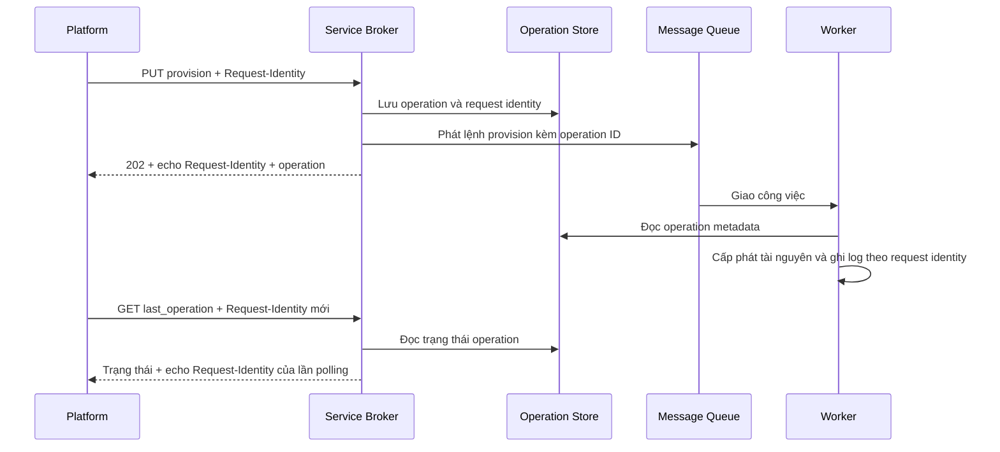

# X-Broker-API-Request-Identity và đối chiếu các yêu cầu

Trong một hệ thống dùng Spring Cloud Service Broker, một thao tác của người dùng có thể đi qua nhiều thành phần: Cloud Foundry hoặc Kubernetes, API gateway, service broker, hàng đợi và worker xử lý tài nguyên. Khi một request bị chậm, thất bại hoặc được gửi lại, đội vận hành cần một mã để tìm toàn bộ log và trace liên quan đến chính request đó.

Open Service Broker API (OSB API) định nghĩa header `X-Broker-API-Request-Identity` cho mục đích này. Header mang định danh của request từ platform đến broker. Broker có thể ghi nhận giá trị này trong log và nên trả lại cùng giá trị trong response. Cần phân biệt nó với `X-Broker-API-Originating-Identity`, vốn mô tả người dùng đã khởi tạo hành động. Hai header giải quyết hai câu hỏi khác nhau: request nào đang được xử lý và ai đã yêu cầu hành động đó.

## 1. Request Identity giải quyết vấn đề gì?

Một service broker tiếp nhận nhiều loại request OSB API như đọc catalog, provision, update, deprovision, tạo hoặc xóa binding và truy vấn `last_operation`. Một thao tác có thể tạo ra nhiều log ở các lớp khác nhau. Nếu log chỉ ghi tên endpoint và service instance, việc ghép các dòng log của một request cụ thể sẽ khó khăn, đặc biệt khi nhiều platform cùng gọi broker đồng thời.

`X-Broker-API-Request-Identity` cung cấp một giá trị tương quan do platform gửi. Broker sử dụng nó để gắn các log và dấu vết xử lý của request với nhau, rồi phản hồi lại giá trị đó để platform có thể ghép response với request ban đầu.

Ví dụ, hai platform cùng gọi provision gần như đồng thời:

| Platform | Service instance | Request identity |
|---|---|---|
| Cloud Foundry production | `db-prod-17` | `req-7d1a...` |
| Kubernetes staging | `db-stage-08` | `req-9b42...` |

Khi tìm `req-7d1a...` trong log, đội vận hành có thể lọc ra request từ lúc gateway tiếp nhận, broker kiểm tra catalog/plan, service bắt đầu cấp phát đến khi broker trả kết quả. Request identity không thay thế ID của service instance hoặc operation; nó bổ sung một khóa quan sát cho một lượt gọi HTTP.

## 2. Quy tắc của OSB API

OSB API mô tả `X-Broker-API-Request-Identity` trong nhóm HTTP header. Đây là một khả năng mà platform có thể hỗ trợ:

- Platform **MAY** hỗ trợ tính năng request identity. Nếu hỗ trợ, platform **MUST** gửi header này trong mọi request OSB API đến broker.
- Giá trị header **MUST** là chuỗi không rỗng, biểu thị định danh của request.
- Giá trị cụ thể **MAY** duy nhất cho từng request gửi đến broker. Sử dụng GUID/UUID là cách được **RECOMMENDED**.
- Broker **MAY** ghi giá trị này vào các log được tạo ra trong quá trình xử lý request.
- Broker **SHOULD** đưa header `X-Broker-API-Request-Identity` vào response tương ứng.

Các từ khóa MUST, SHOULD, MAY và RECOMMENDED được hiểu theo quy ước RFC 2119 được OSB API sử dụng. Việc platform có hỗ trợ tính năng hay không là tùy chọn; vì vậy broker cần chấp nhận request không có header này khi platform không triển khai tính năng request identity. Khi header có mặt, broker nên giữ nguyên giá trị hợp lệ để phản hồi và ghi log.

Header có dạng đơn giản:

```http
X-Broker-API-Request-Identity: 550e8400-e29b-41d4-a716-446655440000
```

Giá trị là một chuỗi định danh không rỗng. Khác với originating identity, request identity không yêu cầu cấu trúc `platform value`, không yêu cầu Base64 và không chứa JSON theo quy định của header này. Broker nên xem nó là giá trị opaque: lưu và truyền tiếp để đối chiếu, không tự phân tích các thành phần bên trong UUID hay chuỗi do platform lựa chọn.

## 3. Phân biệt các header và định danh thường gặp

Các header và ID dưới đây thường xuất hiện trong cùng một luồng OSB API nhưng có mục đích khác nhau:

| Thành phần | Nó định danh điều gì? | Quy tắc và cách sử dụng |
|---|---|---|
| `X-Broker-API-Version` | Phiên bản OSB API mà platform sử dụng | Header bắt buộc trong request; broker kiểm tra khả năng tương thích phiên bản |
| `X-Broker-API-Originating-Identity` | Người dùng platform đã thực hiện hành động dẫn đến request | Platform có thể hỗ trợ; khi có hành động của người dùng thì header mang thông tin người đó; định dạng gồm tên platform và giá trị Base64 của JSON |
| `X-Broker-API-Request-Identity` | Một request HTTP cụ thể từ platform | Platform có thể hỗ trợ; nếu hỗ trợ thì gửi trên mọi request OSB API; chuỗi không rỗng, UUID được khuyến nghị; broker nên echo trong response |
| `service_instance_id` | Service instance do platform quản lý | Định danh tài nguyên trong URL và dữ liệu broker; có thể xuất hiện ở nhiều request khác nhau |
| `operation` | Tác vụ bất đồng bộ đang được platform polling | Định danh operation trong luồng `last_operation`; không phải request identity của lần polling hiện tại |
| `traceparent` | Trace và span theo W3C Trace Context | Dùng cho distributed tracing nếu các thành phần hỗ trợ; độc lập với header OSB request identity |
| Idempotency key | Một yêu cầu nghiệp vụ cần được xử lý lặp an toàn | Là cơ chế hoặc khóa do hệ thống thiết kế; không mặc định đồng nhất với request identity |

### 3.1. Request Identity và Originating Identity

Hai header này dễ bị nhầm vì đều chứa chữ Identity, nhưng chúng trả lời hai câu hỏi khác nhau.

`X-Broker-API-Originating-Identity` cho biết người dùng platform nào đã khởi tạo hành động. Header có định dạng:

```text
X-Broker-API-Originating-Identity: platform base64-json
```

Ví dụ, platform Cloud Foundry có thể gửi:

```http
X-Broker-API-Originating-Identity: cloudfoundry eyJ1c2VyX2lkIjoiYXBwLXVzZXItMTIzIn0=
```

Phần sau tên platform là JSON đã được mã hóa Base64. Các trường JSON phụ thuộc profile của platform. Với request do người dùng khởi tạo, platform hỗ trợ tính năng này phải gửi thông tin người dùng tương ứng. Với tác vụ nền không gắn với người dùng, ví dụ platform tải lại catalog, header có thể không xuất hiện.

Ngược lại, `X-Broker-API-Request-Identity` chỉ nhận diện lượt request. Nó không cho biết người dùng, vai trò, tenant hoặc quyền của caller. Một người dùng có thể tạo nhiều request khác nhau, mỗi request có request identity riêng. Một request cũng có thể không gắn với người dùng cụ thể.

### 3.2. Request Identity và Idempotency

Request identity hỗ trợ quan sát và đối chiếu log. Nó không tự bảo đảm idempotency. Đặc tả cho phép giá trị có thể duy nhất cho mỗi request, nhưng không yêu cầu platform phải giữ nguyên một giá trị qua các lần retry. Vì vậy, broker không nên dùng riêng header này làm khóa chống cấp phát trùng.

Để xử lý idempotency, broker cần dựa vào định danh tài nguyên và trạng thái nghiệp vụ, chẳng hạn tổ hợp platform instance, `service_instance_id`, loại thao tác và dữ liệu request đã chuẩn hóa. Khi platform gửi lại cùng một yêu cầu provision, broker phải kiểm tra service instance hiện tại và kết quả đã ghi nhận để quyết định trả lại kết quả cũ hay tiếp tục xử lý. Request identity có thể được lưu kèm bản ghi operation để truy vết, nhưng không thay thế khóa idempotency.

### 3.3. Request Identity và Trace ID

`X-Broker-API-Request-Identity` là header được OSB API định nghĩa. `traceparent` thuộc W3C Trace Context và mang thông tin trace/span để các thư viện tracing liên kết các span phân tán. `X-Correlation-ID` thường là quy ước riêng của ứng dụng hoặc tổ chức.

Một hệ thống có thể ghi request identity như một thuộc tính của span hoặc log entry, ví dụ `osb.request_identity`. Nếu platform và broker thống nhất dùng chung một giá trị cho correlation ID nội bộ, cần ghi rõ quy ước đó. Không tự coi request identity là trace ID, không ghi đè `traceparent` bằng giá trị này và không giả định các hệ thống bên ngoài hiểu header OSB.

## 4. Ví dụ request và response

Platform gửi một request provision bất đồng bộ:

```http
PUT /v2/service_instances/db-prod-17?accepts_incomplete=true HTTP/1.1
Host: broker.example.com
Content-Type: application/json
X-Broker-API-Version: 2.17
X-Broker-API-Request-Identity: 550e8400-e29b-41d4-a716-446655440000
X-Broker-API-Originating-Identity: cloudfoundry eyJ1c2VyX2lkIjoiYXBwLXVzZXItMTIzIn0=
Authorization: Basic <broker-credentials>

{
  "service_id": "postgresql",
  "plan_id": "standard",
  "organization_guid": "org-42",
  "space_guid": "space-17"
}
```

Broker nhận hai loại identity riêng biệt: request identity để liên kết log của lượt gọi và originating identity để biết người dùng đã yêu cầu cấp phát. Broker xác thực platform bằng cơ chế đã cấu hình; không dùng request identity thay cho `Authorization`.

Nếu broker chấp nhận xử lý bất đồng bộ, response có thể là:

```http
HTTP/1.1 202 Accepted
Content-Type: application/json
X-Broker-API-Request-Identity: 550e8400-e29b-41d4-a716-446655440000

{
  "operation": "provision-op-891"
}
```

Platform có thể dùng request identity để đối chiếu response với request provision. Giá trị `operation` trong body xác định tác vụ bất đồng bộ để platform truy vấn `last_operation`. Khi platform gửi request polling mới, request polling đó có thể mang một request identity khác; operation vẫn là `provision-op-891` cho đến khi tác vụ kết thúc.

## 5. Tiếp nhận và truyền request identity trong Spring Cloud

Spring Cloud Open Service Broker hỗ trợ Spring MVC và Spring WebFlux. Framework có các thành phần xử lý header request identity và phản hồi lại cùng giá trị:

- Với Spring MVC, `RequestIdentityInterceptor` đọc `X-Broker-API-Request-Identity` từ request và đặt giá trị tương ứng vào response. `RequestIdentityWebMvcConfigurerAdapter` đăng ký cấu hình echo header.
- Với Spring WebFlux, framework cung cấp cơ chế web filter tương ứng để xử lý request identity trên luồng reactive.
- Các controller OSB tích hợp của framework tiếp nhận `requestIdentity` cùng các thông tin request chung. `BaseController.configureCommonRequestFields(...)` chuyển giá trị này vào `ServiceBrokerRequest` hoặc `AsyncServiceBrokerRequest`.

Khi sử dụng starter và controller chuẩn, hãy kiểm tra cấu hình tự động của đúng phiên bản Spring Cloud Open Service Broker đang dùng trước khi tự đăng ký interceptor hoặc filter. Nếu framework đã echo header, đăng ký thêm một interceptor khác có thể tạo header trùng lặp hoặc ghi đè giá trị không mong muốn.

Với controller tùy chỉnh, có thể đọc header bằng `@RequestHeader` rồi truyền nó vào lớp xử lý để ghi log hoặc gắn vào ngữ cảnh quan sát:

```java
@RestController
@RequestMapping("/internal/diagnostics")
public class BrokerDiagnosticsController {

    private static final String REQUEST_IDENTITY_HEADER =
            "X-Broker-API-Request-Identity";

    private final BrokerDiagnosticsService diagnosticsService;

    public BrokerDiagnosticsController(BrokerDiagnosticsService diagnosticsService) {
        this.diagnosticsService = diagnosticsService;
    }

    @GetMapping
    public ResponseEntity<DiagnosticResponse> inspect(
            @RequestHeader(name = REQUEST_IDENTITY_HEADER, required = false)
            String requestIdentity) {

        DiagnosticResponse result = diagnosticsService.inspect(requestIdentity);
        return ResponseEntity.ok(result);
    }
}
```

Đây là ví dụ minh họa cách bind header vào tham số controller. Endpoint chẩn đoán không phải endpoint OSB chuẩn. Với endpoint OSB thực tế, nên để controller và auto-configuration của Spring Cloud Open Service Broker quản lý response header; nếu tự triển khai endpoint, cần bảo đảm response echo đúng giá trị hợp lệ nhận được.

### 5.1. Ghi log có cấu trúc

Nên đưa request identity vào trường riêng của log thay vì ghép vào một chuỗi tự do. Ví dụ:

```json
{
  "event": "osb.provision.accepted",
  "requestIdentity": "550e8400-e29b-41d4-a716-446655440000",
  "platformInstanceId": "cf-prod-01",
  "serviceInstanceId": "db-prod-17",
  "operationId": "provision-op-891"
}
```

Tên trường `requestIdentity` trong log là quy ước nội bộ, không phải một header OSB mới. Nên ghi thêm platform instance, endpoint, HTTP status, service instance và operation ID để có thể lọc log theo nhiều chiều. Không ghi Authorization header, password, binding credentials hoặc toàn bộ payload có chứa bí mật.

Request identity là dữ liệu do phía gọi gửi. Trước khi đưa vào log, cần xử lý ký tự điều khiển để ngăn log injection. Hệ thống cũng có thể đặt giới hạn kích thước header theo chính sách vận hành và giới hạn HTTP server. Nếu cần áp dụng giới hạn riêng, hãy thống nhất với platform để tránh từ chối các giá trị hợp lệ.

## 6. Truyền request identity qua xử lý bất đồng bộ

Trong một request provision với `accepts_incomplete=true`, broker có thể trả `202 Accepted` rồi đẩy công việc vào queue. Request identity ban đầu nên được lưu như metadata quan sát của operation hoặc message để worker có thể ghi log cùng mã tương quan.

Luồng xử lý có thể tổ chức như sau:



Một bản ghi operation có thể lưu các trường:

| Trường | Ý nghĩa |
|---|---|
| `operation_id` | ID của công việc bất đồng bộ |
| `platform_instance_id` | Platform instance sở hữu thao tác |
| `service_instance_id` | Service instance đang được xử lý |
| `request_identity` | Request identity của request khởi tạo operation, phục vụ truy vết |
| `status` | Trạng thái như `IN_PROGRESS`, `SUCCEEDED` hoặc `FAILED` |
| `created_at`, `updated_at` | Mốc thời gian phục vụ vận hành và audit |

Worker không nên phụ thuộc vào `ThreadLocal` hoặc MDC của request thread ban đầu. Khi công việc chạy qua executor hoặc message broker, thread cũ có thể đã kết thúc. Hãy ghi metadata vào operation hoặc message envelope rồi khôi phục ngữ cảnh log tại worker. Với WebFlux, Reactor Context có thể mang dữ liệu trong một chuỗi reactive, nhưng khi qua queue hoặc tiến trình khác vẫn cần truyền dữ liệu một cách tường minh.

Mỗi lần polling `last_operation` là một request HTTP riêng. Header request identity của lần polling nên được echo theo request hiện tại; `operation_id` vẫn dùng để tra cứu công việc ban đầu. Không ghi đè request identity ban đầu trong operation bằng ID của các lần polling tiếp theo. Nếu cần liên kết tất cả lượt gọi quanh một operation, lưu thêm operation ID hoặc trace ID làm khóa liên kết.

## 7. Bảo mật và giới hạn sử dụng

Request identity giúp quan sát hệ thống nhưng không phải credential. Một giá trị UUID khó đoán cũng không chứng minh người gửi là platform hợp lệ. Broker vẫn phải xác thực platform qua TLS, HTTP Basic hoặc cơ chế đã thỏa thuận, đồng thời kiểm tra quyền truy cập tài nguyên theo thông tin xác thực và phạm vi platform.

Các nguyên tắc vận hành:

- Không dùng request identity để xác thực, phân quyền, xác định tenant hoặc chọn platform instance.
- Không giả định giá trị luôn là UUID; đặc tả khuyến nghị GUID nhưng cho phép platform chọn một chuỗi không rỗng.
- Xem giá trị là dữ liệu đầu vào không tin cậy. Kiểm soát ký tự điều khiển, độ dài và cách escape khi ghi log.
- Không đặt token, password, thông tin cá nhân hoặc secret vào request identity.
- Chỉ echo giá trị đã nhận và đã qua kiểm tra hợp lệ; không tự tạo giá trị mới rồi giả làm request identity của platform.
- Không dùng request identity làm khóa idempotency nếu platform và broker chưa có thỏa thuận riêng về tính ổn định qua retry.
- Tránh đưa request identity có cardinality cao vào label metric. Dùng nó trong log hoặc trace; metric nên ưu tiên các nhãn có tập giá trị giới hạn như loại thao tác, kết quả và platform type.

Nếu broker nhận request từ gateway, gateway cần giữ nguyên header khi chuyển tiếp. Nếu gateway thay hoặc sinh request identity mới, phải có quy ước rõ ràng về việc giá trị nào được echo và ghi log. Không cho phép client bên ngoài tự đặt một header nội bộ rồi coi nó là mã đã được gateway xác thực.

## 8. Các tình huống kiểm thử

Nên kiểm tra request identity trên cả endpoint đồng bộ và bất đồng bộ:

1. Gửi request OSB API có header hợp lệ và xác nhận broker nhận đúng giá trị.
2. Xác nhận response chứa `X-Broker-API-Request-Identity` với cùng giá trị đã nhận.
3. Gửi request không có header và xác nhận broker vẫn xử lý được khi platform không hỗ trợ tính năng này.
4. Gửi request có originating identity và request identity khác nhau; xác nhận log phân biệt người khởi tạo với mã request.
5. Gửi hai request đồng thời với hai request identity khác nhau và xác nhận log không bị trộn lẫn.
6. Thực hiện provision bất đồng bộ; xác nhận worker đọc được request identity đã lưu trong operation hoặc message metadata.
7. Poll `last_operation` bằng một request identity mới; xác nhận response echo mã mới trong khi operation vẫn trỏ đến tác vụ ban đầu.
8. Gửi giá trị rỗng hoặc có ký tự điều khiển; xác nhận chính sách kiểm tra đầu vào và log được thực thi an toàn.
9. Thử retry provision với request identity khác nhưng cùng service instance; xác nhận logic idempotency vẫn dựa trên trạng thái nghiệp vụ và khóa tài nguyên.
10. Kiểm tra cấu hình Spring MVC và WebFlux để chắc chắn response chỉ có một giá trị header, kể cả khi request đi qua xử lý async hoặc redispatch.

## 9. Lỗi thường gặp

| Lỗi | Hậu quả | Cách xử lý |
|---|---|---|
| Coi request identity là originating identity | Log nhầm request ID thành người dùng thực hiện thao tác | Lưu hai header ở hai trường riêng |
| Bắt buộc mọi platform phải gửi header | Từ chối platform không hỗ trợ tính năng tùy chọn | Chỉ yêu cầu header khi platform đã cam kết hỗ trợ |
| Không echo header trong response | Platform khó đối chiếu response với request | Bật interceptor/filter theo framework hoặc triển khai echo đúng chuẩn |
| Dùng request identity làm khóa idempotency | Retry có ID mới có thể tạo tài nguyên trùng | Dùng khóa và trạng thái nghiệp vụ có phạm vi tài nguyên |
| Chỉ lưu request identity trong MDC | Worker nền mất ngữ cảnh sau khi request kết thúc | Lưu metadata trong operation hoặc message |
| Giả định header luôn là UUID | Từ chối giá trị hợp lệ do platform chọn | Chấp nhận chuỗi không rỗng theo hợp đồng OSB |
| Đăng ký echo interceptor hai lần | Response có thể chứa header lặp | Kiểm tra auto-configuration trước khi thêm interceptor tùy chỉnh |

## 10. Kết luận

`X-Broker-API-Request-Identity` là định danh của request OSB API, hữu ích cho log correlation và distributed tracing. Platform có thể hỗ trợ tính năng này; khi đã hỗ trợ, platform phải gửi header trên mọi request OSB API. Broker có thể ghi log và nên echo giá trị trong response. Khi kết hợp với Spring Cloud Open Service Broker, hãy tận dụng interceptor hoặc web filter có sẵn, truyền request identity rõ ràng vào ngữ cảnh xử lý và lưu metadata cần thiết cho worker bất đồng bộ. Luôn phân biệt request identity với originating identity, operation ID, trace ID và khóa idempotency để việc theo dõi request không làm sai lệch bảo mật hoặc trạng thái nghiệp vụ.

## Tài liệu tham khảo

- [Open Service Broker API Specification — Headers, Originating Identity và Request Identity](https://github.com/cloudfoundry/servicebroker/blob/master/spec.md#headers)
- [Spring Cloud Open Service Broker — RequestIdentityInterceptor](https://docs.spring.io/spring-cloud-open-service-broker/docs/current/apidocs/org/springframework/cloud/servicebroker/autoconfigure/web/servlet/RequestIdentityInterceptor.html)
- [Spring Cloud Open Service Broker — BaseController](https://docs.spring.io/spring-cloud-open-service-broker/docs/current/apidocs/org/springframework/cloud/servicebroker/controller/BaseController.html)
