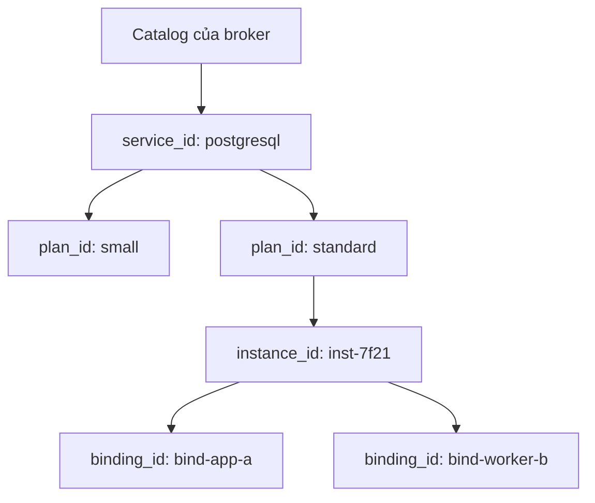
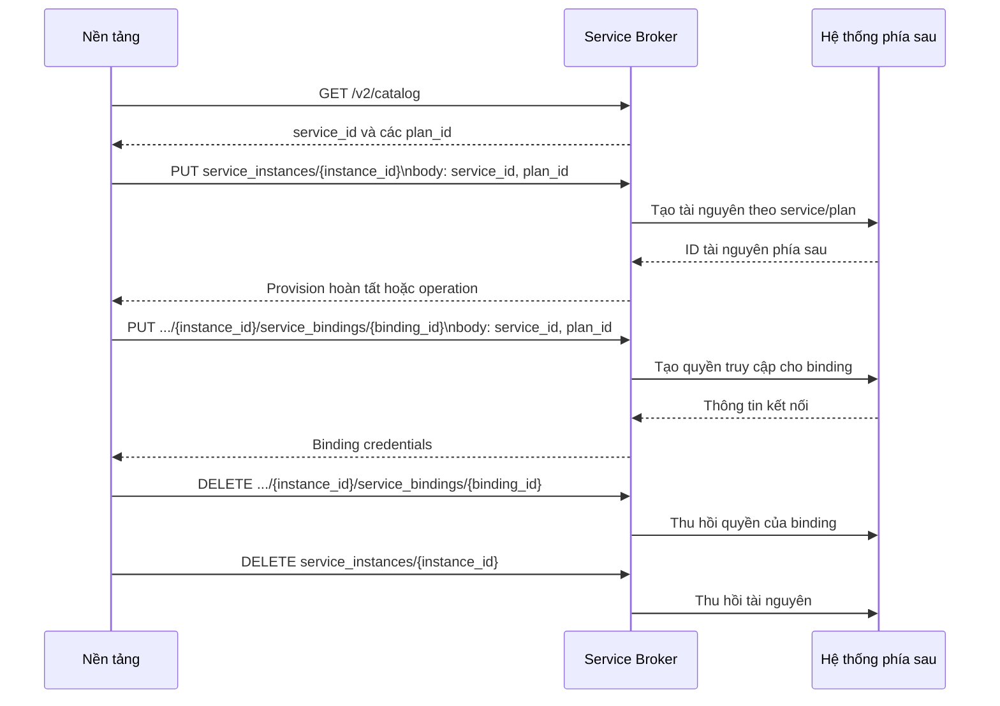

# service_id, plan_id, instance_id và binding_id trong từng loại yêu cầu

## Vì sao cần phân biệt bốn định danh?

Open Service Broker API (OSB API) dùng các định danh để liên kết catalog mà broker công bố với những tài nguyên cụ thể do nền tảng yêu cầu tạo và quản lý. Bốn giá trị thường xuất hiện trong các yêu cầu là `service_id`, `plan_id`, `instance_id` và `binding_id`. Chúng có liên quan với nhau nhưng đại diện cho các đối tượng khác nhau.

Trong module `SPRING_CLOUD_SERVICE_BROKER`, các định danh này là nền tảng để triển khai catalog, provision, update, deprovision và binding bằng Spring Cloud Open Service Broker. Broker phải hiểu định danh nào đến từ catalog của mình, định danh nào do nền tảng cung cấp, và mỗi định danh xuất hiện ở path, query hay request body của endpoint nào.

| Định danh | Đại diện cho | Nơi định nghĩa | Vai trò trong vòng đời |
|---|---|---|---|
| `service_id` | Một loại dịch vụ broker cung cấp. | Broker công bố trong `services[].id` của catalog. | Cho biết yêu cầu đang thao tác với dịch vụ nào, ví dụ PostgreSQL hoặc Redis. |
| `plan_id` | Một gói/cấu hình thuộc một service. | Broker công bố trong `services[].plans[].id`. | Xác định cấu hình được chọn cho service instance. |
| `instance_id` | Một service instance cụ thể được nền tảng yêu cầu quản lý. | Nền tảng cấp và truyền trong path. | Nhận diện tài nguyên xuyên suốt provision, retrieve, update, deprovision và theo dõi thao tác. |
| `binding_id` | Một binding cụ thể gắn với service instance. | Nền tảng cấp và truyền trong path. | Nhận diện một lần cấp quyền/thông tin kết nối cho một consumer. |

Có thể hình dung quan hệ của chúng như sau: broker công bố một `service_id`, service có các `plan_id`, nền tảng chọn một cặp service/plan để tạo `instance_id`, rồi có thể tạo một hoặc nhiều `binding_id` bên dưới instance đó.



Các chuỗi trong sơ đồ chỉ là ví dụ. Trong triển khai thực tế, ID có thể là UUID hoặc một chuỗi định danh khác theo quy ước của broker/nền tảng. Hãy xem chúng là giá trị opaque: dùng đúng giá trị đã nhận, không suy diễn ý nghĩa từ cấu trúc chuỗi, không thay bằng tên hiển thị và không tự tạo lại ID của phía còn lại.

## `service_id` và `plan_id` bắt nguồn từ catalog

Broker công bố catalog qua `GET /v2/catalog`. Mỗi phần tử trong mảng `services` có `id`; mỗi service chứa mảng `plans`, trong đó mỗi plan cũng có `id`.

Ví dụ catalog rút gọn:

```json
{
  "services": [
    {
      "id": "svc-postgresql",
      "name": "postgresql",
      "description": "Cơ sở dữ liệu PostgreSQL được quản lý",
      "bindable": true,
      "plans": [
        {
          "id": "plan-standard",
          "name": "standard",
          "description": "Gói tiêu chuẩn"
        },
        {
          "id": "plan-ha",
          "name": "high-availability",
          "description": "Gói có khả năng sẵn sàng cao"
        }
      ]
    }
  ]
}
```

Trong ví dụ này, `svc-postgresql` là `service_id`; `plan-standard` và `plan-ha` là các `plan_id` thuộc service đó. `name` là tên dễ đọc cho con người, còn `id` là khóa giao thức mà nền tảng dùng trong các yêu cầu tiếp theo. Không nên dùng `name` thay cho `id`.

Broker phải giữ các ID catalog ổn định giữa những lần khởi động và triển khai. Nếu một phiên bản mới đổi ID của service hoặc plan trong khi các instance cũ vẫn tồn tại, những yêu cầu retrieve, update hoặc deprovision có thể không còn ánh xạ được đến đúng tài nguyên. Khi cần ngừng cung cấp một plan, cần có chiến lược tương thích với những instance đã được tạo theo plan đó.

`plan_id` luôn cần được kiểm tra trong ngữ cảnh service tương ứng. Một yêu cầu có thể chứa hai ID đều tồn tại nhưng kết hợp sai, ví dụ plan của Redis đi cùng service PostgreSQL. Broker cần xác thực quan hệ service-plan trước khi thực hiện thay đổi hạ tầng.

## `instance_id` và `binding_id` do nền tảng truyền vào

Khi nền tảng yêu cầu tạo service instance, nó chọn `service_id` và `plan_id` từ catalog rồi cấp một `instance_id` cho tài nguyên cần tạo. ID này xuất hiện trong path của endpoint. Broker lưu ID đó làm khóa tham chiếu đến bản ghi nội bộ và tài nguyên thực tế ở hệ thống phía sau.

Một service instance có thể có nhiều binding. Mỗi yêu cầu bind mang một `binding_id` riêng, cũng nằm trong path và được nền tảng cấp. Vì vậy, broker nên nhận diện một binding bằng cặp `(instance_id, binding_id)`. Không nên chỉ dùng `binding_id` làm khóa nếu thiết kế lưu trữ không bảo đảm tính duy nhất toàn cục.

Ví dụ:

```text
Service instance:
  instance_id = inst-7f21
  service_id  = svc-postgresql
  plan_id     = plan-standard

Bindings:
  (inst-7f21, bind-app-a)     -> ứng dụng web
  (inst-7f21, bind-worker-b)  -> worker xử lý nền
```

Hai binding có thể tạo thông tin xác thực hoặc quyền truy cập riêng, dù cùng trỏ đến một service instance. Khi unbind một binding, broker chỉ thu hồi quyền gắn với binding đó; không được vô tình xóa cả service instance hoặc làm mất binding còn lại.

## Vị trí của các ID trong từng loại yêu cầu

OSB API đặt ID vào path, query string hoặc request body tùy endpoint. Bảng sau tóm tắt các vị trí thường gặp trong vòng đời service instance và binding.

| Loại yêu cầu | Endpoint | Vị trí của định danh |
|---|---|---|
| Đọc catalog | `GET /v2/catalog` | Response chứa `service_id` dưới `services[].id` và `plan_id` dưới `services[].plans[].id`; không cần `instance_id` hay `binding_id`. |
| Provision | `PUT /v2/service_instances/{instance_id}` | `instance_id` ở path; `service_id` và `plan_id` trong body. |
| Retrieve service instance | `GET /v2/service_instances/{instance_id}` | `instance_id` ở path; `service_id` và `plan_id` trong query. Dùng khi broker hỗ trợ khả năng retrieve instance. |
| Update | `PATCH /v2/service_instances/{instance_id}` | `instance_id` ở path; `service_id` và `plan_id` trong body cùng các tham số cập nhật. |
| Deprovision | `DELETE /v2/service_instances/{instance_id}` | `instance_id` ở path; `service_id` và `plan_id` trong query. |
| Theo dõi thao tác | `GET /v2/service_instances/{instance_id}/last_operation` | `instance_id` ở path; `service_id`, `plan_id` và `operation` trong query khi có thao tác bất đồng bộ. |
| Bind | `PUT /v2/service_instances/{instance_id}/service_bindings/{binding_id}` | `instance_id` và `binding_id` ở path; `service_id` và `plan_id` trong body. |
| Retrieve binding | `GET /v2/service_instances/{instance_id}/service_bindings/{binding_id}` | `instance_id` và `binding_id` ở path; `service_id` và `plan_id` trong query. Đây là khả năng tùy chọn của broker. |
| Unbind | `DELETE /v2/service_instances/{instance_id}/service_bindings/{binding_id}` | `instance_id` và `binding_id` ở path; `service_id` và `plan_id` trong query. |

Các ví dụ endpoint sử dụng tiền tố `/v2` theo cấu trúc OSB API. Những khả năng retrieve instance hoặc retrieve binding chỉ được gọi khi broker công bố hỗ trợ feature tương ứng. Payload chi tiết còn có thể chứa `context`, `parameters`, `previous_values`, `app_guid`, `bind_resource` hoặc các trường khác tùy loại yêu cầu; chúng không thay thế bốn ID đang được giải thích.

### Provision: chọn service và plan để tạo instance

Nền tảng gửi `PUT` đến endpoint service instance. `instance_id` nằm trên URL; `service_id` và `plan_id` nằm trong body:

```http
PUT /v2/service_instances/inst-7f21?accepts_incomplete=true HTTP/1.1
Content-Type: application/json
```

```json
{
  "service_id": "svc-postgresql",
  "plan_id": "plan-standard",
  "organization_guid": "org-123",
  "space_guid": "space-456",
  "parameters": {
    "database_name": "orders"
  }
}
```

Broker dùng `service_id` để tìm service trong catalog, xác nhận `plan_id` thuộc service đó, rồi dùng `instance_id` để tra cứu hoặc tạo bản ghi vòng đời. `organization_guid`, `space_guid` và `parameters` cung cấp ngữ cảnh hoặc cấu hình bổ sung; chúng không phải ID thay thế cho service instance.

Nếu nền tảng gửi lại cùng yêu cầu do timeout, broker phải nhận ra `instance_id` đã được xử lý. Nếu cùng ID nhưng service, plan hoặc tham số không tương thích với bản ghi đã lưu, broker cần xử lý theo quy tắc xung đột của giao thức thay vì tạo thêm một tài nguyên khác.

### Retrieve và update: tiếp tục thao tác trên cùng instance

Khi retrieve, `instance_id` vẫn nằm trong path. `service_id` và `plan_id` được truyền qua query để broker xác định ngữ cảnh dịch vụ:

```http
GET /v2/service_instances/inst-7f21?service_id=svc-postgresql&plan_id=plan-standard HTTP/1.1
```

Khi update, nền tảng dùng `PATCH` trên cùng `instance_id`; body chứa `service_id` và plan đích cùng các tham số cập nhật theo hợp đồng:

```http
PATCH /v2/service_instances/inst-7f21?accepts_incomplete=true HTTP/1.1
Content-Type: application/json
```

```json
{
  "service_id": "svc-postgresql",
  "plan_id": "plan-ha",
  "parameters": {
    "backup_enabled": true
  },
  "previous_values": {
    "plan_id": "plan-standard"
  }
}
```

Trong ví dụ, `instance_id` không đổi vì đây vẫn là cùng một service instance. `plan_id` thể hiện plan đích của yêu cầu cập nhật; `previous_values` có thể giúp broker hiểu trạng thái trước cập nhật. Broker cần kiểm tra dịch vụ có hỗ trợ thay đổi plan và tổ hợp cấu hình đó hay không trước khi thực hiện.

### Deprovision: xác định đúng instance cần thu hồi

Yêu cầu deprovision sử dụng `DELETE`, với `instance_id` trong path và `service_id`, `plan_id` trong query:

```http
DELETE /v2/service_instances/inst-7f21?service_id=svc-postgresql&plan_id=plan-ha&accepts_incomplete=true HTTP/1.1
```

Broker tra cứu bản ghi theo `instance_id`, sau đó đối chiếu service và plan với trạng thái đã lưu cùng yêu cầu. Việc đối chiếu giúp tránh thu hồi nhầm tài nguyên khi nền tảng gửi sai ID hoặc một request cũ được phát lại. Theo vòng đời thông thường, các binding liên quan cần được gỡ trước khi service instance bị thu hồi.

### Bind: tạo một binding bên dưới instance

Bind sử dụng cả `instance_id` và `binding_id` trong path. Body mang `service_id` và `plan_id`, cùng thông tin về consumer hoặc tham số binding nếu cần:

```http
PUT /v2/service_instances/inst-7f21/service_bindings/bind-app-a HTTP/1.1
Content-Type: application/json
```

```json
{
  "service_id": "svc-postgresql",
  "plan_id": "plan-ha",
  "app_guid": "app-789",
  "bind_resource": {
    "app": "app-789"
  },
  "parameters": {
    "role": "orders_reader"
  }
}
```

Broker kiểm tra instance tồn tại, service/plan phù hợp và service cho phép binding. Sau đó broker tạo quyền truy cập hoặc thông tin xác thực cho binding được nhận diện bằng `(inst-7f21, bind-app-a)`. `app_guid` mô tả ứng dụng tiêu thụ nếu có; nó không phải `binding_id` và không nên được dùng thay cho ID trên path.

Một instance có thể có binding cho nhiều ứng dụng hoặc thành phần. Broker cần lưu riêng từng binding để có thể trả lại đúng thông tin khi retrieve (nếu hỗ trợ), và thu hồi đúng quyền khi unbind.

### Retrieve binding và unbind

Nếu broker hỗ trợ retrieve binding, nền tảng có thể gọi:

```http
GET /v2/service_instances/inst-7f21/service_bindings/bind-app-a?service_id=svc-postgresql&plan_id=plan-ha HTTP/1.1
```

Khi unbind, hai ID instance và binding tiếp tục nằm trong path; service và plan nằm trong query:

```http
DELETE /v2/service_instances/inst-7f21/service_bindings/bind-app-a?service_id=svc-postgresql&plan_id=plan-ha HTTP/1.1
```

Broker tìm đúng bản ghi binding theo cặp ID, xác minh nó thuộc service instance được chỉ định, rồi thu hồi thông tin xác thực hoặc quyền truy cập tương ứng. Nếu yêu cầu unbind được gửi lại, broker cần xử lý lặp an toàn để một binding đã thu hồi không bị tạo lại hoặc ảnh hưởng đến binding khác.

## `operation` không phải là một trong bốn ID

Khi provision, update hoặc deprovision được xử lý bất đồng bộ, broker có thể trả một giá trị `operation` để nhận diện lần thực hiện đang chạy. Nền tảng dùng giá trị đó khi truy vấn `last_operation`:

```http
GET /v2/service_instances/inst-7f21/last_operation?service_id=svc-postgresql&plan_id=plan-ha&operation=op-2025-04 HTTP/1.1
```

Ở đây:

- `instance_id` xác định service instance đang được theo dõi.
- `service_id` và `plan_id` xác định service/plan gắn với thao tác.
- `operation` xác định lần thao tác bất đồng bộ cụ thể.

`operation` không thay thế `instance_id` và cũng không phải `binding_id`. Broker cần lưu quan hệ giữa operation, instance và trạng thái thao tác để có thể trả kết quả nhất quán sau khi ứng dụng khởi động lại hoặc khi nền tảng polling nhiều lần.

## Cách tổ chức tra cứu và lưu trữ trong broker

Một cách tổ chức dữ liệu dễ kiểm soát là tách định nghĩa catalog khỏi dữ liệu vòng đời:

| Bản ghi | Khóa tra cứu gợi ý | Dữ liệu cần liên kết |
|---|---|---|
| Service definition | `service_id` | Tên, mô tả, trạng thái cung cấp và danh sách plan. |
| Plan definition | `plan_id` trong quan hệ với service | Cấu hình, giới hạn, khả năng update/bind. |
| Service instance | `instance_id` | `service_id`, `plan_id` hiện tại, ID tài nguyên phía sau, trạng thái và tham số cần thiết. |
| Binding | `(instance_id, binding_id)` | Service instance cha, consumer, thông tin truy cập và trạng thái binding. |
| Operation | `operation` trong quan hệ với `instance_id` | Loại thao tác, trạng thái, thời điểm cập nhật và kết quả lỗi an toàn. |

Các khóa trên là gợi ý mô hình hóa dữ liệu; cấu trúc bảng hoặc document cụ thể phụ thuộc hệ lưu trữ. Điểm quan trọng là có thể truy ngược từ ID trong request đến đúng bản ghi và tài nguyên phía sau, kể cả khi broker chạy nhiều bản sao.

Quy trình xử lý một request nên theo thứ tự:

1. Đọc ID từ đúng vị trí của endpoint: path, query hoặc body.
2. Kiểm tra ID bắt buộc có mặt và có định dạng hợp lệ theo giới hạn của ứng dụng.
3. Tra cứu service/plan trong catalog hoặc trạng thái instance đã lưu.
4. Xác minh quan hệ giữa service, plan, instance và binding trước khi gọi hạ tầng.
5. Thực hiện thao tác có kiểm soát idempotency, rồi cập nhật trạng thái bền vững.
6. Trả phản hồi theo hợp đồng OSB API, giữ nguyên các ID để nền tảng có thể tiếp tục vòng đời.

Ví dụ logic kiểm tra ở mức khái niệm:

```java
// Pseudocode: minh họa thứ tự xác thực, không phải API cụ thể của framework.
ServiceDefinition service = catalog.findService(request.serviceId());
PlanDefinition plan = service.findPlan(request.planId());

ServiceInstance instance = instances.findById(path.instanceId());
if (instance != null) {
    verifySameServiceAndCompatiblePlan(instance, service, plan);
    return continueIdempotently(instance, request);
}

return createAndPersistInstance(path.instanceId(), service, plan, request);
```

Trong ứng dụng Spring Cloud Open Service Broker, phần xử lý request được ánh xạ vào các service/handler tương ứng của framework. Có thể tách `CatalogService`, `ServiceInstanceService`, `ServiceBindingService` và repository để mỗi phần phụ trách đúng loại đối tượng. Tên lớp và chữ ký phương thức thực tế phụ thuộc phiên bản thư viện được dự án sử dụng.

## Các lỗi dễ gặp khi xử lý ID

- **Dùng tên thay cho ID:** `postgresql` là tên hiển thị; broker phải xử lý `service_id` mà catalog đã công bố.
- **Tạo lại ID catalog mỗi lần khởi động:** nền tảng có thể gửi các ID cũ của những instance đang tồn tại. ID service và plan cần ổn định.
- **Nhầm `instance_id` với ID nội bộ của database:** lưu ánh xạ giữa hai giá trị; không giả định chúng giống nhau.
- **Chỉ dùng `binding_id` để tra cứu:** dùng thêm `instance_id` để xác định binding thuộc instance nào.
- **Không đối chiếu service và plan:** hai ID hợp lệ riêng lẻ vẫn có thể tạo thành một cặp không hợp lệ.
- **Nhầm `app_guid` với `binding_id`:** một ID mô tả ứng dụng tiêu thụ, ID còn lại nhận diện binding trong OSB API.
- **Nhầm `operation` với `instance_id`:** operation chỉ nhận diện lần xử lý bất đồng bộ, không định danh tài nguyên.
- **Không giữ trạng thái sau retry:** request lặp có thể tạo tài nguyên hoặc thông tin xác thực trùng lặp.
- **Ghi ID vào log cùng bí mật:** ID thường cần cho truy vết, nhưng credentials và dữ liệu nhạy cảm trong binding phải được che hoặc loại khỏi log.

## Luồng tổng hợp

Chuỗi dưới đây thể hiện cách bốn ID xuất hiện xuyên suốt vòng đời thông thường:



Khi đọc hoặc triển khai một endpoint OSB API, hãy xác định trước đối tượng mà endpoint tác động, sau đó kiểm tra ID nào nằm trong path, query và body. Giữ đúng nguồn gốc và quan hệ của từng ID giúp broker xử lý đúng tài nguyên, hỗ trợ retry an toàn và duy trì vòng đời nhất quán giữa nền tảng, ứng dụng Spring và hệ thống hạ tầng phía sau.
