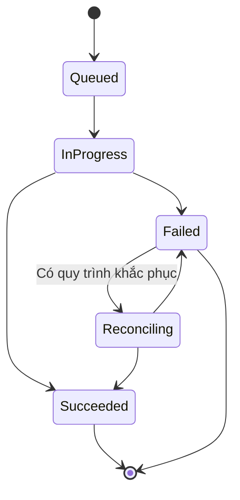
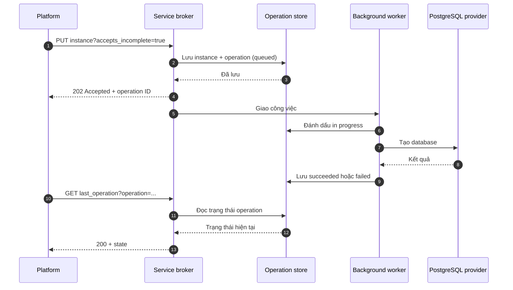

# Hợp đồng phản hồi đồng bộ, bất đồng bộ và lỗi giao thức

Một service broker giao tiếp với nền tảng qua Open Service Broker API (OSB API). Hợp đồng này không chỉ quy định URL và HTTP method mà còn quy định broker phải phản hồi thế nào khi thao tác hoàn tất ngay, khi thao tác cần thêm thời gian và khi có lỗi. Nền tảng dựa vào status code, response body và header để quyết định có thể tiếp tục, cần polling hay phải dừng và báo lỗi cho người dùng.

Trong module `SPRING_CLOUD_SERVICE_BROKER`, các handler được xây dựng bằng Spring Cloud Open Service Broker cần tuân thủ hợp đồng phản hồi của OSB API. Việc trả đúng HTTP response giúp Cloud Foundry hoặc một nền tảng tương thích hiểu được kết quả provision, update, deprovision, bind và unbind. Nó cũng là cơ sở để broker quản lý operation, retry an toàn và cung cấp thông tin lỗi có thể vận hành mà không làm lộ dữ liệu nhạy cảm.

## Mục tiêu học tập

Sau bài này, bạn có thể:

- Phân biệt phản hồi đồng bộ và bất đồng bộ ở cấp độ OSB API.
- Chọn đúng ý nghĩa của các status code thành công như `200`, `201`, `202` và `204` theo loại thao tác.
- Giải thích cách `accepts_incomplete`, `operation` và endpoint `last_operation` phối hợp để theo dõi một thao tác dài.
- Nhận biết các trạng thái `in progress`, `succeeded` và `failed`, cùng vai trò của `Retry-After`.
- Thiết kế error response theo định dạng OSB API và ánh xạ lỗi nghiệp vụ sang HTTP phù hợp.
- Xử lý retry, request lặp và lỗi xảy ra sau khi broker đã tiếp nhận thao tác.
- Phân biệt bất đồng bộ của giao thức OSB với reactive pipeline của Reactor.

## 1. Response là một phần của hợp đồng OSB API

Một request chỉ được xem là xử lý đúng khi broker thực hiện hành vi được yêu cầu và trả response phù hợp với hợp đồng. Ví dụ, `PUT` provision có thể tạo instance ngay hoặc tiếp nhận một operation chạy nền. Hai trường hợp này có kết quả HTTP khác nhau để nền tảng biết phải làm gì tiếp theo.

Response HTTP có ba phần cần đọc cùng nhau:

| Thành phần | Vai trò |
|---|---|
| Status code | Cho biết request đã thành công, được tiếp nhận để xử lý hay thất bại. |
| Header | Mang metadata như content type và thời điểm nên polling tiếp. |
| Body | Chứa dữ liệu nghiệp vụ như catalog, credentials, operation ID hoặc thông tin lỗi. |

OSB API sử dụng header `X-Broker-API-Version` để hai bên thống nhất phiên bản giao thức. Với response có JSON body, broker cần trả `Content-Type: application/json`. Một response có status code đúng nhưng body sai cấu trúc vẫn có thể khiến platform không thể tiếp tục quy trình.

Không nên dùng một status code thành công duy nhất cho mọi tình huống. `201 Created` thể hiện tài nguyên vừa được tạo; `202 Accepted` thể hiện broker đã tiếp nhận công việc nhưng chưa hoàn tất; `204 No Content` thể hiện thành công mà không cần body. Ý nghĩa chính xác còn phụ thuộc endpoint.

## 2. Phản hồi đồng bộ

Một thao tác là đồng bộ ở cấp giao thức khi broker hoàn tất công việc cần thiết trước khi trả response cuối cùng. Nền tảng nhận được kết quả và có thể chuyển sang bước kế tiếp mà không cần gọi endpoint polling.

Ví dụ, broker có thể đọc catalog từ cấu hình đã nạp trong bộ nhớ và trả ngay danh sách service, hoặc tạo một binding nhanh chóng khi backing service đáp ứng trong thời gian cho phép.

### 2.1. Đọc catalog

Request:

```http
GET /v2/catalog HTTP/1.1
Host: broker.example.internal
X-Broker-API-Version: 2.17
Accept: application/json
Authorization: Basic <credentials>
```

Khi thành công, broker trả `200 OK` và một JSON object chứa danh sách `services` cùng các plan mà broker công bố. Ví dụ rút gọn:

```http
HTTP/1.1 200 OK
Content-Type: application/json

{
  "services": [
    {
      "id": "postgres-service",
      "name": "postgresql",
      "description": "Managed PostgreSQL",
      "bindable": true,
      "plans": [
        {
          "id": "small-plan",
          "name": "small",
          "description": "Development database"
        }
      ]
    }
  ]
}
```

Catalog không phải là response của một operation dài. Platform có thể lưu hoặc làm mới catalog theo quy trình riêng. Broker nên giữ các ID service và plan ổn định vì platform sẽ gửi lại các ID đó trong những request vòng đời.

### 2.2. Provision hoàn tất đồng bộ

Platform yêu cầu tạo service instance bằng `PUT`:

```http
PUT /v2/service_instances/instance-123 HTTP/1.1
X-Broker-API-Version: 2.17
Content-Type: application/json
Authorization: Basic <credentials>

{
  "service_id": "postgres-service",
  "plan_id": "small-plan",
  "organization_guid": "org-42",
  "space_guid": "space-dev",
  "parameters": {
    "database_name": "orders"
  }
}
```

Nếu broker tạo xong instance ngay, response thành công thông thường là `201 Created`. Theo hợp đồng provision, response body có thể rỗng; platform hiểu rằng instance đã được provision thành công dựa trên status code. Broker không cần trả credentials của ứng dụng trong response provision, vì credentials thường được cấp ở bước bind.

Nếu cùng `instance_id` được gửi lại sau khi instance đã được tạo với cùng cấu hình, broker trả `200 OK` để thể hiện request lặp đã được đáp ứng; broker không tạo thêm tài nguyên. Nếu định danh đó đang đại diện cho cấu hình không tương thích, broker trả `409 Conflict` thay vì ghi đè âm thầm. Nếu operation đầu tiên vẫn đang chạy, broker cần phản hồi nhất quán với operation hiện có, không khởi chạy một lần provision thứ hai.

### 2.3. Update hoàn tất đồng bộ

Platform dùng `PATCH /v2/service_instances/{instance_id}` để yêu cầu thay đổi plan hoặc tham số được dịch vụ hỗ trợ. Khi thay đổi hoàn tất ngay, broker trả `200 OK`. Response body không cần chứa toàn bộ instance; platform biết yêu cầu cập nhật đã thành công qua status code.

Broker cần xác minh instance tồn tại, service/plan hợp lệ, plan mới có thể cập nhật và trạng thái hiện tại cho phép thay đổi. Nếu thao tác update không được hỗ trợ hoặc yêu cầu vi phạm chính sách, broker trả error response theo hợp đồng thay vì giả vờ cập nhật thành công.

### 2.4. Deprovision hoàn tất đồng bộ

Platform yêu cầu xóa instance qua `DELETE /v2/service_instances/{instance_id}` cùng các query parameter nhận diện service và plan theo hợp đồng. Khi tài nguyên đã được thu hồi thành công, broker trả `200 OK`. Một số lỗi trạng thái, chẳng hạn instance đã không còn tồn tại, được biểu diễn theo response code dành cho endpoint deprovision, thường là `410 Gone`.

Deprovision có thể gồm nhiều bước: ngừng quyền truy cập, xóa database, giải phóng địa chỉ và cập nhật kho trạng thái. Chỉ trả thành công sau khi broker đã đạt điều kiện hoàn tất mà nó cam kết với platform. Nếu còn công việc dài chưa hoàn tất, broker cần dùng cơ chế bất đồng bộ khi platform cho phép.

### 2.5. Bind và unbind

Bind tạo một quan hệ truy cập giữa consumer và service instance. Khi tạo binding thành công, broker trả `201 Created` cùng response JSON có thể chứa object `credentials` và các thông tin kết nối mà dịch vụ hỗ trợ.

```http
HTTP/1.1 201 Created
Content-Type: application/json

{
  "credentials": {
    "uri": "postgresql://db.example.internal:5432/orders",
    "username": "orders_app_123",
    "password": "<secret>",
    "sslmode": "require"
  }
}
```

Nếu binding đã tồn tại với cùng thông tin yêu cầu, broker trả `200 OK` cùng kết quả binding hiện có, bao gồm credentials cần thiết theo hợp đồng; không tạo thêm user hoặc secret. Nếu cùng `binding_id` được dùng với dữ liệu không tương thích, broker trả `409 Conflict`. Credentials phải được bảo vệ trong toàn bộ quá trình tạo, lưu và trả về.

Unbind thu hồi quyền truy cập đã cấp cho binding. Khi hoàn tất đồng bộ, broker trả `200 OK`; nếu binding không tồn tại, response cần phản ánh trạng thái đó theo hợp đồng unbind, thường là `410 Gone`. Unbind không tự động có nghĩa là deprovision instance: một instance có thể tiếp tục tồn tại sau khi một binding bị thu hồi.

Các thao tác binding/unbinding được xử lý như request đồng bộ trong luồng OSB API thông dụng; endpoint `last_operation` dành cho các thao tác vòng đời instance như provision, update và deprovision, không phải cơ chế polling chung cho mọi request HTTP.

## 3. Phản hồi bất đồng bộ

Tạo một database lớn, mở rộng cụm hoặc xóa một tài nguyên có thể mất nhiều thời gian. Nếu broker giữ kết nối HTTP cho đến khi mọi việc kết thúc, request dễ timeout. Platform có thể không biết thao tác đã chạy đến đâu và có thể gửi lại yêu cầu, làm tăng nguy cơ tài nguyên trùng lặp.

OSB API cung cấp cơ chế bất đồng bộ cho các thao tác instance có thể mất thời gian. Platform cho biết nó chấp nhận xử lý bất đồng bộ bằng query parameter `accepts_incomplete=true`. Broker chỉ nên trả trạng thái tiếp nhận bất đồng bộ khi request cho phép và broker thực sự có thể theo dõi operation đến trạng thái cuối.

### 3.1. Thương lượng khả năng bất đồng bộ

Ví dụ request provision cho phép xử lý bất đồng bộ:

```http
PUT /v2/service_instances/instance-123?accepts_incomplete=true HTTP/1.1
X-Broker-API-Version: 2.17
Content-Type: application/json
Authorization: Basic <credentials>

{
  "service_id": "postgres-service",
  "plan_id": "large-plan",
  "organization_guid": "org-42",
  "space_guid": "space-prod"
}
```

Nếu broker có thể hoàn tất ngay, nó vẫn có thể trả response đồng bộ. Nếu cần chạy nền, broker tiếp nhận yêu cầu, lưu operation và trả `202 Accepted`. Nếu thao tác bắt buộc phải chạy bất đồng bộ nhưng request không cho phép, broker phải từ chối theo hợp đồng, thường bằng `422 Unprocessable Entity`, thay vì giữ request mở vô thời hạn hoặc báo thành công giả.

`accepts_incomplete` là cơ chế thương lượng ở tầng giao thức. Nó không tự tạo worker, queue hoặc kho trạng thái; ứng dụng broker phải cung cấp các thành phần đó.

### 3.2. Response `202 Accepted` và operation ID

Ví dụ response khi broker đã nhận việc:

```http
HTTP/1.1 202 Accepted
Content-Type: application/json
Retry-After: 5

{
  "operation": "provision-2026-000123"
}
```

`202 Accepted` có nghĩa broker đã tiếp nhận yêu cầu; nó không có nghĩa database đã sẵn sàng. `operation` là mã do broker tạo để phân biệt công việc đang chạy. Platform giữ mã này và gửi lại trong request polling tiếp theo. Header `Retry-After` gợi ý khoảng thời gian chờ trước lần polling kế tiếp; broker nên cung cấp giá trị hợp lý để tránh platform hỏi quá dày.

Trường `operation` có thể được bỏ qua theo quy tắc của OSB API. Khi broker không trả operation ID, broker phải bảo đảm chỉ có một operation đang hoạt động cho một service instance tại một thời điểm, để endpoint `last_operation` có thể xác định duy nhất công việc cần trả lời. Trong thực tế, trả một operation ID ổn định thường giúp quản lý nhiều lần cập nhật và đối soát rõ ràng hơn.

### 3.3. Platform polling `last_operation`

Sau khi nhận `202 Accepted`, platform gọi endpoint `last_operation` để kiểm tra trạng thái. Request có thể mang `service_id`, `plan_id` và `operation` trong query string:

```http
GET /v2/service_instances/instance-123/last_operation?service_id=postgres-service&plan_id=large-plan&operation=provision-2026-000123 HTTP/1.1
X-Broker-API-Version: 2.17
Authorization: Basic <credentials>
```

Khi operation vẫn đang chạy, broker trả `200 OK` với trạng thái `in progress`:

```http
HTTP/1.1 200 OK
Content-Type: application/json
Retry-After: 5

{
  "state": "in progress",
  "description": "Đang tạo database và cấu hình quyền truy cập"
}
```

Khi hoàn tất thành công:

```http
HTTP/1.1 200 OK
Content-Type: application/json

{
  "state": "succeeded",
  "description": "Database đã sẵn sàng"
}
```

Khi thao tác thất bại:

```http
HTTP/1.1 200 OK
Content-Type: application/json

{
  "state": "failed",
  "description": "Không thể cấp phát tài nguyên theo cấu hình yêu cầu"
}
```

Ba giá trị trạng thái mà platform cần hiểu là:

| `state` | Ý nghĩa | Hành vi tiếp theo của platform |
|---|---|---|
| `in progress` | Broker vẫn đang thực hiện operation. | Chờ theo `Retry-After` hoặc chính sách polling rồi hỏi lại. |
| `succeeded` | Operation đã hoàn tất thành công. | Dừng polling và tiếp tục vòng đời dịch vụ. |
| `failed` | Operation đã kết thúc nhưng không thành công. | Dừng polling và xử lý lỗi theo trạng thái cuối. |

`description` là trường mô tả tùy chọn, hữu ích cho vận hành và hiển thị trạng thái. Không đưa password, token, URL nội bộ nhạy cảm hoặc stack trace vào trường này. Với một operation đã ở trạng thái cuối, broker phải giữ kết quả đủ ổn định để các lần polling lặp lại không làm thay đổi ý nghĩa lịch sử của operation.

### 3.4. Operation type và vòng đời trạng thái

Endpoint `last_operation` được dùng để theo dõi thao tác instance tương ứng. Ở phía broker, cần lưu loại thao tác đang thực hiện, chẳng hạn `create`, `update` hoặc `delete`. Platform gửi `service_id`, `plan_id` và giá trị `operation` mà broker đã trả trước đó; broker dùng instance ID cùng các giá trị này để tra cứu đúng operation. `operation` là mã opaque do broker định nghĩa, không phải một enum cố định mà platform tự suy ra.

Một mô hình trạng thái nội bộ có thể như sau:



`Queued`, `InProgress` và `Reconciling` là ví dụ trạng thái nội bộ. Khi trả qua OSB API, broker ánh xạ chúng về `in progress` cho đến khi operation đạt trạng thái cuối `succeeded` hoặc `failed`. Không trả một trạng thái nội bộ tùy ý như `waiting_for_provider` trong field `state` của giao thức.

Broker nên lưu operation bền vững cùng instance ID, loại thao tác, operation ID, thời điểm bắt đầu, lần cập nhật gần nhất và kết quả. Nếu broker có nhiều replica, mọi replica phải đọc được cùng trạng thái. Không dựa vào biến trong bộ nhớ của một tiến trình để trả lời polling.

## 4. Hợp đồng lỗi giao thức

Không phải request nào cũng có thể thực hiện. Broker có thể nhận request sai cấu trúc, thiếu thông tin xác thực, không tìm thấy service/plan, gặp xung đột trạng thái hoặc không kết nối được nhà cung cấp. OSB API yêu cầu broker thể hiện lỗi bằng HTTP status phù hợp và error response có cấu trúc.

### 4.1. Cấu trúc error response

Một error response OSB API thường có JSON object với trường `error` và có thể có `description`:

```http
HTTP/1.1 422 Unprocessable Entity
Content-Type: application/json

{
  "error": "AsyncRequired",
  "description": "Thao tác cần xử lý bất đồng bộ nhưng request không cho phép accepts_incomplete"
}
```

- `error` là mã lỗi dạng chuỗi để client hoặc hệ thống vận hành phân loại tình huống.
- `description` là mô tả dễ hiểu, có thể hỗ trợ người vận hành tìm nguyên nhân.
- Status code vẫn là tín hiệu chính để phân biệt nhóm lỗi ở cấp HTTP; không nên yêu cầu client phân tích văn bản description để quyết định retry.

Tên `AsyncRequired` trong ví dụ là mã minh họa do broker định nghĩa, không phải một giá trị bắt buộc chung của OSB API. Các mã lỗi tùy chỉnh nên ổn định, có tài liệu và không chứa dữ liệu nhạy cảm.

### 4.2. Các nhóm status code lỗi

| Status | Ý nghĩa thường gặp | Ví dụ trong broker |
|---|---|---|
| `400 Bad Request` | Request không hợp lệ về cú pháp hoặc cấu trúc. | JSON không parse được, thiếu field bắt buộc hoặc query parameter sai định dạng. |
| `401 Unauthorized` | Xác thực thất bại. | Thiếu hoặc sai thông tin Basic Authentication. |
| `403 Forbidden` | Client không được phép thực hiện thao tác. | Danh tính đã xác thực nhưng không có quyền trên phạm vi tài nguyên. |
| `404 Not Found` | Không tìm thấy endpoint hoặc đối tượng theo ngữ cảnh API. | Service/plan hoặc instance không được tìm thấy theo quy tắc endpoint. |
| `409 Conflict` | Request xung đột với tài nguyên hoặc trạng thái hiện tại. | Instance ID đã gắn với cấu hình khác hoặc thao tác xung đột. |
| `410 Gone` | Tài nguyên đã không còn tồn tại trong một số thao tác thu hồi. | Instance khi deprovision hoặc binding khi unbind đã biến mất. |
| `422 Unprocessable Entity` | Request có thể đọc được nhưng không thể xử lý theo điều kiện nghiệp vụ/hợp đồng. | Async cần thiết nhưng platform không cho phép, hoặc tham số không được hỗ trợ. |
| `5xx` | Lỗi phía broker hoặc dependency. | Lỗi không dự kiến, provider không khả dụng hoặc lỗi lưu trạng thái. |

Đây là bảng định hướng đọc lỗi. Status code chính xác được phép cho từng endpoint phải theo phiên bản OSB API đang triển khai. Ví dụ, `410 Gone` có ý nghĩa đặc biệt ở deprovision/unbind; không nên dùng nó thay cho mọi trường hợp “không tìm thấy”. Tương tự, `409 Conflict` nên dành cho xung đột trạng thái hoặc định danh, không dùng để báo mọi lỗi nghiệp vụ.

### 4.3. Ánh xạ lỗi nội bộ sang lỗi giao thức

Broker thường có nhiều loại exception nội bộ, nhưng không nên để exception Java tự động quyết định response API. Hãy có một lớp ánh xạ lỗi có chủ đích:

| Lỗi nội bộ | Phản hồi giao thức có thể phù hợp | Lưu ý |
|---|---|---|
| JSON không hợp lệ | `400 Bad Request` | Không cần gọi provider. |
| Client chưa xác thực | `401 Unauthorized` | Không tiết lộ credential đúng/sai trong description. |
| Không có quyền | `403 Forbidden` | Ghi audit theo chính sách. |
| ID không tồn tại | `404` hoặc status riêng của endpoint | Phải xét endpoint và quy tắc OSB API. |
| ID tồn tại nhưng cấu hình xung đột | `409 Conflict` | Không ghi đè tài nguyên đang có. |
| Yêu cầu async không được chấp nhận | `422 Unprocessable Entity` | Không để thao tác nền chạy ngoài hợp đồng. |
| Provider timeout hoặc không khả dụng | `5xx` hoặc trạng thái operation `failed` | Phụ thuộc thời điểm lỗi xảy ra và thao tác đã được tiếp nhận hay chưa. |
| Lỗi lập trình không dự kiến | `500 Internal Server Error` | Log chi tiết nội bộ có kiểm soát; response không chứa stack trace. |

Nếu lỗi xảy ra trước khi broker tiếp nhận operation, broker trả error response HTTP tương ứng. Nếu broker đã trả `202 Accepted` và lỗi xuất hiện trong quá trình chạy nền, platform cần nhận trạng thái `failed` từ `last_operation`. Không thể thay response `202` đã gửi trước đó bằng một HTTP status mới trên kết nối cũ.

### 4.4. Không để lộ thông tin nội bộ

Một error response tốt giúp người gọi biết điều gì cần sửa mà không tiết lộ thông tin có thể bị khai thác. Không trả stack trace, SQL statement chứa dữ liệu, password, access token, địa chỉ nội bộ hoặc nội dung exception thô cho platform.

Broker có thể ghi log chi tiết hơn ở phía server, nhưng phải loại bỏ secret và dữ liệu nhạy cảm. Nên gắn correlation ID hoặc operation ID vào log để đội vận hành tìm được request tương ứng. `description` nên ngắn, ổn định và hướng tới hành động tiếp theo, ví dụ “plan không hỗ trợ cập nhật” hoặc “provider tạm thời không khả dụng”.

## 5. Retry, idempotency và lỗi xảy ra giữa chừng

Trong hệ thống phân tán, platform có thể mất kết nối sau khi gửi request nhưng trước khi nhận response. Khi đó platform không biết broker đã thực hiện thao tác hay chưa. Một broker đáng tin cậy phải thiết kế response và trạng thái sao cho request lặp không làm hỏng vòng đời tài nguyên.

### 5.1. Không đồng nhất timeout với thất bại

Giả sử broker nhận provision, provider tạo xong database nhưng response từ provider bị timeout. Broker chưa thể kết luận database chưa tồn tại. Nếu gọi lại lệnh tạo mới ngay, có thể phát sinh database thứ hai hoặc lỗi trùng tên.

Một quy trình an toàn hơn:

1. Dùng `instance_id` làm định danh ổn định cho yêu cầu provision.
2. Ghi nhận operation và trạng thái trước khi gọi provider.
3. Truyền idempotency key hoặc resource name ổn định tới provider nếu API của provider hỗ trợ.
4. Nếu kết quả không rõ ràng, tra cứu resource theo định danh đã lưu trước khi tạo lại.
5. Cập nhật operation khi đã xác định được trạng thái cuối.

### 5.2. Request lặp và xung đột

| Tình huống | Cách xử lý mong đợi |
|---|---|
| Provision lặp cùng `instance_id`, cùng cấu hình và operation đã thành công | Trả kết quả idempotent theo endpoint; không tạo tài nguyên thứ hai. |
| Provision lặp cùng ID trong khi operation đang chạy | Trả trạng thái/response nhất quán với operation hiện có; không khởi chạy bản sao. |
| Provision cùng ID nhưng service/plan/parameters không tương thích | Báo xung đột theo hợp đồng. |
| Bind lặp cùng `binding_id` và cùng yêu cầu | Trả lại kết quả binding hiện có theo quy tắc idempotent; không tạo user mới ngoài ý muốn. |
| Unbind hoặc deprovision được gửi lại | Đối chiếu trạng thái đã lưu và trả response đúng quy tắc endpoint. |

Idempotency phải được bảo vệ bằng kho trạng thái dùng chung, unique constraint hoặc cơ chế đồng bộ phù hợp. Chỉ kiểm tra một biến trong bộ nhớ không đủ khi broker chạy nhiều replica.

### 5.3. Operation đã tiếp nhận nhưng thất bại

Sau khi trả `202 Accepted`, broker có trách nhiệm tiếp tục cập nhật trạng thái operation. Nếu provider từ chối tạo database, broker chuyển operation sang `failed` và lưu nguyên nhân nội bộ. Khi platform polling, broker trả `200 OK` với `state: failed` và mô tả phù hợp.

Nếu provider đã tạo một phần tài nguyên trước khi lỗi, broker cần có chiến lược bù trừ hoặc đối soát. Ví dụ, database đã tạo nhưng không tạo được user thì broker có thể thử lại bước tạo user, hoặc xóa database dở dang nếu chính sách cho phép. Kết quả cuối cùng phải phản ánh đúng trạng thái tài nguyên thực tế; không trả `succeeded` chỉ vì một bước trong chuỗi đã thành công.

### 5.4. Polling có kiểm soát

Platform không nên gọi `last_operation` liên tục với tần suất quá cao. Broker có thể trả `Retry-After` để gợi ý thời điểm polling. Với operation lâu, nên có giới hạn tần suất, theo dõi thời gian chạy và chính sách xử lý operation bị treo. Broker cần bảo đảm các replica cùng trả một trạng thái nhất quán cho cùng operation ID.

## 6. Bất đồng bộ của OSB API và reactive của Reactor

Hai khái niệm này có liên quan nhưng nằm ở hai tầng khác nhau:

| Khái niệm | Câu hỏi được trả lời | Ví dụ |
|---|---|---|
| Reactive với Reactor | Ứng dụng tổ chức việc chờ và kết hợp các lời gọi I/O trong tiến trình như thế nào? | Handler trả `Mono<ProvisionResponse>` và nối lời gọi provider bằng `flatMap`. |
| Async operation của OSB API | Platform biết request đã hoàn tất hay vẫn đang chạy bằng hợp đồng HTTP nào? | Broker trả `202 Accepted`, operation ID và hỗ trợ `last_operation`. |

Một handler có thể dùng Reactor nhưng vẫn hoàn tất đồng bộ ở cấp OSB API: pipeline kết thúc trước khi handler trả response `201 Created`. Ngược lại, broker có thể tiếp nhận operation nền và trả `202 Accepted`; worker nội bộ có thể dùng Reactor hoặc cơ chế queue/thread khác để thực thi. `Mono` không tự động biến response thành `202`, và `202` cũng không bắt buộc broker phải dùng `Flux`.

Khi triển khai Spring Cloud Open Service Broker, cần tách rõ kiểu trả về của handler theo thư viện, cách framework chuyển kết quả thành HTTP response và cơ chế lưu/truy vấn trạng thái operation. Hãy dùng extension point của phiên bản thư viện đã chọn và kiểm tra response thực tế bằng integration test.

## 7. Ví dụ tổng hợp: provision database bất đồng bộ

Giả sử platform yêu cầu tạo PostgreSQL instance cỡ lớn. Broker không thể hoàn tất trong thời gian request thông thường nên cần async.



Trình tự xử lý cần bảo đảm operation được lưu bền vững trước khi broker trả `202`. Nếu broker trả `202` nhưng chưa lưu được operation, platform sẽ polling một mã không tồn tại. Worker phải cập nhật trạng thái sau khi gọi provider và ghi nhận kết quả đủ để platform có thể polling từ bất kỳ replica nào.

Nếu platform gửi lại request do mất response, broker tra cứu `instance_id` và operation hiện tại. Nếu operation đã tồn tại, broker trả lời nhất quán thay vì tạo công việc mới. Nếu cùng ID nhưng dữ liệu request khác, broker phản hồi xung đột.

## 8. Checklist kiểm tra response contract

Trước khi hoàn thành một handler OSB API, hãy kiểm tra:

- [ ] Status code phản ánh đúng việc đã hoàn tất, được tiếp nhận hay thất bại.
- [ ] Response body đúng schema của endpoint; không thêm dữ liệu nội bộ không thuộc hợp đồng.
- [ ] Response JSON có `Content-Type` phù hợp.
- [ ] Request async chỉ được chấp nhận khi platform cho phép bằng `accepts_incomplete=true`.
- [ ] `202 Accepted` có operation tracking phù hợp; operation ID ổn định nếu được trả về.
- [ ] `last_operation` trả đúng `in progress`, `succeeded` hoặc `failed`.
- [ ] `Retry-After` được dùng hợp lý để điều tiết polling.
- [ ] Error response có mã lỗi ổn định và mô tả an toàn.
- [ ] Lỗi sau khi đã trả `202` được thể hiện qua trạng thái operation.
- [ ] Retry cùng định danh không tạo instance hoặc binding trùng lặp.
- [ ] Các endpoint bind/unbind được xử lý theo hợp đồng đồng bộ và vòng đời binding riêng.
- [ ] Không có secret, stack trace hoặc thông tin nội bộ nhạy cảm trong response/log.

## 9. Bài tập tự luyện

### Bài tập 1: Chọn response phù hợp

Một request provision mất khoảng hai phút. Platform gửi `accepts_incomplete=true`. Broker đã ghi operation vào kho trạng thái và giao worker thực hiện. Hãy xác định status code, response body và header nào giúp platform biết cần polling.

### Bài tập 2: Phân biệt lỗi HTTP và lỗi operation

Broker trả `202 Accepted` cho request provision. Sau đó provider từ chối tạo database vì quota đã hết. Hãy mô tả response mà platform nhận được ở lần polling tiếp theo. Vì sao broker không thể đổi response HTTP `202` đã gửi thành `422`?

### Bài tập 3: Xử lý request lặp

Platform gửi hai lần provision với cùng `instance_id`. Lần đầu provider đã tạo database nhưng broker mất response do timeout. Hãy đề xuất cách broker kiểm tra tài nguyên hiện có, tránh tạo database thứ hai và cập nhật operation.

### Bài tập 4: Thiết kế error object

Một client đã xác thực nhưng không có quyền xóa instance thuộc tenant khác. Hãy chọn nhóm status code phù hợp, viết JSON error response ngắn và liệt kê dữ liệu nào không được đưa vào `description`.

## Kết luận

Hợp đồng response OSB API cho nền tảng biết thao tác đã hoàn tất, đang được xử lý hay thất bại. Thao tác đồng bộ trả status thành công phù hợp với endpoint; thao tác dài được thương lượng bằng `accepts_incomplete=true`, tiếp nhận bằng `202 Accepted` và theo dõi qua `last_operation`. Khi lỗi xảy ra, broker phải ánh xạ đúng HTTP status và error object; nếu lỗi xuất hiện sau khi operation đã được tiếp nhận, trạng thái cuối `failed` là nơi platform nhận kết quả. Kết hợp response contract với operation store bền vững, polling có kiểm soát và idempotency giúp broker Spring Cloud vận hành đáng tin cậy trước timeout, retry và lỗi từ backing service.
