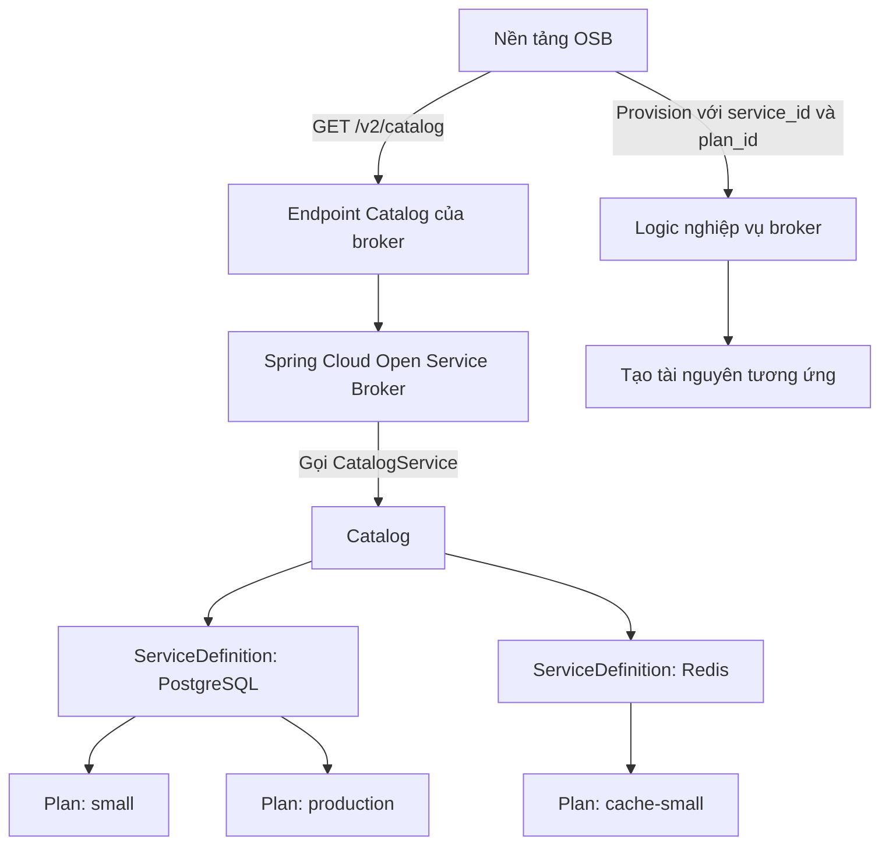

# Cấu trúc Catalog, ServiceDefinition và Plan

Service broker theo Open Service Broker API (OSB API) cần công bố một danh mục để nền tảng như Cloud Foundry hoặc Kubernetes biết broker cung cấp những dịch vụ nào và người dùng có thể chọn cấu hình nào. Danh mục này được gọi là *service catalog*. Trong Spring Cloud Open Service Broker, catalog được biểu diễn bằng các model như `Catalog`, `ServiceDefinition` và `Plan`, sau đó được cung cấp cho lớp giao thức thông qua bean `CatalogService`.

Ba khái niệm có quan hệ phân cấp. `Catalog` là tập hợp các dịch vụ mà broker công bố. Mỗi `ServiceDefinition` mô tả một loại dịch vụ, chẳng hạn PostgreSQL hoặc Redis. Mỗi service definition chứa một hoặc nhiều `Plan`, mô tả các biến thể cung cấp của dịch vụ đó như dung lượng, hiệu năng, tính năng, khu vực hoặc mức dịch vụ. Nền tảng đọc cấu trúc này để hiển thị lựa chọn; khi người dùng chọn một plan và yêu cầu tạo instance, broker dùng các định danh tương ứng để thực hiện nghiệp vụ.

## 1. Vai trò của service catalog trong kiến trúc broker

Catalog là hợp đồng công bố dịch vụ giữa broker và nền tảng. Nó trả lời ba câu hỏi: broker có dịch vụ gì, mỗi dịch vụ có những plan nào và các khả năng nào được hỗ trợ. Catalog không phải là nơi thực hiện cấp phát tài nguyên. Nó mô tả những gì broker có thể cung cấp để nền tảng đưa ra lựa chọn phù hợp.

Luồng tổng quát:



Nền tảng thường truy vấn endpoint catalog, đọc danh sách service và plan, sau đó cho người dùng chọn một cặp định danh. Trong yêu cầu provision, nền tảng gửi `service_id` và `plan_id` cùng `instance_id`, tham số và context liên quan. Broker phải tra cứu các định danh này trong cấu hình catalog hoặc registry tương ứng, kiểm tra chính sách rồi mới cấp phát.

Vì catalog ảnh hưởng trực tiếp đến lựa chọn của người dùng và những yêu cầu vòng đời về sau, dữ liệu công bố cần ổn định, nhất quán với khả năng thật của broker và tương thích qua các lần phát hành.

## 2. Cấu trúc phân cấp Catalog, ServiceDefinition và Plan

### 2.1 Catalog: tập hợp các dịch vụ được công bố

`Catalog` là đối tượng cấp cao nhất chứa danh sách service definition. Một broker có thể công bố một dịch vụ hoặc nhiều dịch vụ độc lập. Ví dụ, broker quản lý hạ tầng dữ liệu có thể công bố PostgreSQL, Redis và object storage trong cùng catalog.

Ở cấp giao thức, nền tảng đọc danh sách này qua endpoint catalog của OSB API, thường là `GET /v2/catalog`. Spring Cloud Open Service Broker cung cấp model `Catalog` và cơ chế tích hợp endpoint; ứng dụng broker cung cấp bean catalog thông qua `CatalogService`.

Catalog nên được xem như cấu hình công bố có kiểm soát. Nếu danh sách dịch vụ được tạo từ database hoặc cấu hình bên ngoài, broker vẫn cần xác thực dữ liệu trước khi trả về. Không đưa credential, token, địa chỉ nội bộ nhạy cảm hoặc thông tin tenant riêng vào catalog vì nội dung này có thể được nền tảng lưu và hiển thị cho người dùng.

### 2.2 ServiceDefinition: một loại dịch vụ

`ServiceDefinition` mô tả một sản phẩm dịch vụ mà broker cung cấp. Ví dụ `managed-postgresql` là một loại dịch vụ cơ sở dữ liệu PostgreSQL được broker quản lý. Định nghĩa dịch vụ có các thông tin chính:

- `id`: định danh duy nhất, ổn định của service trong broker. Đây là khóa mà nền tảng gửi lại trong các thao tác vòng đời.
- `name`: tên ngắn để nền tảng và người dùng nhận biết dịch vụ.
- `description`: mô tả nội dung và mục đích của dịch vụ.
- `bindable`: cho biết dịch vụ có hỗ trợ tạo binding hay không.
- `plans`: danh sách plan mà dịch vụ cung cấp.
- `tags`: các từ khóa phân loại hoặc hỗ trợ tìm kiếm.
- `requires`: các tính năng hoặc khả năng đặc biệt mà dịch vụ yêu cầu từ nền tảng, nếu có.
- `metadata`: thông tin bổ sung phục vụ hiển thị hoặc tích hợp giao diện.
- Các cờ khả năng như `instances_retrievable`, `bindings_retrievable` và `plan_updateable` mô tả những thao tác mà broker hỗ trợ theo hợp đồng OSB API.

Không phải mọi trường đều có cùng mức bắt buộc trong mọi phiên bản OSB API hoặc model của thư viện. Khi triển khai, cần đối chiếu phiên bản API và phiên bản Spring Cloud Open Service Broker đang dùng. Các trường cờ khả năng phải phản ánh hành vi đã triển khai, không phải mục tiêu dự kiến.

### 2.3 Plan: một cấu hình cung cấp của dịch vụ

`Plan` mô tả một biến thể cụ thể của service. Với PostgreSQL, broker có thể công bố plan `small` cho môi trường thử nghiệm và plan `production` cho hệ thống cần dung lượng, hiệu năng và độ sẵn sàng cao hơn. Với Redis, các plan có thể khác nhau về bộ nhớ, chính sách persistence hoặc topology.

Các thuộc tính thường gặp của plan gồm:

- `id`: định danh ổn định của plan, được nền tảng gửi lại khi provision hoặc update.
- `name`: tên ngắn của plan.
- `description`: mô tả đặc điểm và giới hạn của plan.
- `free`: thông tin plan có miễn phí hay không theo hợp đồng API và phiên bản được sử dụng.
- `bindable`: thông tin khả năng binding ở cấp plan nếu phiên bản API/model hỗ trợ trường này; cần nhất quán với khả năng của service.
- `schemas`: schema mô tả tham số đầu vào được phép khi tạo hoặc cập nhật instance, và khi tạo binding nếu được hỗ trợ.
- `metadata`: thông tin bổ sung cho giao diện hoặc nền tảng.
- `maintenance_info`: thông tin phiên bản bảo trì nếu broker dùng cơ chế maintenance của API.

Plan cần mô tả một cấu hình mà broker có thể thực sự cấp phát. Ví dụ, plan `small` có thể ánh xạ đến cấu hình giới hạn CPU, RAM và dung lượng lưu trữ; plan `production` có thể ánh xạ đến cấu hình có backup và replica. Ý nghĩa cụ thể của từng plan phải được lưu trong registry hoặc cấu hình nghiệp vụ để provisioner dùng cùng một định nghĩa.

## 3. Ví dụ catalog theo cấu trúc OSB API

Ví dụ dưới đây minh họa một broker công bố dịch vụ PostgreSQL với hai plan. Các ID là giá trị minh họa; hệ thống thật cần tạo và duy trì định danh ổn định.

```json
{
  "services": [
    {
      "id": "7f2f4c70-3e1a-4e9b-9b5e-2b6e2e0a1001",
      "name": "managed-postgresql",
      "description": "Cơ sở dữ liệu PostgreSQL được quản lý",
      "bindable": true,
      "instances_retrievable": true,
      "bindings_retrievable": false,
      "plan_updateable": true,
      "plans": [
        {
          "id": "7f2f4c70-3e1a-4e9b-9b5e-2b6e2e0a2001",
          "name": "small",
          "description": "Dành cho thử nghiệm và tải nhỏ",
          "free": false,
          "metadata": {
            "displayName": "Small"
          }
        },
        {
          "id": "7f2f4c70-3e1a-4e9b-9b5e-2b6e2e0a2002",
          "name": "production",
          "description": "Dành cho ứng dụng production",
          "free": false,
          "metadata": {
            "displayName": "Production"
          }
        }
      ],
      "tags": ["database", "postgresql", "sql"],
      "requires": [],
      "metadata": {
        "displayName": "Managed PostgreSQL",
        "providerDisplayName": "Example Platform",
        "documentationUrl": "https://example.invalid/docs/postgresql"
      }
    }
  ]
}
```

Trong ví dụ, service có thể binding nên `bindable` được đặt là `true`. Broker cũng công bố khả năng truy xuất instance và khả năng cập nhật plan. Những giá trị này chỉ hợp lệ nếu handler tương ứng thực sự được triển khai và đáp ứng hợp đồng API. Nếu broker không hỗ trợ truy xuất binding, `bindings_retrievable` được đặt là `false`.

`metadata` giúp nền tảng trình bày thông tin thân thiện hơn, ví dụ tên hiển thị hoặc đường dẫn tài liệu. Các thuộc tính trong metadata thường phụ thuộc quy ước của nền tảng; không nên dùng metadata để thay thế những trường giao thức có ý nghĩa chuẩn như `id`, `bindable` hay `plan_updateable`.

## 4. Đăng ký CatalogService trong Spring Cloud Open Service Broker

Trong ứng dụng Spring, `CatalogService` là điểm mở rộng cung cấp catalog cho framework. Một implementation thường được đăng ký thành bean bằng `@Service` hoặc khai báo qua `@Bean` trong lớp `@Configuration`.

Ví dụ minh họa dùng builder của model thư viện:

```java
package com.example.broker.catalog;

import java.util.List;

import org.springframework.stereotype.Service;
import org.springframework.cloud.servicebroker.model.catalog.Catalog;
import org.springframework.cloud.servicebroker.model.catalog.Plan;
import org.springframework.cloud.servicebroker.model.catalog.ServiceDefinition;
import org.springframework.cloud.servicebroker.service.CatalogService;

@Service
public class BrokerCatalogService implements CatalogService {

    @Override
    public Catalog getCatalog() {
        Plan small = Plan.builder()
                .id("7f2f4c70-3e1a-4e9b-9b5e-2b6e2e0a2001")
                .name("small")
                .description("Dành cho thử nghiệm và tải nhỏ")
                .free(false)
                .build();

        Plan production = Plan.builder()
                .id("7f2f4c70-3e1a-4e9b-9b5e-2b6e2e0a2002")
                .name("production")
                .description("Dành cho ứng dụng production")
                .free(false)
                .build();

        ServiceDefinition postgresql = ServiceDefinition.builder()
                .id("7f2f4c70-3e1a-4e9b-9b5e-2b6e2e0a1001")
                .name("managed-postgresql")
                .description("Cơ sở dữ liệu PostgreSQL được quản lý")
                .bindable(true)
                .planUpdateable(true)
                .instancesRetrievable(true)
                .bindingsRetrievable(false)
                .plans(List.of(small, production))
                .tags(List.of("database", "postgresql", "sql"))
                .build();

        return Catalog.builder()
                .serviceDefinitions(List.of(postgresql))
                .build();
    }
}
```

Tên package, kiểu model và một số phương thức builder có thể thay đổi theo phiên bản thư viện. Hãy đối chiếu dependency thực tế trước khi dùng nguyên mã ví dụ. Đặc biệt, nếu phiên bản đang dùng có API reactive hoặc thay đổi tên phương thức, implementation phải theo đúng interface và model của phiên bản đó. Mục tiêu của ví dụ là thể hiện cách một bean `CatalogService` tạo `Catalog` gồm service definition và plan.

Nếu catalog lấy từ cấu hình, có thể tách phần dựng model sang `CatalogFactory` hoặc `CatalogRegistry`. Khi đó `CatalogService` chỉ gọi factory để lấy catalog đã được kiểm tra. Cách tách này tránh trộn dữ liệu catalog với lớp adapter của framework và giúp kiểm thử catalog mà không cần khởi động HTTP server.

## 5. Ánh xạ Plan sang chính sách cấp phát thực tế

Plan chỉ hữu ích khi broker hiểu và thực thi đúng ý nghĩa của nó. Không nên chỉ kiểm tra `plan_id` có xuất hiện trong request rồi chuyển nguyên request đến nhà cung cấp. Broker cần có một registry ánh xạ định danh plan sang chính sách tài nguyên.

Ví dụ:

| Plan ID | Tên plan | Cấu hình nghiệp vụ minh họa |
|---|---|---|
| `...2001` | `small` | 1 vCPU, 2 GB RAM, 20 GB lưu trữ, backup theo ngày |
| `...2002` | `production` | 4 vCPU, 16 GB RAM, 200 GB lưu trữ, backup và replica |

Trong ứng dụng, registry có thể biểu diễn cấu hình đó bằng một kiểu miền:

```java
public record DatabasePlan(
        String id,
        String name,
        int vcpu,
        int memoryGb,
        int storageGb,
        boolean backupEnabled,
        int replicaCount) {
}
```

Provision use case nhận `plan_id`, tra cứu plan trong registry, kiểm tra plan còn được phép cấp phát và dùng cấu hình đã xác thực để gọi provider adapter. Cần tránh tin các thông số tài nguyên do client tự gửi nếu các thông số đó phải do plan kiểm soát. Nếu cho phép người dùng truyền tham số tùy chỉnh, broker phải xác thực chúng theo schema và giới hạn của plan.

Khi update instance, broker cần kiểm tra service có công bố `plan_updateable` hay không và plan đích có được phép chuyển đổi từ plan hiện tại không. Cờ này thể hiện khả năng cập nhật plan ở cấp service; nó không có nghĩa mọi cặp plan đều có thể chuyển đổi hoặc mọi thay đổi đều không gây downtime. Chính sách chuyển đổi vẫn thuộc về broker.

## 6. Ý nghĩa các cờ khả năng của ServiceDefinition

Các cờ khả năng trong service definition ảnh hưởng cách nền tảng tương tác với broker. Cần hiểu rõ ý nghĩa trước khi bật:

| Trường | Ý nghĩa ở mức giao thức | Trách nhiệm cần có trong broker |
|---|---|---|
| `bindable` | Service có hỗ trợ tạo binding hay không | Triển khai bind/unbind và quản lý credential, quyền truy cập |
| `instances_retrievable` | Nền tảng có thể yêu cầu truy xuất thông tin service instance | Cung cấp handler truy vấn với dữ liệu phù hợp |
| `bindings_retrievable` | Nền tảng có thể yêu cầu truy xuất thông tin binding | Cung cấp handler truy vấn binding nếu công bố khả năng này |
| `plan_updateable` | Service cho phép yêu cầu thay đổi plan | Triển khai kiểm tra và thực hiện chuyển đổi plan |
| `requires` | Những khả năng nền tảng cần hỗ trợ cho service | Chỉ khai báo yêu cầu mà nền tảng đích có thể đáp ứng |

Một cờ đặt sai có thể khiến nền tảng gọi thao tác broker chưa hỗ trợ hoặc không cung cấp chức năng mà người dùng mong đợi. Vì vậy, catalog cần được kiểm thử cùng handler thực tế. Với service không bindable, đặt `bindable` thành `false` và không công bố một luồng binding giả định.

Trường `requires` thường dùng để khai báo các khả năng đặc biệt mà nền tảng cần cung cấp, chẳng hạn tích hợp log hoặc khả năng liên quan đến volume, tùy phiên bản OSB API. Không thêm giá trị chỉ vì broker có dùng một công nghệ nội bộ; chỉ khai báo khi đó là yêu cầu của hợp đồng giữa broker và nền tảng.

## 7. Schema tham số cho từng Plan

Một plan có thể công bố schema để nền tảng biết tham số nào được chấp nhận khi tạo hoặc cập nhật service instance, hoặc khi tạo binding. Schema giúp giao diện nền tảng tạo biểu mẫu phù hợp và giúp người dùng hiểu dữ liệu đầu vào.

Ví dụ schema tạo instance cho một dịch vụ PostgreSQL:

```json
{
  "service_instance": {
    "create": {
      "parameters": {
        "$schema": "http://json-schema.org/draft-07/schema#",
        "type": "object",
        "properties": {
          "database_name": {
            "type": "string",
            "pattern": "^[a-zA-Z][a-zA-Z0-9_]{0,62}$"
          },
          "region": {
            "type": "string",
            "enum": ["ap-southeast-1", "ap-southeast-2"]
          }
        },
        "required": ["database_name"],
        "additionalProperties": false
      }
    }
  }
}
```

Schema phải phù hợp với khả năng của nền tảng và phiên bản OSB API. Broker vẫn phải tự xác thực request ở phía server; không thể xem việc nền tảng đã hiển thị form theo schema là bằng chứng dữ liệu đầu vào an toàn. Kiểm tra kiểu, giới hạn, quyền, tenant và chính sách plan trước khi gọi provider.

Không đưa tham số bí mật như mật khẩu do người dùng tự đặt vào metadata hiển thị. Nếu một tham số nhạy cảm thực sự cần thiết, phải xem xét cách truyền, lưu, che log và xóa dữ liệu theo chính sách bảo mật.

## 8. Quy tắc định danh và tính ổn định của catalog

`service_id` và `plan_id` là khóa giao thức mà nền tảng sử dụng trong các yêu cầu sau này. Vì thế, chúng cần ổn định qua các lần phát hành. Có thể dùng UUID hoặc một định danh chuỗi được quản lý như hằng số; điều quan trọng là không tạo ID ngẫu nhiên mới mỗi lần ứng dụng khởi động.

Một số nguyên tắc cần tuân thủ:

1. Mỗi service có ID duy nhất trong phạm vi broker và mỗi plan có ID duy nhất trong phạm vi broker theo yêu cầu của OSB API.
2. Không dùng tên hiển thị làm khóa thay cho ID. Tên có thể được cải thiện để dễ đọc, nhưng ID đã được nền tảng lưu cần được duy trì.
3. Không tái sử dụng ID cũ cho một dịch vụ hoặc plan có ý nghĩa khác. Điều đó có thể khiến instance hiện hữu bị diễn giải sai.
4. Khi ngừng cung cấp plan, cần có chiến lược cho instance hiện hữu: tiếp tục hỗ trợ update/deprovision, đánh dấu plan ngừng cấp mới hoặc chuyển đổi có kiểm soát.
5. Thay đổi schema hoặc giới hạn plan cần được xem là thay đổi hợp đồng; phải đánh giá ảnh hưởng đến người dùng và nền tảng đang tích hợp.

Ví dụ, nếu plan `small` được đổi cấu hình từ 2 GB lên 4 GB, broker cần quyết định việc thay đổi chỉ áp dụng cho instance mới hay cả instance cũ. Nếu thay đổi ID của plan, nền tảng có thể không nhận diện được plan mà các instance cũ đang sử dụng. Catalog vì vậy cần được quản lý như một phần của API công khai.

## 9. Metadata, tags và khả năng hiển thị

`tags` giúp nền tảng hoặc giao diện tìm kiếm phân loại dịch vụ. Với PostgreSQL, các tag như `database`, `sql` và `postgresql` có thể giúp người dùng tìm đúng loại dịch vụ. Chỉ dùng tag mô tả đúng tính chất dịch vụ; không dùng tag để truyền chính sách phân quyền.

`metadata` cung cấp thông tin bổ sung như tên hiển thị, hình ảnh, mô tả dài, nhà cung cấp hoặc đường dẫn tài liệu. Cách nền tảng sử dụng từng thuộc tính metadata có thể khác nhau. Broker nên duy trì metadata gọn, chính xác, không chứa secret và không phụ thuộc vào việc mọi nền tảng đều hiểu cùng một khóa mở rộng.

`schemas` có thể giúp nền tảng xây dựng biểu mẫu cho tham số. `bullets` hoặc `costs` có thể được dùng bởi một số phiên bản API hoặc giao diện để trình bày lợi ích và chi phí của plan. Chỉ công bố chi phí khi dữ liệu có ý nghĩa rõ ràng và đồng nhất với mô hình tính phí thực tế. Không để mô tả marketing mâu thuẫn với giới hạn tài nguyên hoặc SLA mà broker thực thi.

## 10. Catalog tĩnh và catalog được tạo từ cấu hình

Với broker nhỏ, catalog có thể được khai báo tĩnh trong Java bằng builder hoặc file cấu hình. Cách này đơn giản, dễ kiểm tra và phù hợp khi danh mục thay đổi theo lần phát hành ứng dụng.

Với broker lớn hơn, có thể lưu định nghĩa service và plan trong cấu hình có phiên bản hoặc registry riêng. Khi đó cần chú ý:

- Validate dữ liệu registry khi nạp, bao gồm ID trùng, trường bắt buộc thiếu, plan không thuộc service và metadata sai định dạng.
- Có chính sách cache hợp lý nếu catalog được truy vấn thường xuyên.
- Đảm bảo các instance đã tạo vẫn tra cứu được plan cũ để xử lý update hoặc deprovision.
- Xác định thời điểm catalog mới có hiệu lực và cách nhiều replica của broker đồng bộ cấu hình.
- Không để một lần cập nhật registry dở dang khiến một số replica trả catalog khác nhau trong cùng một giai đoạn.

Nếu catalog được nạp từ database khi khởi động, có thể validate rồi giữ snapshot bất biến trong bộ nhớ. Nếu catalog thay đổi động, cần có cơ chế cập nhật đồng bộ và kiểm soát phiên bản. Tránh truy vấn nguồn cấu hình không ổn định cho mọi request catalog mà không có timeout hoặc cache.

Catalog thường mô tả các dịch vụ broker cung cấp nói chung, không phải nơi liệt kê tài nguyên riêng của từng tenant. Việc người dùng có quyền cấp phát một plan hay không cần được kiểm tra trong nghiệp vụ provision theo danh tính và chính sách đáng tin cậy.

## 11. Kiểm thử catalog và tính nhất quán với handler

Catalog cần được kiểm tra độc lập và kiểm tra qua endpoint. Một số trường hợp nên có:

- Catalog có ít nhất một service khi broker dự kiến công bố dịch vụ.
- Service ID và plan ID không rỗng, duy nhất và ổn định.
- Mỗi service có plan hợp lệ, mô tả đủ rõ và không có plan trùng ID.
- `bindable`, `plan_updateable`, `instances_retrievable` và `bindings_retrievable` khớp với handler đã đăng ký.
- Schema tham số cho phép dữ liệu mà use case chấp nhận và từ chối dữ liệu ngoài giới hạn.
- Mỗi plan công bố đều ánh xạ đến một cấu hình cấp phát có thể thực hiện.
- Catalog trả về qua endpoint OSB API có cấu trúc đúng và không lộ thông tin nhạy cảm.

Ví dụ unit test cho catalog service (tên package và builder phụ thuộc phiên bản thư viện):

```java
class BrokerCatalogServiceTest {

    private final BrokerCatalogService catalogService =
            new BrokerCatalogService();

    @Test
    void exposesStableServiceAndPlanIds() {
        Catalog catalog = catalogService.getCatalog();

        assertThat(catalog.getServiceDefinitions()).hasSize(1);

        ServiceDefinition service = catalog.getServiceDefinitions().get(0);
        assertThat(service.getId()).isEqualTo("7f2f4c70-3e1a-4e9b-9b5e-2b6e2e0a1001");
        assertThat(service.getPlans()).extracting(Plan::getId)
                .containsExactlyInAnyOrder(
                        "7f2f4c70-3e1a-4e9b-9b5e-2b6e2e0a2001",
                        "7f2f4c70-3e1a-4e9b-9b5e-2b6e2e0a2002");
    }
}
```

Unit test xác minh nội dung model được tạo ra. Integration test nên gọi endpoint catalog với cấu hình ứng dụng thật để kiểm tra framework đã đăng ký đúng `CatalogService` và serialize response đúng. Ngoài ra, nên có kiểm thử liên kết từ `plan_id` trong catalog đến registry được provision use case sử dụng để tránh trường hợp catalog công bố một plan nhưng logic cấp phát không nhận diện được.

## 12. Các lỗi thiết kế thường gặp

**Tạo ID mới mỗi lần khởi động:** nền tảng thấy service hoặc plan như một mục hoàn toàn mới sau mỗi lần deploy. Hãy quản lý ID ổn định trong cấu hình có phiên bản.

**Công bố plan không thể cấp phát:** catalog hiển thị lựa chọn mà provider adapter không hỗ trợ. Cần dùng chung một registry hoặc cấu hình nguồn cho cả catalog và provisioner.

**Đặt cờ capability quá mức:** service công bố bindable hoặc plan updateable nhưng thiếu handler hay chính sách thực hiện. Hãy kiểm thử cờ catalog với endpoint và use case tương ứng.

**Dùng metadata thay cho trường giao thức:** nền tảng không thể hiểu một khóa metadata tùy chỉnh như một capability chuẩn. Dùng trường OSB API đúng mục đích và chỉ dùng metadata cho thông tin bổ sung.

**Xóa plan đang có instance:** broker không còn tra cứu được cấu hình để cập nhật hoặc thu hồi instance cũ. Cần giữ định nghĩa tương thích hoặc lưu snapshot plan/version gắn với instance.

**Đưa thông tin nhạy cảm vào catalog:** catalog có thể được nền tảng cache hoặc hiển thị rộng. Chỉ công bố thông tin mô tả dịch vụ, không công bố credential hay endpoint nội bộ nhạy cảm.

## 13. Trình tự xây dựng catalog cho broker mới

Khi xây dựng catalog cho `SPRING_CLOUD_SERVICE_BROKER`, có thể thực hiện theo trình tự:

1. Liệt kê các loại dịch vụ mà broker thực sự có thể quản lý, ví dụ PostgreSQL, Redis hoặc object storage.
2. Xác định ID, tên, mô tả và capability của từng service definition.
3. Xác định các plan của từng service dựa trên khác biệt thực tế về tài nguyên, tính năng, vùng triển khai hoặc chính sách vận hành.
4. Gán ID ổn định cho từng plan và định nghĩa registry ánh xạ ID sang cấu hình nghiệp vụ.
5. Xác định schema tham số và metadata cần công bố.
6. Triển khai bean `CatalogService` trả về catalog theo model của phiên bản Spring Cloud Open Service Broker đang dùng.
7. Kiểm thử catalog, kiểm tra các cờ capability và đối chiếu mọi plan với logic provision/update/deprovision.
8. Quản lý thay đổi catalog theo nguyên tắc tương thích để các instance đã tạo tiếp tục được vận hành.

Khi `Catalog`, `ServiceDefinition` và `Plan` được thiết kế rõ ràng, nền tảng có thể khám phá đúng dịch vụ và plan, còn broker có thể ánh xạ các định danh trong request về chính sách cấp phát nhất quán. Đây là nền tảng để triển khai an toàn các thao tác provision, update, bind và deprovision ở những phần tiếp theo của service broker.
