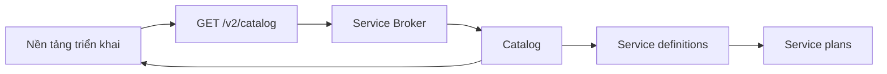
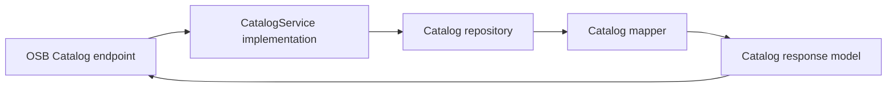

# Công bố danh mục qua GET /v2/catalog

## 1. Vai trò của catalog trong service broker

Catalog là bản mô tả những dịch vụ mà một service broker có thể cung cấp cho nền tảng. Trước khi người dùng yêu cầu tạo tài nguyên, nền tảng cần biết broker có những loại service nào, mỗi service có các plan nào và những khả năng vòng đời nào được hỗ trợ. Open Service Broker API (OSB API) chuẩn hóa việc trao đổi thông tin đó qua endpoint `GET /v2/catalog`.

Trong module `SPRING_CLOUD_SERVICE_BROKER`, Spring Cloud Open Service Broker cung cấp hạ tầng để xây dựng broker tương thích OSB API. Ứng dụng định nghĩa catalog và các quy tắc nghiệp vụ của từng service. Khi nền tảng gọi `GET /v2/catalog`, broker trả về danh sách service definition cùng các plan mà broker công bố.

Catalog trả lời câu hỏi **broker có thể cung cấp những gì**. Nó không phải danh sách instance đang chạy, không tạo tài nguyên và không cấp credential cho ứng dụng. Những việc đó thuộc các thao tác service instance và service binding ở những endpoint khác.



Nền tảng có thể dùng catalog để hiển thị lựa chọn cho người dùng, cho phép quản trị viên bật những plan được cung cấp và xác định những thao tác nào có thể thực hiện với service. Vì vậy, catalog là một phần của hợp đồng vận hành giữa broker và nền tảng, không chỉ là dữ liệu mô tả để hiển thị giao diện.

## 2. Gọi endpoint GET /v2/catalog

Endpoint catalog dùng HTTP `GET` và không nhận request body. Đường dẫn được tính tương đối với broker base URL.

```http
GET /v2/catalog HTTP/1.1
Host: broker.example.com
Authorization: Basic <broker-credentials>
X-Broker-API-Version: 2.17
Accept: application/json
```

Các thành phần cần chú ý:

- `GET` là thao tác đọc catalog, không tạo hoặc thay đổi service instance.
- `Authorization` mang thông tin xác thực broker client theo cấu hình của nền tảng; broker phải xác thực request trước khi trả dữ liệu.
- `X-Broker-API-Version` cho biết phiên bản OSB API mà client sử dụng. Broker cần kiểm tra phiên bản này và xử lý phiên bản không được hỗ trợ theo hợp đồng, thường bằng HTTP `412 Precondition Failed`.
- `Accept: application/json` thể hiện định dạng response mà client mong muốn.

Ví dụ gọi bằng curl:

```bash
curl --user "$BROKER_USERNAME:$BROKER_PASSWORD" \
  --header "X-Broker-API-Version: 2.17" \
  --header "Accept: application/json" \
  https://broker.example.com/v2/catalog
```

Thông tin xác thực trong ví dụ được lấy từ môi trường để tránh ghi trực tiếp vào lệnh hoặc mã nguồn. Trong production, cần dùng secret store và cơ chế cấp quyền phù hợp; không đưa password vào log của pipeline.

Response thành công có cấu trúc cấp cao là một object JSON chứa mảng `services`:

```json
{
  "services": [
    {
      "id": "managed-postgresql",
      "name": "Managed PostgreSQL",
      "description": "Cơ sở dữ liệu PostgreSQL được quản lý",
      "bindable": true,
      "plans": [
        {
          "id": "starter",
          "name": "Starter",
          "description": "Gói dùng thử cho ứng dụng nhỏ",
          "free": true
        }
      ]
    }
  ]
}
```

Ví dụ đã lược bỏ các trường tùy chọn để làm rõ cấu trúc. Trong response thực tế, broker có thể công bố metadata, tags, yêu cầu bổ sung, schema tham số và các cờ năng lực. Nếu broker chưa cung cấp service nào, `services` vẫn là một mảng rỗng; response không nên thiếu trường này.

## 3. Service definition: mô tả một loại dịch vụ

Mỗi phần tử trong `services` là một service definition. Nó mô tả một loại dịch vụ mà broker quản lý, chẳng hạn PostgreSQL, Redis, object storage, message queue hoặc một dịch vụ nội bộ.

Các trường quan trọng gồm:

| Trường | Ý nghĩa |
|---|---|
| `id` | Định danh duy nhất và ổn định của service trong broker. Nền tảng dùng ID này trong request provisioning, update và deprovisioning. |
| `name` | Tên service hiển thị cho người dùng hoặc quản trị viên. |
| `description` | Mô tả mục đích và đặc điểm của service. |
| `bindable` | Cho biết service instance có hỗ trợ binding hay không. |
| `plans` | Danh sách plan mà service cung cấp. |
| `tags` | Các nhãn phân loại để nền tảng tìm kiếm hoặc hiển thị service. |
| `requires` | Những khả năng hoặc loại tích hợp mà service yêu cầu từ nền tảng. |
| `metadata` | Thông tin bổ sung phục vụ giao diện hoặc tích hợp. |
| `dashboard_client` | Thông tin client dùng cho tích hợp dashboard/SSO khi broker hỗ trợ. |

`id` phải ổn định. Ví dụ, nếu service có ID `managed-postgresql`, các instance được tạo theo ID này sẽ tiếp tục tham chiếu tới nó trong suốt vòng đời. Đổi ID thành `postgres-service` sau khi đã có instance có thể khiến broker không nhận diện được request xóa hoặc cập nhật cũ. Nếu muốn đổi tên hiển thị, có thể thay `name` trong khi giữ nguyên ID.

`bindable` là cờ ở cấp service. Nếu là `true`, broker cho phép tạo binding cho các instance của service đó và phải có khả năng xử lý endpoint service bindings. Nếu là `false`, nền tảng không nên đưa ra thao tác binding cho service. Không được đặt `bindable: true` chỉ để giao diện hiển thị nút kết nối khi broker chưa thể cấp và thu hồi credential.

### 3.1. Tags, requires và metadata

`tags` là danh sách chuỗi giúp nền tảng phân loại service. Ví dụ:

```json
"tags": ["database", "relational", "postgresql"]
```

Tags nên ngắn gọn, có ý nghĩa và nhất quán giữa các service. Chúng hỗ trợ tìm kiếm hoặc hiển thị nhưng không thay thế `id` và không quyết định quyền truy cập.

`requires` mô tả những khả năng nền tảng cần có để sử dụng service. Các giá trị được OSB API định nghĩa cho một số tích hợp có thể bao gồm `syslog_drain`, `route_forwarding` và `volume_mount`. Broker chỉ nên công bố yêu cầu mà service thực sự cần. Nền tảng có thể dựa vào trường này để xác định service có phù hợp với môi trường triển khai hay không.

`metadata` là object mở rộng. Các key thường được dùng cho thông tin hiển thị như `displayName`, `imageUrl`, `longDescription`, `providerDisplayName`, `documentationUrl` hoặc `supportUrl`. Đây là metadata chứ không phải nguồn dữ liệu có thẩm quyền cho nghiệp vụ. Không nên nhét password, token, thông tin kết nối riêng của instance hoặc dữ liệu cá nhân vào metadata catalog.

`dashboard_client` có thể mô tả thông tin tích hợp giữa nền tảng và dashboard của broker, chẳng hạn client ID, secret và redirect URI theo hợp đồng. Chỉ công bố khi broker thực sự hỗ trợ luồng dashboard tương ứng; quản lý giá trị nhạy cảm theo chính sách bảo mật và không ghi chúng vào log.

## 4. Service plan: các lựa chọn trong một service

Một service definition thường có nhiều plan. Plan mô tả cấp tài nguyên hoặc cấu hình cụ thể mà consumer có thể chọn, ví dụ dung lượng lưu trữ, số kết nối tối đa, mức hiệu năng, thời gian lưu dữ liệu hoặc tính năng sao lưu.

Các trường thường gặp của một plan:

| Trường | Ý nghĩa |
|---|---|
| `id` | Định danh ổn định của plan trong service. |
| `name` | Tên plan hiển thị. |
| `description` | Mô tả tài nguyên và giới hạn của plan. |
| `free` | Cho biết plan có miễn phí hay không, nếu được khai báo. |
| `metadata` | Thông tin hiển thị bổ sung như thông số, chi phí hoặc nhãn. |
| `schemas` | JSON Schema mô tả tham số hợp lệ cho các thao tác được hỗ trợ. |

ID plan thường được hiểu trong phạm vi service. Ví dụ service `managed-postgresql` có thể có `starter`, `standard` và `high-availability`. Broker phải giữ khả năng nhận diện các ID đã được sử dụng bởi instance hiện hữu, kể cả khi một plan ngừng được cung cấp cho instance mới.

Ví dụ ba plan với đặc điểm khác nhau:

| Plan | Tài nguyên minh họa | Mục đích |
|---|---|---|
| `starter` | 1 vCPU, 1 GB RAM, 10 GB storage | Thử nghiệm và ứng dụng nhỏ. |
| `standard` | 2 vCPU, 4 GB RAM, 100 GB storage | Ứng dụng production quy mô vừa. |
| `high-availability` | 4 vCPU, 8 GB RAM, 250 GB storage, replica | Ứng dụng cần tính sẵn sàng cao. |

Thông số trong bảng chỉ là ví dụ thiết kế. Broker phải bảo đảm mô tả plan khớp với cấu hình thực tế mà adapter hạ tầng tạo ra. Nếu mô tả ghi 100 GB nhưng provision chỉ cấp 50 GB, nền tảng và người dùng sẽ đưa ra quyết định dựa trên thông tin sai.

`free` chỉ thể hiện plan miễn phí theo nghĩa của catalog. Nó không thay thế chính sách billing hoặc quota của nền tảng. Plan có thể miễn phí với một môi trường nhưng vẫn bị giới hạn số lượng hoặc tài nguyên.

### 4.1. Schema tham số của plan

Trường `schemas` cho phép broker mô tả cấu trúc `parameters` được chấp nhận trong các thao tác. Nền tảng có thể dùng schema để hỗ trợ tạo biểu mẫu cấu hình và kiểm tra dữ liệu trước khi gửi request. Broker vẫn phải tự xác thực ở phía server vì client có thể bỏ qua hoặc diễn giải schema khác nhau.

Các nhánh schema thường gặp gồm:

- `service_instance.create.parameters`: tham số khi provision instance.
- `service_instance.update.parameters`: tham số khi cập nhật instance.
- `service_binding.create.parameters`: tham số khi tạo binding.

Ví dụ schema rút gọn:

```json
{
  "schemas": {
    "service_instance": {
      "create": {
        "parameters": {
          "type": "object",
          "properties": {
            "database_name": {
              "type": "string",
              "minLength": 1,
              "maxLength": 48
            },
            "backup_enabled": {
              "type": "boolean",
              "default": true
            }
          },
          "required": ["database_name"],
          "additionalProperties": false
        }
      },
      "update": {
        "parameters": {
          "type": "object",
          "properties": {
            "storage_gb": {
              "type": "integer",
              "minimum": 10,
              "maximum": 500
            }
          },
          "additionalProperties": false
        }
      }
    },
    "service_binding": {
      "create": {
        "parameters": {
          "type": "object",
          "properties": {
            "access_role": {
              "type": "string",
              "enum": ["read-only", "read-write"]
            }
          }
        }
      }
    }
  }
}
```

Schema phải phản ánh đúng tham số mà implementation chấp nhận. Không công bố thuộc tính `storage_gb` nếu adapter không thể áp dụng thay đổi đó. Khi thay đổi schema, cần xem xét tương thích ngược với các ứng dụng và công cụ đã lưu cấu hình cũ.

## 5. Các cờ năng lực ở cấp service

Catalog không chỉ mô tả tên và plan. Các cờ năng lực cho nền tảng biết broker có hỗ trợ một số thao tác vòng đời hay không.

| Cờ | Ý nghĩa và hệ quả |
|---|---|
| `bindable` | Instance có thể được binding. Nếu `true`, broker cần triển khai cấp và thu hồi binding theo hợp đồng. |
| `plan_updateable` | Instance có thể được chuyển sang plan khác bằng thao tác update theo các giới hạn của broker. |
| `instances_retrievable` | Broker hỗ trợ đọc lại thông tin instance theo endpoint retrieve. |
| `bindings_retrievable` | Broker hỗ trợ đọc lại thông tin binding theo endpoint retrieve. |
| `allow_context_updates` | Broker hỗ trợ cập nhật context của instance theo cơ chế update của API. |

Các cờ tùy chọn cần được đặt có chủ đích và phù hợp với phiên bản OSB API mà broker hỗ trợ. Nếu một cờ không được khai báo, client có thể hiểu theo giá trị mặc định của đặc tả phiên bản đó. Khi cần tắt một khả năng, hãy biểu diễn theo quy tắc của đặc tả thay vì dựa vào cách một nền tảng cụ thể tình cờ xử lý trường bị thiếu.

`plan_updateable` là khả năng ở cấp service, không có nghĩa mọi cặp plan đều chuyển đổi được. Broker vẫn phải kiểm tra plan đích, trạng thái instance, giới hạn tài nguyên và khả năng chuyển đổi cụ thể khi nhận request update. Tương tự, `bindable: true` không có nghĩa mọi loại consumer đều được cấp quyền; tầng nghiệp vụ vẫn phải kiểm tra quyền và tham số binding.

## 6. Thiết kế catalog đúng với vòng đời service

Catalog thường được nền tảng đọc khi đăng ký broker hoặc khi làm mới danh sách dịch vụ. Một số nền tảng lưu cache và quản trị viên có thể cần thao tác refresh để thấy thay đổi. Vì vậy, broker nên thiết kế catalog ổn định và có chiến lược thay đổi có kiểm soát.

### 6.1. Giữ ổn định ID và tương thích plan

`service.id` và `plan.id` được lưu trong các instance do nền tảng tạo. Khi thay đổi tên hoặc mô tả, có thể cập nhật trường hiển thị nhưng nên giữ ID. Nếu cần ngừng cung cấp một plan, phải xác định cách tiếp tục xử lý instance hiện hữu: broker vẫn cần hiểu plan cũ khi update hoặc deprovision nếu API yêu cầu các ID đó.

Không tái sử dụng ID của plan cũ cho một cấu hình có ý nghĩa khác. Nếu `standard` từng có 100 GB storage nhưng sau đó được đổi thành 500 GB, những instance đã provision theo định nghĩa cũ có thể bị hiểu sai khi deprovision hoặc kiểm tra trạng thái. Tạo ID plan mới thường an toàn hơn khi ý nghĩa và đặc tính tài nguyên thay đổi không tương thích.

### 6.2. Catalog và implementation phải nhất quán

Mỗi thông tin được công bố cần có đường đi thực thi tương ứng:

- `bindable: true` phải đi cùng khả năng tạo và xóa binding.
- `plan_updateable: true` phải đi cùng logic update và kiểm tra chuyển đổi plan.
- `instances_retrievable: true` phải đi cùng endpoint retrieve instance.
- `bindings_retrievable: true` phải đi cùng endpoint retrieve binding.
- Schema tham số phải khớp validation và adapter.
- `requires` phải khớp khả năng nền tảng cần có để chạy service.

Nếu catalog hứa một tính năng mà broker không thực hiện, nền tảng có thể hiển thị lựa chọn không dùng được hoặc gửi request thất bại. Ngược lại, không công bố khả năng mà broker đã hỗ trợ có thể làm nền tảng không khai thác được tính năng đó.

### 6.3. Phân biệt catalog với trạng thái instance

Catalog là mô tả ở cấp sản phẩm: service nào và plan nào có thể được chọn. Trạng thái instance là dữ liệu ở cấp tài nguyên: instance nào đang provisioning, active, updating hoặc deprovisioning. Không nên đưa thông tin như password, hostname riêng của instance hoặc danh sách consumer vào catalog. Những thông tin đó thuộc response của binding hoặc endpoint retrieve được bảo vệ.

Nếu catalog được sinh động từ database cấu hình, cần tránh để request GET làm thay đổi trạng thái nghiệp vụ. Việc đọc catalog nên an toàn, có thể lặp lại và không kích hoạt provisioning. Nếu catalog phụ thuộc cấu hình từ nhiều nguồn, nên kiểm tra và chuẩn hóa dữ liệu trước khi công bố để tránh trả về một nửa catalog hoặc các ID không nhất quán.

## 7. Cung cấp catalog bằng Spring Cloud Open Service Broker

Trong ứng dụng Spring Boot, Spring Cloud Open Service Broker cung cấp các thành phần web xử lý OSB API và gọi service interface do ứng dụng cung cấp. Với catalog, ứng dụng triển khai `CatalogService`. Framework sử dụng bean này để phục vụ `GET /v2/catalog`; thông thường không cần tự tạo một controller khác cho cùng endpoint.

Ví dụ minh họa một catalog tĩnh:

```java
@Service
public class ExampleCatalogService implements CatalogService {

    @Override
    public Mono<Catalog> getCatalog() {
        Plan starter = Plan.builder()
                .id("starter")
                .name("Starter")
                .description("Gói dùng thử")
                .free(true)
                .build();

        ServiceDefinition postgres = ServiceDefinition.builder()
                .id("managed-postgresql")
                .name("Managed PostgreSQL")
                .description("Cơ sở dữ liệu PostgreSQL được quản lý")
                .bindable(true)
                .plans(List.of(starter))
                .build();

        return Mono.just(Catalog.builder()
                .serviceDefinitions(List.of(postgres))
                .build());
    }
}
```

Đây là ví dụ rút gọn; import và chữ ký chính xác cần khớp phiên bản Spring Cloud Open Service Broker trong dependency của ứng dụng. Các lớp model thường dùng để mô tả catalog gồm `Catalog`, `ServiceDefinition` và `Plan`. Khi catalog được lưu trong database hoặc file cấu hình, implementation có thể đọc dữ liệu từ repository rồi chuyển thành các model tương ứng.

Với catalog động, nên tách nguồn dữ liệu và quá trình chuyển đổi khỏi service interface:



Repository quản lý dữ liệu service/plan đã cấu hình; mapper chuyển dữ liệu nội bộ sang model của OSB API. Cách tổ chức này giúp thay đổi cách lưu catalog mà không buộc controller hoặc hợp đồng HTTP thay đổi. Nên validate catalog khi khởi động hoặc trước khi publish cấu hình mới để phát hiện ID trùng, plan thiếu trường bắt buộc và schema không hợp lệ.

Không nên tạo nhiều bean `CatalogService` cùng cạnh tranh cho một broker nếu chưa có cơ chế định tuyến rõ ràng. Nếu broker cung cấp nhiều nhóm dịch vụ, có thể tổng hợp chúng trong một catalog service duy nhất hoặc dùng một repository/registry thống nhất để trả về tất cả service definition.

## 8. Kiểm thử endpoint catalog

Kiểm thử catalog cần xác minh cả cấu trúc giao thức lẫn ý nghĩa nghiệp vụ của dữ liệu.

| Trường hợp | Điều cần xác minh |
|---|---|
| Đọc catalog thành công | HTTP status thành công, JSON có `services` và tất cả service definition hợp lệ. |
| Catalog rỗng | Trả `services: []`, không trả body sai cấu trúc hoặc null ngoài hợp đồng. |
| Thiếu xác thực | Request bị từ chối theo chính sách bảo mật. |
| Sai thông tin xác thực | Không tiết lộ nội dung catalog cho client không được phép. |
| Phiên bản API không hỗ trợ | Trả lỗi phiên bản phù hợp, thường là `412 Precondition Failed`. |
| Service ID trùng | Validation phát hiện cấu hình catalog không hợp lệ trước khi công bố. |
| Plan không thuộc đúng service | Catalog không chứa quan hệ service-plan sai. |
| Cờ năng lực sai | Các cờ bindable/updateable/retrievable khớp với endpoint thực tế. |
| Schema tham số sai | Nền tảng nhận schema đúng với tham số broker thực sự chấp nhận. |
| Thay đổi catalog | ID cũ vẫn xử lý được với instance đã tồn tại; thay đổi mới được công bố có kiểm soát. |

Ví dụ kiểm tra ở mức API:

```bash
curl --silent --show-error \
  --user "$BROKER_USERNAME:$BROKER_PASSWORD" \
  --header "X-Broker-API-Version: 2.17" \
  --header "Accept: application/json" \
  --write-out "HTTP %{http_code}\n" \
  https://broker.example.com/v2/catalog
```

Trong automated test, có thể gọi `CatalogService` trực tiếp để kiểm tra dữ liệu model, đồng thời dùng integration test để xác minh endpoint thực sự được framework đăng ký, header phiên bản được xử lý và response JSON đúng cấu trúc. Hai lớp kiểm thử này bổ sung cho nhau: test service không chứng minh route HTTP đã hoạt động, còn test HTTP đơn lẻ có thể không phát hiện catalog sai về mặt nghiệp vụ.

## 9. Những lỗi thiết kế thường gặp

- **ID thay đổi theo tên hiển thị:** đổi tên service dẫn đến ID thay đổi, khiến instance cũ khó được nhận diện. Hãy dùng ID ổn định và tách khỏi tên hiển thị.
- **Công bố quá nhiều khả năng:** đặt `bindable` hoặc `plan_updateable` thành `true` dù chưa triển khai endpoint tương ứng. Catalog phải phản ánh khả năng thật.
- **Plan mô tả không khớp tài nguyên:** người dùng chọn plan theo thông số nhưng adapter cấp cấu hình khác. Hãy dùng một nguồn cấu hình thống nhất cho mô tả và provisioning.
- **Schema không được kiểm tra ở server:** chỉ dựa vào giao diện nền tảng để validate parameters. Broker vẫn phải kiểm tra mọi request ở backend.
- **Đưa bí mật vào metadata:** catalog có thể được đọc bởi thành phần quản trị nền tảng. Chỉ công bố thông tin mô tả, không công bố credential của instance.
- **Catalog phụ thuộc trạng thái cục bộ:** một replica trả catalog khác replica còn lại. Các replica cần dùng chung nguồn cấu hình hoặc cùng phiên bản catalog.
- **Xóa plan đang được sử dụng:** broker không còn hiểu ID plan cũ khi xử lý instance đã tồn tại. Cần duy trì khả năng tương thích cho vòng đời tài nguyên cũ.

## 10. Nguyên tắc cần ghi nhớ

1. `GET /v2/catalog` là endpoint đọc để nền tảng khám phá service definition và plan.
2. Response có object gốc chứa mảng `services`; mỗi service chứa các plan của nó.
3. `service.id` và `plan.id` phải ổn định để các thao tác vòng đời sau này tham chiếu chính xác.
4. `bindable`, `plan_updateable`, `instances_retrievable` và `bindings_retrievable` là những cam kết về năng lực của broker.
5. Tags, requires, metadata và schemas giúp nền tảng hiểu cách phân loại, yêu cầu tích hợp, thông tin hiển thị và tham số hợp lệ.
6. Catalog không chứa trạng thái hoặc credential riêng của từng instance.
7. Trong Spring Cloud Open Service Broker, cung cấp catalog qua `CatalogService` và để framework ánh xạ service đó vào endpoint OSB.
8. Kiểm thử cả response HTTP, cấu trúc model, tính ổn định của ID và sự nhất quán giữa catalog với implementation.

Khi catalog mô tả chính xác service, plan và năng lực thực tế, nền tảng có thể đưa ra lựa chọn đúng cho người dùng và gửi các request vòng đời phù hợp. Đây là bước đầu tiên để một service broker Spring Cloud cung cấp dịch vụ một cách nhất quán và có thể vận hành lâu dài.
