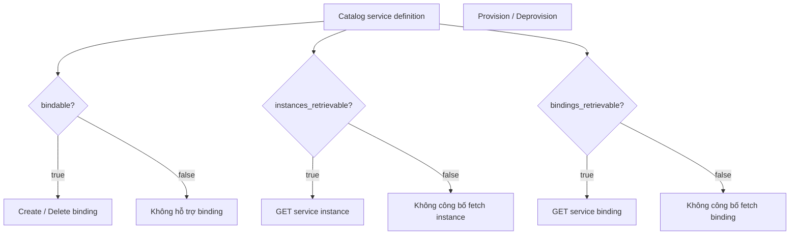

# Các cờ bindable, instances_retrievable và bindings_retrievable

Trong Open Service Broker API (OSB API), catalog không chỉ liệt kê tên dịch vụ và các plan. Mỗi service definition còn công bố những khả năng mà broker hỗ trợ. Ba cờ `bindable`, `instances_retrievable` và `bindings_retrievable` cho platform biết có thể tạo binding cho dịch vụ hay truy vấn lại thông tin instance và binding đã tồn tại hay không.

Ba cờ này mô tả các capability ở cấp service trong catalog. Chúng là hợp đồng giữa broker và platform: khi công bố một capability, broker phải triển khai đúng endpoint và duy trì đủ dữ liệu để thực hiện hành vi đó. Việc đặt cờ thành `true` trong catalog không tự tạo ra chức năng nếu service implementation và persistence chưa hỗ trợ.

## 1. Phân biệt ba capability

| Cờ trong catalog | Câu hỏi mà platform cần biết | Hành vi được công bố | Endpoint chính |
|---|---|---|---|
| `bindable` | Service instance có thể được bind với consumer không? | Cho phép tạo và xóa service binding | `PUT` và `DELETE /v2/service_instances/{instance_id}/service_bindings/{binding_id}` |
| `instances_retrievable` | Broker có thể trả thông tin của một instance đã tạo không? | Cho phép platform fetch service instance | `GET /v2/service_instances/{instance_id}` |
| `bindings_retrievable` | Broker có thể trả thông tin của một binding đã tạo không? | Cho phép platform fetch service binding | `GET /v2/service_instances/{instance_id}/service_bindings/{binding_id}` |

Điểm cần nhớ là `bindable` nói về khả năng tạo và thu hồi quyền truy cập; `bindings_retrievable` nói về khả năng đọc lại thông tin binding. Một service có thể cho phép bind nhưng không hỗ trợ fetch binding. Tương tự, khả năng fetch instance độc lập với khả năng binding.

Trong JSON catalog, tên field dùng snake_case theo OSB API. Trong Java model của Spring Cloud Open Service Broker, builder sử dụng camelCase tương ứng như `bindable`, `instancesRetrievable()` và `bindingsRetrievable()`.

## 2. bindable: service có hỗ trợ binding hay không?

`bindable` cho biết service có thể tạo service binding cho một consumer hay không. Binding là mối liên kết giữa service instance và ứng dụng, route hoặc consumer khác. Ví dụ với PostgreSQL, instance biểu diễn database đã provision; binding tạo một database user riêng và trả thông tin kết nối để ứng dụng truy cập database.

Khi `bindable: true`, platform có thể gọi:

- `PUT /v2/service_instances/{instance_id}/service_bindings/{binding_id}` để tạo binding.
- `DELETE /v2/service_instances/{instance_id}/service_bindings/{binding_id}` để thu hồi binding.

Broker cần xử lý các request đó thông qua binding service. Khi tạo binding, broker thường xác minh instance đang hoạt động, xác thực consumer, tạo credentials hoặc quyền truy cập, lưu trạng thái binding và trả thông tin cần thiết. Khi xóa binding, broker thu hồi đúng credentials hoặc quyền đã tạo.

Khi `bindable: false`, service không công bố khả năng binding. Platform không nên cung cấp thao tác bind cho service đó. Điều này không có nghĩa là service không thể được provision. Ví dụ, broker có thể tạo một bucket lưu trữ hoặc một tài nguyên được sử dụng thông qua cơ chế truy cập bên ngoài platform, mà không cần tạo binding riêng cho từng ứng dụng.

`bindable` là capability của service definition, vì vậy broker cần bảo đảm hành vi nhất quán với các plan của service đó. Nếu một nhóm plan có mô hình tiêu thụ hoàn toàn khác, hãy thiết kế service offering và capability sao cho catalog không hứa một thao tác mà một plan không thể thực hiện.

## 3. instances_retrievable: có thể fetch service instance

`instances_retrievable` cho biết broker có hỗ trợ đọc lại thông tin của một service instance thông qua endpoint fetch hay không.

Khi `instances_retrievable: true`, platform có thể gọi:

```http
GET /v2/service_instances/inst-7f31?service_id=postgresql&plan_id=standard
X-Broker-API-Version: 2.16
```

Broker trả thông tin của instance đã provision theo response schema của OSB, chẳng hạn `dashboard_url`, `parameters`, `metadata` hoặc thông tin phù hợp khác mà broker quản lý và được phép tiết lộ. Endpoint này hữu ích khi platform cần đồng bộ hoặc kiểm tra lại trạng thái và metadata của instance.

Để công bố capability này, broker cần triển khai phần fetch instance, tra cứu đúng ID và dựng response từ trạng thái đã lưu. Không nên phụ thuộc hoàn toàn vào provider đang sẵn sàng tại thời điểm fetch; broker thường cần lưu service ID, plan ID, provider resource ID, parameters cần thiết và trạng thái instance trong repository bền vững.

Khi `instances_retrievable` không được công bố hoặc có giá trị `false`, platform không được dựa vào endpoint GET instance như một khả năng của service. Điều đó không ngăn platform tạo, cập nhật hoặc xóa instance qua các operation tương ứng. Fetch instance là một capability đọc riêng.

## 4. bindings_retrievable: có thể fetch service binding

`bindings_retrievable` cho biết broker có hỗ trợ truy vấn thông tin của một binding đã được tạo hay không.

Khi `bindings_retrievable: true`, platform có thể gọi:

```http
GET /v2/service_instances/inst-7f31/service_bindings/bind-a902?service_id=postgresql&plan_id=standard
X-Broker-API-Version: 2.16
```

Broker tìm binding thuộc đúng instance và trả response theo schema OSB. Với app binding, response có thể chứa `credentials`; với các kiểu binding khác, response có thể chứa những thông tin như `syslog_drain_url`, `route_service_url`, `volume_mounts` hoặc dữ liệu binding tương ứng. Broker chỉ trả những field phù hợp với loại binding đã tạo.

Khả năng fetch binding đòi hỏi broker lưu hoặc có thể tái tạo an toàn dữ liệu đã trả khi bind. Nếu credentials chỉ được sinh một lần rồi bị mất, broker không thể trung thực công bố `bindings_retrievable: true` cho một contract yêu cầu trả lại thông tin binding. Có thể lưu secret trong secret manager và giữ `secret_reference` trong binding record; endpoint fetch đọc secret qua tham chiếu và trả response qua kết nối đã xác thực.

Khi `bindings_retrievable` không được công bố hoặc có giá trị `false`, platform không nên gọi GET binding như một capability của service. Điều này không ngăn việc tạo hoặc xóa binding khi `bindable: true`.

Vì response fetch binding có thể chứa credentials, endpoint này phải được bảo vệ bằng xác thực platform, TLS, phân quyền và kiểm soát log. Capability fetch không có nghĩa là ứng dụng cuối được phép gọi endpoint broker để đọc credentials của binding khác.

## 5. Các cờ độc lập và ma trận cấu hình

Ba cờ thể hiện ba câu hỏi khác nhau. Một số cấu hình hợp lý thường gặp:

| `bindable` | `instances_retrievable` | `bindings_retrievable` | Ý nghĩa |
|---|---|---|---|
| `false` | `false` | `false` | Service có thể provision/deprovision nhưng không hỗ trợ binding hoặc fetch instance/binding |
| `true` | `false` | `false` | Có thể bind/unbind, nhưng platform không có capability fetch instance hoặc binding |
| `true` | `true` | `false` | Có thể bind/unbind và fetch instance; không hỗ trợ fetch binding |
| `true` | `true` | `true` | Hỗ trợ binding, fetch instance và fetch binding |
| `false` | `true` | `false` | Service không hỗ trợ binding nhưng platform vẫn có thể fetch instance |

`bindings_retrievable: true` thường chỉ có ý nghĩa khi service có binding để truy vấn; vì vậy cấu hình `bindable: false` kết hợp với `bindings_retrievable: true` là không nhất quán về mặt nghiệp vụ và nên tránh. Các cờ fetch không thay thế cho `bindable`, và không nên suy luận một cờ từ cờ còn lại.

Một ví dụ quan trọng là `bindable=true`, `bindings_retrievable=false`: platform vẫn tạo và xóa binding bình thường, nhưng không được giả định rằng có thể GET binding để lấy lại credentials. Nếu platform hoặc quy trình vận hành cần fetch credentials sau khi tạo binding bất đồng bộ, broker cần xem xét công bố và triển khai `bindings_retrievable=true`.

## 6. Catalog JSON minh họa

Ví dụ dưới đây công bố PostgreSQL hỗ trợ binding và fetch cả instance lẫn binding:

```json
{
  "services": [
    {
      "id": "postgresql",
      "name": "PostgreSQL",
      "description": "Managed PostgreSQL database",
      "bindable": true,
      "instances_retrievable": true,
      "bindings_retrievable": true,
      "plans": [
        {
          "id": "standard",
          "name": "standard",
          "description": "Database for standard workloads",
          "free": false
        }
      ]
    }
  ]
}
```

Một dịch vụ không cần binding có thể công bố:

```json
{
  "services": [
    {
      "id": "archive-storage",
      "name": "Archive Storage",
      "description": "Managed archive bucket",
      "bindable": false,
      "instances_retrievable": true,
      "bindings_retrievable": false,
      "plans": [
        {
          "id": "cold",
          "name": "cold",
          "description": "Low-cost archive storage",
          "free": false
        }
      ]
    }
  ]
}
```

Trong JSON catalog, `bindable` là field boolean bắt buộc của service definition. `instances_retrievable` và `bindings_retrievable` là các capability tùy chọn; broker chỉ nên công bố `true` khi endpoint và dữ liệu tương ứng thực sự được hỗ trợ. Khi capability không được khai báo, platform không nên giả định tính năng đó có sẵn.

## 7. Khai báo capability trong Spring Cloud Open Service Broker

Spring Cloud Open Service Broker biểu diễn service offering bằng `ServiceDefinition`. Các tên property Java dùng camelCase, còn khi serialize thành catalog OSB chúng tương ứng với tên field snake_case.

Ví dụ khai báo catalog bằng builder:

```java
@Configuration
public class BrokerCatalogConfiguration {

    @Bean
    Catalog catalog() {
        Plan standard = Plan.builder()
                .id("postgresql-standard")
                .name("standard")
                .description("PostgreSQL for standard workloads")
                .free(false)
                .build();

        ServiceDefinition postgres = ServiceDefinition.builder()
                .id("postgresql")
                .name("PostgreSQL")
                .description("Managed PostgreSQL database")
                .bindable(true)
                .instancesRetrievable(true)
                .bindingsRetrievable(true)
                .plans(standard)
                .build();

        return Catalog.builder()
                .serviceDefinitions(postgres)
                .build();
    }
}
```

Nếu service không hỗ trợ binding, khai báo `.bindable(false)`. Nếu không hỗ trợ fetch instance hoặc fetch binding, không bật các property retrieval tương ứng. Hãy giữ catalog phản ánh chính xác các service implementation đang được đăng ký trong ứng dụng.

### 7.1. Liên kết capability với service interface

Trong Spring Cloud Open Service Broker, các service interface chịu trách nhiệm thực hiện hành vi mà catalog công bố:

| Capability | Interface | Phương thức tiêu biểu cần hỗ trợ |
|---|---|---|
| `bindable` | `ServiceInstanceBindingService` | `createServiceInstanceBinding()`, `deleteServiceInstanceBinding()` |
| `instances_retrievable` | `ServiceInstanceService` | `getServiceInstance()` |
| `bindings_retrievable` | `ServiceInstanceBindingService` | `getServiceInstanceBinding()` |

Ví dụ skeleton cho service hỗ trợ fetch instance và binding:

```java
@Service
public class PostgreSqlInstanceService implements ServiceInstanceService {

    private final InstanceRepository instances;

    public PostgreSqlInstanceService(InstanceRepository instances) {
        this.instances = instances;
    }

    @Override
    public Mono<GetServiceInstanceResponse> getServiceInstance(
            GetServiceInstanceRequest request) {
        return instances.findById(request.getServiceInstanceId())
                .map(instance -> GetServiceInstanceResponse.builder()
                        .dashboardUrl(instance.getDashboardUrl())
                        .build())
                .switchIfEmpty(Mono.error(
                        new IllegalArgumentException("Service instance not found")));
    }
}
```

`InstanceRepository`, entity và cách ánh xạ response trong ví dụ là thành phần do ứng dụng định nghĩa. Đoạn code chỉ minh họa phương thức fetch; class hoàn chỉnh còn phải triển khai các phương thức nghiệp vụ bắt buộc khác của `ServiceInstanceService` theo phiên bản thư viện. Trong implementation thực tế, cần dùng đúng kiểu lỗi OSB và response fields phù hợp với phiên bản thư viện. Không đưa dữ liệu nội bộ hoặc secret không được phép tiết lộ vào response fetch.

Binding service phải triển khai `createServiceInstanceBinding()` và `deleteServiceInstanceBinding()` khi `bindable=true`. Nếu `bindings_retrievable=true`, service cũng phải triển khai `getServiceInstanceBinding()` và truy xuất dữ liệu binding tương ứng. Ví dụ cấu trúc xử lý:

```java
@Service
public class PostgreSqlBindingService implements ServiceInstanceBindingService {

    private final BindingRepository bindings;
    private final CredentialStore credentialStore;

    public PostgreSqlBindingService(
            BindingRepository bindings,
            CredentialStore credentialStore) {
        this.bindings = bindings;
        this.credentialStore = credentialStore;
    }

    @Override
    public Mono<GetServiceInstanceBindingResponse> getServiceInstanceBinding(
            GetServiceInstanceBindingRequest request) {
        return bindings.findByInstanceAndBindingId(
                        request.getServiceInstanceId(),
                        request.getBindingId())
                .flatMap(binding -> credentialStore.read(binding.getSecretReference())
                        .map(credentials -> GetServiceInstanceBindingResponse.builder()
                                .credentials(credentials)
                                .build()));
    }
}
```

Đây là skeleton minh họa luồng đọc; một class triển khai interface còn phải cung cấp các phương thức bắt buộc khác theo phiên bản thư viện. `CredentialStore` và `BindingRepository` là abstraction của ứng dụng, không phải API mặc định được cung cấp bởi OSB.

## 8. Phân biệt fetch endpoint với last_operation

Một nhầm lẫn thường gặp là cho rằng `instances_retrievable` hoặc `bindings_retrievable` quyết định luôn việc platform có thể polling operation hay không. Thực tế, fetch resource và polling operation là hai hành vi khác nhau.

| Endpoint | Capability liên quan | Mục đích |
|---|---|---|
| `GET /v2/service_instances/{instance_id}` | `instances_retrievable` | Đọc thông tin instance |
| `GET /v2/service_instances/{instance_id}/service_bindings/{binding_id}` | `bindings_retrievable` | Đọc thông tin binding |
| `GET /v2/service_instances/{instance_id}/last_operation` | Operation async của instance | Kiểm tra provision/update/deprovision đã hoàn tất chưa |
| `GET /v2/service_instances/{instance_id}/service_bindings/{binding_id}/last_operation` | Operation async của binding | Kiểm tra bind/unbind đã hoàn tất chưa |

Ví dụ, broker có thể công bố `instances_retrievable=false` nhưng vẫn hỗ trợ provision bất đồng bộ. Khi trả `202 Accepted`, broker vẫn phải cung cấp trạng thái qua endpoint `last_operation` theo giao thức. Tương tự, `bindings_retrievable=false` không loại bỏ nghĩa vụ trả trạng thái cho một binding operation bất đồng bộ.

`last_operation` trả trạng thái operation như `in progress`, `succeeded` hoặc `failed`. Fetch endpoint trả thông tin tài nguyên. Một operation thành công không đồng nghĩa platform có thể fetch resource nếu capability retrieval chưa được công bố.

## 9. Vòng đời và dữ liệu cần lưu

Ba capability ảnh hưởng trực tiếp đến dữ liệu broker cần duy trì:



Repository của broker thường cần các dữ liệu sau:

| Bản ghi | Dữ liệu tối thiểu hữu ích | Capability/operation được hỗ trợ |
|---|---|---|
| Service instance | `service_instance_id`, `service_id`, `plan_id`, provider resource ID, trạng thái, parameters được lưu | Provision, update, deprovision; fetch khi `instances_retrievable=true` |
| Service binding | `binding_id`, `service_instance_id`, consumer, loại binding, secret reference, trạng thái | Bind/unbind; fetch khi `bindings_retrievable=true` |
| Operation | Operation ID, loại operation, tài nguyên liên quan, trạng thái, mô tả lỗi | Polling cho operation bất đồng bộ |

Nếu broker không công bố fetch instance hoặc binding, vẫn cần lưu trạng thái tối thiểu để thực hiện update, delete, retry và đối soát. Không nên chỉ lưu dữ liệu khi capability retrieval bật: deprovision và unbind vẫn cần tra cứu provider resource ID hoặc secret reference.

## 10. Thay đổi capability và tương thích với tài nguyên đang tồn tại

Capability trong catalog có thể được platform cache hoặc đọc lại theo chu kỳ. Thay đổi một cờ có thể làm thay đổi các thao tác platform cho phép người dùng thực hiện. Vì vậy, thay đổi capability cần được xem là thay đổi contract:

- Trước khi chuyển `bindable` từ `true` sang `false`, cần xác định cách xử lý các binding đã tồn tại và bảo đảm vẫn có quy trình thu hồi quyền truy cập.
- Trước khi tắt `instances_retrievable`, xác định platform hoặc công cụ vận hành có còn phụ thuộc vào endpoint fetch instance hay không.
- Trước khi tắt `bindings_retrievable`, bảo đảm không có quy trình cần fetch lại credentials hoặc metadata binding đã tạo.
- Khi bật một cờ retrieval, triển khai endpoint, persistence và quyền truy cập trước khi công bố catalog mới.
- Khi triển khai nhiều replica, bảo đảm các replica cùng phục vụ một catalog version và cùng truy cập trạng thái nhất quán.

Không xóa metadata hoặc secret của instance/binding chỉ vì catalog hiện tại đã tắt capability fetch. Những tài nguyên đã tồn tại vẫn cần được update, unbind hoặc deprovision theo vòng đời OSB.

## 11. Lỗi cấu hình thường gặp

| Cấu hình hoặc implementation sai | Hệ quả | Cách khắc phục |
|---|---|---|
| `bindable=true` nhưng không có binding service hoạt động | Platform hiển thị chức năng bind nhưng request thất bại | Triển khai create/delete binding và kiểm thử end-to-end trước khi bật cờ |
| `bindable=false` nhưng tài liệu hoặc UI hướng dẫn bind | Platform và broker có contract mâu thuẫn | Đồng bộ catalog, tài liệu và hành vi thực tế |
| `instances_retrievable=true` nhưng không lưu dữ liệu instance | GET không thể trả kết quả ổn định sau restart | Lưu instance metadata và provider reference bền vững |
| `bindings_retrievable=true` nhưng credentials đã mất | Fetch binding không thể trả dữ liệu đã cấp | Lưu secret reference hoặc cơ chế tái tạo an toàn |
| Nhầm `bindings_retrievable` với `bindable` | Tắt fetch binding làm mất khả năng bind hoặc ngược lại | Cấu hình và kiểm thử từng capability riêng |
| Nhầm retrieval flag với async polling | Broker bỏ qua last operation khi trả 202 | Triển khai polling theo operation độc lập với fetch capability |
| Trả credentials cho binding ID không thuộc instance trong path | Có nguy cơ truy cập chéo tenant/tài nguyên | Tra cứu bằng cả instance ID và binding ID, kiểm tra quyền |
| Tắt capability nhưng xóa dữ liệu tài nguyên cũ | Update/delete/retry không thể hoàn thành | Giữ dữ liệu cần thiết đến khi tài nguyên được thu hồi |

## 12. Checklist trước khi công bố catalog

- [ ] `bindable` phản ánh chính xác service có hỗ trợ create/delete binding hay không.
- [ ] Nếu `instances_retrievable=true`, endpoint GET instance đã được triển khai và có dữ liệu bền vững.
- [ ] Nếu `bindings_retrievable=true`, endpoint GET binding đã được triển khai và có thể trả thông tin binding an toàn.
- [ ] Không suy luận `bindings_retrievable` từ `bindable` hoặc ngược lại.
- [ ] Các endpoint `last_operation` vẫn hoạt động cho operation async, độc lập với fetch flags.
- [ ] GET binding kiểm tra cả `instance_id` và `binding_id`.
- [ ] Credentials được bảo vệ, lưu bằng secret store hoặc cơ chế mã hóa thích hợp.
- [ ] Catalog được kiểm thử cùng controller/service implementation và platform client.
- [ ] Quy trình thay đổi capability có tính đến instance và binding đang tồn tại.

## 13. Tài liệu tham khảo

- [Open Service Broker API Specification — Service object and catalog](https://github.com/cloudfoundry/servicebroker/blob/master/spec.md)
- [Open Service Broker API — Repository](https://github.com/cloudfoundry/servicebroker)
- [Spring Cloud Open Service Broker — Reference Guide](https://docs.spring.io/spring-cloud-open-service-broker/docs/current/reference/)
- [Spring Cloud Open Service Broker — API documentation](https://docs.spring.io/spring-cloud-open-service-broker/docs/current/apidocs/)

Các tên field trong catalog dùng chuẩn OSB API: `bindable`, `instances_retrievable` và `bindings_retrievable`. Ví dụ Java minh họa cách khai báo các property tương ứng trong `ServiceDefinition`; khi triển khai cần đối chiếu đúng phiên bản Spring Cloud Open Service Broker mà dự án đang sử dụng.
