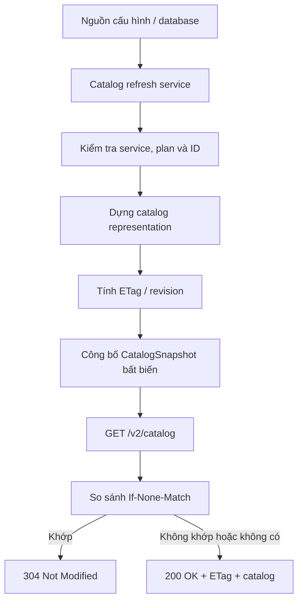

# Bộ nhớ đệm danh mục và phản hồi có điều kiện bằng ETag theo phiên bản hỗ trợ

## Vì sao cần cache catalog?

Trong Open Service Broker API (OSB API), nền tảng gọi `GET /v2/catalog` để lấy danh sách service offering và service plan mà broker cung cấp. Nền tảng có thể truy vấn catalog định kỳ để cập nhật marketplace hoặc giao diện quản lý dịch vụ. Khi catalog lớn, được tạo từ cơ sở dữ liệu hay hệ thống cấu hình từ xa, việc dựng và truyền toàn bộ JSON ở mỗi lần gọi có thể tốn CPU, I/O và băng thông.

**Bộ nhớ đệm catalog** giúp broker tái sử dụng một snapshot đã được tính toán, còn **ETag** cho phép nền tảng hỏi liệu snapshot có thay đổi kể từ lần nhận trước hay chưa. Nếu nội dung vẫn giống nhau, broker có thể trả `304 Not Modified` và bỏ phần JSON response body. Nếu catalog đã thay đổi, broker trả `200 OK`, ETag mới và catalog hiện tại.

Module `SPRING_CLOUD_SERVICE_BROKER` sử dụng Spring Cloud Open Service Broker để xây dựng broker tuân theo OSB API. Với một broker phục vụ nhiều service, plan hoặc nhiều nền tảng, thiết kế cache cần bảo đảm catalog luôn nhất quán với dữ liệu cấu hình, đồng thời tôn trọng phiên bản API và khả năng thực tế của client.

## Phân biệt cache nội bộ và cache HTTP

Có hai lớp cache liên quan nhưng giải quyết hai vấn đề khác nhau:

| Lớp | Nơi hoạt động | Mục tiêu | Ví dụ |
|---|---|---|---|
| Cache nội bộ broker | Trong ứng dụng Spring hoặc kho cache dùng chung. | Tránh truy vấn và dựng catalog lặp lại từ database, cấu hình hoặc API bên ngoài. | Giữ một `CatalogSnapshot` đã được dựng sẵn trong bộ nhớ. |
| Cache HTTP có xác thực lại | Giữa nền tảng, proxy được phép cache và broker. | Tránh truyền lại body khi representation không đổi. | Nền tảng gửi `If-None-Match`; broker trả `304 Not Modified`. |

Hai lớp có thể dùng cùng một phiên bản catalog, nhưng không thay thế nhau. Cache nội bộ giúp broker trả lời nhanh hơn; ETag giúp hai phía xác nhận dữ liệu có thay đổi hay không. Ngay cả khi broker có cache nội bộ, nó vẫn có thể trả `200` cho mọi request. Ngược lại, broker có thể tính ETag từ nguồn dữ liệu mà không giữ một cache dài hạn.

## ETag và phản hồi có điều kiện hoạt động như thế nào?

`ETag` (entity tag) là một validator do máy chủ tạo ra để đại diện cho một phiên bản của HTTP representation. Với catalog, broker trả ETag trong response `200 OK`. Nền tảng lưu lại giá trị này và gửi nó trong header `If-None-Match` ở lần `GET /v2/catalog` kế tiếp.

Luồng cơ bản:

1. Nền tảng gọi catalog lần đầu, chưa có validator.
2. Broker lấy snapshot catalog hiện tại, tạo ETag và trả `200 OK`, header `ETag` cùng JSON body.
3. Nền tảng lưu ETag.
4. Khi cần kiểm tra catalog, nền tảng gửi `If-None-Match` với ETag đã nhận.
5. Broker so sánh validator của request với representation hiện tại. Nếu khớp, broker trả `304 Not Modified` không có body. Nếu không khớp, broker trả `200 OK`, body mới và ETag mới.

Ví dụ lần truy vấn đầu tiên:

```http
GET /v2/catalog HTTP/1.1
X-Broker-API-Version: 2.17
Accept: application/json
```

```http
HTTP/1.1 200 OK
Content-Type: application/json
ETag: "catalog-a91c7d"
Cache-Control: private, max-age=60

{
  "services": [
    {
      "id": "service-postgresql",
      "name": "postgresql",
      "description": "Dịch vụ PostgreSQL được quản lý",
      "bindable": true,
      "plans": [
        {
          "id": "plan-standard",
          "name": "standard",
          "description": "Gói tiêu chuẩn"
        }
      ]
    }
  ]
}
```

Ví dụ lần truy vấn tiếp theo khi catalog chưa đổi:

```http
GET /v2/catalog HTTP/1.1
X-Broker-API-Version: 2.17
If-None-Match: "catalog-a91c7d"
```

```http
HTTP/1.1 304 Not Modified
ETag: "catalog-a91c7d"
Cache-Control: private, max-age=60
```

`304` chỉ cho biết representation đã được cache vẫn còn phù hợp; response không gửi lại JSON catalog. Client tiếp tục dùng body mà nó đã lưu từ lần `200` trước. Khi catalog thay đổi, ví dụ plan được thêm hoặc metadata được sửa, ETag phải thay đổi để nền tảng nhận được body mới.

## Khả năng hỗ trợ và tương thích phiên bản

Đây là điểm cần kiểm tra trước khi triển khai: OSB API mô tả `ETag` và `If-Modified-Since` là các HTTP header mà **Service Broker và Platform có thể hỗ trợ** (`MAY`) để cache catalog. Điều đó có nghĩa tính năng là tùy chọn; không thể giả định mọi nền tảng, broker hoặc phiên bản thư viện đều tự động bật nó.

Header `X-Broker-API-Version` cho biết phiên bản OSB API mà nền tảng sử dụng. Broker cần xác minh phiên bản đó theo cấu hình và ma trận tương thích của mình. Tuy nhiên, chỉ nhìn thấy một giá trị phiên bản trong header không đủ để kết luận client đang gửi `If-None-Match` hoặc có xử lý `304`. Cần kiểm tra tài liệu phiên bản OSB API, tài liệu nền tảng và hành vi client thực tế.

Với Spring Cloud Open Service Broker, tài liệu tham chiếu phiên bản 4.4.1 cung cấp `CatalogService.getResponseEntityCatalog(HttpHeaders)` để broker tự xử lý cache và ETag cho endpoint catalog. Tài liệu của phiên bản này minh họa cách đọc `If-None-Match` từ request header và trả `304` hoặc `200` bằng `ResponseEntity`. Khi dùng phiên bản framework khác, hãy kiểm tra Javadoc/reference đúng phiên bản đang khai báo trong dự án để xác nhận phương thức và chữ ký tương ứng; không sao chép API của bản mới hơn vào một bản cũ mà chưa kiểm tra.

Có thể áp dụng ma trận quyết định sau:

| Broker | Platform | Cách xử lý |
|---|---|---|
| Không hỗ trợ validator | Không gửi conditional header | Trả `200 OK` và catalog đầy đủ. |
| Hỗ trợ ETag | Không gửi `If-None-Match` | Trả `200 OK` cùng ETag; client vẫn nhận đầy đủ body. |
| Hỗ trợ ETag | Gửi `If-None-Match` | So sánh validator; trả `304` khi khớp, `200` khi khác. |
| Hỗ trợ `If-Modified-Since` | Gửi header tương ứng | So sánh thời điểm sửa đổi theo HTTP semantics; trả `304` nếu chưa thay đổi. |
| Một bên không hỗ trợ conditional request | Bên kia có hỗ trợ | Giao thức vẫn hoạt động bằng phản hồi `200` thông thường; không ép client phải dùng cache. |

Nếu triển khai cần dựa vào ETag, phải kiểm tra đồng thời ba phần: phiên bản OSB API được cấu hình, phiên bản Spring Cloud Open Service Broker được dùng và nền tảng sẽ gọi broker. Hãy thử nghiệm request thực tế với và không có conditional header trước khi bật hành vi này trong production.

## Tạo ETag ổn định cho catalog

ETag cần thay đổi khi representation catalog thay đổi và giữ nguyên khi representation không thay đổi. Có hai cách thường dùng:

| Cách tạo | Ý tưởng | Ưu điểm | Điểm cần lưu ý |
|---|---|---|---|
| Hash nội dung | Tuần tự hóa catalog theo cách ổn định rồi tính SHA-256 hoặc hash phù hợp trên bytes. | Validator gắn trực tiếp với nội dung được trả. | Cần serialization ổn định; thay đổi thứ tự field hoặc định dạng có thể làm hash đổi dù dữ liệu logic giống nhau. |
| Phiên bản catalog | Tăng revision khi có thay đổi làm thay đổi response. | Tính nhanh, thuận tiện khi catalog được quản lý bằng cấu hình hoặc database. | Mọi đường cập nhật catalog phải tăng revision; bỏ sót một trường sẽ làm ETag cũ được dùng sai. |

Ví dụ một ETag dựa trên hash có thể có dạng `"sha256-<digest>"`. Đây là chuỗi minh họa; broker phải tự tạo digest từ representation thực tế. ETag là giá trị opaque đối với client: nền tảng chỉ lưu và gửi lại, không phân tích cấu trúc hoặc tự dựng ETag.

Không nên tạo ETag dựa trên thời gian hiện tại của mỗi request. Nếu giá trị thay đổi mỗi lần gọi, client sẽ luôn nhận `200` dù catalog không đổi. Cũng không nên dùng riêng một biến đếm trong bộ nhớ của từng replica nếu các replica có thể có revision khác nhau cho cùng một catalog.

Một `CatalogSnapshot` có thể gom dữ liệu và validator thành một đơn vị bất biến:

```java
public record CatalogSnapshot(
        Catalog catalog,
        String etag,
        Instant generatedAt,
        long revision) {
}
```

Đây là mô hình minh họa. `Catalog` là model của Spring Cloud Open Service Broker; `etag`, `generatedAt` và `revision` là metadata nội bộ của ứng dụng. Khi tạo snapshot, broker cần tính ETag từ chính catalog được giữ trong snapshot để tránh trường hợp header đại diện cho phiên bản A nhưng body lại được đọc từ phiên bản B.

## Những thay đổi nào phải làm ETag đổi?

ETag phải đại diện cho toàn bộ representation được trả ở `/v2/catalog`. Vì vậy, cần thay đổi validator khi bất kỳ dữ liệu nào trong response thay đổi, chẳng hạn:

- Thêm hoặc gỡ service offering.
- Thêm, gỡ hoặc sửa service plan.
- Sửa `name`, `description`, `tags`, `requires` hoặc `metadata`.
- Thay đổi khả năng `bindable`, `instances_retrievable`, `bindings_retrievable` hoặc `plan_updateable`.
- Thay đổi schema tham số, thông tin bảo trì hoặc extension metadata được công bố.
- Thay đổi representation do cấu hình theo nền tảng hoặc tenant.

Đặc biệt, ID của service offering và plan phải ổn định qua các lần đọc catalog. OSB API dùng ID để nền tảng nhận diện cùng một tài nguyên giữa những lần truy vấn. Sửa mô tả hoặc metadata có thể làm ETag thay đổi, nhưng không được đổi ID của một tài nguyên chỉ để biểu thị phiên bản mới. Khi ngừng cung cấp service/plan, cần có chiến lược deprecation vì nền tảng có thể vẫn đang quản lý instance đã tạo trước đó.

## Lưu trữ và làm mới cache nội bộ

Với catalog tĩnh, broker có thể dựng snapshot khi ứng dụng khởi động rồi tái sử dụng cho các request. Với catalog lấy từ database, file cấu hình hoặc dịch vụ quản trị, nên có cơ chế làm mới có kiểm soát.

Một luồng làm mới điển hình:

1. Đọc cấu hình catalog mới từ nguồn dữ liệu.
2. Kiểm tra cấu trúc, tính duy nhất của ID và quan hệ giữa service với plan.
3. Tạo object catalog hoàn chỉnh và tuần tự hóa theo quy tắc ổn định.
4. Tính ETag hoặc lấy revision mới.
5. Công bố snapshot mới một cách nguyên tử để request chỉ thấy snapshot cũ hoàn chỉnh hoặc snapshot mới hoàn chỉnh.
6. Giữ snapshot cũ nếu lần làm mới thất bại, đồng thời ghi log và phát cảnh báo để người vận hành xử lý.

Ví dụ sơ đồ:



Với broker chạy nhiều replica, các replica phải nhìn thấy cùng một revision cho cùng một catalog representation. Có thể dùng một nguồn cấu hình/version dùng chung, cache phân tán hoặc sự kiện invalidation để đồng bộ. Nếu mỗi replica tự tăng bộ đếm độc lập, cùng một catalog có thể sinh ETag khác nhau, khiến request chuyển replica liên tục nhận `200` không cần thiết.

TTL là một cách giới hạn thời gian giữ cache, nhưng TTL không thay thế invalidation. Khi người quản trị cập nhật plan, broker có thể cần làm mới ngay thay vì đợi hết TTL. Ngược lại, với nguồn cấu hình ổn định, TTL dài hơn có thể giảm chi phí đọc. Lựa chọn cần cân bằng độ mới dữ liệu và tải lên nguồn cấu hình.

## Triển khai ETag với Spring Cloud Open Service Broker

Spring Cloud Open Service Broker cho phép cung cấp catalog thông qua một `Catalog` bean hoặc triển khai `CatalogService`. Khi cần kiểm soát response header và mã trạng thái của endpoint catalog, phiên bản framework có hỗ trợ có thể override `getResponseEntityCatalog(HttpHeaders)`.

Ví dụ sau minh họa cách nối snapshot nội bộ với conditional request. Hàm `etagMatches` là helper của ứng dụng, phải xử lý đúng danh sách ETag, wildcard `*` và quy tắc so sánh validator HTTP; phần đó được lược khỏi ví dụ để tập trung vào luồng response.

```java
@Service
public class CachedCatalogService implements CatalogService {

    private final CatalogSnapshotProvider snapshots;

    public CachedCatalogService(CatalogSnapshotProvider snapshots) {
        this.snapshots = snapshots;
    }

    @Override
    public Mono<Catalog> getCatalog() {
        return snapshots.current()
                .map(CatalogSnapshot::catalog);
    }

    @Override
    public Mono<ServiceDefinition> getServiceDefinition(String serviceId) {
        return snapshots.current()
                .flatMap(snapshot -> catalogLookup.findService(
                        snapshot.catalog(), serviceId));
    }

    @Override
    public Mono<ResponseEntity<Catalog>> getResponseEntityCatalog(
            HttpHeaders requestHeaders) {
        return snapshots.current().map(snapshot -> {
            String etag = snapshot.etag();
            CacheControl cachePolicy = CacheControl
                    .maxAge(Duration.ofSeconds(60))
                    .cachePrivate();

            if (etagMatches(requestHeaders.getIfNoneMatch(), etag)) {
                return ResponseEntity.status(HttpStatus.NOT_MODIFIED)
                        .eTag(etag)
                        .cacheControl(cachePolicy)
                        .<Catalog>build();
            }

            return ResponseEntity.ok()
                    .eTag(etag)
                    .cacheControl(cachePolicy)
                    .body(snapshot.catalog());
        });
    }

    private boolean etagMatches(List<String> candidates, String currentEtag) {
        // Implement theo quy tắc If-None-Match của HTTP.
        // Không chỉ so sánh chuỗi đơn giản nếu header có nhiều validator.
        throw new UnsupportedOperationException("Implement HTTP ETag matching");
    }
}
```

Đoạn mã minh họa cấu trúc tích hợp; `CatalogSnapshotProvider`, `CatalogSnapshot`, `catalogLookup` và hàm so sánh ETag là thành phần do ứng dụng xây dựng. Hãy bảo đảm `catalogLookup` đọc từ đúng snapshot đã được chọn cho request. Tùy phiên bản thư viện, chữ ký API model có thể khác; hãy đối chiếu Javadoc của dependency đang dùng trước khi chuyển ví dụ thành mã chạy thực tế. Không giữ `UnsupportedOperationException` trong triển khai production.

Nếu broker chỉ cần catalog tĩnh và không cần điều khiển HTTP response, cung cấp `Catalog` bean hoặc `getCatalog()` có thể là đủ. Chỉ triển khai hook response khi có nhu cầu xử lý validator/cache header và phiên bản framework đang dùng hỗ trợ hook đó.

## `If-Modified-Since` và `Last-Modified`

OSB API cũng cho phép broker và nền tảng hỗ trợ `If-Modified-Since`. Cơ chế này dựa trên thời điểm representation được sửa đổi:

- Broker trả `Last-Modified` cùng response catalog.
- Nền tảng lưu thời điểm đó và gửi `If-Modified-Since` ở request sau.
- Nếu catalog chưa thay đổi kể từ thời điểm được chỉ ra, broker có thể trả `304 Not Modified`.
- Nếu đã thay đổi, broker trả `200 OK` với catalog mới.

Ví dụ:

```http
GET /v2/catalog HTTP/1.1
X-Broker-API-Version: 2.17
If-Modified-Since: Tue, 24 Nov 2026 10:00:00 GMT
```

ETag thường chính xác hơn cho việc xác thực representation vì không phụ thuộc độ phân giải thời gian của header ngày. `Last-Modified` có thể hữu ích với hệ thống đã có timestamp tin cậy hoặc client chỉ hỗ trợ cơ chế này. Nếu request gửi cả `If-None-Match` và `If-Modified-Since`, broker cần tuân theo thứ tự ưu tiên của conditional request HTTP; không tự xử lý hai header như hai điều kiện độc lập theo phép OR.

## Cache-Control, quyền truy cập và biến thể catalog

ETag trả lời câu hỏi “representation có đổi không?”, còn `Cache-Control` quy định cache được giữ trong bao lâu và ai được phép lưu. Hai header có vai trò khác nhau.

| Chính sách | Ý nghĩa thực tế | Khi cân nhắc |
|---|---|---|
| `Cache-Control: private, max-age=60` | Cache riêng của client được giữ tươi trong tối đa 60 giây; cache dùng chung không được lưu response này. | Catalog không nhạy cảm nhưng cần giới hạn cache ở client cụ thể. |
| `Cache-Control: private, no-cache` | Client có thể lưu bản sao riêng nhưng phải xác thực lại trước khi dùng. | Cần kiểm tra ETag thường xuyên để giảm truyền body. |
| `Cache-Control: no-store` | Cache không được lưu representation. | Catalog chứa dữ liệu không được phép lưu hoặc chính sách bảo mật yêu cầu không cache. Khi dùng chính sách này, lợi ích cache HTTP giảm đáng kể. |

Không nên mặc định dùng `public` cho catalog nếu response có thể thay đổi theo nền tảng, tenant, quyền truy cập hoặc cấu hình đăng ký broker. Nếu hai client được phép thấy các catalog khác nhau, ETag cũng phải được tính riêng cho từng representation. Có thể cần phân vùng cache theo `platformInstanceId`/tenant và dùng `Vary` khi response thực sự phụ thuộc header tương ứng. Tránh dùng cache dùng chung nếu chưa chứng minh được representation có thể chia sẻ an toàn.

Catalog chỉ nên chứa metadata công bố cho nền tảng. Không đưa password, token hoặc credential của service instance vào catalog. Những bí mật này thuộc luồng binding và cần được bảo vệ theo chính sách bảo mật riêng.

## Các lỗi thường gặp và cách kiểm tra

| Lỗi | Hậu quả | Cách xử lý |
|---|---|---|
| Tạo ETag mới ở mỗi request | Luôn trả `200`, cache không có tác dụng. | Tạo validator từ snapshot hoặc revision ổn định. |
| Nội dung thay đổi nhưng ETag giữ nguyên | Nền tảng nhận `304` và tiếp tục dùng catalog cũ. | Bao phủ mọi field của response trong hash/revision và invalidation. |
| ETag được tính từ snapshot A nhưng body lấy từ snapshot B | Header và body không cùng một phiên bản. | Đọc một snapshot bất biến duy nhất trong mỗi request. |
| So sánh `If-None-Match` như một chuỗi đơn | Bỏ sót danh sách tag, wildcard hoặc weak validator. | Dùng parser và semantics HTTP phù hợp. |
| Replica tạo revision riêng | Cùng một catalog có ETag khác nhau giữa các replica. | Dùng revision dùng chung hoặc hash representation ổn định. |
| Cache catalog theo tenant nhưng không phân vùng | Có thể trả metadata của tenant khác. | Phân vùng cache và validator theo representation, kiểm soát quyền truy cập. |
| Dùng `max-age` quá dài | Nền tảng tiếp tục dùng catalog cũ trong thời gian dài. | Chọn TTL theo yêu cầu cập nhật và kết hợp invalidation. |
| Nghĩ rằng OSB client luôn hỗ trợ ETag | Broker trông đợi `304` nhưng client vẫn tải toàn bộ catalog. | Kiểm tra nền tảng và phiên bản thực tế; luôn giữ đường xử lý `200`. |

Các phép kiểm tra tối thiểu cho endpoint catalog:

1. Request không có conditional header trả `200`, JSON body hợp lệ và ETag.
2. Request gửi đúng ETag hiện tại trả `304` và không có body.
3. Request gửi ETag cũ sau khi thay đổi một plan trả `200`, body mới và ETag khác.
4. Thay đổi metadata hoặc capability trong catalog cũng làm validator đổi.
5. Header chứa nhiều ETag hoặc `*` được xử lý đúng theo HTTP semantics.
6. Hai replica cùng phục vụ một snapshot tạo ra cùng ETag.
7. Request cho hai platform/tenant có catalog khác nhau không dùng chung validator hoặc cache sai phạm vi.
8. Client không gửi conditional header vẫn nhận được catalog đầy đủ.

## Kết luận

Cache nội bộ giúp broker giảm chi phí tạo catalog; ETag giúp client tránh tải lại representation không thay đổi. Để hai cơ chế phối hợp đúng, broker cần tạo snapshot nhất quán, validator ổn định, invalidation đầy đủ và chính sách cache phù hợp với phạm vi dữ liệu. Trước khi bật conditional response, cần xác nhận khả năng hỗ trợ của phiên bản OSB API, nền tảng và Spring Cloud Open Service Broker đang sử dụng.

## Tài liệu tham khảo

- [Open Service Broker API Specification – Catalog Management](https://github.com/cloudfoundry/servicebroker/blob/master/spec.md#catalog-management): quy định endpoint catalog, tính ổn định của ID và khả năng tùy chọn hỗ trợ `ETag`/`If-Modified-Since`.
- [Spring Cloud Open Service Broker 4.4.1 – Implementing a Catalog Service](https://docs.spring.io/spring-cloud-open-service-broker/docs/4.4.1/reference/#implementing-a-catalog-service): hướng dẫn `CatalogService` và hook `getResponseEntityCatalog(HttpHeaders)` cho ETag/cache.
- [RFC 7232 – HTTP Conditional Requests](https://www.rfc-editor.org/rfc/rfc7232): ngữ nghĩa validator và conditional request được tài liệu OSB tham chiếu.
