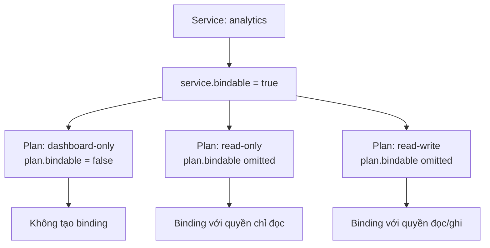

# Quy tắc kế thừa và ghi đè bindable ở cấp gói

## 1. Vì sao cần bindable ở hai cấp?

Trong Open Service Broker API (OSB API), `bindable` cho biết một service instance có thể được liên kết với ứng dụng hoặc consumer hay không. Khi binding được hỗ trợ, broker thường cấp credential, endpoint kết nối hoặc cấu hình cần thiết để consumer sử dụng instance.

Một service có thể cung cấp nhiều plan với cách sử dụng khác nhau. Ví dụ, một dịch vụ PostgreSQL có plan `application` cho phép ứng dụng nhận credential riêng, trong khi plan `dashboard-only` chỉ cho phép người dùng thao tác qua giao diện quản trị. Nếu chỉ có một cờ `bindable` ở cấp service, broker khó mô tả chính xác sự khác biệt giữa các plan.

OSB API giải quyết vấn đề này bằng hai cấp cấu hình:

- `service.bindable` là giá trị mặc định áp dụng cho tất cả plan thuộc service.
- `plan.bindable` là giá trị tùy chọn ở cấp plan. Khi được khai báo, nó ghi đè giá trị ở cấp service cho plan đó.

Quy tắc này cho phép một service có cả plan bindable và plan không bindable, đồng thời vẫn giữ cấu hình ngắn gọn cho những plan dùng chung một chính sách.

## 2. Quy tắc kế thừa và ghi đè

### 2.1. Service-level bindable là giá trị mặc định

Trong Service Offering Object của catalog, trường `bindable` là trường bắt buộc. Nó xác định mặc định liệu các Service Instance của service có thể được binding hay không. Giá trị này được áp dụng cho mọi plan không khai báo `bindable` riêng.

Ví dụ service mặc định cho phép binding:

```json
{
  "id": "managed-database",
  "name": "Managed Database",
  "description": "Cơ sở dữ liệu được quản lý",
  "bindable": true,
  "plans": [
    {
      "id": "standard",
      "name": "Standard",
      "description": "Gói cơ sở dữ liệu tiêu chuẩn"
    },
    {
      "id": "premium",
      "name": "Premium",
      "description": "Gói cơ sở dữ liệu hiệu năng cao"
    }
  ]
}
```

Hai plan không khai báo `bindable`, vì vậy đều kế thừa `true` từ service. Broker không cần lặp lại cùng một giá trị trên từng plan.

### 2.2. Plan-level bindable là giá trị ghi đè

Trường `bindable` ở Service Plan Object là tùy chọn. Nếu trường này xuất hiện, giá trị của nó có ưu tiên cao hơn `service.bindable` đối với plan đang xét. Cả `true` và `false` đều là giá trị ghi đè hợp lệ.

Ví dụ service mặc định cho phép binding, nhưng plan `dashboard-only` tắt binding:

```json
{
  "id": "managed-database",
  "name": "Managed Database",
  "description": "Cơ sở dữ liệu được quản lý",
  "bindable": true,
  "plans": [
    {
      "id": "application",
      "name": "Application",
      "description": "Cho phép ứng dụng kết nối",
      "free": false
    },
    {
      "id": "dashboard-only",
      "name": "Dashboard Only",
      "description": "Chỉ sử dụng qua giao diện quản trị",
      "free": false,
      "bindable": false
    }
  ]
}
```

Kết quả:

- Plan `application` không có trường `bindable`, nên kế thừa `true` từ service.
- Plan `dashboard-only` khai báo `bindable: false`, nên không cho phép binding dù service mặc định là `true`.

Chiều ghi đè ngược lại cũng được hỗ trợ. Service có thể mặc định không cho binding, trong khi một plan cụ thể bật binding:

```json
{
  "id": "analytics-service",
  "name": "Analytics Service",
  "description": "Dịch vụ phân tích dữ liệu",
  "bindable": false,
  "plans": [
    {
      "id": "managed-dashboard",
      "name": "Managed Dashboard",
      "description": "Truy cập qua dashboard"
    },
    {
      "id": "application-api",
      "name": "Application API",
      "description": "Cho phép ứng dụng kết nối qua API",
      "bindable": true
    }
  ]
}
```

Ở ví dụ này, `managed-dashboard` kế thừa `false`, còn `application-api` ghi đè thành `true`. Nếu có ít nhất một plan có hiệu lực bindable, broker phải triển khai khả năng xử lý service binding cho plan đó.

### 2.3. Công thức xác định giá trị có hiệu lực

Có thể biểu diễn quy tắc bằng công thức:

\[
\text{effectiveBindable}(service, plan) =
\begin{cases}
plan.bindable, & \text{nếu plan.bindable được khai báo} \\
service.bindable, & \text{nếu plan.bindable bị bỏ qua}
\end{cases}
\]

Điểm quan trọng là phân biệt `false` với việc không khai báo trường:

- `bindable: false` là một quyết định rõ ràng: plan không hỗ trợ binding.
- Không có trường `bindable` ở plan nghĩa là dùng giá trị mặc định của service.

Không được coi `false` là giá trị rỗng hoặc giá trị mặc định. Nếu hệ thống cấu hình nội bộ dùng kiểu boolean có thể null, cần giữ nguyên ba trạng thái: `true`, `false` và `null`.

### 2.4. Bảng quyết định

| `service.bindable` | `plan.bindable` | Giá trị có hiệu lực | Ý nghĩa |
|---|---|---|---|
| `true` | Không khai báo | `true` | Plan kế thừa quyền binding. |
| `false` | Không khai báo | `false` | Plan kế thừa trạng thái không bindable. |
| `true` | `true` | `true` | Plan khai báo rõ ràng là bindable. |
| `true` | `false` | `false` | Plan tắt binding dù service mặc định bật. |
| `false` | `true` | `true` | Plan bật binding dù service mặc định tắt. |
| `false` | `false` | `false` | Plan giữ trạng thái không bindable. |

Khi đọc catalog, hãy tính giá trị có hiệu lực cho từng plan. Không thể kết luận mọi plan đều bindable chỉ bằng cách nhìn vào `service.bindable` nếu một số plan có ghi đè riêng.

## 3. Hệ quả đối với hành vi của nền tảng

Nền tảng đọc catalog để biết plan nào có thể được binding. Theo OSB API, nếu `bindable: true` được khai báo ở service hoặc plan, nền tảng có thể gửi yêu cầu tạo binding cho instance thuộc service/plan tương ứng. Nếu giá trị có hiệu lực là `false`, nền tảng không được gửi yêu cầu binding cho instance sử dụng plan đó.

Điều này ảnh hưởng đến trải nghiệm người dùng và hành vi tự động của nền tảng:

- Plan bindable có thể được cung cấp thông tin kết nối cho ứng dụng qua thao tác binding.
- Plan không bindable vẫn có thể được provision và sử dụng theo cách khác, chẳng hạn thông qua dashboard, một quy trình quản trị riêng hoặc chức năng không cần cấp credential cho ứng dụng.
- Nền tảng không nên hiển thị hoặc thực hiện thao tác binding cho plan có hiệu lực `false`.

`bindable` chỉ mô tả khả năng binding của plan. Nó không quyết định service có được provision hay không, có hỗ trợ update hay không, có miễn phí hay không hoặc có thể deprovision hay không. Những khả năng đó được quản lý bởi các trường và endpoint khác.

### 3.1. Binding vẫn cần kiểm tra quyền ở broker

Khi `effectiveBindable` là `true`, điều đó cho phép nền tảng yêu cầu binding; nó không có nghĩa mọi consumer đều tự động được cấp quyền. Broker vẫn cần kiểm tra:

- Instance có tồn tại và đang ở trạng thái cho phép binding hay không.
- Service ID và plan ID trong request có khớp với instance đã provision hay không.
- Consumer, organization, space hoặc namespace có được phép sử dụng instance hay không.
- Các tham số binding có hợp lệ và nằm trong giới hạn plan hay không.
- Request có phải lần gọi lặp của một binding đã tồn tại hay không.

Nếu plan không bindable nhưng broker vẫn nhận được request binding do client cũ, catalog bị cache hoặc client triển khai sai, broker cần từ chối theo error model của OSB API và không tạo credential. Không nên chỉ dựa vào giao diện nền tảng để bảo vệ tài nguyên.

## 4. Quan hệ với service binding trong Spring Cloud

Trong Spring Cloud Open Service Broker, catalog được biểu diễn bằng các model như `ServiceDefinition`, `Plan` và `Catalog`. Ở các phiên bản thư viện hiện hành, `ServiceDefinition` có thuộc tính `bindable` kiểu boolean; `Plan` có thuộc tính `bindable` kiểu `Boolean` để biểu diễn cả trường hợp có ghi đè và không khai báo.

Điểm khác biệt giữa hai kiểu dữ liệu rất quan trọng:

- `ServiceDefinition.bindable` luôn có một giá trị boolean làm mặc định cho service.
- `Plan.bindable` có thể là `true`, `false` hoặc `null`.
- Khi `Plan.bindable` là `null`, serializer có thể bỏ trường khỏi JSON để nền tảng áp dụng quy tắc kế thừa.
- Khi `Plan.bindable` là `false`, JSON phải chứa `"bindable": false` để thể hiện ghi đè tắt binding.

Ví dụ xây dựng catalog bằng builder:

```java
Plan inheritedPlan = Plan.builder()
        .id("standard")
        .name("Standard")
        .description("Kế thừa chính sách binding từ service")
        // Không gọi bindable(): trường plan-level không được khai báo
        .build();

Plan nonBindablePlan = Plan.builder()
        .id("dashboard-only")
        .name("Dashboard Only")
        .description("Không cấp binding cho ứng dụng")
        .bindable(false)
        .build();

Plan explicitlyBindablePlan = Plan.builder()
        .id("application")
        .name("Application")
        .description("Cho phép ứng dụng nhận credential")
        .bindable(true)
        .build();

ServiceDefinition service = ServiceDefinition.builder()
        .id("managed-database")
        .name("Managed Database")
        .description("Cơ sở dữ liệu được quản lý")
        .bindable(true)
        .plans(inheritedPlan, nonBindablePlan, explicitlyBindablePlan)
        .build();
```

Ví dụ dùng service mặc định `true`: `inheritedPlan` có hiệu lực `true`, `nonBindablePlan` có hiệu lực `false` và `explicitlyBindablePlan` có hiệu lực `true`.

Nếu muốn service mặc định `false` nhưng vẫn có một plan bindable, đặt `.bindable(false)` ở `ServiceDefinition` và `.bindable(true)` trên plan cần bật. Cần đối chiếu chữ ký builder với phiên bản Spring Cloud Open Service Broker mà ứng dụng đang dùng; các ví dụ trên minh họa model API, không thay thế việc kiểm tra dependency thực tế.

### 4.1. Triển khai ServiceInstanceBindingService

Nếu có bất kỳ plan nào có `effectiveBindable = true`, broker cần triển khai service xử lý binding, thường là `ServiceInstanceBindingService`, với các thao tác tạo và xóa binding theo hợp đồng. Trong Spring Cloud Open Service Broker, framework chuyển request OSB tới implementation mà ứng dụng cung cấp.

Nếu tất cả plan đều có hiệu lực `false`, nền tảng không được gửi request binding cho những plan đó. Khi broker không cung cấp bất kỳ binding nào, ứng dụng không cần quảng bá khả năng bindable và có thể sử dụng cấu hình mặc định của framework cho phần service binding theo phiên bản thư viện.

Trong implementation, nên dùng cùng một nguồn chính sách để sinh catalog và kiểm tra request binding. Nếu catalog cho thấy plan không bindable nhưng service xử lý request lại cho phép, broker có thể cấp credential trái với hợp đồng đã công bố. Nếu catalog cho thấy plan bindable nhưng handler từ chối mọi request, nền tảng sẽ hiển thị một khả năng không sử dụng được.

## 5. Tình huống thiết kế thực tế

### 5.1. Service có một số plan chỉ dùng qua dashboard

Giả sử broker cung cấp dịch vụ phân tích:

| Plan | `service.bindable` | `plan.bindable` | Kết quả |
|---|---:|---:|---|
| `dashboard-basic` | `true` | `false` | Chỉ dùng qua dashboard, không binding. |
| `application-standard` | `true` | Không khai báo | Binding được phép theo mặc định. |
| `application-premium` | `true` | Không khai báo | Binding được phép theo mặc định. |

Thiết kế này phù hợp khi phần lớn plan cho phép ứng dụng kết nối, nhưng một plan chỉ dành cho thao tác qua giao diện quản trị. Chỉ plan ngoại lệ cần khai báo `false`.

### 5.2. Service mặc định không bindable, chỉ một plan cho phép binding

Một dịch vụ backup có thể chỉ cho phép ứng dụng tích hợp ở gói enterprise:

| Plan | `service.bindable` | `plan.bindable` | Kết quả |
|---|---:|---:|---|
| `managed-console` | `false` | Không khai báo | Không binding. |
| `enterprise-api` | `false` | `true` | Binding được phép. |
| `archive-only` | `false` | Không khai báo | Không binding. |

Service default `false` giúp các plan mới không vô tình trở thành bindable khi người phát triển quên khai báo chính sách riêng. Plan enterprise phải bật rõ `true` và broker phải triển khai handler binding tương ứng.

### 5.3. Tách credential theo plan

Hai plan đều bindable nhưng có thể có chính sách credential khác nhau. Ví dụ, plan `read-only` cấp tài khoản chỉ đọc, còn plan `read-write` cấp quyền ghi. Trường `bindable` không mô tả chi tiết quyền này; nó chỉ xác định plan có hỗ trợ binding hay không. Phạm vi quyền thực tế phải được kiểm soát bằng logic binding và hệ thống cấp credential.



## 6. Tương thích phiên bản OSB API

Trường `bindable` ở cấp plan được bổ sung trong OSB API v2.11. Trước phiên bản này, catalog chỉ có cờ bindable ở cấp service, vì vậy client cũ có thể không hiểu hoặc không áp dụng giá trị ghi đè ở cấp plan.

Khi broker hỗ trợ nhiều nền tảng hoặc phiên bản client khác nhau, cần xem xét khả năng tương thích:

- Client hiểu plan-level `bindable` có thể áp dụng đúng giá trị override cho từng plan.
- Client cũ có thể chỉ dựa vào `service.bindable`, khiến tất cả plan được nhìn nhận theo giá trị mặc định ở cấp service.
- Nếu service mặc định `true` nhưng có plan override `false`, client cũ có thể vẫn hiển thị hoặc thử binding cho plan đó.
- Nếu service mặc định `false` nhưng có plan override `true`, client cũ có thể không cung cấp thao tác binding cho plan được bật riêng.

Vì vậy, cần xác định phiên bản OSB API tối thiểu của nền tảng mục tiêu. Nếu phải hỗ trợ client cũ, broker nên chọn giá trị service-level phù hợp với hành vi fallback, kiểm tra request binding ở server và thử nghiệm với từng nền tảng. Không giả định mọi nền tảng đều xử lý plan-level override giống nhau nếu chúng chưa hỗ trợ phiên bản có trường này.

## 7. Thay đổi bindable khi service đã được sử dụng

Thay đổi catalog có thể ảnh hưởng đến những instance đã được provision. Ví dụ, một plan đang bindable được chuyển thành không bindable để ngừng cấp credential mới. Broker cần lập kế hoạch chuyển đổi để không làm mất khả năng quản lý các binding đã tồn tại.

Một quy trình an toàn có thể gồm:

1. Xác định plan nào sẽ ngừng cho phép binding mới và kiểm tra các binding hiện hữu.
2. Cập nhật catalog để công bố giá trị `bindable: false` cho plan đó.
3. Giữ khả năng xử lý unbind và thu hồi credential của các binding cũ.
4. Theo dõi các consumer còn hoạt động và thông báo hoặc thực hiện quy trình di chuyển nếu cần.
5. Chỉ loại bỏ logic hoặc tài nguyên binding cũ sau khi không còn binding cần thu hồi.

Ngược lại, khi chuyển một plan từ không bindable sang bindable, cần triển khai và kiểm thử đầy đủ handler tạo/xóa binding, cơ chế cấp credential và kiểm tra quyền trước khi công bố `bindable: true`. Nếu catalog được cache ở nền tảng, cần tính đến khoảng thời gian nền tảng chưa nhận được thay đổi.

Không được bỏ qua unbind chỉ vì catalog hiện tại đã đặt plan thành `false`. Giá trị catalog điều khiển việc tạo binding mới; broker vẫn cần thu hồi đúng các binding đã được cấp trước đó và xử lý vòng đời instance theo trạng thái thực tế.

## 8. Kiểm thử quy tắc bindable

Kiểm thử nên xác minh cả giá trị JSON được công bố và hành vi của broker khi nhận request binding.

| Trường hợp | Kết quả mong đợi |
|---|---|
| Service `true`, plan bỏ trống | JSON plan không có `bindable`; giá trị có hiệu lực là `true`. |
| Service `false`, plan bỏ trống | JSON plan không có `bindable`; giá trị có hiệu lực là `false`. |
| Service `true`, plan `false` | JSON plan chứa `"bindable": false`; nền tảng không yêu cầu binding cho plan này. |
| Service `false`, plan `true` | JSON plan chứa `"bindable": true`; plan được phép binding nếu client hỗ trợ override. |
| Có ít nhất một plan hiệu lực `true` | Broker có implementation xử lý create và delete binding. |
| Plan hiệu lực `false` nhận request binding | Broker từ chối và không tạo credential hoặc tài nguyên binding. |
| Plan đổi từ `true` sang `false` | Binding cũ vẫn có thể unbind và credential cũ được thu hồi. |
| Plan đổi từ `false` sang `true` | Handler và chính sách cấp credential sẵn sàng trước khi catalog công bố thay đổi. |
| Client cũ không hỗ trợ v2.11 | Hành vi fallback theo service-level được kiểm thử và được xem xét trong chính sách tương thích. |

Có thể kiểm thử logic kế thừa bằng một hàm nhỏ:

```java
boolean isEffectivelyBindable(ServiceDefinition service, Plan plan) {
    Boolean planBindable = plan.isBindable();
    return planBindable != null ? planBindable : service.isBindable();
}
```

Hàm này thể hiện đúng sự khác nhau giữa `null` và `false`. Test cần bao phủ đủ bốn tổ hợp service/plan trong bảng quyết định, đồng thời có integration test để xác minh JSON catalog được serialize đúng: plan kế thừa không xuất hiện trường `bindable`, còn plan override `false` phải xuất hiện rõ ràng.

## 9. Những lỗi thường gặp

- **Coi plan không khai báo là `false`:** làm mất quy tắc kế thừa từ service. Cần dùng kiểu dữ liệu có thể biểu diễn trạng thái chưa khai báo.
- **Coi `false` là không có giá trị:** serializer bỏ mất `bindable: false`, khiến nền tảng dùng giá trị mặc định `true` của service.
- **Chỉ đọc service-level:** logic kiểm tra binding bỏ qua plan override và cấp binding cho plan không được phép.
- **Đặt service-level `false` rồi quên bật plan:** plan đáng lẽ bindable vẫn bị nền tảng xem là không bindable.
- **Công bố bindable trước khi có handler:** nền tảng gửi request nhưng broker chưa thể tạo hoặc thu hồi binding.
- **Tắt unbind khi plan chuyển sang false:** credential cũ không được thu hồi và có thể tiếp tục truy cập tài nguyên.
- **Bỏ qua client cũ:** nền tảng chưa hỗ trợ plan-level field có thể diễn giải catalog khác với dự kiến của broker.
- **Nhầm bindable với quyền truy cập:** plan bindable không có nghĩa mọi consumer đều được cấp cùng một loại credential hoặc quyền hạn.

## 10. Nguyên tắc cần ghi nhớ

1. `service.bindable` là trường bắt buộc và là giá trị mặc định cho các plan của service.
2. `plan.bindable` là trường tùy chọn; nếu được khai báo, nó ghi đè giá trị ở cấp service.
3. Không khai báo `plan.bindable` khác với khai báo `plan.bindable: false`.
4. Giá trị có hiệu lực được tính bằng `plan.bindable` nếu khác null, nếu không dùng `service.bindable`.
5. Nền tảng chỉ được yêu cầu binding khi giá trị có hiệu lực là `true`.
6. Nếu có bất kỳ plan nào bindable, broker phải hỗ trợ xử lý service binding cho plan đó.
7. Trong Spring Cloud Open Service Broker, `Plan.bindable` là giá trị nullable; giữ `null` để kế thừa và dùng `false` để ghi đè tắt.
8. Khi thay đổi chính sách, vẫn phải quản lý và thu hồi binding cũ đúng vòng đời.
9. Cần kiểm tra tương thích với client cũ vì plan-level `bindable` được bổ sung từ OSB API v2.11.

## Nguồn tham khảo

- [Open Service Broker API – Catalog Management](https://github.com/cloudfoundry/servicebroker/blob/master/spec.md#catalog-management): định nghĩa Service Offering, Service Plan và quy tắc precedence của `bindable`.
- [Open Service Broker API – Release Notes](https://github.com/cloudfoundry/servicebroker/blob/master/release-notes.md): ghi nhận trường `bindable` ở cấp plan được bổ sung trong v2.11.
- [Spring Cloud Open Service Broker – Plan API](https://docs.spring.io/spring-cloud-open-service-broker/docs/4.4.1/apidocs/org/springframework/cloud/servicebroker/model/catalog/Plan.html): mô tả `Plan.isBindable()` và builder cho trường bindable nullable.
- [Spring Cloud Open Service Broker – ServiceDefinition API](https://docs.spring.io/spring-cloud-open-service-broker/docs/4.4.1/apidocs/org/springframework/cloud/servicebroker/model/catalog/ServiceDefinition.html): mô tả `ServiceDefinition.isBindable()` ở cấp service.
- [Spring Cloud Open Service Broker – Service Bindings](https://docs.spring.io/spring-cloud-open-service-broker/docs/4.4.1/reference/#service-bindings): yêu cầu triển khai `ServiceInstanceBindingService` khi có plan bindable và các thao tác create/delete binding.
