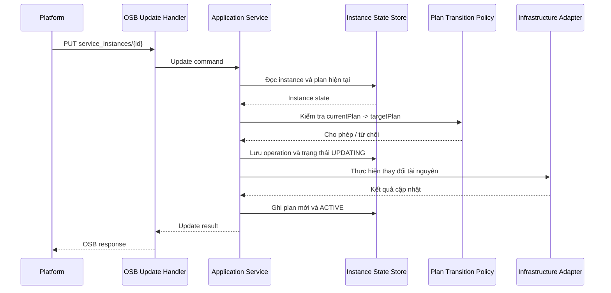
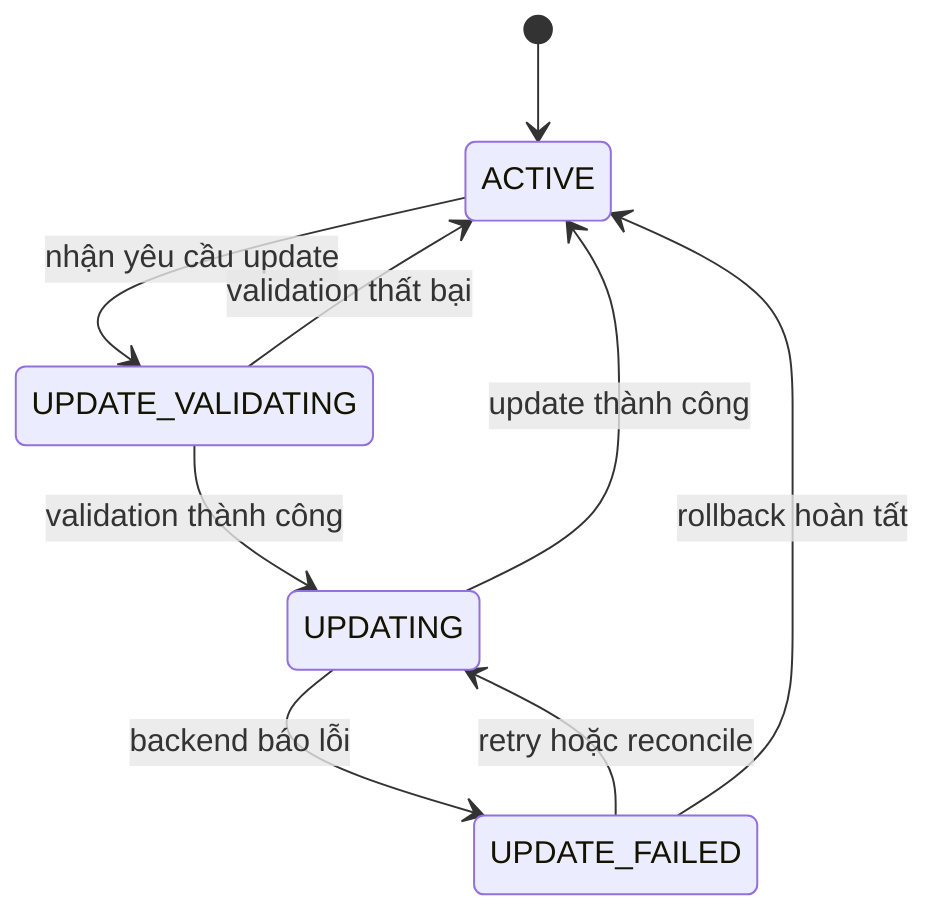

# Khai báo plan_updateable và giới hạn chuyển đổi gói

Một service broker có thể cho phép nền tảng thay đổi plan của một service instance sau khi cấp phát. Ví dụ, một database đang dùng plan `basic` có thể được nâng lên `standard` khi ứng dụng tăng tải. Khả năng này được công bố trong catalog bằng thuộc tính `plan_updateable` của service definition. Trong Spring Cloud Open Service Broker, ứng dụng thường thiết lập thuộc tính đó bằng Java builder qua `planUpdateable(true)`.

Thuộc tính này là một cam kết ở cấp service: broker có hỗ trợ yêu cầu thay đổi plan cho service đó hay không. Nó không có nghĩa mọi cặp plan đều chuyển đổi được, mọi instance đều đủ điều kiện hoặc backend có thể thay đổi tài nguyên ngay lập tức. Broker vẫn phải áp dụng chính sách chuyển đổi cụ thể, kiểm tra trạng thái instance và khả năng của hạ tầng trước khi chấp nhận từng yêu cầu.

## 1. Ý nghĩa của plan_updateable trong catalog

Trong OSB API, `plan_updateable` là capability của `ServiceDefinition`. Khi broker công bố catalog, nền tảng đọc thuộc tính này để biết service có hỗ trợ thay đổi plan sau khi provision hay không.

| Giá trị | Ý nghĩa | Hành vi nền tảng nên thực hiện |
|---|---|---|
| `true` | Service có hỗ trợ cập nhật plan | Có thể cung cấp thao tác thay đổi plan cho instance, tùy quy tắc và điều kiện của broker |
| `false` hoặc không công bố | Broker không quảng bá khả năng đổi plan | Không nên cung cấp luồng đổi plan cho service đó |

Trong JSON catalog, tên thuộc tính dùng dạng snake case `plan_updateable`. Trong Java builder của Spring Cloud Open Service Broker, tên method theo camel case là `planUpdateable(...)`.

Capability này cần được hiểu ở đúng phạm vi:

- Nó thuộc về service definition, không phải một cờ riêng cho từng plan.
- Nó cho biết broker có hỗ trợ plan update nói chung; broker vẫn có thể chỉ cho phép một số hướng chuyển đổi.
- Nó không thay thế việc triển khai handler cập nhật service instance trong ứng dụng.
- Nó không tự cấp quyền cho người dùng, tenant hoặc instance cụ thể.
- Nó không bảo đảm thao tác update hoàn tất đồng bộ; broker có thể cần xử lý bất đồng bộ nếu backend mất thời gian.

Không bật `plan_updateable` chỉ để giao diện nền tảng hiển thị thêm chức năng. Chỉ bật khi broker có quy trình cập nhật thật, có chính sách chuyển đổi và có thể giữ trạng thái nhất quán khi thành công hoặc thất bại.

## 2. Khai báo bằng Java builder

Thuộc tính được đặt khi xây dựng `ServiceDefinition`. Ví dụ dưới đây công bố một service PostgreSQL có hai plan và hỗ trợ thay đổi plan:

```java
import org.springframework.cloud.servicebroker.model.catalog.ServiceDefinition;
import org.springframework.cloud.servicebroker.model.catalog.Plan;

import java.util.List;

public final class DatabaseServiceCatalog {

    private DatabaseServiceCatalog() {
    }

    public static ServiceDefinition postgres(List<Plan> plans) {
        return ServiceDefinition.builder()
                .id("8f2f1f8a-5c7b-4d0a-9f30-000000000001")
                .name("postgresql-database")
                .description("Dịch vụ cơ sở dữ liệu PostgreSQL")
                .bindable(true)
                .planUpdateable(true)
                .plans(plans)
                .build();
    }
}
```

Khi serialize thành catalog OSB, framework biểu diễn capability này thành `plan_updateable: true`. Nếu service không hỗ trợ đổi plan, hãy đặt `planUpdateable(false)` hoặc để giá trị mặc định theo API phiên bản đang dùng. Khi đó, catalog không quảng bá khả năng chuyển đổi plan.

Nếu chỉ một service trong catalog hỗ trợ plan update, hãy đặt cờ trên đúng `ServiceDefinition` đó. Không dùng một cấu hình toàn cục để bật đồng loạt cho mọi service, vì khả năng của database, cache và object storage có thể khác nhau.

## 3. Phân biệt đổi plan và thay đổi tham số

OSB có endpoint cập nhật service instance. Request update có thể chứa `service_id`, `plan_id`, `parameters`, `previous_values` và các thông tin context theo phiên bản API. Việc thay đổi `plan_id` là thay đổi plan; việc thay `parameters` là cập nhật cấu hình của instance. Hai loại thay đổi có thể cùng xuất hiện trong một request nhưng không nên bị đánh đồng.

| Trường hợp | Ý nghĩa | Điều broker cần kiểm tra |
|---|---|---|
| Chỉ có `parameters` thay đổi | Cập nhật cấu hình trong cùng plan | Service có hỗ trợ tham số cập nhật hay không, schema và tính bất biến của từng tham số |
| `plan_id` thay đổi | Chuyển instance sang plan khác | `plan_updateable`, cặp plan nguồn/đích, trạng thái instance và năng lực backend |
| `plan_id` và `parameters` cùng thay đổi | Chuyển plan kèm cấu hình mới | Kiểm tra cả chính sách chuyển plan lẫn schema tham số của plan đích |
| `plan_id` không đổi hoặc không được gửi | Giữ nguyên plan hiện tại | Xử lý các thay đổi tham số nếu endpoint và service cho phép |

`plan_updateable` mô tả khả năng thay đổi plan. Nó không tự động có nghĩa mọi tham số đều có thể sửa. Một tham số như tên database hoặc vùng triển khai có thể bất biến sau khi tạo; tham số như giới hạn kết nối có thể cập nhật được. Broker phải định nghĩa riêng schema và quy tắc cập nhật tham số.

`previous_values` cung cấp thông tin về giá trị trước đó trong request update. Đây là dữ liệu hỗ trợ xử lý theo hợp đồng OSB; state store của broker vẫn là nguồn dữ liệu có thẩm quyền về service instance hiện tại. Không dùng `previous_values.plan_id` do client gửi làm bằng chứng duy nhất về plan đang được áp dụng.

## 4. Khai báo capability không đồng nghĩa cho phép mọi chuyển đổi

Giả sử service PostgreSQL công bố ba plan:

| Plan | Tài nguyên minh họa | Mục đích |
|---|---|---|
| `basic` | 1 vCPU, 2 GB RAM, 10 GB storage | Phát triển và tải nhỏ |
| `standard` | 2 vCPU, 8 GB RAM, 100 GB storage | Ứng dụng production thông thường |
| `high-availability` | Primary/standby, 4 vCPU, 16 GB RAM, 500 GB storage | Tải cao và yêu cầu dự phòng |

Broker có thể cho phép nâng từ `basic` lên `standard`, rồi từ `standard` lên `high-availability`. Nhưng chiều ngược lại có thể bị giới hạn nếu dữ liệu đang dùng vượt dung lượng plan đích, nếu kiến trúc standby chưa thể tháo bỏ an toàn hoặc nếu hạ tầng không hỗ trợ giảm tài nguyên trực tiếp.

Một ma trận chuyển đổi minh họa:

| Plan hiện tại | `basic` | `standard` | `high-availability` |
|---|---:|---:|---:|
| `basic` | Giữ nguyên | Cho phép | Cho phép |
| `standard` | Từ chối theo mặc định | Giữ nguyên | Cho phép |
| `high-availability` | Từ chối | Từ chối hoặc yêu cầu quy trình riêng | Giữ nguyên |

Ma trận là chính sách ví dụ, không phải quy tắc bắt buộc của OSB. Sản phẩm thực tế có thể cho phép downgrade sau khi kiểm tra dung lượng, có cửa sổ bảo trì hoặc yêu cầu người vận hành phê duyệt. Điều quan trọng là broker phải đưa ra kết quả nhất quán cho từng cặp plan và giải thích được lý do từ chối.

## 5. Xây dựng chính sách chuyển đổi trong domain

Không nên đặt ma trận chuyển đổi trực tiếp trong controller hoặc rải các điều kiện `if` theo tên plan trong handler. Hãy đưa chính sách vào một thành phần nghiệp vụ độc lập. Ví dụ đơn giản sau biểu diễn các chuyển đổi được cho phép theo ID plan:

```java
import java.util.Map;
import java.util.Set;

public final class PlanTransitionPolicy {

    private static final String BASIC = "plan-basic";
    private static final String STANDARD = "plan-standard";
    private static final String HIGH_AVAILABILITY = "plan-ha";

    private static final Map<String, Set<String>> ALLOWED = Map.of(
            BASIC, Set.of(STANDARD, HIGH_AVAILABILITY),
            STANDARD, Set.of(HIGH_AVAILABILITY),
            HIGH_AVAILABILITY, Set.of()
    );

    public void validate(String currentPlanId, String targetPlanId) {
        if (currentPlanId.equals(targetPlanId)) {
            return;
        }

        Set<String> targets = ALLOWED.getOrDefault(currentPlanId, Set.of());
        if (!targets.contains(targetPlanId)) {
            throw new UnsupportedPlanTransitionException(
                    currentPlanId, targetPlanId);
        }
    }
}
```

`UnsupportedPlanTransitionException` là exception nghiệp vụ do ứng dụng định nghĩa. Trong hệ thống thực, policy thường cần thêm context của instance và tenant thay vì chỉ so sánh hai ID:

```java
public record PlanChangeContext(
        String instanceId,
        String tenantId,
        String currentPlanId,
        String targetPlanId,
        long allocatedStorageGb,
        long usedStorageGb,
        String region,
        InstanceStatus status) {
}
```

Policy có thể kiểm tra:

- Instance đang ở trạng thái cho phép cập nhật, thường là `ACTIVE`.
- Plan đích tồn tại trong đúng service definition và còn được phép cấp phát.
- Plan nguồn và plan đích có cặp chuyển đổi được hỗ trợ.
- Dung lượng đang sử dụng không vượt giới hạn của plan đích.
- Vùng triển khai, loại storage, phiên bản engine hoặc cấu hình mạng tương thích.
- Tenant còn quota và được phép dùng plan đích.
- Không có operation provision, update hoặc deprovision khác đang chạy trên instance.
- Binding hiện tại có tương thích với thay đổi hoặc cần được xử lý theo quy trình riêng.

Những điều kiện động phải được kiểm tra từ state store và nguồn quota đáng tin cậy. Catalog chỉ công bố khả năng tổng quát; nó không chứa trạng thái hiện thời của từng instance.

## 6. Luồng xử lý update trong Spring Cloud Open Service Broker

Spring Cloud Open Service Broker cung cấp extension point cho vòng đời service instance. Ứng dụng triển khai xử lý update trong service tương ứng, sau đó chuyển request framework thành command nội bộ. Tên class và chữ ký method cụ thể phụ thuộc phiên bản thư viện; giữ phần chuyển đổi giao thức ở adapter và thực thi quy tắc ở application service.

Một luồng xử lý plan update có thể gồm:

1. Nhận request update và xác định `instance_id`, `service_id`, `plan_id` đích cùng parameters.
2. Đọc instance hiện tại từ state store; xác nhận instance thuộc service ID tương ứng và không ở trạng thái không cho phép cập nhật.
3. Xác định plan hiện tại từ dữ liệu broker đã lưu.
4. Nếu plan đích khác plan hiện tại, xác nhận service công bố `plan_updateable=true` và gọi `PlanTransitionPolicy`.
5. Kiểm tra parameters theo schema của plan đích; từ chối tham số bất biến hoặc không hợp lệ.
6. Lưu yêu cầu update và trạng thái operation để ngăn hai thao tác cạnh tranh trên cùng instance.
7. Gọi cổng nghiệp vụ/infrastructure adapter để thay đổi tài nguyên.
8. Khi thành công, cập nhật plan hiện tại và trạng thái instance; khi thất bại, ghi nhận kết quả và áp dụng chính sách phục hồi.

Sơ đồ trình tự:



Nếu policy từ chối, broker không gọi adapter và không thay đổi plan hiện tại. Response lỗi cần phản ánh request không thể thực hiện theo chính sách hoặc dữ liệu hiện tại, theo cách ánh xạ lỗi mà phiên bản OSB và framework hỗ trợ.

## 7. Xử lý update bất đồng bộ

Thay đổi plan có thể yêu cầu tăng dung lượng volume, tạo replica, chuyển dữ liệu, đổi cấu hình database hoặc thực hiện failover. Những công việc này có thể vượt quá thời gian xử lý HTTP request. Khi service và nền tảng hỗ trợ asynchronous operations, broker có thể chấp nhận yêu cầu, lưu operation và để worker thực hiện.

Một state machine đơn giản:



Trong triển khai thực tế, có thể biểu diễn trạng thái operation riêng với `PENDING`, `IN_PROGRESS`, `SUCCEEDED` và `FAILED`, đồng thời giữ trạng thái instance riêng. Không nên gán plan đích thành plan hiện tại ngay khi mới nhận request. Nên lưu riêng:

- `currentPlanId`: plan đang được xác nhận là có hiệu lực;
- `targetPlanId`: plan mà operation đang cố gắng áp dụng;
- `operationId`: định danh thao tác update;
- `previousPlanId`: plan trước thao tác để hỗ trợ reconcile hoặc rollback;
- `status`, `attempt`, thời điểm bắt đầu/kết thúc và lỗi đã chuẩn hóa.

Khi backend xác nhận hoàn tất, broker mới cập nhật `currentPlanId` thành plan đích. Nếu backend có thể áp dụng một phần, worker cần truy vấn trạng thái thực tế trước khi retry hoặc rollback. Tránh chỉ dựa trên kết quả timeout của HTTP call để kết luận backend chưa thay đổi gì.

Với thao tác bất đồng bộ, response ban đầu và endpoint truy vấn last operation phải tuân theo phiên bản OSB mà broker công bố. Nếu request không cho phép xử lý bất đồng bộ hoặc nền tảng không hỗ trợ khả năng đó, broker phải trả kết quả phù hợp theo hợp đồng thay vì âm thầm chuyển thao tác sang worker.

## 8. Idempotency, cạnh tranh và phục hồi

Nền tảng có thể gửi lại request update sau timeout. Worker cũng có thể chạy lại operation sau khi tiến trình khởi động lại. Do đó, plan update cần idempotent và có kiểm soát cạnh tranh.

Các biện pháp thường dùng:

- Gắn operation với instance ID và một request/correlation key ổn định; lưu dấu vết request đã xử lý.
- Dùng optimistic locking hoặc version column để hai request không cùng cập nhật một instance dựa trên cùng một trạng thái cũ.
- Đặt ràng buộc chỉ cho phép một operation thay đổi vòng đời đang hoạt động trên một instance tại một thời điểm.
- Truyền idempotency key đến backend nếu API hỗ trợ; nếu không, adapter cần kiểm tra cấu hình/tài nguyên hiện tại trước khi thực hiện lại.
- Ghi trạng thái operation trước khi gửi công việc ra worker; transactional outbox giúp tránh mất công việc giữa transaction state và hàng đợi.
- Phân loại lỗi có thể retry, lỗi cần rollback và lỗi cần can thiệp vận hành.

Ví dụ: instance đang ở `basic`, request chuyển sang `standard` đã tạo volume mới nhưng worker mất kết nối trước khi ghi nhận kết quả. Khi retry, worker cần kiểm tra volume và cấu hình backend theo operation ID. Nếu volume đã được tạo, worker tiếp tục từ bước phù hợp; không tạo thêm volume thứ hai hoặc cập nhật `currentPlanId` hai lần.

## 9. Giới hạn downgrade và thay đổi không thể đảo ngược

Downgrade thường phức tạp hơn upgrade vì có thể làm giảm dung lượng hoặc loại bỏ khả năng mà dữ liệu hiện tại đang phụ thuộc. Một số giới hạn cần xác định rõ:

| Rủi ro | Ví dụ | Chính sách có thể áp dụng |
|---|---|---|
| Dung lượng không đủ | Database đang dùng 80 GB nhưng plan đích chỉ có 50 GB | Từ chối downgrade hoặc yêu cầu giảm dữ liệu trước |
| Mất tính sẵn sàng | Chuyển từ primary/standby sang một node | Yêu cầu cửa sổ bảo trì hoặc quy trình chuyển đổi có kiểm soát |
| Tính năng không tương thích | Plan đích không hỗ trợ backup retention hiện tại | Kiểm tra parameters và thông báo giới hạn trước khi update |
| Quota tenant | Tenant đã dùng hết quota của plan đích | Từ chối hoặc chờ quota được giải phóng |
| Binding phụ thuộc plan | Ứng dụng đang dùng endpoint hoặc credential có đặc tính riêng | Giữ tương thích hoặc yêu cầu tái tạo binding theo chính sách |
| Backend không hỗ trợ shrink | API chỉ cho phép tăng volume | Không quảng bá hoặc không cho phép downgrade theo đường tự động |

Không nên thực hiện downgrade bằng cách thay đổi metadata plan trong database trước rồi mới tìm cách thu nhỏ tài nguyên. Trạng thái broker phải phản ánh tài nguyên thực tế. Nếu cần migration dữ liệu, hãy xem đó là workflow có các bước chuẩn bị, chuyển đổi, xác minh và bù trừ riêng.

## 10. Vòng đời plan và tương thích với instance hiện hữu

Catalog có thể thay đổi theo phiên bản triển khai. Một plan có thể bị ngừng cung cấp cho instance mới nhưng vẫn đang được instance cũ sử dụng. Vì vậy, cần phân biệt:

- **Plan được công bố:** nền tảng có thể chọn cho yêu cầu provision mới.
- **Plan được hỗ trợ cho instance hiện hữu:** broker vẫn có thể đọc trạng thái, cập nhật theo chính sách hoặc deprovision instance đã tạo bằng plan đó.
- **Plan được phép chuyển đến:** plan đích được cho phép trong ma trận chuyển đổi hiện hành.

Ẩn plan khỏi catalog không đồng nghĩa xóa dữ liệu plan khỏi hệ thống. Broker nên lưu service ID, plan ID và thông tin phiên bản cấu hình cần thiết cùng instance. Khi nhận update, broker có thể nhận diện plan cũ và áp dụng quy tắc migration rõ ràng. Khi nhận deprovision, broker vẫn phải thu hồi tài nguyên của instance ngay cả khi plan đó đã bị loại khỏi catalog hiện tại.

Nếu đổi ID plan, hãy xem đó là thay đổi hợp đồng có ảnh hưởng đến nền tảng và instance hiện hữu. Thông thường nên giữ ID ổn định, thay đổi metadata hiển thị hoặc thêm plan mới khi cần một lựa chọn khác biệt. Nếu buộc phải loại bỏ plan, cần có giai đoạn tương thích và chính sách cho instance cũ.

## 11. Kiểm thử capability và ma trận chuyển đổi

Kiểm thử cần xác nhận cả catalog công bố lẫn hành vi update thực tế:

| Phạm vi | Ca kiểm thử | Kết quả mong đợi |
|---|---|---|
| Catalog | Service có `planUpdateable(true)` | JSON catalog công bố `plan_updateable: true` |
| Catalog | Service không hỗ trợ đổi plan | Capability không được quảng bá là true |
| Policy | Cặp plan nằm trong allowlist | Cho phép đi tiếp sang bước kiểm tra instance/backend |
| Policy | Cặp plan bị cấm | Từ chối trước khi gọi infrastructure adapter |
| Policy | Plan đích không thuộc service | Từ chối request |
| Instance state | Instance đang `UPDATING` hoặc `DEPROVISIONING` | Không nhận thêm thao tác cạnh tranh |
| Resource constraint | Dung lượng hiện tại vượt giới hạn plan đích | Từ chối downgrade hoặc yêu cầu migration riêng |
| Async worker | Backend thành công nhưng worker bị dừng trước khi ghi state | Retry/reconcile không tạo tài nguyên trùng |
| Failure | Backend update thất bại | Giữ plan có hiệu lực hoặc ghi trạng thái cần reconcile rõ ràng |
| Compatibility | Plan cũ không còn công bố nhưng instance vẫn tồn tại | Vẫn có thể đọc và deprovision instance theo chính sách |

Ngoài unit test cho `PlanTransitionPolicy`, nên có contract test qua endpoint catalog và integration test cho `ServiceInstanceService` update. Test backend nên bao phủ timeout, lỗi một phần, retry, quota và giới hạn downgrade. Không chỉ kiểm tra rằng method `planUpdateable(true)` có mặt trong code; cần xác nhận JSON mà framework trả về và hành vi thật của endpoint update.

## 12. Những sai lầm thường gặp

- Bật `plan_updateable` nhưng chưa triển khai update handler.
- Xem `plan_updateable=true` là cho phép mọi cặp plan chuyển đổi tự do.
- Dựa vào tên plan hoặc display name thay vì ID ổn định.
- Cập nhật plan trong database trước khi backend hoàn tất thao tác.
- Không kiểm tra dung lượng, quota, trạng thái instance và binding phụ thuộc.
- Chỉ kiểm tra capability ở giao diện nền tảng mà không xác thực lại tại broker.
- Không khóa operation đồng thời hoặc không xử lý request lặp.
- Xóa plan khỏi catalog rồi mất khả năng xử lý instance cũ.

## Kết luận

`plan_updateable` cho nền tảng biết service có hỗ trợ thay đổi plan sau khi provision hay không. Trong Spring Cloud Open Service Broker, khai báo capability bằng `ServiceDefinition.builder().planUpdateable(true)` chỉ là bước công bố hợp đồng. Broker còn phải kiểm tra plan nguồn/đích, trạng thái instance, quota, dữ liệu, binding và năng lực backend cho từng request. Một ma trận chuyển đổi rõ ràng, state machine có lưu operation, cơ chế idempotency và chính sách tương thích cho plan cũ giúp việc nâng cấp hoặc hạ cấp tài nguyên diễn ra có kiểm soát và không làm sai lệch trạng thái mà nền tảng nhìn thấy.
