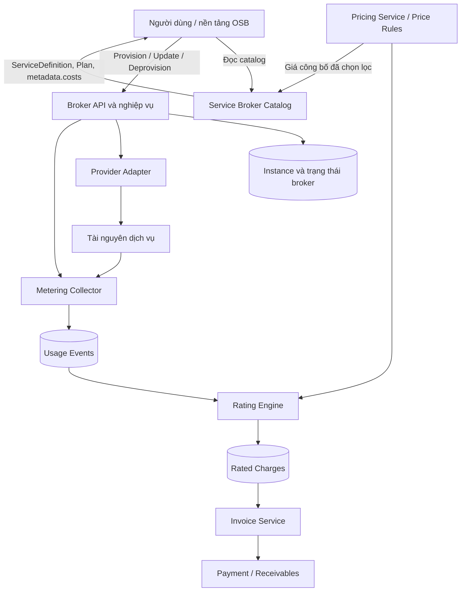

# Tách metadata về giá khỏi cơ chế tính phí thực tế

Trong một service broker theo Open Service Broker API (OSB API), service plan mô tả biến thể dịch vụ mà người dùng có thể chọn, còn metadata về giá giúp nền tảng trình bày thông tin chi phí của plan. Hai phần này có liên quan nhưng phục vụ hai mục đích khác nhau. Metadata như `metadata.costs` là thông tin công bố trong catalog; nó không tự đo mức sử dụng, không tạo khoản phải thu và không thay thế hệ thống tính phí.

Với `SPRING_CLOUD_SERVICE_BROKER`, cần giữ ranh giới rõ giữa catalog, chính sách giá, đo lường sử dụng và lập hóa đơn. Catalog cho biết plan nào tồn tại và có thể có giá hiển thị ra sao. Hệ thống billing phải xác định khách hàng nào chịu phí, tính phí theo quy tắc nào, dữ liệu sử dụng nào được chấp nhận, giá nào có hiệu lực tại thời điểm phát sinh và khoản phí đã được ghi nhận hay chưa.

## 1. Ba khái niệm cần phân biệt

### Service plan

Plan định nghĩa một gói cung cấp dịch vụ, thường gắn với cấu hình tài nguyên hoặc tính năng. Ví dụ plan `standard` của PostgreSQL có thể giới hạn CPU, bộ nhớ, dung lượng lưu trữ, số kết nối hoặc chính sách backup. Plan ID được nền tảng gửi lại trong các thao tác provision và update để broker biết cấu hình nào cần áp dụng.

Plan trả lời câu hỏi: *khách hàng được cấp loại dịch vụ và cấu hình nào?* Plan không nhất thiết định nghĩa đầy đủ cách khách hàng bị tính tiền. Cùng một plan có thể có giá khác nhau theo hợp đồng, khu vực, thời điểm, chương trình khuyến mại hoặc tài khoản.

### Metadata về giá

Metadata của plan có thể chứa `costs` để mô tả giá tham khảo theo đơn vị. Ví dụ: 15 USD cho mỗi instance mỗi tháng hoặc 0,02 USD cho mỗi GB-hour. Nền tảng có thể dùng dữ liệu này để hiển thị giá hoặc giúp người dùng so sánh plan.

Metadata trả lời câu hỏi: *người dùng nên được thông báo chi phí như thế nào khi khám phá catalog?* Nó là thông tin mô tả được công bố cùng catalog, không phải lệnh thu tiền hay kết quả tính phí.

### Cơ chế tính phí thực tế

Billing là quy trình xác định và ghi nhận số tiền khách hàng phải trả. Quy trình này có thể bao gồm đo lường mức sử dụng, áp dụng bảng giá có hiệu lực, tính phí định kỳ hoặc theo mức tiêu thụ, áp dụng chiết khấu và thuế, làm tròn, lập hóa đơn và đối soát thanh toán.

Billing trả lời câu hỏi: *tài khoản nào phải trả bao nhiêu cho khoảng thời gian hoặc sự kiện sử dụng cụ thể?* Quy trình này cần dữ liệu và quy tắc riêng, thường nằm trong billing hoặc metering service.

| Thành phần | Mục đích | Ví dụ |
|---|---|---|
| Plan | Mô tả gói và cấu hình dịch vụ | PostgreSQL Standard, 2 vCPU, 8 GB RAM |
| `metadata.costs` | Trình bày giá tham khảo trong catalog | 15 USD/instance/tháng |
| Price rule | Quy tắc dùng để tính tiền | 15 USD/tháng cộng 0,02 USD/GB-hour |
| Metering | Ghi nhận lượng sử dụng | Instance chạy 720 giờ, dùng 300 GB-hour |
| Rating | Chuyển usage thành khoản phí | 15 + 6 = 21 USD trước thuế |
| Invoice | Tổng hợp khoản phải trả | Hóa đơn tháng của tenant |

Không nên dùng một trường dữ liệu để đồng thời đại diện cho tất cả các khái niệm này. Tách chúng giúp thay đổi cách trình bày giá mà không làm sai lịch sử tính phí, đồng thời cho phép cập nhật chính sách billing mà không phải thay đổi service ID hoặc plan ID.

## 2. `metadata.costs` trong service plan dùng để làm gì?

Trong catalog OSB API, plan có thể có `metadata` chứa các thông tin bổ sung. Một số nền tảng hiểu thuộc tính `costs` để trình bày chi phí. Mỗi mục chi phí thường mô tả một `amount` theo đơn vị tiền tệ và một `unit` cho biết mức giá áp dụng trên đơn vị nào.

Ví dụ minh họa:

```json
{
  "id": "plan-postgresql-standard-v1",
  "name": "standard",
  "description": "PostgreSQL cho ứng dụng có tải vừa",
  "free": false,
  "metadata": {
    "displayName": "Standard",
    "bullets": [
      "2 vCPU và 8 GB RAM",
      "Backup hằng ngày",
      "Hỗ trợ service binding"
    ],
    "costs": [
      {
        "amount": {
          "usd": 15.00
        },
        "unit": "service instance per month"
      },
      {
        "amount": {
          "usd": 0.02
        },
        "unit": "GB-hour of storage"
      }
    ]
  }
}
```

Trong ví dụ, catalog trình bày hai thành phần giá: phí cố định theo instance mỗi tháng và giá tham khảo theo GB-hour lưu trữ. Cách hiển thị cụ thể phụ thuộc vào nền tảng tiêu thụ catalog. Một nền tảng có thể trình bày các mục chi phí, nền tảng khác có thể chỉ hiển thị tên và mô tả plan hoặc bỏ qua metadata mở rộng.

Các điểm cần nhớ:

- `costs` là metadata mô tả, không phải endpoint billing của OSB API.
- `amount` thể hiện số tiền theo mã tiền tệ được khai báo; `unit` diễn giải cơ sở tính giá.
- `unit` cần rõ nghĩa với người dùng, chẳng hạn `per instance per month`, `GB-hour` hoặc `1 million requests`.
- Nếu có nhiều thành phần chi phí, mỗi thành phần cần có đơn vị riêng để tránh cộng nhầm các đại lượng khác nhau.
- Metadata có thể được cache cùng catalog. Vì vậy không nên coi nó là nguồn giá động hoặc dữ liệu cá nhân hóa theo tài khoản.

Tên trường và cấu trúc phải tuân theo phiên bản OSB API mà broker công bố. Các khóa bổ sung trong `metadata` có thể là quy ước riêng; không nên giả định mọi nền tảng sẽ hiểu chúng giống nhau.

## 3. Vì sao metadata không thể thay thế billing?

Một mục giá trong catalog không có đủ thông tin để tính khoản phí cuối cùng. Chẳng hạn, giá `0,02 USD/GB-hour` không cho biết khách hàng đã dùng bao nhiêu GB-hour, usage thuộc tenant nào, khoảng thời gian nào, có được miễn phí một phần hay không và bảng giá nào có hiệu lực tại thời điểm sử dụng.

Metadata cũng không mô tả đầy đủ các tình huống vận hành:

- Khách hàng có thể có hợp đồng riêng hoặc mức chiết khấu theo tenant.
- Giá có thể thay đổi theo vùng triển khai, loại tài nguyên hoặc thời gian cao điểm.
- Một dịch vụ có thể tính phí khởi tạo một lần, phí duy trì định kỳ và phí theo mức sử dụng.
- Mức sử dụng có thể nằm trong hạn mức miễn phí trước khi bắt đầu tính phí.
- Phí theo bậc có thể thay đổi khi tổng lượng sử dụng vượt một ngưỡng.
- Thuế, tiền tệ thanh toán, tỷ giá và quy tắc làm tròn có thể phụ thuộc địa chỉ thanh toán hoặc hợp đồng.
- Instance có thể được tạo hoặc xóa giữa kỳ, cần chính sách prorating (tính tỷ lệ theo thời gian thực tế).
- Sự kiện usage có thể đến trễ, bị gửi lại hoặc cần điều chỉnh sau đối soát.

Catalog không phải nơi lưu những quyết định này. Nếu lấy `metadata.costs` làm giá trị duy nhất để lập hóa đơn, hệ thống sẽ thiếu lịch sử giá, dữ liệu sử dụng và khả năng xử lý các trường hợp phát sinh.

## 4. Kiến trúc tách catalog, pricing, metering và billing

Một kiến trúc có thể chia thành các thành phần sau:



Catalog và pricing service có thể dùng chung một nguồn định nghĩa plan, nhưng chúng có nhiệm vụ khác nhau. Catalog tạo bản mô tả công khai cho nền tảng. Pricing service giữ quy tắc có hiệu lực và có thể lựa chọn giá theo tenant, hợp đồng, khu vực hoặc thời điểm. Metering collector thu thập usage. Rating engine áp dụng price rule lên usage. Invoice service tổng hợp khoản phí thành hóa đơn.

Một triển khai nhỏ có thể đặt các thành phần trong cùng một ứng dụng hoặc cùng một database. Dù vậy, nên giữ ranh giới dữ liệu và interface rõ ràng để sau này có thể tách dịch vụ mà không phải viết lại logic nghiệp vụ.

## 5. Thiết kế nguồn dữ liệu giá riêng

Thay vì đọc giá trực tiếp từ catalog để tính tiền, broker hoặc billing system nên có mô hình giá riêng. Ví dụ, một price rule có thể gồm:

| Thuộc tính | Ý nghĩa |
|---|---|
| `priceRuleId` | Định danh duy nhất của quy tắc giá |
| `serviceId`, `planId` | Plan hoặc dịch vụ mà quy tắc áp dụng |
| `billingMetric` | Đại lượng tính phí như instance-hour, GB-hour hoặc request count |
| `amount` | Đơn giá cho một đơn vị |
| `currency` | Mã tiền tệ |
| `billingPeriod` | Chu kỳ tính phí nếu là phí định kỳ |
| `effectiveFrom`, `effectiveTo` | Khoảng thời gian quy tắc có hiệu lực |
| `tenantScope` / `contractId` | Phạm vi khách hàng hoặc hợp đồng nếu có |
| `tierPolicy` | Quy tắc tính bậc nếu giá phụ thuộc mức tiêu thụ |
| `roundingPolicy` | Quy tắc độ chính xác và làm tròn |

Một kiểu Java đơn giản có thể biểu diễn giá cơ bản như sau:

```java
import java.math.BigDecimal;
import java.time.Instant;

public record PriceRule(
        String id,
        String serviceId,
        String planId,
        String metric,
        BigDecimal unitPrice,
        String currency,
        Instant effectiveFrom,
        Instant effectiveTo) {
}
```

Đây là mô hình minh họa. Hệ thống thực tế có thể cần thêm tenant, contract, tier, thuế, chu kỳ, phiên bản và trạng thái phê duyệt. Dùng `BigDecimal` cho tiền thay vì `float` hoặc `double` để tránh sai số nhị phân khi tính toán số thập phân. Cần thống nhất scale và rounding mode tại ranh giới rating hoặc invoice.

Price rule nên được quản lý theo phiên bản và khoảng hiệu lực. Khi giá thay đổi, tạo quy tắc mới với `effectiveFrom` thay vì sửa đè đơn giá cũ. Nhờ vậy, hệ thống có thể tính lại hoặc giải trình hóa đơn của kỳ trước theo đúng giá tại thời điểm phát sinh usage.

## 6. Đo lường mức sử dụng bằng metering

Với mô hình usage-based, billing cần biết lượng tài nguyên thực tế đã sử dụng. Metering collector có thể lấy dữ liệu từ provider, hệ thống giám sát, bộ điều khiển tài nguyên hoặc sự kiện vòng đời của broker.

Một usage event thường cần những thông tin như:

- `eventId`: định danh duy nhất để chống ghi nhận trùng.
- `tenantId` hoặc `accountId`: chủ thể chịu phí, lấy từ nguồn danh tính đáng tin cậy.
- `serviceInstanceId`: instance phát sinh usage.
- `metric`: loại đại lượng được đo, ví dụ `storage_gb_hour` hoặc `request_count`.
- `quantity`: lượng sử dụng và đơn vị tương ứng.
- `measuredAt` hoặc khoảng thời gian đo: thời điểm hoặc kỳ mà usage thuộc về.
- `source` và `sourceVersion`: nguồn phát sinh và phiên bản dữ liệu để hỗ trợ đối soát.

Ví dụ event JSON:

```json
{
  "eventId": "usage-2026-11-27-000184",
  "tenantId": "tenant-42",
  "serviceInstanceId": "instance-9a21",
  "serviceId": "managed-postgresql",
  "planId": "plan-postgresql-standard-v1",
  "metric": "storage_gb_hour",
  "quantity": 300.0,
  "unit": "GB-hour",
  "measuredAt": "2026-11-27T10:00:00Z",
  "source": "provider-metering"
}
```

Event usage không nên chứa thông tin xác thực hoặc dữ liệu người dùng không cần thiết cho tính phí. Trước khi ghi nhận, cần xác minh tenant và instance có tồn tại, instance thuộc tenant đó và metric được phép đo cho service/plan tương ứng.

### Chống ghi nhận trùng và xử lý dữ liệu đến trễ

Hệ thống metering thường nhận lại event do retry hoặc giao nhận ít nhất một lần. `eventId` cần có unique constraint hoặc cơ chế idempotency tương đương để một event chỉ được ghi nhận một lần. Nếu nguồn gửi cùng event ID nhưng payload khác nhau, cần phát hiện xung đột và đưa vào quy trình kiểm tra.

Usage có thể đến trễ hoặc được điều chỉnh sau đối soát. Nên lưu thời điểm đo riêng với thời điểm hệ thống nhận event. Chính sách chốt kỳ cần quy định khoảng thời gian chờ dữ liệu, cách ghi nhận adjustment và cách phát hành credit/debit khi có sai lệch.

## 7. Rating: chuyển usage thành khoản phí

Rating engine nhận usage đã được xác thực, chọn price rule có hiệu lực tại thời điểm usage và tính thành rated charge. Với mô hình giá đơn giản:

\[
\text{Charge} = \text{Quantity} \times \text{Unit Price}
\]

Ví dụ khách hàng sử dụng 300 GB-hour và giá áp dụng là 0,02 USD/GB-hour:

\[
300 \times 0.02 = 6.00\text{ USD}
\]

Nếu plan còn có phí cố định 15 USD/instance/tháng, khoản phí trước thuế trong tháng có thể là 21 USD. Kết quả chỉ đúng khi instance hoạt động đủ kỳ, không có miễn phí, chiết khấu, prorating hoặc các điều chỉnh khác.

Ví dụ code minh họa phép tính cơ bản:

```java
import java.math.BigDecimal;
import java.math.RoundingMode;

public class RatingCalculator {

    public BigDecimal calculate(
            BigDecimal quantity,
            BigDecimal unitPrice) {
        return quantity.multiply(unitPrice)
                .setScale(2, RoundingMode.HALF_UP);
    }
}
```

Trong hệ thống thật, không nên để một hàm tính đơn giá đơn giản quyết định toàn bộ khoản phải thu. Rating cần chọn đúng price rule theo tenant, plan, metric, khu vực, thời điểm và hợp đồng; áp dụng tier, miễn phí, chiết khấu, thuế hoặc prorating theo chính sách; sau đó lưu kết quả cùng thông tin nguồn để có thể giải trình.

Một rated charge nên tham chiếu usage event hoặc khoảng usage, price rule ID và phiên bản, đơn vị, số lượng, đơn giá, tiền tệ, số tiền sau tính toán và kỳ billing. Dữ liệu này giúp kiểm tra vì sao một khoản phí xuất hiện trên hóa đơn.

## 8. Các mô hình giá phổ biến và cách trình bày trong catalog

| Mô hình giá | Ví dụ | Cách thể hiện trong metadata |
|---|---|---|
| Phí cố định định kỳ | 15 USD mỗi instance mỗi tháng | Một cost item với unit rõ ràng |
| Phí một lần | 5 USD khi khởi tạo instance | Ghi rõ đơn vị là phí khởi tạo một lần |
| Theo mức sử dụng | 0,02 USD mỗi GB-hour | Một cost item cho metric và unit tương ứng |
| Theo số lượng request | 0,10 USD mỗi một triệu request | Ghi rõ đơn vị và bội số |
| Kết hợp | Phí instance cộng phí lưu trữ và request | Nhiều cost item, mỗi item có unit riêng |
| Theo bậc | 0,02 USD cho 100 GB-hour đầu, giá khác cho phần vượt | Metadata có thể chỉ trình bày giá khởi điểm; giải thích bậc trong tài liệu giá riêng |
| Theo hợp đồng | Giá khác nhau theo tenant hoặc cam kết | Công bố thông tin chung phù hợp; giá cá nhân hóa lấy từ pricing service |

Metadata phù hợp nhất với những thông tin giá có thể trình bày ngắn gọn và tương đối ổn định. Nếu giá phụ thuộc nhiều điều kiện, không nên cố nhồi toàn bộ công thức vào `unit` hoặc các khóa metadata tùy chỉnh. Có thể công bố mức giá cơ sở hoặc hướng dẫn người dùng đến tài liệu giá, đồng thời để pricing service quyết định số tiền thực tế.

Nếu nền tảng không hỗ trợ hiển thị `costs`, người dùng vẫn cần được cung cấp thông tin giá qua giao diện quản trị, tài liệu hoặc quy trình bán hàng phù hợp. Không thể giả định mọi nền tảng OSB đều có cùng cách diễn giải metadata.

## 9. Quan hệ giữa `free`, metadata chi phí và chính sách tính phí

Plan có thể có trường `free` để khai báo plan miễn phí theo hợp đồng catalog. Trường này và `metadata.costs` cần nhất quán với chính sách giá thực tế. Tuy nhiên, `free` không thay thế logic kiểm tra quyền, quota hoặc billing.

Ví dụ:

- Plan thử nghiệm miễn phí: `free` có thể là `true`; pricing policy phải xác định rõ hạn mức miễn phí và điều kiện vượt hạn mức.
- Plan tính phí cố định: `free` là `false`; metadata có thể hiển thị phí định kỳ và billing ghi nhận phí theo chu kỳ.
- Plan miễn phí phần cấp phát nhưng tính phí vượt mức: catalog cần mô tả rõ điều kiện miễn phí; metering và rating phải áp dụng ngưỡng miễn phí.
- Plan có giá theo hợp đồng: catalog có thể không công bố một mức giá phổ quát; pricing service lấy hợp đồng của tenant để tính phí.

Đặc biệt, không nên đặt `free: true` chỉ vì catalog không có `costs`. Việc thiếu metadata giá không chứng minh dịch vụ miễn phí. Ngược lại, nếu plan được công bố miễn phí nhưng billing vẫn tính phí cơ bản, giao diện và hóa đơn sẽ mâu thuẫn. Hãy xác định chính sách giá trước rồi mới quyết định cách công bố.

## 10. Thay đổi giá và quản lý vòng đời plan

Plan ID thường được nền tảng lưu cùng service instance. Khi thay đổi giá, cần quyết định giá mới áp dụng cho instance mới, instance hiện hữu hay cả hai. Không nên thay đổi một đơn giá trong cấu hình dùng chung rồi vô tình làm thay đổi kết quả tính phí của kỳ trước.

Một chiến lược có kiểm soát gồm:

1. Tạo price rule phiên bản mới với thời điểm bắt đầu hiệu lực rõ ràng.
2. Giữ nguyên price rule cũ để tính usage thuộc các kỳ trước.
3. Xác định chính sách áp dụng cho khách hàng hiện tại: grandfathering (giữ giá cũ), chuyển giá sau thông báo hoặc yêu cầu khách hàng chấp thuận.
4. Cập nhật `metadata.costs` nếu giá công bố thay đổi, đồng thời đồng bộ thời điểm hiệu lực và tài liệu giải thích.
5. Nếu thay đổi cấu hình plan chứ không chỉ thay đổi giá, đánh giá việc tạo plan ID mới hoặc cơ chế versioning để tránh diễn giải sai instance hiện hữu.
6. Đối soát các hóa đơn đang mở và usage đến trễ qua ranh giới thời điểm đổi giá.

Ví dụ, giá lưu trữ tăng từ 0,02 lên 0,025 USD/GB-hour từ ngày đầu tháng sau. Usage trước thời điểm hiệu lực phải được rating theo giá cũ; usage sau thời điểm đó theo giá mới. Nếu một event được gửi đến muộn, rating phải dựa trên `measuredAt` và chính sách thời điểm áp dụng, không đơn giản lấy giá hiện tại lúc nhận event.

Catalog có thể được cache bởi nền tảng. Vì vậy, việc cập nhật metadata không đảm bảo mọi giao diện hiển thị giá mới ngay lập tức. Billing vẫn phải dùng price rule có hiệu lực trong hệ thống của mình, không dựa vào bản catalog mà nền tảng đang cache.

## 11. Tích hợp với Spring service broker

Trong ứng dụng Spring, nên giữ `CatalogService` tập trung vào việc trả catalog. Logic tính giá và lập hóa đơn nên nằm trong các service nghiệp vụ riêng, có interface rõ ràng.

```java
public interface CatalogPricingView {
    List<PlanCostView> costsFor(String serviceId, String planId);
}

public interface PricingService {
    PriceRule findApplicableRule(
            String tenantId,
            String serviceId,
            String planId,
            String metric,
            Instant measuredAt);
}

public interface MeteringService {
    void recordUsage(UsageEvent event);
}

public interface RatingService {
    RatedCharge rate(UsageEvent event);
}
```

`CatalogPricingView` chỉ cung cấp dữ liệu đã chọn lọc để hiển thị trong catalog. `PricingService` tìm quy tắc tính tiền. `MeteringService` tiếp nhận usage. `RatingService` tính khoản phí. Các interface trên là thiết kế minh họa thuộc ứng dụng, không phải API được Spring Cloud Open Service Broker cung cấp sẵn.

Một implementation `CatalogService` có thể lấy thông tin trình bày giá từ `CatalogPricingView`, nhưng không nên gọi rating cho từng request catalog. Catalog cần phản hồi nhanh, ổn định và không tạo side effect. Việc đọc catalog không được ghi nhận usage hoặc phát sinh khoản phí.

Khi provision thành công, broker có thể phát một sự kiện vòng đời để hệ thống metering biết instance bắt đầu hoạt động. Khi deprovision, hệ thống ghi nhận thời điểm kết thúc để dừng tính phí theo chính sách. Sự kiện vòng đời và số đo usage nên được lưu có định danh, timestamp và khả năng xử lý lặp an toàn.

## 12. Bảo mật và tính toàn vẹn dữ liệu tính phí

Billing là dữ liệu tài chính nên cần kiểm soát chặt chẽ:

- Chỉ nhận usage từ nguồn được xác thực; không tin số lượng do client tự gửi nếu client không có quyền khai báo số đo.
- Ràng buộc usage với tenant và instance bằng dữ liệu sở hữu đáng tin cậy.
- Lưu event ID duy nhất để chống ghi nhận trùng và lưu payload gốc để đối soát khi cần.
- Giới hạn quyền sửa price rule; ghi audit log cho thao tác tạo, phê duyệt, kích hoạt và ngừng hiệu lực giá.
- Không sửa đè rated charge hoặc hóa đơn đã chốt. Điều chỉnh nên được biểu diễn bằng credit/debit hoặc adjustment có liên kết với bản ghi gốc.
- Bảo vệ dữ liệu hợp đồng và giá riêng theo tenant; không đưa giá cá nhân hóa vào catalog công khai.
- Dùng transaction hoặc outbox khi phối hợp thay đổi trạng thái instance với phát sự kiện tính phí.
- Có cơ chế reconciliation để so sánh usage broker ghi nhận với số liệu từ provider.

Đặc biệt, việc deprovision và billing có thể diễn ra ở hai hệ thống khác nhau. Nếu broker đã xóa instance nhưng sự kiện kết thúc không đến metering, hệ thống có thể tiếp tục tính phí. Ngược lại, nếu dừng tính phí trước khi tài nguyên thực sự bị thu hồi, khách hàng có thể được dùng tài nguyên miễn phí ngoài chính sách. Cần định nghĩa thời điểm bắt đầu và kết thúc tính phí một cách nhất quán.

## 13. Kiểm thử metadata và billing độc lập

Nên có các nhóm kiểm thử riêng cho thông tin công bố và cơ chế tính tiền.

**Kiểm thử catalog metadata:**

- `costs` có amount và unit rõ ràng.
- Currency code được hỗ trợ và định dạng amount hợp lệ.
- Mỗi cost item mô tả một đơn vị nhất quán.
- `free` khớp với chính sách công bố.
- Metadata không chứa credential hoặc giá riêng của tenant khác.
- Catalog trả về đúng cấu trúc OSB API và không thực hiện side effect billing.

**Kiểm thử pricing và rating:**

- Chọn đúng price rule theo service, plan, tenant, metric và thời điểm.
- Usage lặp event ID không tạo rated charge thứ hai.
- Usage đến trễ được tính theo thời điểm đo và price rule có hiệu lực.
- Phí cố định, phí theo mức sử dụng, ngưỡng miễn phí và tier được tính đúng.
- Tiền tệ, scale và rounding nhất quán.
- Thay đổi giá không làm thay đổi hóa đơn đã chốt hoặc usage thuộc thời kỳ cũ.
- Usage của tenant này không thể được gắn sang instance của tenant khác.

Ví dụ unit test cho phép tính giá cơ bản:

```java
class RatingCalculatorTest {

    private final RatingCalculator calculator = new RatingCalculator();

    @Test
    void multipliesUsageByUnitPrice() {
        BigDecimal charge = calculator.calculate(
                new BigDecimal("300"),
                new BigDecimal("0.02"));

        assertThat(charge).isEqualByComparingTo("6.00");
    }
}
```

Kiểm thử trên chỉ xác minh phép nhân và quy tắc làm tròn cơ bản. Hệ thống production cần thêm kiểm thử tích hợp cho lưu usage, transaction, retry, lựa chọn price rule, tạo rated charge và tổng hợp invoice.

## 14. Những sai lầm thường gặp

**Dùng `metadata.costs` làm nguồn tính tiền:** catalog có thể được cache, thiếu usage và không biết hợp đồng của tenant. Hãy dùng pricing service và dữ liệu metering làm đầu vào cho rating.

**Coi plan không có `costs` là miễn phí:** thiếu thông tin hiển thị không đồng nghĩa không có phí. Chính sách miễn phí phải được xác định rõ trong price rule và trường `free`.

**Công bố giá không có đơn vị:** số tiền `0,02` không có ý nghĩa nếu người dùng không biết là theo GB, GB-hour hay một triệu request. Mỗi cost item phải nêu rõ unit.

**Ghi đè giá cũ:** làm mất khả năng tính lại hoặc giải trình hóa đơn lịch sử. Hãy version price rule và quản lý thời điểm hiệu lực.

**Công bố giá cá nhân hóa trong catalog chung:** có thể làm lộ điều khoản hợp đồng của tenant. Chỉ công bố mức chung; lấy giá riêng từ pricing service sau khi xác thực tài khoản.

**Không chống trùng usage event:** retry có thể làm khách hàng bị tính phí hai lần. Dùng event ID duy nhất, constraint và xử lý idempotent.

**Cho rằng giao diện nền tảng sẽ hiển thị mọi metadata:** các nền tảng có thể xử lý metadata khác nhau. Cung cấp tài liệu giá và giao diện phù hợp cho trường hợp cần diễn giải chi tiết.

## 15. Trình tự triển khai cho service broker

Khi triển khai giá cho broker, có thể đi theo trình tự sau:

1. Xác định plan mô tả cấu hình tài nguyên và tính năng nào; không trộn quy tắc thu tiền vào định danh plan.
2. Chọn thông tin giá nào đủ ổn định để công bố trong `metadata.costs`, gồm amount, currency và unit.
3. Thiết kế price rule riêng có tenant/contract scope và khoảng hiệu lực.
4. Xác định nguồn metering cho từng metric, event ID, timestamp và đơn vị đo.
5. Xây dựng rating để chọn price rule và tính khoản phí có thể giải trình.
6. Xây dựng invoice hoặc tích hợp hệ thống receivables/payment theo quy trình tài chính của sản phẩm.
7. Đồng bộ sự kiện provision/deprovision với thời điểm bắt đầu/kết thúc tính phí.
8. Kiểm thử tính nhất quán giữa `free`, metadata công bố, price rule, usage và hóa đơn.
9. Quản lý thay đổi giá bằng phiên bản và thời điểm hiệu lực; giữ lịch sử để đối soát.

Khi tách rõ metadata giá khỏi metering, rating và billing, catalog có thể cung cấp thông tin dễ hiểu cho nền tảng trong khi hệ thống tài chính vẫn tính phí dựa trên usage, hợp đồng và bảng giá có hiệu lực. Cách tổ chức này giúp broker thay đổi cách công bố plan mà không làm sai lệch các khoản phí đã phát sinh hoặc hóa đơn của khách hàng.
