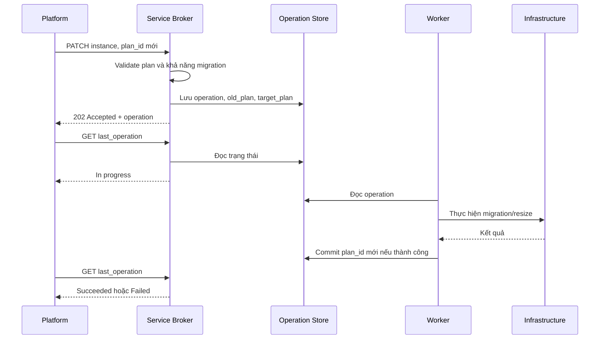

# Thêm, ngừng cung cấp và thay đổi gói mà vẫn quản lý được instance cũ

Service plan mô tả một lựa chọn dịch vụ mà platform có thể cung cấp cho người dùng. Với Spring Cloud Service Broker, một service như PostgreSQL có thể có các plan `starter`, `standard` và `high-availability`, mỗi plan quy định dung lượng, hiệu năng, tính sẵn sàng, giới hạn sử dụng hoặc mức hỗ trợ khác nhau. Theo thời gian, broker cần thêm plan mới, ngừng nhận provision cho plan cũ hoặc thay đổi cách cung cấp plan mà vẫn phải quản lý được những service instance đã tạo trước đó.

Open Service Broker API (OSB API) tách service definition khỏi service instance. Catalog công bố các service plan hiện có để platform khám phá và lựa chọn. Khi provision, platform gửi `service_id` và `plan_id`; broker phải lưu liên kết đó để xử lý update, binding, truy vấn trạng thái và deprovision về sau. Vì vậy, vòng đời plan cần được thiết kế cùng với vòng đời tài nguyên, dữ liệu lịch sử và khả năng tương thích của broker.

## 1. Service plan là gì?

Một service definition đại diện cho một loại dịch vụ, ví dụ PostgreSQL. Một service plan là một cấu hình được đặt tên trong service đó, ví dụ:

| Plan | Cấu hình minh họa | Đối tượng sử dụng |
|---|---|---|
| `starter` | 1 vCPU, RAM 1 GB, dung lượng 5 GB, backup giới hạn | Học tập hoặc thử nghiệm |
| `standard` | 2 vCPU, RAM 4 GB, dung lượng 50 GB, backup hằng ngày | Ứng dụng production tải vừa |
| `high-availability` | 4 vCPU, RAM 16 GB, dung lượng 200 GB, nhiều replica và failover | Hệ thống cần tính sẵn sàng cao |

Các thông số trên là ví dụ nghiệp vụ. OSB API không bắt buộc mọi broker phải dùng cùng cách tính CPU, RAM hay dung lượng. Broker xác định ý nghĩa thực tế của plan và phải thực thi nhất quán với thông tin đã công bố.

Trong catalog, một service definition thường có các field:

- `id`: định danh service ổn định.
- `name`, `description`: tên và mô tả service.
- `bindable`: cho biết service instance có hỗ trợ binding hay không.
- `plans`: danh sách plan được công bố.
- `plan_updateable`: cho biết broker hỗ trợ thay đổi plan của instance đã provision hay không.
- `metadata`, `tags`, `requires`: thông tin bổ sung, phân loại và yêu cầu capability của platform.

Một plan thường có `id`, `name`, `description`, `free`, `bindable`, `metadata` và có thể có schema cho parameters. Các field cụ thể phụ thuộc phiên bản OSB API mà broker công bố. Không nên dùng metadata tùy chỉnh để thay thế một field giao thức đã có ý nghĩa chuẩn.

Ví dụ catalog rút gọn:

```json
{
  "services": [
    {
      "id": "postgresql-service-v1",
      "name": "postgresql",
      "description": "Dịch vụ PostgreSQL được quản lý",
      "bindable": true,
      "plan_updateable": true,
      "plans": [
        {
          "id": "postgresql-starter-v1",
          "name": "starter",
          "description": "Dành cho môi trường thử nghiệm",
          "free": true,
          "bindable": true
        },
        {
          "id": "postgresql-standard-v1",
          "name": "standard",
          "description": "Dành cho ứng dụng production tải vừa",
          "free": false,
          "bindable": true
        }
      ]
    }
  ]
}
```

`plan_updateable` nằm ở service definition và mô tả khả năng thay đổi plan của service instance. Nếu broker công bố `true`, broker cần triển khai luồng update tương ứng trong OSB API. Nếu broker không hỗ trợ thay đổi plan, không nên công bố khả năng này chỉ để marketplace hiển thị một lựa chọn.

## 2. Định danh plan và dữ liệu cần lưu

### 2.1. `plan_id` là định danh, không phải tên hiển thị

Platform gửi `plan_id` trong request provision và có thể gửi `plan_id` mới trong request update. `plan_id` phải được giữ ổn định trong suốt vòng đời của plan. Tên hiển thị, mô tả, giá trình bày hoặc metadata có thể thay đổi theo chính sách, nhưng thay đổi `name` không nên làm thay đổi ý nghĩa của ID đã được lưu trên các instance.

Ví dụ:

| Thuộc tính | Giá trị |
|---|---|
| `service_id` | `postgresql-service-v1` |
| `plan_id` | `postgresql-standard-v1` |
| `name` | `standard` |
| Display name | `PostgreSQL Standard` |
| Nội dung cấu hình | 2 vCPU, RAM 4 GB, 50 GB storage |

Trong dữ liệu broker, nên xác định plan bằng cặp `service_id` và `plan_id`, đồng thời giữ phạm vi platform nếu broker phục vụ nhiều platform instance. Không dùng tên plan làm khóa vì tên có thể trùng giữa các service hoặc được đổi cho mục đích trình bày.

### 2.2. Lưu plan được chọn trên service instance

Khi provision thành công hoặc được chấp nhận xử lý, broker cần lưu các thông tin đủ để quản lý tài nguyên về sau:

| Trường dữ liệu gợi ý | Mục đích |
|---|---|
| `platform_instance_id` | Phạm vi platform sở hữu instance |
| `service_instance_id` | ID instance do platform gửi |
| `service_id` | Service definition đã được chọn |
| `plan_id` | Plan đã được chọn tại thời điểm provision hoặc update thành công |
| `plan_revision` | Phiên bản cấu hình nội bộ được áp dụng |
| `plan_snapshot` hoặc tham chiếu cấu hình | Giữ lại các tham số cần thiết để vận hành instance cũ |
| `parameters` | Các tùy chọn người dùng gửi khi provision/update, sau khi loại bỏ dữ liệu nhạy cảm khỏi log |
| `status` | Trạng thái tài nguyên và operation |

`plan_revision` và `plan_snapshot` là đề xuất mô hình dữ liệu nội bộ, không phải field bắt buộc của OSB API. Chúng hữu ích khi broker thay đổi cấu hình plan hiện tại nhưng vẫn cần biết tài nguyên cũ được tạo với giới hạn hoặc quy tắc nào. Không lưu secret dạng rõ trong snapshot; lưu tham chiếu đến secret manager hoặc kho credential bảo mật.

Ví dụ bảng dữ liệu tối giản:

```sql
CREATE TABLE service_plan_revision (
    service_id       VARCHAR(128) NOT NULL,
    plan_id          VARCHAR(128) NOT NULL,
    revision         INTEGER NOT NULL,
    lifecycle_state  VARCHAR(24) NOT NULL,
    configuration    JSON NOT NULL,
    created_at       TIMESTAMP NOT NULL,
    PRIMARY KEY (service_id, plan_id, revision)
);

CREATE TABLE service_instance (
    platform_instance_id VARCHAR(128) NOT NULL,
    service_instance_id  VARCHAR(128) NOT NULL,
    service_id           VARCHAR(128) NOT NULL,
    plan_id              VARCHAR(128) NOT NULL,
    plan_revision        INTEGER NOT NULL,
    status               VARCHAR(24) NOT NULL,
    PRIMARY KEY (platform_instance_id, service_instance_id)
);
```

DDL trên minh họa cách giữ phiên bản plan và liên kết instance. Kiểu JSON, timestamp và cú pháp khóa cần điều chỉnh theo hệ quản trị cơ sở dữ liệu thực tế.

## 3. Thêm service plan mới

Thêm plan mới thường là thay đổi tương thích nếu plan hiện tại vẫn giữ nguyên ID và hành vi. Ví dụ broker bổ sung `high-availability` cho PostgreSQL trong khi các instance `starter` và `standard` tiếp tục hoạt động.

Quy trình nên gồm:

1. Xác định cấu hình và capability cần thiết của plan mới: CPU, RAM, storage, backup, replication, network hoặc giới hạn kết nối.
2. Cấp `plan_id` mới, ổn định và chưa được dùng cho một plan có ý nghĩa khác.
3. Cập nhật catalog để công bố plan mới cùng mô tả, metadata, `free`, `bindable` và schema parameters phù hợp.
4. Kiểm tra broker có thể provision và bind instance với plan mới trên từng platform được hỗ trợ.
5. Phát hành catalog và theo dõi request provision, operation, chi phí và tài nguyên thực tế.

Thêm plan không có nghĩa tự động chuyển các instance cũ sang plan mới. Instance cũ tiếp tục gắn với `plan_id` mà platform đã chọn. Chỉ thay đổi plan của instance khi có request update hợp lệ và broker hỗ trợ khả năng đó.

Ví dụ request provision:

```http
PUT /v2/service_instances/db-prod-17?accepts_incomplete=true HTTP/1.1
Content-Type: application/json
X-Broker-API-Version: 2.17
Authorization: Basic <broker-credentials>

{
  "service_id": "postgresql-service-v1",
  "plan_id": "postgresql-high-availability-v1",
  "organization_guid": "org-42",
  "space_guid": "space-17",
  "parameters": {
    "storage_gb": 200,
    "backup_retention_days": 30
  }
}
```

Broker cần xác thực `service_id` và `plan_id`, kiểm tra plan đang cho phép provision, validate parameters theo schema và kiểm tra capability của platform. Nếu thao tác chạy bất đồng bộ, broker lưu operation cùng plan được yêu cầu trước khi trả `202 Accepted`.

## 4. Ngừng cung cấp plan mà không làm mất instance cũ

Ngừng cung cấp plan là quyết định về catalog và chính sách provision mới. Ví dụ plan `starter` không còn phù hợp cho workload production hoặc nhà cung cấp muốn chuyển khách hàng sang `standard`.

Một vòng đời nội bộ có thể dùng các trạng thái sau:

| Trạng thái nội bộ | Có hiển thị cho provision mới? | Có quản lý instance hiện hữu? |
|---|---:|---:|
| `ACTIVE` | Có | Có |
| `DEPRECATED` | Tùy chính sách và marketplace | Có |
| `RETIRED` | Không | Có |
| `PURGED` | Không | Chỉ khi đã hoàn tất chính sách lưu trữ và không còn tham chiếu cần thiết |

Đây là trạng thái quản trị nội bộ. OSB API không định nghĩa một bộ enum lifecycle như trên cho mọi broker. Nếu muốn marketplace hiển thị nhãn deprecated, broker có thể dùng metadata theo quy ước của platform, nhưng không được giả định mọi platform đều hiểu khóa đó.

Khi ngừng nhận provision mới, broker có thể loại plan khỏi danh sách `plans` trả về trong catalog hoặc áp dụng chính sách tương thích phù hợp với platform. Dù chọn cách nào, broker vẫn phải xử lý các service instance đã được tạo từ plan đó. Không được suy luận rằng plan không còn trong catalog thì các instance cũ có thể bị xóa hoặc không cần deprovision.

Các nguyên tắc quan trọng:

- Giữ bản ghi plan cũ hoặc snapshot cấu hình đủ để đọc trạng thái, binding, update theo chính sách và deprovision.
- Kiểm tra plan lifecycle khi provision để từ chối tạo instance mới từ plan đã retired.
- Tra cứu plan lịch sử khi xử lý instance cũ; không chỉ tra trong danh sách plan đang public của catalog.
- Không xóa `plan_id` khỏi dữ liệu instance đã tồn tại.
- Giữ logic deprovision hoạt động ngay cả khi service hoặc plan tương ứng đã ngừng xuất hiện trong catalog.
- Có lộ trình thông báo và di chuyển cho người dùng nếu plan cần được thay thế.

Ví dụ: `starter` đã retired, catalog không còn công bố plan này. Một instance `db-lab-01` vẫn lưu `plan_id=postgresql-starter-v1`. Khi platform gửi `DELETE /v2/service_instances/db-lab-01`, broker tra cứu instance và bản ghi plan lịch sử để thu hồi tài nguyên. Broker không yêu cầu plan cũ phải còn active trong catalog mới có thể deprovision.

## 5. Thay đổi plan và tương thích ngược

Không phải mọi thay đổi plan đều có cùng mức độ ảnh hưởng. Nên phân biệt thay đổi trình bày, thay đổi cấu hình mặc định và thay đổi có thể làm thay đổi tài nguyên hiện hữu.

| Loại thay đổi | Ví dụ | Hướng xử lý |
|---|---|---|
| Trình bày | Sửa mô tả, display name, documentation URL | Có thể cập nhật metadata mà giữ nguyên plan ID |
| Cấu hình mặc định cho provision mới | Instance mới nhận backup retention 14 ngày thay vì 7 ngày | Đánh giá có cần revision mới; instance cũ giữ cấu hình đã áp dụng |
| Thay đổi giới hạn tài nguyên hiện hữu | Tăng RAM, storage hoặc số replica | Cần quy trình migration/update rõ ràng; không âm thầm đổi cấu hình mọi instance |
| Thay đổi ý nghĩa thương mại hoặc hợp đồng | Thay đổi lớn về quota, SLA hoặc giá | Cân nhắc plan ID mới và chính sách chuyển đổi minh bạch |
| Ngừng plan | Không cho provision mới từ plan cũ | Ẩn/đánh dấu theo chính sách; vẫn quản lý instance cũ |

Nếu thay đổi làm thay đổi ý nghĩa của plan, tạo plan ID mới thường dễ hiểu và an toàn hơn việc tái sử dụng ID cũ. ID mới cho phép platform phân biệt lựa chọn mới với instance được tạo trước đó. Các instance cũ vẫn giữ ID cũ cho đến khi có quy trình chuyển đổi được chấp thuận.

### 5.1. Cờ `plan_updateable`

OSB API có field `plan_updateable` ở service definition. Field này cho biết service có hỗ trợ thay đổi plan của một service instance đã provision hay không. Nếu broker công bố khả năng này, broker phải xử lý request update có `plan_id` mới theo hợp đồng OSB API.

Khi `plan_updateable` là `false` hoặc không được công bố, platform không nên giả định người dùng có thể đổi plan cho instance hiện có. Broker cần trả lỗi theo quy tắc OSB API nếu nhận yêu cầu thay đổi plan không được hỗ trợ và bảo đảm không để lại trạng thái dở dang.

Khi hỗ trợ, endpoint update có dạng:

```http
PATCH /v2/service_instances/db-prod-17?accepts_incomplete=true HTTP/1.1
Content-Type: application/json
X-Broker-API-Version: 2.17
Authorization: Basic <broker-credentials>

{
  "service_id": "postgresql-service-v1",
  "plan_id": "postgresql-standard-v2",
  "parameters": {
    "storage_gb": 100
  }
}
```

Broker cần kiểm tra service ID, plan ID đích, trạng thái instance, khả năng update và các parameters. Ngoài ra cần kiểm tra việc chuyển từ cấu hình hiện tại sang plan mới có được hỗ trợ hay không. Ví dụ giảm storage từ 200 GB xuống 50 GB có thể không khả thi nếu dữ liệu hiện tại đã vượt giới hạn mới.

### 5.2. Thay đổi plan đồng bộ và bất đồng bộ

Nếu thay đổi plan hoàn thành nhanh, broker có thể trả response update đồng bộ theo OSB API. Nếu cần di chuyển dữ liệu, thay đổi topology, tạo replica hoặc điều chỉnh tài nguyên trên Kubernetes/Cloud Foundry, broker có thể cần xử lý bất đồng bộ khi platform gửi `accepts_incomplete=true`.

Luồng bất đồng bộ nên lưu rõ plan hiện tại và plan đích:



Không cập nhật `plan_id` của service instance thành plan đích ngay khi vừa nhận PATCH nếu hạ tầng chưa chuyển đổi thành công. Có thể lưu `target_plan_id` trong operation; chỉ commit plan hiện tại khi migration hoàn tất. Nếu thất bại, broker cần ghi nhận lỗi, giữ trạng thái nhất quán và có cách retry hoặc rollback phù hợp.

Request update có thể được gửi lại. Broker cần áp dụng idempotency dựa trên service instance, operation và trạng thái hiện tại; không tạo nhiều migration cho cùng một chuyển đổi chỉ vì platform retry request. Operation record nên chứa `platform_instance_id`, `service_instance_id`, `old_plan_id`, `target_plan_id`, parameters đã chuẩn hóa, trạng thái và mốc thời gian.

## 6. Triển khai quản lý plan bằng Spring Cloud Open Service Broker

Trong Spring Cloud Open Service Broker, `Plan` biểu diễn một service plan trong catalog. `ServiceDefinition` chứa danh sách plan và khả năng update plan. Catalog service xây dựng model từ cấu hình hoặc repository; provisioning/update service dùng plan ID để chọn cấu hình tài nguyên.

Ví dụ minh họa cách xây dựng hai plan:

```java
Plan starter = Plan.builder()
        .id("postgresql-starter-v1")
        .name("starter")
        .description("Dành cho môi trường thử nghiệm")
        .free(true)
        .build();

Plan standard = Plan.builder()
        .id("postgresql-standard-v1")
        .name("standard")
        .description("Dành cho ứng dụng production tải vừa")
        .free(false)
        .build();

ServiceDefinition postgres = ServiceDefinition.builder()
        .id("postgresql-service-v1")
        .name("postgresql")
        .description("Dịch vụ PostgreSQL được quản lý")
        .bindable(true)
        .planUpdateable(true)
        .plans(List.of(starter, standard))
        .build();
```

Tên builder và kiểu dữ liệu có thể khác theo phiên bản thư viện. Hãy đối chiếu Javadoc của dependency đang dùng, đặc biệt với phương thức thiết lập `planUpdateable`. Đoạn code thể hiện mối quan hệ: plan thuộc service definition; khả năng đổi plan được công bố ở cấp service.

### 6.1. Ánh xạ plan ID sang cấu hình nội bộ

Provisioning service nên dùng một thành phần chuyên trách tra cứu plan và cấu hình tương ứng. Không nên rải chuỗi `if (planId.equals(...))` khắp các controller.

```java
public record PlanConfiguration(
        String serviceId,
        String planId,
        int revision,
        int cpu,
        int memoryGb,
        int storageGb,
        boolean highAvailability
) {}

@Service
public class PlanConfigurationService {

    private final PlanConfigurationRepository repository;

    public PlanConfigurationService(PlanConfigurationRepository repository) {
        this.repository = repository;
    }

    public PlanConfiguration requireProvisionable(String serviceId, String planId) {
        return repository.findActive(serviceId, planId)
                .orElseThrow(() -> new PlanNotAvailableException(serviceId, planId));
    }
}
```

`findActive` chỉ phù hợp cho provision mới. Với instance cũ, cần một phương thức tra cứu revision lịch sử theo dữ liệu instance, kể cả khi plan đã retired. Tách hai đường tra cứu này giúp broker không vô tình từ chối deprovision chỉ vì plan không còn active.

### 6.2. Xử lý request update

Trong controller tích hợp OSB, framework chuyển request update thành model tương ứng và gọi service xử lý. Lớp nghiệp vụ cần nhận service instance hiện tại, plan đích và parameters để quyết định có thể chuyển đổi hay không.

Pseudocode minh họa:

```java
UpdateDecision validatePlanChange(
        ServiceInstance instance,
        String requestedPlanId,
        Map<String, Object> parameters) {

    if (!servicePolicy.isPlanUpdateable(instance.getServiceId())) {
        throw new PlanChangeNotSupportedException();
    }

    PlanConfiguration target = planConfigurationService
            .requireProvisionable(instance.getServiceId(), requestedPlanId);

    PlanConfiguration current = planConfigurationService
            .requireRevision(instance.getServiceId(),
                    instance.getPlanId(), instance.getPlanRevision());

    return migrationPlanner.plan(current, target, parameters);
}
```

Đây là pseudocode về trách nhiệm nghiệp vụ, không phải một chữ ký method bắt buộc của Spring Cloud Open Service Broker. Việc thực hiện update cần tuân thủ các model request/response của phiên bản framework và OSB API mà ứng dụng đang sử dụng.

## 7. Quản lý instance cũ khi plan thay đổi

Đây là phần dễ bị bỏ sót khi thiết kế catalog. Catalog hiện tại phản ánh lựa chọn được công bố ở thời điểm hiện tại; nó không phải nguồn duy nhất để xác định tài nguyên đã tồn tại được tạo như thế nào.

Giả sử phiên bản đầu tiên có plan `standard-v1` với 2 vCPU, 4 GB RAM và 50 GB storage. Phiên bản mới cung cấp `standard-v2` với 4 vCPU, 8 GB RAM và 100 GB storage. Sau khi phát hành, một số instance vẫn đang dùng `standard-v1`, số khác dùng `standard-v2`.

Broker cần:

1. Lưu `plan_id` và revision đã áp dụng vào từng instance.
2. Giữ cấu hình lịch sử đủ để binding, update và deprovision instance cũ.
3. Chỉ sử dụng cấu hình plan mới cho instance provision mới hoặc instance đã chuyển đổi thành công.
4. Không tự động thay đổi quota, giá hoặc SLA của instance cũ chỉ vì catalog được cập nhật.
5. Có kế hoạch migration và thông báo rõ ràng nếu plan cũ cần ngừng vận hành.

Với binding, broker cần bảo đảm credential và endpoint được tạo phù hợp với tài nguyên hiện tại của instance, không lấy mặc định từ plan active mới nhất nếu instance vẫn thuộc revision cũ. Với deprovision, broker phải dùng thông tin tài nguyên thực tế đã lưu để thu hồi đúng resource, ngay cả khi plan đã biến mất khỏi catalog.

Nếu provider infrastructure không còn hỗ trợ một phiên bản cấu hình cũ, broker cần một quy trình chuyển đổi bắt buộc hoặc xử lý ngoại lệ có kiểm soát. Xóa bản ghi plan cũ mà không có migration sẽ khiến broker không còn đủ thông tin để vận hành và thu hồi tài nguyên.

## 8. Kiểm thử vòng đời plan

Các kiểm thử cần bao phủ cả catalog mới và tài nguyên cũ:

- Catalog trả về đúng các plan đang active với ID ổn định và metadata đúng cấp.
- Provision mới với plan active thành công; provision với plan retired bị từ chối theo chính sách.
- Instance đã provision trước khi plan bị retired vẫn có thể truy vấn trạng thái, binding và deprovision.
- Thay đổi display name hoặc mô tả không làm thay đổi plan ID đã lưu.
- Khi `plan_updateable=false`, request đổi plan bị từ chối và instance không bị thay đổi.
- Khi `plan_updateable=true`, PATCH với plan đích hợp lệ cập nhật đúng cấu hình và lưu revision mới.
- PATCH với plan không tồn tại, parameters sai schema hoặc migration không khả thi không làm thay đổi trạng thái instance.
- Với update bất đồng bộ, `last_operation` phản ánh đúng trạng thái; plan hiện tại chỉ được commit sau khi migration thành công.
- Retry cùng một request update không tạo migration hoặc tài nguyên trùng lặp.
- Plan mới không làm ảnh hưởng binding hoặc deprovision của instance dùng plan cũ.
- Catalog sau khi retire không công bố plan mới cho provision nhưng vẫn giữ đường xử lý tài nguyên lịch sử.

## 9. Lỗi thường gặp và cách khắc phục

| Lỗi | Hậu quả | Cách khắc phục |
|---|---|---|
| Dùng `name` thay `plan_id` làm khóa | Đổi tên có thể làm mất liên kết | Dùng ID ổn định, lưu service ID và plan ID |
| Tái sử dụng plan ID cho cấu hình khác | Instance cũ có thể bị hiểu sai cấu hình | Cấp ID mới khi ý nghĩa plan thay đổi đáng kể |
| Xóa plan khỏi database khi retire | Không thể quản lý hoặc thu hồi instance cũ | Giữ revision lịch sử và tham chiếu từ instance |
| Chỉ tra plan trong catalog active | Deprovision instance cũ thất bại | Tách tra cứu provision mới và tra cứu plan lịch sử |
| Công bố `plan_updateable=true` nhưng không xử lý PATCH | Platform hiển thị khả năng không tồn tại | Chỉ bật khi có migration/update thực sự |
| Đổi plan ID trước khi migration hoàn tất | Dữ liệu broker không khớp hạ tầng | Lưu target plan trong operation và commit khi thành công |
| Thay đổi giới hạn plan âm thầm | Instance cũ bị thay đổi ngoài dự kiến | Dùng revision, plan ID mới hoặc migration có kiểm soát |
| Dùng metadata deprecated như field chuẩn | Platform khác có thể bỏ qua | Xem đây là quy ước riêng và quản lý lifecycle nội bộ |

## 10. Kết luận

Quản lý service plan là quản lý vòng đời của một hợp đồng cấu hình mà platform chọn khi tạo service instance. Hãy cấp plan ID ổn định, công bố các plan active trong catalog, dùng `plan_updateable` đúng với khả năng thực tế, và lưu plan ID cùng revision đã áp dụng trên mỗi instance. Khi thêm plan mới, không tự chuyển instance cũ; khi retire plan, vẫn phải hỗ trợ tài nguyên lịch sử; khi thay đổi plan, cần migration đồng bộ hoặc bất đồng bộ có kiểm soát, idempotency và khả năng rollback. Cách tổ chức này giúp Spring Cloud Service Broker phát triển catalog theo thời gian mà không làm mất khả năng vận hành những instance đã được platform provision.
