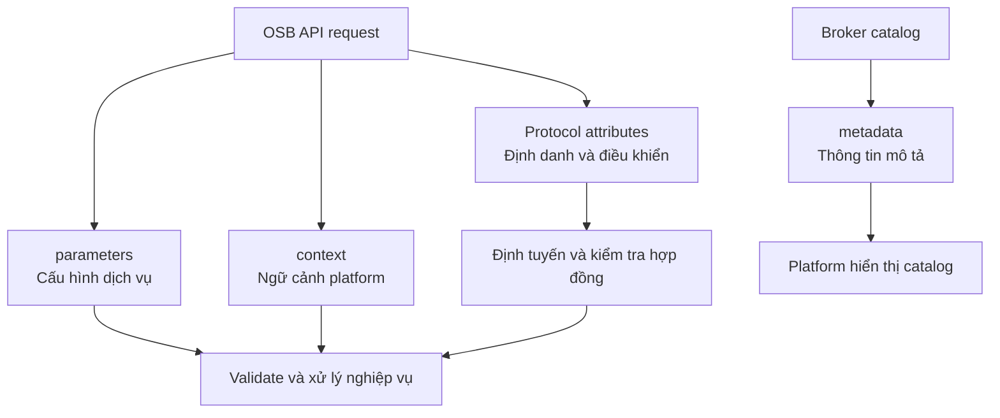

# Phân biệt parameters, context, metadata và thuộc tính giao thức

Khi nền tảng gọi một service broker theo Open Service Broker API (OSB API), request có thể chứa nhiều nhóm dữ liệu khác nhau. Một số giá trị mô tả cấu hình mà người dùng muốn cho tài nguyên, một số mô tả môi trường của nền tảng, một số chỉ dùng để hiển thị catalog, và một số là thành phần bắt buộc của hợp đồng giao thức. Nếu trộn lẫn các nhóm này, broker dễ kiểm tra sai dữ liệu, cấp phát nhầm tài nguyên hoặc vô tình coi một giá trị do client gửi là bằng chứng quyền truy cập.

Trong module `SPRING_CLOUD_SERVICE_BROKER`, cần phân biệt rõ `parameters`, `context`, `metadata` và các thuộc tính giao thức khi triển khai catalog, provision, update, bind và các thao tác vòng đời khác. Bài học này giúp bạn đọc request OSB API, xác định chủ thể tạo ra từng giá trị, biết nơi công bố schema và hiểu cách ánh xạ dữ liệu vào logic broker bằng Spring.

## Mục tiêu học tập

Sau bài này, bạn có thể:

- Giải thích `parameters` là dữ liệu cấu hình riêng của dịch vụ do client cung cấp.
- Phân biệt `context` do platform cung cấp với dữ liệu cấu hình và thông tin xác thực.
- Nhận diện `metadata` mô tả service/plan trong catalog và hiểu mục đích hiển thị của nó.
- Phân biệt các trường giao thức như `service_id`, `plan_id`, `instance_id`, `binding_id`, `accepts_incomplete` và `operation`.
- Xác định nhóm dữ liệu nào cần validate, lưu trữ, công bố trong catalog hoặc dùng để điều phối request.
- Thiết kế cách xử lý dữ liệu an toàn, nhất quán trong một Spring Cloud Service Broker.

## 1. Bốn nhóm dữ liệu trong một lần gọi broker

Hãy hình dung người dùng yêu cầu một PostgreSQL instance với dung lượng 20 GB cho môi trường thử nghiệm. Nền tảng gửi request đến broker. Request có thể đồng thời mang ID service và plan, tham số cấu hình database, ngữ cảnh tổ chức/môi trường và thông tin phiên bản API.

Các nhóm dữ liệu có mục đích khác nhau:

| Nhóm | Ai cung cấp? | Mục đích | Ví dụ |
|---|---|---|---|
| `parameters` | Người dùng hoặc client thông qua platform | Mô tả cấu hình riêng mà người dùng muốn áp dụng cho service instance hoặc binding. | `storage_gb: 20`, `database_name: orders` |
| `context` | Platform | Cung cấp ngữ cảnh triển khai và thông tin môi trường mà platform biết. | Platform, organization, space hoặc namespace |
| `metadata` | Broker công bố trong catalog | Bổ sung thông tin mô tả service/plan để platform hiển thị hoặc phân loại. | Tên hiển thị, URL tài liệu, nhà cung cấp |
| Thuộc tính giao thức | Platform gửi theo hợp đồng OSB API; một số được đặt trong URL/header/query | Định tuyến, định danh, chọn service/plan, phiên bản và điều khiển cách xử lý request. | `service_id`, `plan_id`, `instance_id`, `accepts_incomplete` |

Một cách ghi nhớ hữu ích là: `parameters` nói người dùng muốn cấu hình tài nguyên ra sao; `context` nói platform đang yêu cầu trong môi trường nào; `metadata` giúp mô tả lựa chọn dịch vụ; thuộc tính giao thức giúp hai bên thực hiện đúng hợp đồng OSB API.



`metadata` thường nằm trong dữ liệu catalog do broker trả về, trong khi ba nhóm còn lại có thể xuất hiện trong request vòng đời. Không phải mọi endpoint đều có đủ mọi nhóm dữ liệu; broker cần căn cứ vào schema của từng endpoint và phiên bản OSB API đang hỗ trợ.

## 2. `parameters`: cấu hình riêng cho dịch vụ

`parameters` là object chứa các tùy chọn riêng của service hoặc plan mà người dùng muốn sử dụng. OSB API cung cấp vị trí để truyền object này, nhưng ý nghĩa cụ thể của từng key do broker và nhà cung cấp dịch vụ định nghĩa.

Ví dụ, người dùng chọn PostgreSQL và muốn database có tên `orders`, dung lượng 20 GB, bật backup hằng ngày:

```json
{
  "service_id": "postgres-service",
  "plan_id": "standard-plan",
  "parameters": {
    "database_name": "orders",
    "storage_gb": 20,
    "backup_enabled": true
  }
}
```

Trong ví dụ này:

- `service_id` và `plan_id` là các thuộc tính giao thức để chọn đúng service và plan.
- `parameters` là object cấu hình dành cho service broker.
- `database_name`, `storage_gb` và `backup_enabled` là key do dịch vụ định nghĩa, không phải các field chuẩn chung mà mọi broker đều phải hiểu.

Platform có thể chuyển tiếp `parameters` đến broker mà không cần hiểu toàn bộ ý nghĩa của từng key. Broker phải kiểm tra cấu trúc, kiểu dữ liệu, giá trị cho phép, quota và khả năng của plan trước khi gọi backing service.

### 2.1. Parameters trong các thao tác vòng đời

Tùy thao tác và khả năng dịch vụ, `parameters` có thể xuất hiện trong request provision, update hoặc bind:

| Thao tác | Mục đích của `parameters` | Ví dụ |
|---|---|---|
| Provision | Cấu hình instance lúc tạo mới. | Tên database, dung lượng, vùng triển khai. |
| Update | Các thay đổi cấu hình mà broker cho phép. | Tăng dung lượng hoặc thay đổi chính sách backup. |
| Bind | Tùy chọn riêng cho một binding nếu dịch vụ hỗ trợ. | Vai trò truy cập hoặc phạm vi quyền của consumer. |

Không phải dịch vụ nào cũng hỗ trợ parameters cho cả ba thao tác. Broker nên công bố schema tương ứng và từ chối các key không được hỗ trợ theo chính sách đã định nghĩa. Khi update, broker cũng cần xét cấu hình hiện tại, giá trị mới và giới hạn của plan.

### 2.2. Công bố schema parameters trong catalog

OSB API cho phép broker công bố schema cho parameters trong catalog. Schema giúp platform biết những trường nào có thể yêu cầu, kiểu dữ liệu, giá trị mặc định hoặc giới hạn hợp lệ. Một phần catalog minh họa:

```json
{
  "services": [
    {
      "id": "postgres-service",
      "name": "postgresql",
      "description": "Managed PostgreSQL",
      "bindable": true,
      "plans": [
        {
          "id": "standard-plan",
          "name": "standard",
          "description": "Standard database",
          "schemas": {
            "service_instance": {
              "create": {
                "parameters": {
                  "type": "object",
                  "properties": {
                    "database_name": { "type": "string" },
                    "storage_gb": {
                      "type": "integer",
                      "minimum": 1,
                      "maximum": 500
                    },
                    "backup_enabled": { "type": "boolean" }
                  },
                  "required": ["database_name", "storage_gb"]
                }
              }
            }
          }
        }
      ]
    }
  ]
}
```

Đây là ví dụ rút gọn về schema JSON Schema được gắn với plan. Trong catalog thực tế, schema có thể được khai báo cho `service_instance.create`, `service_instance.update` và `service_binding.create` khi các thao tác tương ứng được hỗ trợ. Broker phải bảo đảm schema công bố phản ánh đúng những gì handler thực sự chấp nhận.

Schema giúp platform xây dựng biểu mẫu hoặc kiểm tra dữ liệu sớm, nhưng không thay thế validation phía broker. Client có thể bỏ qua schema hoặc gửi request trực tiếp. Vì vậy, broker luôn phải validate lại trước khi tạo hoặc thay đổi tài nguyên.

### 2.3. Quy tắc thiết kế parameters

- Dùng tên key rõ nghĩa, nhất quán và có tài liệu.
- Chọn kiểu dữ liệu cụ thể; tránh dùng chuỗi cho mọi giá trị.
- Xác định field bắt buộc, giá trị mặc định, miền giá trị và giới hạn kích thước.
- Phân biệt tham số tạo mới với tham số được phép cập nhật.
- Không dùng `parameters` để thay thế các trường giao thức như `service_id`, `plan_id` hoặc `accepts_incomplete`.
- Không âm thầm bỏ qua key sai chính tả hoặc key không được hỗ trợ nếu điều đó khiến người dùng hiểu nhầm cấu hình đã được áp dụng.
- Tránh đưa secret vào parameters nếu có cơ chế truyền secret chuyên dụng an toàn hơn; nếu bắt buộc nhận secret, phải che log và kiểm soát lưu trữ.

Ví dụ, `storage_gb` phải là số nguyên dương và không vượt giới hạn của plan. `database_name` cần được kiểm tra độ dài và ký tự hợp lệ. `backup_enabled` phải là boolean thực sự, không phải chuỗi `"true"`.

## 3. `context`: ngữ cảnh do platform cung cấp

`context` là object mang thông tin về môi trường hoặc platform đang quản lý service instance hay binding. Thông tin này giúp broker hiểu tài nguyên được yêu cầu trong hệ sinh thái nào, thuộc tổ chức hoặc không gian làm việc nào, và có thể hỗ trợ ánh xạ tới tenant, project hoặc namespace tương ứng.

Ví dụ minh họa:

```json
{
  "context": {
    "platform": "cloudfoundry",
    "organization_guid": "org-42",
    "space_guid": "space-dev"
  }
}
```

Các key trong ví dụ chỉ minh họa thông tin có thể có trong context; cấu trúc thực tế phụ thuộc platform và hợp đồng mà broker hỗ trợ. Platform có thể gửi context trong request provision và các request liên quan khi có thông tin tương ứng. Không nên giả định mọi platform đều gửi cùng một object hoặc cùng một bộ key.

### 3.1. Context dùng để làm gì?

Broker có thể sử dụng context để:

- Gắn service instance với đúng tổ chức, project, space hoặc namespace.
- Chọn tài khoản, vùng hoặc cluster backing service phù hợp với môi trường.
- Áp dụng quota, chính sách lưu trữ, network hoặc quy tắc đặt tên theo tenant.
- Ghi audit và hỗ trợ truy vết tài nguyên về platform đã yêu cầu.
- Cung cấp thông tin môi trường cho adapter khi gọi API của nhà cung cấp.

Context mô tả môi trường request. Nó không tự chứng minh người gọi có quyền trên môi trường đó. Broker cần xác thực client và kiểm tra quyền độc lập, sau đó đối chiếu context với danh tính đã xác thực và dữ liệu sở hữu được lưu.

### 3.2. Context và các GUID tương thích

OSB API từng có các field riêng `organization_guid` và `space_guid` ở cấp cao nhất của request provision. Các field này đã được đánh dấu deprecated để chuyển sang object `context`, nơi platform có thể gửi thông tin môi trường theo cấu trúc của mình. Chúng vẫn có thể xuất hiện trong tích hợp cũ để duy trì tương thích; broker nên hỗ trợ đúng theo phiên bản API và platform mục tiêu, đồng thời xác định rõ cách xử lý nếu cả field cũ lẫn context cùng được gửi.

Khi triển khai, hãy tuân theo phiên bản API và cấu trúc request mà broker công bố hỗ trợ. Nếu có cả context lẫn field tương thích cũ, cần xác định rõ nguồn dữ liệu được ưu tiên, cách xử lý khi hai nguồn mâu thuẫn và cách duy trì tương thích. Không tự suy ra rằng một giá trị trong context luôn thay thế được một field giao thức riêng.

### 3.3. Context không phải credentials

Không dùng `context.platform`, `organization_guid`, `space_guid` hoặc tên project làm bằng chứng xác thực. Client có thể gửi một JSON object có cấu trúc hợp lệ nhưng vẫn không được phép thao tác với tenant tương ứng.

Một quy trình an toàn cần:

1. Xác thực platform hoặc client theo cơ chế bảo mật của broker.
2. Lấy danh tính đã xác thực từ security context.
3. Kiểm tra client có quyền thực hiện thao tác hay không.
4. Đối chiếu context với tenant/owner của instance trong kho dữ liệu.
5. Chỉ chuyển các giá trị đã được kiểm tra sang backing service adapter.

## 4. `metadata`: thông tin mô tả trong catalog

`metadata` trong catalog là object chứa thông tin bổ sung về service hoặc plan để platform có thể hiển thị, phân loại hoặc liên kết tới tài liệu. Đây là dữ liệu mô tả do broker công bố, không phải cấu hình mà người dùng nhập cho từng lần provision.

Ví dụ metadata của một service:

```json
{
  "id": "postgres-service",
  "name": "postgresql",
  "description": "Managed PostgreSQL",
  "metadata": {
    "displayName": "PostgreSQL Database",
    "imageUrl": "https://example.com/images/postgresql.png",
    "longDescription": "Cơ sở dữ liệu quan hệ được quản lý",
    "providerDisplayName": "Example Platform",
    "documentationUrl": "https://docs.example.com/postgresql",
    "supportUrl": "https://support.example.com"
  },
  "bindable": true,
  "plans": []
}
```

Các key trong `metadata` là ví dụ thông tin mô tả thường được platform tiêu thụ; không phải mọi platform đều hiển thị hoặc yêu cầu tất cả key. Broker nên giữ metadata ngắn gọn, ổn định, không chứa secret và không đặt logic cấp phát tài nguyên vào metadata.

Metadata cũng có thể được công bố ở cấp plan để mô tả khác biệt giữa các gói dịch vụ, chẳng hạn nhãn hiển thị hoặc thông tin bổ sung về tính năng. Platform có thể dùng metadata để giúp người dùng chọn plan, nhưng quyết định cho phép provision vẫn phải dựa trên ID service/plan, chính sách và validation nghiệp vụ.

### 4.1. Metadata không phải parameters

So sánh hai object:

```json
{
  "metadata": {
    "displayName": "PostgreSQL Standard",
    "documentationUrl": "https://docs.example.com/postgresql"
  },
  "parameters": {
    "storage_gb": 20,
    "backup_enabled": true
  }
}
```

`metadata` giúp người dùng hiểu service/plan là gì. `parameters` yêu cầu broker áp dụng cấu hình cụ thể cho instance hoặc binding. Nếu đổi `displayName`, điều đó không nên làm thay đổi dung lượng database. Nếu đổi `storage_gb`, đó là thay đổi cấu hình tài nguyên và có thể cần một thao tác provision hoặc update.

Không đưa thông tin bí mật như password, token, private endpoint hoặc dữ liệu định danh nhạy cảm vào metadata. Catalog thường được đọc bởi nhiều thành phần của platform và có thể được cache hoặc hiển thị cho người dùng.

## 5. Thuộc tính giao thức: định danh và điều khiển request

OSB API định nghĩa các field và vị trí dữ liệu để hai bên hiểu cùng một thao tác. Các thuộc tính này không phải parameters tùy ý.

| Thuộc tính | Vị trí thường gặp | Ý nghĩa |
|---|---|---|
| `service_id` | Request body hoặc query theo endpoint | ID của service trong catalog mà client chọn. |
| `plan_id` | Request body hoặc query theo endpoint | ID plan thuộc service được chọn. |
| `instance_id` | Path của endpoint service instance | Định danh instance do platform cung cấp. |
| `binding_id` | Path của endpoint service binding | Định danh binding do platform cung cấp. |
| `accepts_incomplete` | Query parameter của request vòng đời hỗ trợ async | Cho biết platform chấp nhận xử lý bất đồng bộ. |
| `operation` | Query parameter của `last_operation` | Mã operation broker đã trả trong response async. |
| `X-Broker-API-Version` | HTTP header | Phiên bản OSB API mà client sử dụng. |
| `bind_resource` | Request body của bind, khi có | Thông tin tài nguyên mà binding gắn với, ví dụ thông tin ứng dụng hoặc route. |
| `previous_values` | Request body của update, khi có | Một số giá trị trước khi cập nhật để broker hiểu thay đổi. |

Vị trí chính xác và khả năng xuất hiện của từng thuộc tính phụ thuộc endpoint và phiên bản OSB API. Ví dụ, `instance_id` không phải một key do người dùng tự đặt trong `parameters`; nó nằm trong URL để platform và broker xác định tài nguyên đang được thao tác.

### 5.1. ID service, plan, instance và binding

`service_id` và `plan_id` tham chiếu catalog. Chúng trả lời câu hỏi “người dùng chọn loại dịch vụ nào và gói nào?”. `instance_id` xác định một lần cấp phát cụ thể. `binding_id` xác định một quan hệ truy cập cụ thể giữa consumer và instance.

Ví dụ:

```http
PUT /v2/service_instances/instance-123/service_bindings/binding-456
```

Trong URL trên, `instance-123` là ID instance, `binding-456` là ID binding. Nếu cần cấu hình quyền riêng cho binding, các tùy chọn đó có thể nằm trong `parameters` của body theo schema binding được hỗ trợ. Không đưa ID binding vào object parameters chỉ để thay thế vị trí chuẩn trong URL.

### 5.2. Thuộc tính điều khiển bất đồng bộ

`accepts_incomplete=true` là tín hiệu của platform cho biết nó chấp nhận việc broker tiếp nhận một thao tác dài và trả `202 Accepted`. Nếu broker trả response có `operation`, platform sẽ gửi giá trị đó trong request `last_operation` tiếp theo.

`operation` là mã theo dõi do broker phát hành. Nó không phải trạng thái và cũng không phải parameters. Trạng thái của operation được trả qua field `state`, thường là `in progress`, `succeeded` hoặc `failed`.

### 5.3. `bind_resource` và `previous_values`

Trong request bind, `bind_resource` có thể cung cấp thông tin về resource mà binding phục vụ, ví dụ thông tin ứng dụng hoặc route tùy loại dịch vụ. Đây là phần dữ liệu theo hợp đồng bind; không nên gộp nó vào parameters do người dùng tự định nghĩa.

Trong request update, `previous_values` có thể mang các giá trị trước khi cập nhật như service, plan hoặc thông tin môi trường theo schema OSB API. Broker có thể dùng dữ liệu này để kiểm tra chuyển đổi plan, nhưng cần đối chiếu với trạng thái đã lưu thay vì tin tuyệt đối dữ liệu client gửi.

## 6. Ví dụ đọc một request provision hoàn chỉnh

Xem request minh họa:

```http
PUT /v2/service_instances/instance-123?accepts_incomplete=true HTTP/1.1
Host: broker.example.internal
X-Broker-API-Version: 2.17
Content-Type: application/json
Authorization: Basic <credentials>

{
  "service_id": "postgres-service",
  "plan_id": "standard-plan",
  "context": {
    "platform": "cloudfoundry",
    "organization_guid": "org-42",
    "space_guid": "space-dev"
  },
  "parameters": {
    "database_name": "orders",
    "storage_gb": 20,
    "backup_enabled": true
  }
}
```

Phân loại dữ liệu:

| Giá trị | Nhóm | Broker dùng để làm gì? |
|---|---|---|
| `instance-123` trong URL | Thuộc tính giao thức | Tra cứu và quản lý service instance. |
| `accepts_incomplete=true` | Thuộc tính giao thức | Quyết định có thể trả response async hay không. |
| `X-Broker-API-Version` | Thuộc tính giao thức | Kiểm tra phiên bản API được hỗ trợ. |
| `service_id`, `plan_id` | Thuộc tính giao thức | Xác định service và plan đã công bố trong catalog. |
| `context` (có thể chứa `organization_guid`, `space_guid`) | Context/ngữ cảnh platform theo hợp đồng | Ánh xạ tenant và môi trường sau khi xác thực/đối chiếu. |
| `database_name`, `storage_gb`, `backup_enabled` | `parameters` | Validate và chuyển thành cấu hình tạo database. |
| Metadata của service/plan trong catalog | `metadata` | Giúp platform hiển thị và mô tả lựa chọn. |

Metadata không nằm trong request provision ở ví dụ này vì broker đã công bố metadata trước đó trong catalog. Platform đọc catalog để hiển thị lựa chọn; sau khi người dùng chọn, platform gửi ID service/plan cùng parameters và context trong request vòng đời.

## 7. Xử lý các nhóm dữ liệu trong Spring Cloud Service Broker

Khi triển khai broker bằng Spring, hãy giữ mỗi nhóm dữ liệu ở đúng ranh giới của nó. Spring Cloud Open Service Broker cung cấp các model và extension point tương ứng với request/response OSB API. Tên class và chữ ký handler có thể thay đổi theo phiên bản thư viện; hãy dựa vào API của dependency mà dự án đang sử dụng.

Một cách tổ chức nghiệp vụ có thể là:

1. Lớp giao thức nhận request và ánh xạ các field OSB API vào model tương ứng.
2. Handler kiểm tra `service_id`, `plan_id`, `instance_id` và khả năng của thao tác.
3. Thành phần validation kiểm tra `parameters` theo schema của service/plan và quy tắc nghiệp vụ.
4. Thành phần tenant/context xác thực quyền, đối chiếu context với chủ sở hữu instance và chọn môi trường provider phù hợp.
5. Catalog service công bố metadata và schema parameters cho platform.
6. Provider adapter nhận một command nội bộ đã được kiểm tra để gọi backing service.

Ví dụ một command nội bộ sau khi validate có thể có cấu trúc như sau:

```java
public record ProvisionCommand(
        String instanceId,
        String serviceId,
        String planId,
        String tenantId,
        String databaseName,
        int storageGb,
        boolean backupEnabled
) {}
```

Đây là model minh họa do ứng dụng định nghĩa, không phải kiểu request chuẩn của thư viện. Nó thể hiện một quyết định kiến trúc hữu ích: chuyển dữ liệu giao thức và JSON động thành command nội bộ có kiểu rõ ràng sau khi đã xác thực và kiểm tra.

### 7.1. Validation parameters

Ví dụ logic kiểm tra:

```java
public void validate(ProvisionInput input, ServicePlan plan) {
    if (input.storageGb() < 1 || input.storageGb() > plan.maxStorageGb()) {
        throw new InvalidParametersException("storage_gb nằm ngoài giới hạn của plan");
    }

    if (input.databaseName() == null || input.databaseName().isBlank()) {
        throw new InvalidParametersException("database_name là bắt buộc");
    }
}
```

Đoạn code chỉ minh họa cách kiểm tra. Trong triển khai thực tế, có thể dùng Bean Validation, JSON Schema validator hoặc validation service riêng. Kiểm tra phải phản ánh đúng plan đang chọn; cùng một `storage_gb` có thể hợp lệ với plan lớn nhưng vượt giới hạn ở plan nhỏ.

### 7.2. Xử lý context và quyền sở hữu

Không chuyển trực tiếp `organization_guid` từ request thành `tenantId` tin cậy. Trước tiên phải xác thực caller, sau đó xác định caller được phép thao tác tenant nào. Dữ liệu context được đối chiếu với quan hệ sở hữu đã lưu hoặc nguồn danh tính đáng tin cậy. Nếu context mâu thuẫn với instance hiện có, broker phải từ chối hoặc xử lý theo chính sách tương thích đã định nghĩa.

### 7.3. Công bố metadata và schema

Metadata và schema được cấu hình ở catalog service/plan definition. Chúng giúp platform biết lựa chọn nào có sẵn, cách hiển thị và các parameters được hỗ trợ. Khi thay đổi schema hoặc metadata, cần xem xét tương thích với người dùng hiện tại và các instance đã được provision bằng cấu hình cũ.

## 8. Lưu trữ và bảo mật dữ liệu

Không phải mọi dữ liệu nhận được đều cần lưu giống nhau:

| Dữ liệu | Cách xử lý gợi ý |
|---|---|
| `parameters` cần để tái tạo cấu hình instance | Lưu bản đã chuẩn hóa hoặc các thuộc tính nghiệp vụ cần thiết; kiểm soát dữ liệu nhạy cảm. |
| `context` cần cho audit hoặc định tuyến tenant | Chỉ lưu phần cần thiết, xác định nguồn tin cậy và thời hạn lưu. |
| `metadata` catalog | Quản lý như cấu hình công bố của broker; có thể version hóa cùng catalog. |
| ID giao thức | Lưu quan hệ giữa service/plan/instance/binding/operation để hỗ trợ idempotency và vòng đời. |
| Secret trong parameters hoặc credentials | Không log; mã hóa khi lưu; hạn chế quyền đọc; hỗ trợ xoay vòng và thu hồi. |

Một số nguyên tắc quan trọng:

- Không ghi toàn bộ request body vào log nếu body có thể chứa secret.
- Không tin `context` hoặc GUID chỉ vì chúng đến từ platform; xác thực caller và kiểm tra quyền trước.
- Không dùng metadata để lưu thông tin bí mật hoặc trạng thái tài nguyên có thể thay đổi liên tục.
- Không lưu mọi key parameters một cách mù quáng; chỉ lưu những trường cần thiết và có chính sách retention rõ ràng.
- Giữ ID instance và binding ổn định để retry không tạo tài nguyên trùng lặp.
- Gắn operation ID hoặc correlation ID vào log để truy vết, nhưng không dùng chúng thay thế authorization.

## 9. Các nhầm lẫn thường gặp

- **Đưa `service_id` vào parameters:** làm sai ranh giới giao thức; service ID phải được đọc từ field chuẩn của request.
- **Coi context là dữ liệu do người dùng cấu hình:** context do platform cung cấp để mô tả môi trường; parameters mới là tùy chọn cấu hình dịch vụ.
- **Coi context là chứng thực quyền:** GUID hoặc tên organization không chứng minh caller được phép thao tác tenant đó.
- **Đưa display name vào parameters:** tên hiển thị thuộc metadata catalog; nó không phải cấu hình tạo tài nguyên.
- **Dùng metadata để điều khiển provision:** metadata mô tả service/plan; logic cấp phát phải dựa trên request, catalog definition và chính sách nghiệp vụ.
- **Công bố schema nhưng không validate phía broker:** client có thể gửi request trực tiếp hoặc bỏ qua UI, nên server vẫn phải kiểm tra.
- **Cho phép mọi parameters ở mọi thao tác:** provision, update và bind có thể hỗ trợ tập key khác nhau.
- **Tin `previous_values` hoặc `bind_resource` mà không đối chiếu:** các field này thuộc request contract nhưng vẫn cần kiểm tra với trạng thái và quyền đã lưu.

## 10. Checklist đọc và xử lý request

Khi nhận một request OSB API, hãy tự hỏi:

- [ ] Endpoint và HTTP method xác định thao tác nào?
- [ ] `service_id`, `plan_id`, `instance_id` hoặc `binding_id` nằm ở đâu và có hợp lệ không?
- [ ] Request có `parameters` không? Schema của thao tác/plan quy định những key nào?
- [ ] Parameters đã được kiểm tra kiểu, miền giá trị, quota và khả năng của plan chưa?
- [ ] Request có `context` hoặc các field môi trường tương thích không?
- [ ] Context có phù hợp với caller đã xác thực và chủ sở hữu instance không?
- [ ] Metadata đang đọc là metadata catalog do broker công bố hay dữ liệu khác?
- [ ] `accepts_incomplete` có cho phép async không và broker có operation store hay chưa?
- [ ] Các field như `previous_values` hoặc `bind_resource` có liên quan đến endpoint hiện tại không?
- [ ] Dữ liệu nào cần lưu, dữ liệu nào cần che khỏi log và dữ liệu nào không nên lưu?

## Kết luận

`parameters`, `context`, `metadata` và thuộc tính giao thức phục vụ bốn mục đích riêng trong OSB API. Parameters mô tả cấu hình service-specific do client yêu cầu; context mang thông tin môi trường do platform cung cấp; metadata mô tả service/plan trong catalog; các thuộc tính giao thức định danh tài nguyên và điều khiển request. Khi giữ đúng ranh giới, broker Spring Cloud có thể validate đúng dữ liệu, áp dụng chính sách tenant an toàn, công bố catalog nhất quán và thực hiện provision/update/bind có thể truy vết, retry và vận hành đáng tin cậy.
