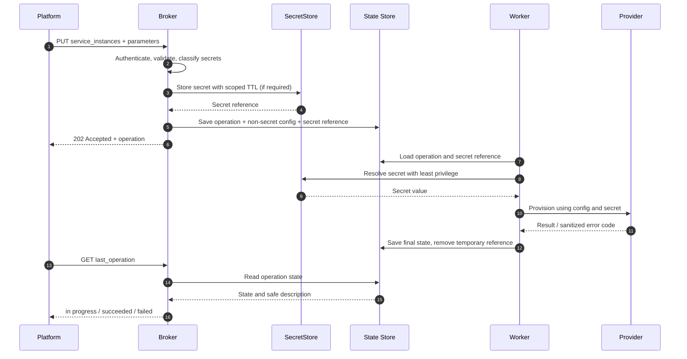

# Quản lý tham số nhạy cảm và loại bỏ bí mật khỏi thông báo lỗi

Khi platform gửi yêu cầu tạo hoặc cập nhật service instance theo Open Service Broker API (OSB API), request có thể chứa object `parameters` do người dùng cung cấp. Một số giá trị chỉ là tùy chọn cấu hình như dung lượng hoặc vùng triển khai; một số khác có thể là bí mật như mật khẩu quản trị, token truy cập hệ thống bên ngoài, khóa mã hóa hoặc private key. Service broker phải nhận diện đúng dữ liệu nhạy cảm, chỉ sử dụng chúng cho mục đích được phép và bảo đảm chúng không xuất hiện trong log, trace, thông báo lỗi hay dữ liệu trạng thái không cần thiết.

Với `SPRING_CLOUD_SERVICE_BROKER`, điều này đặc biệt quan trọng vì broker điều phối việc provision, update, binding và deprovision tài nguyên. Một lỗi từ provider đôi khi chứa nguyên request, URL có thông tin xác thực hoặc thông điệp SDK phản chiếu giá trị đầu vào. Nếu broker trả nguyên lỗi đó về platform hoặc ghi toàn bộ exception ra log, một thao tác thất bại có thể làm lộ bí mật cho người không có quyền truy cập.

## 1. Tham số đầu vào trong OSB API

Platform gửi các tham số tùy chỉnh trong object `parameters` của request vòng đời. Ví dụ, khi provision PostgreSQL, người dùng có thể chọn dung lượng, vùng triển khai và một mật khẩu khởi tạo do họ quản lý:

```http
PUT /v2/service_instances/instance-123?accepts_incomplete=true HTTP/1.1
X-Broker-API-Version: 2.14
Content-Type: application/json

{
  "service_id": "postgres-service-id",
  "plan_id": "postgres-standard-plan",
  "organization_guid": "org-001",
  "space_guid": "space-001",
  "parameters": {
    "storage_gb": 50,
    "region": "ap-southeast-1",
    "admin_password": "<secret-value>",
    "external_api_token": "<secret-value>"
  }
}
```

Object `parameters` là dữ liệu đầu vào cho nghiệp vụ của broker. Broker phải kiểm tra chúng theo service, plan, schema và chính sách tenant trước khi gọi provider. Không được mặc định rằng platform đã validate đầy đủ hoặc người gửi luôn đáng tin cậy: request vẫn phải được xác thực, kiểm tra kiểu dữ liệu, giới hạn và quyền sử dụng.

Tham số cũng có thể xuất hiện trong yêu cầu binding hoặc update nếu service và platform hỗ trợ các trường đó. Quy tắc bảo vệ bí mật phải áp dụng cho mọi request có dữ liệu nhạy cảm, không chỉ riêng provision.

## 2. Phân loại dữ liệu trước khi xử lý

Broker nên phân loại tham số theo mục đích và mức độ nhạy cảm. Phân loại này quyết định dữ liệu nào được log, dữ liệu nào được lưu và dữ liệu nào phải xóa ngay sau khi sử dụng.

| Nhóm | Ví dụ | Cách xử lý |
|---|---|---|
| Cấu hình thông thường | `storage_gb`, `region`, `replica_count` | Validate, lưu nếu cần để quản lý instance; log có chọn lọc. |
| Thông tin định danh/tổ chức | `organization_guid`, `space_guid`, `tenant_id` | Kiểm tra theo danh tính platform; hạn chế log và tránh dùng làm bằng chứng xác thực độc lập. |
| Bí mật xác thực | `admin_password`, `external_api_token`, `client_secret` | Không log; truyền qua kênh an toàn; không lưu nếu không cần. |
| Khóa mật mã | `encryption_key`, `private_key`, `signing_key` | Tránh nhận khóa thô nếu có thể dùng secret manager hoặc cơ chế quản lý khóa chuyên dụng. |
| Dữ liệu cá nhân/nhạy cảm | Email, thông tin người dùng hoặc dữ liệu khách hàng | Chỉ thu thập khi cần thiết, giới hạn quyền truy cập và thời gian lưu. |

Không nên dựa hoàn toàn vào tên trường để xác định bí mật. Một trường tên `config` vẫn có thể chứa password; một trường `url` có thể chứa user info hoặc token trong query string. Hãy xác định schema cho từng service/plan, phân loại trường theo nghiệp vụ và áp dụng nguyên tắc mặc định không ghi nội dung request vào log.

## 3. Khai báo schema và validate tham số

Schema trong catalog giúp platform biết những tham số mà broker chấp nhận và có thể hỗ trợ giao diện nhập liệu. Với OSB API, schema của tham số tạo service instance có thể được công bố qua phần `schemas.service_instance.create.parameters` nếu broker và platform hỗ trợ. Schema là hợp đồng mô tả cấu trúc; broker vẫn phải validate lại ở phía server.

Ví dụ schema minh họa:

```json
{
  "schemas": {
    "service_instance": {
      "create": {
        "parameters": {
          "$schema": "http://json-schema.org/draft-04/schema#",
          "type": "object",
          "additionalProperties": false,
          "required": ["storage_gb", "region"],
          "properties": {
            "storage_gb": {
              "type": "integer",
              "minimum": 10,
              "maximum": 500,
              "description": "Dung lượng database tính bằng GB"
            },
            "region": {
              "type": "string",
              "enum": ["ap-southeast-1", "ap-northeast-1"]
            },
            "admin_password": {
              "type": "string",
              "minLength": 16,
              "maxLength": 128,
              "description": "Mật khẩu quản trị ban đầu"
            }
          }
        }
      }
    }
  }
}
```

Schema trên chỉ minh họa cấu trúc và ràng buộc. Không giả định rằng mọi platform sẽ tự ẩn `admin_password` trong giao diện hoặc log. Khả năng biểu diễn trường nhạy cảm và cách platform hiển thị phụ thuộc vào schema dialect và implementation của platform. Broker phải tự bảo vệ dữ liệu kể cả khi client hiển thị sai.

Ở phía server, cần kiểm tra:

- Chỉ chấp nhận các thuộc tính được định nghĩa; từ chối hoặc xử lý có chủ đích thuộc tính không biết.
- Kiểm tra kiểu dữ liệu, trường bắt buộc, độ dài, giới hạn số và tập giá trị cho phép.
- Kiểm tra quan hệ giữa tham số với plan, tenant, quota và trạng thái instance.
- Giới hạn kích thước request và độ sâu JSON để tránh tiêu thụ bộ nhớ quá mức.
- Không đưa giá trị đầu vào vào thông báo validation nếu giá trị đó có thể là bí mật.
- Không dùng chuỗi tham số trực tiếp để tạo câu SQL, lệnh shell hoặc URL không được kiểm soát.

Ví dụ, `storage_gb=5000` có thể đúng kiểu số nguyên nhưng vượt giới hạn của plan. `region=unknown-region` có thể là chuỗi hợp lệ về cú pháp nhưng không nằm trong danh sách vùng mà broker cung cấp. Validation phải kiểm tra cả cú pháp lẫn quy tắc nghiệp vụ.

## 4. Nguyên tắc xử lý bí mật

Một secret chỉ nên được sử dụng bởi thành phần cần nó, trong khoảng thời gian cần thiết và với quyền tối thiểu.

1. **Thu thập tối thiểu:** không yêu cầu người dùng gửi mật khẩu hoặc khóa nếu provider có thể tự sinh credential an toàn.
2. **Không log giá trị:** không ghi request body, map parameters, header xác thực hoặc provider request/response đầy đủ.
3. **Không phản chiếu:** không đưa secret vào exception message, validation message, HTTP response, metric label hoặc trace attribute.
4. **Truyền an toàn:** sử dụng TLS tới provider và secret manager; tránh đặt secret trong URL hoặc query string.
5. **Lưu có kiểm soát:** nếu bắt buộc phải lưu, dùng secret store hoặc mã hóa envelope với khóa được quản lý riêng; giới hạn quyền đọc và thời gian lưu.
6. **Xóa đúng lúc:** xóa bản tạm trong bộ nhớ khi không còn cần, xóa secret tham chiếu khi operation kết thúc và áp dụng retention rõ ràng cho bản sao được lưu.
7. **Thu hồi:** khi credential không còn hợp lệ hoặc instance bị thu hồi, broker phải gọi provider/secret manager để revoke hoặc xóa bí mật tương ứng.

Không nên lưu password dạng rõ trong database trạng thái service instance. Nếu broker chỉ cần xác minh một giá trị do người dùng cung cấp, cân nhắc cơ chế hash phù hợp. Nếu provider cần nhận lại secret để thực hiện công việc bất đồng bộ, hãy ưu tiên lưu trong secret manager và chỉ lưu một reference có quyền hạn, thời hạn và phạm vi instance cụ thể.

## 5. Tách dữ liệu nghiệp vụ khỏi secret

Một cách thiết kế an toàn là chuyển request thành hai phần ngay sau validation:

- **Cấu hình không nhạy cảm:** dung lượng, vùng, số replica, lựa chọn tính năng; có thể lưu trong bản ghi instance nếu cần cho update/reconcile.
- **Bí mật:** password, token, private key; chỉ truyền tới thành phần cần dùng hoặc lưu trong secret manager. Bản ghi instance chỉ lưu secret reference, không lưu giá trị.

Ví dụ mô hình nội bộ:

```java
public record ProvisionSettings(
        int storageGb,
        String region,
        int replicaCount
) {}

public record ProvisionSecrets(
        char[] adminPassword,
        String externalApiToken
) {}

public record ValidatedProvisionInput(
        ProvisionSettings settings,
        ProvisionSecrets secrets
) {}
```

Đây là mô hình minh họa. Trong triển khai thật, cần kiểm tra cách thư viện JSON deserialize và quản lý vòng đời dữ liệu nhạy cảm. `char[]` có thể cho phép ghi đè nội dung sau khi sử dụng, nhưng không bảo đảm mọi bản sao chuỗi đã được tạo trong JVM đều bị xóa. Java `String` là immutable và có thể tồn tại trong heap cho tới khi garbage collector thu hồi; vì vậy quan trọng nhất vẫn là giảm số bản sao, giới hạn thời gian sống và không ghi chúng ra log hoặc persistent storage.

Ví dụ tách tham số sau khi kiểm tra kiểu và giới hạn:

```java
import java.util.Map;
import java.util.Set;

public final class ProvisionInputMapper {
    public static ValidatedProvisionInput map(Map<String, Object> parameters) {
        Object storageValue = parameters.get("storage_gb");
        if (!(storageValue instanceof Integer storageGb)
                || storageGb < 10 || storageGb > 500) {
            throw new InvalidProvisionParametersException(
                    "Tham số cấu hình không hợp lệ.");
        }

        Object regionValue = parameters.get("region");
        if (!(regionValue instanceof String region)
                || !Set.of("ap-southeast-1", "ap-northeast-1").contains(region)) {
            throw new InvalidProvisionParametersException(
                    "Tham số cấu hình không hợp lệ.");
        }

        Object passwordValue = parameters.get("admin_password");
        if (!(passwordValue instanceof String password)
                || password.length() < 16 || password.length() > 128) {
            throw new InvalidProvisionParametersException(
                    "Tham số cấu hình không hợp lệ.");
        }

        ProvisionSettings settings = new ProvisionSettings(storageGb, region, 1);
        ProvisionSecrets secrets = new ProvisionSecrets(
                password.toCharArray(),
                (String) parameters.get("external_api_token")
        );
        return new ValidatedProvisionInput(settings, secrets);
    }

    private ProvisionInputMapper() {}
}
```

Đoạn mã minh họa cần bổ sung import, kiểm tra token tùy theo schema và xử lý trường hợp `null` trong dự án thực tế. Điểm quan trọng là lỗi trả về không chứa giá trị đầu vào. Cũng cần tránh giữ cả `Map<String,Object>` gốc trong các đối tượng operation hoặc closure chạy nền sau khi đã tách secret.

## 6. Không đưa secret vào thông báo lỗi

Lỗi có thể phát sinh ở nhiều lớp: deserialize JSON, validation, service nghiệp vụ, HTTP client, SDK của provider, database hoặc worker nền. Một số thư viện đưa request body, URL, header hoặc tham số vào exception message để hỗ trợ debug. Broker không được chuyển nguyên thông điệp đó cho platform.

Ví dụ lỗi nguy hiểm:

```text
Provision failed for admin_password=MyRealPassword123!
Provider returned: invalid token eyJhbGciOi...
POST https://provider.internal/create?api_key=secret-value failed
```

Thông báo an toàn hơn:

```text
Không thể hoàn tất yêu cầu cấp phát. Mã tham chiếu: op-7f2a91.
```

Nguyên tắc xây dựng lỗi:

- Trả mô tả tổng quát, đủ để người dùng biết thao tác thất bại và có mã tham chiếu để liên hệ hỗ trợ.
- Không trả raw exception message, provider response body, request parameters, token, password, URL có user info hoặc query string nhạy cảm.
- Không trả stack trace, đường dẫn file, hostname nội bộ, câu SQL hoặc chi tiết topology cho platform.
- Phân biệt lỗi đầu vào có thể sửa với lỗi hệ thống; chỉ nêu tên trường hoặc quy tắc vi phạm nếu việc đó không làm lộ giá trị bí mật.
- Ghi nhận correlation ID hoặc operation ID để đối chiếu với log đã được lọc.

OSB API sử dụng cấu trúc lỗi theo hợp đồng của phiên bản đang triển khai; phản hồi lỗi thường mang mô tả trong trường `description`. Broker nên để lớp tích hợp Spring Cloud Open Service Broker ánh xạ exception theo cơ chế được thư viện hỗ trợ, và chỉ cung cấp nội dung mô tả đã làm sạch. Không tạo một response tùy ý làm sai status code hoặc schema mà platform mong đợi.

Ví dụ phản hồi lỗi an toàn:

```http
HTTP/1.1 400 Bad Request
Content-Type: application/json

{
  "description": "Tham số cấu hình không hợp lệ. Kiểm tra schema của service và plan."
}
```

Với lỗi provider nội bộ, nội dung có thể chung hơn:

```json
{
  "description": "Không thể hoàn tất thao tác cấp phát. Mã tham chiếu: op-7f2a91."
}
```

Status code và loại lỗi cụ thể cần theo điều kiện của OSB API và mapping của framework. Không trả `400` cho mọi lỗi chỉ để che thông tin; giữ đúng phân loại lỗi hợp đồng, đồng thời làm sạch phần mô tả.

## 7. Tạo exception an toàn trong tầng nghiệp vụ

Nên tách thông tin dành cho người gọi khỏi chi tiết kỹ thuật nội bộ. Exception nghiệp vụ có thể chứa mã lỗi ổn định và mô tả công khai đã được duyệt; nguyên nhân gốc chỉ được xử lý bởi thành phần logging an toàn.

```java
public final class BrokerOperationException extends RuntimeException {
    private final String publicCode;
    private final String publicDescription;

    public BrokerOperationException(
            String publicCode,
            String publicDescription,
            Throwable cause
    ) {
        super(publicCode, cause);
        this.publicCode = publicCode;
        this.publicDescription = publicDescription;
    }

    public String publicCode() {
        return publicCode;
    }

    public String publicDescription() {
        return publicDescription;
    }
}
```

Khi bắt lỗi từ provider, không nối `cause.getMessage()` vào `publicDescription`:

```java
try {
    providerClient.createDatabase(settings, secrets);
} catch (ProviderException ex) {
    throw new BrokerOperationException(
            "PROVISION_PROVIDER_FAILURE",
            "Không thể hoàn tất thao tác cấp phát.",
            ex
    );
}
```

Đoạn mã trên chỉ minh họa ranh giới giữa thông báo công khai và nguyên nhân nội bộ. Khi ghi log, cũng không được truyền exception nguyên gốc vào logger một cách máy móc vì stack trace thường in cả message của cause. Hãy dùng bộ lọc exception đã được kiểm soát hoặc ghi các trường chẩn đoán an toàn như loại lỗi, mã lỗi provider đã chuẩn hóa và operation ID.

Với endpoint do ứng dụng tự xây dựng, có thể dùng `@RestControllerAdvice` để ánh xạ exception sang response đã làm sạch. Với endpoint OSB API do thư viện xử lý, hãy dùng extension point/error mapping của phiên bản thư viện thay vì thêm một handler toàn cục có thể ghi đè hợp đồng phản hồi của framework.

## 8. Redaction trong log, trace và metric

Ẩn secret ở HTTP response là chưa đủ. Dữ liệu có thể rò rỉ qua log ứng dụng, log HTTP client, tracing span, APM agent, metric label, audit event hoặc thông báo gửi tới hệ thống cảnh báo.

### Không log toàn bộ request

Tránh các mẫu sau:

```java
// Không an toàn
log.info("Provision request: {}", request);
log.debug("Parameters: {}", request.getParameters());
log.error("Provider request failed: {}", providerRequest, exception);
```

Các dòng trên có thể gọi `toString()` của DTO hoặc map và ghi tất cả trường nhạy cảm. Một số HTTP client cũng có chế độ wire logging ghi header và body; không bật chế độ đó trong production nếu chưa có redaction chắc chắn.

Hãy log theo allowlist những trường cần cho vận hành:

```java
log.info(
        "Starting provision: instanceId={}, serviceId={}, planId={}, operationId={}",
        instanceId,
        serviceId,
        planId,
        operationId
);
```

Không đưa parameters vào log. Nếu cần theo dõi lựa chọn cấu hình, chỉ ghi các giá trị không nhạy cảm đã được duyệt, ví dụ `storage_gb` và `region`; vẫn phải cân nhắc dữ liệu tenant hoặc thông tin có thể nhận diện khách hàng.

### Redact theo cấu trúc nếu bắt buộc xử lý payload

Tốt nhất là không ghi payload. Nếu một hệ thống kiểm toán bắt buộc ghi nhận cấu trúc request, hãy dùng allowlist hoặc bộ lọc đệ quy có hiểu biết về schema. Không dựa vào một regex đơn giản để thay chuỗi vì secret có thể nằm trong object lồng nhau, mảng, URL hoặc giá trị không có tên trường rõ ràng.

Ví dụ hàm che theo tên khóa chỉ là lớp bảo vệ bổ sung, không thay thế nguyên tắc allowlist:

```java
import java.util.Locale;
import java.util.Set;

public final class SecretRedactor {
    private static final Set<String> SENSITIVE_KEYS = Set.of(
            "password", "admin_password", "token", "access_token",
            "client_secret", "api_key", "private_key", "encryption_key"
    );

    public static String redact(String key, Object value) {
        String normalized = key.toLowerCase(Locale.ROOT);
        if (SENSITIVE_KEYS.contains(normalized)) {
            return "[REDACTED]";
        }
        return String.valueOf(value);
    }

    private SecretRedactor() {}
}
```

Hàm này không xử lý nested object, alias, URL query, biến thể tên khóa hoặc secret nhúng trong chuỗi lỗi. Vì vậy, không dùng nó như bằng chứng rằng một payload bất kỳ đã an toàn để log. Một allowlist các trường không nhạy cảm được xác định trước thường an toàn hơn việc cố gắng phát hiện mọi bí mật.

### Tracing và metrics

- Không đưa password, token, private key, request body hoặc provider response vào span attribute hay baggage.
- Không dùng giá trị tham số làm metric label; ngoài nguy cơ lộ dữ liệu, label động còn tạo cardinality rất lớn.
- Có thể ghi operation type, service ID, plan ID, kết quả, loại lỗi đã chuẩn hóa và thời gian xử lý.
- Không đưa secret vào tên span, exception event hoặc URL đầy đủ nếu URL có credential/query nhạy cảm.
- Cấu hình agent/APM để lọc header như `Authorization`, cookie và các trường bí mật trong body.

## 9. Xử lý lỗi từ provider và hệ thống bên ngoài

Provider có thể trả lỗi chứa chi tiết nhạy cảm. Ví dụ, SDK trả về body có token bị từ chối, database driver chứa username trong connection string hoặc HTTP client in URL kèm query key. Broker cần chuẩn hóa lỗi tại ranh giới adapter:

1. Bắt lỗi ở adapter gọi provider.
2. Phân loại lỗi thành nhóm đã biết: xác thực provider, quota, tài nguyên không tồn tại, timeout, xung đột hoặc lỗi không xác định.
3. Tạo mã lỗi nội bộ ổn định và correlation ID cho operation.
4. Chuyển lỗi sang exception nghiệp vụ có mô tả công khai đã làm sạch.
5. Chỉ ghi log các thuộc tính đã được duyệt; loại bỏ request/response body và thông tin xác thực.
6. Trả lỗi theo mapping OSB API tương ứng với thao tác và trạng thái hiện tại.

Không nên đưa nguyên nội dung lỗi provider vào trường `description`. Nếu cần hỗ trợ vận hành, lưu mã lỗi provider đã chuẩn hóa và operation ID; chi tiết chẩn đoán nhạy cảm cần nằm trong hệ thống bảo mật riêng với quyền truy cập và thời hạn lưu phù hợp.

## 10. Bí mật trong xử lý bất đồng bộ

Provision hoặc update có thể mất nhiều phút. Broker thường trả `202 Accepted` và để platform polling endpoint `last_operation`. Khi chuyển công việc sang worker nền, cần tránh đưa secret thô vào message queue hoặc bản ghi operation.

Một luồng an toàn có thể như sau:



Trong sơ đồ, secret store là lựa chọn khi worker thật sự cần lấy lại bí mật sau khi request HTTP kết thúc. Nếu provider có thể nhận secret ngay trong request đồng bộ và không cần lưu lại, không cần tạo bản lưu bổ sung. Nếu phải lưu, reference cần giới hạn theo instance, operation, tenant và thời gian; worker chỉ có quyền đọc reference của công việc mà nó được giao.

Message queue hoặc transactional outbox nên chứa operation ID, instance ID, loại thao tác, dữ liệu không nhạy cảm và secret reference. Không serialize toàn bộ request gốc vào message. Khi operation kết thúc hoặc bị hủy, xóa secret tạm theo chính sách. Endpoint `last_operation` chỉ trả trạng thái và mô tả đã làm sạch, tuyệt đối không trả parameters hoặc secret reference nội bộ.

## 11. Idempotency và dấu vết request có secret

Platform có thể retry request sau timeout. Broker cần bảo đảm cùng một request không tạo thêm tài nguyên hoặc credential. Tuy nhiên, khi so sánh request trùng lặp, không lưu raw secret hoặc hash thông thường của secret để làm fingerprint.

- Dùng instance ID hoặc binding ID theo hợp đồng OSB API làm khóa vòng đời.
- Lưu trạng thái operation và các thuộc tính không nhạy cảm cần thiết để nhận diện thao tác.
- Nếu phải so sánh nội dung có chứa secret, dùng HMAC với khóa riêng được quản lý an toàn thay vì hash thuần; không đưa HMAC vào log công khai.
- Kiểm tra cùng ID nhưng khác plan hoặc cấu hình có phải xung đột hay request tiếp tục hợp lệ theo trạng thái operation hiện tại.
- Không dùng một fingerprint có thể bị dò từ điển để xác nhận password hoặc token.
- Retry worker phải dùng secret reference còn hiệu lực và không tạo thêm credential ngoài dự kiến.

Một operation có thể thất bại sau khi provider đã tạo tài nguyên nhưng trước khi broker lưu kết quả. Khi reconcile, broker nên dùng external resource ID hoặc idempotency key của provider để tìm tài nguyên hiện có. Không yêu cầu người dùng gửi lại password qua một error message hoặc log để khôi phục công việc.

## 12. Ví dụ trả lỗi đã làm sạch trong Spring

Với endpoint nghiệp vụ do ứng dụng tự quản lý, một response DTO chỉ chứa mô tả công khai có thể là:

```java
public record SafeErrorResponse(String description) {}
```

Một handler minh họa:

```java
import org.springframework.http.HttpStatus;
import org.springframework.http.ResponseEntity;
import org.springframework.web.bind.annotation.ExceptionHandler;
import org.springframework.web.bind.annotation.RestControllerAdvice;

@RestControllerAdvice(basePackages = "com.example.broker.internalapi")
public class InternalApiExceptionHandler {

    @ExceptionHandler(InvalidProvisionParametersException.class)
    ResponseEntity<SafeErrorResponse> handleInvalidParameters() {
        return ResponseEntity.status(HttpStatus.BAD_REQUEST)
                .body(new SafeErrorResponse(
                        "Tham số cấu hình không hợp lệ. Hãy kiểm tra schema của service và plan."
                ));
    }

    @ExceptionHandler(BrokerOperationException.class)
    ResponseEntity<SafeErrorResponse> handleBrokerFailure(
            BrokerOperationException exception
    ) {
        return ResponseEntity.status(HttpStatus.SERVICE_UNAVAILABLE)
                .body(new SafeErrorResponse(
                        "Không thể hoàn tất thao tác. Mã lỗi: " + exception.publicCode()
                ));
    }
}
```

Đây là ví dụ cho API nội bộ của ứng dụng, không phải mapping status code áp dụng cho mọi endpoint OSB. Với OSB API, dùng mapping exception mà phiên bản Spring Cloud Open Service Broker hỗ trợ và bảo đảm response tuân thủ đúng status/body theo hợp đồng. Trong handler, không đưa `exception.getMessage()` hoặc `exception.getCause().getMessage()` vào response.

Nếu cần ghi nhận sự kiện lỗi, có thể log mã operation, loại lỗi và mã provider đã chuẩn hóa:

```java
log.warn(
        "Provision operation failed: operationId={}, errorCode={}, causeType={}",
        operationId,
        exception.publicCode(),
        exception.getCause() == null
                ? "none"
                : exception.getCause().getClass().getSimpleName()
);
```

Không truyền đối tượng exception làm tham số cuối của log nếu message/stack trace chưa được làm sạch. Với sự cố cần điều tra sâu, dùng cơ chế chẩn đoán có kiểm soát và kiểm tra quyền truy cập trước khi lưu hoặc xem chi tiết nhạy cảm.

## 13. Kiểm thử việc không rò rỉ bí mật

Kiểm thử không chỉ xác minh request thành công hoặc thất bại. Cần chứng minh secret không xuất hiện trong các đầu ra quan sát được.

Các trường hợp nên có:

1. Gửi password/token hợp lệ và xác minh provider nhận đúng giá trị qua mock an toàn.
2. Gửi tham số sai kiểu, thiếu trường bắt buộc hoặc vượt giới hạn; response chỉ chứa thông báo validation đã duyệt.
3. Làm provider ném exception có message chứa một chuỗi sentinel giả làm secret; xác minh response không chứa sentinel.
4. Thu log trong lúc provision thất bại và xác minh sentinel không xuất hiện trong log, stack trace, trace attribute hoặc audit event.
5. Gửi request có secret rồi tạo operation async; xác minh bản ghi operation và message queue chỉ chứa secret reference hoặc dữ liệu không nhạy cảm.
6. Retry cùng instance ID; xác minh không tạo tài nguyên hoặc credential trùng và không ghi lại secret vào log.
7. Kiểm tra unbind/deprovision thu hồi secret hoặc credential theo đúng chính sách.
8. Kiểm tra thông báo `last_operation` không chứa provider response body hoặc dữ liệu đầu vào.

Ví dụ kiểm tra response với sentinel:

```java
String sentinel = "TEST_SECRET_DO_NOT_LEAK_91A7";
ProviderException providerFailure = new ProviderException(
        "Authentication failed for token " + sentinel
);

// Giả lập adapter chuyển lỗi provider thành lỗi nghiệp vụ đã làm sạch.
BrokerOperationException safeFailure = new BrokerOperationException(
        "PROVISION_PROVIDER_FAILURE",
        "Không thể hoàn tất thao tác cấp phát.",
        providerFailure
);

assertFalse(safeFailure.publicDescription().contains(sentinel));
assertFalse(safeFailure.publicCode().contains(sentinel));
```

Đây chỉ là kiểm tra đơn vị cho nội dung công khai. Test tích hợp cần kiểm tra cả response HTTP và appender log/trace được cấu hình trong dự án, vì secret có thể rò rỉ ở một lớp khác dù exception nghiệp vụ đã an toàn.

## 14. Checklist vận hành

- Chỉ thu thập các tham số cần thiết cho service và plan.
- Schema công bố đúng các trường được hỗ trợ; server validate lại mọi request.
- Phân loại dữ liệu nhạy cảm theo schema và nghiệp vụ.
- Không log request body, parameters, authorization header hoặc provider response thô.
- Không đưa raw exception message vào response OSB API.
- Log theo allowlist và dùng operation/correlation ID để truy vết.
- Không đưa secret vào trace, metric label, event hoặc queue payload.
- Nếu cần lưu secret cho worker async, dùng secret manager/reference có phạm vi và TTL; không lưu trong bảng trạng thái thông thường.
- Mã hóa và giới hạn quyền truy cập cho dữ liệu nhạy cảm buộc phải lưu.
- Có kiểm thử sentinel để phát hiện secret trong response và log.
- Thu hồi credential và xóa secret tạm khi binding/instance hoặc operation kết thúc theo chính sách.

Một service broker an toàn không chỉ xác thực người gọi và bảo vệ kết nối. Nó còn phải kiểm soát vòng đời của từng giá trị nhạy cảm sau khi request đã được chấp nhận. Khi broker tách cấu hình khỏi secret, chỉ lưu reference cần thiết, chuẩn hóa lỗi tại ranh giới provider và áp dụng allowlist cho log/trace, các thao tác OSB API có thể được retry, xử lý bất đồng bộ và hỗ trợ vận hành mà không biến thông báo lỗi thành kênh rò rỉ bí mật.
