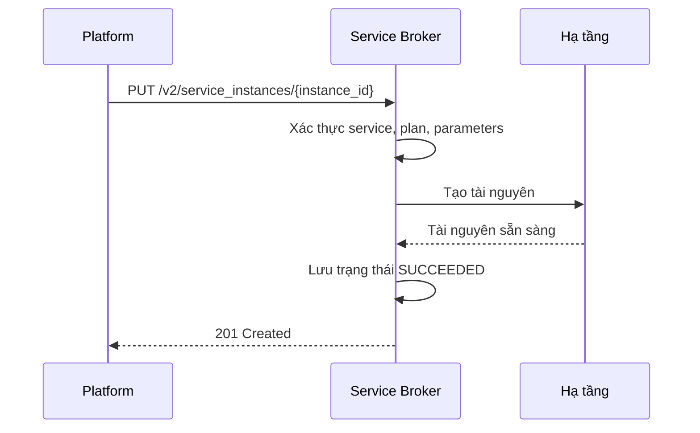
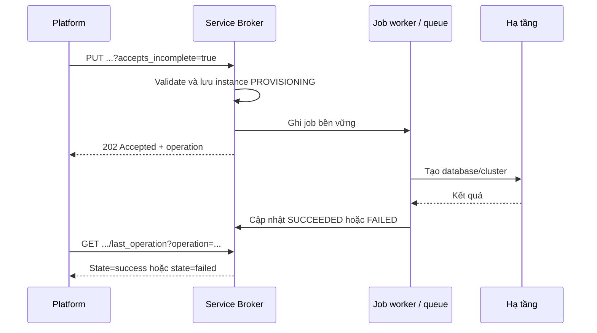
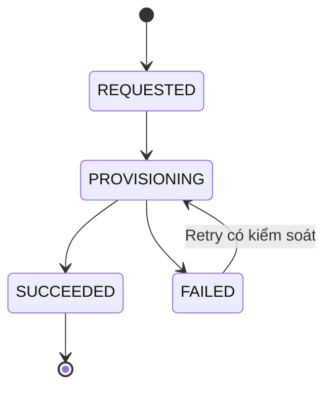

# `PUT /v2/service_instances/{instance_id}` và hợp đồng cấp phát

## Vai trò của yêu cầu provision

Trong Open Service Broker API (OSB API), **provision** là thao tác nền tảng yêu cầu service broker tạo một service instance mới theo một service offering và một service plan đã được công bố trong catalog. Ví dụ, một nhóm phát triển chọn plan PostgreSQL tiêu chuẩn cho ứng dụng `orders`; nền tảng gửi yêu cầu provision, còn broker chuyển yêu cầu đó thành việc tạo database, user, cấu hình mạng và các tài nguyên cần thiết ở hệ thống phía sau.

Module `SPRING_CLOUD_SERVICE_BROKER` sử dụng Spring Cloud Open Service Broker để triển khai hợp đồng này bằng Spring. Broker cần hiểu cấu trúc request, xác thực service và plan, quản lý `instance_id`, xử lý tham số, quyết định thao tác đồng bộ hay bất đồng bộ và trả response mà nền tảng có thể tiếp tục sử dụng trong suốt vòng đời service instance.

Endpoint chuẩn để provision là:

```http
PUT /v2/service_instances/{instance_id}
```

Đây là yêu cầu có tính idempotent theo định danh instance. Nền tảng có thể gửi lại request khi không nhận được phản hồi do timeout hoặc lỗi mạng. Broker phải nhận diện lần gọi lặp và tránh tạo thêm tài nguyên cho cùng một service instance.

## Bốn thành phần chính của request

Request gồm định danh service instance trong path, các lựa chọn service/plan trong body và các tham số điều khiển ở query string hoặc header.

| Thành phần | Vị trí | Ý nghĩa |
|---|---|---|
| `instance_id` | Path | ID do nền tảng cấp để nhận diện service instance. |
| `service_id` | JSON body | ID của service offering mà broker đã công bố trong catalog. |
| `plan_id` | JSON body | ID của plan thuộc service được chọn. |
| `accepts_incomplete` | Query string | Cho biết nền tảng cho phép broker tiếp nhận thao tác bất đồng bộ hay không. |
| `X-Broker-API-Version` | HTTP header | Phiên bản OSB API mà nền tảng sử dụng. |

Các trường body thường gặp:

| Trường | Bắt buộc | Mục đích |
|---|---|---|
| `service_id` | Có | Chọn service offering trong catalog. |
| `plan_id` | Có | Chọn plan hợp lệ thuộc service đó. |
| `context` | Tùy nền tảng | Cung cấp ngữ cảnh do nền tảng gửi, ví dụ thông tin platform instance hoặc dữ liệu tích hợp. |
| `organization_guid` | Theo nền tảng | Định danh tổ chức chứa ứng dụng hoặc service instance. |
| `space_guid` | Theo nền tảng | Định danh space hoặc vùng triển khai tương ứng. |
| `parameters` | Không bắt buộc | Các tùy chọn do người dùng cung cấp, được mô tả hoặc giới hạn bởi schema của plan. |

Không phải nền tảng nào cũng gửi mọi trường tùy chọn. Broker nên xử lý đúng những trường được hợp đồng và nền tảng hỗ trợ, không phụ thuộc vào một giá trị `organization_guid` hay `space_guid` nếu môi trường triển khai không cung cấp chúng.

## Ví dụ request provision

Giả sử catalog của broker công bố service PostgreSQL có ID `svc-postgresql` và plan tiêu chuẩn có ID `plan-standard`. Nền tảng muốn tạo một instance với ID `inst-orders-001`:

```http
PUT /v2/service_instances/inst-orders-001 HTTP/1.1
Host: broker.example.internal
Content-Type: application/json
X-Broker-API-Version: 2.17
Authorization: Basic <broker-credentials>
```

```json
{
  "service_id": "svc-postgresql",
  "plan_id": "plan-standard",
  "context": {
    "platform": "example-platform",
    "platform_instance_id": "platform-prod-01"
  },
  "organization_guid": "org-100",
  "space_guid": "space-orders",
  "parameters": {
    "database_name": "orders",
    "storage_gb": 20,
    "backup_enabled": true
  }
}
```

Các giá trị trong ví dụ chỉ để minh họa. Broker không được mặc định rằng `database_name`, `storage_gb` hoặc `backup_enabled` là tham số hợp lệ cho mọi plan. Nó phải kiểm tra schema và quy tắc riêng của service/plan đã chọn.

`instance_id` nằm trên URL nên không lặp lại trong JSON body. Broker cần giữ nguyên ID này trong kho trạng thái để các yêu cầu retrieve, update, bind, unbind và deprovision sau đó có thể tham chiếu đúng tài nguyên.

## Xác thực và kiểm tra trước khi tạo tài nguyên

Provision là thao tác có thể tạo chi phí và mở quyền truy cập vào hạ tầng. Broker nên hoàn thành các kiểm tra sau trước khi gọi hệ thống phía sau:

1. Xác thực request đến từ nền tảng được phép và kiểm tra kết nối bảo mật.
2. Đọc `instance_id` từ path, kiểm tra giá trị không rỗng và nằm trong giới hạn mà ứng dụng chấp nhận.
3. Kiểm tra body có `service_id` và `plan_id` hợp lệ.
4. Tìm service trong catalog và xác minh plan thuộc đúng service đó.
5. Kiểm tra plan còn được cung cấp và có thể provision trong trạng thái hiện tại.
6. Xác thực `parameters` theo schema, kiểu dữ liệu, giới hạn tài nguyên và chính sách nghiệp vụ.
7. Kiểm tra `context`, `organization_guid` và `space_guid` theo khả năng của nền tảng; không dùng dữ liệu client gửi như bằng chứng phân quyền nếu chưa xác minh.
8. Tra cứu `instance_id` để phát hiện request lặp hoặc xung đột trước khi tạo tài nguyên.

Ví dụ, nếu `plan-standard` chỉ cho phép `storage_gb` từ 10 đến 100, request yêu cầu 500 GB phải bị từ chối trước khi gửi lệnh tạo database hoặc volume. Nếu plan không hỗ trợ backup, broker cần từ chối hoặc xử lý tham số theo chính sách đã công bố, không âm thầm tạo tài nguyên với cấu hình khác ý định của người dùng.

## Hợp đồng response

Response phản ánh trạng thái thực tế của thao tác. Broker phải phân biệt tài nguyên đã được tạo xong với yêu cầu mới chỉ được tiếp nhận để xử lý sau.

| HTTP status | Ý nghĩa | Khi sử dụng |
|---|---|---|
| `201 Created` | Service instance vừa được tạo thành công. | Provision hoàn tất đồng bộ. |
| `200 OK` | Service instance đã tồn tại và request được nhận diện là thao tác lặp phù hợp. | Nền tảng retry một request đã hoàn tất; broker trả kết quả nhất quán theo hợp đồng. |
| `202 Accepted` | Broker đã tiếp nhận yêu cầu nhưng thao tác vẫn đang chạy. | Chỉ dùng khi nền tảng cho phép xử lý bất đồng bộ và broker có khả năng theo dõi tiến trình. |
| `400 Bad Request` | Request thiếu hoặc sai cấu trúc. | JSON không hợp lệ hoặc thiếu trường bắt buộc. |
| `401 Unauthorized` / `403 Forbidden` | Không xác thực được hoặc không được phép thực hiện. | Thông tin xác thực không hợp lệ hoặc caller không có quyền. |
| `409 Conflict` | Request xung đột với trạng thái instance hiện tại. | Cùng `instance_id` nhưng request không tương thích với service/plan hoặc trạng thái đã lưu. |
| `422 Unprocessable Entity` | Request không thể xử lý theo điều kiện hiện tại. | Tham số không hợp lệ hoặc broker cần async nhưng nền tảng không cho phép. |
| `5xx` | Lỗi phía broker hoặc hệ thống phụ thuộc. | Lỗi không mong muốn khi xử lý request. |

Các mã lỗi cụ thể phải tuân theo phiên bản OSB API và điều kiện của từng endpoint. Response lỗi nên có cấu trúc theo hợp đồng, thông tin đủ để nền tảng hiểu nguyên nhân và không làm lộ stack trace, credential hoặc dữ liệu nhạy cảm.

Ví dụ response khi tạo thành công đồng bộ:

```http
HTTP/1.1 201 Created
Content-Type: application/json
```

```json
{
  "dashboard_url": "https://console.example.internal/services/inst-orders-001"
}
```

`dashboard_url` là trường tùy chọn. Nếu broker không có giao diện quản trị cho instance, có thể bỏ trường này. Khi request được xử lý lặp và instance đã provision, broker phải phản hồi theo trạng thái đã lưu, tránh tạo tài nguyên thứ hai.

## Đồng bộ và bất đồng bộ qua `accepts_incomplete`

Một số tài nguyên có thể tạo nhanh, nhưng việc cấp phát database cluster, cấu hình mạng, tạo volume hoặc gọi API cloud có thể mất nhiều thời gian. OSB API cho phép nền tảng báo trước khả năng chấp nhận thao tác chưa hoàn tất bằng query parameter `accepts_incomplete`.

### Provision đồng bộ

Nếu broker có thể hoàn thành trong thời gian xử lý request, nó thực hiện tạo tài nguyên và chỉ trả response thành công sau khi kết quả đã được xác nhận. Luồng đơn giản:



Việc broker gọi được API tạo tài nguyên chưa đủ để kết luận thành công. Cần xác định rõ điều kiện “đã provision”: database đã tồn tại, endpoint có thể truy cập, quyền cần thiết đã được cấu hình hay chỉ mới có yêu cầu tạo được gửi đi.

### Provision bất đồng bộ

Nếu thao tác cần thời gian dài và nền tảng gửi `accepts_incomplete=true`, broker có thể nhận việc, lưu trạng thái và trả `202 Accepted`. Response có thể chứa một giá trị `operation` để nền tảng dùng khi hỏi trạng thái:

```http
PUT /v2/service_instances/inst-orders-001?accepts_incomplete=true HTTP/1.1
Content-Type: application/json
```

```json
{
  "service_id": "svc-postgresql",
  "plan_id": "plan-standard",
  "parameters": {
    "storage_gb": 20
  }
}
```

```http
HTTP/1.1 202 Accepted
Content-Type: application/json
```

```json
{
  "operation": "provision-op-001"
}
```

`operation` là ID do broker quản lý để nhận diện lần thực hiện bất đồng bộ. Broker cần lưu nó cùng `instance_id`, loại thao tác, trạng thái và thời điểm cập nhật. Nền tảng tiếp tục hỏi endpoint `last_operation` cho instance đó cho đến khi nhận trạng thái hoàn tất hoặc thất bại.

Nếu broker cần xử lý bất đồng bộ nhưng request không cho phép (`accepts_incomplete` không được bật), broker phải trả lỗi phù hợp theo OSB API, thường là `422 Unprocessable Entity` với mã lỗi `AsyncRequired`. Broker không được trả `202` rồi kỳ vọng nền tảng polling trong khi nền tảng chưa chấp nhận mô hình này.

Luồng bất đồng bộ:



Điểm quan trọng là job phải được lưu bền vững trước khi trả `202`. Nếu broker trả `202` nhưng làm mất job khi tiến trình khởi động lại, nền tảng sẽ polling mãi mà không có thao tác thực sự chạy. Có thể dùng transaction kết hợp outbox, hàng đợi bền vững hoặc một cơ chế điều phối công việc có khả năng phục hồi.

## Quản lý trạng thái service instance

Provision không chỉ là một lệnh gọi API. Broker phải quản lý trạng thái xuyên suốt từ lúc nhận request đến khi tài nguyên được tạo xong hoặc thất bại.

Một state machine đơn giản:



| Trạng thái | Ý nghĩa | Hành động phù hợp |
|---|---|---|
| `REQUESTED` | Broker đã ghi nhận request. | Xác thực, chuẩn hóa dữ liệu và lên lịch xử lý. |
| `PROVISIONING` | Hệ thống phía sau đang tạo tài nguyên. | Theo dõi job, timeout và retry. |
| `SUCCEEDED` | Tài nguyên đáp ứng điều kiện sẵn sàng. | Trả kết quả thành công và cho phép các thao tác tiếp theo. |
| `FAILED` | Provision thất bại. | Lưu lỗi an toàn, xử lý tài nguyên dở dang và cho phép retry theo chính sách. |

Trạng thái trong bảng là mô hình nội bộ minh họa. Response `last_operation` phải ánh xạ các trạng thái này sang các giá trị OSB API quy định, chẳng hạn `in progress`, `succeeded` hoặc `failed`; không trả nguyên tên state nội bộ nếu không đúng hợp đồng.

Một bản ghi instance có thể lưu:

```text
instance_id
service_id
plan_id
parameters_fingerprint
provider_resource_id
provision_state
current_operation_id
created_at
updated_at
failure_code
```

Không nhất thiết lưu nguyên văn mọi tham số nếu chúng chứa bí mật. Có thể lưu fingerprint để so sánh request lặp, còn thông tin nhạy cảm phải được mã hóa hoặc quản lý qua secret store.

## Idempotency và xử lý request gửi lại

HTTP `PUT` được thiết kế cho ngữ nghĩa idempotent: nhiều lần gửi cùng một yêu cầu tới cùng tài nguyên không được tạo ra nhiều hiệu ứng ngoài ý muốn. Trong OSB API, `instance_id` là định danh trọng tâm để broker nhận biết yêu cầu provision đang nhắm đến cùng service instance.

Broker nên xử lý ba tình huống:

| Tình huống | Hành vi mong đợi |
|---|---|
| `instance_id` chưa tồn tại | Ghi nhận request và bắt đầu provision. |
| `instance_id` đã tồn tại với cùng service, plan và cấu hình tương thích | Không tạo tài nguyên lần nữa; trả kết quả hoặc trạng thái đang xử lý nhất quán với lần trước. |
| `instance_id` đã tồn tại nhưng request có service, plan hoặc cấu hình xung đột | Trả lỗi xung đột phù hợp; không ghi đè dữ liệu instance một cách âm thầm. |

Một cách thực hiện là tạo unique constraint trên `instance_id`, sau đó xử lý việc insert cạnh tranh bằng cách đọc lại bản ghi đã tồn tại. Khi hai request cùng đến một lúc, không thể chỉ kiểm tra `findById` rồi mới insert vì cả hai tiến trình có thể cùng thấy “chưa tồn tại”. Ràng buộc duy nhất ở database, khóa theo instance hoặc optimistic locking giúp bảo vệ vùng tranh chấp.

Ngoài ra, cần xét tình huống API phía sau đã tạo tài nguyên nhưng broker mất kết nối trước khi ghi `provider_resource_id`. Khi retry, broker phải đối soát bằng provider idempotency key, tên tài nguyên xác định từ `instance_id` hoặc thao tác tìm kiếm tài nguyên đã tạo. Nếu không có cơ chế này, retry có thể sinh database hoặc cluster trùng lặp.

## Triển khai luồng provision trong Spring Cloud Open Service Broker

Spring Cloud Open Service Broker cung cấp abstraction để ứng dụng triển khai nghiệp vụ tạo service instance. Tùy phiên bản thư viện, service thường triển khai hợp đồng `ServiceInstanceService` và xử lý request tạo instance qua `CreateServiceInstanceRequest`, sau đó trả `CreateServiceInstanceResponse`.

Ví dụ dưới đây là pseudocode Java nhằm thể hiện ranh giới trách nhiệm; tên builder và chữ ký cụ thể cần đối chiếu với phiên bản dependency của ứng dụng:

```java
@Service
public class PostgresInstanceService implements ServiceInstanceService {

    private final Catalog catalog;
    private final InstanceRepository instances;
    private final ProvisioningCoordinator coordinator;

    @Override
    public Mono<CreateServiceInstanceResponse> createServiceInstance(
            CreateServiceInstanceRequest request) {

        return Mono.defer(() -> {
            ServiceDefinition service = catalog.getServiceDefinition(
                    request.getServiceDefinitionId());
            if (service == null) {
                return Mono.error(new InvalidServiceException());
            }

            PlanDefinition plan = service.getPlan(request.getPlanId());
            if (plan == null) {
                return Mono.error(new InvalidPlanException());
            }

            return instances.findById(request.getServiceInstanceId())
                    .flatMap(existing -> coordinator.handleDuplicate(existing, request))
                    .switchIfEmpty(coordinator.startProvision(request, service, plan));
        });
    }
}
```

Đây là cấu trúc minh họa, không phải đoạn mã có thể biên dịch nguyên trạng: `InvalidServiceException`, `InvalidPlanException`, repository và coordinator là thành phần ứng dụng; các getter, kiểu trả về và cách lấy catalog cần được xác nhận theo phiên bản framework. Ý chính là handler giao thức không nên ôm toàn bộ logic tạo database, quản lý retry và ghi trạng thái vào một phương thức duy nhất. Hãy tách nghiệp vụ provision vào service/coordinator để có thể kiểm thử và phục hồi độc lập.

Một cách chia trách nhiệm thường gặp:

- `CatalogService`: công bố service và plan mà broker hỗ trợ.
- `ServiceInstanceService`: nhận yêu cầu tạo, đọc, cập nhật hoặc xóa instance theo hợp đồng framework.
- `ProvisioningCoordinator`: điều phối đồng bộ/bất đồng bộ và state transition.
- `InstanceRepository`: lưu trạng thái và ánh xạ ID.
- `InfrastructureAdapter`: gọi API nhà cung cấp hoặc Kubernetes operator để tạo tài nguyên.
- `OperationRepository`: lưu operation ID và kết quả polling.

## Bảo mật và xử lý dữ liệu đầu vào

`parameters` và `context` đến từ request của nền tảng, do đó phải được xem là dữ liệu đầu vào cần xác thực. Broker nên:

- Chỉ chấp nhận các trường được schema của service/plan cho phép.
- Kiểm tra kích thước, kiểu dữ liệu, giá trị enum, giới hạn dung lượng và các ràng buộc chéo.
- Xác thực quyền caller trước khi tạo tài nguyên hoặc tiêu thụ quota.
- Mã hóa credential và secret khi lưu trữ; tránh đưa chúng vào log hoặc thông báo lỗi.
- Giới hạn quyền của service account mà broker dùng để thao tác hạ tầng.
- Kiểm soát URL hoặc địa chỉ endpoint do người dùng truyền để tránh gọi nhầm hệ thống nội bộ ngoài phạm vi cho phép.

`organization_guid`, `space_guid` và `context` có thể giúp broker áp dụng quota, naming convention hoặc chính sách cô lập. Tuy nhiên, dữ liệu này phải được đối chiếu với danh tính nền tảng đã xác thực. Không tin một `organization_guid` do client tự gửi nếu broker chưa xác nhận caller được phép cấp tài nguyên cho tổ chức đó.

## Quan sát, timeout và phục hồi

Provision thường kéo theo nhiều bước ở hệ thống ngoài broker. Cần có log có cấu trúc và correlation ID để nối request HTTP, instance, operation và lệnh gọi provider. Những ID này hỗ trợ truy vết, nhưng log không được chứa password, token hoặc payload nhạy cảm.

Các chỉ số hữu ích gồm số request provision theo status, thời gian tạo instance, số job đang chạy, số lần retry, tỷ lệ lỗi provider và số instance mắc kẹt ở trạng thái `PROVISIONING`. Cần đặt timeout cho lời gọi provider và có quy tắc retry theo loại lỗi; không retry vô hạn với lỗi cấu hình hoặc quyền truy cập.

Khi broker khởi động lại, worker cần tìm các operation còn ở trạng thái đang chạy, kiểm tra trạng thái thực tế ở provider rồi tiếp tục hoặc kết thúc thao tác. Nếu không thể xác định kết quả do timeout không rõ ràng, broker cần reconciliation trước khi phát lệnh tạo lại.

## Checklist kiểm tra hợp đồng provision

1. Request hợp lệ với `service_id`, `plan_id` và `instance_id` tạo đúng một service instance.
2. Service ID không tồn tại hoặc plan không thuộc service bị từ chối trước khi gọi provider.
3. Tham số ngoài schema hoặc vượt giới hạn plan được xử lý đúng.
4. Request lặp với cùng instance và cấu hình không tạo tài nguyên trùng.
5. Request lặp với cùng instance nhưng dữ liệu xung đột trả lỗi phù hợp.
6. Provision đồng bộ chỉ trả thành công sau khi tài nguyên đạt điều kiện sẵn sàng.
7. Provision bất đồng bộ chỉ trả `202` khi `accepts_incomplete=true` và operation đã được lưu bền vững.
8. Request không cho phép async nhưng cần async trả lỗi `AsyncRequired` theo hợp đồng.
9. `last_operation` trả đúng trạng thái cho operation đang chạy, thành công hoặc thất bại.
10. Lỗi provider, timeout và restart không làm mất dấu instance hoặc tạo tài nguyên trùng.
11. Response và log không làm lộ credential hay dữ liệu nhạy cảm.

## Kết luận

`PUT /v2/service_instances/{instance_id}` là điểm bắt đầu vòng đời service instance trong OSB API. Một broker đúng hợp đồng cần xác thực service/plan và tham số, quản lý định danh instance ổn định, thực hiện provision an toàn khi retry, chọn đồng bộ hoặc bất đồng bộ theo `accepts_incomplete`, và lưu trạng thái đủ để nền tảng tiếp tục theo dõi. Spring Cloud Open Service Broker cung cấp lớp tích hợp giao thức; logic tạo tài nguyên, quản lý trạng thái, idempotency và phục hồi vẫn cần được thiết kế rõ trong ứng dụng broker.
