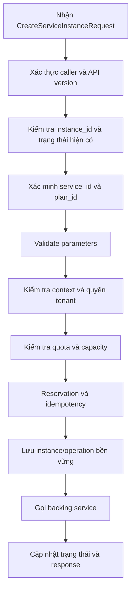

# CreateServiceInstanceRequest và dữ liệu cần xác minh trước khi tạo

Provision là thao tác nền tảng yêu cầu service broker tạo một service instance mới từ service và plan đã được công bố trong catalog. Trong Open Service Broker API (OSB API), nền tảng gửi `PUT /v2/service_instances/{instance_id}` cùng request body chứa `service_id`, `plan_id` và các dữ liệu liên quan. Khi triển khai bằng Spring Cloud Open Service Broker, request này được ánh xạ vào model `CreateServiceInstanceRequest` để handler xử lý.

Trước khi gọi backing service để tạo database, cache, queue hoặc tài nguyên cloud, broker phải xác minh đầy đủ định danh, service/plan, parameters, context, quyền sở hữu, quota và trạng thái hiện tại. Nếu bỏ qua bước kiểm tra, broker có thể cấp phát sai plan, tạo tài nguyên cho tenant không hợp lệ, vượt giới hạn hoặc tạo trùng tài nguyên khi platform gửi lại request.

Trong module `SPRING_CLOUD_SERVICE_BROKER`, bài học này tập trung vào cách đọc `CreateServiceInstanceRequest`, phân biệt dữ liệu thuộc giao thức với dữ liệu nghiệp vụ, và xây dựng quy trình preflight trước khi thực hiện side effect. Các nguyên tắc này áp dụng khi tích hợp với Cloud Foundry, Kubernetes thông qua thành phần tương thích OSB, hoặc một platform khác.

## Mục tiêu học tập

Sau bài này, bạn có thể:

- Mô tả request provision theo OSB API và vai trò của `CreateServiceInstanceRequest`.
- Phân biệt dữ liệu trong path, query parameter, header và JSON body.
- Xác minh `service_id` và `plan_id` dựa trên catalog mà broker công bố.
- Kiểm tra `parameters`, context, quyền tenant, quota và khả năng của backing service.
- Thiết kế quy trình idempotent khi `instance_id` được gửi lại.
- Biết thời điểm ghi nhận trạng thái và bắt đầu gọi nhà cung cấp.
- Ánh xạ lỗi preflight sang response OSB API phù hợp.

## 1. Provision request gồm những phần nào?

Nền tảng gửi request provision tới endpoint service instance. Một request minh họa:

```http
PUT /v2/service_instances/instance-7f21?accepts_incomplete=true HTTP/1.1
Host: broker.example.internal
X-Broker-API-Version: 2.17
Content-Type: application/json
Accept: application/json
Authorization: Basic <credentials>

{
  "service_id": "postgres-service",
  "plan_id": "standard-plan",
  "context": {
    "platform": "cloudfoundry",
    "organization_guid": "org-42",
    "space_guid": "space-dev"
  },
  "parameters": {
    "database_name": "orders",
    "storage_gb": 20,
    "backup_enabled": true
  }
}
```

Các thành phần không cùng nằm trong JSON body:

| Vị trí | Giá trị | Vai trò |
|---|---|---|
| HTTP method | `PUT` | Yêu cầu tạo hoặc xác lập service instance theo URI. |
| Path | `/v2/service_instances/{instance_id}` | Xác định instance mà platform muốn tạo; ID do platform quản lý. |
| Query | `accepts_incomplete=true` | Cho biết platform chấp nhận kết quả bất đồng bộ nếu thao tác cần chạy nền. |
| Header | `X-Broker-API-Version` | Xác định phiên bản OSB API mà client sử dụng. |
| Header | `Authorization` | Cung cấp thông tin xác thực của platform với broker. |
| Body | `service_id`, `plan_id` | Chọn service và plan trong catalog. |
| Body | `context` | Mang ngữ cảnh platform hoặc môi trường triển khai. |
| Body | `parameters` | Mang các tùy chọn cấu hình riêng của service. |

`instance_id` không phải một parameter do người dùng tự đặt. Nó nằm trong path và là định danh quan trọng để broker liên kết request, bản ghi nội bộ, tài nguyên ở nhà cung cấp và các operation tiếp theo. Tương tự, `accepts_incomplete` là query parameter của giao thức, không phải key bên trong `parameters`.

Các field môi trường như `organization_guid` và `space_guid` từng được truyền ở cấp cao nhất trong các request cũ; chúng đã được chuyển hướng sang `context` trong hợp đồng OSB API. Khi tích hợp platform cũ, broker cần tuân thủ phiên bản API được hỗ trợ và có quy tắc tương thích rõ ràng.

## 2. `CreateServiceInstanceRequest` trong Spring Cloud Open Service Broker

Spring Cloud Open Service Broker cung cấp model request cho từng thao tác OSB API. `CreateServiceInstanceRequest` biểu diễn dữ liệu của yêu cầu provision sau khi lớp giao thức đã nhận HTTP request và ánh xạ các field theo hợp đồng.

Ở góc độ nghiệp vụ, handler cần đọc được các nhóm thông tin sau:

- Định danh service và plan được chọn.
- Context của platform, cùng các field môi trường tương thích nếu phiên bản thư viện hỗ trợ.
- Parameters mà người dùng yêu cầu cho instance.
- Thông tin cho biết platform có chấp nhận xử lý bất đồng bộ hay không.
- Định danh service instance lấy từ endpoint path.

Tên thuộc tính Java trong model có thể khác tên JSON của OSB API. Ví dụ, `service_id` trong giao thức thường được biểu diễn theo khái niệm service definition trong model của Spring Cloud Open Service Broker. Vì vậy, khi đọc model hoặc viết handler, hãy dựa vào API của đúng phiên bản dependency trong dự án; không giả định tên accessor Java phải giống nguyên văn key JSON.

Một handler ở mức khái niệm có thể được tổ chức như sau:

```java
public Mono<CreateServiceInstanceResponse> createServiceInstance(
        CreateServiceInstanceRequest request) {

    return requestValidator.validate(request)
            .flatMap(validatedCommand -> provisioningService.provision(validatedCommand));
}
```

Đây là ví dụ minh họa cấu trúc, không phải chữ ký bắt buộc cho mọi phiên bản thư viện. Ý tưởng chính là handler nhận model giao thức, chuyển qua bước xác minh và tạo một command nội bộ đã được kiểm tra trước khi gọi logic cấp phát.

Không nên để provider adapter tự đọc một object request chưa được xác minh rồi tùy ý quyết định service, tenant hoặc plan. Việc tách validation khỏi provisioning giúp ranh giới giữa giao thức OSB và nghiệp vụ cấp phát rõ ràng hơn.

## 3. Xác minh định danh và service/plan

Đây là nhóm kiểm tra đầu tiên vì chúng quyết định broker sẽ tạo loại tài nguyên nào.

### 3.1. Kiểm tra `instance_id`

Broker cần kiểm tra định danh lấy từ path:

- Giá trị phải hiện diện và có định dạng hợp lệ theo quy ước của platform/broker.
- Được dùng nhất quán trong kho dữ liệu và khi gọi backing service.
- Không được tự tạo một ID khác rồi làm mất liên hệ với ID platform gửi.
- Phải được tra cứu trước khi tạo mới để phát hiện instance đã tồn tại hoặc operation đang chạy.

`instance_id` là khóa idempotency tự nhiên cho vòng đời service instance trong phạm vi broker. Nó không chứng minh người gọi có quyền sở hữu instance; quyền vẫn phải được xác minh dựa trên danh tính client và dữ liệu sở hữu đáng tin cậy.

### 3.2. Xác minh `service_id`

`service_id` phải tham chiếu đến một service mà broker đã công bố trong catalog. Broker cần kiểm tra:

- Service ID có tồn tại trong catalog hiện hành hay không.
- Service có đang được phép cấp phát mới hay đã bị ngừng cung cấp.
- Broker có adapter hoặc cơ chế thực thi tương ứng hay không.
- Các capability và chính sách của service có cho phép thao tác provision hay không.

Không dùng tên hiển thị như `PostgreSQL Database` để thay thế ID ổn định. Tên có thể đổi để phục vụ giao diện; ID là khóa mà platform dùng trong request.

### 3.3. Xác minh `plan_id`

Một plan phải thuộc đúng service được chọn. Việc plan tồn tại ở một service khác không làm cho cặp `service_id`/`plan_id` trở nên hợp lệ.

Ví dụ:

| Service | Plan | Kết quả |
|---|---|---|
| `postgres-service` | `standard-plan` thuộc PostgreSQL | Hợp lệ nếu plan đang mở provision. |
| `postgres-service` | `redis-small-plan` thuộc Redis | Không hợp lệ vì plan không thuộc service. |
| `unknown-service` | `standard-plan` | Không hợp lệ vì service không tồn tại. |

Ngoài kiểm tra quan hệ, broker cần xác minh plan còn được phép tạo instance mới, không bị vô hiệu hóa, không vượt giới hạn tenant và có cấu hình backing service tương ứng. Một plan có trong catalog không nhất thiết đồng nghĩa mọi tenant đều đủ điều kiện sử dụng plan đó.

### 3.4. Kiểm tra capability và chính sách

Broker phải biết service và plan hỗ trợ những thao tác nào. Nếu service bị đánh dấu không bindable thì điều đó ảnh hưởng đến bước bind sau này; nó không tự động có nghĩa provision bị cấm. Tương tự, khả năng update plan và các giới hạn của plan cần được kiểm tra theo đúng thao tác đang thực hiện.

Catalog là hợp đồng công bố với platform. Logic kiểm tra trong handler và provider adapter phải nhất quán với catalog; không nhận một plan mà broker đã công bố là không khả dụng hoặc không thể thực thi.

## 4. Xác minh `parameters` theo schema và nghiệp vụ

`parameters` chứa các tùy chọn riêng của dịch vụ. Trong ví dụ PostgreSQL, người dùng yêu cầu tên database, dung lượng và chính sách backup. Đây là dữ liệu cần kiểm tra trước khi gọi nhà cung cấp.

### 4.1. Kiểm tra cấu trúc và kiểu dữ liệu

Ví dụ quy tắc:

| Parameter | Kiểu mong đợi | Kiểm tra |
|---|---|---|
| `database_name` | String | Không rỗng, độ dài và ký tự hợp lệ theo provider. |
| `storage_gb` | Integer | Số dương, nằm trong giới hạn của plan. |
| `backup_enabled` | Boolean | Nhận boolean thực, không nhận chuỗi tùy ý. |

JSON parse thành công không có nghĩa parameters hợp lệ. `storage_gb: -10` là số nguyên hợp lệ về cú pháp JSON nhưng không hợp lệ về nghiệp vụ. Tương tự, chuỗi `"true"` không nên tự động được coi là boolean nếu schema yêu cầu kiểu boolean.

### 4.2. Đối chiếu schema với plan

Broker có thể công bố schema parameters trong catalog để platform hiển thị biểu mẫu hoặc kiểm tra sớm. Handler vẫn phải validate ở server:

1. Kiểm tra object có đúng kiểu và không vượt giới hạn kích thước.
2. Kiểm tra field bắt buộc, kiểu dữ liệu, định dạng và miền giá trị.
3. Kiểm tra key có được hỗ trợ trong thao tác provision hay không.
4. Áp dụng default theo quy tắc đã công bố nếu field được phép bỏ qua.
5. Đối chiếu giới hạn với plan cụ thể và chính sách tenant.

Ví dụ `storage_gb` có thể tối đa 50 GB ở plan `small` nhưng tối đa 500 GB ở plan `standard`. Không nên chỉ kiểm tra một giới hạn toàn cục rồi bỏ qua plan đang được chọn.

### 4.3. Xử lý key không được hỗ trợ

Nếu client gửi `replica_count` trong khi service không hỗ trợ cấu hình replica, broker cần có hành vi rõ ràng. Tùy chính sách, broker có thể từ chối request và nêu parameter không hợp lệ. Âm thầm bỏ qua key thường gây hiểu nhầm vì người dùng tưởng cấu hình đã được áp dụng.

Không chuyển trực tiếp parameters vào SQL, shell command hoặc URL mà chưa kiểm tra. Hãy chuyển chúng thành kiểu nội bộ đã xác thực và dùng API an toàn của backing service.

## 5. Xác minh context và quyền sở hữu tenant

Context giúp broker hiểu request đến từ platform nào và gắn tài nguyên với môi trường nào. Ví dụ, Cloud Foundry có thể cung cấp thông tin platform, organization và space; một adapter cho Kubernetes có thể dùng context phù hợp với cụm, namespace hoặc tenant mà nó quản lý.

Broker cần xác minh:

- Context có cấu trúc hợp lệ theo platform và phiên bản được hỗ trợ hay không.
- Những field nào là bắt buộc trong tích hợp hiện tại.
- Context có nhất quán với tổ chức/tenant được lưu trong hệ thống hay không.
- Client đã xác thực có quyền tạo tài nguyên cho tenant đó hay không.
- Tenant có được phép dùng service/plan và còn quota hay không.

Không coi `organization_guid`, `space_guid`, namespace hoặc tên project do request gửi là bằng chứng xác thực. Các giá trị này có thể được dùng để định tuyến hoặc đối chiếu, nhưng quyền phải xuất phát từ danh tính đã xác thực và chính sách phân quyền.

Một luồng kiểm tra quyền điển hình:

1. Xác thực platform/client ở lớp bảo mật của broker.
2. Lấy principal hoặc thông tin caller từ security context đáng tin cậy.
3. Xác định tenant mà caller được phép thao tác.
4. Đối chiếu tenant đó với context của request và chính sách của broker.
5. Chỉ tiếp tục khi caller được phép provision service/plan trong phạm vi này.

Nếu context không đủ thông tin để xác định tenant hoặc mâu thuẫn với danh tính đã xác thực, broker cần từ chối hoặc yêu cầu dữ liệu hợp lệ theo hợp đồng tích hợp. Không tự gán vào tenant mặc định vì có thể tạo tài nguyên sai chủ sở hữu.

## 6. Kiểm tra quota, capacity và khả năng provider

Ngay cả khi service, plan và parameters hợp lệ, broker vẫn phải xác định tài nguyên có thể được cấp phát trong điều kiện hiện tại hay không.

### 6.1. Quota theo tenant và plan

Ví dụ một tenant được phép có tối đa 10 PostgreSQL instances và tổng dung lượng 500 GB. Tenant hiện có 9 instances với tổng 470 GB. Request mới yêu cầu 40 GB:

- Giới hạn số lượng vẫn cho phép tạo instance thứ 10.
- Giới hạn tổng dung lượng không cho phép tăng từ 470 GB lên 510 GB.
- Broker phải từ chối request hoặc áp dụng chính sách cấp phát khác đã được công bố.

Quota có thể được áp dụng theo tenant, service, plan, môi trường hoặc toàn broker. Kiểm tra cần tính cả tài nguyên đang provision hoặc quota đã được giữ chỗ cho operation đang chạy, tránh hai request đồng thời cùng nhìn thấy phần quota còn trống.

### 6.2. Capacity và trạng thái nhà cung cấp

Broker có thể kiểm tra cluster/provider có còn capacity, credential quản trị còn hiệu lực, endpoint provider đang hoạt động và vùng triển khai có hỗ trợ plan hay không. Một plan được công bố không đảm bảo mọi vùng hoặc mọi tenant đều có thể dùng tại mọi thời điểm.

Nếu kiểm tra capacity chỉ mang tính ước lượng, kết quả không thể bảo đảm provider sẽ chấp nhận thao tác sau đó. Broker vẫn phải xử lý lỗi từ provider và cập nhật trạng thái operation chính xác.

### 6.3. Giữ chỗ quota an toàn khi có cạnh tranh

Không nên thực hiện quy trình “đọc quota còn lại, rồi sau đó mới ghi tăng” bằng hai thao tác độc lập không có đồng bộ. Hai request đồng thời có thể cùng đọc 30 GB còn trống và đều yêu cầu 20 GB, khiến tổng cấp phát vượt giới hạn.

Có thể dùng transaction với cập nhật có điều kiện, row lock, optimistic version hoặc cơ chế reservation phù hợp. Bản ghi reservation cần liên kết với `instance_id`/operation để có thể giải phóng nếu provision thất bại hoặc bị hủy.

## 7. Idempotency và kiểm tra instance đã tồn tại

Platform có thể gửi lại request vì timeout, retry hoặc mất response. Broker phải kiểm tra `instance_id` trước khi tạo tài nguyên để một request lặp không tạo thêm database hoặc tài nguyên cloud.

Một quy trình kiểm tra điển hình:

| Trạng thái đã lưu | Request mới | Hành vi gợi ý |
|---|---|---|
| Chưa có instance | Request hợp lệ | Giữ chỗ ID và bắt đầu quy trình provision. |
| Instance đã active với cùng service/plan/cấu hình | Request lặp tương đương | Trả kết quả idempotent theo hợp đồng, không tạo lại tài nguyên. |
| Instance đang `provisioning` với cùng yêu cầu | Request lặp khi operation đang chạy | Trả phản hồi nhất quán với operation hiện có, không khởi tạo worker thứ hai. |
| Instance tồn tại nhưng service/plan/parameters không tương thích | Request xung đột | Từ chối theo quy tắc xung đột của OSB API. |
| Instance đã bị thu hồi | Request provision mới với cùng ID | Xử lý theo chính sách vòng đời và trạng thái lưu trữ của broker; không nhầm bản ghi tombstone với instance đang active. |

Để bảo đảm điều này khi chạy nhiều replica:

- Dùng unique constraint cho định danh instance trong phạm vi broker.
- Lưu fingerprint của request đã chuẩn hóa, gồm các field có ý nghĩa đối với provision.
- Ghi nhận trạng thái và operation trong kho dữ liệu bền vững.
- Dùng transaction hoặc cơ chế khóa/reservation để chỉ một request tạo mới được quyền bắt đầu.
- Dùng idempotency key hoặc resource name ổn định khi gọi provider nếu provider hỗ trợ.

Không đưa password hoặc secret thô vào fingerprint có thể bị log. Nếu parameters có secret, cần chuẩn hóa và so sánh an toàn theo thiết kế bảo mật của broker.

## 8. Chỉ gọi backing service sau khi preflight đạt

Preflight là giai đoạn kiểm tra và chuẩn bị trước side effect. Mục tiêu là phát hiện lỗi dữ liệu, quyền, plan, quota và xung đột trước khi tạo tài nguyên thực tế.

Một trình tự phù hợp:

1. Nhận request, xác thực caller và kiểm tra phiên bản OSB API.
2. Đọc `instance_id` từ path, kiểm tra định dạng và tra cứu trạng thái hiện tại.
3. Xác minh `service_id`, `plan_id` và quan hệ giữa chúng trong catalog.
4. Validate `parameters` theo schema, quy tắc nghiệp vụ và giới hạn của plan.
5. Xác minh context, quyền tenant và chính sách truy cập.
6. Kiểm tra quota, reservation và capacity hiện có.
7. Xử lý idempotency hoặc xung đột với instance/operation đã tồn tại.
8. Ghi bản ghi instance cùng trạng thái ban đầu và operation/reservation trong kho dữ liệu bền vững.
9. Chỉ sau khi các bước trên thành công mới gọi provider để tạo tài nguyên.
10. Cập nhật trạng thái và phản hồi theo hợp đồng OSB API.



Nếu một bước preflight thất bại, broker trả lỗi phù hợp và không gọi provider. Nếu bước lưu reservation hoặc operation thất bại, broker cũng không được tiếp tục tạo tài nguyên vì sẽ không có trạng thái đáng tin cậy để theo dõi hoặc thu hồi.

## 9. Xử lý đồng bộ và bất đồng bộ sau preflight

Sau khi dữ liệu được xác minh, broker quyết định có thể hoàn tất provision trong request hiện tại hay cần tiếp nhận operation nền.

Nếu có thể hoàn tất đồng bộ, broker gọi provider, lưu resource ID và trạng thái `active`, rồi trả response thành công theo OSB API. Nếu cần chạy lâu, broker chỉ trả `202 Accepted` khi platform đã gửi `accepts_incomplete=true` và broker có khả năng theo dõi operation đến trạng thái cuối.

Nếu thao tác bắt buộc phải chạy bất đồng bộ nhưng platform không chấp nhận async, broker phải từ chối theo hợp đồng thay vì tạo một công việc nền mà platform không biết cách theo dõi. Trạng thái operation phải được lưu trước khi trả `202` để lần polling đầu tiên có thể tra cứu được.

Khi provider timeout sau khi đã nhận lệnh, không thể mặc định rằng tài nguyên chưa được tạo. Broker cần tra cứu theo resource ID/idempotency key, đối soát trạng thái hoặc thực hiện retry an toàn. Kết quả cuối cùng phải được ghi vào operation để endpoint `last_operation` trả `succeeded` hoặc `failed` đúng thực tế.

## 10. Ánh xạ dữ liệu request thành command nội bộ

Sau preflight, nên chuyển dữ liệu giao thức thành một command nội bộ có kiểu rõ ràng. Ví dụ:

```java
public record ProvisionCommand(
        String instanceId,
        String serviceId,
        String planId,
        String tenantId,
        String databaseName,
        int storageGb,
        boolean backupEnabled
) {}
```

Command này là model nghiệp vụ minh họa do ứng dụng định nghĩa. Nó không phải JSON request chuẩn và không thay thế `CreateServiceInstanceRequest`. `tenantId` chỉ được đưa vào command sau khi broker xác thực và đối chiếu quyền; không sao chép trực tiếp một GUID chưa kiểm tra từ context.

Provider adapter nhận command đã xác minh và thực hiện công việc cụ thể. Nhờ vậy, adapter không cần biết cấu trúc HTTP, query parameter hay cách platform biểu diễn context. Nó chỉ nhận dữ liệu cần thiết để tạo tài nguyên.

## 11. Ánh xạ lỗi preflight sang response OSB API

Khi kiểm tra thất bại, broker cần trả lỗi rõ ràng theo endpoint và phiên bản OSB API đang hỗ trợ. Bảng sau là định hướng tổng quát; mã cụ thể phải tuân theo hợp đồng của thao tác provision:

| Tình huống | Nhóm response có thể phù hợp | Hành vi |
|---|---|---|
| JSON hoặc cấu trúc request sai | `400 Bad Request` | Chỉ rõ field hoặc cấu trúc không hợp lệ mà không tiết lộ nội bộ. |
| Caller chưa xác thực | `401 Unauthorized` | Yêu cầu xác thực hợp lệ. |
| Caller không có quyền với tenant | `403 Forbidden` | Không tiếp tục tạo tài nguyên. |
| Service hoặc plan không hợp lệ | `422 Unprocessable Entity` theo quy tắc endpoint/API | Trả lỗi có mã ổn định, không gọi provider. |
| Instance ID đã gắn với cấu hình khác | `409 Conflict` | Giữ nguyên tài nguyên hiện tại. |
| Quota hoặc điều kiện nghiệp vụ không đáp ứng | Response lỗi phù hợp theo hợp đồng | Nêu điều kiện không đạt và không giữ reservation vĩnh viễn. |
| Provider không khả dụng trước khi operation được tiếp nhận | `5xx` phù hợp | Trả lỗi server/dependency và cho phép client xử lý theo chính sách retry. |

Error response có thể chứa `error` và `description`. Không trả password, token, stack trace, SQL statement hoặc thông tin hạ tầng nhạy cảm. Ghi correlation ID/operation ID trong log để truy vết, đồng thời bảo đảm log đã loại bỏ secret.

## 12. Ví dụ tổng hợp: tạo PostgreSQL instance

Một người dùng chọn plan `standard-plan`, yêu cầu database `orders` với dung lượng 20 GB. Nền tảng gửi request provision với `instance_id` ổn định.

Broker thực hiện:

1. Xác thực platform qua lớp bảo mật.
2. Tra cứu `instance_id` để xác định request có phải retry hay không.
3. Kiểm tra `postgres-service` và `standard-plan` tồn tại, plan thuộc service và đang cho phép provision.
4. Kiểm tra `database_name` hợp lệ, `storage_gb` nằm trong giới hạn plan và `backup_enabled` được hỗ trợ.
5. Xác minh context trỏ tới tenant hợp lệ và caller được phép tạo PostgreSQL cho tenant đó.
6. Kiểm tra quota tổng của tenant và giữ chỗ 20 GB theo cơ chế đồng bộ.
7. Ghi bản ghi instance ở trạng thái `provisioning` và operation tương ứng.
8. Gọi provider để tạo database bằng resource name/idempotency key ổn định.
9. Lưu provider resource ID, cập nhật instance thành `active` và operation thành `succeeded`.
10. Trả response provision thành công; nếu xử lý bất đồng bộ, platform theo dõi qua `last_operation`.

Nếu một request lặp đến trong lúc bước 8 đang chạy, broker tra cứu instance và operation đã có rồi trả phản hồi nhất quán. Nó không tạo database thứ hai. Nếu request lặp dùng cùng ID nhưng plan khác, broker phát hiện xung đột và trả lỗi.

## 13. Checklist trước khi tạo service instance

- [ ] Caller đã được xác thực và có quyền gọi broker.
- [ ] API version được hỗ trợ.
- [ ] `instance_id` từ path hợp lệ và đã được tra cứu trong kho trạng thái.
- [ ] `service_id` tồn tại trong catalog và cho phép provision.
- [ ] `plan_id` tồn tại, thuộc đúng service và đang khả dụng.
- [ ] `parameters` đúng schema, kiểu dữ liệu, miền giá trị và giới hạn plan.
- [ ] `context` phù hợp với tenant và môi trường đã xác minh.
- [ ] Caller có quyền tạo tài nguyên cho tenant đó.
- [ ] Quota, reservation và capacity đã được kiểm tra an toàn trước cạnh tranh đồng thời.
- [ ] Request lặp được nhận diện; request xung đột được từ chối.
- [ ] Instance/operation đã được ghi bền vững trước khi gọi provider.
- [ ] Async chỉ được chấp nhận khi platform cho phép và broker có thể theo dõi operation.
- [ ] Secret không xuất hiện trong log hoặc error response.

## Kết luận

`CreateServiceInstanceRequest` là điểm vào của nghiệp vụ provision trong Spring Cloud Open Service Broker. Trước khi tạo tài nguyên, broker phải xác minh định danh instance, cặp service/plan, parameters, context, quyền tenant, quota, capacity và trạng thái hiện có. Chỉ sau khi các kiểm tra và reservation cần thiết được lưu bền vững, broker mới nên gọi backing service. Kết hợp preflight với idempotency và operation tracking giúp quá trình cấp phát có thể dự đoán, an toàn khi retry và dễ vận hành trong Cloud Foundry hoặc các nền tảng tương thích OSB API.
