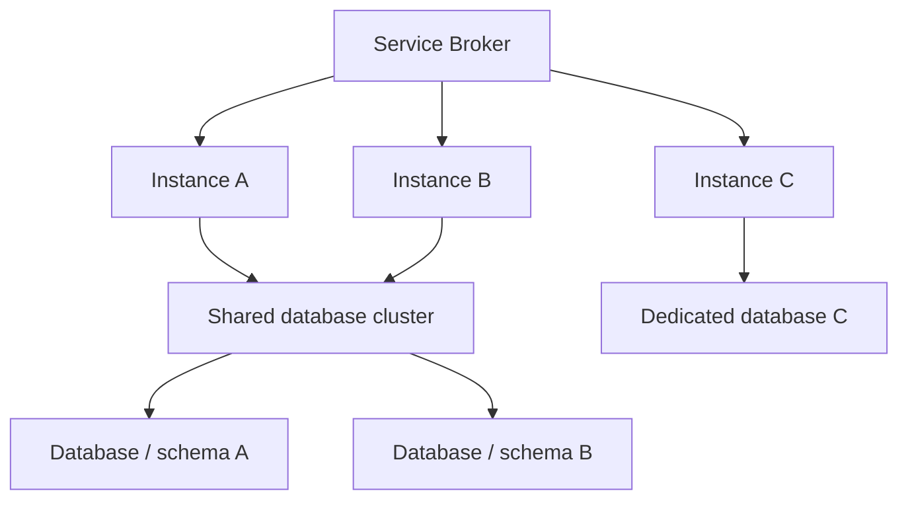
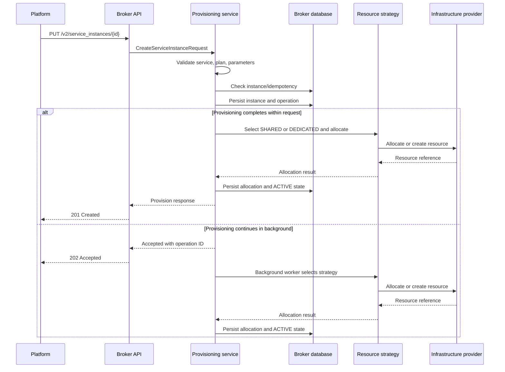
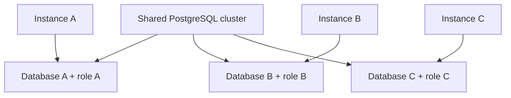
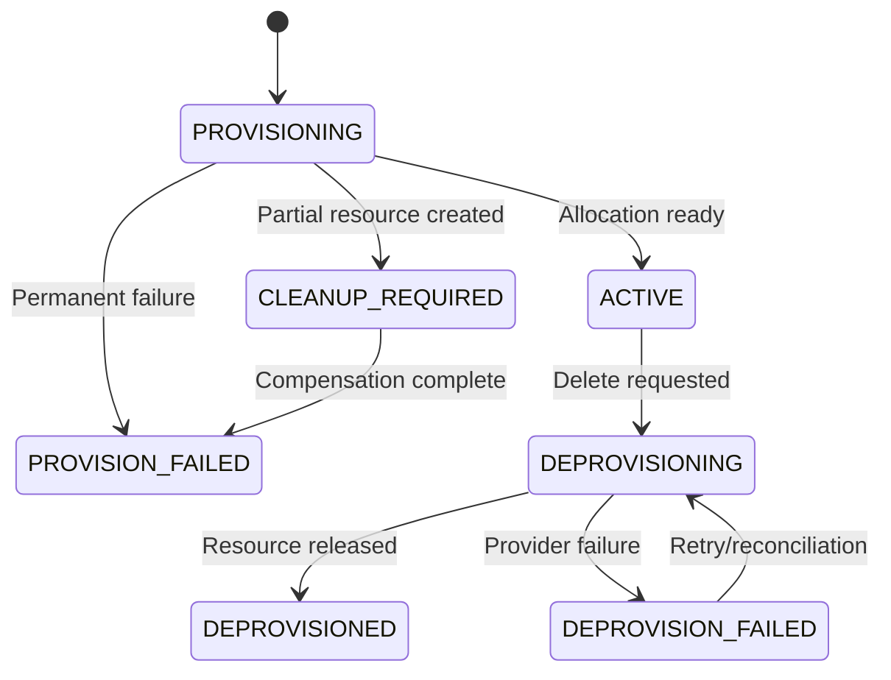

# Cấp phát tài nguyên dùng chung và tài nguyên dành riêng

## 1. Hai cách tổ chức tài nguyên khi provisioning

Provisioning là quá trình service broker tiếp nhận yêu cầu từ nền tảng, cấp một service instance và chuẩn bị tài nguyên để consumer sử dụng. Với cùng một loại dịch vụ, broker có thể triển khai tài nguyên trên hạ tầng dùng chung hoặc cấp một tài nguyên dành riêng cho từng instance.

Trong module `SPRING_CLOUD_SERVICE_BROKER`, Spring Cloud Open Service Broker cung cấp hợp đồng và các thành phần tích hợp với Open Service Broker API (OSB API). API xác định cách nền tảng yêu cầu tạo instance; broker quyết định instance đó được ánh xạ tới tài nguyên vật lý hoặc logic nào, cách cô lập tenant và cách thu hồi tài nguyên khi deprovision.

Hai mô hình phổ biến:

- **Shared resource:** nhiều service instance cùng sử dụng một hạ tầng hoặc pool tài nguyên nền. Broker tạo một phân vùng logic riêng cho mỗi instance, ví dụ database/schema, bucket prefix, queue hoặc namespace con.
- **Dedicated resource:** mỗi service instance được cấp một tài nguyên riêng, ví dụ một database server, một cluster, một storage volume hoặc một deployment độc lập.

Điểm cần phân biệt là shared không có nghĩa mọi tenant dùng chung một danh tính hoặc truy cập trực tiếp cùng dữ liệu. Một nền tảng có thể được chia sẻ nhưng mỗi instance vẫn có database, schema, credential và giới hạn riêng. Tương tự, dedicated mô tả mức tài nguyên được dành riêng; nó không tự động bảo đảm an toàn nếu broker cấu hình quyền truy cập sai.



Sơ đồ minh họa hai chiến lược có thể chọn: Instance A và B nhận allocation logic trên pool dùng chung, còn Instance C nhận một tài nguyên riêng. Mỗi instance được ánh xạ theo một chiến lược provisioning đã xác định cho plan của nó.

## 2. So sánh shared resource và dedicated resource

| Tiêu chí | Shared resource | Dedicated resource |
|---|---|---|
| Cách cấp phát | Tạo phân vùng hoặc allocation trên pool có sẵn. | Tạo hoặc dành riêng một tài nguyên cho instance. |
| Thời gian provisioning | Thường nhanh nếu pool đã sẵn sàng. | Thường lâu hơn do phải tạo, cấu hình và chờ tài nguyên hoạt động. |
| Chi phí | Tận dụng tài nguyên tốt, chi phí trên mỗi instance thấp hơn. | Chi phí cao hơn do dành riêng dung lượng hoặc compute. |
| Mật độ tenant | Nhiều instance dùng chung nền tảng. | Mỗi instance có phạm vi tài nguyên riêng. |
| Cô lập | Phụ thuộc phân vùng logic, quyền và giới hạn tài nguyên. | Có thể cô lập mạnh hơn ở cấp hạ tầng, nhưng vẫn cần cấu hình mạng và IAM đúng. |
| Khả năng mở rộng | Phải quản lý sức chứa và tranh chấp tài nguyên trong pool. | Mở rộng bằng cách tạo hoặc tăng tài nguyên riêng; có thể tốn thời gian và quota. |
| Sự cố | Sự cố pool có thể ảnh hưởng nhiều instance. | Sự cố thường giới hạn hơn, tùy dependency dùng chung bên dưới. |
| Deprovision | Xóa allocation của instance; giữ pool nếu còn tenant sử dụng. | Thu hồi tài nguyên riêng và xử lý dữ liệu, snapshot, backup liên quan. |

Không có mô hình nào luôn tốt hơn. Broker nên chọn theo đặc tính workload, yêu cầu cách ly, SLA, chi phí, thời gian cấp phát, khả năng phục hồi và giới hạn của nhà cung cấp hạ tầng.

## 3. Chọn chiến lược theo service plan

Service plan mô tả cấp dịch vụ mà consumer chọn. Broker có thể ánh xạ từng plan sang chiến lược provisioning khác nhau. Ví dụ:

| Service plan | Chiến lược | Cách cấp phát minh họa |
|---|---|---|
| `starter` | Shared | Tạo database hoặc schema riêng trong shared database cluster. |
| `standard` | Shared có quota cao hơn | Dùng pool có dung lượng lớn hơn, giới hạn connection và storage riêng. |
| `isolated` | Dedicated | Tạo database server hoặc instance riêng cho consumer. |
| `high-availability` | Dedicated hoặc nhóm tài nguyên riêng | Cấp tài nguyên có replica, backup và chính sách failover. |

OSB API không bắt buộc phải có trường chuẩn tên `resource_mode` để phân biệt shared và dedicated. Đây là quyết định nội bộ của broker, thường được lưu trong cấu hình plan, registry hoặc metadata riêng. Broker có thể công bố mô tả và đặc tính plan qua catalog, nhưng không nên giả định nền tảng sẽ hiểu một trường tùy chỉnh không thuộc hợp đồng.

Ví dụ cấu hình nội bộ:

```yaml
plans:
  starter:
    resourceMode: SHARED
    pool: postgres-general
    maxConnections: 10
    storageLimitMb: 10240
  isolated:
    resourceMode: DEDICATED
    providerClass: postgres-large
    backupPolicy: daily
```

Đây là cấu hình minh họa cho ứng dụng broker, không phải định dạng catalog OSB bắt buộc. Request provisioning gửi `service_id` và `plan_id`; broker tra cấu hình tin cậy theo hai ID này để chọn chiến lược. Không nên cho client tự gửi `resourceMode=DEDICATED` trong `parameters` rồi tự nâng cấp tài nguyên vượt khỏi plan mà họ đã chọn.

### 3.1. Các yếu tố quyết định

Trước khi chọn shared hay dedicated, hãy trả lời các câu hỏi sau:

1. Dữ liệu có yêu cầu cách ly vật lý hoặc tuân thủ chính sách đặc thù không?
2. Workload có ổn định và dự đoán được về CPU, RAM, IOPS, connection hoặc throughput không?
3. Hạ tầng có hỗ trợ tạo phân vùng logic an toàn và áp dụng quota theo tenant không?
4. Pool dùng chung có đủ capacity trong giờ cao điểm và khi một node gặp sự cố không?
5. Thời gian provisioning tối đa mà nền tảng chấp nhận là bao lâu?
6. Chi phí dành riêng tài nguyên có phù hợp với giá và quota của plan không?
7. Khi deprovision, dữ liệu cần xóa, lưu trữ, export hay giữ lại theo retention policy nào?

Broker có thể dùng shared cho plan cơ bản và dedicated cho plan cao cấp. Cũng có thể dùng shared cho phần control plane nhưng dedicated cho data plane. Cần mô tả rõ ranh giới: thành phần nào dùng chung, thành phần nào dành riêng và cơ chế cách ly áp dụng ở đâu.

## 4. Mô hình dữ liệu quản lý allocation

Broker cần phân biệt service instance trong OSB với tài nguyên hạ tầng thật. Một instance có định danh do nền tảng cung cấp; tài nguyên vật lý hoặc logic có ID do provider tạo. Giữa chúng cần có bản ghi liên kết để broker có thể update, deprovision và đối soát.

Một mô hình lưu trữ minh họa:

```text
service_instance
  instance_id            -- ID từ path OSB
  service_id
  plan_id
  consumer_context       -- organization, space, app hoặc tenant
  state                  -- PROVISIONING, ACTIVE, DEPROVISIONING...
  resource_mode          -- SHARED hoặc DEDICATED (nội bộ)
  allocation_id
  created_at
  updated_at

resource_allocation
  allocation_id
  instance_id
  provider_type
  provider_resource_id   -- ID database/schema/volume/cluster ở provider
  pool_id                -- có giá trị với shared allocation
  quota                  -- giới hạn được cấp cho instance
  state
  created_at
  released_at

resource_pool
  pool_id
  provider_resource_id
  capacity_total
  capacity_reserved
  state

broker_operation
  operation_id
  instance_id
  operation_type         -- PROVISION, UPDATE, DEPROVISION
  state                  -- IN_PROGRESS, SUCCEEDED, FAILED
  idempotency_key
  started_at
  completed_at
```

Đây là schema khái niệm, không phải schema được OSB API quy định. Trong database thực tế, cần có foreign key, unique constraint, chỉ mục và chiến lược lưu trữ phù hợp. `instance_id` cần duy nhất trong phạm vi broker; một instance không được có hai allocation đang hoạt động ngoài ý muốn. Với shared pool, thao tác reserve capacity phải được bảo vệ bởi transaction hoặc cơ chế đồng bộ tương đương để hai request đồng thời không cấp vượt quota.

Không nên lưu password hoặc token trong các trường `consumer_context`, `quota` hay log operation. Credential cần được lưu trong secret manager hoặc kho được mã hóa; database broker chỉ lưu tham chiếu nếu có thể.

## 5. Luồng provisioning tổng quát

Khi nền tảng gửi `PUT /v2/service_instances/{instance_id}`, broker cần xử lý cả hợp đồng OSB lẫn chiến lược tài nguyên nội bộ.



Một quy trình đồng bộ hoặc bất đồng bộ nên có các bước logic sau:

1. **Xác thực request:** kiểm tra broker client, phiên bản OSB API, path ID và body.
2. **Kiểm tra service/plan:** xác nhận `service_id` và `plan_id` tồn tại, plan còn được cung cấp và request có đủ tham số bắt buộc.
3. **Xác định consumer:** đọc organization, space, app hoặc context do nền tảng gửi; xác thực dữ liệu theo chính sách tenant.
4. **Kiểm tra idempotency:** tìm instance hoặc operation đã được tạo cho `instance_id` này.
5. **Ghi nhận ý định:** lưu instance ở trạng thái `PROVISIONING` và operation trước khi thực hiện tác động bên ngoài.
6. **Chọn strategy:** dựa trên cấu hình plan tin cậy, chọn shared hoặc dedicated.
7. **Cấp phát:** reserve capacity và tạo logical allocation, hoặc tạo tài nguyên dedicated.
8. **Lưu liên kết:** lưu provider resource ID, allocation ID, quota và trạng thái.
9. **Hoàn tất:** chuyển instance sang `ACTIVE`, đánh dấu operation thành công và trả response theo OSB API.

Nếu tài nguyên chưa sẵn sàng ngay, broker có thể dùng xử lý bất đồng bộ khi request cho phép. Không trả `201 Created` khi tài nguyên chưa đáp ứng điều kiện sẵn sàng mà service đã cam kết.

## 6. Cấp phát shared resource

Với shared resource, broker quản lý một pool hạ tầng và tạo allocation logic riêng cho từng service instance. Pool có thể là một database cluster, Redis cluster, object storage account, Kubernetes cluster hoặc một cụm message broker.

### 6.1. Tạo phân vùng logic

Ví dụ với shared PostgreSQL cluster, mỗi instance có thể nhận một database riêng hoặc schema riêng. Broker tạo role và credential riêng cho allocation đó, sau đó gán quyền chỉ trên database/schema tương ứng. Một instance không được dùng credential có quyền quản trị toàn cluster.



Các kiểu phân vùng khác cũng có thể áp dụng:

- Object storage: bucket riêng cho mỗi instance hoặc prefix có policy giới hạn truy cập.
- Message broker: virtual host, namespace, queue hoặc topic riêng với ACL riêng.
- Redis: database index hoặc key prefix chỉ là phân tách logic; cần đánh giá kỹ giới hạn bảo mật của provider trước khi dùng cho tenant không tin cậy.
- Kubernetes: namespace riêng cho mỗi instance trong một cluster dùng chung, kèm ResourceQuota, NetworkPolicy, ServiceAccount và RBAC.

Chỉ dùng prefix hoặc tên quy ước không tự tạo ra ranh giới bảo mật. Broker phải cấu hình ACL, credential, network policy và quota ở hệ thống đích để tenant không thể truy cập allocation của tenant khác.

### 6.2. Quản lý capacity và quota

Shared pool có giới hạn tổng dung lượng. Broker cần theo dõi capacity đã dùng, capacity đã reserve và capacity còn trống. Khi nhận request mới, việc kiểm tra và reserve phải diễn ra nguyên tử hoặc được điều phối bằng lock phù hợp.

Ví dụ, pool có giới hạn 1.000 connection. Nếu hai request đồng thời đều đọc thấy còn 100 connection rồi cùng reserve 80, tổng reservation sẽ vượt capacity. Cách xử lý đúng là thực hiện cập nhật có điều kiện trong transaction, dùng optimistic locking/version hoặc một cơ chế reservation có tính nguyên tử.

Quota có thể được đặt ở nhiều cấp:

- **Per instance:** số connection, storage, queue, request hoặc CPU mà instance được sử dụng.
- **Per tenant:** tổng tài nguyên mà organization, space hoặc tenant được phép tiêu thụ.
- **Per pool:** tổng tài nguyên mà provider có thể cung cấp an toàn.
- **Global:** giới hạn vận hành để bảo vệ toàn bộ broker và hạ tầng.

Broker cần kiểm tra cả quota riêng và capacity tổng. Một plan có thể cho phép 20 connection mỗi instance, nhưng nếu pool đã gần hết capacity thì broker phải từ chối hoặc đưa request vào hàng đợi theo chính sách, thay vì cấp vượt giới hạn.

### 6.3. Deprovision shared allocation

Khi deprovision một instance dùng shared resource, broker thu hồi đúng allocation của instance: xóa database/schema, role, bucket, queue, namespace hoặc ACL liên quan; giải phóng reservation; cập nhật allocation thành `RELEASED`.

Broker không được xóa pool hoặc cluster dùng chung khi chỉ một instance bị deprovision. Pool chỉ được thu hồi bởi quy trình quản trị riêng khi không còn allocation và không còn dependency cần thiết. Đây là khác biệt quan trọng nhất giữa xóa một tenant allocation và xóa nền tảng shared.

## 7. Cấp phát dedicated resource

Với dedicated resource, mỗi instance nhận một tài nguyên được dành riêng. Ví dụ, broker tạo một database server riêng, một managed database instance, một volume riêng hoặc một Kubernetes deployment có node pool riêng theo yêu cầu.

Luồng dedicated thường gồm:

1. Kiểm tra quota và khả năng cấp phát của provider.
2. Tạo tài nguyên với tên/tag có thể liên kết về `instance_id`.
3. Cấu hình network, encryption, backup, monitoring và IAM.
4. Chờ provider báo tài nguyên đạt trạng thái sẵn sàng.
5. Lưu provider resource ID và các thuộc tính cần thiết.
6. Chỉ chuyển instance sang `ACTIVE` khi có thể đáp ứng contract của service.

Ví dụ, một plan database dedicated có thể tạo managed database instance bằng provider API. Provider có thể trả về trạng thái `CREATING`; broker cần theo dõi cho đến khi `AVAILABLE`, hoặc đánh dấu operation thất bại nếu provider trả lỗi cuối cùng. Không nên cấp credential cho consumer khi database chưa sẵn sàng nhận kết nối.

### 7.1. Gắn thẻ và tìm lại tài nguyên

Dedicated resource cần metadata hoặc tag có thể truy ngược về broker instance, chẳng hạn:

```text
managed-by = service-broker
broker-instance-id = inst-1001
service-id = managed-database
plan-id = isolated
environment = production
```

Tag giúp reconciliation phát hiện tài nguyên mồ côi nếu broker bị dừng giữa lúc provider tạo xong tài nguyên và lúc database broker kịp lưu kết quả. Không đưa credential hoặc thông tin cá nhân vào tag vì tag có thể được nhiều hệ thống quản trị đọc.

### 7.2. Deprovision dedicated resource

Khi deprovision, broker tra provider resource ID từ allocation đã lưu, kiểm tra nó thuộc đúng instance rồi yêu cầu provider xóa. Tùy chính sách, broker cũng có thể cần xử lý snapshot, backup, encryption key, DNS record, security group hoặc network attachment.

Chỉ đánh dấu instance đã xóa sau khi tài nguyên được thu hồi hoặc đã chuyển sang trạng thái xử lý cuối cùng được quy định. Nếu provider timeout và kết quả không rõ, broker cần tra cứu trạng thái tài nguyên trước khi gửi lệnh xóa lại. Không suy luận rằng timeout đồng nghĩa provider chưa thực hiện thao tác.

## 8. Tổ chức strategy trong ứng dụng Spring

Để hỗ trợ cả hai mô hình, nên tách phần điều phối provisioning khỏi cách cấp phát cụ thể. Một abstraction nhỏ có thể đại diện cho strategy:

```java
public interface ResourceProvisioningStrategy {
    ResourceMode mode();

    Mono<ResourceAllocation> provision(
            ProvisioningContext context);

    Mono<Void> deprovision(
            ResourceAllocation allocation);
}
```

`SharedResourceStrategy` chịu trách nhiệm reserve capacity, tạo logical allocation và thu hồi allocation. `DedicatedResourceStrategy` gọi provider để tạo/xóa tài nguyên riêng. `ResourceProvisioningService` đọc plan configuration, chọn strategy và quản lý trạng thái instance.

```java
public Mono<ResourceAllocation> provision(ProvisioningContext context) {
    ResourceMode mode = context.plan().resourceMode();

    ResourceProvisioningStrategy strategy = strategies.stream()
            .filter(candidate -> candidate.mode() == mode)
            .findFirst()
            .orElseThrow(() -> new IllegalStateException(
                    "No provisioning strategy for " + mode));

    return strategy.provision(context);
}
```

Đây là mã minh họa cho tầng domain/application; các class `ResourceMode`, `ProvisioningContext`, `ResourceAllocation` và cách đăng ký bean cần được định nghĩa trong ứng dụng. Nó không phải chữ ký interface do OSB API quy định.

Ở lớp tích hợp OSB, implementation của `ServiceInstanceService` nhận request provisioning, chuyển dữ liệu đã kiểm tra thành `ProvisioningContext`, rồi gọi `ResourceProvisioningService`. Framework ánh xạ request HTTP tới service bean. Không nên đặt logic reserve pool, tạo database hoặc gọi Kubernetes API trực tiếp trong controller.

## 9. Trạng thái, xử lý bất đồng bộ và response OSB

Shared allocation có thể hoàn tất nhanh nếu pool đã có sẵn. Dedicated provisioning thường mất nhiều thời gian hơn do provider cần tạo compute, storage, network hoặc database. Tuy nhiên, cả hai mô hình đều có thể cần bất đồng bộ nếu thao tác vượt quá thời gian xử lý HTTP.

OSB API dùng `accepts_incomplete=true` để client cho biết có chấp nhận thao tác bất đồng bộ hay không. Nếu hoàn tất đồng bộ, broker có thể trả `201 Created`. Nếu chấp nhận xử lý nền, broker trả `202 Accepted` cùng thông tin `operation` để client truy vấn `last_operation`. Nếu thao tác bắt buộc phải bất đồng bộ nhưng client không chấp nhận, broker phải trả lỗi phù hợp, thường là `422 Unprocessable Entity` với error `AsyncRequired`.

Một state machine nội bộ có thể như sau:



Trạng thái nội bộ có thể chi tiết hơn các giá trị giao thức. Endpoint last operation phải ánh xạ về `in progress`, `succeeded` hoặc `failed` theo OSB API. Broker nên lưu operation bền vững trong database hoặc hàng đợi dùng chung; không giữ trạng thái duy nhất trong memory của một replica.

Ví dụ response bất đồng bộ:

```http
HTTP/1.1 202 Accepted
Content-Type: application/json

{
  "operation": "provision-inst-1001"
}
```

Nền tảng tiếp tục polling:

```http
GET /v2/service_instances/inst-1001/last_operation?service_id=managed-database&plan_id=isolated&operation=provision-inst-1001 HTTP/1.1
```

Trong thời gian chờ provider, broker trả `state: "in progress"`. Khi tài nguyên sẵn sàng, broker trả `state: "succeeded"`. Nếu thao tác thất bại cuối cùng, trả `state: "failed"` cùng mô tả đã được làm sạch.

## 10. Idempotency, retry và phục hồi khi lỗi

Nền tảng có thể retry provisioning sau timeout hoặc mất kết nối, kể cả khi provider đã tạo tài nguyên nhưng broker chưa nhận được response. Vì vậy, broker phải bảo đảm một `instance_id` không tạo ra nhiều allocation ngoài ý muốn.

Các nguyên tắc cần áp dụng:

- Đặt unique constraint cho `instance_id` và kiểm tra request đã được tiếp nhận trước khi bắt đầu tạo tài nguyên.
- Nếu request lặp có cùng service, plan và tham số có ý nghĩa, trả kết quả của thao tác đã ghi nhận.
- Nếu cùng `instance_id` nhưng request có service/plan hoặc tham số mâu thuẫn, trả lỗi xung đột.
- Tạo `operation_id` ổn định và lưu trước khi gọi provider.
- Dùng idempotency token của provider nếu có; nếu không, gắn tag theo `instance_id` và tra cứu tài nguyên trước khi tạo lại.
- Dùng transaction hoặc reservation nguyên tử khi cấp capacity của shared pool.
- Với dedicated resource, lưu ý định tạo và tag tài nguyên trước khi gọi provider để reconciliation có thể tìm tài nguyên tạo dở.
- Chỉ retry lỗi tạm thời với backoff, giới hạn số lần và timeout rõ ràng.

### 10.1. Xử lý cấp phát dở dang

Một provisioning có thể thất bại sau khi đã tạo một phần tài nguyên. Ví dụ, broker tạo database thành công nhưng thất bại khi tạo user; hoặc tạo dedicated instance nhưng timeout trước khi nhận provider ID.

Broker cần có chính sách compensation:

1. Xác định chính xác tài nguyên đã được tạo dựa trên provider ID, idempotency key hoặc tag.
2. Thu hồi những thành phần đã tạo nếu không thể hoàn tất provisioning.
3. Nếu không thể xóa ngay, lưu trạng thái `CLEANUP_REQUIRED` và đưa vào hàng đợi retry/reconciliation.
4. Không trả instance sang trạng thái `ACTIVE` khi credential hoặc phân vùng chưa được cấu hình đầy đủ.
5. Ghi lại lỗi đã làm sạch và operation ID để người vận hành truy vết.

Với shared resource, compensation phải xóa đúng allocation và hoàn trả reservation, không tác động đến allocation của tenant khác. Với dedicated resource, phải xác minh provider resource ID thuộc đúng instance trước khi xóa.

## 11. Bảo mật và cô lập tenant

Shared resource làm tăng mật độ tenant trên một nền tảng nên việc cô lập logic là yêu cầu bắt buộc. Broker cần bảo đảm mỗi allocation có định danh, credential, quyền và quota riêng. Các biện pháp thường gồm:

- Tạo database/schema/user hoặc bucket/queue/namespace riêng theo instance.
- Áp dụng ACL hoặc RBAC ở hệ thống đích; không chỉ dựa vào tên resource.
- Dùng network policy, firewall hoặc security group để giới hạn đường truy cập.
- Giới hạn CPU, RAM, connection, storage, IOPS và throughput theo plan.
- Mã hóa dữ liệu khi truyền và khi lưu; quản lý encryption key theo chính sách tenant.
- Lưu credential trong secret manager, chỉ trả credential cần thiết qua binding và thu hồi khi unbind.
- Không cho phép `parameters` tự chọn pool hoặc nâng cấp resource mode ngoài quyền của plan.
- Ghi audit event cho thao tác tạo, thay đổi và thu hồi allocation; không ghi secret vào log.

Dedicated resource có thể giảm phạm vi ảnh hưởng giữa các tenant nhưng vẫn cần kiểm tra quyền provider, network, encryption, backup và quyền truy cập control plane. Một database riêng nhưng dùng chung master credential hoặc security group quá rộng vẫn có nguy cơ bị truy cập chéo.

## 12. Áp dụng với Cloud Foundry và Kubernetes

### 12.1. Cloud Foundry

Cloud Foundry gửi provisioning request với service ID, plan ID, instance ID và context của organization/space. Broker có thể dùng context để áp dụng quota theo organization hoặc space, chọn pool theo vùng triển khai và gắn allocation với tenant phù hợp.

Ví dụ, plan `starter` tạo database riêng trong shared PostgreSQL cluster của một vùng; plan `isolated` tạo managed database instance dành riêng. Cả hai đều là một service instance theo OSB API. Sự khác biệt nằm trong resource strategy và provider mapping của broker.

Broker không nên chỉ dựa vào tên organization hoặc space. Hãy dùng GUID ổn định do nền tảng gửi và kiểm tra context theo ranh giới tin cậy của hệ thống.

### 12.2. Kubernetes

Trong Kubernetes, shared có thể là nhiều service instance cùng dùng một cluster nhưng mỗi instance có namespace hoặc resource allocation riêng. Dedicated có thể là cluster riêng, node pool riêng hoặc một tập workload/storage được dành riêng tùy yêu cầu plan.

Với shared cluster, broker nên tạo namespace riêng, ServiceAccount riêng, Role/RoleBinding theo quyền tối thiểu, ResourceQuota, LimitRange và NetworkPolicy khi phù hợp. Không dùng một service account có quyền cluster-admin cho mọi tenant.

Với dedicated cluster, broker gọi provider hoặc cluster management API để tạo cluster, cấu hình node pool, network, storage class, encryption và access policy. Vì thao tác có thể kéo dài, cần operation bất đồng bộ và last operation để nền tảng theo dõi.

## 13. Kiểm thử và vận hành

Kiểm thử cần bao phủ chiến lược cấp phát, cô lập, concurrency và phục hồi:

| Nhóm kiểm thử | Nội dung cần xác minh |
|---|---|
| Strategy selection | Plan shared chọn shared strategy; plan dedicated chọn dedicated strategy. |
| Shared isolation | Hai instance không đọc hoặc ghi allocation của nhau. |
| Shared capacity | Request đồng thời không reserve vượt capacity hoặc quota. |
| Dedicated lifecycle | Resource được tạo, chờ ready, liên kết đúng instance và được xóa đúng ID. |
| Idempotency | Retry cùng `instance_id` không tạo allocation hoặc provider resource trùng. |
| Partial failure | Tạo dở dang được compensation hoặc đưa vào cleanup queue. |
| Async operation | `202` có operation ID; last operation chuyển đúng từ in progress sang terminal state. |
| Deprovision | Shared chỉ giải phóng allocation; dedicated thu hồi resource riêng. |
| Security | Credential và quyền được giới hạn theo tenant; secret không xuất hiện trong log. |
| Reconciliation | Phát hiện tài nguyên mồ côi, reservation bị kẹt và operation quá hạn. |

Trong production, theo dõi số allocation theo pool, capacity còn lại, tỷ lệ provisioning thành công, thời gian cấp phát theo plan, số operation `IN_PROGRESS` quá lâu, lỗi provider, số cleanup pending và tài nguyên không còn instance liên kết. Với shared pool, cảnh báo sớm khi capacity hoặc quota tiến gần ngưỡng. Với dedicated, theo dõi tài nguyên provider bị tạo nhưng không hoàn tất đăng ký trong broker.

## 14. Nguyên tắc thiết kế cần nhớ

1. Shared resource là dùng chung hạ tầng nền nhưng mỗi instance vẫn cần allocation và ranh giới truy cập riêng.
2. Dedicated resource dành riêng tài nguyên cho instance; broker phải lưu provider resource ID để quản lý vòng đời.
3. Chiến lược shared/dedicated thường được quyết định bởi service plan và cấu hình tin cậy của broker.
4. OSB API chuẩn hóa request provisioning; topology tài nguyên là trách nhiệm triển khai của broker.
5. Shared pool cần reservation nguyên tử, quota và cơ chế bảo vệ tenant khỏi tranh chấp tài nguyên.
6. Deprovision shared chỉ giải phóng allocation; deprovision dedicated thu hồi tài nguyên riêng theo chính sách dữ liệu.
7. Tác vụ dài cần operation bền vững, `202 Accepted` và endpoint last operation.
8. Idempotency, compensation và reconciliation giúp broker phục hồi khi timeout hoặc provider trả kết quả không xác định.
9. Cả shared và dedicated đều cần IAM, network policy, secret management và audit.

Khi tách rõ service instance, resource allocation và provider resource, broker có thể hỗ trợ nhiều mức dịch vụ trên cùng một hợp đồng OSB API. Việc chọn shared hay dedicated trở thành một chính sách provisioning có thể kiểm soát, đo lường và vận hành theo từng plan.
