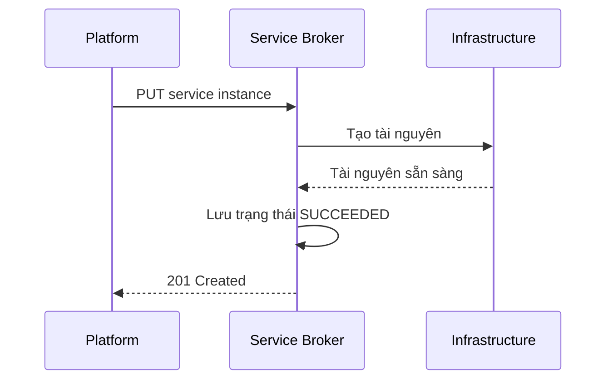
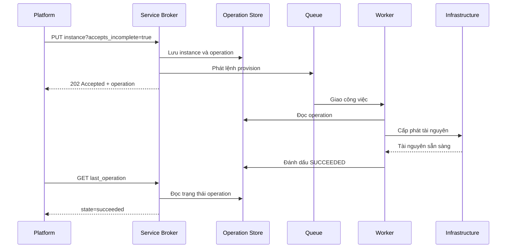
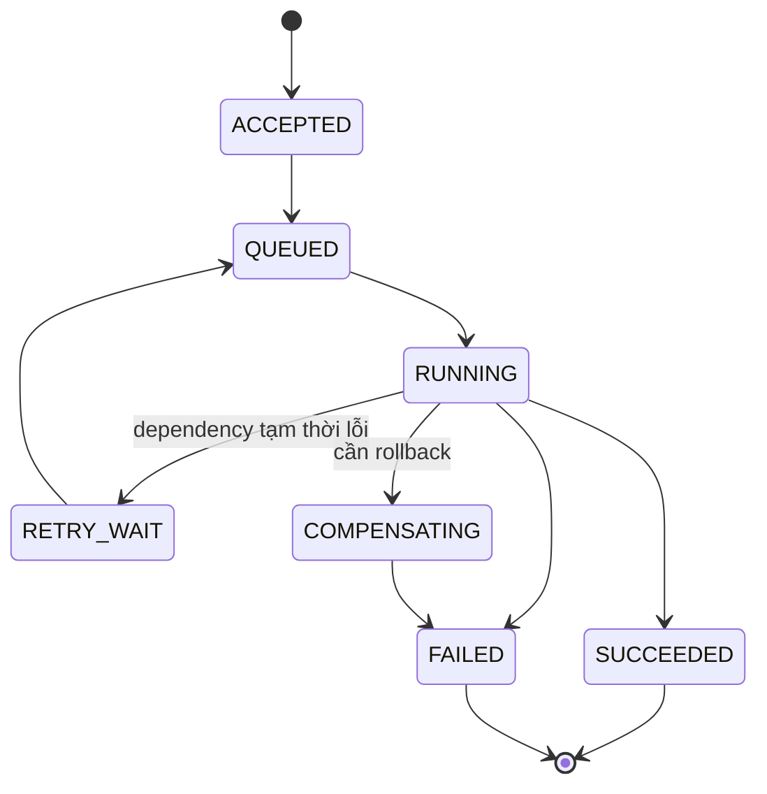

# Lựa chọn hoàn tất đồng bộ hoặc trả về thao tác bất đồng bộ

Khi platform yêu cầu tạo một service instance, service broker có thể hoàn tất việc cấp phát ngay trong HTTP request hoặc tiếp nhận yêu cầu rồi xử lý ở nền. Lựa chọn này ảnh hưởng trực tiếp đến thời gian phản hồi, cách platform theo dõi trạng thái, cách broker phục hồi sau sự cố và khả năng xử lý request gửi lại.

Với Spring Cloud Service Broker, quyết định đồng bộ hay bất đồng bộ phải phản ánh thời gian thực tế của thao tác provision và khả năng của hạ tầng phía sau. Một thao tác nhanh, có giới hạn thời gian rõ ràng có thể hoàn tất đồng bộ. Một thao tác phải chờ Kubernetes scheduler, tạo database, cấu hình replication, cấp DNS hoặc gọi nhiều control plane thường phù hợp với mô hình bất đồng bộ. Open Service Broker API (OSB API) định nghĩa query parameter `accepts_incomplete` và endpoint `last_operation` để hai phía phối hợp theo mô hình này.

## 1. Hai cách hoàn tất một yêu cầu provision

### 1.1. Provision đồng bộ

Trong mô hình đồng bộ, broker thực hiện toàn bộ công việc trước khi trả response cuối cùng. Ví dụ, broker có thể tạo một tài nguyên nhỏ trong một hệ thống có API phản hồi nhanh, ghi nhận trạng thái sẵn sàng và trả kết quả trong vài giây.

Luồng cơ bản:



Ưu điểm của cách này là đơn giản: platform nhận kết quả ngay và không cần polling. Tuy nhiên, HTTP request phải tồn tại trong suốt thời gian cấp phát. Nếu công việc kéo dài, kết nối có thể timeout ở load balancer, gateway, HTTP client hoặc server. Khi platform không nhận được response, platform có thể gửi lại request trong khi broker chưa biết lần gọi trước đã tạo tài nguyên đến đâu.

### 1.2. Provision bất đồng bộ

Trong mô hình bất đồng bộ, broker xác thực request, lưu ý định cấp phát cùng một operation bền vững, đưa công việc vào hàng đợi rồi trả response chấp nhận xử lý. Worker thực hiện việc cấp phát sau đó. Platform truy vấn endpoint `last_operation` để biết công việc còn chạy, đã thành công hay thất bại.



Platform không phải giữ kết nối HTTP trong suốt quá trình cấp phát. Broker có thể retry công việc, giới hạn số worker và theo dõi tiến độ độc lập với vòng đời request ban đầu. Đổi lại, broker phải lưu trạng thái operation, quản lý queue, hỗ trợ polling và xử lý các tình huống worker dừng giữa chừng.

## 2. Quy tắc `accepts_incomplete` trong OSB API

OSB API cho phép platform thể hiện khả năng chấp nhận thao tác bất đồng bộ qua query parameter `accepts_incomplete` trên các endpoint hỗ trợ async, ví dụ provision, update, deprovision và binding/unbinding:

```http
PUT /v2/service_instances/db-prod-17?accepts_incomplete=true HTTP/1.1
```

Các quy tắc cần nhớ:

- `accepts_incomplete` không có hoặc có giá trị `false` nghĩa là platform không chấp nhận broker trả về một thao tác đang chạy bất đồng bộ cho request đó.
- Khi platform gửi `accepts_incomplete=true`, platform cho phép broker tiếp nhận thao tác bất đồng bộ. Broker vẫn có thể hoàn tất đồng bộ nếu công việc thực tế kết thúc nhanh.
- Nếu broker không thể hoàn tất đồng bộ và platform không chấp nhận async, broker phải từ chối bằng lỗi `422 Unprocessable Entity` với mã lỗi `AsyncRequired` theo hợp đồng OSB API.
- Nếu broker chấp nhận thực hiện bất đồng bộ, broker trả `202 Accepted`. Response có thể chứa trường `operation` để platform dùng khi polling nếu broker cần một định danh operation riêng.
- Nếu hoàn tất đồng bộ, broker trả mã thành công đồng bộ tương ứng với thao tác, dù request có `accepts_incomplete=true`.

`accepts_incomplete=true` là sự cho phép của platform cho một request cụ thể, không phải yêu cầu broker bắt buộc phải chạy nền. Broker quyết định cách xử lý dựa trên khả năng thực tế và chính sách vận hành.

Ví dụ platform không chấp nhận async:

```http
PUT /v2/service_instances/db-prod-17 HTTP/1.1
Content-Type: application/json
X-Broker-API-Version: 2.17

{
  "service_id": "postgresql-service-v1",
  "plan_id": "postgresql-standard-v1"
}
```

Nếu broker biết việc tạo database cần nhiều phút và không thể hoàn tất trong request, broker trả lỗi dạng:

```http
HTTP/1.1 422 Unprocessable Entity
Content-Type: application/json

{
  "error": "AsyncRequired",
  "description": "Provisioning requires asynchronous processing. Retry with accepts_incomplete=true."
}
```

Platform có thể gửi lại request với `accepts_incomplete=true` nếu hỗ trợ luồng async. Broker không nên âm thầm trả `202` khi platform không cho phép bất đồng bộ.

## 3. Chọn đồng bộ hay bất đồng bộ theo tiêu chí nào?

Quyết định không nên dựa vào một ngưỡng thời gian cố định cho mọi dịch vụ. Cần xem thời gian thực tế, độ biến động và khả năng kiểm soát của các hệ thống phụ thuộc.

| Tiêu chí | Nghiêng về đồng bộ | Nghiêng về bất đồng bộ |
|---|---|---|
| Thời gian thực thi | Ngắn và ổn định | Dài hoặc biến động lớn |
| Hệ thống phụ thuộc | Một API nhanh, có timeout thấp | Nhiều API hoặc control plane độc lập |
| Tài nguyên | Tạo cấu hình nhẹ, không chờ scheduler | Tạo database, cluster, volume, replica hoặc DNS |
| Khả năng phục hồi | Có thể retry trong request mà không gây tác dụng phụ | Cần retry bền vững sau khi request đã kết thúc |
| Theo dõi tiến độ | Không cần trạng thái trung gian | Cần `last_operation` để platform polling |
| Timeout HTTP | Có đủ dư địa trong toàn bộ chuỗi proxy/client/server | Có nguy cơ vượt timeout của một thành phần trung gian |

Ví dụ đồng bộ: tạo một bản ghi cấu hình và cấp một credential đã được tạo sẵn trong hệ thống có SLA phản hồi ngắn. Ví dụ bất đồng bộ: yêu cầu Kubernetes tạo StatefulSet, PersistentVolumeClaim, chờ Pod sẵn sàng, cấu hình database và chạy kiểm tra kết nối.

Một broker có thể kết hợp cả hai. Nếu thao tác hoàn tất trong thời gian ngắn, trả kết quả đồng bộ. Nếu vượt ngưỡng nội bộ hoặc phát hiện phải chờ một dependency, broker có thể chuyển sang async khi platform đã cho phép. Tuy nhiên, việc chuyển trạng thái phải được thiết kế ngay từ đầu để không tạo hai luồng cấp phát song song hoặc mất dấu tài nguyên đã tạo dở.

## 4. HTTP response và polling `last_operation`

### 4.1. Response khi hoàn tất đồng bộ

Với provision hoàn tất thành công ngay, broker trả `201 Created`. Response có thể chứa thông tin theo hợp đồng OSB API, chẳng hạn `dashboard_url` nếu dịch vụ hỗ trợ dashboard:

```http
HTTP/1.1 201 Created
Content-Type: application/json

{
  "dashboard_url": "https://console.example.com/databases/db-prod-17"
}
```

Không cần tạo operation đang chạy chỉ để phục vụ polling nếu thao tác đã hoàn tất. Platform có thể tiếp tục sử dụng service instance theo quy trình bình thường.

### 4.2. Response khi chấp nhận xử lý bất đồng bộ

Khi broker chấp nhận một thao tác provision đang chạy, broker trả `202 Accepted`. Nếu broker cần phân biệt operation, response chứa `operation`:

```http
HTTP/1.1 202 Accepted
Content-Type: application/json
Retry-After: 5

{
  "operation": "provision-2026-000891"
}
```

Giá trị `operation` là chuỗi do broker quản lý, không phải service instance ID. Broker phải lưu nó và có thể dùng nó để tra cứu operation tương ứng. `Retry-After` có thể được dùng để gợi ý khoảng thời gian trước lần polling tiếp theo; platform nên tuân thủ header này nếu broker gửi.

### 4.3. Platform polling trạng thái

Platform gọi endpoint `last_operation`:

```http
GET /v2/service_instances/db-prod-17/last_operation?service_id=postgresql-service-v1&plan_id=postgresql-standard-v1&operation=provision-2026-000891 HTTP/1.1
X-Broker-API-Version: 2.17
```

Broker trả `200 OK` với trạng thái operation:

```json
{
  "state": "in progress",
  "description": "Đang chờ database sẵn sàng"
}
```

Các giá trị `state` mà platform hiểu gồm:

| State | Ý nghĩa | Hành động tiếp theo |
|---|---|---|
| `in progress` | Thao tác vẫn đang thực hiện | Tiếp tục polling theo khoảng thời gian phù hợp |
| `succeeded` | Thao tác đã hoàn tất thành công | Dừng polling và sử dụng service instance |
| `failed` | Thao tác đã thất bại | Dừng polling và xử lý lỗi theo thông tin trả về |

Khi hoàn tất, response có thể là:

```json
{
  "state": "succeeded",
  "description": "Database đã sẵn sàng và vượt qua kiểm tra kết nối"
}
```

Broker nên trả `Retry-After` khi muốn điều khiển nhịp polling. Không nên yêu cầu platform polling liên tục với khoảng thời gian quá ngắn; điều đó tạo tải lên broker và database trạng thái mà không làm công việc hoàn tất nhanh hơn.

## 5. Thiết kế operation store

Một operation bất đồng bộ phải tồn tại độc lập với HTTP request ban đầu. Broker cần ghi nhận operation vào kho dữ liệu bền vững trước khi trả `202 Accepted`.

Một bản ghi operation có thể gồm:

| Trường | Ý nghĩa |
|---|---|
| `operation_id` | ID duy nhất của operation do broker tạo |
| `platform_instance_id` | Platform instance gửi request |
| `service_instance_id` | Service instance đang được xử lý |
| `service_id`, `plan_id` | Service và plan được yêu cầu |
| `type` | `PROVISION`, `UPDATE`, `DEPROVISION`, `BIND` hoặc `UNBIND` |
| `state` | Trạng thái nội bộ của công việc |
| `request_payload` | Các trường nghiệp vụ cần để tiếp tục xử lý, đã lọc dữ liệu nhạy cảm |
| `result` | Tham chiếu đến kết quả hoặc resource đã tạo |
| `error_code`, `error_description` | Thông tin lỗi đã chuẩn hóa |
| `attempt` | Số lần worker đã thử |
| `created_at`, `updated_at` | Mốc thời gian |
| `lease_until` | Thời điểm hết hạn quyền xử lý của worker hiện tại |

Trạng thái nội bộ có thể chi tiết hơn trạng thái OSB API:



Khi chuyển sang response OSB, broker ánh xạ trạng thái nội bộ sang `in progress`, `succeeded` hoặc `failed`. Các trạng thái như `QUEUED`, `RETRY_WAIT` hoặc `COMPENSATING` đều có thể được hiển thị là `in progress` cho platform.

### 5.1. Ghi operation và phát queue an toàn

Một lỗi phổ biến là lưu operation trong database rồi gửi message sang queue bằng hai thao tác độc lập. Nếu database commit thành công nhưng gửi message thất bại, platform nhận `202` nhưng không có worker xử lý. Nếu message gửi thành công trước khi transaction commit và transaction rollback, worker có thể nhận một operation không tồn tại.

Có thể dùng Transactional Outbox:

1. Trong cùng một transaction, ghi service instance, operation và outbox event.
2. Commit transaction.
3. Một publisher đọc outbox chưa gửi và phát message sang queue.
4. Sau khi publish thành công, đánh dấu outbox event đã gửi.
5. Worker nhận message, đọc operation từ database và thực hiện công việc.

Nhờ vậy, operation và sự kiện cần xử lý được lưu nhất quán. Publisher hoặc queue có thể gửi trùng, nên worker vẫn phải xử lý message theo cách idempotent.

## 6. Triển khai trong Spring Cloud Service Broker

Trong ứng dụng Spring, nên tách lớp tiếp nhận OSB request khỏi lớp điều phối provision và worker thực hiện tác vụ. Controller hoặc adapter theo framework chịu trách nhiệm giải mã request/response OSB. Service nghiệp vụ quyết định đồng bộ hay bất đồng bộ; OperationService lưu trạng thái; worker giao tiếp với hạ tầng.

Một giao diện nội bộ minh họa kết quả xử lý:

```java
public sealed interface ProvisionOutcome {
    record Completed(String serviceInstanceId) implements ProvisionOutcome {}
    record Accepted(String operationId) implements ProvisionOutcome {}
}
```

Điều phối có thể được mô hình hóa như sau:

```java
@Service
public class ProvisioningCoordinator {

    private final InfrastructureProvisioner provisioner;
    private final OperationRepository operations;
    private final OutboxRepository outbox;

    public ProvisioningCoordinator(
            InfrastructureProvisioner provisioner,
            OperationRepository operations,
            OutboxRepository outbox) {
        this.provisioner = provisioner;
        this.operations = operations;
        this.outbox = outbox;
    }

    public ProvisionOutcome provision(
            ProvisionCommand command,
            boolean acceptsIncomplete) {

        if (provisioner.canCompleteSynchronously(command)) {
            return new ProvisionOutcome.Completed(
                    provisioner.provision(command));
        }

        if (!acceptsIncomplete) {
            throw new AsyncRequiredException();
        }

        String operationId = UUID.randomUUID().toString();
        operations.insertAccepted(operationId, command);
        outbox.insertProvisionRequested(operationId);
        return new ProvisionOutcome.Accepted(operationId);
    }
}
```

Đây là mô hình domain minh họa, không phải chữ ký API cố định của Spring Cloud Open Service Broker. Trong ứng dụng thực tế, hãy dùng request/response model và extension point của đúng phiên bản thư viện để chuyển `Completed` thành response đồng bộ, `Accepted` thành `202` cùng operation, và `AsyncRequiredException` thành lỗi OSB `422 AsyncRequired`.

### 6.1. Worker xử lý operation

Worker cần chiếm quyền xử lý operation một cách an toàn. Có thể dùng optimistic locking, lease hoặc cơ chế khóa phân tán có thời hạn. Sau khi nhận operation, worker kiểm tra trạng thái và điều kiện retry trước khi gọi hạ tầng.

```java
@Component
public class ProvisioningWorker {

    private final OperationService operationService;
    private final InfrastructureProvisioner provisioner;

    public ProvisioningWorker(
            OperationService operationService,
            InfrastructureProvisioner provisioner) {
        this.operationService = operationService;
        this.provisioner = provisioner;
    }

    public void handle(String operationId) {
        Operation operation = operationService.claim(operationId);
        if (operation == null) {
            return; // đã hoàn tất hoặc worker khác đang giữ lease
        }

        try {
            ResourceResult result = provisioner.provision(operation.toCommand());
            operationService.markSucceeded(operationId, result);
        } catch (RetryableInfrastructureException ex) {
            operationService.scheduleRetry(operationId, ex);
        } catch (Exception ex) {
            operationService.markFailed(operationId, ex);
        }
    }
}
```

Ví dụ lược bỏ chi tiết transaction, heartbeat và lease renewal. Trong thực tế, worker phải xử lý trường hợp tiến trình dừng sau khi hạ tầng đã tạo tài nguyên nhưng trước khi database ghi `SUCCEEDED`. Cần có cách tra cứu resource theo khóa idempotency hoặc external resource ID để lần chạy lại không tạo thêm tài nguyên.

### 6.2. Cung cấp trạng thái cho `last_operation`

Service xử lý `last_operation` cần xác thực platform scope, tìm đúng instance và operation, rồi ánh xạ trạng thái nội bộ:

```java
LastOperationResponse toOsbResponse(Operation operation) {
    return switch (operation.getState()) {
        case ACCEPTED, QUEUED, RUNNING, RETRY_WAIT, COMPENSATING ->
                new LastOperationResponse("in progress", operation.getProgressMessage());
        case SUCCEEDED ->
                new LastOperationResponse("succeeded", operation.getResultMessage());
        case FAILED ->
                new LastOperationResponse("failed", operation.getErrorDescription());
    };
}
```

Đoạn mã minh họa mapping, không phải model class bắt buộc của framework. Không để lộ stack trace, SQL, token hoặc thông tin hạ tầng nhạy cảm trong `description` trả về platform. Chi tiết kỹ thuật nên nằm trong log nội bộ và được liên kết bằng operation ID.

## 7. Idempotency, timeout và phục hồi

Platform có thể retry request vì mất kết nối, timeout hoặc không nhận được response. Queue cũng có thể giao lại message. Do đó, cả request handler và worker đều phải an toàn khi chạy lặp.

Với provision, broker nên kiểm tra khóa phạm vi tài nguyên, thường gồm `platform_instance_id` và `service_instance_id`. Nếu instance đã được provision với cùng service, plan và parameters tương thích, broker có thể trả trạng thái/kết quả đã lưu theo quy tắc OSB API. Nếu request lặp có dữ liệu mâu thuẫn với instance đã tồn tại, broker cần xử lý theo hợp đồng lỗi và không tạo tài nguyên thứ hai.

Một số nguyên tắc:

- Ghi operation và trạng thái instance trước khi trả `202`.
- Dùng unique constraint hoặc khóa nghiệp vụ để ngăn tạo hai operation provision cạnh tranh cho cùng instance.
- Gửi idempotency key hoặc operation ID đến hạ tầng nếu API đích hỗ trợ.
- Lưu external resource ID ngay khi có thể, để worker tiếp tục hoặc cleanup sau crash.
- Phân biệt lỗi tạm thời như timeout, rate limit, service unavailable với lỗi vĩnh viễn như plan không hợp lệ hoặc thiếu quyền.
- Retry có exponential backoff và jitter; đặt giới hạn số lần thử và thời gian tổng thể.
- Khi worker giữ lease bị dừng, lease hết hạn cho phép worker khác tiếp quản sau khi kiểm tra trạng thái hạ tầng.
- Dùng compensation khi một phần tài nguyên đã tạo nhưng bước tiếp theo thất bại; ghi nhận kết quả rollback.

Timeout của HTTP request và timeout của operation là hai khái niệm khác nhau. HTTP timeout chỉ giới hạn thời gian platform chờ response ban đầu. Operation timeout giới hạn thời gian broker cho phép công việc chạy ở nền. Broker nên có deadline cho từng bước hạ tầng, tổng thời gian operation và chính sách cleanup khi vượt deadline.

## 8. Bảo mật và quan sát vận hành

Request provision có thể chứa parameters nhạy cảm. Broker cần xác thực caller, kiểm tra service/plan, validate parameters và xác minh platform instance trước khi tạo operation. Chỉ lưu những dữ liệu cần cho worker; secret nên được mã hóa hoặc đưa vào secret manager, không ghi vào log hoặc message payload dạng rõ.

Operation endpoint cũng cần kiểm tra quyền sở hữu. Không chỉ dựa vào `service_instance_id` hoặc `operation` do client gửi; broker phải xác minh operation thuộc đúng platform instance và service instance đang truy cập. Nếu dùng operation ID ngẫu nhiên, nó vẫn không phải credential và không thay thế authorization.

Các trường quan sát hữu ích gồm:

- `operation_id`, `operation_type`, `state` và số lần retry.
- `platform_instance_id`, `service_instance_id`, `service_id`, `plan_id`.
- Thời điểm tiếp nhận, bắt đầu, hoàn tất và thời gian chờ dependency.
- Mã lỗi đã chuẩn hóa và external resource ID nếu không nhạy cảm.
- Request identity hoặc trace context để liên kết log của request ban đầu với worker nền.

Không đưa operation ID riêng lẻ hoặc service instance ID có cardinality cao thành label metric nếu làm tăng số chuỗi thời gian quá lớn. Dùng log/trace cho định danh cụ thể và metric tổng hợp theo loại thao tác, trạng thái, loại platform hoặc dependency.

## 9. Kiểm thử luồng đồng bộ và bất đồng bộ

Các kiểm thử cần xác nhận cả hợp đồng HTTP và trạng thái hạ tầng:

1. Provision hoàn tất nhanh trả response đồng bộ và không tạo operation đang chạy.
2. Provision chậm với `accepts_incomplete=true` trả `202 Accepted` sau khi operation và outbox đã được lưu bền vững.
3. Provision chậm khi thiếu `accepts_incomplete=true` trả `422 AsyncRequired` và không để lại tài nguyên hoặc operation mồ côi.
4. Platform polling `last_operation` nhận lần lượt `in progress`, `succeeded` hoặc `failed` theo trạng thái thực tế.
5. Broker trả `Retry-After` phù hợp nếu muốn điều khiển nhịp polling.
6. Worker nhận message trùng không tạo tài nguyên trùng.
7. Worker bị dừng sau khi hạ tầng tạo tài nguyên nhưng trước khi ghi kết quả; lần chạy lại nhận diện tài nguyên cũ và hoàn tất an toàn.
8. Database commit thành công nhưng queue tạm thời lỗi; outbox publisher gửi lại message sau đó.
9. Hai request provision cùng `service_instance_id` đến đồng thời; chỉ một luồng được tạo tài nguyên.
10. Request polling bằng sai platform scope không đọc được trạng thái operation của platform khác.
11. Lỗi vĩnh viễn chuyển operation sang `failed`; lỗi tạm thời đi qua retry policy và cuối cùng thành công hoặc thất bại theo deadline.
12. Parameters nhạy cảm không xuất hiện trong log, exception response hoặc message queue dạng rõ.

## 10. Lỗi thường gặp và cách khắc phục

| Lỗi | Hậu quả | Cách khắc phục |
|---|---|---|
| Trả `202` trước khi lưu operation bền vững | Platform polling nhưng broker không tìm thấy công việc | Commit operation và outbox trước response |
| Chạy async khi platform không chấp nhận | Vi phạm hợp đồng OSB API | Trả `422 AsyncRequired` khi cần async mà thiếu chấp thuận |
| Giữ HTTP request mở cho công việc kéo dài | Gateway hoặc client timeout | Chuyển sang operation nền khi platform cho phép |
| Trả `202` nhưng không có worker nhận việc | Operation treo mãi ở trạng thái queued | Dùng outbox, queue monitoring và xử lý message retry |
| Chỉ lưu trạng thái trong bộ nhớ | Mất trạng thái sau restart | Dùng operation store bền vững |
| Worker chạy lặp tạo nhiều database | Tài nguyên trùng lặp và tăng chi phí | Idempotency, unique key và tra cứu external resource |
| Đánh dấu thành công trước khi tài nguyên sẵn sàng | Platform sử dụng instance chưa hoạt động | Chỉ commit `succeeded` sau readiness check |
| Không có timeout tổng thể | Operation chạy vô hạn | Deadline, retry budget và compensation |
| Lộ exception hoặc parameters trong `last_operation` | Rò rỉ thông tin nội bộ | Trả mô tả an toàn, giữ chi tiết trong log bảo vệ |

## 11. Kết luận

Provision đồng bộ phù hợp với thao tác nhanh và có thời gian thực thi ổn định. Provision bất đồng bộ phù hợp khi phải chờ hạ tầng hoặc nhiều dependency và platform đã gửi `accepts_incomplete=true`. Với async, broker trả `202 Accepted` sau khi lưu operation bền vững, platform theo dõi bằng `last_operation`, còn worker xử lý queue với idempotency, retry, deadline và phục hồi sau sự cố. Khi tích hợp Spring Cloud Service Broker, hãy tách request adapter, operation store và worker; ánh xạ trạng thái nội bộ sang ba trạng thái OSB `in progress`, `succeeded`, `failed`; đồng thời bảo đảm mọi request được xử lý trong đúng phạm vi platform và service instance.
