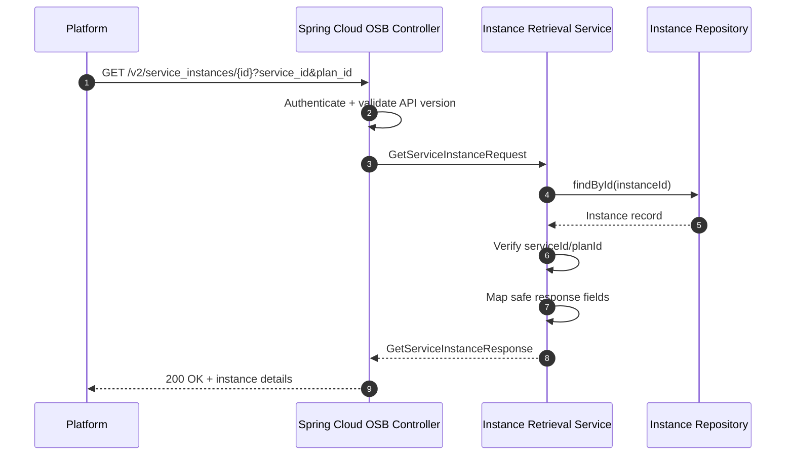

# instances_retrievable và điều kiện hỗ trợ GET service instance

Open Service Broker API (OSB API) cho phép platform đọc lại thông tin của một service instance đã được tạo thông qua endpoint `GET /v2/service_instances/{instance_id}`. Broker chỉ được platform kỳ vọng gọi endpoint này khi service tương ứng công bố capability `instances_retrievable: true` trong catalog. Vì vậy, việc bật capability là một cam kết về hợp đồng: broker phải có khả năng tìm đúng instance, xác minh service và plan, rồi trả thông tin nhất quán theo schema OSB API.

Trong module `SPRING_CLOUD_SERVICE_BROKER`, capability này cần được nối từ catalog đến dữ liệu vòng đời mà broker lưu khi provision hoặc update. Endpoint retrieval là thao tác đọc; nó hỗ trợ platform và công cụ vận hành tra cứu cấu hình của instance, nhưng không thay thế endpoint `last_operation`, không tạo tài nguyên và không trả credential binding. Broker chỉ nên quảng bá khả năng này khi implementation có thể đáp ứng ổn định trong mọi replica và mọi môi trường mà catalog được cung cấp.

## 1. Ý nghĩa của instances_retrievable

`instances_retrievable` là thuộc tính capability ở cấp service definition trong catalog. Nó cho platform biết broker có hỗ trợ truy xuất thông tin của service instance thuộc service đó hay không.

- `true`: broker cam kết hỗ trợ `GET /v2/service_instances/{instance_id}` cho service đó và phải xử lý request theo OSB API.
- `false` hoặc không khai báo: platform không được giả định broker hỗ trợ endpoint retrieval cho service đó.
- Capability được công bố theo service, không phải một cờ riêng cho từng instance. Các plan thuộc service cần có cách xử lý retrieval nhất quán.
- Chỉ bật sau khi broker đã triển khai lưu trữ, truy vấn, phân quyền, response mapping và kiểm thử cho endpoint.

Ví dụ một phần catalog:

```json
{
  "services": [
    {
      "id": "postgres-service-id",
      "name": "managed-postgresql",
      "description": "Dịch vụ PostgreSQL được quản lý",
      "bindable": true,
      "instances_retrievable": true,
      "plan_updateable": true,
      "plans": [
        {
          "id": "postgres-small-plan",
          "name": "small",
          "description": "PostgreSQL cho tải nhỏ"
        }
      ]
    }
  ]
}
```

Trong ví dụ này, platform có thể dùng service ID và plan ID được công bố để gọi retrieval cho một instance. Nếu broker chỉ hỗ trợ GET trên một số service nhưng không hỗ trợ trên các service khác, capability phải phản ánh đúng từng service definition.

### Phân biệt với các capability khác

| Capability | Phạm vi | Ý nghĩa |
|---|---|---|
| `instances_retrievable` | Service instance | Cho phép platform truy xuất thông tin service instance. |
| `bindings_retrievable` | Service binding | Cho phép platform truy xuất thông tin binding nếu broker hỗ trợ. |
| `plan_updateable` | Service | Cho biết service có hỗ trợ cập nhật plan hay không. |
| `bindable` | Service | Cho biết service instance có thể được bind với ứng dụng/consumer hay không. |

`instances_retrievable: true` không tự động bật `bindings_retrievable`, không có nghĩa service hỗ trợ update plan và cũng không chứng minh instance đang hoạt động khỏe mạnh. Mỗi capability mô tả một hợp đồng riêng và chỉ được công bố khi endpoint hoặc hành vi tương ứng đã được triển khai.

## 2. Khi nào platform cần GET service instance?

Platform có thể cần đọc lại thông tin instance trong các tình huống như:

- Đồng bộ thông tin service instance với broker sau khi platform khôi phục dữ liệu hoặc tái lập kết nối.
- Hiển thị thông tin cấu hình của instance trong giao diện quản trị hoặc công cụ hỗ trợ.
- Đối chiếu service ID, plan ID và các tham số cấu hình mà broker đã lưu.
- Hỗ trợ quy trình vận hành cần đọc trạng thái cấu hình đã được broker ghi nhận.
- Thực hiện các thao tác quản lý tiếp theo dựa trên thông tin đã truy xuất.

Endpoint này không phải API health check cho database hay provider. Nếu cần biết tài nguyên bên ngoài có thể kết nối hay không, broker phải có cơ chế health check hoặc reconciliation riêng. GET service instance trả thông tin theo hợp đồng retrieval, không nhất thiết thực hiện truy vấn sâu tới mọi thành phần hạ tầng mỗi lần được gọi.

## 3. Hợp đồng HTTP của GET service instance

Endpoint có dạng:

```http
GET /v2/service_instances/{instance_id}?service_id={service_id}&plan_id={plan_id} HTTP/1.1
Host: broker.example.internal
X-Broker-API-Version: 2.14
Authorization: Basic <broker-credentials>
Accept: application/json
```

Trong đó:

- `{instance_id}` là định danh service instance do platform cấp khi provision.
- `service_id` là ID service đã được platform dùng để tạo instance.
- `plan_id` là ID plan được dùng cho instance theo thông tin mà platform gửi trong request retrieval.
- `X-Broker-API-Version` xác định phiên bản OSB API mà platform đang sử dụng.
- Thông tin xác thực broker được gửi theo cơ chế đã cấu hình khi đăng ký broker.

Broker phải xác thực caller và kiểm tra các định danh trong request với bản ghi instance. Không được chỉ dựa vào `instance_id` rồi bỏ qua `service_id` hoặc `plan_id`; cũng không được tin các query parameter là bằng chứng rằng caller có quyền truy cập instance.

### Phản hồi thành công

Khi tìm thấy instance và xác minh request hợp lệ, broker trả `200 OK` với JSON mô tả service instance theo hợp đồng OSB API. Ví dụ:

```http
HTTP/1.1 200 OK
Content-Type: application/json

{
  "service_id": "postgres-service-id",
  "plan_id": "postgres-small-plan",
  "parameters": {
    "storage_gb": 20,
    "region": "ap-southeast-1"
  },
  "dashboard_url": "https://console.example.com/instances/instance-123"
}
```

`service_id` và `plan_id` xác định service và plan của instance. `parameters` có thể được trả về để mô tả cấu hình đã dùng khi tạo instance, trong phạm vi schema và dữ liệu mà broker có thể cung cấp an toàn. `dashboard_url` có thể được trả về nếu broker có trang quản lý instance phù hợp. Chỉ trả các trường được định nghĩa bởi phiên bản OSB API đang hỗ trợ; không tự thêm trường trạng thái nội bộ hoặc dữ liệu provider không thuộc hợp đồng.

Broker cần bảo đảm dữ liệu trả về có nguồn gốc rõ ràng từ bản ghi instance đã lưu. Nếu broker không lưu một tham số từ lúc provision và không thể khôi phục nó một cách đáng tin cậy, không nên bịa giá trị dựa trên cấu hình hiện tại của plan.

## 4. Điều kiện trước khi bật capability

Trước khi công bố `instances_retrievable: true`, cần đáp ứng tối thiểu các điều kiện sau:

1. **Định danh bền vững:** broker lưu `service_instance_id`, `service_id`, `plan_id` và khóa tài nguyên ngoài khi provision thành công.
2. **Dữ liệu retrieval:** broker lưu hoặc có thể tái dựng an toàn các thuộc tính được phép trả về, chẳng hạn parameters không nhạy cảm và dashboard URL.
3. **Truy vấn chính xác:** có thể tìm instance theo ID và xác minh service/plan trong request.
4. **Tính nhất quán:** mọi replica của broker đọc cùng nguồn dữ liệu hoặc cùng snapshot nhất quán.
5. **Bảo mật:** chỉ platform được ủy quyền mới gọi được endpoint; response không làm lộ credential, token hoặc dữ liệu tenant khác.
6. **Xử lý lỗi:** instance không tồn tại, request sai định danh hoặc dependency gặp lỗi được ánh xạ sang phản hồi phù hợp OSB API.
7. **Tương thích:** ID service/plan cũ vẫn được nhận diện cho instance đã tạo trước khi catalog được cập nhật.
8. **Kiểm thử:** có test cho cả trường hợp thành công, không tìm thấy, sai service/plan, dữ liệu nhạy cảm và truy cập đồng thời.

Nếu thiếu một trong các điều kiện cốt lõi, nên giữ capability ở trạng thái không hỗ trợ cho đến khi endpoint hoàn thiện. Công bố `true` nhưng endpoint trả `404` cho mọi instance hoặc chỉ hoạt động trên một replica là vi phạm cam kết với platform.

## 5. Dữ liệu nào nên được lưu để retrieval?

Broker không thể trả lại thông tin mà nó chưa từng lưu hoặc không thể tái dựng một cách an toàn. Vì vậy, thiết kế persistence ngay từ bước provision rất quan trọng.

Một bản ghi instance có thể chứa các trường nội bộ sau:

| Trường nội bộ | Mục đích |
|---|---|
| `instance_id` | Khóa service instance do platform cấp. |
| `service_id` | Định danh service đã được provision. |
| `plan_id` | Định danh plan đã được chọn. |
| `tenant_context` | Tổ chức/space hoặc context đã được xác thực và chuẩn hóa. |
| `parameters_json` | Các tham số không nhạy cảm đã được chuẩn hóa, nếu cần trả lại. |
| `secret_reference` | Tham chiếu secret store nếu worker còn cần secret; không lưu secret thô tại đây. |
| `external_resource_id` | ID database, queue hoặc tài nguyên do provider tạo. |
| `dashboard_url` | Địa chỉ dashboard đã được broker tạo hoặc kiểm tra. |
| `lifecycle_state` | Trạng thái nghiệp vụ nội bộ của instance. |
| `created_at`, `updated_at` | Thời điểm tạo và cập nhật. |

Không phải tất cả trường nội bộ đều được trả trong GET response. `external_resource_id`, tenant context, trạng thái worker, secret reference và dữ liệu provider thường chỉ phục vụ nội bộ. Response chỉ nên chứa các trường mà OSB API cho phép và platform cần.

### Lưu snapshot thay vì suy diễn từ catalog hiện tại

Giả sử instance được tạo với plan `postgres-small-v1`, dung lượng 20 GB. Sau đó catalog đổi tên plan thành `starter` và cấu hình plan mặc định chuyển sang 30 GB. Nếu retrieval chỉ đọc cấu hình plan hiện tại, broker có thể trả về 30 GB cho một instance thực tế vẫn có 20 GB.

Do đó, broker nên lưu snapshot tham số hoặc cấu hình đã áp dụng khi provision. Catalog mô tả lựa chọn hiện tại; bản ghi instance mô tả lựa chọn thực tế mà instance đó đã dùng. Hai dữ liệu có liên quan nhưng không thể thay thế nhau.

## 6. Phân biệt retrieval với last_operation và binding retrieval

Các endpoint này phục vụ mục đích khác nhau:

| Endpoint | Câu hỏi được trả lời | Dữ liệu chính |
|---|---|---|
| `GET /v2/service_instances/{id}` | Instance được provision với service/plan và cấu hình nào? | Service ID, plan ID và thông tin instance được phép trả về. |
| `GET /v2/service_instances/{id}/last_operation` | Thao tác provision/update/deprovision gần nhất đang ở trạng thái nào? | `in progress`, `succeeded`, `failed` và mô tả an toàn. |
| `GET /v2/service_instances/{id}/service_bindings/{binding_id}` | Binding được tạo với thông tin nào? | Thông tin binding theo capability và hợp đồng tương ứng. |

Không dùng `last_operation` để thay thế GET instance. Một instance có thể đã provision thành công từ lâu và không còn operation đang chạy, nhưng platform vẫn có thể cần đọc lại thông tin instance. Ngược lại, GET instance không phải nơi trả tiến trình của một operation đang chạy.

Tương tự, retrieval service instance không trả credential của từng binding. Credential thuộc ranh giới binding và có chính sách bảo mật riêng. Nếu broker hỗ trợ binding retrieval, phải công bố và triển khai capability tương ứng; không mở rộng response instance để chứa password hoặc token của mọi consumer.

## 7. Luồng xử lý trong broker

Một luồng GET an toàn và dễ kiểm soát có thể gồm:

1. Spring Cloud Open Service Broker nhận request OSB và chuyển thành request object.
2. Broker xác thực platform, kiểm tra phiên bản API và lấy `instance_id`, `service_id`, `plan_id`.
3. Service nghiệp vụ tìm bản ghi instance trong repository.
4. Kiểm tra instance tồn tại và ID service/plan trong request khớp với bản ghi.
5. Chuyển dữ liệu đã lưu sang response model, loại bỏ trường nội bộ và secret.
6. Trả response đồng bộ `200 OK`; nếu có lỗi, ánh xạ theo hợp đồng OSB API.

Sơ đồ tuần tự:



GET là thao tác đọc nên không được tạo operation nền, thay đổi plan, cấp credential hoặc provision lại tài nguyên. Nếu cần đối chiếu trạng thái provider, hãy thực hiện qua tác vụ reconcile riêng và cập nhật bản ghi theo quy trình có kiểm soát; không biến một request retrieval thành thao tác thay đổi trạng thái bất ngờ.

## 8. Tích hợp với Spring Cloud Open Service Broker

Spring Cloud Open Service Broker cung cấp abstraction cho các thao tác service instance. Trong các phiên bản có reactive service API, implementation có thể cung cấp phương thức retrieval tương ứng với `GetServiceInstanceRequest` và trả về `Mono<GetServiceInstanceResponse>`. Tên method, package và builder có thể khác theo phiên bản thư viện; cần dùng đúng API mà dự án đang khai báo.

Ví dụ minh họa cho service layer reactive:

```java
import reactor.core.publisher.Mono;

public class BrokerServiceInstanceService implements ServiceInstanceService {

    private final ServiceInstanceRepository repository;

    public BrokerServiceInstanceService(ServiceInstanceRepository repository) {
        this.repository = repository;
    }

    @Override
    public Mono<GetServiceInstanceResponse> getServiceInstance(
            GetServiceInstanceRequest request
    ) {
        return repository.findById(request.getServiceInstanceId())
                .switchIfEmpty(Mono.error(
                        new ServiceInstanceNotFoundException(request.getServiceInstanceId())
                ))
                .flatMap(instance -> {
                    if (!instance.getServiceId().equals(request.getServiceDefinitionId())
                            || !instance.getPlanId().equals(request.getPlanId())) {
                        return Mono.error(new ServiceInstanceRequestMismatchException());
                    }

                    return Mono.just(GetServiceInstanceResponse.builder()
                            .serviceDefinitionId(instance.getServiceId())
                            .planId(instance.getPlanId())
                            .parameters(instance.getPublicParameters())
                            .dashboardUrl(instance.getDashboardUrl())
                            .build());
                });
    }
}
```

Đây là ví dụ về cấu trúc xử lý; tên repository, exception, getter và builder cần được điều chỉnh theo model của ứng dụng và phiên bản Spring Cloud Open Service Broker. Không đưa `secret_reference`, password, token hoặc external provider credentials vào `getPublicParameters()`.

### Công bố capability trong catalog

Khi tạo service definition, cần bật capability retrieval bằng API builder của phiên bản thư viện đang dùng. Ví dụ minh họa:

```java
ServiceDefinition service = ServiceDefinition.builder()
        .id(CatalogIds.POSTGRES_SERVICE)
        .name("managed-postgresql")
        .description("Dịch vụ PostgreSQL được quản lý")
        .bindable(true)
        .instancesRetrievable(true)
        .planUpdateable(true)
        .plans(plans)
        .build();
```

Tên builder `instancesRetrievable` thể hiện capability trong model service definition; cần xác nhận API chính xác theo dependency version. Chỉ cấu hình `true` khi service retrieval implementation đã được đăng ký và hoạt động. Nếu catalog builder công bố capability nhưng không có service handler tương ứng, platform có thể gửi request mà broker không xử lý được.

## 9. Xác minh định danh và quyền truy cập

Request GET chứa nhiều định danh nhưng chỉ một số giá trị là khóa tra cứu. Broker phải xác minh mối quan hệ giữa chúng:

- `instance_id` phải tồn tại trong kho trạng thái của broker.
- `service_id` trong query phải khớp service ID đã lưu.
- `plan_id` trong query phải khớp plan ID gắn với instance theo quy tắc OSB API.
- Caller phải là platform hoặc client được ủy quyền theo cấu hình broker.
- Nếu hệ thống hỗ trợ nhiều tenant, bản ghi instance phải được ràng buộc với tenant context đã xác thực; không lấy tenant từ query tùy ý.

Ví dụ, request có `instance_id=instance-123` nhưng `service_id=redis-service-id` trong khi bản ghi là PostgreSQL phải bị xử lý như request không hợp lệ theo mapping lỗi của OSB API. Không được trả thông tin PostgreSQL chỉ vì instance ID tồn tại; điều đó có thể làm lộ thông tin giữa các service hoặc tenant.

Không nên phân biệt quá chi tiết trong thông báo công khai giữa “instance không tồn tại” và “caller không có quyền” nếu điều đó giúp dò tìm ID. Phản hồi vẫn phải tuân thủ status/schema OSB API, nhưng description nên tránh tiết lộ thông tin nội bộ.

## 10. Bảo vệ dữ liệu nhạy cảm trong response

Service instance retrieval là một endpoint đọc dữ liệu, nhưng không có nghĩa broker được phép trả mọi thứ đã lưu. Đặc biệt, các tham số provision có thể chứa password, token hoặc private key.

- Không trả credential binding, password database, API token, private key hoặc secret reference nội bộ.
- Chỉ trả parameters được phép công bố và cần thiết để mô tả cấu hình instance.
- Nếu cần lưu secret để worker bất đồng bộ sử dụng, lưu ở secret manager và chỉ giữ reference nội bộ.
- Không trả raw provider response, stack trace, internal resource ID nếu đó là thông tin nhạy cảm hoặc không thuộc hợp đồng.
- Không ghi toàn bộ response vào log nếu response có thể chứa dữ liệu tenant hoặc thông tin nhạy cảm.
- Nếu có dashboard URL chứa token truy cập, không trả URL đó dưới dạng bearer secret; hãy dùng URL an toàn, có cơ chế xác thực phù hợp hoặc không cung cấp trường này.

Ví dụ bản ghi nội bộ:

```json
{
  "instance_id": "instance-123",
  "service_id": "postgres-service-id",
  "plan_id": "postgres-small-plan",
  "public_parameters": {
    "storage_gb": 20,
    "region": "ap-southeast-1"
  },
  "secret_reference": "vault://broker/instances/instance-123/admin-password",
  "external_resource_id": "db-9a82",
  "lifecycle_state": "AVAILABLE"
}
```

Response retrieval chỉ nên dùng phần `service_id`, `plan_id` và các trường public được OSB API cho phép. `secret_reference`, `external_resource_id` và `lifecycle_state` là dữ liệu nội bộ trong ví dụ này; không sao chép toàn bộ bản ghi persistence sang response DTO.

## 11. Tính nhất quán và hiệu năng

Platform có thể gọi retrieval nhiều lần hoặc gọi qua các replica khác nhau. Endpoint cần có hành vi đọc ổn định:

- Dùng repository hoặc read model bền vững; không lưu instance chỉ trong memory của một JVM.
- Đảm bảo replica đọc cùng nguồn dữ liệu hoặc dữ liệu được đồng bộ theo cơ chế rõ ràng.
- Tạo index cho `instance_id` nếu kho dữ liệu có quy mô lớn.
- Trả nhanh từ snapshot instance đã lưu; không gọi tuần tự nhiều provider API nếu không cần.
- Không cập nhật `updated_at`, trạng thái hoặc operation chỉ vì có GET.
- Không dùng cache không có invalidation rõ ràng khiến platform đọc plan/parameters cũ sau khi update thành công.
- Nếu có read replica với độ trễ, cân nhắc đọc từ nguồn nhất quán cho các request ngay sau provision/update.

GET retrieval thường là request đồng bộ. Nếu truy vấn cần một thao tác dài để khôi phục dữ liệu, cần thiết kế lại read model hoặc quy trình vận hành; không trả `202` và tự tạo operation retrieval nếu hợp đồng endpoint không quy định cơ chế đó.

## 12. Xử lý lỗi và trạng thái không tìm thấy

Broker cần phân loại lỗi thay vì trả cùng một response cho mọi tình huống:

| Tình huống | Xử lý mong muốn |
|---|---|
| Instance tồn tại, service/plan khớp | Trả `200 OK` với response hợp lệ. |
| Instance không tồn tại | Trả mã lỗi resource không tồn tại theo quy định OSB API và mapping của framework. |
| `service_id` hoặc `plan_id` không khớp | Trả lỗi hợp đồng phù hợp; không trả dữ liệu của instance khác. |
| Caller không xác thực hoặc không được phép | Từ chối theo cơ chế bảo mật của broker. |
| Database trạng thái tạm thời không truy cập được | Trả lỗi hệ thống phù hợp, không giả vờ instance không tồn tại. |
| Bản ghi thiếu dữ liệu bắt buộc hoặc hỏng | Ghi nhận lỗi nội bộ an toàn và trả thông báo tổng quát có correlation ID. |

Không ánh xạ lỗi database timeout thành “instance không tồn tại”; làm vậy khiến platform có thể hiểu nhầm rằng tài nguyên đã mất. Cũng không trả stack trace hoặc exception message của driver trong `description`.

Khi instance đã deprovision thành công và bản ghi được giữ dưới dạng tombstone, broker cần áp dụng chính sách nhất quán: endpoint không được trả một instance đang hoạt động nếu tài nguyên đã bị thu hồi. Có thể giữ tombstone để audit, idempotency và hỗ trợ xử lý retry, nhưng response retrieval phải tuân thủ ngữ nghĩa vòng đời của OSB API.

## 13. Kiểm thử capability và endpoint retrieval

Kiểm thử cần bao phủ cả catalog và endpoint. Một test endpoint thành công riêng lẻ chưa đủ nếu catalog không công bố capability; ngược lại, catalog trả `true` mà handler không hoạt động cũng không đạt.

Các ca kiểm thử quan trọng:

1. Catalog trả `instances_retrievable: true` cho service đã triển khai retrieval.
2. Service không hỗ trợ retrieval không quảng bá capability này.
3. GET với instance ID hợp lệ và service/plan đúng trả `200` cùng dữ liệu đã lưu.
4. GET với instance ID không tồn tại trả mã lỗi đúng theo hợp đồng.
5. GET với service ID hoặc plan ID sai không trả dữ liệu instance.
6. Parameters nhạy cảm và secret reference không xuất hiện trong response.
7. GET không gọi provisioner tạo tài nguyên, không tạo operation và không thay đổi lifecycle state.
8. Sau update thành công, retrieval phản ánh snapshot/cấu hình mới theo chính sách.
9. Sau deprovision, retrieval không trả instance như một tài nguyên đang hoạt động.
10. Nhiều replica cùng xử lý GET cho cùng instance trả dữ liệu nhất quán.
11. Lỗi repository hoặc provider không làm lộ exception message, SQL, URL hoặc credential.

Ví dụ kiểm tra mapping response bằng JUnit ở tầng service:

```java
@Test
void retrievesStoredInstanceWithoutSecrets() {
    ServiceInstance instance = new ServiceInstance(
            "instance-123",
            "postgres-service-id",
            "postgres-small-plan",
            Map.of("storage_gb", 20, "region", "ap-southeast-1"),
            "vault://internal/instance-123/password",
            "AVAILABLE"
    );
    when(repository.findById("instance-123")).thenReturn(Mono.just(instance));

    GetServiceInstanceRequest request = requestFor(
            "instance-123", "postgres-service-id", "postgres-small-plan");

    StepVerifier.create(service.getServiceInstance(request))
            .assertNext(response -> {
                assertEquals("postgres-service-id", response.getServiceDefinitionId());
                assertEquals("postgres-small-plan", response.getPlanId());
                assertEquals(20, response.getParameters().get("storage_gb"));
                assertFalse(response.toString().contains("vault://"));
            })
            .verifyComplete();
}
```

Đoạn test minh họa; constructor, builder, getter và cách tạo request cần điều chỉnh theo model thực tế. Trong test bảo mật, nên dùng một chuỗi sentinel giả làm secret và xác minh nó không xuất hiện trong JSON response, log và trace. Không dùng secret production trong fixture.

## 14. Triển khai theo môi trường và tích hợp platform

Trước khi bật `instances_retrievable`, cần xác nhận phiên bản OSB API và client platform mục tiêu hỗ trợ capability. Catalog có thể được cache; vì vậy thay đổi capability cần được triển khai đồng bộ và có kế hoạch refresh catalog.

Với Cloud Foundry, platform có thể đọc catalog từ broker đã đăng ký và dùng capability để quyết định có gọi GET instance hay không. Broker cần bảo đảm endpoint có thể truy cập từ platform, xác thực đúng credential và trả thông tin tương ứng với instance mà platform quản lý.

Với Kubernetes, thành phần tích hợp OSB API (service catalog/controller hoặc controller riêng) cần hỗ trợ capability retrieval mới gọi endpoint này. Kubernetes không mặc định tự biến mọi service broker thành một API truy vấn instance; hành vi phụ thuộc controller hoặc thành phần tích hợp được cài đặt. Broker vẫn phải tuân thủ OSB API và cung cấp response ổn định.

Trong triển khai nhiều replica, tất cả replica phải dùng chung persistence hoặc read model nhất quán. Không để replica A có catalog bật retrieval nhưng replica B không có handler hoặc không đọc được dữ liệu instance. Việc bật capability và rollout handler nên được điều phối cùng một phiên bản phát hành.

## 15. Checklist trước khi công bố instances_retrievable=true

- Endpoint `GET /v2/service_instances/{instance_id}` đã được triển khai theo phiên bản OSB API đang hỗ trợ.
- Request đọc và xác minh `instance_id`, `service_id`, `plan_id`.
- Dữ liệu service/plan và parameters được lưu bền vững từ provision/update.
- Response chỉ chứa trường được phép, không chứa credential hoặc dữ liệu nội bộ.
- Endpoint là thao tác đọc, không provision, update hoặc tạo operation mới.
- Lỗi not found, mismatch, unauthorized và dependency failure được ánh xạ phù hợp.
- Các replica có thể truy xuất cùng bản ghi và trả kết quả nhất quán.
- Catalog công bố capability đúng với service đã được triển khai.
- Test catalog, happy path, lỗi, bảo mật, update và deprovision đều đạt.
- Platform mục tiêu đã được xác nhận hỗ trợ hành vi retrieval này.

`instances_retrievable` là một cam kết cụ thể giữa broker và platform. Khi công bố `true`, broker phải cung cấp GET service instance thực sự hữu ích, nhất quán và an toàn. Việc lưu snapshot cấu hình cùng định danh service/plan, kiểm tra query parameters, tách response công khai khỏi dữ liệu nội bộ và triển khai đồng bộ trên mọi replica giúp Spring Cloud Service Broker đáp ứng capability này trong suốt vòng đời tài nguyên.
