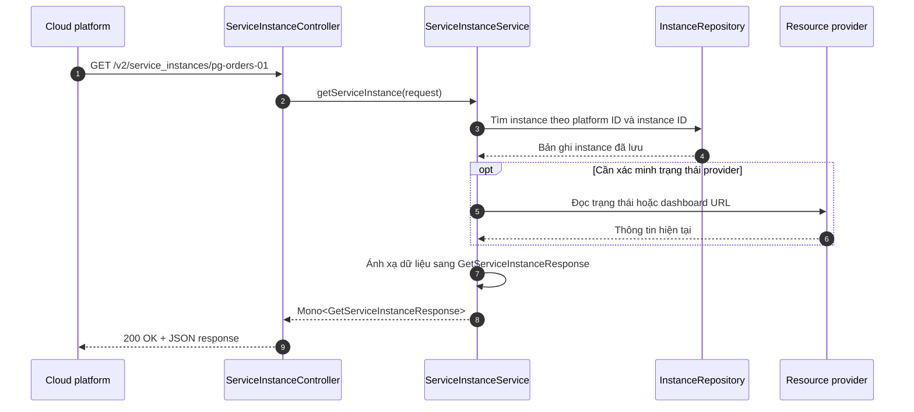
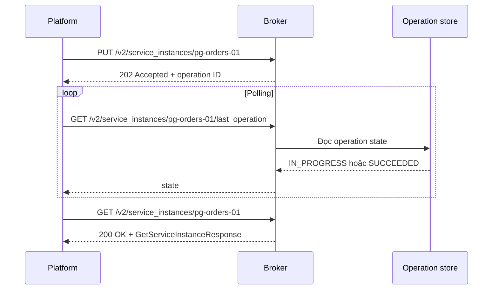

# Cài đặt getServiceInstance() và xây dựng GetServiceInstanceResponse

Trong Open Service Broker API (OSB API), platform có thể yêu cầu broker truy xuất lại thông tin của một service instance đã được cấp phát. Với Spring Cloud Open Service Broker, thao tác này được triển khai bằng phương thức `getServiceInstance(GetServiceInstanceRequest request)` của `ServiceInstanceService`. Kết quả là một `Mono<GetServiceInstanceResponse>` chứa thông tin instance mà broker đang quản lý.

Ví dụ, sau khi PostgreSQL instance `pg-orders-01` được provision thành công, platform có thể gọi endpoint fetch để làm mới thông tin của instance, nhận biết thay đổi được thực hiện ngoài luồng quản lý của platform hoặc lấy lại dashboard URL. Broker cần tra cứu trạng thái đã lưu, xác định đúng instance và trả response theo contract OSB.

## 1. Khi nào platform gọi getServiceInstance()?

Broker công bố khả năng truy xuất instance bằng field `instances_retrievable: true` trong service definition của catalog. Khi bật capability này, broker phải hỗ trợ endpoint fetch cho tất cả plan thuộc service offering đó. Platform có thể dùng endpoint để cập nhật cách nhìn của mình về instance đã provision thành công và phát hiện thay đổi được thực hiện ngoài luồng, ví dụ parameters hoặc dashboard URL.

Endpoint chuẩn:

```http
GET /v2/service_instances/{instance_id}
X-Broker-API-Version: 2.16
```

`instance_id` là ID của instance đã được provision trước đó. Platform có thể gửi thêm `service_id` và `plan_id` dưới dạng query parameter để cung cấp gợi ý cho broker:

```http
GET /v2/service_instances/pg-orders-01?service_id=postgresql&plan_id=standard
```

Hai query parameter này là tùy chọn trong request fetch. Nếu có mặt, chúng phải là chuỗi không rỗng. Broker nên dùng dữ liệu đã lưu của instance làm nguồn sự thật; các query parameter chỉ giúp đối chiếu hoặc định tuyến, không phải dữ liệu thay thế cho bản ghi instance.

### 1.1. Điều kiện để bật capability

Khi catalog công bố `instances_retrievable: true`:

- Broker phải triển khai `getServiceInstance()`.
- Endpoint fetch phải hoạt động với mọi plan thuộc service offering đó.
- Endpoint phải sẵn sàng ngay sau khi endpoint polling last operation trả `state: succeeded` cho thao tác provision.
- Broker phải duy trì trạng thái instance đủ để phục vụ truy xuất, kể cả sau khi tiến trình broker khởi động lại.

Nếu service không công bố `instances_retrievable: true`, platform không nên gọi endpoint này. Trong Spring Cloud Open Service Broker, `getServiceInstance()` có implementation mặc định; tuy nhiên, khi đã bật capability retrieval, ứng dụng phải ghi đè phương thức để trả thông tin thực tế.

## 2. Luồng xử lý trong Spring Cloud Open Service Broker

Spring Cloud Open Service Broker cung cấp controller cho endpoint `/v2/service_instances/{instanceId}`. Controller nhận path variable, query parameter và một số header, xây dựng `GetServiceInstanceRequest`, gọi `ServiceInstanceService.getServiceInstance()` rồi chuyển `GetServiceInstanceResponse` thành HTTP response.



Controller và request mapping được thư viện cung cấp. Ứng dụng tập trung vào truy vấn repository, kiểm tra trạng thái và xây dựng response. Có thể đọc dữ liệu từ repository nội bộ hoặc kết hợp với provider nếu cần đồng bộ thông tin mới nhất. Không nên gọi provider một cách không cần thiết trong mỗi lần fetch nếu dữ liệu broker đã đủ và có tính nhất quán.

## 3. GetServiceInstanceRequest chứa thông tin gì?

Framework tạo `GetServiceInstanceRequest` từ path, query parameter và metadata của HTTP request. Những field thường được sử dụng:

| Getter | Nguồn | Ý nghĩa |
|---|---|---|
| `getServiceInstanceId()` | Path `instance_id` | ID của instance cần truy xuất; do platform cấp |
| `getServiceDefinitionId()` | Query `service_id` | ID service offering, nếu platform gửi |
| `getPlanId()` | Query `plan_id` | ID plan, nếu platform gửi |
| `getPlatformInstanceId()` | Path prefix tùy cấu hình | ID của platform instance đang gọi broker |
| `getApiInfoLocation()` | Header platform | Địa chỉ API info của platform nếu có |
| `getOriginatingIdentity()` | Header identity | Danh tính người dùng khởi tạo request nếu platform gửi |
| `getRequestIdentity()` | Header request identity | Định danh request để trace |

Request fetch không có JSON body nghiệp vụ. Vì vậy, không tìm parameters trong request này; parameters cần trả về phải được đọc từ trạng thái instance mà broker đã lưu hoặc nguồn dữ liệu có thẩm quyền.

Ví dụ tạo request trong unit test bằng builder:

```java
GetServiceInstanceRequest request = GetServiceInstanceRequest.builder()
        .serviceInstanceId("pg-orders-01")
        .serviceDefinitionId("postgresql")
        .planId("standard")
        .platformInstanceId("cf-east")
        .build();
```

`platformInstanceId` có thể không được dùng trong broker chỉ phục vụ một platform. Nếu cùng một broker phục vụ nhiều platform, nên đưa ID này vào phạm vi truy vấn để tránh đọc nhầm tài nguyên của platform khác.

## 4. GetServiceInstanceResponse biểu diễn điều gì?

`GetServiceInstanceResponse` là model response mà ứng dụng tạo ra sau khi tra cứu thành công. Trong Spring Cloud Open Service Broker 4.4.1, model có các thuộc tính chính:

| Builder method | JSON field OSB | Ý nghĩa |
|---|---|---|
| `serviceDefinitionId(String)` | `service_id` | ID service offering của instance |
| `planId(String)` | `plan_id` | ID plan mà instance đang sử dụng |
| `dashboardUrl(String)` | `dashboard_url` | URL giao diện quản trị instance, nếu có |
| `parameters(Map<String, Object>)` | `parameters` | Các cấu hình instance có thể cung cấp lại cho platform |

Hai phương thức `parameters(String key, Object value)` và `parameters(Map<String, Object>)` đều có sẵn để thêm một hoặc nhiều tham số. Nếu không có parameters hoặc broker không hỗ trợ truy xuất parameters, giá trị có thể là `null`.

Ví dụ JSON response:

```json
{
  "service_id": "postgresql",
  "plan_id": "standard",
  "dashboard_url": "https://console.example.com/databases/pg-orders-01",
  "parameters": {
    "storage_gb": 100,
    "region": "ap-southeast-1",
    "high_availability": true
  }
}
```

Không có `instance_id` trong response body vì platform đã biết ID đó từ path của request. Response chỉ mang thông tin mô tả instance được truy xuất.

### 4.1. service_id và plan_id

Hai field này cho biết instance thuộc service offering và plan nào. Nên lấy chúng từ bản ghi instance đã lưu, thay vì sao chép trực tiếp query parameter của request. Query có thể vắng mặt, cũ hoặc không khớp với trạng thái hiện tại sau khi instance đã đổi plan.

Nếu request có gửi `service_id` hoặc `plan_id`, broker có thể so sánh với dữ liệu đã lưu để phát hiện request không nhất quán. Không dùng query hint để ghi đè metadata gốc của instance.

### 4.2. dashboard_url

`dashboard_url` là URL đến giao diện web quản trị của chính instance. URL cần chứa đủ thông tin để dashboard xác định đúng tài nguyên, chẳng hạn ID database. Nếu broker muốn trả dashboard URL trong response fetch, OSB yêu cầu URL đó cũng phải được trả trong response provision ban đầu, kể cả khi provision chạy bất đồng bộ.

Nếu dịch vụ không có dashboard, có thể bỏ qua hoặc để giá trị `null`. Không tạo URL giả hoặc trả đường dẫn quản trị chung không xác định được instance đích.

### 4.3. parameters

`parameters` là các cấu hình của instance. Broker có thể trả lại các giá trị mà platform cần để làm mới trạng thái, ví dụ dung lượng, region hoặc chế độ high availability.

Broker được phép không trả một phần hoặc toàn bộ parameters khi fetch, ví dụ khi parameters có chứa dữ liệu nhạy cảm. Nên tách rõ cấu hình có thể công khai với secret như password, token, private key hoặc connection credential. Những secret này nên được quản lý bằng secret store và không được đưa vào response fetch nếu không cần thiết.

### 4.4. Phạm vi model theo phiên bản thư viện

Ví dụ Java trong bài dựa trên `GetServiceInstanceResponse` của Spring Cloud Open Service Broker 4.4.1. Model này cung cấp `serviceDefinitionId`, `planId`, `dashboardUrl` và `parameters`. Các phiên bản OSB API mới hơn có thể bổ sung field response như metadata; khi nâng cấp thư viện, cần đối chiếu model và phiên bản giao thức thực tế thay vì tự thêm field mà model đang dùng không hỗ trợ.

## 5. Cài đặt getServiceInstance()

Implementation thường gồm bốn bước:

1. Lấy `serviceInstanceId` từ request.
2. Tìm bản ghi instance trong repository, có xét platform/tenant nếu broker phục vụ nhiều platform.
3. Kiểm tra trạng thái: instance phải tồn tại, đã provision thành công và không đang trong một operation khiến fetch không an toàn.
4. Ánh xạ service ID, plan ID, dashboard URL và parameters được phép công bố vào `GetServiceInstanceResponse`.

Ví dụ dưới đây dùng reactive repository giả định:

```java
import reactor.core.publisher.Mono;

import org.springframework.cloud.servicebroker.exception.ServiceBrokerConcurrencyException;
import org.springframework.cloud.servicebroker.exception.ServiceBrokerOperationInProgressException;
import org.springframework.cloud.servicebroker.exception.ServiceInstanceDoesNotExistException;
import org.springframework.cloud.servicebroker.model.instance.GetServiceInstanceRequest;
import org.springframework.cloud.servicebroker.model.instance.GetServiceInstanceResponse;
import org.springframework.cloud.servicebroker.service.ServiceInstanceService;
import org.springframework.stereotype.Service;

@Service
public class PostgreSqlServiceInstanceService implements ServiceInstanceService {

    private final InstanceRepository instances;

    public PostgreSqlServiceInstanceService(InstanceRepository instances) {
        this.instances = instances;
    }

    @Override
    public Mono<GetServiceInstanceResponse> getServiceInstance(
            GetServiceInstanceRequest request) {

        return instances.findByPlatformInstanceIdAndServiceInstanceId(
                        request.getPlatformInstanceId(),
                        request.getServiceInstanceId())
                .flatMap(instance -> {
                    if (instance.isProvisioning()) {
                        return Mono.error(
                                new ServiceBrokerOperationInProgressException("provision"));
                    }

                    if (instance.isUpdating()) {
                        return Mono.error(new ServiceBrokerConcurrencyException(
                                "Service instance is being updated"));
                    }

                    // Policy example: this broker only exposes ACTIVE instances.
                    if (!instance.isActive()) {
                        return Mono.error(new ServiceInstanceDoesNotExistException(
                                request.getServiceInstanceId()));
                    }

                    GetServiceInstanceResponse response = GetServiceInstanceResponse.builder()
                            .serviceDefinitionId(instance.getServiceDefinitionId())
                            .planId(instance.getPlanId())
                            .dashboardUrl(instance.getDashboardUrl())
                            .parameters(instance.getPublicParameters())
                            .build();

                    return Mono.just(response);
                })
                .switchIfEmpty(Mono.error(
                        new ServiceInstanceDoesNotExistException(
                                request.getServiceInstanceId())));
    }
}
```

`InstanceRepository`, `StoredServiceInstance` và các phương thức `isProvisioning()`, `isUpdating()`, `isActive()`, `getPublicParameters()` là abstraction/entity do ứng dụng định nghĩa. Ví dụ tập trung vào nhánh fetch; class triển khai hoàn chỉnh vẫn phải cung cấp các phương thức bắt buộc khác của `ServiceInstanceService` theo phiên bản thư viện đang dùng.

Ví dụ repository ở trên dành cho broker phục vụ nhiều platform và dùng URL prefix để nhận `platformInstanceId`. Với broker chỉ phục vụ một platform, có thể tra cứu bằng `serviceInstanceId` và bổ sung kiểm tra tenant theo mô hình dữ liệu của ứng dụng. Quy tắc xem trạng thái nào là có thể fetch cũng là chính sách của broker; các mapping bắt buộc của OSB cần được giữ nguyên cho provision đang chạy và update đang diễn ra.

### 5.1. Vì sao phải đọc từ repository?

Service instance có thể đại diện cho database, cluster, tài khoản hoặc tài nguyên ở một hệ thống bên ngoài. Khi provision thành công, broker cần lưu mối liên hệ giữa ID do platform cấp và ID tài nguyên ở provider. Nếu không lưu quan hệ này, broker khó có thể truy xuất đúng tài nguyên sau khi restart hoặc khi provider không sẵn sàng.

Một bản ghi instance thường cần tối thiểu:

| Thuộc tính | Mục đích |
|---|---|
| `platform_instance_id` | Phân vùng dữ liệu theo platform nếu broker phục vụ nhiều platform |
| `service_instance_id` | ID trong path do platform cấp |
| `service_definition_id` | Service ID của catalog |
| `plan_id` | Plan hiện tại của instance |
| `provider_resource_id` | ID database/cluster/account ở provider |
| `dashboard_url` | URL quản trị instance nếu có |
| `parameters` | Cấu hình cần thiết để tái dựng response, đã loại bỏ secret không được công khai |
| `state` | Trạng thái provision/update/deprovision |
| `updated_at` | Thời điểm trạng thái được cập nhật gần nhất |

Không nhất thiết phải lưu tất cả field thành cột riêng. Có thể lưu parameters dạng JSON hoặc dùng metadata riêng, miễn là truy xuất an toàn và có thể migrate khi schema thay đổi.

### 5.2. Không dùng query hint làm dữ liệu chuẩn

`request.getServiceDefinitionId()` và `request.getPlanId()` có thể trả `null` vì query parameter không bắt buộc trong fetch request. Hãy dùng giá trị đã lưu của instance làm nguồn sự thật. Nếu hint được gửi, có thể so sánh để phát hiện platform đang giữ metadata cũ; không được thay plan đang lưu chỉ vì query gửi lên khác.

## 6. Xử lý lỗi và trạng thái không thể truy xuất

OSB định nghĩa các kết quả quan trọng khi fetch:

| Tình huống | HTTP status theo OSB | Spring exception tiêu biểu |
|---|---:|---|
| Instance không tồn tại | `404 Not Found` | `ServiceInstanceDoesNotExistException` |
| Provision vẫn đang chạy | `404 Not Found` | `ServiceBrokerOperationInProgressException` |
| Instance đang được update nên không thể fetch | `422 Unprocessable Entity`, error `ConcurrencyError` | `ServiceBrokerConcurrencyException` |
| Fetch thành công | `200 OK` | Trả `Mono.just(GetServiceInstanceResponse)` |

`ServiceInstanceDoesNotExistException` có mapping HTTP phụ thuộc endpoint: khi fetch instance, exception này được chuyển thành `404`; khi delete instance, nó có mapping khác. Không nên tự ánh xạ exception này thành một status code chung ở mọi thao tác.

Nếu provision bất đồng bộ chưa hoàn tất, platform cần polling endpoint `last_operation`. Khi last operation trả `succeeded`, fetch instance phải có thể hoạt động ngay. Fetch không thay thế polling và cũng không được giả vờ trả instance đã sẵn sàng trong khi provision còn chạy.

Khi instance đang update, trả lỗi concurrency để platform biết cần chờ operation thay đổi hoàn tất rồi thử fetch lại. Tránh trả snapshot một phần hoặc trạng thái không nhất quán nếu việc update đang ghi nhiều thành phần của instance.

Không nên dùng `Mono.empty()` để biểu diễn instance không tồn tại. Với reactive controller, một `Mono` rỗng không tự diễn đạt rõ lỗi OSB cần trả. Hãy phát ra exception phù hợp bằng `Mono.error(...)` để framework ánh xạ thành HTTP response đúng.

## 7. Phân biệt fetch instance và getLastOperation

Hai endpoint đều dùng GET nhưng trả lời hai câu hỏi khác nhau:

| Endpoint | Mục đích | Khi nào gọi |
|---|---|---|
| `GET /v2/service_instances/{instance_id}/last_operation` | Trạng thái provision/update/deprovision bất đồng bộ | Khi broker đã trả `202 Accepted` cho operation |
| `GET /v2/service_instances/{instance_id}` | Thông tin hiện tại của instance đã provision | Khi `instances_retrievable=true` và instance đã sẵn sàng |

Ví dụ luồng provision bất đồng bộ:



Không gọi fetch để thay thế polling. Nếu fetch được gọi khi provision còn chạy, broker phải trả `404 Not Found` theo contract. Sau khi polling báo thành công, broker phải trả được thông tin instance mới nhất.

## 8. Bảo mật dữ liệu trong response

Fetch instance có thể trả parameters và dashboard URL, vì vậy broker cần kiểm soát những gì được tiết lộ:

1. Chỉ cho platform đã xác thực truy cập endpoint broker; áp dụng TLS và cơ chế xác thực đã thỏa thuận.
2. Tra cứu instance trong đúng phạm vi platform/tenant. Nếu dùng platform prefix, đưa `platformInstanceId` vào khóa truy vấn hoặc bước kiểm tra quyền.
3. Không trả password, token, private key hoặc connection secret trong `parameters`.
4. Dùng một tập `publicParameters` đã được lọc thay vì serialize toàn bộ entity hoặc cấu hình nội bộ.
5. Không ghi parameters nhạy cảm hoặc dashboard URL chứa token vào log, tracing hay thông báo lỗi.
6. Nếu dashboard URL có token truy cập, dùng token ngắn hạn và ràng buộc đúng instance/người dùng; tránh token dài hạn trong URL có thể bị ghi vào log.

Việc platform đã xác thực không có nghĩa mọi field trong repository đều được phép trả về. Response cần tuân theo quyền và mức dữ liệu mà platform được phép nhận.

## 9. Kiểm thử getServiceInstance()

Nên kiểm tra ít nhất các trường hợp sau:

| Trường hợp | Kết quả mong đợi |
|---|---|
| Instance ACTIVE tồn tại | Response có service ID, plan ID, dashboard URL và parameters công khai |
| ID không tồn tại | `ServiceInstanceDoesNotExistException` và HTTP 404 |
| Provision đang chạy | `ServiceBrokerOperationInProgressException` và HTTP 404 |
| Update đang chạy | `ServiceBrokerConcurrencyException` và HTTP 422 với `ConcurrencyError` |
| Không có dashboard URL | Response không có URL hoặc giá trị `null` |
| Parameters chứa secret | Secret không xuất hiện trong response |
| Query hint vắng mặt | Vẫn fetch được dựa trên instance ID đã lưu |
| Query hint không khớp | Broker phát hiện không nhất quán; không ghi đè service/plan đã lưu |
| Cùng instance ID ở hai platform | Mỗi platform chỉ nhận bản ghi thuộc phạm vi của mình |

Ví dụ unit test với Reactor Test:

```java
import java.util.Map;

import reactor.test.StepVerifier;

GetServiceInstanceRequest request = GetServiceInstanceRequest.builder()
        .serviceInstanceId("pg-orders-01")
        .serviceDefinitionId("postgresql")
        .planId("standard")
        .platformInstanceId("cf-east")
        .build();

GetServiceInstanceResponse expected = GetServiceInstanceResponse.builder()
        .serviceDefinitionId("postgresql")
        .planId("standard")
        .dashboardUrl("https://console.example.com/databases/pg-orders-01")
        .parameters(Map.of("storage_gb", 100, "region", "ap-southeast-1"))
        .build();

StepVerifier.create(service.getServiceInstance(request))
        .expectNext(expected)
        .verifyComplete();
```

Test minh họa cần có import và fixture của ứng dụng. Ngoài unit test, nên kiểm tra controller integration để xác nhận response thực tế có HTTP `200`, JSON field đúng tên snake_case và exception được ánh xạ đúng status.

## 10. Lỗi triển khai thường gặp

| Lỗi | Hệ quả | Cách xử lý |
|---|---|---|
| Bật `instances_retrievable=true` nhưng giữ default method | Platform gọi fetch nhưng không nhận dữ liệu thực | Override `getServiceInstance()` |
| Không lưu provider resource ID hoặc plan hiện tại | Không thể tái dựng response ổn định | Lưu metadata cần thiết khi provision và update |
| Tin query `plan_id` là trạng thái hiện tại | Có thể trả nhầm plan sau khi instance đã đổi plan | Đọc plan từ repository |
| Trả parameters chứa password/token | Rò rỉ credentials cho platform hoặc qua log | Lọc parameters trước khi tạo response |
| Dùng `Mono.empty()` cho ID không tồn tại | Không tạo được lỗi OSB rõ ràng | Trả `Mono.error(ServiceInstanceDoesNotExistException)` |
| Fetch khi provision đang chạy và trả bản ghi dở dang | Platform hiểu nhầm tài nguyên đã sẵn sàng | Trả lỗi operation in progress, platform tiếp tục polling |
| Fetch khi update đang ghi dữ liệu | Platform nhận snapshot không nhất quán | Trả `ConcurrencyError` và yêu cầu thử lại sau |
| Truy vấn chỉ theo instance ID khi phục vụ nhiều platform | Có thể truy cập nhầm tài nguyên giữa platform | Phân vùng truy vấn bằng platform ID hoặc tenant ID |
| Gọi `.block()` trong WebFlux | Chặn event loop, giảm khả năng mở rộng | Duy trì chuỗi reactive hoặc cô lập blocking I/O phù hợp |

## 11. Checklist triển khai

- [ ] Service definition công bố `instances_retrievable: true` chỉ khi broker đã hỗ trợ fetch.
- [ ] `getServiceInstance()` nhận `GetServiceInstanceRequest` và trả `Mono<GetServiceInstanceResponse>`.
- [ ] Tra cứu bằng instance ID và phạm vi platform/tenant khi cần.
- [ ] Service ID và plan ID lấy từ dữ liệu instance đã lưu.
- [ ] Response builder đặt đúng `serviceDefinitionId`, `planId`, `dashboardUrl` và `parameters`.
- [ ] Dashboard URL được trả nhất quán với response provision ban đầu.
- [ ] Parameters nhạy cảm được loại bỏ trước khi trả response.
- [ ] Provision đang chạy trả 404; update đang chạy trả 422 `ConcurrencyError`.
- [ ] Fetch hoạt động ngay sau khi last operation của provision báo `succeeded`.
- [ ] Không dùng `Mono.empty()` hoặc `.block()` sai mục đích.
- [ ] Unit test và controller integration test bao phủ success, not found, operation in progress, concurrency và dữ liệu nhạy cảm.

## 12. Tài liệu tham khảo

- [Spring Cloud Open Service Broker 4.4.1 — Reference Guide, Service Instance Retrieval](https://docs.spring.io/spring-cloud-open-service-broker/docs/4.4.1/reference/#service-instance-retrieval)
- [ServiceInstanceService API](https://docs.spring.io/spring-cloud-open-service-broker/docs/4.4.1/apidocs/org/springframework/cloud/servicebroker/service/ServiceInstanceService.html)
- [GetServiceInstanceRequest API](https://docs.spring.io/spring-cloud-open-service-broker/docs/4.4.1/apidocs/org/springframework/cloud/servicebroker/model/instance/GetServiceInstanceRequest.html)
- [GetServiceInstanceResponse API](https://docs.spring.io/spring-cloud-open-service-broker/docs/4.4.1/apidocs/org/springframework/cloud/servicebroker/model/instance/GetServiceInstanceResponse.html)
- [Open Service Broker API v2.16 Specification](https://github.com/openservicebrokerapi/servicebroker/blob/v2.16/spec.md)

Ví dụ Java trong bài bám theo model Spring Cloud Open Service Broker 4.4.1. Khi dùng phiên bản khác, cần đối chiếu lại request/response model và cách framework ánh xạ exception sang HTTP status.
