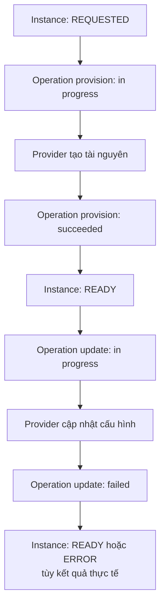

# Phân biệt trạng thái instance với trạng thái thao tác `last_operation`

## Hai câu hỏi khác nhau trong vòng đời service broker

Khi nền tảng làm việc với một service broker, có hai loại trạng thái rất dễ bị nhầm lẫn:

- **Trạng thái service instance:** tài nguyên dịch vụ hiện đang ở tình trạng nào trong vòng đời của nó, ví dụ đang tạo, sẵn sàng, đang cập nhật, đang thu hồi hoặc đã thu hồi.
- **Trạng thái thao tác `last_operation`:** thao tác bất đồng bộ gần nhất mà broker tiếp nhận đã tiến triển đến đâu, ví dụ đang chạy, thành công hoặc thất bại.

Hai trạng thái có liên quan nhưng không đồng nghĩa. Một instance có thể vẫn sử dụng được dù lần update gần nhất thất bại; ngược lại, một thao tác provision có thể đã được tiếp nhận nhưng instance chưa sẵn sàng cho ứng dụng. Nếu gộp hai khái niệm thành một cột trạng thái, broker dễ trả lời sai cho nền tảng, retry sai thao tác hoặc cho phép binding vào tài nguyên chưa sẵn sàng.

Trong module `SPRING_CLOUD_SERVICE_BROKER`, Spring Cloud Open Service Broker cung cấp lớp tích hợp Open Service Broker API (OSB API). Ứng dụng broker cần lưu trạng thái tài nguyên và trạng thái từng operation một cách riêng biệt, sau đó ánh xạ đúng loại trạng thái vào endpoint retrieve hoặc `last_operation`.

## Trạng thái service instance là gì?

Service instance đại diện cho một tài nguyên dịch vụ được provision theo một service và plan, chẳng hạn database PostgreSQL, Redis deployment, queue hoặc bucket. Trạng thái instance mô tả vòng đời và khả năng sử dụng của tài nguyên đó.

Một broker có thể định nghĩa state machine nội bộ như sau:

| Trạng thái nội bộ | Ý nghĩa | Hành vi nghiệp vụ thường gặp |
|---|---|---|
| `REQUESTED` | Đã ghi nhận yêu cầu provision. | Kiểm tra dữ liệu và lên lịch tạo tài nguyên. |
| `PROVISIONING` | Tài nguyên đang được tạo. | Chưa cấp binding cho consumer nếu dịch vụ chưa sẵn sàng. |
| `READY` | Tài nguyên đã được tạo và đạt điều kiện sẵn sàng. | Cho phép retrieve, bind và các thao tác được hỗ trợ. |
| `UPDATING` | Broker đang thay đổi plan hoặc cấu hình. | Áp dụng chính sách sử dụng trong thời gian chuyển tiếp. |
| `UPDATE_FAILED` | Lần cập nhật thất bại. | Đối soát cấu hình thực tế và xác định instance còn sử dụng được hay không. |
| `DEPROVISIONING` | Tài nguyên đang được thu hồi. | Chặn binding mới và điều phối cleanup. |
| `DEPROVISIONED` | Tài nguyên đã được giải phóng. | Không còn được sử dụng như một instance đang hoạt động. |
| `ERROR` | Trạng thái không xác định hoặc cần can thiệp. | Reconciliation hoặc xử lý vận hành. |

Các tên trên là ví dụ cho mô hình nội bộ của broker, không phải tập giá trị `state` chuẩn mà OSB API yêu cầu trong response retrieve. Broker có thể dùng tên khác hoặc tách thêm trạng thái theo đặc tính của provider.

Trạng thái instance nên phản ánh điều mà broker biết về tài nguyên thực tế. Ví dụ, không đặt `READY` chỉ vì đã gửi lệnh tạo database thành công; cần xác định tiêu chí sẵn sàng như database tồn tại, endpoint có thể truy cập và quyền cần thiết đã được cấu hình.

## Trạng thái `last_operation` là gì?

`last_operation` được dùng để nền tảng theo dõi một thao tác bất đồng bộ đã được broker tiếp nhận. Endpoint trả lời câu hỏi: *thao tác đó đã hoàn tất chưa và kết quả ra sao?*

Với service instance, nền tảng polling:

```http
GET /v2/service_instances/{instance_id}/last_operation
```

Với thao tác trên binding, endpoint có thêm `binding_id`:

```http
GET /v2/service_instances/{instance_id}/service_bindings/{binding_id}/last_operation
```

Response `last_operation` của service instance sử dụng ba giá trị `state` theo OSB API:

| `state` | Ý nghĩa |
|---|---|
| `in progress` | Operation vẫn đang được xử lý. |
| `succeeded` | Operation đã hoàn tất thành công. |
| `failed` | Operation đã thất bại. |

Đây là trạng thái của một lần thực hiện, không phải trạng thái tổng quát của tài nguyên. Nền tảng tiếp tục polling khi nhận `in progress` và dừng khi nhận `succeeded` hoặc `failed`.

Ví dụ response:

```http
HTTP/1.1 200 OK
Content-Type: application/json
```

```json
{
  "state": "in progress",
  "description": "Đang tạo database và cấu hình quyền truy cập."
}
```

Khi hoàn tất:

```json
{
  "state": "succeeded",
  "description": "Database đã được tạo và kiểm tra kết nối thành công."
}
```

Không đưa các trạng thái nội bộ như `PROVISIONING`, `READY` hoặc `UPDATE_FAILED` vào trường `state` của response `last_operation`. Hãy ánh xạ chúng sang ba giá trị mà giao thức quy định.

## Endpoint retrieve service instance trả lời điều gì?

OSB API có capability tùy chọn để nền tảng truy vấn thông tin của một service instance đã tồn tại. Khi broker công bố `instances_retrievable: true` trong catalog, nền tảng có thể gọi:

```http
GET /v2/service_instances/{instance_id}?service_id={service_id}&plan_id={plan_id}
```

Ví dụ:

```http
GET /v2/service_instances/instance-42?service_id=postgres-service&plan_id=standard HTTP/1.1
X-Broker-API-Version: 2.17
```

Response có thể chứa thông tin instance mà broker được phép công bố, chẳng hạn `dashboard_url`:

```http
HTTP/1.1 200 OK
Content-Type: application/json
```

```json
{
  "dashboard_url": "https://console.example.internal/services/instance-42"
}
```

Retrieve service instance giúp nền tảng xác nhận hoặc lấy lại thông tin về instance đã tồn tại. Nó không phải endpoint polling operation và không có nghĩa broker phải trả một state machine chung như `READY` hoặc `PROVISIONING` trong response. Khả năng retrieve là tùy chọn; broker cần công bố capability tương ứng và tuân theo hợp đồng phiên bản OSB API được hỗ trợ.

Vì vậy, cần phân biệt:

| Endpoint | Câu hỏi được trả lời | Dữ liệu trọng tâm |
|---|---|---|
| `GET /v2/service_instances/{instance_id}` | Instance có tồn tại và broker có thể trả thông tin gì về nó? | Thông tin instance theo retrieve contract, ví dụ dashboard URL. |
| `GET /v2/service_instances/{instance_id}/last_operation` | Operation bất đồng bộ gần nhất đang chạy hay đã kết thúc? | `state`, `description` và các thuộc tính kết quả được hỗ trợ. |

Nếu nền tảng cần biết một operation provision vừa hoàn tất hay chưa, nó phải dùng `last_operation` sau response `202 Accepted`. Một request retrieve không thay thế chu kỳ polling đó.

## Quan hệ giữa instance state và operation state

Một operation làm thay đổi instance state, nhưng hai bản ghi cần được quản lý riêng. Ví dụ:



Ví dụ trong sơ đồ cho thấy một update có thể thất bại nhưng instance vẫn giữ cấu hình cũ và tiếp tục hoạt động. Một trường hợp khác là provider đã áp dụng một phần thay đổi; lúc đó instance có thể cần chuyển sang `ERROR` hoặc trạng thái nội bộ khác cho đến khi reconciliation xác định được tình trạng thực tế.

Các tình huống điển hình:

| Operation | Operation state | Instance state có thể có | Giải thích |
|---|---|---|---|
| Provision | `in progress` | `PROVISIONING` | Tài nguyên chưa sẵn sàng. |
| Provision | `succeeded` | `READY` | Tài nguyên đã đạt tiêu chí sẵn sàng. |
| Provision | `failed` | `ERROR` hoặc chưa có instance hoàn chỉnh | Có thể đã tạo một phần tài nguyên cần cleanup. |
| Update | `in progress` | `UPDATING` | Đang áp dụng cấu hình đích. |
| Update | `failed` | `READY` hoặc `ERROR` | Phụ thuộc instance cũ còn hoạt động và provider đã thay đổi đến đâu. |
| Deprovision | `in progress` | `DEPROVISIONING` | Tài nguyên đang được thu hồi. |
| Deprovision | `succeeded` | `DEPROVISIONED` | Tài nguyên đã được giải phóng. |
| Deprovision | `failed` | `READY`, `ERROR` hoặc trạng thái cleanup dở dang | Phải đối soát trước khi nhận request tiếp theo. |

Bảng này mô tả ánh xạ nghiệp vụ có thể dùng trong broker; nó không phải một bảng ánh xạ bắt buộc của OSB API. Broker cần xác định trạng thái instance dựa trên kết quả provider và chính sách dịch vụ.

## `instance_usable` và `update_repeatable` bổ sung điều gì?

Trong response polling service instance, OSB API có các thuộc tính tùy chọn giúp nền tảng hiểu hậu quả khi một operation thất bại:

- `instance_usable`: cho biết service instance còn có thể sử dụng hay không sau thất bại, khi thuộc tính này được áp dụng.
- `update_repeatable`: cho biết nền tảng có thể lặp lại yêu cầu update hay không sau thất bại, khi thuộc tính này được áp dụng.

Ví dụ một update thất bại nhưng broker xác nhận instance vẫn dùng được:

```json
{
  "state": "failed",
  "description": "Không thể mở rộng storage; cấu hình trước đó vẫn đang hoạt động.",
  "instance_usable": true,
  "update_repeatable": true
}
```

Hai thuộc tính này không phải trạng thái thay thế cho `state` và không nên được dùng như một state machine mới. `state: failed` vẫn nói rằng operation thất bại; `instance_usable` nói về khả năng sử dụng của tài nguyên sau thất bại, còn `update_repeatable` hướng dẫn nền tảng về khả năng thử lại update.

Broker chỉ nên trả những thuộc tính tùy chọn này khi có đủ thông tin đáng tin cậy. Nếu provider timeout và broker chưa xác định được cấu hình thực tế, không nên đoán `instance_usable: true`. Hãy giữ trạng thái cần reconciliation và trả thông tin phù hợp với khả năng mà broker xác nhận được.

## Lưu instance và operation thành hai mô hình dữ liệu

Một thiết kế phổ biến là tách bảng service instance khỏi bảng operation.

### Bản ghi instance

```text
service_instance
----------------
instance_id
service_id
plan_id
provider_resource_id
instance_state
current_configuration
revision
created_at
updated_at
```

### Bản ghi operation

```text
service_operation
-----------------
operation_id
instance_id
operation_type
operation_state
description
started_at
updated_at
completed_at
instance_usable
update_repeatable
provider_job_id
error_code
```

`instance_state` mô tả tài nguyên; `operation_state` mô tả lần xử lý. Một instance có thể có nhiều operation nối tiếp theo thời gian, vì vậy operation record cần có ID riêng và liên kết đến `instance_id`. Không ghi đè toàn bộ lịch sử operation bằng một cột `last_operation_state` duy nhất nếu hệ thống cần audit, retry hoặc điều tra sự cố.

Trong mỗi thời điểm, broker có thể giữ một operation hiện hành cho instance để phục vụ endpoint `last_operation`, đồng thời lưu lịch sử các operation trước đó. Cần xác định rõ operation nào được xem là gần nhất và ngăn hai operation không tương thích cùng thay đổi một instance.

## Cập nhật hai loại trạng thái một cách nhất quán

Một quy trình bất đồng bộ cần cập nhật operation và instance state theo các bước có thể phục hồi:

1. Xác thực request và đọc instance hiện tại.
2. Kiểm tra instance có cho phép loại operation mới hay không.
3. Tạo operation record với `operation_state = IN_PROGRESS`.
4. Chuyển instance sang trạng thái nội bộ tương ứng, ví dụ `PROVISIONING` hoặc `UPDATING`.
5. Lưu operation, instance revision và job vào kho bền vững trước khi trả `202 Accepted`.
6. Worker gọi provider và cập nhật tiến độ.
7. Khi provider xác nhận kết quả, cập nhật operation thành `SUCCEEDED` hoặc `FAILED`.
8. Cập nhật instance state dựa trên tài nguyên thực tế và kết quả operation.
9. Endpoint `last_operation` đọc operation state; các nghiệp vụ khác đọc instance state.

Không giữ transaction database mở trong suốt thời gian chờ API cloud hoặc database provider. Có thể dùng transaction ngắn để ghi operation và trạng thái ban đầu, outbox hoặc hàng đợi bền vững để phát job, rồi transaction khác để ghi kết quả. Nếu worker bị dừng, job và trạng thái phải đủ để khởi động lại hoặc reconciliation.

## Xử lý retry và request đến đồng thời

Nền tảng có thể polling nhiều lần cùng một operation. Các request polling đó phải đọc cùng một operation record, không tạo operation mới và không khởi chạy lại công việc provider.

Với request lifecycle mới, broker cần kiểm tra trạng thái instance và operation hiện hành:

| Tình huống | Cách xử lý |
|---|---|
| Provision đang chạy, nền tảng retry cùng request | Trả kết quả nhất quán với operation hiện tại; không tạo tài nguyên thứ hai. |
| Update đang chạy, nhận thêm update khác | Tuần tự hóa hoặc từ chối xung đột theo chính sách; không để hai worker ghi đè cấu hình. |
| Deprovision đã bắt đầu, nhận bind mới | Từ chối bind mới theo trạng thái instance. |
| Operation đã terminal, nền tảng polling lại | Trả lại trạng thái cuối đã lưu. |
| Provider timeout, kết quả chưa rõ | Reconciliation trước khi retry hành động có thể gây tác dụng phụ. |

Dùng optimistic locking hoặc khóa theo `instance_id` để ngăn nhiều worker thay đổi instance cùng lúc. Operation ID giúp phân biệt lần xử lý; idempotency key hoặc fingerprint request giúp nhận diện retry của cùng một yêu cầu.

## Tích hợp trong Spring Cloud Open Service Broker

Trong Spring Cloud Open Service Broker, phần service instance thường được triển khai qua service handler tương ứng với các thao tác create, retrieve, update, delete và last operation. Tên method, request model và response model phụ thuộc phiên bản thư viện đang dùng, vì vậy cần đối chiếu Javadoc của dependency trước khi triển khai cụ thể.

Nên tách trách nhiệm thành các thành phần:

- `ServiceInstanceRepository`: đọc và cập nhật trạng thái tài nguyên.
- `OperationRepository`: lưu trạng thái và lịch sử operation.
- `ProvisioningCoordinator`: điều phối create/update/delete.
- `LastOperationService`: trả trạng thái operation theo `instance_id` và operation ID.
- `InstanceRetrievalService`: trả thông tin instance khi broker công bố khả năng retrieve.
- `ProviderAdapter`: gọi hệ thống thực tế và kiểm tra khả năng sử dụng tài nguyên.
- `ReconciliationService`: đối chiếu trạng thái broker với provider sau timeout hoặc lỗi không xác định.

Ví dụ pseudocode cho hai luồng đọc:

```java
public Mono<InstanceDetails> retrieveInstance(String instanceId) {
    return instanceRepository.findById(instanceId)
            .switchIfEmpty(Mono.error(new InstanceNotFoundException()))
            .map(instance -> new InstanceDetails(
                    instance.dashboardUrl()));
}

public Mono<LastOperationDetails> retrieveLastOperation(
        String instanceId, String operationId) {
    return operationRepository.find(instanceId, operationId)
            .switchIfEmpty(Mono.error(new OperationNotFoundException()))
            .map(operation -> new LastOperationDetails(
                    operation.operationState(), operation.description(),
                    operation.instanceUsable(), operation.updateRepeatable()));
}
```

Đây là pseudocode ở domain layer, không phải chữ ký interface cố định của Spring Cloud Open Service Broker. `InstanceDetails`, `LastOperationDetails`, repository và exception là kiểu nội bộ minh họa. Adapter framework cần ánh xạ hai kết quả sang response model tương ứng: retrieve instance response và last-operation response. Trạng thái nội bộ vẫn được dùng để quyết định nghiệp vụ, nhưng không tự thêm nó vào retrieve response hoặc trả vào trường `state` của `last_operation`.

## Ví dụ hoàn chỉnh: provision bất đồng bộ

Giả sử nền tảng yêu cầu tạo PostgreSQL instance `instance-42`:

```http
PUT /v2/service_instances/instance-42?accepts_incomplete=true HTTP/1.1
Content-Type: application/json
```

```json
{
  "service_id": "postgres-service",
  "plan_id": "standard",
  "parameters": {
    "storage_gb": 50
  }
}
```

Broker lưu instance ở trạng thái nội bộ `PROVISIONING` và operation `provision-42` ở `IN_PROGRESS`, sau đó trả:

```http
HTTP/1.1 202 Accepted
Content-Type: application/json
```

```json
{
  "operation": "provision-42"
}
```

Khi nền tảng polling:

```http
GET /v2/service_instances/instance-42/last_operation?service_id=postgres-service&plan_id=standard&operation=provision-42 HTTP/1.1
```

Nếu provider vẫn đang tạo database, broker trả `state: in progress`. Khi database đã sẵn sàng, broker cập nhật operation thành `SUCCEEDED`, instance thành `READY` rồi trả:

```json
{
  "state": "succeeded",
  "description": "PostgreSQL instance is ready."
}
```

Sau đó, nếu broker công bố `instances_retrievable: true`, nền tảng có thể gọi endpoint retrieve để lấy thông tin instance:

```http
GET /v2/service_instances/instance-42?service_id=postgres-service&plan_id=standard HTTP/1.1
```

Retrieve response cung cấp thông tin theo retrieve contract. Nó không phải một lần polling mới và không thay thế trạng thái operation đã hoàn tất.

## Các lỗi thường gặp

| Lỗi | Hậu quả | Cách xử lý |
|---|---|---|
| Dùng `PROVISIONING` làm giá trị `last_operation.state` | Response không đúng tập giá trị OSB API. | Ánh xạ sang `in progress`. |
| Coi `succeeded` đồng nghĩa tài nguyên luôn khỏe mạnh | Bỏ sót lỗi runtime xảy ra sau operation. | Theo dõi health riêng với operation lifecycle. |
| Coi `failed` nghĩa instance chắc chắn không dùng được | Có thể ngừng một instance vẫn giữ cấu hình cũ và hoạt động. | Xác định khả năng sử dụng thực tế; trả `instance_usable` khi phù hợp. |
| Dùng retrieve endpoint để polling | Không nhận được trạng thái operation theo hợp đồng. | Poll `last_operation` sau `202 Accepted`. |
| Lưu instance state và operation state trong cùng một field | Mất khả năng phân biệt tài nguyên với lần xử lý. | Tách hai mô hình dữ liệu. |
| Polling tạo operation mới | Mỗi lần hỏi trạng thái lại kích hoạt công việc provider. | Poll chỉ đọc operation đã lưu. |
| Cho phép update và deprovision chạy đồng thời | Trạng thái và tài nguyên provider có thể bị hỏng. | Khóa hoặc kiểm soát revision theo instance. |
| Xóa operation ngay khi terminal | Nền tảng retry polling có thể không nhận được kết quả cuối. | Lưu terminal operation theo retention policy. |
| Đánh dấu instance `READY` trước khi provider xác nhận | Nền tảng có thể bind vào tài nguyên chưa sẵn sàng. | Chỉ chuyển state sau khi kiểm tra điều kiện readiness. |

## Checklist kiểm tra

1. Mô hình instance state và operation state được lưu riêng.
2. State nội bộ không bị trả nhầm vào trường `last_operation.state`.
3. `last_operation.state` chỉ dùng `in progress`, `succeeded` hoặc `failed`.
4. Operation có ID và liên kết đúng với `instance_id`.
5. Request polling không khởi chạy lại công việc provider.
6. Operation terminal được giữ đủ lâu để xử lý polling retry.
7. Instance chỉ chuyển `READY` khi tài nguyên thực sự đạt tiêu chí sẵn sàng.
8. Khi update thất bại, broker xác định instance còn sử dụng được hay không.
9. `instance_usable` và `update_repeatable` chỉ được trả khi có căn cứ.
10. Retrieve service instance chỉ được sử dụng khi broker công bố capability tương ứng.
11. Retrieve response không bị nhầm với response `last_operation`.
12. Các operation xung đột trên cùng instance được tuần tự hóa hoặc phát hiện.
13. Timeout và worker restart có thể phục hồi qua operation record và reconciliation.

## Kết luận

Trạng thái instance mô tả tình trạng tài nguyên mà broker quản lý; trạng thái `last_operation` mô tả kết quả của một thao tác bất đồng bộ cụ thể. Endpoint retrieve cung cấp thông tin về instance khi broker hỗ trợ capability đó, còn endpoint `last_operation` phục vụ polling sau `202 Accepted`. Tách riêng hai loại trạng thái trong dữ liệu, điều phối và response giúp nền tảng hiểu đúng tài nguyên, retry đúng operation và tránh cấp binding hoặc thu hồi tài nguyên dựa trên một trạng thái không còn phù hợp.
