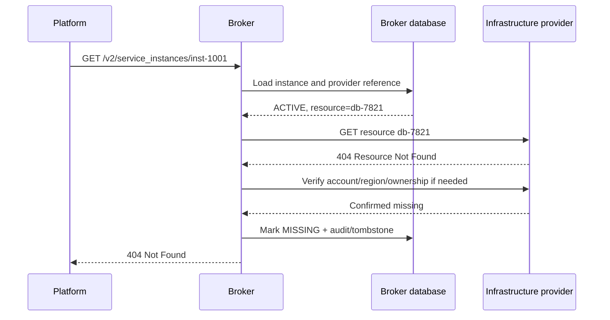

# Xử lý instance không tồn tại hoặc tài nguyên bên ngoài đã bị xóa

## 1. Bài toán truy xuất trạng thái thực của service instance

Một service broker thường lưu thông tin service instance trong database nội bộ, đồng thời tạo tài nguyên thật ở hệ thống bên ngoài như database, bucket, queue, namespace hoặc managed cluster. Hai nơi này có thể mất đồng bộ. Ví dụ, quản trị viên xóa database trực tiếp trên cloud provider, một Kubernetes namespace bị xóa ngoài luồng, hoặc tài khoản bên ngoài bị thu hồi mà broker chưa nhận được sự kiện.

Khi đó, database broker vẫn có thể ghi instance ở trạng thái `ACTIVE`, nhưng tài nguyên mà instance đại diện đã không còn tồn tại. Nếu broker chỉ trả lại dữ liệu đã cache, nền tảng sẽ tiếp tục tin rằng service đang hoạt động và có thể cho phép ứng dụng binding hoặc sử dụng một endpoint không còn hợp lệ.

Open Service Broker API (OSB API) định nghĩa endpoint truy xuất service instance:

```http
GET /v2/service_instances/{instance_id}
```

Endpoint này cho phép nền tảng đọc lại thông tin của một instance đã provision thành công. Trong module `SPRING_CLOUD_SERVICE_BROKER`, Spring Cloud Open Service Broker ánh xạ endpoint tới phương thức `getServiceInstance()` của `ServiceInstanceService`. Broker phải đối chiếu bản ghi nội bộ với trạng thái tài nguyên ở provider, phân biệt tài nguyên thực sự đã mất với lỗi truy cập tạm thời và trả đúng kết quả theo hợp đồng.

Điểm cốt lõi là xác định **instance có còn tồn tại về mặt nghiệp vụ hay không**. Một bản ghi database broker còn tồn tại chưa đủ để kết luận service instance vẫn hoạt động; ngược lại, một lỗi truy vấn provider cũng chưa đủ để kết luận tài nguyên đã bị xóa.

## 2. Khi nào nền tảng gọi GET service instance?

Truy xuất service instance là khả năng tùy chọn của OSB API. Broker công bố khả năng này trong catalog bằng trường `instances_retrievable` ở cấp service offering:

```json
{
  "id": "managed-database",
  "name": "Managed Database",
  "description": "Cơ sở dữ liệu được quản lý",
  "bindable": true,
  "instances_retrievable": true,
  "plans": [
    {
      "id": "standard",
      "name": "Standard",
      "description": "Gói tiêu chuẩn"
    }
  ]
}
```

Khi `instances_retrievable` là `true`, broker phải hỗ trợ endpoint retrieve cho **tất cả plan** thuộc service offering đó. Endpoint phải sẵn sàng ngay sau khi nền tảng polling last operation nhận `state: succeeded` cho thao tác provisioning. Nếu broker không công bố khả năng này, nền tảng không nên gọi endpoint retrieve theo hợp đồng OSB API.

Nền tảng có thể gọi GET để làm mới thông tin instance và phát hiện những thay đổi ngoài luồng, chẳng hạn:

- Người vận hành thay đổi cấu hình hoặc tham số trực tiếp trên dashboard của provider.
- Dashboard URL, thông tin bảo trì hoặc metadata của instance thay đổi.
- Tài nguyên được di chuyển hoặc thay thế ở provider.
- Tài nguyên chính bị xóa ngoài luồng và instance không còn tồn tại.

GET retrieve không phải một lịch health check bắt buộc. Nền tảng có thể chọn thời điểm gọi; vì vậy, nếu broker cần phát hiện tài nguyên bị xóa nhanh chóng, cần có reconciliation hoặc cơ chế giám sát riêng thay vì chỉ chờ request GET từ nền tảng.

## 3. Hợp đồng request GET /v2/service_instances/{instance_id}

Request sử dụng HTTP `GET`, không có request body:

```http
GET /v2/service_instances/inst-1001?service_id=managed-database&plan_id=standard HTTP/1.1
Host: broker.example.com
Authorization: Basic <broker-credentials>
X-Broker-API-Version: 2.17
Accept: application/json
```

Các thành phần:

| Thành phần | Ý nghĩa |
|---|---|
| `instance_id` | ID của service instance đã được provision trước đó. |
| `service_id` | ID service offering; query parameter tùy chọn để broker đối chiếu. |
| `plan_id` | ID service plan; query parameter tùy chọn để broker đối chiếu. |
| `X-Broker-API-Version` | Phiên bản OSB API do nền tảng sử dụng. |
| `Authorization` | Thông tin xác thực broker client theo cơ chế đã cấu hình. |

`service_id` và `plan_id` là thông tin gợi ý trong query string; nếu có, chúng phải là chuỗi không rỗng và phải khớp với instance tương ứng. Broker nên dùng `instance_id` cùng platform context để tìm bản ghi, sau đó kiểm tra service và plan. Không dùng `plan_id` do client gửi để tự chọn một provider resource khác.

Header `X-Broker-API-Version` là bắt buộc theo OSB API. Giao tiếp giữa nền tảng và broker nên dùng TLS và xác thực. Nếu broker hỗ trợ nhiều platform, cần đưa platform instance ID hoặc path prefix vào phạm vi tra cứu để không nhầm hai instance có ID giống nhau ở hai platform khác nhau.

## 4. Response hợp lệ và ý nghĩa của status code

Theo hợp đồng Fetching a Service Instance của OSB API v2.17, các status chính là:

| HTTP status | Khi sử dụng |
|---|---|
| `200 OK` | Instance tồn tại và broker đọc được thông tin cần trả về. |
| `404 Not Found` | Instance không tồn tại hoặc thao tác provisioning vẫn đang chạy. |
| `422 Unprocessable Entity` | Instance đang được update nên chưa thể truy xuất; body phải có `error: ConcurrencyError`. |

Các status khác được nền tảng xem là lỗi và nền tảng phải tiếp tục ghi nhớ service instance. Vì vậy, broker không nên trả một mã status tùy ý để diễn đạt trạng thái “đã mất” nếu hợp đồng đã định nghĩa `404`.

### 4.1. 200 OK: instance tồn tại

Khi instance còn tồn tại và broker có thể xác minh trạng thái, trả `200 OK` cùng thông tin hiện tại:

```json
{
  "service_id": "managed-database",
  "plan_id": "standard",
  "dashboard_url": "https://console.example.com/databases/inst-1001",
  "parameters": {
    "database_name": "orders",
    "storage_gb": 100
  },
  "metadata": {
    "attributes": {
      "provider.region": "ap-southeast-1",
      "broker.resource-state": "available"
    }
  }
}
```

Các trường response được OSB API định nghĩa gồm `service_id`, `plan_id`, `dashboard_url`, `parameters`, `maintenance_info` và `metadata`. Broker có thể không trả một số hoặc tất cả `parameters` nếu chúng chứa dữ liệu nhạy cảm. Không đưa password, token hoặc private key vào response retrieve.

Nếu broker muốn trả `dashboard_url`, URL đó cũng phải được trả trong response provisioning ban đầu, kể cả provisioning bất đồng bộ. Retrieve có thể làm mới URL hiện tại nhưng không phải cách đầu tiên để nền tảng biết dashboard tồn tại.

### 4.2. 404 Not Found: instance không tồn tại hoặc provisioning chưa xong

OSB API yêu cầu trả `404 Not Found` trong hai tình huống:

- Broker không có service instance tương ứng với `instance_id`.
- Provisioning vẫn đang tiến hành, instance chưa sẵn sàng để retrieve.

Nếu provider xác nhận tài nguyên chính của instance đã bị xóa ngoài luồng, broker cần xem instance đó là không còn tồn tại về mặt nghiệp vụ và trả `404 Not Found`. Không trả `200 OK` chỉ dựa trên bản ghi nội bộ cũ.

### 4.3. 422 Unprocessable Entity: instance đang được update

Nếu một update đang thay đổi plan hoặc cấu hình, GET có thể quan sát trạng thái trung gian. OSB API yêu cầu broker trả `422 Unprocessable Entity` với mã lỗi `ConcurrencyError`:

```http
HTTP/1.1 422 Unprocessable Entity
Content-Type: application/json

{
  "error": "ConcurrencyError",
  "description": "Service instance is being updated and cannot be fetched yet"
}
```

Nền tảng có thể thử lại sau khi thao tác update hoàn tất. Không dùng `404` cho một instance vẫn tồn tại nhưng đang update; `404` mang ý nghĩa instance không tồn tại hoặc provisioning chưa hoàn tất.

### 4.4. Không dùng 410 Gone cho GET retrieve

`410 Gone` có ngữ nghĩa ở một số thao tác khác, ví dụ DELETE service instance khi instance không tồn tại hoặc polling last operation cho deprovision bất đồng bộ đã thành công. Endpoint GET retrieve định nghĩa `404` cho instance không tồn tại và không liệt kê `410` là response hợp lệ.

Vì vậy, khi tài nguyên provider bị xóa ngoài luồng và nền tảng gọi GET retrieve, broker trả `404 Not Found`. Không dùng `410 Gone` để thay thế `404` ở endpoint này. Đừng nhầm response GET với response DELETE hoặc last operation.

## 5. Phân biệt bản ghi broker và tài nguyên provider

Một service instance thường có ít nhất hai lớp dữ liệu:

1. **Broker record:** ID instance, service ID, plan ID, consumer context, trạng thái nội bộ và provider resource reference.
2. **Provider resource:** database, bucket, queue, namespace, cluster hoặc tài nguyên thật mà instance đại diện.

Broker record giúp tìm tài nguyên và quản lý vòng đời. Provider resource mới là đối tượng thực sự cung cấp năng lực dịch vụ. Nếu tài nguyên bị xóa trực tiếp ở provider, hai lớp dữ liệu không còn đồng bộ.

```mermaid
flowchart TD
    Platform[Nền tảng]
    Get[GET /v2/service_instances/{instance_id}]
    Broker[Service Broker]
    Record[(Broker instance record)]
    Provider[Provider API]
    Resource[(External resource)]
    Platform --> Get --> Broker
    Broker --> Record
    Broker --> Provider --> Resource
    Record --> Decision{Đối chiếu trạng thái}
    Resource --> Decision
    Decision -->|Tồn tại và sẵn sàng| OK[200 OK]
    Decision -->|Không tồn tại thực sự| Missing[Đánh dấu MISSING nội bộ]
    Missing --> NotFound[404 Not Found]
    Decision -->|Provider không truy cập được| Error[5xx / lỗi dependency]
    Decision -->|Instance đang update| Conflict[422 ConcurrencyError]
```

Ví dụ broker có bản ghi `inst-1001` trỏ tới provider resource `db-7821`. Người vận hành xóa `db-7821` trong cloud console. Database broker vẫn còn `inst-1001`, nhưng GET retrieve không thể tiếp tục trả thông tin như thể database vẫn hoạt động.

Broker cần giữ mapping giữa `instance_id` và provider resource ID, gồm provider account, region, tenant hoặc namespace liên quan. Thiếu thông tin phạm vi này, một phản hồi “not found” có thể bị hiểu nhầm khi tài nguyên thực tế nằm ở account hoặc region khác.

## 6. Phân biệt resource đã bị xóa với lỗi truy cập provider

Đây là bước quan trọng nhất khi xử lý tài nguyên bên ngoài. Không phải mọi lỗi khi gọi provider đều có nghĩa tài nguyên đã bị xóa.

| Kết quả từ provider | Cách hiểu | Hành động của broker |
|---|---|---|
| `200` và resource ID khớp | Tài nguyên tồn tại. | Cập nhật thông tin hiện tại và trả `200 OK`. |
| `404` sau khi xác minh đúng account, region và resource ID | Tài nguyên không còn tồn tại. | Đánh dấu trạng thái nội bộ `MISSING`, giữ audit/tombstone và trả `404 Not Found`. |
| `401` hoặc `403` | Credential provider hết hạn hoặc thiếu quyền. | Không kết luận tài nguyên đã mất; phát hiện lỗi cấu hình/quyền và trả lỗi server phù hợp. |
| Timeout, DNS hoặc lỗi mạng | Chưa xác định được trạng thái tài nguyên. | Không đánh dấu `MISSING`; trả lỗi dependency phù hợp để có thể retry. |
| `429` hoặc giới hạn quota API | Provider đang giới hạn request. | Áp dụng retry có backoff hoặc trả lỗi tạm thời. |
| `5xx` từ provider | Provider gặp sự cố. | Không biến thành `404`; giữ trạng thái chưa xác định và trả lỗi server phù hợp. |
| Resource ID thuộc account/region khác | Dữ liệu mapping hoặc cấu hình có thể sai. | Dừng xử lý, cảnh báo và kiểm tra mapping; không xóa bản ghi. |

Broker chỉ nên kết luận resource đã bị xóa khi nhận được bằng chứng đủ tin cậy. Với provider có eventual consistency, có thể thực hiện một lần xác minh có giới hạn hoặc tra cứu theo resource ID/tag trước khi chuyển instance sang `MISSING`. Không retry vô hạn trong request GET.

Nếu provider trả `403`, broker không được che giấu lỗi phân quyền bằng `404`. Làm như vậy sẽ biến lỗi vận hành thành trạng thái tài nguyên bị mất, khiến việc khắc phục và đối soát trở nên khó khăn.

## 7. Phân loại tài nguyên bị thiếu trong một instance phức hợp

Một service instance có thể gồm nhiều tài nguyên: database chính, security group, backup policy, DNS record, monitoring agent và secret. Không phải tài nguyên phụ nào mất cũng đồng nghĩa toàn bộ service instance không còn tồn tại.

Hãy phân loại:

- **Primary resource:** tài nguyên xác định service instance, ví dụ database chính hoặc cluster. Nếu tài nguyên này đã bị xóa và không còn cách sử dụng service, instance được xem là không tồn tại; GET trả `404`.
- **Required dependency:** thành phần bắt buộc để service hoạt động, ví dụ encryption key hoặc network attachment. Nếu dependency mất nhưng primary resource còn, instance có thể vẫn tồn tại nhưng không usable. Broker cần phản ánh trạng thái degraded theo thiết kế service và xử lý repair; không tự động tuyên bố instance không tồn tại.
- **Optional resource:** dashboard widget, metric exporter hoặc cấu hình phụ. Nếu mất, broker có thể trả `200` với thông tin hiện tại và ghi nhận việc cần sửa chữa.
- **Binding-owned resource:** credential hoặc identity riêng consumer. Đây thuộc vòng đời binding; không xử lý bằng cách đánh dấu service instance missing chỉ vì một binding credential đã bị thu hồi.

Nếu instance vẫn tồn tại nhưng đang degraded, broker cần định nghĩa chính sách sửa chữa, thông báo và khả năng sử dụng. Không dùng `404` như một mã lỗi chung cho mọi dependency bị lỗi; mã này nói rằng chính service instance không tồn tại hoặc đang provisioning.

## 8. Quy trình xử lý khi provider resource đã bị xóa ngoài luồng

Khi GET retrieve phát hiện tài nguyên chính đã biến mất, broker có thể xử lý theo quy trình sau:

1. **Tra cứu broker record:** tìm instance theo platform context và `instance_id`.
2. **Kiểm tra state machine:** xác định instance có đang provisioning hoặc updating không.
3. **Đọc provider reference:** lấy resource ID, account, region, namespace và ownership tag từ bản ghi tin cậy.
4. **Xác minh provider:** gọi API đọc trạng thái resource, phân biệt `NotFound` thực sự với lỗi quyền, timeout hoặc provider outage.
5. **Đối chiếu ownership:** xác nhận resource ID thuộc đúng instance. Không đánh dấu missing chỉ vì một resource khác cùng tên không tìm thấy.
6. **Ghi nhận drift:** chuyển trạng thái nội bộ sang `MISSING` hoặc `OUT_OF_BAND_DELETED`, lưu thời điểm, provider response code và request identity.
7. **Trả GET response:** trả `404 Not Found` vì service instance không còn tồn tại về mặt nghiệp vụ.
8. **Đưa vào reconciliation:** kiểm tra credential, binding, backup, reservation và tài nguyên phụ còn sót để phục hồi hoặc cleanup theo chính sách.



GET là thao tác đọc. Broker không nên tự tạo lại database, cluster hoặc bucket ngay trong request retrieve chỉ vì resource không còn tồn tại. Tự động recreate có thể làm mất dữ liệu, tạo resource ID mới, phát sinh chi phí hoặc khiến binding cũ trỏ tới sai tài nguyên. Việc repair cần một workflow có chủ đích, có kiểm tra dữ liệu và quyền rõ ràng.

## 9. Quản lý trạng thái nội bộ và tombstone

Broker nên có trạng thái đủ để phân biệt việc tài nguyên chưa sẵn sàng, đang được thay đổi và đã mất ngoài luồng.

| Trạng thái nội bộ | Ý nghĩa | GET retrieve |
|---|---|---|
| `PROVISIONING` | Provider đang tạo tài nguyên. | `404 Not Found` cho đến khi provisioning hoàn tất. |
| `ACTIVE` | Tài nguyên đã được xác minh sẵn sàng. | `200 OK` nếu provider vẫn xác nhận tồn tại. |
| `UPDATING` | Broker đang thay đổi plan hoặc cấu hình. | `422` với `ConcurrencyError`. |
| `MISSING` | Tài nguyên chính đã được xác minh không còn tồn tại. | `404 Not Found`. |
| `DEGRADED` | Instance còn tồn tại nhưng một dependency bắt buộc gặp vấn đề. | Trả thông tin phù hợp với khả năng retrieve; không mặc định coi là missing. |
| `DEPROVISIONING` | Broker đang thu hồi instance. | Áp dụng concurrency/lifecycle policy và trả trạng thái phù hợp với sự tồn tại thực tế. |
| `DEPROVISIONED` | Vòng đời instance đã kết thúc. | `404 Not Found` cho GET retrieve. |

Không nên xóa ngay broker record khi phát hiện provider resource đã mất. Hãy giữ tombstone hoặc bản ghi lịch sử đủ để:

- Nhận diện request retry cho cùng `instance_id`.
- Ngăn provisioning mới vô tình tái sử dụng ID cũ.
- Cho phép DELETE/deprovision tiếp tục dọn tài nguyên phụ còn sót.
- Đối soát binding, credential, backup và quota.
- Lưu audit về việc resource bị xóa ngoài luồng.

Tombstone cần có retention policy. Sau thời gian lưu giữ phù hợp và khi không còn operation hoặc dependency cần xử lý, broker có thể chuyển dữ liệu sang kho audit hoặc xóa theo chính sách.

## 10. GET retrieve không thay thế reconciliation

Nền tảng có thể gọi GET retrieve để làm mới trạng thái, nhưng không có bảo đảm nó sẽ gọi ngay sau khi người vận hành xóa resource. Vì vậy, broker nên có một tiến trình reconciliation riêng nếu cần phát hiện drift chủ động.

Một job reconciliation có thể:

1. Lấy danh sách broker record ở `ACTIVE` theo từng batch.
2. Tra cứu provider resource theo ID hoặc tag, giới hạn concurrency để không vượt API quota.
3. Đối chiếu kết quả với broker record.
4. Đánh dấu `MISSING` khi provider xác nhận resource không còn tồn tại.
5. Đánh dấu `PROVIDER_UNAVAILABLE` hoặc giữ trạng thái chưa xác định khi provider timeout/5xx.
6. Ghi metric, audit và đưa các trường hợp cần repair vào hàng đợi xử lý.
7. Khi nền tảng gọi GET sau đó, trả response dựa trên trạng thái đã xác minh và cập nhật mới nhất.

Không nên thực hiện một lượt quét toàn bộ provider trong mỗi request GET. Dùng cache có thời hạn hoặc reconciliation để giảm tải, nhưng cache phải có quy tắc hết hạn và không được trả dữ liệu `ACTIVE` cũ vô thời hạn sau khi resource đã mất.

## 11. Triển khai getServiceInstance() bằng Spring Cloud

Trong Spring Cloud Open Service Broker, nếu catalog khai báo `instances_retrievable: true`, ứng dụng phải cung cấp implementation của `getServiceInstance()` trong `ServiceInstanceService`. Framework chuyển request HTTP thành `GetServiceInstanceRequest` và gọi bean tương ứng.

Ví dụ implementation rút gọn:

```java
import org.springframework.cloud.servicebroker.exception.ServiceInstanceDoesNotExistException;
import org.springframework.cloud.servicebroker.model.instance.GetServiceInstanceRequest;
import org.springframework.cloud.servicebroker.model.instance.GetServiceInstanceResponse;
import reactor.core.publisher.Mono;

public Mono<GetServiceInstanceResponse> getServiceInstance(
        GetServiceInstanceRequest request) {

    String instanceId = request.getServiceInstanceId();

    return instanceRepository.findByPlatformAndInstanceId(
                    request.getPlatformInstanceId(), instanceId)
            .switchIfEmpty(Mono.error(
                    new ServiceInstanceDoesNotExistException(instanceId)))
            .flatMap(instance -> providerClient.findById(
                            instance.getProviderResourceId(),
                            instance.getProviderAccount(),
                            instance.getRegion())
                    .switchIfEmpty(markMissing(instance)
                            .then(Mono.error(
                                    new ServiceInstanceDoesNotExistException(instanceId))))
                    .map(resource -> GetServiceInstanceResponse.builder()
                            .serviceDefinitionId(instance.getServiceId())
                            .planId(instance.getPlanId())
                            .dashboardUrl(resource.getDashboardUrl())
                            .parameters(instance.getPublicParameters())
                            .build()));
}
```

`ServiceInstanceRepository`, `ProviderResourceClient` và phương thức `markMissing()` là thành phần nội bộ minh họa. Provider client cần phân biệt kết quả not found với timeout, 401/403 và 5xx. Chỉ trường hợp resource thực sự không tồn tại mới được chuyển thành `Mono.empty()` trong ví dụ này. Lỗi provider chưa xác định phải được truyền thành lỗi server phù hợp, không được biến thành `ServiceInstanceDoesNotExistException`.

Đoạn code là phần thân của phương thức trong bean triển khai `ServiceInstanceService`; nó không phải toàn bộ implementation của interface. Bean thực tế vẫn phải triển khai các phương thức vòng đời khác mà ứng dụng hỗ trợ, chẳng hạn create, delete, update hoặc last operation.

Spring Cloud Open Service Broker 4.4.1 ánh xạ `ServiceInstanceDoesNotExistException` thành HTTP `404 Not Found` khi được ném trong luồng retrieve. Cùng exception này được ánh xạ khác trong thao tác DELETE service instance: khi xóa một instance không tồn tại, framework trả `410 Gone`. Vì vậy, không suy luận status chỉ từ tên exception; hãy xét endpoint đang xử lý.

### 11.1. Xử lý trạng thái provisioning và updating

Ví dụ trên đã lược bỏ kiểm tra state để tập trung vào provider resource. Trong implementation đầy đủ, cần kiểm tra state trước khi gọi provider:

- Nếu instance đang `PROVISIONING`, trả `404 Not Found` theo hợp đồng retrieve.
- Nếu instance đang `UPDATING`, trả `422 Unprocessable Entity` với `error: ConcurrencyError`.
- Nếu instance đã `MISSING` hoặc `DEPROVISIONED`, trả `404 Not Found`.
- Nếu instance `ACTIVE`, đọc provider để xác minh tài nguyên và lấy thông tin hiện tại.

Phần ánh xạ lỗi concurrency cần dùng cơ chế exception/error response phù hợp với phiên bản Spring Cloud đang sử dụng. Không trả `404` cho instance vẫn tồn tại nhưng đang update.

## 12. Xử lý khi resource bị xóa nhưng broker record vẫn còn

Khi provider resource đã bị xóa ngoài luồng, GET trả `404` nhưng broker record vẫn có thể cần thiết cho các thao tác tiếp theo. Ví dụ, instance có thể còn binding credential, secret reference, DNS record hoặc reservation chưa được dọn.

Broker cần giữ lại các thông tin cần thiết cho cleanup:

- Provider resource ID và thông tin account/region.
- Binding ID liên quan và trạng thái binding.
- Secret reference cần revoke.
- Network, IAM, DNS hoặc quota allocation cần thu hồi.
- Audit event và operation trước đó.

Khi nền tảng gọi DELETE service instance sau đó, deprovision handler có thể phát hiện primary resource đã không còn, coi bước xóa resource đó đã hoàn tất sau khi xác minh ownership, rồi tiếp tục dọn các thành phần còn lại. Nếu instance không còn tồn tại trong broker theo hợp đồng, DELETE dùng response `410 Gone`; nếu request DELETE hoàn tất việc cleanup một instance vẫn được broker theo dõi, trả response thành công theo quy tắc deprovision.

Không để GET retrieve tự xóa hết broker record và secret reference. Nếu làm vậy, broker có thể mất thông tin để revoke credential hoặc cleanup những tài nguyên còn sót.

## 13. Idempotency và xử lý race condition

Tài nguyên có thể bị xóa ngoài luồng trong lúc broker đang phục vụ GET, update, bind hoặc deprovision. Broker cần xử lý những tình huống này một cách nhất quán.

- **Hai GET đồng thời:** cả hai có thể cùng phát hiện resource đã mất; thao tác đánh dấu `MISSING` phải idempotent.
- **GET và DELETE đồng thời:** dùng version hoặc state transition có điều kiện để GET không ghi đè trạng thái `DEPROVISIONING` thành `ACTIVE`.
- **GET và UPDATE đồng thời:** nếu update đang chạy, trả `422 ConcurrencyError` thay vì trả snapshot nửa cũ nửa mới.
- **Provider xóa resource ngay sau GET:** response `200` chỉ phản ánh trạng thái tại thời điểm broker xác minh; không thể bảo đảm resource sẽ còn tồn tại mãi sau response.
- **Provider trả not found lặp lại:** chỉ đánh dấu missing một lần và giữ audit event có thể truy vết.
- **Provider timeout rồi trả not found ở lần sau:** chỉ kết luận missing khi có kết quả xác minh rõ ràng.

Nên dùng optimistic locking hoặc compare-and-set khi cập nhật state. Ví dụ, chỉ chuyển `ACTIVE` sang `MISSING` nếu version/state hiện tại chưa bị một thao tác deprovision hoặc update khác thay đổi.

## 14. Bảo mật và bảo vệ dữ liệu

GET retrieve có thể trả thông tin cấu hình hoặc metadata của instance. Broker cần bảo vệ endpoint và dữ liệu trả về:

- Xác thực broker client và dùng HTTPS theo cấu hình nền tảng.
- Tra cứu instance theo platform context cùng `instance_id`, tránh truy cập chéo tenant.
- Đối chiếu service ID và plan ID nếu nền tảng gửi query parameter.
- Chỉ trả parameters cần thiết; loại bỏ password, token, private key và dữ liệu nhạy cảm.
- Không đưa provider credential hoặc raw error response vào `description`.
- Giới hạn log provider resource ID và context theo chính sách bảo vệ dữ liệu.
- Ghi audit khi phát hiện resource bị xóa ngoài luồng, nhưng không ghi secret.

Không dùng `instance_id` làm bằng chứng duy nhất rằng caller có quyền đọc dữ liệu của instance. Request phải đến từ broker client đã được xác thực và được phân vùng theo platform phù hợp.

## 15. Kiểm thử xử lý instance không tồn tại và external resource bị xóa

Kiểm thử cần xác minh cả HTTP contract và khả năng phân loại kết quả provider.

| Trường hợp | Kết quả mong đợi |
|---|---|
| Broker không có instance record | `404 Not Found`. |
| Instance đang provisioning | `404 Not Found` cho đến khi provision hoàn tất. |
| Instance đang updating | `422 Unprocessable Entity`, `error: ConcurrencyError`. |
| Instance active, provider resource tồn tại | `200 OK` với thông tin hiện tại. |
| Primary resource bị xóa ngoài luồng | Đánh dấu `MISSING`, trả `404 Not Found`. |
| Optional dependency bị xóa nhưng instance vẫn tồn tại | Không mặc định trả `404`; phản ánh trạng thái phù hợp và tạo cảnh báo/reconciliation. |
| Provider trả 401/403 | Không đánh dấu missing; trả lỗi phù hợp và cảnh báo credential/quyền. |
| Provider timeout hoặc 5xx | Không đánh dấu missing; trả lỗi dependency phù hợp. |
| Provider trả 404 ở sai account/region | Không kết luận missing trước khi xác minh mapping. |
| Request GET lặp sau khi đã đánh dấu missing | Tiếp tục trả `404`, không tạo lại resource. |
| GET và DELETE chạy đồng thời | Không ghi đè state transition hoặc xóa tombstone cần thiết. |
| Parameters có secret | Không trả trường nhạy cảm trong response. |
| Catalog không khai báo `instances_retrievable` | Nền tảng không gọi endpoint theo hợp đồng; không phụ thuộc vào GET để reconciliation. |

Một integration test quan trọng là: provision instance, xác nhận GET trả `200`, xóa resource trực tiếp trong provider test environment, gọi GET lần nữa và xác nhận broker trả `404` cùng trạng thái nội bộ `MISSING`. Sau đó gọi quy trình cleanup để xác minh binding credential, quota và tài nguyên phụ vẫn được xử lý.

## 16. Checklist triển khai

1. Chỉ công bố `instances_retrievable: true` khi broker hỗ trợ GET cho tất cả plan của service.
2. Đảm bảo endpoint sẵn sàng ngay sau khi provisioning last operation trả `succeeded`.
3. Tra cứu broker record theo platform context và `instance_id`.
4. Đối chiếu service ID và plan ID nếu query parameter được gửi.
5. Xác minh primary provider resource trước khi trả `200`.
6. Chỉ trả `404` khi instance thực sự không tồn tại hoặc provisioning còn chạy.
7. Trả `422 ConcurrencyError` khi instance đang update.
8. Không dùng `410 Gone` cho GET retrieve.
9. Phân biệt provider NotFound với lỗi credential, quyền, timeout, rate limit và provider outage.
10. Không tự động recreate resource trong request GET.
11. Giữ tombstone và dữ liệu cleanup khi resource bị xóa ngoài luồng.
12. Có reconciliation riêng nếu cần phát hiện drift chủ động.
13. Bảo vệ parameters, provider credentials, tenant context và audit log.
14. Kiểm thử trường hợp external resource đã bị xóa cùng các lỗi provider chưa xác định.

## 17. Nguyên tắc cần ghi nhớ

- `GET /v2/service_instances/{instance_id}` là endpoint tùy chọn được kích hoạt bằng `instances_retrievable: true`.
- Khi đã công bố khả năng retrieve, broker phải hỗ trợ mọi plan của service offering.
- `200 OK` chỉ nên trả khi instance còn tồn tại và broker có thông tin hiện tại.
- `404 Not Found` dùng khi instance không tồn tại hoặc provisioning vẫn đang chạy.
- `422 ConcurrencyError` dùng khi instance đang update.
- GET retrieve không dùng `410 Gone`; mã này thuộc ngữ nghĩa của các thao tác khác như delete và asynchronous deprovision polling.
- Provider trả 404 chỉ chứng minh resource mất khi broker đã xác minh đúng resource ID, account, region và ownership.
- Timeout, 401/403 và 5xx không phải bằng chứng resource đã bị xóa.
- Khi phát hiện primary resource mất ngoài luồng, đánh dấu `MISSING`, trả 404 và giữ tombstone để cleanup/reconciliation.
- GET không tự tạo lại resource; repair phải là workflow có kiểm soát.

## Nguồn tham khảo

- [Open Service Broker API v2.17 – Fetching a Service Instance](https://github.com/cloudfoundry/servicebroker/blob/v2.17/spec.md#fetching-a-service-instance): capability `instances_retrievable`, route GET, response fields và status `200`/`404`/`422`.
- [Open Service Broker API v2.17 – Service Broker Errors](https://github.com/cloudfoundry/servicebroker/blob/v2.17/spec.md#service-broker-errors): quy tắc error response và mã `ConcurrencyError`.
- [Spring Cloud Open Service Broker 4.4.1 – Service Instance Retrieval](https://docs.spring.io/spring-cloud-open-service-broker/docs/4.4.1/reference/#service-instance-retrieval): yêu cầu triển khai `getServiceInstance()` khi catalog bật retrieval.
- [Spring Cloud Open Service Broker 4.4.1 – ServiceInstanceService](https://docs.spring.io/spring-cloud-open-service-broker/docs/4.4.1/apidocs/org/springframework/cloud/servicebroker/service/ServiceInstanceService.html): interface xử lý vòng đời và retrieve instance.
- [Spring Cloud Open Service Broker 4.4.1 – ServiceInstanceDoesNotExistException](https://docs.spring.io/spring-cloud-open-service-broker/docs/4.4.1/apidocs/org/springframework/cloud/servicebroker/exception/ServiceInstanceDoesNotExistException.html): cách framework ánh xạ exception sang `404` khi retrieve và `410` khi delete.
- [Spring Cloud Open Service Broker 4.4.1 – GetServiceInstanceRequest](https://docs.spring.io/spring-cloud-open-service-broker/docs/4.4.1/apidocs/org/springframework/cloud/servicebroker/model/instance/GetServiceInstanceRequest.html): request model của phương thức `getServiceInstance()`.
- [Spring Cloud Open Service Broker 4.4.1 – GetServiceInstanceResponse](https://docs.spring.io/spring-cloud-open-service-broker/docs/4.4.1/apidocs/org/springframework/cloud/servicebroker/model/instance/GetServiceInstanceResponse.html): response model và các trường có thể trả về.
