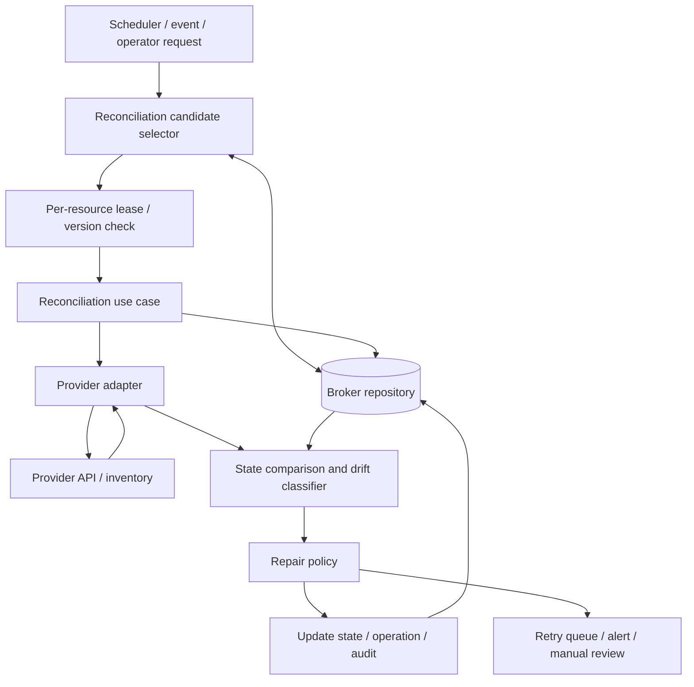
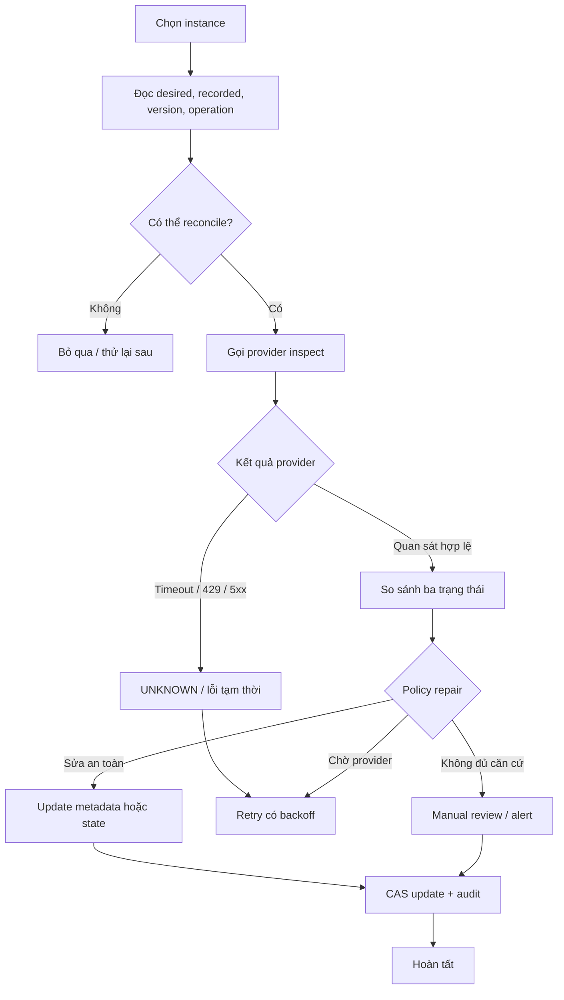
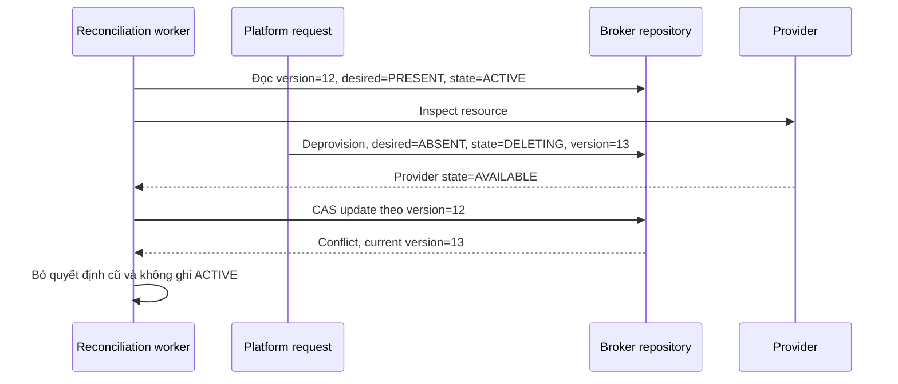

# Đối chiếu trạng thái đã lưu với trạng thái thực của nhà cung cấp

Service broker quản lý service instance thông qua Open Service Broker API (OSB API), nhưng tài nguyên thật thường nằm trong một hệ thống khác: database service, Kubernetes cluster, storage provider hoặc nền tảng SaaS. Broker lưu ID, plan, cấu hình và trạng thái operation trong repository của mình; provider lại quản lý trạng thái runtime của tài nguyên. Hai hệ thống có thể lệch nhau khi request timeout, worker bị dừng, provider xử lý chậm hoặc người vận hành thay đổi tài nguyên trực tiếp.

**Reconciliation** là quá trình đối chiếu trạng thái broker đã lưu với trạng thái provider đang quan sát được, phân loại sai lệch và đưa hệ thống về trạng thái nhất quán theo chính sách. Mục tiêu không phải là ghi đè một bên bằng dữ liệu của bên kia trong mọi trường hợp. Broker cần phân biệt trạng thái mong muốn, trạng thái đã ghi nhận, trạng thái provider quan sát được và operation đang chạy trước khi quyết định sửa chữa.

Ví dụ: broker lưu instance `pg-orders-01` ở trạng thái `ACTIVE`, provider resource ID là `db-93a1`. Một lần worker gọi provider để mở rộng database đã thành công, nhưng broker bị restart trước khi ghi kết quả. Lần đối chiếu tiếp theo thấy database vẫn tồn tại và dung lượng đã tăng. Broker có thể cập nhật metadata sau khi xác minh operation; không nên tạo database mới hoặc đánh dấu instance mất chỉ vì bản ghi nội bộ chưa phản ánh thay đổi.

## 1. Vì sao trạng thái broker và provider có thể khác nhau?

Broker và provider không chia sẻ một transaction database. Khi broker gọi API provider, hai hệ thống có thể hoàn thành ở các thời điểm khác nhau. Một số nguyên nhân thường gặp:

1. **Mất response:** provider đã tạo tài nguyên nhưng response bị mất trên đường truyền. Broker không biết thao tác đã thành công hay chưa.
2. **Broker restart:** provider hoàn thành operation, nhưng tiến trình broker dừng trước khi cập nhật repository.
3. **Operation bất đồng bộ:** provider trả job ID trước; broker hoặc worker chưa kịp cập nhật trạng thái cuối cùng.
4. **Event đến trễ hoặc bị mất:** webhook/event từ provider không được nhận hoặc được xử lý ngoài thứ tự.
5. **Thay đổi ngoài broker:** operator sửa, xóa, pause hoặc resize tài nguyên trực tiếp trên provider.
6. **Eventual consistency:** API đọc provider chưa thấy kết quả vừa ghi dù lệnh tạo hoặc cập nhật đã được chấp nhận.
7. **Lỗi đồng bộ dữ liệu:** mapping ID, plan, tenant hoặc parameters trong repository không được cập nhật cùng operation.
8. **Tài nguyên mồ côi:** provider còn tài nguyên nhưng broker không có bản ghi tương ứng, hoặc broker còn bản ghi nhưng provider resource đã biến mất.

Một broker chỉ đọc trạng thái trong repository sẽ không phát hiện được tài nguyên bị xóa ngoài luồng. Ngược lại, một broker chỉ truy vấn provider cũng không thể biết tài nguyên đó thuộc instance OSB nào, platform nào hoặc operation nào nếu thiếu mapping bền vững.

## 2. Phân biệt trạng thái mong muốn, trạng thái đã lưu và trạng thái quan sát

Không nên dùng một cột `status` để đại diện cho tất cả thông tin. Ít nhất cần phân biệt ba khái niệm:

| Khái niệm | Nguồn | Ví dụ | Câu hỏi được trả lời |
|---|---|---|---|
| Desired state | Request OSB và chính sách broker | `PRESENT`, `ABSENT`, plan `standard` | Broker/platform muốn tài nguyên ở trạng thái nào? |
| Recorded state | Repository và operation store của broker | `PROVISIONING`, `ACTIVE`, `DELETING` | Broker đã ghi nhận điều gì? |
| Observed state | API hoặc inventory của provider | `AVAILABLE`, `CREATING`, `DELETED`, `UNKNOWN` | Provider đang báo tài nguyên ở trạng thái nào? |

Desired state thể hiện ý định. Recorded state thể hiện tiến trình nghiệp vụ mà broker đã lưu. Observed state là ảnh chụp trạng thái provider tại một thời điểm, có thể cũ hoặc chưa đầy đủ. Kết quả reconciliation được tạo ra bằng cách so sánh cả ba thông tin, không phải chỉ so sánh hai chuỗi trạng thái.

Ví dụ, nếu desired state là `ABSENT` vì platform đã gửi deprovision, recorded state là `DELETING`, còn provider báo `AVAILABLE`, đây có thể là operation xóa chưa hoàn tất. Broker không được đổi recorded state trở lại `ACTIVE` chỉ vì provider vẫn báo tài nguyên tồn tại. Ngược lại, nếu desired state là `PRESENT`, recorded state là `ACTIVE`, provider báo `DELETED`, đây là drift cần điều tra hoặc xử lý theo chính sách mất tài nguyên.

### 2.1. Mỗi hệ thống là nguồn chuẩn cho dữ liệu nào?

Không có một nguồn chuẩn duy nhất cho mọi field:

- Platform sở hữu ID service instance và binding mà nó gửi cho broker, cùng trạng thái quản lý ở phía platform.
- Broker sở hữu mapping giữa OSB ID, service definition, plan, tenant, operation và provider resource ID.
- Provider sở hữu trạng thái runtime của tài nguyên do provider quản lý, ví dụ database còn tồn tại, cluster đang ready hay volume đã bị xóa.
- Broker policy quyết định cách chuyển đổi khi dữ liệu giữa các hệ thống không nhất quán.

Vì vậy, provider báo `AVAILABLE` không tự chứng minh platform vẫn muốn giữ instance. Broker cần kiểm tra desired state và delete intent. Tương tự, repository ghi `ACTIVE` không chứng minh database còn tồn tại; broker cần đối chiếu provider khi có tín hiệu hoặc theo lịch.

## 3. Những loại drift thường gặp

Drift là khác biệt giữa trạng thái được broker mong đợi/ghi nhận và trạng thái quan sát từ provider. Có thể phân loại như sau:

| Tình huống | Recorded state | Observed state | Cách hiểu ban đầu |
|---|---|---|---|
| Tài nguyên bình thường | `ACTIVE` | `AVAILABLE` | Nhất quán |
| Provider đang tạo | `PROVISIONING` | `CREATING` | Operation đang tiến triển |
| Provider tạo xong nhưng broker chưa cập nhật | `PROVISIONING` hoặc `UNKNOWN` | `AVAILABLE` | Có thể là create thành công nhưng response/state update bị mất |
| Broker ghi active nhưng provider không tìm thấy | `ACTIVE` | `NOT_FOUND` | Tài nguyên có thể đã bị xóa ngoài luồng hoặc mapping sai |
| Broker ghi deleting nhưng provider vẫn available | `DELETING` | `AVAILABLE` | Deprovision đang chờ hoặc provider chưa hoàn tất |
| Broker ghi deleted nhưng provider còn tài nguyên | `DELETED` | `AVAILABLE` | Có thể còn resource mồ côi hoặc provider trả dữ liệu cũ |
| Không có bản ghi broker nhưng provider có resource mang tag broker | Không có | `AVAILABLE` | Ứng viên orphan cần xác minh ownership |
| Plan/config trong broker khác provider | `ACTIVE`, plan A | `AVAILABLE`, plan B | Thay đổi ngoài luồng hoặc broker chưa ghi nhận update |
| Provider không trả lời | Bất kỳ | `UNKNOWN` | Chưa đủ dữ liệu để kết luận drift |

Phân loại chỉ là bước đầu. Trước khi sửa, cần kiểm tra operation gần nhất, thời điểm cập nhật, provider request ID, resource tag, tenant và trạng thái consistency của provider.

## 4. Kiến trúc reconciliation

Một thiết kế phổ biến tách reconciliation thành các thành phần:



Các thành phần có trách nhiệm riêng:

- **Candidate selector:** chọn instance cần kiểm tra, ví dụ instance active lâu chưa đối chiếu hoặc operation quá thời hạn.
- **Lease/lock:** ngăn nhiều worker cùng sửa một instance trong cùng thời điểm.
- **Repository:** cung cấp desired state, recorded state, version và provider resource ID.
- **Provider adapter:** gọi API provider và chuyển response riêng của provider thành mô hình quan sát chung.
- **Drift classifier:** xác định nhất quán, đang tiến triển, thiếu dữ liệu hoặc sai lệch thực sự.
- **Repair policy:** quyết định cập nhật metadata, tiếp tục polling, retry, cleanup, đánh dấu lost hay chuyển sang manual review.
- **Audit/metrics:** ghi lại quan sát, quyết định và kết quả sửa chữa.

Không nên để scheduler gọi trực tiếp API provider rồi tự sửa entity. Đưa logic vào use case giúp có thể gọi cùng một quy trình từ scheduled job, webhook, thao tác vận hành hoặc luồng fetch khi cần.

## 5. Chọn thời điểm và phạm vi đối chiếu

Reconciliation có thể được kích hoạt theo ba cách:

| Cách kích hoạt | Khi phù hợp | Điểm cần lưu ý |
|---|---|---|
| Theo lịch (periodic) | Kiểm tra định kỳ instance active, operation quá hạn và cleanup pending | Phải giới hạn tải provider và tránh nhiều replica chạy trùng |
| Theo sự kiện (event-driven) | Provider gửi webhook khi resource đổi trạng thái | Event có thể trễ, trùng hoặc sai thứ tự; vẫn cần đối chiếu lại với provider |
| Theo yêu cầu (on-demand) | Operator hoặc luồng nghiệp vụ cần kiểm tra một instance cụ thể | Không để request người dùng tạo ra hàng loạt lời gọi provider không giới hạn |

Một chiến lược thực tế là kết hợp event-driven với periodic sweep. Event giúp phát hiện thay đổi nhanh; sweep xử lý event bị mất và trạng thái chưa được đồng bộ. On-demand reconciliation hữu ích khi điều tra một instance cụ thể.

Không nên gọi API provider cho mọi request fetch nếu không cần thiết. Fetch thường nên đọc trạng thái broker đã lưu để có độ trễ ổn định. Reconciliation có thể chạy riêng, cập nhật trạng thái, rồi fetch trả dữ liệu đã được kiểm chứng gần nhất. Nếu sản phẩm yêu cầu fetch phải xác minh provider trực tiếp, cần đặt timeout rõ ràng và xử lý trạng thái provider không sẵn sàng.

### 5.1. Lập lịch có giới hạn

Khi có nhiều instance, không thể kiểm tra tất cả cùng lúc. Candidate selector có thể ưu tiên:

1. Operation `PROVISIONING`, `UPDATING` hoặc `DELETING` đã quá thời hạn dự kiến.
2. Instance `ACTIVE` có `last_reconciled_at` cũ hơn ngưỡng cấu hình.
3. Instance vừa nhận provider event.
4. Bản ghi `CLEANUP_PENDING` hoặc `DRIFTED` cần retry.
5. Resource được operator yêu cầu kiểm tra.

Dùng batch size và concurrency giới hạn. Phân tán thời điểm kiểm tra bằng jitter để tránh tất cả worker gọi provider vào cùng một thời điểm. Với provider có quota API, cần rate limit theo account/region/tenant.

## 6. Quy trình đối chiếu từng instance

Một lần reconciliation nên thực hiện các bước theo thứ tự:

1. **Đọc bản ghi broker:** lấy platform scope, instance ID, provider resource ID, desired state, recorded state, plan, version và operation gần nhất.
2. **Kiểm tra điều kiện:** bỏ qua bản ghi đã bị xóa hoàn toàn, bản ghi đang có operation chưa hết hạn hoặc bản ghi đang bị worker khác giữ lease.
3. **Đọc provider:** gọi adapter bằng provider resource ID hoặc correlation tag đã được lưu.
4. **Chuẩn hóa kết quả:** chuyển response provider thành `AVAILABLE`, `CREATING`, `UPDATING`, `DELETING`, `DELETED`, `NOT_FOUND`, `UNKNOWN` hoặc trạng thái tương đương.
5. **Phân loại drift:** so sánh desired, recorded, observed và operation intent.
6. **Áp dụng policy:** cập nhật trạng thái, tiếp tục polling, retry, phát cảnh báo hoặc tạo cleanup operation.
7. **Ghi kết quả nguyên tử:** dùng optimistic version hoặc transaction để không ghi đè thay đổi mới hơn.
8. **Ghi audit và metric:** lưu thời điểm, provider request ID, loại drift, policy được áp dụng và kết quả.



Nếu provider trả lỗi mạng, rate limit hoặc server error, kết quả phải được xem là `UNKNOWN`, không phải `NOT_FOUND`. Một lần kiểm tra không thành công không đủ căn cứ để đánh dấu instance đã mất hoặc xóa tài nguyên.

## 7. Chính sách xử lý theo từng loại sai lệch

Không phải drift nào cũng nên tự động sửa. Bảng dưới đây là chính sách tham khảo; mỗi broker cần quyết định dựa trên loại tài nguyên, mức độ quan trọng và khả năng khôi phục.

| Drift | Hành động an toàn ban đầu | Hành động cần tránh |
|---|---|---|
| `PROVISIONING` nhưng provider đã `AVAILABLE` | Xác minh provider operation ID và resource mapping; nếu khớp, hoàn tất operation và cập nhật `ACTIVE` | Tạo thêm tài nguyên mới |
| `ACTIVE` nhưng provider `NOT_FOUND` ổn định | Kiểm tra tenant, resource ID, operation gần nhất và xác nhận qua lần đọc thứ hai; đánh dấu `LOST` hoặc chuyển manual review | Tự tạo lại database và ghi đè dữ liệu cũ |
| `DELETING` nhưng provider vẫn `AVAILABLE` | Kiểm tra delete job; tiếp tục hoặc khởi chạy lại delete theo operation idempotent | Chuyển instance về `ACTIVE` chỉ vì provider còn thấy resource |
| `DELETED` nhưng provider còn resource | Xác minh ownership tag và tombstone; tạo cleanup task nếu chắc chắn thuộc instance đã xóa | Xóa mọi resource cùng tên hoặc cùng tenant |
| Provider tồn tại nhưng broker không có record | Đưa vào orphan candidate/quarantine; kiểm tra tag, tenant và tuổi resource | Xóa ngay khi chỉ thấy resource không có mapping |
| Plan hoặc parameters khác | Phân biệt update đã hoàn tất, thay đổi ngoài luồng và khác biệt do provider chuẩn hóa | Ghi đè parameters hoặc hạ cấp plan tự động |
| Provider `UPDATING` lâu hơn SLA | Kiểm tra operation/job, retry polling và cảnh báo nếu quá hạn | Gửi update thứ hai song song |
| Provider trả `UNKNOWN` | Giữ nguyên recorded state, tăng lần lỗi và retry có backoff | Đánh dấu `DELETED` hoặc `FAILED` chỉ từ lỗi truy vấn |

### 7.1. Khi provider không tìm thấy resource

`NOT_FOUND` cần được phân biệt với lỗi xác thực, sai region, sai account hoặc API chưa đồng bộ. Trước khi kết luận tài nguyên mất, broker nên:

- Xác minh provider account và region được lưu trong instance record.
- Xác minh resource ID không bị thay đổi hoặc mapping sai.
- Kiểm tra operation gần nhất có đang tạo, restore hoặc chuyển region hay không.
- Nếu provider có eventual consistency, đợi grace period và đọc lại.
- Dùng inventory/tag query nếu provider hỗ trợ để tìm resource theo correlation ID.
- Chỉ đánh dấu `LOST` hoặc tạo incident khi có đủ bằng chứng.

Không nên tự động provision resource mới để thay thế resource đã mất nếu dữ liệu cũ có thể không khôi phục được. Với database, việc tạo database rỗng có cùng instance ID có thể khiến platform tưởng rằng dữ liệu ban đầu vẫn còn. Quyết định restore, recreate hoặc báo lỗi phải theo chính sách recovery của service.

### 7.2. Khi provider còn resource sau deprovision

Nếu desired state đã là `ABSENT` nhưng provider vẫn báo `AVAILABLE`, broker cần kiểm tra delete operation. Nếu operation chưa chạy hoặc thất bại tạm thời, tạo lại cleanup task bằng cùng resource ID. Nếu provider xác nhận resource đã được chuyển sang tài khoản khác hoặc ownership không rõ, chuyển manual review.

Một resource có tag do broker tạo, ví dụ `broker-instance-id`, `platform-id` và `tenant-id`, giúp xác minh ownership. Tag chỉ là bằng chứng hỗ trợ; cần kiểm tra cả account, region và mapping lưu trong repository.

## 8. Mô hình dữ liệu hỗ trợ reconciliation

Một bản ghi instance có thể lưu các field sau:

| Field | Mục đích |
|---|---|
| `platform_instance_id` | Phân vùng dữ liệu theo platform nếu broker phục vụ nhiều platform |
| `service_instance_id` | ID do platform cấp trong OSB API |
| `service_definition_id`, `plan_id` | Offering và plan đã chọn |
| `provider_account_id`, `provider_region` | Phạm vi gọi API provider |
| `provider_resource_id` | ID tài nguyên thật ở provider |
| `desired_state` | `PRESENT` hoặc `ABSENT` theo intent đã chấp nhận |
| `recorded_state` | Trạng thái nội bộ gần nhất của broker |
| `provider_observed_state` | Trạng thái provider ở lần đối chiếu gần nhất |
| `provider_observed_at` | Thời điểm đọc provider thành công |
| `last_reconciled_at` | Thời điểm reconciliation gần nhất |
| `reconcile_version` | Version dùng cho optimistic locking |
| `last_operation_id` | Operation đang chạy hoặc gần nhất |
| `last_reconcile_error` | Mã lỗi đã chuẩn hóa, không chứa secret |

Không nhất thiết phải lưu `provider_observed_state` nếu có thể truy xuất từ audit/observation table. Tuy nhiên, lưu thời điểm quan sát và kết quả gần nhất giúp operator biết dữ liệu hiện tại mới đến đâu. Không ghi đè `recorded_state` bằng `provider_observed_state` nếu hai state có ý nghĩa khác nhau.

Với binding, có thể áp dụng mô hình tương tự, bổ sung `binding_id`, `consumer_id`, provider credential ID hoặc secret reference, volume/log resource ID và desired state riêng. Một instance có thể còn `ACTIVE` trong khi một binding bị `LOST`; không gộp trạng thái hai loại tài nguyên.

## 9. Cài đặt provider adapter

Provider adapter che giấu khác biệt API của từng nhà cung cấp và trả về một mô hình quan sát chung. Use case reconciliation không nên chứa logic riêng của AWS, Kubernetes, PostgreSQL hoặc một SaaS cụ thể.

Ví dụ các kiểu dữ liệu do ứng dụng định nghĩa:

```java
public enum ProviderResourceState {
    CREATING,
    AVAILABLE,
    UPDATING,
    DELETING,
    DELETED,
    NOT_FOUND,
    UNKNOWN
}

public record ProviderObservation(
        String resourceId,
        ProviderResourceState state,
        String providerOperationId,
        String planCode,
        Map<String, Object> publicAttributes,
        Instant observedAt) {
}

public interface ProviderResourceClient {
    Mono<ProviderObservation> inspect(String providerResourceId);
}
```

Các type `ProviderObservation`, `ProviderResourceClient` và enum trên là model của ứng dụng, không phải class được OSB hoặc Spring Cloud Open Service Broker cung cấp. Adapter cụ thể chuyển mã trạng thái provider sang enum chung, chuẩn hóa lỗi và không để lộ credential trong exception.

Ví dụ adapter cần phân biệt lỗi:

```java
public Mono<ProviderObservation> inspect(String resourceId) {
    return providerApi.describe(resourceId)
            .map(this::toObservation)
            .onErrorMap(ProviderNotFoundException.class,
                    ex -> new ResourceAbsentException(resourceId))
            .onErrorMap(ProviderRateLimitException.class,
                    ex -> new ProviderTemporarilyUnavailableException("rate_limited"))
            .onErrorMap(ProviderTransportException.class,
                    ex -> new ProviderTemporarilyUnavailableException("transport_error"));
}
```

`providerApi`, `toObservation()` và các exception là abstraction minh họa. Nếu provider trả `403`, broker cần phân biệt credential hết hạn, thiếu permission hoặc resource không thuộc account hiện tại; không ánh xạ `403` thành `NOT_FOUND`.

## 10. Ví dụ use case reconciliation với Reactor

Use case đọc snapshot từ repository, gọi provider adapter, phân loại drift và cập nhật theo version. Các abstraction trong ví dụ do ứng dụng xây dựng.

```java
@Service
public class InstanceReconciliationService {

    private final InstanceRepository repository;
    private final ProviderResourceClient provider;
    private final ReconciliationPolicy policy;

    public InstanceReconciliationService(
            InstanceRepository repository,
            ProviderResourceClient provider,
            ReconciliationPolicy policy) {
        this.repository = repository;
        this.provider = provider;
        this.policy = policy;
    }

    public Mono<ReconciliationResult> reconcile(
            String platformInstanceId,
            String serviceInstanceId) {

        return repository.findSnapshot(platformInstanceId, serviceInstanceId)
                .switchIfEmpty(Mono.error(
                        new ServiceInstanceDoesNotExistException(serviceInstanceId)))
                .flatMap(snapshot -> {
                    if (!policy.isEligible(snapshot)) {
                        return Mono.just(ReconciliationResult.skipped("not_eligible"));
                    }

                    return provider.inspect(snapshot.providerResourceId())
                            .flatMap(observation -> policy.evaluate(snapshot, observation)
                                    .flatMap(decision -> repository.applyIfVersionMatches(
                                            snapshot, decision)))
                            .onErrorResume(ResourceAbsentException.class,
                                    error -> policy.handleNotFound(snapshot)
                                            .flatMap(decision -> repository.applyIfVersionMatches(
                                                    snapshot, decision)))
                            .onErrorResume(ProviderTemporarilyUnavailableException.class,
                                    error -> repository.recordReconcileFailure(
                                            snapshot, error.getCode())
                                            .thenReturn(ReconciliationResult.retry("provider_unavailable")));
                });
    }
}
```

`InstanceRepository`, `ReconciliationPolicy`, `ReconciliationResult`, `ResourceAbsentException` và `ProviderTemporarilyUnavailableException` là thành phần tùy biến. `applyIfVersionMatches()` cần cập nhật có điều kiện theo version; nếu version đã thay đổi do request OSB mới, quyết định cũ phải bị từ chối và reconciliation chạy lại với snapshot mới.

Trong code production, cần bổ sung:

- Lease hoặc distributed lock theo platform/instance để giảm xử lý trùng.
- Timeout cho provider API và retry có giới hạn.
- Phân biệt provider not found chắc chắn với lỗi account, region, permission hoặc eventual consistency.
- Audit record cho cả kết quả nhất quán và drift đã sửa.
- Giới hạn concurrency khi xử lý batch.
- Không dùng `.block()` trong reactive request path.

### 10.1. Chạy reconciliation theo batch

Một batch job có thể lấy danh sách candidate từ repository rồi xử lý với concurrency giới hạn:

```java
public Mono<Void> reconcileBatch(int batchSize, int concurrency) {
    return repository.findReconciliationCandidates(batchSize)
            .flatMap(candidate -> reconciliationService.reconcile(
                    candidate.platformInstanceId(),
                    candidate.serviceInstanceId()), concurrency)
            .then();
}
```

`findReconciliationCandidates()` cần sắp xếp theo mức ưu tiên và `last_reconciled_at`, đồng thời dùng lease/claim nguyên tử để các replica không lấy cùng một candidate. Scheduler hoặc job runner gọi phương thức này theo cadence cấu hình. Không chạy một vòng lặp không giới hạn trên toàn bộ bảng instance.

## 11. Tránh race condition và ghi đè trạng thái mới

Trong khi reconciliation đang gọi provider, platform có thể gửi update hoặc deprovision. Snapshot đọc lúc bắt đầu có thể đã cũ khi provider trả kết quả. Nếu worker ghi thẳng trạng thái từ snapshot cũ, nó có thể ghi `ACTIVE` đè lên `DELETING`.

Các biện pháp bảo vệ:

1. **Optimistic locking:** mỗi instance có `version`; update chỉ thành công khi version hiện tại bằng version snapshot.
2. **Lease theo resource:** một worker giữ lease trong thời gian ngắn, có expiration và owner ID.
3. **Operation intent:** nếu có operation mới hơn hoặc desired state đổi, bỏ quyết định sửa từ snapshot cũ.
4. **Idempotent provider call:** các lệnh inspect không tạo side effect; lệnh repair/delete phải có correlation ID hoặc idempotency key nếu provider hỗ trợ.
5. **Recheck trước khi repair:** nếu hành động có tính phá hủy, đọc lại desired state và ownership ngay trước khi thực hiện.

Ví dụ race:



Không giữ database transaction mở trong lúc gọi network provider. Thay vào đó, đọc snapshot, gọi provider ngoài transaction, rồi cập nhật bằng CAS/transaction ngắn. Nếu cần lock, dùng lease bền vững có timeout để tránh khóa bị kẹt khi worker chết.

## 12. Retry, eventual consistency và circuit breaker

Provider có thể chưa phản ánh ngay thao tác vừa hoàn thành. Nếu broker đọc ngay sau khi nhận response create, provider có thể vẫn báo `CREATING` hoặc tạm thời `NOT_FOUND`. Vì vậy, reconciliation cần grace period và retry phù hợp.

- Dùng exponential backoff và jitter cho lỗi tạm thời.
- Tôn trọng `Retry-After` hoặc rate limit signal nếu provider trả.
- Đặt timeout cho từng API call và deadline cho toàn bộ lần reconciliation.
- Dùng circuit breaker để tránh tiếp tục gọi provider khi đang có sự cố diện rộng.
- Không retry vô hạn một lỗi cấu hình vĩnh viễn như credential sai hoặc thiếu quyền.
- Tăng khoảng cách giữa các lần kiểm tra đối với instance ổn định; giảm khoảng cách với operation đang chạy nhưng chưa quá deadline.
- Ghi `last_reconcile_error` dạng mã chuẩn hóa, không lưu access token hoặc response chứa secret.

`NOT_FOUND` cũng cần grace period nếu provider có eventual consistency hoặc resource đang được chuyển vùng. Chỉ sau khi đã kiểm tra đúng account, region và mapping, broker mới kết luận tài nguyên thực sự vắng mặt.

## 13. Reconciliation với Spring Cloud Open Service Broker

Reconciliation là logic nội bộ của broker, không phải endpoint OSB bắt buộc. Spring Cloud Open Service Broker cung cấp service interface cho các thao tác OSB như provision, update, deprovision, fetch instance và binding. Ứng dụng có thể gọi cùng repository/use case từ những service đó và từ reconciliation job.

Một cách phân chia trách nhiệm:

| Thành phần | Trách nhiệm |
|---|---|
| `ServiceInstanceService` | Nhận provision/update/deprovision/fetch request OSB và gọi use case tương ứng |
| `ServiceInstanceBindingService` | Quản lý binding và trạng thái credentials/volume/log binding |
| Reconciliation service | Đối chiếu recorded state với provider observation |
| Provider adapter | Đọc trạng thái thật và thực hiện operation trên provider |
| Repository/operation store | Lưu desired state, recorded state, resource mapping, operation và version |
| Scheduler/event handler | Kích hoạt reconciliation theo lịch hoặc sự kiện |

Ví dụ, `getServiceInstance()` có thể đọc snapshot gần nhất từ repository, trả `GetServiceInstanceResponse` theo dữ liệu đã được broker xác minh và không nhất thiết phải gọi provider mỗi lần. Nếu snapshot quá cũ hoặc instance đang drift, service có thể yêu cầu reconciliation theo chính sách; cần tránh kéo dài request fetch bằng một operation provider không giới hạn thời gian.

Khi reconciliation phát hiện instance đã mất, broker không nên trả response thành công với dữ liệu stale như thể tài nguyên vẫn hoạt động. Tùy chính sách và trạng thái operation, broker có thể đánh dấu instance `LOST`, trả lỗi phù hợp cho fetch hoặc yêu cầu operator phục hồi. Việc đánh dấu `LOST` không đồng nghĩa với việc OSB platform đã xóa instance; platform vẫn có thể cần thực hiện deprovision để hoàn tất vòng đời.

## 14. Reconciliation cho service binding

Binding cũng có tài nguyên phía provider riêng: database user, token, ACL, log drain endpoint, volume attachment hoặc route registration. Vì vậy, không chỉ reconcile service instance.

Ví dụ:

| Recorded binding | Provider observation | Hành động |
|---|---|---|
| `ACTIVE` | User/token còn tồn tại | Giữ trạng thái |
| `ACTIVE` | User/token bị thu hồi ngoài luồng | Đánh dấu binding `LOST` hoặc cần tái tạo theo policy |
| `CREATING` | Credential đã tạo | Xác minh binding ID/consumer rồi hoàn tất operation |
| `DELETING` | Credential vẫn còn | Tiếp tục revoke |
| `DELETED` | Credential vẫn hợp lệ | Cleanup candidate; xác minh ownership trước khi revoke |
| Không có binding record | Provider có token gắn binding tag | Orphan candidate; quarantine trước khi cleanup |

Khi instance đang `DELETING` hoặc `LOST`, không nên tạo binding mới. Nếu volume được chia sẻ giữa nhiều binding, reconciliation cần kiểm tra ownership/reference count trước khi detach hoặc xóa physical volume. Một binding bị mất không có nghĩa instance cha cũng bị mất.

## 15. Bảo mật khi đối chiếu provider

Reconciliation thường có quyền đọc metadata và đôi khi có quyền sửa/xóa tài nguyên. Cần giới hạn quyền rõ ràng:

1. Dùng service account hoặc credential riêng cho broker; chỉ cấp quyền inspect cần thiết và quyền repair theo phạm vi account/region.
2. Kiểm tra provider account, tenant, region và ownership tag trước khi sửa hoặc xóa.
3. Không dùng tên resource làm khóa duy nhất; ưu tiên provider resource ID và correlation ID bất biến.
4. Không ghi credential, secret, connection string hoặc dữ liệu người dùng vào log/audit.
5. Bảo vệ webhook bằng xác thực chữ ký, timestamp và chống replay.
6. Phân quyền riêng cho thao tác manual repair; ghi audit actor, lý do và resource ID.
7. Với cleanup phá hủy dữ liệu, có thể yêu cầu phê duyệt vận hành hoặc policy rõ ràng nếu ownership không chắc chắn.

## 16. Quan sát và vận hành

Một reconciliation system cần cho operator biết dữ liệu nào mới, drift nào đang tồn tại và cleanup nào bị kẹt. Các metric hữu ích:

| Metric | Mục đích |
|---|---|
| `reconciliation_runs_total` | Số lần reconciliation theo kết quả |
| `reconciliation_drift_total` | Số drift theo loại và mức độ |
| `reconciliation_errors_total` | Lỗi provider/API theo mã chuẩn hóa |
| `reconciliation_duration_seconds` | Thời gian xử lý mỗi lần đối chiếu |
| `reconciliation_candidates` | Số bản ghi đang chờ đối chiếu |
| `reconciliation_oldest_unchecked_seconds` | Tuổi của candidate chưa được kiểm tra |
| `reconciliation_conflicts_total` | Số lần CAS/lease conflict do request đồng thời |
| `reconciliation_repairs_total` | Số hành động repair theo policy |

Audit record nên lưu resource ID, platform/tenant scope, recorded state trước đó, observed state, desired state, decision, operation ID, provider request ID và thời điểm. Tránh lưu toàn bộ provider response vì có thể chứa dữ liệu nhạy cảm.

Operator cần phân biệt:

- **Healthy:** lần kiểm tra gần nhất thành công và trạng thái nhất quán.
- **Stale:** chưa có lần kiểm tra thành công trong khoảng thời gian quy định.
- **Drifted:** quan sát thành công nhưng trạng thái khác mong đợi.
- **Unknown:** provider không trả đủ thông tin để kết luận.
- **Repair pending:** đã có quyết định sửa nhưng chưa hoàn tất.
- **Manual review:** ownership hoặc cách khôi phục chưa rõ.

## 17. Kiểm thử reconciliation

Nên dùng provider adapter giả lập để tạo các trạng thái và lỗi có thể lặp lại. Một số test case quan trọng:

| Test case | Kết quả mong đợi |
|---|---|
| Broker `ACTIVE`, provider `AVAILABLE` | Kết quả `CONSISTENT`, không sửa resource |
| Broker `PROVISIONING`, provider `AVAILABLE`, operation ID khớp | Hoàn tất operation và cập nhật state nếu version còn hợp lệ |
| Broker `ACTIVE`, provider `NOT_FOUND` một lần | Ghi nhận quan sát; chờ grace period hoặc xác minh lại |
| Broker `ACTIVE`, provider `NOT_FOUND` ổn định và mapping hợp lệ | Đánh dấu drift/`LOST` theo policy; không tự tạo database mới |
| Provider timeout hoặc 5xx | `UNKNOWN`, giữ recorded state và retry |
| Provider 403 | Báo lỗi quyền/account, không đánh dấu resource missing |
| Provider 429 | Tôn trọng rate limit/backoff |
| Broker `DELETING`, provider `AVAILABLE` | Tiếp tục hoặc retry deprovision, không đổi thành `ACTIVE` |
| Broker `DELETED`, provider còn resource có ownership tag khớp | Tạo cleanup candidate và xử lý theo policy |
| Resource provider không có broker record | Quarantine, không xóa nếu chưa xác minh ownership |
| Platform update trong khi reconcile đang chạy | CAS thất bại; không ghi đè version mới |
| Hai worker reconcile cùng instance | Lease/claim bảo đảm chỉ một worker sửa tại một thời điểm |
| Event provider trùng hoặc đến sai thứ tự | Reconcile lại từ provider state, không áp dụng event mù quáng |
| Broker restart giữa provider call và state update | Lần reconcile tiếp theo khôi phục từ operation/mapping đã lưu |

Ngoài unit test, nên có integration test với repository thật hoặc test container để kiểm tra optimistic locking, transaction và lease expiration. Không chỉ kiểm tra rằng provider API được gọi; cần xác minh state sau cùng và side effect có idempotent.

## 18. Lỗi thiết kế thường gặp

| Lỗi | Hậu quả | Cách xử lý |
|---|---|---|
| Coi repository là nguồn chuẩn cho trạng thái runtime | Không phát hiện tài nguyên bị thay đổi hoặc xóa ngoài luồng | Đối chiếu provider theo lịch/sự kiện |
| Coi provider là nguồn chuẩn cho desired state | Có thể đưa instance về ACTIVE dù platform đã yêu cầu deprovision | Giữ desired state và operation intent riêng |
| Ánh xạ timeout/5xx thành NOT_FOUND | Đánh dấu nhầm tài nguyên mất và có thể tạo trùng | Dùng trạng thái UNKNOWN cho lỗi truy vấn |
| Tạo lại database ngay khi provider trả 404 | Mất dữ liệu hoặc tạo tài nguyên khác với instance ban đầu | Xác minh nhiều lần, đánh dấu LOST và theo recovery policy |
| Xóa resource không có broker record ngay lập tức | Xóa nhầm tài nguyên do người khác sở hữu | Quarantine và xác minh ownership tag/scope |
| Ghi kết quả từ snapshot cũ | Ghi đè DELETING bằng ACTIVE | Dùng version/CAS và kiểm tra desired state mới nhất |
| Gọi provider cho mọi fetch request | Tăng latency và phụ thuộc uptime provider | Dùng snapshot gần nhất, reconcile theo policy |
| Chạy sweep không giới hạn | Quá tải provider và database | Batch, concurrency, rate limit và jitter |
| Không lưu operation ID/provider resource ID | Không thể tiếp tục sau restart hoặc timeout | Lưu mapping và operation bền vững |
| Chỉ reconcile instance, bỏ qua binding | Token, user hoặc volume attachment bị bỏ sót | Reconcile binding độc lập với instance |

## 19. Checklist triển khai

- [ ] Tách desired state, recorded state và provider observed state.
- [ ] Lưu mapping platform ID, service instance ID và provider resource ID.
- [ ] Provider adapter chuẩn hóa trạng thái và lỗi theo một mô hình chung.
- [ ] Phân biệt `NOT_FOUND` với `UNKNOWN`, timeout, 403, 429 và 5xx.
- [ ] Có candidate selector, batch size, concurrency và cadence cấu hình.
- [ ] Có lease hoặc optimistic locking để tránh ghi đè operation mới.
- [ ] Kiểm tra operation intent trước khi áp dụng repair hoặc cleanup.
- [ ] Dùng grace period cho provider eventual consistency.
- [ ] Không tự recreate hoặc delete tài nguyên khi ownership chưa được xác minh.
- [ ] Reconcile cả instance và binding.
- [ ] Ghi audit, metric và lỗi chuẩn hóa; không ghi secret.
- [ ] Kiểm thử drift, provider outage, race condition, retry và broker restart.

## 20. Tài liệu tham khảo

- [Open Service Broker API v2.17 Specification](https://github.com/openservicebrokerapi/servicebroker/blob/v2.17/spec.md)
- [Spring Cloud Open Service Broker 4.4.1 — Reference Guide](https://docs.spring.io/spring-cloud-open-service-broker/docs/4.4.1/reference/)
- [Spring Framework — Reactive Programming with Reactor](https://docs.spring.io/spring-framework/reference/web/webflux-reactive-spring.html)
- [Kubernetes — Controllers and Reconciliation](https://kubernetes.io/docs/concepts/architecture/controller/)
- [Kubernetes API Concepts — Resource Versions and Optimistic Concurrency](https://kubernetes.io/docs/reference/using-api/api-concepts/)

Các interface `ProviderResourceClient`, repository, policy và state trong ví dụ là abstraction do ứng dụng định nghĩa. Spring Cloud Open Service Broker cung cấp lớp giao tiếp OSB; reconciliation loop và cách sửa drift là trách nhiệm nghiệp vụ của broker, cần được thiết kế theo đặc tính nhất quán, API và quyền hạn của từng provider.
