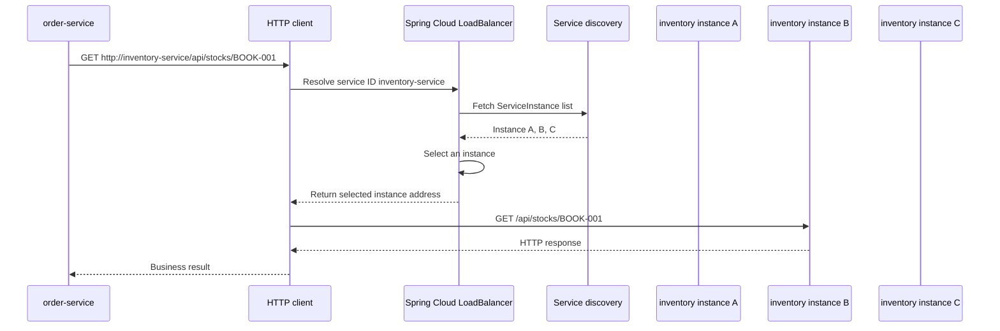

# Request Model: Calling Service, Target Service, and Multiple Replicas

In a microservices architecture, one service often needs to call another service's API to complete a business workflow. For example, `order-service` needs to ask `inventory-service` whether an item has sufficient stock before confirming an order. When the system runs multiple replicas of `inventory-service`, the caller needs a way to find a suitable replica for each request.

Spring Cloud LoadBalancer handles replica selection on the client side. Instead of hardcoding a server's IP address and port, the calling service uses a logical **service ID**. Spring Cloud LoadBalancer retrieves the list of available instances, picks an instance, and forwards the HTTP request to that instance's actual address. This mechanism allows the calling service to keep using the same logical address when the number of replicas or deployment locations change.

## 1. Three Components in the Communication Model

A request passes through three main components:

| Component | Role | Example |
| --- | --- | --- |
| Calling service | Initiates the request and consumes the result from another service | `order-service` |
| Destination service | Provides the API that the calling service needs to use | `inventory-service` |
| Instances of the destination service | Running processes of the same service, each with its own network address | `10.0.1.11:8080`, `10.0.1.12:8080`, `10.0.1.13:8080` |

In Spring Cloud LoadBalancer, distinguish between two concepts:

- **Service ID** is the logical name used to identify the service to call, such as `inventory-service`. This name typically appears in discovery configuration and in the URL used by the client.
- **ServiceInstance** is a concrete replica of a service. It holds the information needed to connect to that replica, typically including host, port, secure connection flag, and accompanying metadata.

One service ID can map to zero, one, or multiple `ServiceInstance` objects. This list can change during deployments, scaling up, scaling down, or service registration and deregistration.

## 2. Logical Address and Physical Address

Suppose `inventory-service` is running three replicas:

| Service ID | Instance | Physical Address |
| --- | --- | --- |
| `inventory-service` | Instance A | `10.0.1.11:8080` |
| `inventory-service` | Instance B | `10.0.1.12:8080` |
| `inventory-service` | Instance C | `10.0.1.13:8080` |

The calling service only needs to send requests to the logical address:

```text
http://inventory-service/api/stocks/BOOK-001
```

Here, `inventory-service` is the service ID. It is not a hostname that can be resolved via DNS by default in every environment. The client must be integrated with Spring Cloud LoadBalancer so the service name portion is resolved to a specific instance.

After instance selection, the request's target address can become one of the following addresses:

```text
http://10.0.1.11:8080/api/stocks/BOOK-001
http://10.0.1.12:8080/api/stocks/BOOK-001
http://10.0.1.13:8080/api/stocks/BOOK-001
```

The business code of `order-service` still calls `inventory-service` by its service ID. When instance D is added or instance A's address changes, the calling service does not need to edit URLs at every call site.

## 3. How Is a Request Distributed?

The processing flow typically includes the following steps:

1. `order-service` creates an HTTP request to a URL containing the service ID `inventory-service`.
2. The HTTP client integrated with Spring Cloud LoadBalancer recognizes that this request requires load balancing.
3. LoadBalancer asks the instance supplier to return the instance list for `inventory-service`. This supplier typically fetches data from a service discovery mechanism.
4. The instance list may go through supporting steps such as caching or instance filtering based on application configuration.
5. The load balancer selects an instance from the eligible list.
6. The HTTP client sends the request to the actual host and port of the selected instance.
7. The instance processes the request and returns the result to `order-service`.

The diagram below shows the relationship between the calling service, the load balancer, discovery, and the replicas of the target service:



In the diagram, instance B is just an example of a selected instance. Another request could be sent to A or C. The calling service does not need to query the registry itself or write its own server selection algorithm; resolution and selection are handled through Spring Cloud LoadBalancer's integration with the HTTP client.

## 4. How Do Multiple Replicas Help the System Handle Requests?

When there is only one instance, every request goes to that instance. If the instance stops running, the calling service has no other replica to use. When multiple instances exist, LoadBalancer can distribute requests across different replicas, giving the system greater scalability and fault tolerance.

Spring Cloud LoadBalancer provides instance selection algorithms. The default configuration typically uses `RoundRobinLoadBalancer`, which picks instances in the list in turn. With a stable list of three instances, a sequence of requests can be distributed as follows:

| Request | Selected Instance in Example |
| --- | --- |
| Request 1 | A |
| Request 2 | B |
| Request 3 | C |
| Request 4 | A |
| Request 5 | B |
| Request 6 | C |

This is an illustration of Round Robin, not a guarantee that request counts or processing loads on every instance are always equal. Each calling application can have its own selection state; request processing times can also vary. Therefore, multiple instances enable load distribution but do not guarantee that CPU load, memory usage, or active request counts are always strictly balanced.

When the instance list changes, subsequent requests are selected based on the list returned by the instance supplier at that moment. This allows the system to scale the number of replicas up or down without manually updating each URL in the calling service.

## 5. Service Discovery Provides the Instance List

Spring Cloud LoadBalancer needs to know which instances can receive requests. This information usually comes from a service discovery mechanism. On startup, each instance of the target service can register its service ID along with its host and port with a registry. The calling service uses a discovery client to retrieve the instance list matching the service ID.

Common discovery sources in the Spring Cloud ecosystem and deployment environments include:

- Eureka or Consul: services register and look up instances through a service registry.
- Kubernetes: endpoint or service information can be provided through an appropriate discovery integration.
- Static configuration lists: useful for test environments or small systems not yet using a dynamic registry.

The roles of discovery and LoadBalancer are different:

- Discovery answers the question: **Which instances are currently known for this service ID?**
- LoadBalancer answers the question: **Among the provided instances, which instance will receive the current request?**

LoadBalancer uses components that provide the instance list (`ServiceInstanceListSupplier`). Depending on configuration, the supplier chain may add caching or filter instances. Health check mechanisms can also be configured to exclude instances that do not meet criteria. Do not assume every application automatically performs active health checks; verify the actual supplier configuration and discovery source of the application.

## 6. Integrating the Service ID Model with HTTP Clients

To use a service ID in a URL, the HTTP client must be marked or configured to integrate with Spring Cloud LoadBalancer. The examples below illustrate three common options. The application only needs to pick the client that fits the communication style in use.

### 6.1. Using RestClient

With a Spring Framework version supporting `RestClient`, declare a builder annotated with `@LoadBalanced`:

```java
import org.springframework.cloud.client.loadbalancer.LoadBalanced;
import org.springframework.context.annotation.Bean;
import org.springframework.context.annotation.Configuration;
import org.springframework.web.client.RestClient;

@Configuration
class HttpClientConfiguration {

    @Bean
    @LoadBalanced
    RestClient.Builder loadBalancedRestClientBuilder() {
        return RestClient.builder();
    }
}
```

Use this builder to create a client that calls the target service by service ID:

```java
import org.springframework.stereotype.Component;
import org.springframework.web.client.RestClient;

@Component
class InventoryGateway {

    private final RestClient restClient;

    InventoryGateway(RestClient.Builder loadBalancedRestClientBuilder) {
        this.restClient = loadBalancedRestClientBuilder.build();
    }

    StockResponse getStock(String sku) {
        return restClient.get()
                .uri("http://inventory-service/api/stocks/{sku}", sku)
                .retrieve()
                .body(StockResponse.class);
    }
}
```

The key point is that the builder is annotated with `@LoadBalanced`. When the client makes a request to `inventory-service`, the LoadBalancer integration can resolve the service ID and select a corresponding instance. If the application has multiple builders of the same type, name the bean or use `@Qualifier` to ensure the gateway receives the right builder.

### 6.2. Using WebClient

For applications using WebFlux or needing a reactive API, you can declare a load-balanced `WebClient.Builder`:

```java
import org.springframework.cloud.client.loadbalancer.LoadBalanced;
import org.springframework.context.annotation.Bean;
import org.springframework.context.annotation.Configuration;
import org.springframework.web.reactive.function.client.WebClient;

@Configuration
class ReactiveHttpClientConfiguration {

    @Bean
    @LoadBalanced
    WebClient.Builder loadBalancedWebClientBuilder() {
        return WebClient.builder();
    }
}
```

Example API call:

```java
import org.springframework.stereotype.Component;
import org.springframework.web.reactive.function.client.WebClient;
import reactor.core.publisher.Mono;

@Component
class ReactiveInventoryGateway {

    private final WebClient webClient;

    ReactiveInventoryGateway(WebClient.Builder loadBalancedWebClientBuilder) {
        this.webClient = loadBalancedWebClientBuilder.build();
    }

    Mono<StockResponse> getStock(String sku) {
        return webClient.get()
                .uri("http://inventory-service/api/stocks/{sku}", sku)
                .retrieve()
                .bodyToMono(StockResponse.class);
    }
}
```

### 6.3. Using OpenFeign

OpenFeign lets you describe a remote API using an interface. Declare the service ID in `@FeignClient` and do not specify a fixed URL:

```java
import org.springframework.cloud.openfeign.FeignClient;
import org.springframework.web.bind.annotation.GetMapping;
import org.springframework.web.bind.annotation.PathVariable;

@FeignClient(name = "inventory-service")
interface InventoryClient {

    @GetMapping("/api/stocks/{sku}")
    StockResponse getStock(@PathVariable("sku") String sku);
}
```

Enable Feign client scanning in the application:

```java
import org.springframework.cloud.openfeign.EnableFeignClients;
import org.springframework.boot.autoconfigure.SpringBootApplication;

@SpringBootApplication
@EnableFeignClients
class OrderApplication {
}
```

When calling `inventoryClient.getStock("BOOK-001")`, Feign uses the name `inventory-service` to locate an instance. The application needs the appropriate Spring Cloud OpenFeign and Spring Cloud LoadBalancer dependencies; the corresponding discovery dependency must also be configured if a registry is used.

### 6.4. Integration Conditions to Check

- The `spring-cloud-starter-loadbalancer` dependency must be present in the application using load balancing.
- The Spring Cloud version must be compatible with the project's Spring Boot version; manage versions using the corresponding Spring Cloud BOM.
- The service ID in the URL or `@FeignClient` must match the name provided by discovery.
- For `RestClient` and `WebClient`, use a builder annotated with `@LoadBalanced`.
- If not using a registry, another instance list source must be present, such as static instance configuration.

A plain HTTP client does not automatically understand `inventory-service` as a service ID. If LoadBalancer integration is omitted, that name may be treated as a normal hostname and the request fails when DNS has no matching record.

## 7. What Happens When an Instance Fails?

Having multiple replicas creates more options, but it does not mean every failure is automatically recovered. Distinguish several scenarios:

| Scenario | What Can Happen | How to Handle |
| --- | --- | --- |
| Discovery returns an empty list | No instance to select; request cannot be routed to the target service | Check service registration, service ID, discovery config, and startup timing |
| Instance stopped but still in the list | LoadBalancer may select that instance; connection fails or times out | Check registry update mechanism, caching, and health check configuration |
| Instance stops after being selected | Connection may be refused or time out | Configure timeouts and retries suitable for the request type |
| Instance returns a business error | Request reached the service but processing did not succeed | Handle according to error codes and business rules; do not retry every request by default |

Health checks, when configured, help detect and filter out unhealthy instances before selection. Still, there is always a time window between the check and sending the request; an instance can fail right after being selected.

Retries can allow repeating a request with a different instance selection, but must be designed carefully. For requests that write data or create orders, resending can produce duplicate side effects if the target service does not support idempotency. Timeouts limit waiting time; they do not by themselves guarantee that the request was cancelled on the target service side.

For reliable communication, combine an appropriate instance list, selection policy, timeouts, conditional retries, and observability. Logs or tracing should help identify the service ID, actual instance called, processing duration, and failure reason. This information is especially helpful when some replicas work well while one replica repeatedly causes errors.

## 8. Distinguishing Client-Side and Server-Side Load Balancing

Both models distribute requests across multiple replicas, but where selection happens differs:

| Criterion | Client-side load balancing | Server-side load balancing |
| --- | --- | --- |
| Where instance is selected | Inside the calling application, via the client and LoadBalancer | At a proxy or load balancer sitting in front of the instances |
| Address used by caller | Service ID resolved by the client | Address of the proxy or load balancer |
| Component aware of instance list | Client-side discovery and supplier | Server-side proxy or load balancer |
| Example | Spring Cloud LoadBalancer integrated with RestClient, WebClient, or OpenFeign | Nginx, HAProxy, or a gateway configured for load balancing |

A system can combine both models at different communication hops. When analyzing a request, identify which component actually selects the instance so you know where to inspect configuration and logs.

## 9. End-to-End Example: order-service Calling inventory-service

Suppose a system has one `order-service` and three `inventory-service` replicas. When a customer orders a product, the stock check flow proceeds as follows:

1. `order-service` receives an order creation request.
2. `InventoryGateway` creates a request to `http://inventory-service/api/stocks/BOOK-001`.
3. Spring Cloud LoadBalancer retrieves the `inventory-service` instance list from the configured supplier.
4. The algorithm picks an instance, for example `10.0.1.12:8080`.
5. The HTTP client sends the request to instance B.
6. `inventory-service` returns the stock quantity; `order-service` continues business processing based on the result.

If the system later scales up to five replicas, the service ID and call logic in `order-service` stay the same. Discovery updates the instance list and LoadBalancer uses the new list according to the configured supplier mechanism.

The key takeaway is that the service ID represents the service, whereas an instance represents a specific running process. Service discovery finds the instances; Spring Cloud LoadBalancer selects one instance; the HTTP client sends the request to that instance's actual network address.

## 10. Self-Check Questions

1. Why should `order-service` call `inventory-service` using a service ID instead of hardcoding the IP and port of a single replica?
2. What two distinct responsibilities do service discovery and Spring Cloud LoadBalancer handle?
3. If the discovery list has three instances, how might Round Robin distribute six consecutive requests?
4. Why does having multiple replicas not guarantee that every request will succeed?
5. When using `RestClient` or `WebClient`, which configuration element allows the client to resolve a service ID through Spring Cloud LoadBalancer?

Once you can answer these questions, you have grasped the foundational model of client-side load balancing: the caller sends a request to a logical service name, the system finds the list of replicas, picks a suitable instance, and communicates over that instance's actual network address.
