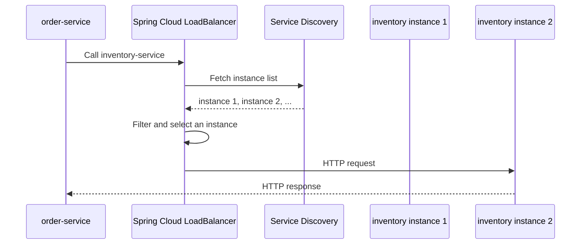
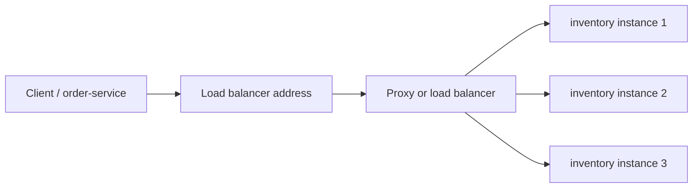

# Client-Side vs. Server-Side Load Balancing

## Objectives

When a service is deployed across multiple replicas, calling applications need a way to select an appropriate replica for each request. Load balancing distributes requests across instances to utilize resources, increase availability, and limit the impact when an instance fails.

In a Spring Cloud architecture, **Spring Cloud LoadBalancer** provides client-side load balancing. The calling application uses a service ID, retrieves the instance list from a discovery mechanism, and picks an instance to send the request to. Server-side load balancing performs selection at an infrastructure component such as a reverse proxy, load balancer, or container orchestration platform.

After this lesson, you will be able to:

- Distinguish the placement and processing flow of client-side vs. server-side load balancing.
- Explain the roles of service ID, service discovery, `ServiceInstanceListSupplier`, and the instance selector in Spring Cloud LoadBalancer.
- Integrate load balancing with `RestClient`, `WebClient`, and Spring Cloud OpenFeign.
- Choose suitable routing policies combined with health checks, timeouts, and retries.
- Recognize common errors when the instance list is inaccurate or no usable instances remain.

## 1. What Problem Does Load Balancing Solve?

Suppose `inventory-service` has three running instances. If every request from `order-service` calls a single fixed address, that instance can become a bottleneck while the other two instances sit underutilized. If the fixed instance stops running, requests fail even though the other instances remain healthy.

Load balancing places a selection mechanism between the caller and the group of instances. This mechanism distributes traffic according to a policy and can exclude instances that do not meet serving criteria.

Three concepts to distinguish:

- **Service ID** is the logical name of a service, such as `inventory-service`. The caller uses this name instead of hardcoding a machine's IP and port.
- **Service instance** is a concrete deployment of the service, typically represented by host, port, metadata, and security status.
- **Load balancer** is the component that chooses an instance from the candidate list for each request.

Service discovery is responsible for finding and supplying the instance list. The load balancer uses that list to make a selection. These two responsibilities are closely related but not identical: having an instance list does not mean that list always reflects the exact current health of every instance.

## 2. Client-Side Load Balancing

With client-side load balancing, the load balancing library lives inside the calling application's process. The application calls a service ID; the library fetches the instance list and chooses a target address. The HTTP client then sends the request directly to the chosen instance.



A typical processing flow consists of these steps:

1. `order-service` creates a request to a logical address, e.g., `http://inventory-service/api/items/42`.
2. The load balancer integration component recognizes `inventory-service` as a service ID to resolve.
3. `ServiceInstanceListSupplier` provides the instance list, typically fetching data from `DiscoveryClient` or `ReactiveDiscoveryClient`.
4. The instance selector applies the configured policy to pick an appropriate instance.
5. The HTTP client sends the request to that instance's host and port.
6. The result is returned to the calling application. For the next request, the load balancer may select a different instance.

Spring Cloud LoadBalancer has the following core components:

| Component | Responsibility |
|---|---|
| `ServiceInstance` | Describes a specific deployment address of a service. |
| `DiscoveryClient` / `ReactiveDiscoveryClient` | Queries the instance list from the discovery system. |
| `ServiceInstanceListSupplier` | Supplies, caches, or filters the instance list prior to selection. |
| `ReactorLoadBalancer` | Selects an instance from the supplied list. |
| HTTP client integration | Translates the service ID in the URL into the selected instance's address. |

In typical configuration, Spring Cloud LoadBalancer uses `RoundRobinLoadBalancer`. Applications can also configure another selector, such as `RandomLoadBalancer`, or create a custom policy when specific routing criteria are needed.

### 2.1. Instance Selection Policies

The load balancing policy decides which instance receives a request. Common selection strategies include:

- **Round robin**: distributes requests sequentially across instances in the list. This is easy to understand and works well when instances have comparable capacity. Under high concurrency, the observed order does not necessarily form a strictly sequential sequence.
- **Random**: picks an instance at random. This is simple, though it does not guarantee each instance receives an equal number of requests over a short period.
- **Zone preference**: prefers instances in the same zone or a preferred configured zone to reduce latency and cross-zone traffic.
- **Hint or request-based routing**: uses metadata or request attributes to narrow the instance set, such as preferring a group of instances dedicated to a certain type of traffic.
- **Weighted routing**: distributes by weight when the system has appropriate capacity data or weights. Do not assume default round robin understands CPU capacity or actual per-instance load.

Suppliers can be combined to filter instances by zone, hint, or health status before the selector makes a decision. Therefore, be clear about where the selector's input list comes from and when it is refreshed.

### 2.2. Service Discovery and the Instance List

A Service ID is meaningful only when there is a mechanism to resolve it into instances. Spring Cloud LoadBalancer can work with discovery solutions such as Eureka, Consul, or platform-provided discovery. For learning environments or static configurations, `SimpleDiscoveryClient` can be used.

Example configuring two static instances for `inventory-service`:

```yaml
spring:
  cloud:
    discovery:
      client:
        simple:
          instances:
            inventory-service:
              - uri: http://localhost:8081
              - uri: http://localhost:8082
```

When the application calls `http://inventory-service/...`, the list above provides two addresses for the load balancer to choose from. In real environments, the list is typically updated as instances register, deregister, or as the discovery platform detects changes.

Do not hardcode a single instance's address into the caller's source code or configuration if the goal is to call the service by service ID. That defeats dynamic selection and makes changing instance counts difficult.

### 2.3. Instance Health Checks

Discovery indicates that an instance is registered or detected. That does not prove the instance can currently process business logic. A process can still keep its network port open while unable to connect to the database or critical dependencies.

Spring Cloud LoadBalancer supports building a candidate list that considers health checks via `ServiceInstanceListSupplier`, such as `HealthCheckServiceInstanceListSupplier` in an appropriate configuration. Health checks periodically call a health endpoint and remove failing instances from the selectable list. Some discovery configurations or platforms also have their own health check mechanisms.

When designing health checks:

- Use an endpoint that reflects readiness to serve traffic (`readiness`) rather than only checking whether the process is alive (`liveness`).
- Set reasonable check intervals and timeouts; checking too frequently adds load, while checking too rarely delays incident detection.
- Ensure the endpoint does not require authentication or headers the health checker cannot supply, unless access is explicitly configured.
- Avoid letting a non-essential secondary dependency mark every instance unhealthy.
- Track list refresh timing and cache durations to understand why a recently failed instance may still appear for a few requests.

Health checks reduce the probability of sending requests to failing instances; they do not replace timeouts, exception handling, or business monitoring.

## 3. Server-Side Load Balancing

With server-side load balancing, the caller sends requests to a stable address such as a virtual IP, DNS name, or reverse proxy endpoint. An infrastructure component receives the request, selects a backend instance, and forwards the request to that instance.



The calling application does not need to know all backend addresses. It only needs to know the load balancer endpoint. Discovery, backend checking, and instance selection are handled at the infrastructure layer.

Examples of components that can perform this role:

- **NGINX or HAProxy**: reverse proxy/load balancer deployed in front of a backend pool.
- **Envoy**: a proxy capable of load balancing, upstream health checking, and providing telemetry.
- **Kubernetes Service**: provides a stable service address and distributes connections to matching endpoints in the cluster.
- **Ingress controller or cloud load balancer**: receives traffic entering a cluster or cloud system and routes it to the target service.

At the network layer, two main categories can be distinguished:

- **Layer 4 (L4)**: decides based on connection metadata such as IP and TCP/UDP port. This component does not need to inspect HTTP content.
- **Layer 7 (L7)**: understands application protocols such as HTTP, and can route by host, path, header, or request attributes.

An API Gateway may include upstream load balancing capabilities, but a gateway also handles responsibilities like authentication, rate limiting, request transformation, and API policies. Therefore, an API Gateway and a load balancer should not be treated as identical concepts.

## 4. Comparing the Two Models

| Criterion | Client-Side | Server-Side |
|---|---|---|
| Where instance is selected | Inside the calling service application | At a proxy or intermediate infrastructure |
| Address used by caller | Service ID resolved by the library | Stable endpoint of the load balancer |
| Source of backend list | Discovery client or supplier | Configuration, discovery, or infrastructure control plane |
| Dependency on application | Requires compatible library and configuration in client | Client usually only needs to call a standard endpoint |
| Request path | Client sends directly to selected instance | Request passes through load balancer then to instance |
| Policy management | Can be configured per application or service ID | Can be centralized at the infrastructure layer |
| Operational risk | Client-side discovery/cache lists can be stale or inconsistent | Load balancer must be deployed redundantly and monitored |

**Advantages of client-side load balancing** include removing one proxy hop on the path between two services, allowing applications to select instances based on metadata or local context, and fitting service-to-service communication in Spring Cloud ecosystems. In return, each application needs the corresponding library, discovery configuration, timeout/retry policies, and observability.

**Advantages of server-side load balancing** include centralized backend and policy management, supporting diverse client types or programming languages without requiring each client to integrate a specific library. In return, requests pass through an intermediary; the system must ensure that component is highly available, sufficiently provisioned, and monitored.

Both models can coexist in one architecture if they handle different hops. For example, an edge load balancer receives Internet traffic, while Spring applications use client-side load balancing when calling internal services. Clearly understand which layer selects backends at each step to avoid overlapping, purposeless load balancing layers.

## 5. Integrating Spring Cloud LoadBalancer with HTTP Clients

To use client-side load balancing, the application needs Spring Cloud LoadBalancer and an instance list supplier. In Maven, the base dependency is:

```xml
<dependency>
    <groupId>org.springframework.cloud</groupId>
    <artifactId>spring-cloud-starter-loadbalancer</artifactId>
</dependency>
```

Add the corresponding discovery starter if the system uses Eureka, Consul, or another discovery solution. Use a Spring Cloud release train compatible with your application's Spring Boot version; do not mix Spring Cloud library versions arbitrarily.

### 5.1. Using RestClient

With Spring Framework 6.1 and later, `RestClient` provides a synchronous API for sending HTTP requests. Annotate the builder with `@LoadBalanced` so URLs containing a service ID are handled through the load balancer.

```java
import org.springframework.cloud.client.loadbalancer.LoadBalanced;
import org.springframework.context.annotation.Bean;
import org.springframework.context.annotation.Configuration;
import org.springframework.web.client.RestClient;

@Configuration
class HttpClientConfiguration {

    @Bean
    @LoadBalanced
    RestClient.Builder loadBalancedRestClientBuilder() {
        return RestClient.builder();
    }
}
```

A component can inject this builder and call the service by service ID:

```java
import org.springframework.cloud.client.loadbalancer.LoadBalanced;
import org.springframework.stereotype.Component;
import org.springframework.web.client.RestClient;

@Component
class InventoryGateway {

    private final RestClient restClient;

    InventoryGateway(@LoadBalanced RestClient.Builder builder) {
        this.restClient = builder.build();
    }

    InventoryResponse find(String sku) {
        return restClient.get()
                .uri("http://inventory-service/api/inventory/{sku}", sku)
                .retrieve()
                .body(InventoryResponse.class);
    }
}
```

Here, `inventory-service` is the service ID that must match the service name in discovery. If a plain builder without `@LoadBalanced` is used, the HTTP client will not automatically know how to resolve this service ID to an instance.

### 5.2. Using WebClient

For reactive applications, you can configure a `WebClient.Builder` annotated with `@LoadBalanced`:

```java
import org.springframework.cloud.client.loadbalancer.LoadBalanced;
import org.springframework.context.annotation.Bean;
import org.springframework.context.annotation.Configuration;
import org.springframework.web.reactive.function.client.WebClient;

@Configuration
class ReactiveHttpClientConfiguration {

    @Bean
    @LoadBalanced
    WebClient.Builder loadBalancedWebClientBuilder() {
        return WebClient.builder();
    }
}
```

Use the builder to create a client calling the service ID:

```java
import org.springframework.cloud.client.loadbalancer.LoadBalanced;
import org.springframework.stereotype.Component;
import org.springframework.web.reactive.function.client.WebClient;
import reactor.core.publisher.Mono;

@Component
class CatalogGateway {

    private final WebClient webClient;

    CatalogGateway(@LoadBalanced WebClient.Builder builder) {
        this.webClient = builder
                .baseUrl("http://catalog-service")
                .build();
    }

    Mono<CatalogItem> find(String id) {
        return webClient.get()
                .uri("/api/items/{id}", id)
                .retrieve()
                .bodyToMono(CatalogItem.class);
    }
}
```

`WebClient` returns publishers; the application must continue processing results reactively and avoid calling blocking operations on the event loop.

### 5.3. Using Spring Cloud OpenFeign

OpenFeign allows declaring a client via an interface. When integrated with Spring Cloud LoadBalancer, the `name` attribute of `@FeignClient` serves as the service ID:

```java
import org.springframework.cloud.openfeign.FeignClient;
import org.springframework.web.bind.annotation.GetMapping;
import org.springframework.web.bind.annotation.PathVariable;

@FeignClient(name = "inventory-service")
interface InventoryClient {

    @GetMapping("/api/inventory/{sku}")
    InventoryResponse find(@PathVariable("sku") String sku);
}
```

The application needs to enable Feign client scanning with appropriate `@EnableFeignClients` configuration and have the Spring Cloud LoadBalancer dependency on the classpath. OpenFeign will use load balancing integration to resolve the service ID and select an instance. If Feign is configured with a fixed URL only, the application calls that endpoint directly and does not use discovery by service ID.

## 6. Retries, Timeouts, and Handling Instance Failures

Load balancing helps pick an instance, but does not guarantee every request succeeds. An instance may stop right after a health check, the network may drop connections, or the target service may respond too slowly. Therefore, load balancing must be paired with resilience mechanisms.

### 6.1. Timeouts

Configure connection and response timeouts for the HTTP client. Timeouts must match business SLAs and the target service's normal processing time. If timeouts are too long, failing requests can hold caller resources for a long time; if too short, valid requests may be aborted prematurely.

HTTP client timeouts and gateway/proxy timeouts are limits at different hops. When multiple tiers exist, configure them consistently so an upstream tier does not needlessly wait longer than a downstream tier's limit.

### 6.2. Retries

Spring Cloud LoadBalancer supports retries and can retry on the same instance or fail over to another instance, depending on configuration and the HTTP client type used. Retries should only be applied when errors are likely transient and the operation can be safely repeated.

For example, a read `GET` request is usually more suitable for retries than an order creation operation. When retrying a write operation, design an idempotency key or duplicate-prevention mechanism. Also limit retry attempts and total retry duration; retrying at multiple layers simultaneously can multiply request volume very quickly when the system is overloaded.

### 6.3. When No Usable Instances Remain

If the supplier returns an empty list, the load balancer has no instance to select. The application must handle this error as a service unavailability situation: log with context, return an appropriate error to the calling layer, and let a circuit breaker or fallback mechanism handle it if business rules allow.

Do not silently fall back to an old hardcoded IP address to bypass discovery failures. Doing so can send requests to a decommissioned or unsafe instance. Inspect the discovery source, service ID, registration status, health checks, and cache duration.

## 7. Observability and Diagnostics

To operate load balancing reliably, monitor both instance selection outcomes and HTTP request outcomes. Useful signals include:

- Request success and failure rates by service ID.
- Count of errors due to no available instances.
- Connection timeouts, response timeouts, and DNS/network errors.
- Retry counts, cross-instance failover retry counts, and retry success rates.
- Latency per service or per instance to detect instances behaving abnormally.
- Health check status, instance counts in the list, and when the list was refreshed.

Combine logs with a trace ID to correlate a request from the caller to the target instance. When investigating a specific request, the service ID and selected instance help determine whether an error stemmed from instance selection, network connectivity, or business logic. Do not log tokens, credentials, or sensitive request payloads.

## 8. Which Model Should You Choose for Your Architecture?

Choose the model based on where traffic originates and where policies need to be managed:

- For internal communication between Spring services, client-side load balancing fits well when applications need to call by service ID, integrate with discovery, and control instance selection inside the client.
- For traffic from browsers, mobile apps, or external systems, server-side load balancing is usually more convenient because callers only need one stable endpoint.
- With Kubernetes, DNS and Kubernetes Service can let the platform distribute connections. Add application-layer client-side load balancing only when custom selection policies are needed or when leveraging the instance list aligns with the architecture.
- In polyglot systems, a centralized load balancing layer can unify policies without requiring every client to install the same library.
- When routing requires zone, tenant, version, or metadata awareness, determine which layer owns that policy and ensure routing metadata is updated consistently.

In a system using both models, clearly document each hop. For example: external clients call a cloud load balancer; the load balancer forwards to an API Gateway; the API Gateway calls `order-service`; `order-service` uses Spring Cloud LoadBalancer to select an `inventory-service` instance. Each layer has a distinct purpose and can be observed independently.

## 9. Deployment Checklist

Before rolling out load balancing configuration to production, verify:

1. The Service ID in URLs or `@FeignClient` matches the name registered in discovery.
2. The discovery source returns the correct host, port, scheme, and metadata for each instance.
3. The HTTP client is genuinely configured with `@LoadBalanced` when calling by service ID.
4. The selection policy aligns with instance capacity and routing goals.
5. Health checks verify readiness with sensible timeouts and intervals.
6. Instance list caching does not retain stale data longer than operational requirements allow.
7. Timeouts and retries are bounded; write operations have idempotency mechanisms when retried.
8. Empty lists or all-instance failures have clear handling and error reporting.
9. Logs, metrics, and traces are sufficient to identify which instance received a request.
10. Load balancer tiers in the architecture have clear responsibilities, avoiding routing loops or overlapping configurations.

## Conclusion

Client-side load balancing brings instance selection decisions into the calling service application. Spring Cloud LoadBalancer achieves this by combining service IDs, instance lists from discovery, suppliers, and instance selectors; it integrates with `RestClient`, `WebClient`, and OpenFeign. Server-side load balancing places decisions in a proxy or intermediate infrastructure, centralizing backend management and serving diverse clients. The right choice depends on where traffic originates, routing requirements, discovery organization, and operational capabilities. Whichever model is used, combine health checks, timeouts, controlled retries, and thorough observability to keep service-to-service communication reliable.
