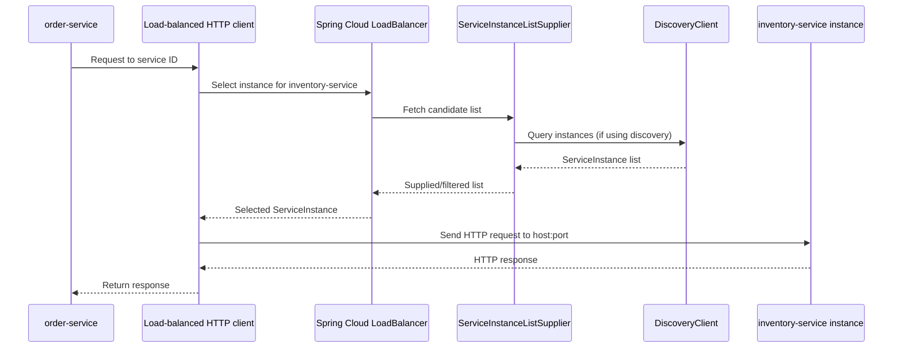

# Roles of Spring Cloud Commons and Spring Cloud LoadBalancer

In a microservices system, a service often has multiple instances running on different machines or containers. Each instance's address can change during deployments, scaling, or restarts. Therefore, when `order-service` needs to call `inventory-service`, the application should call by **service ID** rather than hardcoding a specific IP address and port.

Spring Cloud Commons and Spring Cloud LoadBalancer work together to solve this problem on the calling application's side:

- **Spring Cloud Commons** defines common abstractions and integration points so Spring Cloud components can work with discovery, service registries, and load balancing in a uniform way.
- **Spring Cloud LoadBalancer** provides client-side load balancing: it receives a service's instance list, applies a selection policy, and returns an instance for the HTTP client to send the request to.

The two components have different responsibilities but complement each other. Commons provides the contracts and integration hooks; LoadBalancer performs instance selection in the service-call flow.

## 1. Why Is Client-Side Load Balancing Needed?

Suppose `inventory-service` has three instances:

| Instance | Sample Address |
|---|---|
| inventory-1 | `10.0.1.11:8080` |
| inventory-2 | `10.0.1.12:8080` |
| inventory-3 | `10.0.1.13:8080` |

If `order-service` directly calls `10.0.1.11:8080`, every request depends on that instance. When the instance stops or its address changes, the calling service's configuration must also change. The remaining instances may go unused even though they are still healthy.

Client-side load balancing lets `order-service` send requests to a logical name, for example:

```text
http://inventory-service/api/items/sku-001
```

Before sending the request, the load balancer component finds available instances of `inventory-service`, chooses an instance according to the configured policy, and replaces the service ID with that instance's actual address. The HTTP client then establishes the connection like a normal HTTP request.

This approach offers several benefits:

- Distributes requests across multiple instances to utilize resources.
- Reduces dependency on fixed IP addresses and ports.
- Adapts to adding, removing, or replacing instances as the system changes.
- Can exclude unsuitable instances from the candidate list, such as instances failing health checks.
- Allows each service to use a selection policy tailored to operational requirements.

Client-side load balancing also has limits: it only coordinates requests from the calling application. It does not create instances, deploy services, or replace a service discovery system.

## 2. Spring Cloud Commons: Common Abstraction and Integration Layer

Spring Cloud Commons is the foundational module providing abstractions used by many Spring Cloud projects. With shared contracts, applications can integrate with different discovery or service registry systems without coupling all business code to provider-specific APIs.

Within service-to-service communication, the key abstractions include:

### 2.1. DiscoveryClient

`DiscoveryClient` provides a way to query service instances by service ID. Applications can request the list of instances for a service or the list of registered services.

Example showing the intent of the call:

```java
List<ServiceInstance> instances =
        discoveryClient.getInstances("inventory-service");
```

The snippet above demonstrates querying at the abstraction level. In a real application, Spring injects the implementation matching the discovery provider in use.

Several systems can provide implementations for this abstraction, such as Eureka, Consul, or Kubernetes. When not using an external registry, Spring Cloud also offers a simple discovery option based on static configuration in appropriate scenarios.

### 2.2. ServiceInstance

`ServiceInstance` represents a concrete instance of a service. Commonly used details include:

- Service ID or service name.
- Host and port to construct the connection address.
- Secure connection status.
- Instance URI.
- Additional metadata supplied by the discovery system.

The load balancer works with these instance objects rather than needing direct knowledge of how Eureka, Consul, or another platform stores registration data.

### 2.3. ServiceRegistry

`ServiceRegistry` defines the abstraction for registering and deregistering service instances. Discovery and registry are often used together but serve distinct roles:

- Registry concerns publishing or revoking instance information.
- Discovery concerns querying information about published instances.

An application can use a discovery provider's self-registration mechanism or a registration workflow managed by the deployment platform. Having the abstraction in Commons does not mean Commons operates a central registry by itself.

### 2.4. LoadBalancerClient and Integration Points

Spring Cloud Commons provides abstractions and annotations to integrate load balancing with service-calling clients. Common components include:

- `LoadBalancerClient`: imperative-style abstraction to pick a `ServiceInstance` by service ID and support executing requests bound to the chosen instance.
- `ReactiveLoadBalancer`: abstraction serving instance selection in a reactive flow.
- `@LoadBalanced`: marks a builder or client to be augmented with service ID resolution and load balancing.
- `@LoadBalancerClient` and `@LoadBalancerClients`: declare custom load balancer configurations for one or more services.

These abstractions allow Spring Cloud to integrate load balancing with multiple HTTP clients. Applications can use the same service ID in service-call code without manually writing host and port selection logic per request.

**Key point:** Spring Cloud Commons defines contracts and extension points. It is not Eureka Server, Consul Server, or a registry cluster; nor does it independently decide which instance receives requests across all configurations.

## 3. Spring Cloud LoadBalancer: Client-Side Instance Selector

Spring Cloud LoadBalancer is the client-side load balancing implementation of the Spring Cloud ecosystem. It takes a service ID, retrieves candidate instances via an instance list supplier, and chooses an instance according to the configured strategy.

Key components in LoadBalancer's model include:

| Component | Role |
|---|---|
| `ReactiveLoadBalancer` | Abstraction that performs instance selection and returns the selection result. |
| `ReactorServiceInstanceLoadBalancer` | Contract for Reactor-based load balancer implementations. |
| `RoundRobinLoadBalancer` | Picks instances sequentially from the candidate list. |
| `RandomLoadBalancer` | Randomly picks an instance from the candidate list. |
| `ServiceInstanceListSupplier` | Supplies the instance list to the load balancer; can chain filtering or data enrichment steps. |

The concrete class names help orient you when reading logs or configuration, while business code typically just calls by service ID through an HTTP client marked as load-balanced.

### 3.1. Instance Selection Policies

Round robin is the common default policy. With three instances and an unchanging candidate list, consecutive requests can be distributed sequentially:

```text
Request 1  -> inventory-1
Request 2  -> inventory-2
Request 3  -> inventory-3
Request 4  -> inventory-1
Request 5  -> inventory-2
```

Round robin is easy to understand and fits when instances have comparable capacity. However, it does not guarantee each instance always receives the exact same amount of work over a short window: requests can have varying processing times, concurrent request counts fluctuate, and the instance list can be updated.

Random selects an instance randomly from the candidate list. When different behavior is needed, you can supply a custom load balancer implementation or configure per-service behavior. Choosing an algorithm should be based on workload characteristics and system requirements, not switched merely because another algorithm sounds more complex.

### 3.2. ServiceInstanceListSupplier

The load balancer needs an instance list to choose from. `ServiceInstanceListSupplier` is responsible for providing that list and is a key extension point in Spring Cloud LoadBalancer.

Data sources can come from a discovery client or static instance configuration. Beyond fetching the list, suppliers can be composed to perform tasks such as:

- Caching the instance list to reduce discovery queries.
- Filtering instances by zone or metadata.
- Incorporating health check results.
- Applying candidate selection rules tailored to the request.

The supplier decides **which instances enter the candidate list**; the load balancer decides **which instance to pick from that list**. Separating these two responsibilities lets you change data sources or filtering rules without rewriting the selection algorithm.

## 4. Processing Flow from Service ID to HTTP Request

When an application sends a request to a service ID, components coordinate in the following high-level sequence:

1. Application code creates a request with a logical address, e.g., `http://inventory-service/api/items/sku-001`.
2. The load-balanced HTTP client recognizes the request must be resolved through Spring Cloud LoadBalancer.
3. LoadBalancer asks the instance supplier to fetch candidate instances for `inventory-service`.
4. The discovery implementation or configured data source returns instance details.
5. The supplier may cache, filter, or check the list before passing it to the load balancer.
6. The load balancing policy picks one `ServiceInstance`.
7. The client replaces the logical host with the selected instance's host and port.
8. The HTTP client sends the request to that instance and handles the response like a normal HTTP request.

The diagram below illustrates the relationship between components:



This is a high-level flow. Some steps may be cached or executed asynchronously depending on client type and configuration. If the instance list comes from a static source, the external discovery query step may not appear.

Distinguish three responsibilities in this flow:

- **Service discovery** answers the question: which instances of the service currently exist?
- **Load balancing** answers the question: among suitable instances, which instance should this request choose?
- **HTTP client** is responsible for establishing connections, sending requests, receiving responses, and applying transport-layer timeouts.

An error at one layer does not necessarily originate at the other layers. For example, no instances available is an issue with discovery data or the candidate list; a connection timeout may relate to the network or HTTP client even when the load balancer picked the right instance.

## 5. Health Checks and Instance List Quality

An instance can still appear in the discovery registry while no longer processing requests normally. For instance, the process may be running yet the application is not ready, overloaded, or unable to reach a critical dependency.

Spring Cloud LoadBalancer allows building a candidate list that accounts for health checks. A supplier can periodically check an instance's health endpoint and supply only instances meeting configured conditions.

Clearly understand three concepts:

- **Discovery status:** whether the instance is recorded by the discovery system.
- **Application health:** whether the application at the instance is running and meeting health conditions.
- **Readiness:** whether the instance is ready to accept the traffic in question.

A health endpoint returning HTTP 200 does not prove every business workflow works properly. The endpoint should reflect the actual purpose of the check. For example, readiness is better suited for deciding whether an instance should accept new requests; liveness typically serves to determine whether a process needs to be restarted.

When enabling health checks, consider:

- Check frequency and timeout per check.
- Number of instances and overhead generated by probes.
- Delay between when an instance fails and when it is removed from the candidate list.
- Behavior when the health endpoint is temporarily unreachable.
- Recovery and re-admitting an instance to the list once it becomes healthy.

Health checks do not replace monitoring, deployment platform readiness/liveness probes, or service-level error handling. They add a signal so the load balancer can choose better instances.

## 6. Integrating with HTTP Clients

Applications rarely call the instance selection API directly. Instead, Spring Cloud integrates load balancing into HTTP clients via annotations and configuration components.

### 6.1. RestClient

With Spring Framework versions supporting `RestClient`, you can declare a builder annotated with `@LoadBalanced`:

```java
@Configuration
class HttpClientConfiguration {

    @Bean
    @LoadBalanced
    RestClient.Builder loadBalancedRestClientBuilder() {
        return RestClient.builder();
    }
}
```

A service can use this builder to create a client:

```java
@Service
class InventoryGateway {

    private final RestClient restClient;

    InventoryGateway(RestClient.Builder builder) {
        this.restClient = builder.build();
    }

    InventoryResponse findItem(String sku) {
        return restClient.get()
                .uri("http://inventory-service/api/items/{sku}", sku)
                .retrieve()
                .body(InventoryResponse.class);
    }
}
```

In this example, `inventory-service` is the service ID. The application does not need to fetch the instance list manually or splice host and port into the URL. The `@LoadBalanced`-marked builder routes requests through Spring Cloud LoadBalancer integration.

If the application has multiple `RestClient.Builder` beans, use an appropriate qualifier when injecting to avoid picking a non-load-balanced builder by mistake.

### 6.2. WebClient

For reactive applications, you can declare a similar builder:

```java
@Configuration
class ReactiveHttpClientConfiguration {

    @Bean
    @LoadBalanced
    WebClient.Builder loadBalancedWebClientBuilder() {
        return WebClient.builder();
    }
}
```

When using this builder, requests to a service ID pass through the filter integrated with Spring Cloud LoadBalancer. The application still uses the `WebClient` API to construct requests and handle responses.

Do not mix load-balanced builders and plain builders arbitrarily. A `WebClient` not configured with load balancing will not automatically recognize a service ID as a name requiring instance lookup.

### 6.3. OpenFeign

With Spring Cloud OpenFeign, the name in `@FeignClient` can act as the service ID:

```java
@FeignClient(name = "inventory-service")
interface InventoryClient {

    @GetMapping("/api/items/{sku}")
    InventoryResponse findItem(@PathVariable String sku);
}
```

When Spring Cloud LoadBalancer integration is on the classpath and configured properly, OpenFeign uses a load-balanced client to resolve the service name and select an instance. Check application dependencies: declaring OpenFeign should not be assumed to automatically include all discovery and load balancing components in every configuration.

### 6.4. RestTemplate in Existing Applications

Applications already using `RestTemplate` can continue integrating via a bean annotated with `@LoadBalanced`. For new projects, choose an HTTP client matching the current Spring version and architecture; there is no need to switch clients solely to change load balancing algorithms.

## 7. Per-Service Configuration and Extensibility

Not every service needs the same policy. For example, a service with homogeneous instances can use round robin, while another service needs filtering by zone or metadata.

Spring Cloud LoadBalancer supports per-service configuration through extension points like `@LoadBalancerClient`. Example declaration:

```java
@Configuration
@LoadBalancerClient(
        name = "inventory-service",
        configuration = InventoryLoadBalancerConfiguration.class
)
class InventoryClientConfiguration {
}
```

The `InventoryLoadBalancerConfiguration` class can declare custom beans for load balancing the corresponding service, such as a custom load balancer implementation or supplier. Detailed configuration must follow the API of the Spring Cloud version in use.

When creating custom configurations, pay attention to component scan scope. A configuration class dedicated to a load balancer should not accidentally be registered as a global configuration if the intent is to apply it to only one service. Check package organization and how Spring initializes per-service configuration contexts.

Only customize when there is a clear requirement, for example:

- Instances span multiple zones and closer instances should be preferred.
- Some instances carry metadata classifying capacity or processing groups.
- Instances need filtering based on request conditions.
- The default policy does not meet measured load distribution requirements.

Each custom rule increases operational complexity. Document selection criteria, handling when no candidates exist, and how outcomes are observed.

## 8. Retries, Timeouts, and Error Handling

Load balancing and retries are related, but they are not the same function.

The load balancer selects an instance for a single attempt. Retry decides whether to resend a request after an error and, if resending, whether to pick a different instance. Depending on integration and configuration, Spring Cloud LoadBalancer can work with the client's retry mechanism to re-select an instance.

Timeouts are typically configured on the HTTP client or underlying transport library. Distinguish:

- **Connection timeout:** maximum time waiting to establish a connection.
- **Response/read timeout:** maximum time waiting for response data.
- **Overall deadline:** total time budget permitted by business requirements, including retries.

A request can exceed the desired duration if each retry attempt has a long timeout. Therefore, set an overall time budget and allocate it reasonably across retry attempts.

Retries must also consider operation safety:

- GET or read operations are usually easier to retry, though real impact still needs evaluation.
- Write operations may have already been processed on the server even though the client never received the response. Retrying then can create duplicate transactions.
- For non-idempotent operations, design an idempotency key or duplicate-prevention mechanism before enabling broad retries.
- Avoid configuring retries simultaneously across multiple tiers without calculating total attempt counts, as actual request volume can spike rapidly during an incident.

When no instance can be found, the application should handle the error explicitly and log the relevant service ID. When an instance was selected but the connection failed, inspect the instance address, network errors, and timeouts to identify the cause. Do not treat every service-call failure as a bug in the load balancing algorithm.

## 9. Observability and Diagnostics in Operations

To evaluate whether load balancing is working properly, logs and metrics need to provide enough information about instance selection decisions and request outcomes.

Useful data includes:

- Called Service ID.
- Number of instances in the candidate list.
- Selected instance, if logging policy permits recording that detail.
- Request processing duration and error rate per service or per instance.
- Retry count and retry reason.
- Timestamps when instances are added to or removed from the candidate list.

When diagnosing, you can follow this order:

1. Confirm the service ID in the URL or client declaration matches the registered name in discovery.
2. Check whether the discovery client returns instances.
3. Check whether the supplier filters out all instances due to health checks, zone, or metadata.
4. Confirm the HTTP client is actually using the builder annotated with `@LoadBalanced`.
5. Check whether the selected instance is reachable from the calling service's network.
6. Cross-check connection timeout, response timeout, retries, and logs across both services.

Common scenarios:

| Symptom | What to Check |
|---|---|
| No instance found | Service ID, service registration, discovery provider, and instance status. |
| Requests still hit a fixed address | Whether client is annotated with `@LoadBalanced`; whether URL hardcodes host/port. |
| Some instances receive no requests | Discovery list, health checks, zone/metadata filters, and caching. |
| Instance selected but request times out | Network connectivity, instance capacity/health, and HTTP client timeouts. |
| Request processed multiple times | Retries across layers, idempotency, and business duplicate-prevention logic. |
| Behavior differs across environments | Spring Boot/Spring Cloud versions, dependencies, and profile-specific configurations. |

When caching or health checks are enabled, observed results may lag behind actual state by some interval. Compare timestamps and refresh cycles before concluding that discovery or the load balancer is using incorrect data.

## 10. Dependencies and Version Compatibility

To use load balancing, the application needs Spring Cloud dependencies matching the client type and discovery source in use. Typically, a project includes the starter for Spring Cloud LoadBalancer, a starter for the discovery provider if using a registry, and the corresponding HTTP client integration starter.

Manage Spring Cloud versions with a BOM compatible with the project's Spring Boot version. Do not pick a LoadBalancer or Commons version independently while ignoring the release train compatibility matrix. When upgrading, re-verify:

- Whether actual dependencies include Spring Cloud LoadBalancer.
- Whether the discovery provider is configured and able to return instances.
- Whether the HTTP client in use supports load balancing integration in that version.
- Whether configuration properties and customization APIs changed between release trains.

If using a service ID without a discovery provider, declare an appropriate instance source, such as static discovery configuration in test environments. Without any instance source, the load balancer cannot infer the target service's address on its own.

## 11. Separation of Responsibilities Across Components

| Component | Question It Resolves | Primary Responsibility |
|---|---|---|
| Spring Cloud Commons | Under what contracts do Spring Cloud projects integrate with discovery and load balancing? | Provides common abstractions, annotations, and extension points. |
| Discovery provider | Which instances are registered? | Manages or supplies service registration and discovery data. |
| Spring Cloud LoadBalancer | Which instance should the request select? | Receives candidate lists, applies policies, and picks instances client-side. |
| ServiceInstanceListSupplier | Which instances are included in the candidate list? | Supplies, caches, or filters the instance list. |
| HTTP client | How is the request sent to the selected instance? | Manages connections, request/response handling, and transport timeouts. |
| Retry/circuit breaker | How does the application react when requests fail? | Coordinates retries or prevents calls from continuing to pressure the system. |

You can remember this relationship with a quick summary: Commons defines how an application requests an instance; the discovery provider supplies instance data; LoadBalancer picks an instance; the HTTP client sends the request to the chosen address. Each component solves a distinct part of service-to-service communication.

## 12. Conclusion

Spring Cloud Commons and Spring Cloud LoadBalancer are two complementary parts of Spring Cloud's client-side load balancing mechanism. Commons creates a unified abstraction layer for discovery, registries, and load balancing integration. LoadBalancer uses the instance list to pick a target for each request according to an appropriate policy.

When deploying, ensure three conditions: the service ID resolves to a valid instance list, the HTTP client is genuinely configured as load-balanced, and timeouts/retries fit business characteristics. Health checks, caching, zone-based policies, and per-service configuration are extension points that adapt the system to real production environments.
