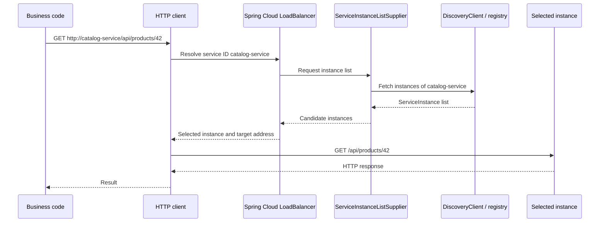

# Relationship Between HTTP Client, Service Discovery, and Load Balancer

In a Spring Cloud system with multiple instances of the same service, the calling application typically only knows a logical name such as `catalog-service` or `payment-service`. The application should not have to store the IP address and port of each instance itself, nor pick an instance manually before every call. Three components work together to solve this: the **HTTP client**, **service discovery**, and **client-side load balancing**.

The HTTP client creates and executes HTTP requests. Service discovery finds instances registered under a service ID. Spring Cloud LoadBalancer chooses an instance from that list and enables the HTTP client to send the request to the concrete address. Each component has its own responsibility; combining them lets business code call services by a stable name while infrastructure can add, remove, or replace instances.

## 1. Role of Each Component

### HTTP client: performing HTTP communication

The HTTP client is responsible for building requests, sending data over the network, and reading responses. In Spring, common options include:

- `RestClient`: synchronous HTTP calling API, suitable for standard request processing flows.
- `WebClient`: API supporting non-blocking and reactive execution, suitable when an application needs asynchronous processing or data streams.
- Spring Cloud OpenFeign: enables declaring HTTP calls via interfaces and annotations.

The HTTP client understands HTTP methods, paths, headers, bodies, and how to decode responses. A plain HTTP client on its own does not automatically know which instances `catalog-service` currently has. If you pass `http://catalog-service/...` to a client without service discovery and load balancing integration, the name `catalog-service` may be treated as a hostname to resolve via DNS.

### Service discovery: finding instances of a service

Service discovery provides the address list of instances belonging to a service. In an environment with a registry, each instance registers information such as service ID, instance ID, host, port, status, and metadata. For example, three instances all register under the name `catalog-service`:

| Service ID | Instance | Example Address |
|---|---|---|
| `catalog-service` | `catalog-1` | `10.0.4.21:8080` |
| `catalog-service` | `catalog-2` | `10.0.4.22:8080` |
| `catalog-service` | `catalog-3` | `10.0.4.23:8080` |

In Spring Cloud, an application can retrieve this list through the `DiscoveryClient` abstraction. Given a service ID, calling `getInstances(serviceId)` returns the `ServiceInstance` objects known to the active discovery implementation. That implementation may connect to Eureka, Consul, or another service discovery platform. In simple configurations, the instance list can also be declared statically.

Service discovery answers the question **"Which instances of this service exist?"**. It does not necessarily decide which instance the current request will go to.

### Spring Cloud LoadBalancer: selecting an instance per request

Spring Cloud LoadBalancer receives a service ID and the list of usable instances, then applies an instance selection policy. In its architecture, `ServiceInstanceListSupplier` provides the candidate list; a `ReactorLoadBalancer` performs the selection. The default configuration typically uses a round-robin algorithm: requests are distributed sequentially across instances in the list.

LoadBalancer can work with additional suppliers or configurations to filter instances, check health, consider deployment zones, hints, or metadata. These capabilities depend on the configuration and integration used. Do not assume every application automatically has active health checks or always immediately removes an instance that just failed.

Once an instance is selected, LoadBalancer supplies the specific target address for the HTTP client to execute the request. It decides **"Which instance should this request call?"**, while opening connections, sending HTTP, and reading responses remain the HTTP client's responsibility.

## 2. How the Three Components Coordinate on a Request

Suppose `order-service` needs to fetch product details from `catalog-service`. Application code creates a request with a logical URL:

```text
GET http://catalog-service/api/products/42
```

The high-level processing flow works as follows:

1. Business code invokes an HTTP client using the service ID `catalog-service`.
2. The Spring Cloud LoadBalancer integration recognizes that the request must be load balanced. For `RestClient` or `WebClient`, this is typically enabled via the `@LoadBalanced` annotation on the builder; OpenFeign integrates by service name.
3. LoadBalancer asks the supplier to provide `ServiceInstance` entries matching the service ID. The supplier retrieves data from a discovery client or configured instance source.
4. LoadBalancer applies the selection policy and picks an instance, e.g., `10.0.4.22:8080`.
5. The logical URL is resolved to a specific instance address. The HTTP client sends the request to that address.
6. The HTTP client receives the response and returns the result to business code.



For example, if LoadBalancer selects `10.0.4.22:8080`, the actual request is sent to:

```text
GET http://10.0.4.22:8080/api/products/42
```

The IP address here only illustrates the resolution result. Business code keeps using the service ID, since instances can change after redeployment or scaling replica counts.

## 3. Integrating with HTTP Clients in Spring

For calls by service ID to be handled by Spring Cloud LoadBalancer, the application needs the `spring-cloud-starter-loadbalancer` dependency and an instance supplier source. That source is usually a discovery client matching the system's registry. Simply adding an HTTP client to the classpath does not automatically turn every URL hostname into a service ID.

### With RestClient

Annotate the builder with `@LoadBalanced` so Spring Cloud applies resolution and instance selection for requests using a service ID:

```java
import org.springframework.cloud.client.loadbalancer.LoadBalanced;
import org.springframework.context.annotation.Bean;
import org.springframework.context.annotation.Configuration;
import org.springframework.web.client.RestClient;

@Configuration
class HttpClientConfiguration {

    @Bean
    @LoadBalanced
    RestClient.Builder loadBalancedRestClientBuilder() {
        return RestClient.builder();
    }
}
```

A client can use this builder to create a `RestClient`:

```java
import org.springframework.beans.factory.annotation.Qualifier;
import org.springframework.stereotype.Component;
import org.springframework.web.client.RestClient;

@Component
class CatalogClient {

    private final RestClient restClient;

    CatalogClient(
            @Qualifier("loadBalancedRestClientBuilder") RestClient.Builder builder) {
        this.restClient = builder.build();
    }

    ProductResponse getProduct(String productId) {
        return restClient.get()
                .uri("http://catalog-service/api/products/{id}", productId)
                .retrieve()
                .body(ProductResponse.class);
    }
}
```

`CatalogClient` only needs to know the service ID and API path. Spring Cloud LoadBalancer coordinates with the annotated builder to pick an instance when the request runs. If the application has both a regular builder and a load-balanced builder, name the beans and use `@Qualifier` explicitly to avoid injecting the wrong one.

### With WebClient

WebClient can also use a service ID when its builder is annotated with `@LoadBalanced`:

```java
import org.springframework.cloud.client.loadbalancer.LoadBalanced;
import org.springframework.context.annotation.Bean;
import org.springframework.context.annotation.Configuration;
import org.springframework.web.reactive.function.client.WebClient;

@Configuration
class ReactiveHttpClientConfiguration {

    @Bean
    @LoadBalanced
    WebClient.Builder loadBalancedWebClientBuilder() {
        return WebClient.builder();
    }
}
```

Example usage in a client:

```java
import org.springframework.beans.factory.annotation.Qualifier;
import org.springframework.stereotype.Component;
import org.springframework.web.reactive.function.client.WebClient;
import reactor.core.publisher.Mono;

@Component
class CatalogReactiveClient {

    private final WebClient webClient;

    CatalogReactiveClient(
            @Qualifier("loadBalancedWebClientBuilder") WebClient.Builder builder) {
        this.webClient = builder.build();
    }

    Mono<ProductResponse> getProduct(String productId) {
        return webClient.get()
                .uri("http://catalog-service/api/products/{id}", productId)
                .retrieve()
                .bodyToMono(ProductResponse.class);
    }
}
```

`WebClient` preserves its reactive execution model. LoadBalancer only adds the step of resolving the service ID and picking an instance before the request is sent.

### With Spring Cloud OpenFeign

OpenFeign lets you describe the target service directly on an interface:

```java
import org.springframework.cloud.openfeign.FeignClient;
import org.springframework.web.bind.annotation.GetMapping;
import org.springframework.web.bind.annotation.PathVariable;

@FeignClient(name = "catalog-service")
interface CatalogFeignClient {

    @GetMapping("/api/products/{id}")
    ProductResponse getProduct(@PathVariable("id") String productId);
}
```

When the application has Feign client scanning enabled and has the Spring Cloud LoadBalancer integration dependency, the name in `@FeignClient` is used as the service ID. Feign builds the call from the interface declaration; the load balancer integration finds and selects an instance. Because the LoadBalancer dependency can be optional in some OpenFeign setups, verify the application's actual dependencies rather than assuming `spring-cloud-starter-openfeign` alone is sufficient.

The three integrations have different APIs, yet follow the same idea: business code calls by service name, LoadBalancer selects an instance, and the HTTP client executes the request.

## 4. Service ID, Instance, and Target Address

These three concepts must be clearly distinguished:

| Concept | Meaning | Example |
|---|---|---|
| Service ID | Logical name representing a service | `catalog-service` |
| Service instance | A specific running replica of the service | `catalog-2` |
| Target address | Host and port the client connects to | `10.0.4.22:8080` |

The Service ID usually corresponds to the application name that instances register, such as `spring.application.name: catalog-service`. The discovery client uses the service ID to look up instances. LoadBalancer chooses an instance from that result. Ultimately, the HTTP client needs a reachable target address.

Therefore, the name in the URL must match the service ID registered by instances or the service name declared in discovery configuration. A mismatch such as `catalog-service` vs. `catalog` can result in an empty instance list even while instances are running.

## 5. What Does Load Balancing Solve and What Does It Not Solve?

Client-side load balancing distributes requests among the instances it receives. With round-robin, each subsequent request is typically sent to the next instance in the list. This is simple and useful when instances have comparable capacity.

However, round-robin does not measure exact CPU usage, active request count, or response time of each instance. If instances have different capacities, consider appropriate selection policies and metadata. Health checks, instance filtering, retries, and zone preference must also be configured as needed; do not treat them as behavior guaranteed in every deployment.

LoadBalancer also does not replace the following mechanisms:

- HTTP timeouts and connection timeouts: must be configured on the HTTP client or appropriate request factory.
- Retries: require a policy limiting attempts and evaluating operation safety. Retrying a data-writing request can cause duplicate side effects if the server already processed the request and the response was lost.
- Business error handling: LoadBalancer cannot fix `4xx` or `5xx` responses returned by the target application.
- Security and authentication: tokens, TLS, access control, and input validation remain the responsibility of the application and relevant infrastructure.

If discovery returns an empty list, LoadBalancer has no instance to pick. If an instance was chosen but the connection failed, the cause may lie in the target process, port, network, or stale discovery data. If the request reached the application and received `4xx`/`5xx`, inspect the target service's response and logs. Distinguishing these cases helps pinpoint errors at the right layer.

## 6. How to Inspect the Service-Call Flow

When a call by service ID does not behave as expected, check in sequence:

1. Is the HTTP client actually integrated with LoadBalancer? For `RestClient` and `WebClient`, check that the builder has `@LoadBalanced`; for Feign, check the client name and LoadBalancer dependency.
2. Does the service ID in the URL or annotation match the registered service name?
3. Does the discovery client return instances for that service ID?
4. Do the returned instances have valid hosts, ports, and statuses for connecting?
5. Which instance did LoadBalancer pick? Check logs or appropriate observability signals to determine the target address.
6. Does the HTTP client have suitable timeouts and receive responses from the selected instance?

A useful diagnostic check is comparing three values in a single call: the service ID requested by the application, the instance list supplied by discovery, and the instance selected by LoadBalancer. If the service ID is right but the list is empty, focus on registration and discovery. If the list has instances yet connections fail, check addresses, ports, and network reachability. If the request reached the target, inspect that application's logs and responses.

## 7. Takeaways

The HTTP client is responsible for sending and receiving HTTP. Service discovery finds instances by service ID. Spring Cloud LoadBalancer selects an instance and supplies the target address for the HTTP client to call. When properly integrated, business code only needs to use a logical name like `catalog-service`; instance lists and target selection are handled at the communication layer between the client and discovery infrastructure.
