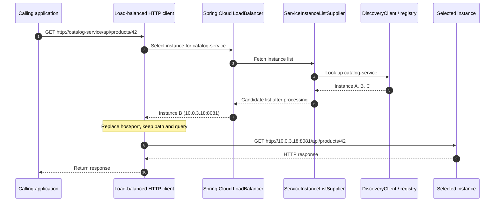

# Request Flow from Service Name to Selected Replica

In a system with multiple replicas of the same service, an application calls the target service using a stable **service ID**, such as `catalog-service`. At request time, Spring Cloud LoadBalancer looks up the list of registered replicas, picks a `ServiceInstance`, and forwards the request to that replica's specific network address.

That is client-side load balancing: the replica selection decision happens inside the calling service application. The application does not need to know the IP address or port of each replica in advance; it only needs to know the service ID and have an instance list supplier source.

## 1. Service ID Represents the Logical Service

Suppose the system has three replicas of the catalog service:

| Component | Sample Value | Meaning |
|---|---|---|
| Service ID | `catalog-service` | Logical name the application uses to call |
| Instance A | `10.0.3.17:8081` | One process serving `catalog-service` |
| Instance B | `10.0.3.18:8081` | Second replica |
| Instance C | `10.0.3.19:8081` | Third replica |

When writing `http://catalog-service/api/products/42`, the `catalog-service` part is the logical service name. With a LoadBalancer-integrated HTTP client, this name is resolved to an instance before the HTTP request is sent.

A Service ID is not an IP address, a server DNS hostname, or an individual process ID. It is the key for looking up the instance group. One service ID can map to multiple instances, and that set can change when the service scales, restarts, or is removed from the registry.

## 2. Which Components Does a Request Pass Through?

The overall flow can be broken down into the following steps:

1. **The application creates a request using a service ID.** For example, `RestClient` sends `GET http://catalog-service/api/products/42`.
2. **LoadBalancer integration recognizes the logical address.** An interceptor or exchange filter added by `@LoadBalanced` configuration separates the service ID from the path, query, and remaining request details.
3. **LoadBalancer requests the instance list.** `ServiceInstanceListSupplier` provides instances for that service ID. Data typically comes from a `DiscoveryClient`, or from static configuration in simple environments.
4. **The candidate list is processed.** Suppliers can combine caching, deployment-zone filters, health checks, or other selection rules.
5. **The load balancing strategy picks an instance.** For example, `RoundRobinLoadBalancer` cycles through available candidates.
6. **The target address is replaced with the instance address.** The service ID's host and port are replaced with the selected instance's host and port; the request's path and query are preserved.
7. **The HTTP client sends the real request.** The network connection is performed by the underlying client such as `RestClient`'s HTTP client, `WebClient`'s Reactor Netty, or the HTTP client used by Feign.



The diagram illustrates a successful request. In practice, caching may keep the supplier from querying the registry on every request; health checks may exclude an instance prior to selection; retries may trigger another selection after an error. Those mechanisms change the list or number of selections, but do not alter the core role of the service ID.

## 3. Discovery Supplies the Instance List

Spring Cloud LoadBalancer is responsible for choosing an instance. It needs another component to provide instance information. In Spring Cloud, `DiscoveryClient` is one of the common abstractions for querying registered services.

Depending on infrastructure, discovery data may come from:

- Eureka or Consul when the system uses the corresponding service registry.
- Kubernetes discovery when the deployment environment integrates Kubernetes discovery.
- `SimpleDiscoveryClient` when declaring a static instance list, often useful for testing or small environments.

Example static configuration for `SimpleDiscoveryClient`:

```yaml
spring:
  cloud:
    discovery:
      client:
        simple:
          instances:
            catalog-service:
              - uri: http://localhost:8081
              - uri: http://localhost:8082
```

With this configuration, the `catalog-service` service ID has two instances for LoadBalancer to consider. In environments using a real registry, addresses are typically registered and updated by the service application or deployment platform.

`ServiceInstanceListSupplier` is the intermediate layer providing the list to the selector. One supplier can fetch data from `DiscoveryClient`; another supplier can wrap it to add caching or candidate filtering. Thus, distinguish three responsibilities:

- **Discovery** answers the question: which instances are currently known for this service ID?
- **Supplier** answers the question: which instance list will be passed to the selector for the current request?
- **Load balancer** answers the question: which instance in the candidate list should be selected?

Caching helps reduce queries to the discovery source, but can also cause the candidate list to reflect registry changes with a delay. Cache lifetime and refresh behavior must match the rate of instance changes in the system.

### Health checks and instance filtering

An instance appearing in the registry is not guaranteed to be ready to handle requests. The registry may update slowly, the process may still be starting, or the application may have failed since its last registration. A health check supplier can inspect instance health and include only qualifying instances in the candidate list.

Health checks must be configured intentionally: the check endpoint should accurately reflect serving capability, the check interval should not generate excessive load, and application readiness should be designed consistently with the deployment platform. LoadBalancer's health check is a filtering layer in the instance selection flow; it does not replace platform readiness/liveness probes or lifecycle management.

If all instances are filtered out, LoadBalancer has no candidates to choose from. When investigating errors, inspect both initial discovery data and the output after suppliers and filters.

## 4. The Selector Decides Which Replica Receives the Request

Once a candidate list is available, the load balancing strategy decides which instance receives the request. Spring Cloud LoadBalancer provides built-in implementations; `RoundRobinLoadBalancer` is the common default when no other strategy is configured.

With three instances A, B, and C, round robin can distribute consecutive requests in the cycle A -> B -> C -> A. This is turn-based distribution, not a guarantee that each instance receives the exact same number of requests in every time window. Concurrent traffic, instance changes, retries, and multiple independent clients can all cause observed behavior to differ from an illustrative cycle.

Options and considerations include:

| Strategy or Mechanism | How It Works | When to Consider |
|---|---|---|
| Round robin | Sequentially selects instances in the list | Instances have comparable capacity and simple distribution is desired |
| Random | Randomly selects an instance from the list | Random distribution is desired without alternating order |
| Filtered supplier | Restricts candidates prior to selection, e.g., by zone or health check | Preferring a deployment zone or excluding unsuitable instances |
| Custom load balancer | Applies custom rules based on metadata or request context | Specific routing requirements exist and the rule can be tested and operated |

You can configure a dedicated LoadBalancer for a service ID using `@LoadBalancerClient`, then provide a `ReactorLoadBalancer<ServiceInstance>` bean or appropriate supplier. Per-service configuration should be scoped strictly to the target service; avoid letting the configuration class be picked up by global component scanning unintentionally, which would cause custom rules to leak to other services.

Do not pick an algorithm just because its name sounds fitting. Consider differences in instance capacity, load state, network locality, session requirements, and observability. If instances are heterogeneous in capacity, simple round robin may not reflect actual capacity.

## 5. Integrating with HTTP Clients

Spring Cloud LoadBalancer can be used across multiple clients. The common pattern is that the application sends a URL containing a service ID and the client is annotated/integrated with LoadBalancer to resolve that URL.

First, add the LoadBalancer starter when your application's integration setup requires it, and manage versions using the Spring Cloud BOM compatible with your Spring Boot version:

```xml
<dependency>
    <groupId>org.springframework.cloud</groupId>
    <artifactId>spring-cloud-starter-loadbalancer</artifactId>
</dependency>
```

### RestClient

With modern Spring Framework, `RestClient.Builder` can be annotated with `@LoadBalanced`:

```java
@Configuration(proxyBeanMethods = false)
class HttpClientConfiguration {

    @Bean
    @LoadBalanced
    RestClient.Builder loadBalancedRestClientBuilder() {
        return RestClient.builder();
    }
}
```

The application injects the annotated builder and calls by service ID:

```java
@Service
class CatalogClient {

    private final RestClient restClient;

    CatalogClient(@LoadBalanced RestClient.Builder builder) {
        this.restClient = builder.build();
    }

    Product findProduct(String id) {
        return restClient.get()
                .uri("http://catalog-service/api/products/{id}", id)
                .retrieve()
                .body(Product.class);
    }
}
```

If the builder is not configured with LoadBalancer, `catalog-service` may be treated by the HTTP client as an ordinary hostname and resolution will depend on DNS. Therefore, verify the right bean is injected when the application has multiple `RestClient.Builder` beans.

### WebClient

For reactive applications, annotate `WebClient.Builder` with `@LoadBalanced`:

```java
@Configuration(proxyBeanMethods = false)
class ReactiveHttpClientConfiguration {

    @Bean
    @LoadBalanced
    WebClient.Builder loadBalancedWebClientBuilder() {
        return WebClient.builder();
    }
}
```

Then call the URL with the service ID like a regular URI:

```java
@Service
class ReactiveCatalogClient {

    private final WebClient webClient;

    ReactiveCatalogClient(@LoadBalanced WebClient.Builder builder) {
        this.webClient = builder.build();
    }

    Mono<Product> findProduct(String id) {
        return webClient.get()
                .uri("http://catalog-service/api/products/{id}", id)
                .retrieve()
                .bodyToMono(Product.class);
    }
}
```

In reactive integration, LoadBalancer's exchange filter participates in resolving the service ID and selecting an instance. Keep calls inside the reactive chain so connection errors and timeouts are handled properly according to the application's reactive model.

### OpenFeign

With OpenFeign, the service ID is declared directly on `@FeignClient`:

```java
@FeignClient(name = "catalog-service")
interface CatalogFeignClient {

    @GetMapping("/api/products/{id}")
    Product findProduct(@PathVariable("id") String id);
}
```

Feign generates an HTTP client for the interface. When Spring Cloud LoadBalancer integration is on the classpath and enabled appropriately, Feign's client picks an instance by the name `catalog-service` before sending the request. There is no need to put individual instance hostnames or ports in the annotation.

The three integration approaches differ in API and execution model, but share the same service ID mechanism to locate instances. Choose a client based on application architecture: `RestClient` for synchronous calls, `WebClient` for reactive or non-blocking flows, and OpenFeign when you want to declare HTTP calls via interfaces.

## 6. How Does the Request Address Change?

Suppose the application sends:

```text
GET http://catalog-service/api/products/42?lang=vi
```

The supplier returns three instances and the selector picks instance B:

```text
http://10.0.3.18:8081
```

The HTTP client will send to the resolved URI:

```text
GET http://10.0.3.18:8081/api/products/42?lang=vi
```

LoadBalancer replaces the authority portion (host and port) with the selected instance's address. The path `/api/products/42` and query `lang=vi` stay with the request. Therefore, the service ID must match the name published by discovery, while the path must match the endpoint provided by the target application.

Instance selection happens per call through the integrated client. If the same service ID is called multiple times, each call can pick a different instance depending on the candidate list and strategy in use. Do not assume every request within a session will always hit the same instance unless the application explicitly configures corresponding affinity or routing mechanisms.

## 7. When a Request Fails to Reach an Instance

Failures can happen at multiple stages in the pipeline. Identifying the failing stage avoids confusing discovery issues with network issues or request handling in the target service.

| Symptom | Where to Check | How to Handle |
|---|---|---|
| No instance found for service ID | Service ID name, registry, `DiscoveryClient`, static config | Verify service ID spelling and confirm instances are registered |
| Registry has instances but selection list is empty | Cache, supplier, zone filter, health checks | Check output after each filter layer and health endpoint status |
| Instance selected but connection fails | Host, port, network policy, firewall, TLS, and process status | Test direct connectivity to the instance address |
| Instance returns 4xx or 5xx | Path, method, access permissions, and target service logic | Inspect the final request and logs of the receiving instance |
| Request is slow or times out | Connect/read/response timeout, service load, retries | Set appropriate timeouts and check whether retries amplify load |

LoadBalancer solves choosing a target address; it does not by itself guarantee connections or business logic will succeed. Timeouts belong to HTTP client configuration and related network layers. Retries may request re-selecting an instance, though exact behavior depends on the client integration and the application's retry configuration.

When enabling retries, bound attempt counts and only retry operations with safe semantics. A write operation may already have been processed by the target service before the connection dropped; uncontrolled resending can create duplicate side effects. Additionally, retrying across multiple layers can multiply call counts unexpectedly.

To observe the request flow, record the service ID, selected instance, processing duration, HTTP outcome, and failure cause. When debugging, correlate client-side logs with instance-side logs to see whether the request stopped at selection, connection, or business processing.

## 8. How to Test the Instance Selection Flow

A small integration test can verify the entire path:

1. Declare two instances for the same service ID using real discovery or `SimpleDiscoveryClient`.
2. Have each instance return a distinct identifier marker, such as `instance=A` and `instance=B`.
3. Send multiple requests through the proper HTTP client configured with `@LoadBalanced`.
4. Observe responses or logs to confirm requests were forwarded to the instance addresses.
5. Stop one instance or make its health check fail, then inspect the candidate list and subsequent call behavior.
6. Try a non-existent service ID to confirm the application clearly reports a no-instance error.

During testing, distinguish discovery output from selector output. If the registry returns two instances while the supplier filters down to one, every request hitting one address is the expected behavior given the current candidate list.

## 9. Concepts to Distinguish

- **Service ID and instance:** service ID represents the service group; an instance is a replica with a specific address.
- **Discovery and load balancing:** discovery finds known instances; load balancing picks one instance from the supplied list.
- **Selecting an instance and sending a request:** LoadBalancer decides the target; the HTTP client handles connecting and exchanging data.
- **Health checks and readiness assurance:** health checks help exclude instances failing check conditions, yet readiness, monitoring, and lifecycle management at other layers are still required.
- **Client-side load balancing and gateway:** client-side load balancing selects targets inside the calling application; a centralized gateway or proxy can accept requests and route at an intermediate point.

When tracing a request, start from the service ID in the URL, confirm the discovery source, inspect the list returned by `ServiceInstanceListSupplier`, determine which instance the strategy selected, and inspect the final URI sent by the HTTP client. This check chain pinpoints exactly where the request stopped and isolates issues across configuration, discovery, instance selection, and network connectivity.
