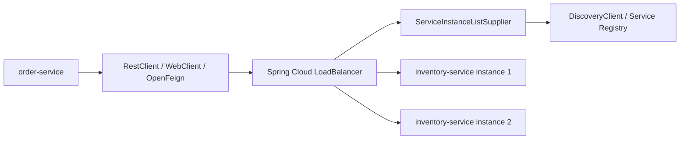

# Learning Path and End-to-End Hands-On Labs

The `SPRING_CLOUD_SERVICE_COMMUNICATION_LOAD_BALANCING` module teaches how a service chooses a target instance when calling another service using Spring Cloud LoadBalancer. You will progress from identifying service IDs and fetching instance lists via discovery, to instance selection, integrating with `RestClient`, `WebClient`, and OpenFeign, and then configuring health checks, retries, timeouts, and observing failures in service-to-service communication.

This lesson organizes the entire content into one unified hands-on learning path. Examples use `order-service` as the calling service and `inventory-service` as the called service. `inventory-service` has at least two instances registered under one service ID. When running the labs, you can use Eureka, Consul, Kubernetes, or a discovery mechanism suited to your environment; the key is that the client sees a logical service name instead of needing to know each instance's address in advance.

## Expected Outcomes

After completing the learning path, you should be able to:

- Explain the flow from a URI containing a service ID to the concrete `ServiceInstance` that receives the request.
- Distinguish service discovery, the instance list, instance selection policies, and the HTTP client.
- Configure Spring Cloud LoadBalancer for synchronous calls with `RestClient`, asynchronous calls with `WebClient`, and declarative clients with OpenFeign.
- Verify how the system reacts when instances are healthy, an instance stops, the discovery list changes, or a service has no usable instances left.
- Choose and configure request distribution policies, health checks, retries, and timeouts based on application requirements.
- Read logs, metrics, and traces to identify the service ID, selected instance, and root cause of failed requests.

## Shared Lab Topology

Throughout all lessons, keep a simple topology so results across configurations can be compared:

| Component | Role | Example |
|---|---|---|
| `order-service` | Calling service, runs client exercises | Port `8080` |
| `inventory-service` instance 1 | Instance handling inventory lookup requests | Port `8081` |
| `inventory-service` instance 2 | Second instance with the same service ID | Port `8082` |
| Service registry | Stores registered instance info | Eureka, Consul, or discovery platform in use |
| Spring Cloud LoadBalancer | Retrieves instance list and selects target per request | Runs inside `order-service` process |

Both inventory instances must share the same `spring.application.name`, while having different network addresses or ports. Each instance should return an instance identifier in its response or logs, such as `inventory-8081` and `inventory-8082`. That way, you can see where a request landed without guessing from request counts.

Overall flow of a request:



When the client calls `http://inventory-service/...`, `inventory-service` is the service ID. Discovery supplies known instance addresses. `ServiceInstanceListSupplier` provides the list used for that selection; the list may be affected by caching, health checks, or filters. LoadBalancer applies the instance selection policy, and then the HTTP client sends the request to the actual address. Instance selection takes place on the client side, inside the calling service application.

## Environment Preparation

Before starting, prepare the following components:

1. A Spring Boot project with a Spring Cloud BOM compatible with the Spring Boot version in use. Do not pick individual library versions arbitrarily; let the release train manage compatible versions.
2. A service registry or discovery mechanism that applications can query. If the system already has discovery, use that mechanism. For an isolated lab, you can spin up a small registry to observe instance registration and updates.
3. Two `inventory-service` processes running concurrently with the same service ID and different ports. Both should expose an inventory lookup endpoint and a health endpoint.
4. An `order-service` able to call `inventory-service` by service ID. Add `spring-cloud-starter-loadbalancer` to the calling application's classpath; add the discovery starter matching your chosen registry.
5. Actuator or an equivalent way to observe application status. Log the instance ID when handling requests so lab results can be verified.

Example configuring service name and port for an instance:

```yaml
spring:
  application:
    name: inventory-service

server:
  port: ${SERVER_PORT:8081}
```

Run the second process with `SERVER_PORT=8082`, keeping `spring.application.name` unchanged. Discovery registration configuration must ensure both processes appear under the same service ID. For `order-service`, set a distinct application name such as `order-service`, and use a URI whose host is `inventory-service` when calling via LoadBalancer.

Do not place `localhost:8081` or `localhost:8082` in `order-service` business code. If the client calls a physical address directly, the lab bypasses the instance selection mechanism this module covers.

## Stage-by-Stage Learning Path

| Stage | Focus | Hands-On Exercise | What to Observe |
|---|---|---|---|
| 1. Service ID and discovery | Registering, querying, and updating the instance list | Start two inventory instances and verify the registry recognizes both under the same service ID | Distinguish service ID from instance host and port |
| 2. Instance selection | Selection flow and default policy | Send multiple sequential requests from `order-service`, recording the handling instance ID | Identify which instance was chosen per request and understand round robin's role |
| 3. Supplier and instance health | `ServiceInstanceListSupplier`, caching, health checks, and metadata | Stop one instance and track when the active list removes that instance | Explain the delay between failure, discovery/health check, and list update |
| 4. HTTP client integration | `RestClient`, `WebClient`, OpenFeign | Perform the same lookup operation using all three clients | All three clients call by service ID and go through LoadBalancer |
| 5. Retries and timeouts | Transient error handling, attempt limits, and wait times | Simulate an instance returning errors or responding slowly | Distinguish instance selection errors, connection errors, timeouts, and HTTP errors |
| 6. Routing policies | Zone, hints, metadata, and custom suppliers | Tag instances by zone or metadata and test selection | Prove requests are filtered/selected according to the configured policy |
| 7. Observability and wrap-up | Logs, metrics, traces, and failure testing | Run an end-to-end scenario, collecting evidence from logs and observability tools | Trace a request from service ID to instance and failure cause |

### Stage 1 — Understanding Service ID and Service Discovery

The first goal is clarifying three commonly confused concepts:

- **Service ID** is the logical name used by the calling application, e.g., `inventory-service`.
- **ServiceInstance** describes a concrete process, typically including host, port, security info, and metadata.
- **Service discovery** is the mechanism enabling clients or LoadBalancer to find instances registered for a service ID.

Practice:

1. Start two `inventory-service` instances on two different ports.
2. Verify both register with the same service ID in the registry.
3. Temporarily stop one instance and observe how the registry marks or removes the instance under the active mechanism.
4. Restart the instance and observe re-registration.

Record the service ID, instance ID, host, port, and status displayed by the registry. If the registry does not distinguish instances clearly, assign a unique instance ID to each process. This stage is complete when you can explain why one service ID can represent multiple network addresses.

### Stage 2 — Observing How LoadBalancer Selects Instances

Once the instance list is available, send requests using a URI containing the service ID. The default policy usually uses round robin: selections cycle through available instances. Spring Cloud LoadBalancer also provides other selection policies, such as random, and allows per-service configuration overrides.

Practice:

1. Create an endpoint in `order-service` that calls `GET http://inventory-service/api/inventory/{sku}`.
2. Send around 20 sequential requests with the same SKU.
3. Have each instance log its identifier and cross-check logs with responses.
4. Change the instance count from two to three and run again.
5. If changing the selection policy, record the configuration and compare results against the round robin run.

Do not conclude that every instance always receives equal request counts in all situations. Outcomes also depend on request count, concurrency, the instance list at selection time, retries, and the active policy. With round robin and a stable list, a sequential request batch is the easiest way to observe behavior.

### Stage 3 — Exploring Suppliers, Caching, and Health Checks

`ServiceInstanceListSupplier` is the component that provides the instance list to LoadBalancer. Suppliers can fetch data from discovery, cache lists, or filter instances by conditions. Some configurations can probe a health endpoint to avoid selecting unresponsive instances.

Practice:

1. Call the service while both instances are healthy and save the list of instances used.
2. Stop one instance or make its health endpoint report an unhealthy status.
3. Monitor the registry, health checks, and the instance list received by LoadBalancer.
4. Measure the elapsed time from inducing the failure until requests stop going to that instance.
5. Restore the instance and verify it returns to the list.

Distinguish LoadBalancer's health check from registration status in the registry. The two mechanisms can update at different times. Behavior also depends on check intervals, caching, refresh durations, and how discovery is implemented. Therefore, do not expect an instance that just stopped to vanish instantaneously from every client.

To extend this exercise, test a supplier capable of zone preference or metadata filtering. Only use a health endpoint that accurately reflects the application's ability to accept traffic; a plain liveness endpoint may report that the process is alive while it is not yet ready to serve requests.

### Stage 4 — Integrating with RestClient, WebClient, and OpenFeign

The goal is keeping the service ID unchanged in calling code regardless of which client type the application uses. The examples below illustrate declaring builders annotated with `@LoadBalanced`. They require the corresponding libraries on the classpath and a Spring Framework version supporting the APIs used.

**RestClient — synchronous calls**

```java
@Configuration
class InventoryRestClientConfiguration {

    @Bean
    @LoadBalanced
    RestClient.Builder inventoryRestClientBuilder() {
        return RestClient.builder();
    }
}
```

```java
@Service
class InventoryGateway {
    private final RestClient restClient;

    InventoryGateway(@LoadBalanced RestClient.Builder builder) {
        this.restClient = builder.build();
    }

    InventoryDto find(String sku) {
        return restClient.get()
                .uri("http://inventory-service/api/inventory/{sku}", sku)
                .retrieve()
                .body(InventoryDto.class);
    }
}
```

`@LoadBalanced` enables the builder to create a client capable of resolving service-ID URIs via Spring Cloud LoadBalancer. If the application has multiple builders of the same type, keep the `@LoadBalanced` qualifier at both declaration and injection points to avoid injecting a non-load-balanced builder by mistake.

**WebClient — reactive calls**

```java
@Configuration
class InventoryWebClientConfiguration {

    @Bean
    @LoadBalanced
    WebClient.Builder inventoryWebClientBuilder() {
        return WebClient.builder();
    }
}
```

```java
@Service
class ReactiveInventoryGateway {
    private final WebClient webClient;

    ReactiveInventoryGateway(@LoadBalanced WebClient.Builder builder) {
        this.webClient = builder
                .baseUrl("http://inventory-service")
                .build();
    }

    Mono<InventoryDto> find(String sku) {
        return webClient.get()
                .uri("/api/inventory/{sku}", sku)
                .retrieve()
                .bodyToMono(InventoryDto.class);
    }
}
```

`WebClient` returns reactive types like `Mono` or `Flux`. Do not block the thread with `block()` in a reactive execution path just to make the example look like `RestClient`; keep asynchronous handling throughout the call chain.

**OpenFeign — interface-based client declaration**

```java
@EnableFeignClients
@SpringBootApplication
class OrderApplication {
}
```

```java
@FeignClient(name = "inventory-service", path = "/api/inventory")
interface InventoryFeignClient {

    @GetMapping("/{sku}")
    InventoryDto find(@PathVariable("sku") String sku);
}
```

OpenFeign uses `name` as the service ID. When Spring Cloud LoadBalancer is on the classpath and configured in the application, the Feign client can use this mechanism to select an instance. Enable Feign client scanning with `@EnableFeignClients` and ensure both OpenFeign and LoadBalancer dependencies are added to the application.

Across all three integrations, verify the URI or annotation has the right service ID, discovery/LoadBalancer dependencies are present, and requests actually reach one of the instances. If requests still call a fixed host, re-check builder configuration and where the HTTP client is instantiated.

### Stage 5 — Retries, Timeouts, and Error Handling

LoadBalancer selects an instance; the HTTP client establishes connections and exchanges data. The two parts are closely related yet have separate responsibilities. LoadBalancer retries can re-try the same instance or try another instance depending on configuration. Connect and response timeouts belong to client or HTTP transport configuration.

Practice each scenario individually:

1. **Instance refuses connection:** stop a process while the registry still holds stale info, then observe errors and retry behavior.
2. **Transient HTTP error:** create a test endpoint returning a retryable status code, then configure the retryable status code list and bounded attempt counts.
3. **Slow response:** create an endpoint with controlled delay, and configure connect timeout and response/read timeout suitable for the HTTP client.
4. **No instances remaining:** stop all instances and verify the application returns an observable error instead of waiting indefinitely.
5. **Recovery:** start an instance back up and verify requests succeed again once discovery or the health supplier updates.

When configuring retries, inspect both retries on the same instance and retries switching to the next instance separately. Cap total retry counts to avoid extending processing times or amplifying load when the system is overloaded. Do not blindly retry write operations that can produce side effects; only retry when the operation is idempotent or protected by an idempotency key and proper transaction controls.

Set timeouts according to the end-to-end request time budget. For example, if `order-service`'s API is only allowed to execute within a short window, the sum of connection time, response time, and retries must fit within that budget. Distinguish at least connect timeout, response/read timeout, and API-caller-tier timeout. An overly long timeout can hold resources while the instance is no longer responding.

### Stage 6 — Testing Routing Policies and Customization

Round robin works when instances are equivalent and simple request distribution is the goal. In real systems, instances may span different zones, carry different metadata, or serve distinct request groups.

Practice directions:

- **Zone preference:** attach zone metadata to instances and prefer instances in the same zone as the caller to reduce latency or cross-zone costs.
- **Hints or metadata:** pass controlled routing info to select the instance group matching the request.
- **List-filtering supplier:** create or configure a supplier to exclude instances not meeting a specific service's criteria.
- **Custom policy:** when built-in policies do not meet requirements, implement a dedicated LoadBalancer configuration for the service needing customization and test instance selection logic independently.

Practice with two zones, each having at least one instance. Send requests from a caller in zone A and verify the policy prefers zone A. Then shut down all instances in zone A to test fallback behavior to zone B. Explicitly document the policy when no matching instances exist: fall back to another zone, return an error, or apply a defined fallback rule. Do not leave fallback behavior as an unpredictable, uncontrolled outcome.

### Stage 7 — Observing and Verifying Behavior

A lab is complete only when there is evidence showing LoadBalancer selected instances and the application reacted properly to errors. Combine the following observability sources:

- **Application logs:** log service ID, instance ID, endpoint, outcome, and correlation ID or trace ID. Avoid logging sensitive data.
- **Actuator and health:** observe application status and the health endpoint used by the supplier or registry.
- **Micrometer metrics:** export metrics through your monitoring stack; look for metrics related to LoadBalancer requests, service ID, outcome, and exceptions. Exact metric names and tags may vary by Spring Cloud version.
- **Distributed tracing:** use traces to follow requests from `order-service` to `inventory-service`, comparing wait times and the receiving instance.
- **LoadBalancer logs:** when investigating, raise the log level for package `org.springframework.cloud.loadbalancer` in development environments, then restore an appropriate level afterward.

Do not look solely at total successful request counts. Cross-reference call counts, receiving instances, response times, retry counts, and errors per scenario. A useful dashboard should quickly answer: which service ID is being called, how many instances are available, how requests are distributed, and at which step errors appear.

## Capstone End-to-End Lab

After completing each stage, run the following end-to-end scenario within the same topology:

1. Run two `inventory-service` instances and one `order-service`; verify both instances registered under the same service ID.
2. Create an inventory lookup operation and call it with `RestClient`. Repeat with `WebClient` and OpenFeign; verify all three use `inventory-service` as the service ID.
3. Send a sequential batch of requests and save instance logs to prove the selection policy is working.
4. Stop one instance, measure the detection time, and verify requests continue to be served by the remaining instance once the list updates.
5. Induce transient errors and slow responses; configure bounded retries and timeouts. Verify requests do not exceed the configured time budget.
6. Add zone metadata to instances, configure zone preference, and test a scenario where the preferred zone has no healthy instances left.
7. Collect logs, metrics, and traces for both success and failure cases.

**Deliverables:** discovery and LoadBalancer configurations, service-call code across all three client types, retry/timeout configuration, one verified routing policy, plus logs or dashboard screenshots proving the results. Record the Spring Boot and Spring Cloud versions used so others can reproduce the lab.

## Self-Assessment Criteria

| Criterion | Passed When |
|---|---|
| Service discovery | Two instances with the same service ID appear in the discovery list and update when stopped/restarted |
| Instance selection | Logs or responses prove requests were sent to specific instances per the configured policy |
| HTTP client integration | `RestClient`, `WebClient`, and OpenFeign all call via service ID |
| Health handling | Unhealthy instances are excluded from selection per the configured interval and mechanism |
| Retries and timeouts | Attempt counts are bounded, timeouts are deliberate, and errors are clearly classified |
| Routing | Zone/hint/metadata routing and behavior when no matching instances exist are verified |
| Observability | Logs or traces can be correlated with target instance, response time, and failure cause |

## Common Mistakes to Check

- **Calling host and port directly:** a URI using `localhost:8081` bypasses service-ID-based instance selection.
- **Service ID mismatch:** the name in the URI or `@FeignClient` must match the service name registered in discovery.
- **Missing dependencies or unannotated builder:** check `spring-cloud-starter-loadbalancer`, the discovery starter, and `@LoadBalanced` on the proper builder.
- **Only one instance running:** load distribution cannot be observed if the registry returns only a single instance.
- **Concluding an instance was removed too early:** caching, health check intervals, and discovery refresh cycles can create update delays.
- **Retries duplicating write operations:** evaluate idempotency and cap retries before enabling retries on data-mutating endpoints.
- **Confusing timeouts with retries:** timeouts determine how long to wait; retries determine whether to make another call. Configure and monitor both.
- **Lack of observability evidence:** if responses lack an instance ID and logs do not record the receiving instance, distribution outcomes are hard to verify.

Upon completing this learning path, you can explain and verify the entire client-side load balancing process: from service ID, discovery, and the `ServiceInstance` list, through selection policies and HTTP clients, to how the system responds to instance failures, retries, timeouts, and routing requirements. This forms the foundation for configuring stable, production-operable service-to-service communication.
