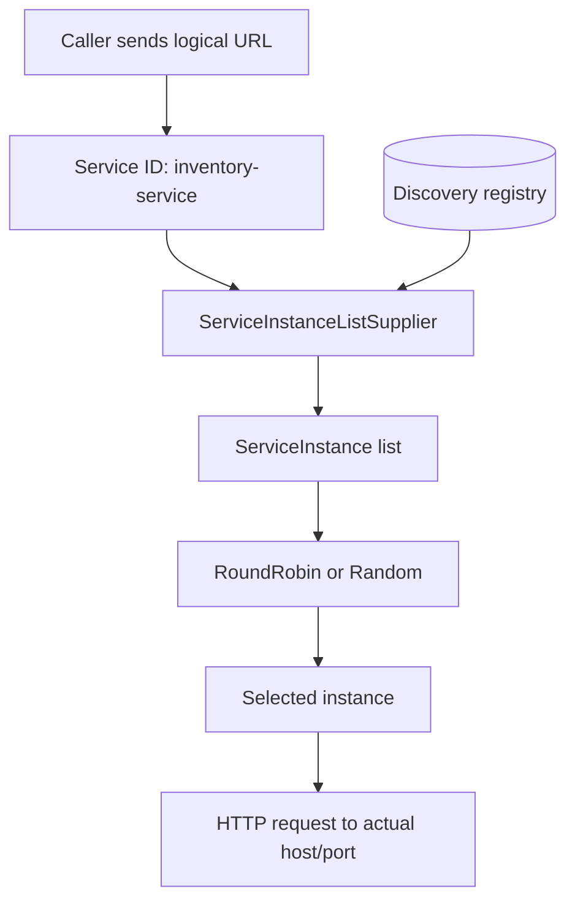
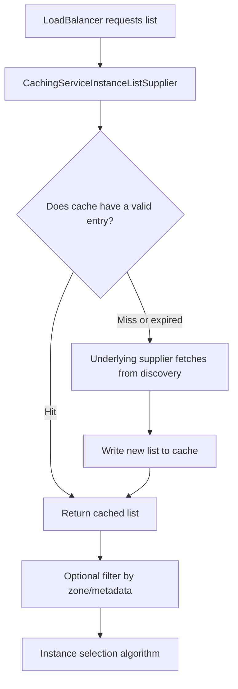
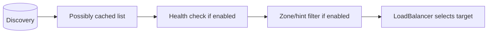

# Purpose of ServiceInstance List Caching

When an application calls `http://inventory-service/api/products/P-1001`, Spring Cloud LoadBalancer needs to find the list of instances serving `inventory-service`. This list may come from Eureka, Consul, another discovery provider, or a static configuration source. If every target selection had to refetch the list remotely, the number of discovery queries would scale with request traffic, whereas service topology usually does not change that quickly.

**`ServiceInstance` list caching** lets the caller reuse a discovered list of instances for a configured duration. As a result, target selection depends less on per-request discovery lookups, saving resources and reducing latency on the HTTP call path. In return, the cached list can temporarily be **older than the actual state** of the system.

In the **Instance Caching** chapter, this lesson covers the purpose, placement, trade-offs, and verification of the instance cache when an application uses Spring Cloud LoadBalancer with RestClient, WebClient, or OpenFeign.

## 1. What is a ServiceInstance List?

A service ID is a logical service name, such as `inventory-service`. A registry might provide these instances:

| Instance ID | Host and Port | Notes |
|---|---|---|
| `inventory-1` | `10.0.10.11:8080` | First instance |
| `inventory-2` | `10.0.10.12:8080` | Second instance |
| `inventory-3` | `10.0.10.13:8080` | Third instance |

Each `ServiceInstance` object represents a reachable target: service ID, host, port, scheme, instance ID, and provider-specific metadata. A `ServiceInstanceListSupplier` supplies this candidate set; a `ReactorLoadBalancer<ServiceInstance>`, such as round robin or random, selects one candidate for the client to send the request to.



These are **two distinct responsibilities**: retrieving the instance list and choosing one instance from that list. Caching optimizes the first responsibility; it is not the LoadBalancer's selection algorithm.

## 2. Key Purposes of Instance Caching

### 2.1. Reducing Discovery Source Lookups

Suppose a caller sends 200 requests/second to `inventory-service`. Over 20 seconds, there are 4,000 requests. If every instance selection queried the registry, the registry could face thousands of queries for a nearly static topology.

With caching, a single list fetch can serve many subsequent selections while the list remains valid. The actual number of queries also depends on cache expiration, concurrent requests, the number of caller replicas, and any built-in caching in the discovery client. The example only illustrates **potential cost reduction**, not that exactly one query occurs every 20 seconds.

### 2.2. Reducing Latency at the Target Selection Step

Reading a list from a local cache is typically faster and more predictable than querying a registry over the network. This is especially helpful when the registry has variable latency or when the caller issues many consecutive requests. However, it does not make the target service's database queries faster and does not reduce inherent business processing time.

### 2.3. Protecting the Control Plane from Unnecessary Load

The discovery registry is a shared component across many services. If hundreds of callers perform repeated lookups on every HTTP call, pressure on the control plane can grow rapidly. Reusing an instance snapshot reduces continuous query demand and makes registry load more stable.

### 2.4. Reducing Immediate Dependency on Discovery

A cached snapshot can allow a caller to keep selecting from known instances when the registry is briefly slow, **depending on how the cache and supplier behave**. However, caching does not guarantee failover: an entry may be expired, empty, or contain only instances that have stopped running.

## 3. What Does the Cache Store and Not Store?

| Stored in the instance cache | Not the job of the instance cache |
|---|---|
| List of instance addresses for a service ID. | Does not cache JSON payloads returned by business APIs. |
| Host, port, scheme, instance ID, and metadata of candidates. | Does not store request bodies, transactions, or sessions. |
| Input snapshot for target selection. | Does not replace an HTTP connection pool. |
| Information reusable across multiple requests. | Does not guarantee the same instance is chosen next time. |
| A list that may be stale until refreshed. | Does not automatically health-check each instance before every request. |

Therefore, even on a cache hit, a `GET /api/products/P-1001` call is still sent to a target service. This is **not an HTTP response cache** like `Cache-Control`, ETag, Redis, or a CDN. You should not expect enabling `spring.cloud.loadbalancer.cache.enabled` to cache business responses.

## 4. Placement of CachingServiceInstanceListSupplier

Spring Cloud LoadBalancer includes `CachingServiceInstanceListSupplier`, a supplier that acts as a decorator over an underlying instance-fetching supplier. `LoadBalancerClientFactory` manages child application contexts per service ID, and those contexts hold components such as `ServiceInstanceListSupplier` and `ReactorLoadBalancer`.

Conceptual flow with caching enabled:



On a **cache hit**, the stored list is reused. On a **cache miss**, the application must fetch it from the underlying source. When an **entry expires**, refreshing is typically tied to the next access or the implementation's refresh mechanism; there is not necessarily a background process polling the registry at every exact TTL interval.

**Supplier chain ordering matters.** If a request-dependent filter (such as hint/zone or tenant) runs before the cache, the filtered result of one request could inadvertently be reused for another request if the cache does not distinguish the context properly. When configuring an advanced chain, place the network-fetching supplier first, with the cache and filters in appropriate positions according to the release train's guidance, then verify the actual behavior.

## 5. TTL and Capacity: Two Different Tuning Goals

**Time-to-live (TTL)** limits how long an entry is considered valid by the cache mechanism. A shorter TTL surfaces updates sooner but increases lookup frequency. A longer TTL reduces discovery queries but can retain outdated instance information.

**Capacity** limits the cache's entry storage size, not the number of concurrent requests or the number of instances allowed to register. With many service IDs and distinct entries, capacity helps control memory usage and eviction.

Configuration example:

```yaml
spring:
  cloud:
    loadbalancer:
      cache:
        enabled: true
        ttl: 20s
        capacity: 256
```

In this example, `20s` and `256` are illustrative choices, not fixed recommended values for every application. Default values and eviction details should be checked against the documentation and configuration metadata for your exact Spring Cloud release train.

| TTL | Common Benefit | Risk to Watch |
|---|---|---|
| Short | Sees new instances sooner; removes deregistered instances sooner. | Increases discovery load and latency. |
| Long | Fewer queries; reduces churn during lookups. | Continues seeing old instances or misses new ones. |
| Disable cache at LoadBalancer | Removes one LoadBalancer snapshot layer. | May increase supplier queries; the discovery client may still cache separately. |

There is no universally optimal TTL. Systems that autoscale frequently need a different level of freshness than applications with mostly static instance groups. Do not tune TTL while ignoring graceful shutdown, health checks, and retries.

## 6. What Happens When Topology Changes?

Suppose a caller fetches the list `[inventory-1, inventory-2]` at `t=0s` and the cache has a 30-second TTL:

| Time | Event | List the caller may use |
|---|---|---|
| `t=0s` | Reads registry and populates cache. | `[inventory-1, inventory-2]` |
| `t=5s` | `inventory-3` registers in the registry. | Stale cache likely does not yet contain `inventory-3`. |
| `t=12s` | `inventory-2` stops abruptly. | Cache may still contain `inventory-2`. |
| `t=31s` | New access occurs, cache has expired, and registry has updated. | May fetch `[inventory-1, inventory-3]`. |

**TTL is not an SLA guaranteeing that after exactly 30 seconds every caller sees the new topology.** The registry needs time to update, the discovery provider may maintain its own cache or polling interval, some callers may not have made another request yet, and each caller replica populates its cache at different times.

During **scale-up**, new instances may receive requests late, delaying the benefit of added capacity. During **scale-down**, callers may keep selecting an instance that has left the system, causing timeouts or connection errors. A stale snapshot does not mean LoadBalancer is broken; the refresh mechanism across the entire pipeline must be evaluated.

### Caches Across Callers Are Not Necessarily Synchronized

If `order-service` has three replicas, each replica can hold its own snapshot. After the registry updates, two callers may see different lists for a brief period. Keep this in mind when analyzing traffic distribution; uneven request counts across instances do not necessarily mean round robin is broken.

## 7. Cache and Health Check Answer Different Questions

The cache answers: **"Which instances were discovered recently?"**

The health check answers: **"Among the known instances, which ones pass the configured health condition?"**

`HealthCheckServiceInstanceListSupplier` can probe and filter instances according to its configured mechanism. However, health checks do not necessarily reflect CPU, connection pools, p99 latency, or the ability to serve every business API. An instance whose health endpoint returns `UP` can still be overloaded.



The diagram shows logical responsibilities. When assembling an actual supplier chain, follow the decorator order and guidelines for your version. A cache placed in the wrong position can hold the output of health or hint filters for too long.

Health checks can detect failed instances before the registry updates, provided there is an appropriate check interval and result handling. Conversely, if the instance source is not refreshed, health checks cannot independently discover new instances that have never appeared in the list.

## 8. Double Caching with DiscoveryClient

Some discovery providers/clients keep their own snapshot or cache of the instance list. If you wrap it with the LoadBalancer cache as well, the system may have **two data caching layers**:

```text
LoadBalancer
  |
  +-- LoadBalancer list cache (if enabled)
        |
        +-- DiscoveryClient
              |
              +-- Provider cache/snapshot (if any)
                    |
                    +-- Registry
```

Consequences can include lists staying stale longer than expected, difficulty identifying which layer is responsible during scale-up/scale-down, and increased observability complexity. Therefore, if the discovery client already has solid caching, evaluate whether you truly need an **additional** LoadBalancer cache. This is an architectural decision based on the provider and traffic level, not a rule to disable caching everywhere.

To disable **only the Spring Cloud LoadBalancer cache**:

```yaml
spring:
  cloud:
    loadbalancer:
      cache:
        enabled: false
```

This property does not disable caching in Eureka/Consul, the HTTP connection pool, or business data caches.

## 9. Caffeine and the Default Implementation

Spring Cloud LoadBalancer can use a **Caffeine**-based cache when the library is on the classpath; otherwise, the framework uses its own default implementation depending on the release train. Caffeine provides advanced eviction/expiry options and is well suited when local cache tuning is needed.

Sample Maven dependency, when the project manages versions through an appropriate BOM or dependency management:

```xml
<dependency>
    <groupId>com.github.ben-manes.caffeine</groupId>
    <artifactId>caffeine</artifactId>
</dependency>
```

In versions that support a Caffeine spec, for example:

```yaml
spring:
  cloud:
    loadbalancer:
      cache:
        enabled: true
        caffeine:
          spec: expireAfterWrite=20s,maximumSize=256
```

When using `cache.caffeine.spec`, settings inside the spec may override expectations from `cache.ttl` and `cache.capacity`. Do not configure multiple conflicting property groups and assume all of them apply together; check the implementation and effective values.

Do not pick Caffeine solely expecting faster cache hits before measuring the slowest part of your system. For instance lists, keeping an **accurate** snapshot and refreshing appropriately is no less important than hit speed.

## 10. Example: Integrating Caching with RestClient

Suppose `order-service` wants to call `inventory-service` using a LoadBalancer-enabled `RestClient`. Maven dependency:

```xml
<dependency>
    <groupId>org.springframework.cloud</groupId>
    <artifactId>spring-cloud-starter-loadbalancer</artifactId>
</dependency>
```

Static instance configuration for development and caching:

```yaml
spring:
  cloud:
    discovery:
      client:
        simple:
          instances:
            inventory-service:
              - uri: http://localhost:8081
              - uri: http://localhost:8082
    loadbalancer:
      cache:
        enabled: true
        ttl: 20s
```

Declare a LoadBalancer-enabled builder:

```java
@Configuration(proxyBeanMethods = false)
class HttpClientConfiguration {

    @Bean
    @LoadBalanced
    RestClient.Builder loadBalancedRestClientBuilder() {
        return RestClient.builder();
    }
}
```

Gateway calling the service ID:

```java
@Service
class InventoryGateway {

    private final RestClient client;

    InventoryGateway(@LoadBalanced RestClient.Builder builder) {
        this.client = builder.build();
    }

    ProductView getProduct(String productId) {
        return client.get()
                .uri("http://inventory-service/api/products/{id}", productId)
                .retrieve()
                .body(ProductView.class);
    }
}
```

`ProductView` is an illustrative DTO; servers at 8081 and 8082 must be running for the test to succeed. The example assumes compatible Spring Boot/Spring Framework and Spring Cloud versions with `RestClient` integration. If using `WebClient`, use the appropriate `@LoadBalanced` builder; with OpenFeign, use `@FeignClient(name = "inventory-service")` and supported LoadBalancer integration.

Each call to `getProduct` still sends a request to a selected instance. Caching here only optimizes fetching the **list** of instances; it does not store or reuse `ProductView` responses.

## 11. Cache Miss, Empty List, and Failed Request

Three situations must be distinguished:

1. **Cache miss:** the entry does not exist or has expired; the underlying supplier needs to fetch a fresh list.
2. **Empty list:** no valid instances exist for the service ID, so LoadBalancer cannot pick a target from an empty set.
3. **Instance selected, but HTTP failed:** discovery still returns the instance, yet the target host may suffer a connection error, timeout, or return 5xx.

| Symptom | First Diagnostic Step |
|---|---|
| First call after TTL expiry is slow | Check discovery latency and cache miss frequency. |
| No instances found for a service ID | Verify the service ID, registry, and supplier chain. |
| Deregistered instance is still selected | Check TTL, provider-side caching, health checks, and drain mechanism. |
| New instance receives no requests | Verify registry update, cache source, and refresh timing. |
| HTTP `503` error or connect timeout | Distinguish inability to select an instance from selecting one whose backend cannot serve. |

Do not assume an HTTP error immediately evicts an instance from the cache. Removing a failing instance normally depends on discovery updates, health checks, or relevant extension components. Retries can help a request succeed after a transient failure, but can also overload the system further.

## 12. Coordinating Cache, Timeout, and Retry

Caching and resilience mechanisms serve different roles:

- **Cache TTL** governs the lifetime of an instance snapshot at the cache layer.
- **Connection/response timeout** limits how long the HTTP client waits for an instance.
- **Retry policy** decides whether a request is retried, how many attempts at most, and under what conditions.
- **Health checks, discovery, and readiness** determine candidate validity over time.

A short TTL will not rescue a request already waiting on a connection; a short timeout does not immediately refresh the cache; retries do not fix stale discovery data. For write operations such as creating an order, retries can cause duplicate side effects if the server already committed but the response was lost. An idempotency key or equivalent business safeguard is needed before retrying unsafe requests.

## 13. Observing the Cache in Real Environments

To measure instance caching, evaluate both **performance** and **stale-list risk**:

| Metric | Question to Answer |
|---|---|
| Registry lookup rate per service ID | Does caching reduce discovery pressure? |
| Cache hit/miss/eviction if metrics exist | Are TTL/capacity appropriate? |
| Instance selection time and HTTP client latency | Does it reduce cost on the request path? |
| Requests sent to deregistered instances | Does a stale cache cause errors? |
| Connect timeouts, 503s, retry attempts | Is a stale list amplifying errors? |
| Time until new instances receive traffic | How does caching affect scale-up? |
| Divergence across caller replicas | How long do callers see different topologies? |

Spring Boot Actuator, Micrometer, and tracing can aid observability depending on the starter, version, and implementation. Do not assume every cache type emits full hit/miss metrics; custom instrumentation may be required. Keep metric labels at reasonable cardinality such as service ID, route pattern, instance ID, and result; avoid tokens or sensitive user data.

Logs and tracing are helpful when recording the service ID, selected instance, request ID, attempt, duration, and status. To diagnose stale lists, correlate these timestamps with registry logs and scale-up/scale-down events.

## 14. Lab Exercise: Testing TTL and Instance Changes

Prepare two servers returning different `instanceId` values, such as `inventory-1` and `inventory-2`, exposing the same `GET /api/debug/instance` API. The caller sends requests via `@LoadBalanced RestClient` to `http://inventory-service/api/debug/instance`.

**Step 1 — Baseline:** Send many requests over several seconds without changing topology. Observe selected instances and the number of discovery reads if instrumentation is available. Even when multiple requests use a single cached snapshot, round robin can still alternate targets.

**Step 2 — Scale up:** Add `inventory-3` in the test registry. Record when the registry registers the new instance and when the caller first selects it. If the caller updates slowly, identify whether the delay comes from the registry, discovery client, or LoadBalancer cache.

**Step 3 — Drain an instance:** Perform a graceful drain or stop one instance in the lab environment. Record how many requests are still sent to the old instance, along with connect errors, timeouts, and retries. Do not run disruptive experiments on production systems.

**Step 4 — Vary the TTL:** Test shorter and longer TTLs in the same environment. Compare discovery cost, topology convergence time, failed requests, and p95/p99 latency. Pick a TTL based on the acceptable trade-off between performance and freshness rather than solely minimizing registry calls.

## 15. Misconceptions to Avoid

- **"Enabling instance cache caches API responses."** False: it only stores the target list.
- **"A cache hit means the request reuses the previous instance."** False: the algorithm still selects from the same candidate set.
- **"A 20-second TTL means after exactly 20 seconds every caller sees the new instance."** False: discovery caches, registry delays, and refresh timing also apply.
- **"The cache automatically removes an instance right after a connection error."** False: removal relies on discovery, health checks, or actual eviction.
- **"Disabling LoadBalancer cache disables caching across all discovery layers."** False: it disables only one layer.
- **"Health check UP means the instance will definitely handle every request well."** False: health does not equate to capacity or business-level health.
- **"With caching enabled, there is no need to monitor retries."** False: stale caches can cause abnormal retry spikes.

## 16. Production Readiness Checklist

- [ ] Distinguish instance caching from HTTP response caching and connection pooling.
- [ ] Identify the discovery source along with all existing cache/snapshot layers.
- [ ] Know the cache's position in the `ServiceInstanceListSupplier` chain.
- [ ] Choose TTL based on registry delay, autoscaling frequency, and stale-instance risk.
- [ ] Choose capacity aligned with the number of service IDs and actual needs.
- [ ] Have proper readiness, health check, and graceful drain mechanisms in place.
- [ ] Verify new and removed instances in scale-up/scale-down tests.
- [ ] Configure bounded timeouts and retries; protect idempotency on write requests.
- [ ] Monitor latency, registry calls, failed requests, and instance selection per service ID.
- [ ] Verify behavior on the exact Spring Cloud version and HTTP client in use.

**Conclusion:** `ServiceInstance` list caching lets Spring Cloud LoadBalancer **reuse discovery information** to select targets more efficiently and reduce control-plane load. The core trade-off is that the list can become stale when instances are added, removed, or fail. Understanding TTL, cache layers, the supplier chain, and health checks helps design a policy that both saves queries and limits requests to unsuitable instances.
