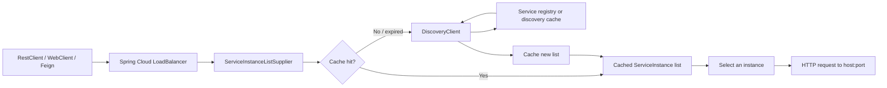
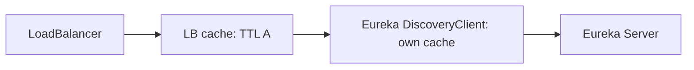

# TTL, Capacity, and the Trade-off Between Freshness and Lookup Cost

In Spring Cloud LoadBalancer, a call to a logical URL such as `http://inventory-service/api/items/42` needs to obtain the list of `ServiceInstance` entries for `inventory-service` before choosing a target using round-robin, random, or another policy. If every request queries the discovery client or registry to re-fetch the list, the application can incur unnecessary lookup overhead. **Instance list caching** reduces that cost, yet at the same time it can cause the client to keep seeing stale addresses after a deployment or scaling event.

This lesson in the **Instance Caching** chapter focuses on three variables: **TTL** (how long an entry lives), **capacity** (allocated/retained entry storage), and **freshness** (how closely it matches actual topology). You will see how to configure these variables in Spring Cloud LoadBalancer, how to spot double caching with discovery, and how to measure and pick appropriate values when communicating across services with `RestClient`, `WebClient`, or OpenFeign.

## 1. What Does the LoadBalancer Cache Store?

Suppose `order-service` sends multiple requests to `inventory-service`:

```text
GET http://inventory-service/api/items/42
GET http://inventory-service/api/items/43
GET http://inventory-service/api/items/44
```

A list provided by discovery might look like:

| Service ID | Instance ID | Host | Port | Observed Registry Status |
|---|---|---|---:|---|
| `inventory-service` | `inventory-a` | `10.0.1.10` | 8080 | Registered |
| `inventory-service` | `inventory-b` | `10.0.1.11` | 8080 | Registered |

**Spring Cloud LoadBalancer's cache** retains the instance list lookup result per service so subsequent selections can reuse it. This cache does not store the response of `/api/items/42`, does not store TCP connections, and does not store per-request round-robin outcomes. HTTP response caching and connection pooling are separate mechanisms.



This is a logical diagram. A discovery client, such as the Eureka client, may already maintain its own registry cache; therefore, not every LoadBalancer cache miss triggers a network request to the registry.

## 2. What Is TTL and What Duration Does It Actually Measure?

The **TTL (Time To Live)** of the LoadBalancer cache is the duration from when an entry is **written to the cache** until that entry is considered expired. The primary property is:

```properties
spring.cloud.loadbalancer.cache.ttl=35s
```

According to the Spring Cloud Commons documentation, the default TTL is **35 seconds** in standard cache configurations. The `35s` value is the time after write, **not** 35 seconds since the last access. Re-reading the list while the entry is still valid does not automatically extend the TTL just because new requests arrive.

For example, a new instance registers in the registry at second 12, while the caller holds a snapshot cached at second 0 with a 35-second TTL:

```text
Time:            t=0         t=12                    t=35       t=36
                 |-----------|-----------------------|----------|
Cache:          [inventory-a, inventory-b]          expired
Registry:       [a, b]      [a, b, c]              [a, b, c]
Caller sees:    [a, b]      [a, b]                   [a, b, c]*

* When a lookup occurs after expiry and the source reflects the change.
```

**TTL expiration does not mean the cache pushes the updated list to every caller right at that instant.** With on-demand caching, the next lookup creates the opportunity to re-read the source. If the underlying discovery client still holds an old snapshot, the result after the LoadBalancer cache expires may still not be fresh.

### 2.1. TTL, Change Detection Delay, and the Stale Data Window

A topology change can pass through several stages:

1. An instance registers or is deregistered; the registry must observe the event.
2. The discovery client updates its own data or re-reads the registry.
3. The LoadBalancer cache entry reaches its TTL or is invalidated by the active mechanism.
4. The next lookup fetches the fresh snapshot and applies any remaining filters.

In an idealized model where the registry is already updated and the client sends traffic regularly, the delay attributable solely to the cache ranges roughly from **0 to one TTL**, depending on when the change happened relative to the last write. If changes are distributed fairly uniformly and no other cache layer exists, the theoretical average wait time is about **TTL/2**. This is a mental estimation aid, not an SLA or guarantee for a real system.

Observed production latency also depends on heartbeats, discovery synchronization, other cache layers, when the next request arrives, and health check mechanisms. With two cache layers on independent cycles, total delay can exceed a single layer's TTL, yet you also cannot simply treat the sum of TTLs as a guaranteed upper bound.

### 2.2. TTL Is Not a Health Check and Does Not Eliminate Failures Immediately

TTL tells the cache when to **re-fetch information**, not whether an endpoint is still alive. An instance can crash right after the cache is written; LoadBalancer can still choose it until the list or health policy reflects reality. Conversely, a healthy instance may be missing from the list until the cache refreshes.

When fast failure detection is needed, look at discovery readiness/health, `HealthCheckServiceInstanceListSupplier`, or HTTP client timeouts/retries. A shorter TTL refreshes data faster assuming the source already knows about the change; it does not replace these mechanisms.

## 3. What Is Capacity? Watch Out for the Default 256

Spring Cloud Commons provides:

```properties
spring.cloud.loadbalancer.cache.capacity=256
```

The default **256** in the documentation is the **initial cache capacity**: the initial allocation capacity for the cache, **not** a limit allowing only 256 instances or 256 service IDs. This is a very common point of confusion.

Distinguish three metrics:

| Metric | Meaning | Impact |
|---|---|---|
| **Initial capacity** | Expected initial capacity of the underlying data structure | Can affect memory allocation and resizing; does not necessarily cap item count |
| **Maximum size / eviction policy** | Maximum cache entries allowed before eviction | Controls cache occupancy depending on implementation, especially with Caffeine |
| **Instances per service** | Number of `ServiceInstance` objects inside a single cache entry's value | Affects list size; not directly capped by `capacity=256` |

For instance, an application calls 20 service IDs, each having 10 instances. A per-service-ID cache model may hold around **20 entries**, whose lists together describe 200 instances. Do not interpret `capacity=256` as limiting the entire system to 256 instances.

Memory estimation must consider entry count, size of each list, instance metadata, object overhead, and retention of old snapshots. If you want to **cap the number of entries** with Caffeine, configure `maximumSize` in the Caffeine specification or use a size policy supported by the implementation.

## 4. Cache Mechanisms Provided by Spring Cloud LoadBalancer

Spring Cloud LoadBalancer has two common cache implementations, chosen based on classpath dependencies:

| Implementation | Condition | Key Notes |
|---|---|---|
| `DefaultLoadBalancerCache` | No Caffeine present; included with the starter | Supports general TTL and initial capacity settings |
| **Caffeine**-based cache | `com.github.ben-manes.caffeine:caffeine` dependency present | Allows tuning eviction/size/TTL via Caffeine specification |

Key configuration properties:

| Property | Documented Default | Meaning |
|---|---|---|
| `spring.cloud.loadbalancer.cache.enabled` | `true` | Enables the LoadBalancer caching mechanism for the active configuration |
| `spring.cloud.loadbalancer.cache.ttl` | `35s` | Expiration duration measured from write time |
| `spring.cloud.loadbalancer.cache.capacity` | `256` | **Initial** cache capacity, not max-size |
| `spring.cloud.loadbalancer.cache.caffeine.spec` | Unset | Optional Caffeine specification |

These defaults are documented in Spring Cloud Commons; always verify against the Spring Cloud release train locked in your project BOM, as features and properties can differ across versions.

### 4.1. Typical TTL and Initial Capacity Configuration

Example `application.yml`:

```yaml
spring:
  cloud:
    loadbalancer:
      cache:
        enabled: true
        ttl: 15s
        capacity: 128
```

Here, `ttl=15s` is an experimental choice to shorten stale snapshot exposure; `capacity=128` is the initial capacity, **not a hard cap** of 128 entries and not a limit allowing only 128 instances.

If the application uses a discovery source with its own effective cache—such as certain Eureka setups—check before keeping LoadBalancer caching on to avoid double caching. Do not blindly keep an extra cache enabled simply because `enabled=true` is the default.

### 4.2. Using Caffeine When Size Limits Are Needed

When Caffeine is on the project's classpath, `caffeine.spec` can be used:

```yaml
spring:
  cloud:
    loadbalancer:
      cache:
        enabled: true
        caffeine:
          spec: "initialCapacity=64,maximumSize=500,expireAfterWrite=15s"
```

The specification above defines **initialCapacity**, **maximumSize**, and **expireAfterWrite** for the Caffeine cache. `maximumSize=500` caps the number of cache entries under Caffeine's eviction policy; it **does not cap the number of instances inside each list**.

**Critical warning:** according to the Spring Cloud documentation, if `spring.cloud.loadbalancer.cache.caffeine.spec` is set, that specification **overrides** the general cache settings, including `spring.cloud.loadbalancer.cache.ttl` and `.capacity`. Therefore, do not set `caffeine.spec` while expecting `cache.ttl` or `cache.capacity` to also apply. Choose one consistent configuration approach per setup.

Caffeine does not create a new discovery mechanism and does not make the registry update faster. It is solely a way to store and evict cached entries. Check dependencies, actual service ID counts, and eviction requirements before adopting it.

### 4.3. Disabling Caching Without Disabling Load Balancing

```yaml
spring:
  cloud:
    loadbalancer:
      cache:
        enabled: false
```

This disables the LoadBalancer cache mechanism; it does **not** disable the load balancing algorithm or bypass service discovery. Each selection may invoke the discovery client to fetch the list, though the discovery client may still be using its own cache.

When disabling caching because you suspect double caching, inspect the actual supplier configuration. With custom suppliers, `enabled=true` does not automatically guarantee every chain includes `CachingServiceInstanceListSupplier`; conversely, supplier wrapping and cache providers must align with the overall system configuration.

## 5. Where Should the Cache Sit in the ServiceInstanceListSupplier Chain?

A Spring Cloud LoadBalancer configuration typically uses a `ServiceInstanceListSupplier` chain. The discovery source supplies the list; decorators can cache or filter by zone, hint, API version, or other request attributes.


**Ordering principle:** place `CachingServiceInstanceListSupplier` **immediately after** the supplier that fetches the list over the network, and **before** request-dependent filters. This is recommended in the Spring Cloud documentation.

Why? Suppose `inventory-service` has two versions, v1 and v2. If the cache is placed after the `X-Api-Version` filter, the filtered result for a v1 request could be reused for a v2 request if the cache does not key on that header. Caching the raw list per service ID before applying request-specific filters avoids mixing data across requests.

### 5.1. Configuration Example with Discovery and Caching

```java
// Service-specific configuration for service ID inventory-service.
public class InventoryLoadBalancerConfiguration {

    @Bean
    ServiceInstanceListSupplier inventorySupplier(
            ConfigurableApplicationContext context) {

        return ServiceInstanceListSupplier.builder()
                .withDiscoveryClient()
                .withCaching()
                .withZonePreference()
                .build(context);
    }
}
```

Bind the configuration to a specific service:

```java
@SpringBootApplication
@LoadBalancerClient(
        name = "inventory-service",
        configuration = InventoryLoadBalancerConfiguration.class)
public class OrderServiceApplication {
}
```

This example assumes the project already has the LoadBalancer starter, a compatible discovery adapter, and a `@LoadBalanced` HTTP client. `InventoryLoadBalancerConfiguration` should live outside regular component scan scope, or omit `@Configuration` as shown above, so that the service-specific bean is not accidentally registered into the root application context.

`withDiscoveryClient()` selects the appropriate discovery source per framework configuration; `withCaching()` adds the caching decorator; `withZonePreference()` acts as a downstream filter. Configuration alone does not enable caching for a nonexistent service or fix incorrect hosts/ports in the registry.

### 5.2. Health Check Is Not an Ordinary Cache

`HealthCheckServiceInstanceListSupplier` probes endpoint liveness and uses its own Reactor-based retention/replay mechanism. Spring Cloud documentation recommends considering omitting `CachingServiceInstanceListSupplier` when using health checks, and placing the health-check supplier right after the instance-fetching source, before request-based filters.

Example replacing the caching chain above:

```java
return ServiceInstanceListSupplier.builder()
        .withDiscoveryClient()
        .withHealthChecks()
        .withZonePreference()
        .build(context);
```

This is an alternative approach, **not** a recommendation to combine `.withCaching().withHealthChecks()` together. For the blocking stack, the builder offers the corresponding blocking health-check option, such as `.withBlockingHealthChecks()`. Choose according to your dependencies, health endpoint accessibility, and deployment setup.

## 6. Trade-offs Between Short TTL and Long TTL

TTL pushes **lookup cost** and **data staleness** in opposite directions:

| TTL | Benefit | Cost | Suitable Scenarios |
|---|---|---|---|
| Short, e.g., `5s` | Sees topology changes sooner once lower layers update | More cache misses, more frequent list fetches; higher load and jitter if source is slow | Fast-changing environments with cheap, high-capacity lookup sources |
| Moderate, e.g., `15s`–`35s` | Balances refresh cost and freshness in many scenarios | Still leaves a window of stale instances | Services with steady request volume and fairly stable topology |
| Long, e.g., `2m`–`5m` | Fewer refreshes, less pressure on the lookup source | Easy to retain invalid endpoints after deploy/scale | Very stable topology with independent failure-detection/failover mechanisms |

These are only **starting ranges for experimentation**, not universal defaults for every project. Choosing a TTL should depend on instance churn frequency, registry sync latency, source capacity, and the service's error/latency SLOs.

### 6.1. Estimating Lookup Cost per Service ID

Suppose a caller regularly invokes `S` service IDs, each cache entry expires after `T` seconds, the source does not push invalidations, and traffic is steady enough that entries are re-read immediately upon TTL expiration. The ideal cache miss rate on **one caller** is approximately:

\[
Q_{miss} \approx \frac{S}{T} \quad \text{list fetches/second}
\]

With `S = 20` service IDs and `T = 20s`:

\[
Q_{miss} \approx \frac{20}{20} = 1 \quad \text{fetches/second per caller}
\]

With 100 similar callers, the total idealized load on the list-fetching layer could be around 100 fetches/second. Lowering TTL from 20 seconds to 5 seconds nearly quadruples the refresh count in this model. This is **not** the number of network calls to the registry, because the underlying discovery client may cache; nor does it account for invalidations, bursty traffic, synchronized misses, or changes in active service IDs.

Another way to look at efficiency is the **cache hit ratio**:

\[
HitRatio = \frac{Hits}{Hits + Misses}
\]

For example, 9,800 hits and 200 misses yield a 98% hit ratio. However, a high hit ratio **does not prove a good configuration**: if TTL is too long, a system can achieve 99.9% hits while still failing requests due to dead instances. Evaluate hit ratio alongside **data age, topology convergence speed, and error rate**.

### 6.2. Capacity and Memory Cost

Initial capacity affects upfront allocation; maximum size or eviction policies affect how many entries can stay resident. A cache too small for the active set of service IDs will continually evict in-use entries, causing repeated misses. A cache too large or unbounded can consume excessive memory if service IDs are generated dynamically from uncontrolled input.

Cache keys normally correspond to service groups, so never generate service IDs per user, order ID, or request ID. High-cardinality keys bloat the cache and multiply child contexts and operational overhead. Service IDs should come from configuration or trusted discovery with a bounded set of values.

Importantly, if each list contains thousands of instances or bulky metadata, total memory can still be substantial even with few entries. Entry-count `maximumSize` does not directly bound the byte size of each list value.

## 7. Double Caching: A Common Issue with Eureka and Discovery

Some `DiscoveryClient` implementations—such as the Eureka client in many setups—already maintain a **local registry cache**. If Spring Cloud LoadBalancer adds another cache on top, the system can end up with two layers:



Distinguish these states:

- **LB cache hit:** retrieves the list from LoadBalancer memory without calling the underlying supplier.
- **LB cache miss:** calls the discovery client, yet the discovery client may still return its old local snapshot.
- **Registry changed:** does not guarantee either client-side cache has refreshed yet.

For example, when the LB cache expires, the Eureka client may not have pulled the new registry yet; the old list gets written back into the LB cache and persists for another full TTL. Thus, dropping LoadBalancer TTL from 35 seconds to 5 seconds sometimes barely improves convergence time when the bottleneck sits in Eureka's refresh cycle.

Spring Cloud documentation advises: **if the discovery client already caches effectively, disable LB caching to avoid double caching**. Disabling it via `spring.cloud.loadbalancer.cache.enabled=false` does not mean disabling Eureka caching or querying the registry over the network on every request.

Do not assume double caching always breaks things or that a specific TTL is always optimal. Before changing configuration, inspect your project's actual layers, refresh intervals, and error rates during deployments.

## 8. How Does TTL Affect Instance Failures and Scaling?

### 8.1. Scale-Out: New Replicas Do Not Receive Traffic Yet

At `t=0`, the caller caches `[inventory-a, inventory-b]`. At `t=10`, `inventory-c` registers and becomes ready. Until the caller refreshes its list, `inventory-c` may not be selected even though it is ready to serve. A shorter TTL can surface `inventory-c` sooner, **provided** discovery has updated and new requests arrive.

Common symptoms: new replicas get little traffic initially, old replicas show high CPU, and load distribution looks uneven right after scale-out. Cross-check the registry, discovery client, and actual supplier output rather than looking only at rollout dashboards.

### 8.2. Scale-In: Old Replicas Are Still Selected

When `inventory-a` shuts down, the caller may still hold `[inventory-a, inventory-b]` and keep routing some requests to `inventory-a`. An abrupt shutdown increases connection/reset errors. With a drain phase and transitioning readiness to unready before stopping, the registry and health filters have a chance to drop the instance from candidates earlier.

A safer deployment sequence:

1. Stop accepting new traffic via infrastructure readiness/draining mechanisms.
2. Wait for discovery and filter/cache layers to converge within designed bounds.
3. Let in-flight requests finish via graceful shutdown.
4. Reclaim the instance and stop the process.

The wait duration must account for all cache layers and connection lifecycles; `cache.ttl` alone cannot serve as a guaranteed deadline. HTTP clients still need bounded timeouts and conditional retries because race conditions cannot be eliminated completely.

### 8.3. Empty Lists and Lookup Source Failures

An empty instance list can happen because the registry has not seen the service yet, all candidates were filtered out, or the discovery layer is unavailable. Distinguish **no valid instances** from **source read errors**; whether to fail-open (last-known-good) or fail-closed must be decided upfront based on business requirements.

Never treat a stale cache as proof that an instance is healthy. Where legal/regulatory regions, incompatible API versions, or tenant isolation apply, never fall back to targets outside the permitted list merely to avoid errors.

## 9. Impact of Caching on Timeouts, Retries, and Connection Pools

Caching the instance list and sending HTTP requests are two separate phases:

| Component | What It Solves | What It Does Not Solve |
|---|---|---|
| LB cache | Cuts down instance list fetches | Does not verify sockets are still connectable |
| Health/discovery | Helps exclude unsuitable or unready instances | Does not guarantee the next request will succeed |
| Connect/response timeout | Caps waiting time for connection and response | Does not automatically refresh the registry cache |
| Retry | Re-attempts failed requests per policy | Not safe by default for all operations |
| Connection pool | Reuses TCP/TLS connections per endpoint | Does not remove stale instances from LoadBalancer's list |

For instance, LoadBalancer might still pick `inventory-a` from an old list. The HTTP client tries to reuse a socket or open a connection to that endpoint and gets `Connection refused`. A retry might pick `inventory-a` again if the list and policy are unchanged; in some configurations, a retry-aware supplier can avoid the just-failed instance. Check the actual retry mechanism instead of assuming retries always switch targets.

An order-creating `POST` may already have been processed on the server even when the caller receives a timeout. Retries must be paired with idempotency or an idempotency key so they do not produce duplicate side effects. Never use a short TTL as an excuse to skip timeouts or retry limits.

## 10. Tuning TTL and Capacity Using Operational Data

There is no single best TTL for all services. You can start from the defaults and adjust through repeatable experiments.

| Observation | Hypothesis | Verification Action |
|---|---|---|
| Removed instance keeps receiving failed requests for a long time | LB cache or discovery client is stale | Measure snapshot age, per-layer TTLs, and registry update time |
| Discovery/registry faces high load under increased concurrency | Caching disabled, TTL too short, or synchronized caller refreshes | Measure misses/sec, active service IDs, and source load before/after changes |
| Caffeine evictions rise continuously | `maximumSize` too small for the active service ID set | Measure entry count, evictions, and active service ID count |
| Heap grows despite small entry count | Each entry holds huge lists or heavy metadata | Measure instances per service, snapshot size, and object retention |
| Lowering TTL does not reduce deploy errors | Discovery cache, readiness, or draining is the bottleneck | Trace timeline across registry → discovery → supplier → request |
| Adding `caffeine.spec` disables general TTL setting | Spec overrides general cache properties | Pick one configuration style and verify effective settings |
| Different service ID per request | Unbounded key cardinality | Use stable logical service IDs; never embed user data in keys |

### 10.1. Metrics Worth Collecting

- **Cache hit/miss/eviction:** from the cache provider or custom instrumentation; do not assume all of these meters are enabled by default.
- **Cache entry count and snapshot age:** number of cached service IDs and time elapsed since the last successful list fetch.
- **Discovery refresh latency/errors:** duration and errors when fetching lists from the source.
- **Instance count before/after filtering:** separates stale caching from health/zone filtering dropping instances.
- **Topology convergence time:** from when an instance turns ready/unready in the registry until the caller sees the change.
- **Request error rate, p95/p99 latency, and retry count:** measures actual client impact, not just cache statistics.
- **Memory and GC:** evaluates the cost of numerous entries or large lists.

Spring Cloud LoadBalancer can emit request statistics via Micrometer when properly configured with a `MeterRegistry`, though request meters do not automatically include cache hit/miss metrics. Avoid attaching request IDs, tenant IDs, parameterized paths, or ephemeral instance IDs to unbounded metric labels, as doing so drives up cardinality.

### 10.2. Repeatable Tuning Process

1. **Capture baseline:** current TTL, provider (default vs. Caffeine), discovery client, caller count, and active service ID count.
2. **Inspect cache layers:** verify whether the registry/discovery client caches and whether `CachingServiceInstanceListSupplier` is in the chain.
3. **Measure convergence time:** add/remove an instance in a test environment and measure when the registry, discovery, and supplier reflect the change.
4. **Change one variable at a time:** test a shorter or longer TTL while holding workload and other settings constant.
5. **Measure cost:** hits/misses, discovery lookup rate, heap, CPU, and instance selection time.
6. **Measure business impact:** error rate, tail latency, retries, and time until new replicas take traffic.
7. **Prepare rollback:** if registry overload or errors spike after a change, revert to the previously stable configuration.

## 11. Hands-On: Observing a Removed Replica

Prepare an `order-service` client and two `inventory-service` replicas, say on `8081` and `8082`. Use a real discovery server or a supplier whose list can update at runtime; **do not** use a completely static list and expect TTL alone to change it.

Example test configuration:

```yaml
spring:
  cloud:
    loadbalancer:
      cache:
        enabled: true
        ttl: 10s
        capacity: 64
```

Steps:

1. Confirm the HTTP client uses the logical service ID `inventory-service` with LoadBalancer integration.
2. Send requests continuously and record the returned instance ID so you know which replica handled each request.
3. Record the timestamp when the registry stops advertising `inventory-a`; verify `inventory-b` remains healthy.
4. Watch requests still hitting `inventory-a` and determine when it disappears from the supplier list.
5. Change TTL from `10s` to `30s` in a comparable test run; compare convergence time, lookup rate, and error rate.
6. Disable the LoadBalancer cache while keeping the discovery client unchanged; repeat to detect potential double caching.
7. If using Caffeine, test a `maximumSize` smaller than the active service ID count to observe evictions; then increase the size and compare hits/misses.

Do not draw conclusions from a single run. Test removing instances at different points within the TTL cycle, because observed lag depends on whether the entry was freshly written or about to expire. Repeat with scale-out to measure how long it takes for a new replica to start receiving traffic.

## 12. Misconceptions to Avoid

| Misconception | Accurate Understanding |
|---|---|
| "A 35-second TTL means every client knows the new topology after exactly 35 seconds." | TTL is entry age since write; discovery data and the next lookup also govern convergence time. |
| "Capacity 256 means at most 256 instances." | Per documentation, that is **initial capacity**, not an instance count limit. |
| "Caffeine automatically speeds up dead-instance detection." | Caffeine optimizes caching/eviction; freshness still depends on TTL, discovery, and health. |
| "Higher cache hit ratio is always better." | A high hit ratio with an overly stale snapshot can still cause request failures. |
| "A small TTL always increases network load on the registry." | A cache miss may only read a local discovery cache; measure the right layer. |
| "Using `caffeine.spec` and `cache.ttl` together strengthens enforcement." | Caffeine spec overrides general settings like TTL/capacity. |
| "Health check and cache are the same feature." | Health checks verify ability to serve; caching retains fetched data. |
| "Disabling LB cache disables LoadBalancer completely." | Load balancing and discovery still operate; only one cache layer is removed. |

## 13. Operations Checklist

- Confirm whether the instance source comes from `DiscoveryClient`, `ReactiveDiscoveryClient`, or a custom supplier.
- Identify **every** cache layer between caller and registry to avoid unintended double caching.
- Record effective TTL, cache provider, `initialCapacity`, and `maximumSize` if applicable.
- Place `CachingServiceInstanceListSupplier` close to the list-fetching source, before request-based filters.
- Never use TTL as a substitute for readiness, health checks, timeouts, or bounded retries.
- Track topology convergence time alongside miss counts and HTTP error rates.
- Distinguish cache entry count from the number of instances inside each list.
- Avoid high-cardinality service IDs derived from user input.
- Verify graceful shutdown and draining mechanisms during scale-in.
- Explicitly define whether to retain old snapshots or fail closed when discovery cannot fetch fresh data.
- Roll out TTL/capacity changes incrementally with metrics and a rollback plan.

**Conclusion:** TTL and capacity are only meaningful when viewed within the complete picture of discovery, the supplier chain, and the HTTP client. A shorter TTL surfaces changes faster *if the source has already updated*, at the cost of more refreshes. A longer TTL cuts refreshes but increases the risk of using stale instances. Meanwhile, Spring Cloud LoadBalancer's default `capacity=256` is **initial capacity**, not a 256-instance limit. Sound decisions come from measuring topology convergence, lookup load, memory usage, and request SLOs.

## References

- [Spring Cloud Commons — Spring Cloud LoadBalancer](https://docs.spring.io/spring-cloud-commons/reference/spring-cloud-commons/loadbalancer.html): cache implementations, default TTL, initial capacity, Caffeine specification, double caching, and supplier ordering.
- [Spring Cloud Commons — Configuration Properties](https://docs.spring.io/spring-cloud-commons/reference/configprops.html): list of `spring.cloud.loadbalancer.cache.*` properties and their corresponding defaults.
