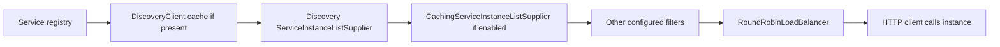
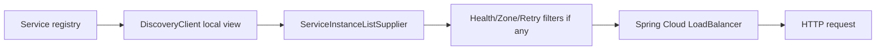
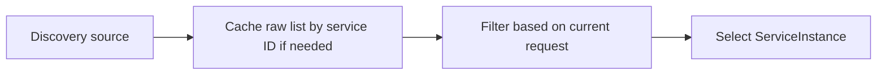

# Avoiding Duplicate Caching Across Multiple Layers

When `order-service` calls `inventory-service` by service ID, Spring Cloud LoadBalancer needs a list of `ServiceInstance` entries to choose a replica for each request. Querying this list can incur network overhead or service discovery system load, so multiple components support **instance list caching**.

Caching lowers latency and reduces load on the service registry, yet an easily overlooked risk is that **the same instance list may be cached across multiple layers**: in the discovery client, in Spring Cloud LoadBalancer's `ServiceInstanceListSupplier`, and sometimes in deployment platform caches. When these layers refresh on their own schedules, the time it takes for a new replica to appear or a failed replica to drop from the list can be longer than expected.

The goal of this lesson is to understand **where caches sit, what they cache, when to keep or disable a cache layer, and how to verify the instance list LoadBalancer actually uses**. This forms the foundation for balancing performance, topology freshness, and resilience when a replica stops running.

## 1. Instance List Caching Differs from HTTP Response Caching

First, identify what is being cached:

| Component | Data That Can Be Cached | Example |
| --- | --- | --- |
| Service registry / discovery client | Registered replicas, registration status, addresses, and metadata | `inventory-service` has A, B, C |
| Spring Cloud LoadBalancer cache | List of `ServiceInstance` candidates for the selection step | `[A, B, C]` for a period of time |
| HTTP response cache | Business endpoint response content when app/proxy allows caching | Result of `GET /api/stocks/BOOK-001` |
| HTTP connection pool | Reusable TCP/TLS connections to an address | Open connection to `10.0.1.12:8080` |
| DNS cache | Hostname-to-IP resolution results | Host `inventory.example` pointing to an IP |

This lesson focuses on **caching the `ServiceInstance` list**, not inventory response caching or connection pools. When a replica has been removed from the instance list, an old TCP connection can still linger in the pool; conversely, keeping A in the instance list cache does not guarantee an HTTP connection to A currently exists or is usable.

Correctly distinguishing each cache prevents applying the wrong fix. For instance, tuning an HTTP response cache will not stop `RoundRobinLoadBalancer` from repeatedly picking a stopped instance.

## 2. Two Common Cache Layers in the Same Call Path

Suppose `inventory-service` has three instances:

| Instance | Address | Initial Status |
| --- | --- | --- |
| A | `10.0.1.11:8080` | Running |
| B | `10.0.1.12:8080` | Running |
| C | `10.0.1.13:8080` | Running |

A request from `order-service` can traverse this data pipeline:



These layers have distinct roles:

1. **Registry** is the source of instance registrations; the registry itself may also maintain registration status and lease expiration.
2. **Discovery client** in the caller application looks up instances. Some implementations, notably the Eureka client, keep a local copy of registry data and sync periodically.
3. **`ServiceInstanceListSupplier`** turns discovery data into a candidate list for Spring Cloud LoadBalancer.
4. **`CachingServiceInstanceListSupplier`**, when present in the chain, stores the list supplied by the inner supplier so subsequent selections do not have to re-fetch that list immediately.
5. **LoadBalancer** selects one instance from the received list. Algorithms like Round Robin do not dictate the discovery refresh cycle.

Not every application has both cache layers. A static instance source or a direct-querying discovery client may have no internal cache; another system may use continuous synchronization and always maintain a local view of the registry. Inspect your actual implementation and configuration before deciding to add or remove a cache.

## 3. What Is Duplicate Caching and Why Does It Happen?

**Duplicate caching** occurs when two or more layers store copies of the same discovery information—such as the instance list for `inventory-service`—without a clear need for maintaining an extra copy at each layer.

Example:

```text
Actual registry:            [A, C]      (B has stopped)
DiscoveryClient cache:      [A, B, C]   (not yet synced)
LoadBalancer cache:         [A, B, C]   (TTL not expired)
RoundRobin candidates:      [A, B, C]
```

At this moment, a request can still be routed to B even though B stopped running. The fault does not necessarily come from Round Robin; the algorithm simply chooses from the list it is given.

Even after the discovery client updates to `[A, C]`, the LoadBalancer cache can continue holding `[A, B, C]` until its next refresh. Hence, **fixing data in the inner layer does not mean the outer layer immediately sees the change**.

Common consequences include:

- **Slow topology updates:** new instances receive no requests despite having registered in the registry.
- **Dead replicas still selected:** stopped instances remain in the candidate set, causing connection refused errors or timeouts.
- **Hard diagnostics:** the registry displays accurate state, yet callers keep sending requests to old addresses.
- **Unnecessary resource overhead:** duplicate data copies, timers, and invalidation mechanics running at multiple layers.
- **Unpredictable behavior on config changes:** TTL at one layer was reduced, while another layer still holds stale data.

Not every two-layer cache is wrong. A system might need a local registry view for resilience while also caching at another boundary to throttle expensive computation. What to avoid is **duplicating caches without knowing what purpose each layer serves, how old its data can get, and how it refreshes**.

## 4. Stacked TTL Effects

**TTL (time to live)** is how long data in a cache may be used before needing refresh or expiring, depending on cache policy. Neither layer's TTL guarantees the exact moment a replica truly stops receiving requests.

Suppose the discovery client refreshes its local view on its own cycle while the LoadBalancer cache keeps candidates by TTL:

```text
T0             T1                  T2                    T3
|--------------|-------------------|---------------------|
B stops        Discovery client    LB cache expires      Caller sees
operating      drops B from        and re-reads          the new list
               local view          discovery
```

Between T0 and when both layers see the fresh data, the caller may keep choosing B. If the LoadBalancer cache happened to refresh from the discovery client **right before** discovery dropped B, the old list can remain cached for another full cache cycle.

One rough estimation for analyzing worst-case update delay is:

```text
Delay to see new topology
    ≈ registry/discovery update delay
    + wait time for LoadBalancer cache layer to refresh
    + related processing or synchronization delays
```

This is purely a **mental model**, not a hard additive TTL formula guaranteed by Spring Cloud. Cache expiration timing, update events, next request arrival, refresh policies, cache eviction, dead-instance detection, and network latency can all shift real-world results.

The key takeaway is that shrinking one TTL does not guarantee fast updates if another layer keeps returning old data. When assessing convergence time, examine the **entire path from the registry to the candidate list on the caller**.

## 5. When Should You Disable Spring Cloud LoadBalancer Caching?

Spring Cloud LoadBalancer documentation notes that if `DiscoveryClient` already provides caching, adding extra caching in Spring Cloud LoadBalancer is usually unnecessary. With discovery sources like the Eureka client that maintain a local registry cache, prefer **using the single cache layer already managed in discovery** rather than retaining another copy at the supplier.

Caller application configuration:

```yaml
spring:
  cloud:
    loadbalancer:
      cache:
        enabled: false
```

This configuration requests **disabling Spring Cloud LoadBalancer's caching mechanism** within the scope supported by the framework. It **does not disable Eureka's or the discovery client's cache**, does not clear HTTP response caches, and does not force the registry to push new lists immediately to callers.

### 5.1. Architecture Diagram After Removing Duplicate Caching



In this diagram, the LoadBalancer chain adds no extra instance-list cache. However, **the discovery client can still return an unrefreshed local view**, so the possibility of hitting a stopped instance does not vanish completely.

### 5.2. When Should You Not Disable It Mechanically?

If the discovery source has no internal cache and every instance fetch triggers an expensive network query, disabling caching at LoadBalancer can increase latency or overload the registry. In that situation, keeping a cache with an appropriate TTL and capacity can be the right choice.

The decision should rest on three questions: **Does discovery already cache? How costly is re-querying? How fast must the system see replica changes?** There is no one-size-fits-all configuration across every registry type and traffic scale.

## 6. Configuring the Cache When You Genuinely Need It at LoadBalancer

When there is a sound reason to keep caching in Spring Cloud LoadBalancer, configure cache properties under the `spring.cloud.loadbalancer.cache` namespace. The following example is illustrative, not a fixed production TTL recommendation:

```yaml
spring:
  cloud:
    loadbalancer:
      cache:
        enabled: true
        ttl: 20s
        capacity: 256
```

| Property | Meaning | Considerations |
| --- | --- | --- |
| `spring.cloud.loadbalancer.cache.enabled` | Enables or disables LoadBalancer caching | Avoid stacking on top of discovery client cache unnecessarily |
| `spring.cloud.loadbalancer.cache.ttl` | Entry lifetime in the default cache | Lower TTL increases refresh frequency; higher TTL retains old topology longer |
| `spring.cloud.loadbalancer.cache.capacity` | Default cache capacity | Account for service ID count and how the implementation manages entries |

Some Spring Cloud LoadBalancer versions default to roughly **35 seconds** for TTL and **256** for capacity in their cache. Check the documentation for your exact version or the application's effective configuration rather than assuming one default holds across all releases.

When Caffeine is on the classpath, Spring Cloud LoadBalancer can use a Caffeine-based cache instead of the default cache. It can be configured with a property such as:

```properties
spring.cloud.loadbalancer.cache.caffeine.spec=maximumSize=256,expireAfterWrite=20s
```

When configuring Caffeine via `spec`, settings stated in the spec can **override** LoadBalancer's separate `ttl` and `capacity` settings. Inspect the classpath and active configuration to verify which implementation actually runs. Never configure conflicting values simultaneously and expect the framework to apply both.

Note that a short TTL is **not** a health check mechanism: refreshing the cache only pulls a newer list from the discovery source, without verifying that each replica is accepting connections cleanly.

## 7. Avoid Adding CachingServiceInstanceListSupplier Twice in Custom Chains

Beyond the framework's auto-configured cache, an application can build its own `ServiceInstanceListSupplier` via the builder. In that case, verify whether the chain already includes a cache layer before calling `.withCaching()`.

An illustrative chain when **you want LoadBalancer caching**:

```java
import org.springframework.cloud.loadbalancer.core.ServiceInstanceListSupplier;
import org.springframework.context.ConfigurableApplicationContext;
import org.springframework.context.annotation.Bean;

class CachedInventorySupplierConfiguration {

    @Bean
    ServiceInstanceListSupplier inventorySupplier(
            ConfigurableApplicationContext context) {

        return ServiceInstanceListSupplier.builder()
                .withDiscoveryClient()
                .withCaching()
                .build(context);
    }
}
```

An illustrative chain when **DiscoveryClient already caches and you want to avoid extra caching**:

```java
import org.springframework.cloud.loadbalancer.core.ServiceInstanceListSupplier;
import org.springframework.context.ConfigurableApplicationContext;
import org.springframework.context.annotation.Bean;

class DirectInventorySupplierConfiguration {

    @Bean
    ServiceInstanceListSupplier inventorySupplier(
            ConfigurableApplicationContext context) {

        return ServiceInstanceListSupplier.builder()
                .withDiscoveryClient()
                .build(context);
    }
}
```

These are **two mutually exclusive alternatives**, not two beans to register at once. When configuring per service ID, bind a supplier configuration class via `@LoadBalancerClient(name = "inventory-service", configuration = ...)`, ensuring that class is excluded from normal component scanning so it does not apply more broadly than intended.

If choosing the uncached option, align it with `spring.cloud.loadbalancer.cache.enabled=false` where appropriate. Do not add `.withCaching()` to a chain and expect every case to automatically skip that layer just because you want caching off. Interaction between auto-configuration and custom beans should be verified on your running Spring Cloud version.

**Do not confuse two kinds of duplication:** (1) discovery client already caches yet the supplier caches again; (2) the same supplier chain contains multiple `CachingServiceInstanceListSupplier` layers. Both must be caught by inspecting actual configuration, not merely glancing at a single property.

## 8. Cache Raw Lists; Do Not Accidentally Cache Request-Filtered Results

Spring Cloud LoadBalancer also has request-context-dependent suppliers such as hint routing, sticky sessions, or retry-aware filtering. These filters can produce **different candidate lists for the same service ID**.

Suppose discovery holds:

```text
inventory-service
  A: zone-a, stable
  B: zone-a, canary
  C: zone-b, stable
  D: zone-b, canary
```

Request X carries hint `zone-a` and needs A, B; request Y carries hint `zone-b` and needs C, D. If a cache keyed solely by service ID stores **X's filtered result** and serves it to Y, Y can mistakenly receive A, B.

Conceptually safe organization:



Do not assume every decorator order behaves identically. Spring Cloud LoadBalancer provides recommendations on where to place caching and health checks in the chain; with custom suppliers, verify the exact delegate call direction and what data gets cached. In the illustration above, cached data is the **list from the source**, while per-request policies run **after reading the list**.

Similarly, if a retry-aware supplier needs to exclude an instance that just failed from the next attempt, the previous attempt's filtered result must not be cached and shared with unrelated requests. This is also why `Request` context must be propagated through decorators via the matching invocation path when inner suppliers need it.

## 9. Caching Does Not Replace Health Checks and Retries

Suppose replica B stops working while still present in the cache. Three distinct mechanisms can participate in recovery:

| Mechanism | What Does It Help With? | Limitation |
| --- | --- | --- |
| Discovery refresh | Updates the list of instances still advertised by the registry | Subject to registry/discovery detection and sync delays |
| Cache TTL/eviction | Caps the age of the instance list held by LoadBalancer | Only refreshes from the underlying source; that source can still be stale |
| Health check supplier | Filters out instances failing configured health probes | Probes are not instantaneous and do not prove the next request succeeds |
| Retry policy | Allows re-trying requests after certain errors | Can amplify load and cause duplicate side effects for non-idempotent operations |

A very short cache TTL will not save requests if discovery still holds B in its local view. Conversely, even if discovery dropped B, LoadBalancer's cache holding an old list can still make a bad selection. Health checks narrow out unhealthy candidates, yet an instance can fail right after a probe. Retries can switch instances, yet cannot by themselves make write operations safe.

Therefore, removing duplicate caching is one part of design, **not a complete replacement for timeouts, bounded retries, or health checks**.

## 10. Comparing Three Caching Strategies

| Strategy | Suitable Case | Benefit | Trade-off |
| --- | --- | --- | --- |
| Use discovery client cache only | Discovery provides an adequate local registry view, e.g., Eureka client | Avoids extra cache lag at LoadBalancer; simpler configuration | Freshness remains bounded by registry/discovery refresh |
| Use Spring Cloud LoadBalancer cache only | Discovery source serves directly and re-querying is costly | Cuts list fetches; single place to control TTL | Topology update lag matches configured TTL |
| Intentionally keep two cache layers | Special performance profile or caches serving distinct goals | Can lower load in certain architectures | Harder to reason about freshness and invalidation; must be measured |

Base your choice on SLAs for topology change detection, inter-service call volume, discovery query latency, and application fault tolerance. Do not enable multiple caches just because each component exposes an `enabled` toggle.

## 11. Observing Live Data: Registry, Discovery, and Supplier

To prove duplicate caching is causing errors, compare **three list snapshots** over the same time window:

1. **Registry view:** the instances the registry or platform currently considers registered.
2. **Discovery client view:** the output of `DiscoveryClient.getInstances("inventory-service")` inside the caller itself.
3. **LoadBalancer supplier view:** the actual list fed into the instance selection algorithm after caching and filters.

Example right after B stops:

```text
12:00:00  Registry:             [A, C]
12:00:01  Caller DiscoveryClient: [A, C]
12:00:01  LB Supplier:          [A, B, C]
12:00:02  LoadBalancer selected: B -> Connection refused
12:00:21  LB Supplier:          [A, C]
```

If both registry and discovery client have dropped B yet the supplier still returns B, investigate LoadBalancer caching/filtering. If both registry and discovery still include B, the root cause likely lies in deregistration, lease/heartbeat expiration, refresh cycles, or the discovery source's health check mechanism rather than LoadBalancer's cache.

### 11.1. Reading the List from DiscoveryClient

Simple Java example to inspect what the caller's discovery client sees:

```java
import java.util.List;

import org.springframework.cloud.client.ServiceInstance;
import org.springframework.cloud.client.discovery.DiscoveryClient;
import org.springframework.stereotype.Component;

@Component
class InventoryDiscoveryInspector {

    private final DiscoveryClient discoveryClient;

    InventoryDiscoveryInspector(DiscoveryClient discoveryClient) {
        this.discoveryClient = discoveryClient;
    }

    List<ServiceInstance> currentInstances() {
        return discoveryClient.getInstances("inventory-service");
    }
}
```

`currentInstances()` shows the discovery client's list at the moment of the call; it is **not necessarily** the final list LoadBalancer chooses from if caching, zone filtering, health checks, or retry-aware suppliers sit downstream. To observe the final step, add logging or instrumentation in the supplier chain and log the chosen instance.

### 11.2. Logging Necessary Facts

Useful fields include service ID, timestamp, supplier name, instance count before/after cache/filter, chosen instance host/port, network exception, and trace ID. When possible, also record cache entry age or last list update timestamp according to your implementation's API/metrics.

```text
traceId=ab10... serviceId=inventory-service
discoveryCount=2 supplierCount=3 selected=10.0.1.12:8080
error=ConnectException cause=Connection refused
```

The log above shows a mismatch between discovery and supplier data. Locate which cache holds B or whether another data source is in play. Never log tokens, cookies, full headers, or metadata containing sensitive values; also avoid attaching high-churn host/instance IDs to unbounded metric labels.

## 12. Diagnostic Procedure When a Stopped Replica Is Still Selected

Suppose B has been removed from the system, yet requests keep failing when picking `10.0.1.12:8080`. Inspect in order:

1. **Confirm the failing address:** do logs show LoadBalancer picked B, or is the HTTP client reusing another connection/URI? Separate instance caching from connection pooling.
2. **Check registration status:** does the registry still list B, has B deregistered, or has its lease expired?
3. **Check caller-side discovery data:** does `DiscoveryClient.getInstances("inventory-service")` still include B?
4. **List supplier layers:** does the chain include `CachingServiceInstanceListSupplier`, health checks, or custom filters? Are multiple caching layers present?
5. **Read effective cache config:** what are `spring.cloud.loadbalancer.cache.enabled`, TTL, capacity, Caffeine spec, and any service-ID-specific overrides?
6. **Verify decorator order:** is caching wrapping the raw list or request-filtered results? Does another component cache again internally?
7. **Measure convergence time:** compare timestamps for when B stopped, registry updated, discovery updated, and supplier dropped B.
8. **Check recovery mechanisms:** are timeouts, retries, health checks, and idempotency properly designed?

Do not try to fix the issue by shrinking every TTL to tiny values before locating the layer causing the lag. Doing so can hammer the registry while failing to fix the cache that is actually retaining stale data.

## 13. Essential Test Scenarios

An integration test can run three instances A, B, and C, then mutate topology and measure how long it takes the caller to receive the updated list.

| Scenario | Expectation to Verify |
| --- | --- |
| B stops and deregisters | Once data sources update, the supplier stops selecting B |
| Instance D added | Caller sees and selects D within acceptable refresh/cache lag |
| Disable LB cache when discovery caches | No extra stale-list layer from LB cache; discovery itself may still lag |
| Enable LB cache with uncached source | Source read frequency drops; topology visibility lag aligns with TTL and SLA |
| Two requests use different hints | Request-filtered results are not wrongly shared via service-ID cache |
| Retry after connection error to B | If policy permits, subsequent attempt can avoid B; retries remain bounded |
| Multiple callers running in parallel | Each caller has its own local view and refresh timing; observe divergence between them |

When measuring, record timestamps using a consistent clock in the test environment, request counts, registry state, TTL values, and Spring Cloud version. A single successful call right after stopping B does not prove B disappeared from the list; Round Robin may simply have picked A or C on that attempt.

## 14. Sound Design Practices

These principles keep caching easy to understand and operate:

1. **Assign clear ownership of the primary instance cache.** If discovery already offers a solid local cache, consider disabling LoadBalancer caching.
2. **State topology freshness requirements explicitly.** Acceptable time to discover new replicas and stop picking failed ones should be measurable targets.
3. **Avoid stacking multiple `.withCaching()` layers** in custom `ServiceInstanceListSupplier` chains.
4. **Order caching and request-based filters properly.** Never share hint/retry-filtered results across unrelated requests.
5. **Understand effective Caffeine configuration.** Verify when a spec overrides other TTL/capacity properties.
6. **Distinguish caching from health.** TTL expiration does not prove a new replica is healthy; health checks do not immediately refresh every cache either.
7. **Keep retry policies safe.** Timeouts on write requests can happen after downstream already committed; consider idempotency keys or status queries.
8. **Observe every layer.** Registry, discovery client, supplier, and chosen instance must be cross-checkable during incident investigations.
9. **Prefer simple configurations.** Add a cache layer only when measurements demonstrate latency or query-cost gains.

## 15. Self-Check Questions

1. How does `ServiceInstance` list caching differ from HTTP response caching and connection pooling?
2. If the Eureka client already maintains a local registry cache, what side effect can adding `CachingServiceInstanceListSupplier` introduce?
3. Why might `RoundRobinLoadBalancer` still select B even after the registry removed B?
4. Does `spring.cloud.loadbalancer.cache.enabled=false` also disable the discovery client's own cache?
5. When is keeping Spring Cloud LoadBalancer's cache a sensible choice?
6. Why should you not cache request-filtered lists keyed solely by service ID?
7. If the discovery client sees `[A, C]` while the supplier returns `[A, B, C]`, which layer should be investigated first?
8. When enabling Caffeine, what should you watch out for regarding `caffeine.spec` vs. `ttl` and `capacity`?
9. Why can lowering TTL not replace proper health checks, timeouts, and retries?

**Conclusion:** instance list caching lowers the cost of fetching discovery data, yet every added cache layer complicates knowing which list is in use and when new topology becomes visible. Deliberately choose where caching lives, avoid unnecessary duplication between the discovery client and Spring Cloud LoadBalancer, and measure instance update latency from the registry all the way to actual replica selection.
