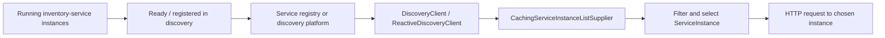
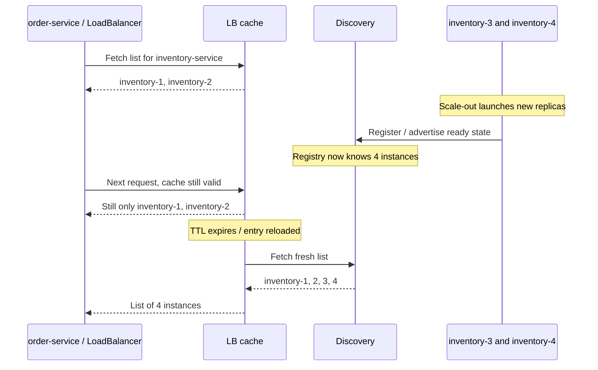
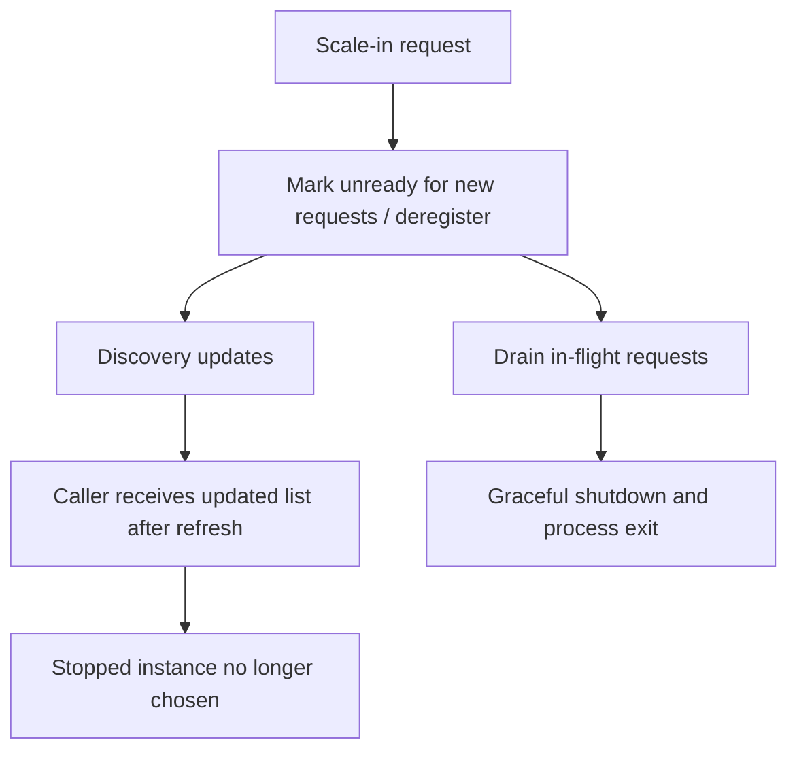

# Impact of Caching on Scaling Out and Scaling In Replicas

## Objective

When a service scales out from two to five replicas (*scale-out*) or scales in from five down to two replicas (*scale-in*), operators often expect traffic to adjust immediately to match active instances. In systems using **Spring Cloud LoadBalancer**, that expectation can fail because the `ServiceInstance` list seen by clients may be cached.

Caching cuts down calls to the service discovery system, reduces instance-list fetch overhead, and avoids unnecessary load. In return, caching introduces a window where **the client's list differs from actual deployment state**. During scale-out, clients may keep ignoring new instances. During scale-in, clients may keep picking instances that stopped accepting requests.

After this lesson, you will be able to:

- Describe the layers from running instances to the `ServiceInstance` list used by LoadBalancer.
- Distinguish when an instance is created, becomes ready, appears in discovery, and appears in cache.
- Explain the consequences of stale caches during scale-out and scale-in.
- Tune `spring.cloud.loadbalancer.cache.ttl`, `capacity`, Caffeine, or disable a cache layer when needed.
- Design safe scale-in via readiness, deregistration, draining, and graceful shutdown.
- Coordinate health checks, timeouts, retries, and observability to reduce errors while replica counts change.
- Test time-to-visibility for new instances and time-to-stop selecting old ones rather than only counting replicas in infrastructure.

## 1. Where Does the Client's Replica List Come From?

Suppose `order-service` sends an HTTP request to a logical URL:

```text
http://inventory-service/api/items/42
```

With `RestClient`, `WebClient`, or OpenFeign integrated with Spring Cloud LoadBalancer, `inventory-service` is the **service ID**. LoadBalancer needs the list of `ServiceInstance` entries for that service ID to choose a specific host and port.

Conceptual path:



Not every system includes all layers. Some discovery clients cache registry data internally; some environments send requests to a Kubernetes Service or reverse proxy so infrastructure load-balances instead of the client. In this lesson, we focus on cases where **client-side LoadBalancer actually sees and selects among multiple instances**.

Three commonly confused states:

| State | Meaning |
|---|---|
| **Running** | The process or container has started, though it may not yet be ready to serve. |
| **Published by discovery** | The discovery source knows about the instance and can return it depending on state/conditions. |
| **Selected by LoadBalancer** | The caller's active list contains the instance and filtering/routing policies allow choosing it. |

Increasing replicas in Kubernetes, launching more JVMs on VMs, or registering another replica in Eureka initially affects only the first layer or two. Subsequent layers can refresh on independent schedules.

## 2. What Does Spring Cloud LoadBalancer's Cache Store?

Spring Cloud LoadBalancer provides `CachingServiceInstanceListSupplier`, which fetches the list from another supplier and stores the result so subsequent requests do not repeat discovery lookups.

Example at startup:

```text
discovery result for inventory-service:
  [inventory-1, inventory-2]

LoadBalancer cache:
  key: inventory-service
  value: [inventory-1, inventory-2]
```

When subsequent requests arrive before the cache entry expires, LoadBalancer can keep using those two instances even if the registry changed. The cache is not a TCP connection table; it holds **a snapshot of the instance list**. Each HTTP request is still governed by timeouts, connection pools, retries, and the actual state of the target instance.

### 2.1. Cache TTL and Capacity

Per the Spring Cloud Commons **5.0.4** documentation, default LoadBalancer cache values are:

| Property | Default | Meaning |
|---|---:|---|
| `spring.cloud.loadbalancer.cache.enabled` | `true` | Enables LoadBalancer caching. |
| `spring.cloud.loadbalancer.cache.ttl` | `35s` | Entry lifetime measured from cache write time. |
| `spring.cloud.loadbalancer.cache.capacity` | `256` | **Initial capacity** of the cache, not 256 instances per service. |
| `spring.cloud.loadbalancer.cache.caffeine.spec` | Unset | Optional Caffeine specification that can override general settings. |

Cache adjustment example:

```yaml
spring:
  cloud:
    loadbalancer:
      cache:
        enabled: true
        ttl: 15s
        capacity: 256
```

`ttl: 15s` is an **illustrative choice**, not a standard value for every system. TTL must be chosen based on scaling speed, registry update frequency, and fault tolerance while stale lists persist.

TTL is an expiration duration measured from cache write; it does **not** mean every caller refreshes simultaneously every 15 seconds. Each caller process populates its cache at its own time, and reloading depends on traffic, the discovery source, network errors, and cache configuration.

### 2.2. Default Cache vs. Caffeine

Spring Cloud LoadBalancer has two cache options:

- **DefaultLoadBalancerCache** when Caffeine is absent from the classpath.
- **Caffeine-backed cache** when the `com.github.ben-manes.caffeine:caffeine` dependency is present.

With Maven, Caffeine can be added if the project picks that option:

```xml
<dependency>
    <groupId>com.github.ben-manes.caffeine</groupId>
    <artifactId>caffeine</artifactId>
</dependency>
```

Example dedicated Caffeine configuration:

```yaml
spring:
  cloud:
    loadbalancer:
      cache:
        caffeine:
          spec: expireAfterWrite=15s,initialCapacity=256,maximumSize=512
```

**Note:** when setting `spring.cloud.loadbalancer.cache.caffeine.spec`, the Caffeine spec can **override** general LoadBalancer cache settings such as `cache.ttl` and `cache.capacity`. Thus, if a project configures both, check which policy actually takes effect.

`maximumSize` in this example caps the number of Caffeine cache entries, not the replica count of `inventory-service`. Never use `cache.capacity` to describe how many replicas can be load-balanced.

## 3. Scale-Out: More Replicas, Yet Traffic Does Not Grow With Them

Suppose `inventory-service` has two healthy instances: `inventory-1` and `inventory-2`. As load grows, the autoscaler spins up `inventory-3` and `inventory-4`.

### 3.1. Illustrative Timeline



While the cache retains the old two-instance snapshot, the two new replicas may **already be ready yet receive almost no traffic from that caller**. Consequences:

- The two old instances stay heavily loaded even though the system provisioned more CPU and memory.
- The autoscaler may observe load not dropping as expected, spinning up extra replicas or reacting sluggishly.
- Load-balancing distribution looks skewed across callers: caller A refreshed and picks across four instances; caller B still holds the two-instance snapshot.
- A new canary group with valid metadata remains invisible in the client's candidate set.
- If old instances are saturated, requests can still time out or fail while new instances sit idle.

Caching **does not lose** new instances permanently; it only delays them from becoming candidates. Once both discovery and cache refresh, the LoadBalancer algorithm can select the new instances unless zone, hint, health-check, or API-version filters exclude them.

### 3.2. Timing Example, Purely Illustrative

Suppose:

1. `t=0s`: caller holds a cache with `inventory-1` and `inventory-2`, TTL 35 seconds.
2. `t=5s`: `inventory-3` becomes ready and is advertised by the registry.
3. `t=12s`: the discovery client can now return all three instances.
4. `t=20s`: caller keeps using its still-valid cache and picks only instance 1 or 2.
5. `t≈35s` or on a later access/reload: cache expires and can receive the three-instance list.

This is a hypothetical scenario, **not a guarantee** that every system updates in exactly 35 seconds. If discovery has not synced when the cache reloads, the client can store another stale snapshot and wait for yet another refresh cycle. With multiple cache layers or discovery errors, delay can be even longer.

Observed time usually depends on:

```text
Time ready to serve traffic
  -> time instance is advertised by discovery
  -> time discovery client sees the change
  -> time LoadBalancer cache holds the new list
  -> time policy actually selects the new instance
```

Do not add `discovery TTL + LoadBalancer TTL` and treat that sum as a hard ceiling. Layers refresh out of phase; traffic arrival, retries, health check conditions, and infrastructure state can all change real-world outcomes.

## 4. Scale-In: Stale Lists Can Cause More Severe Errors

When shrinking replicas, the main issue is not merely uneven distribution. Clients can **send requests to instances already removed from the system**.

Example initial LoadBalancer cache:

```text
inventory-service = [inventory-1, inventory-2, inventory-3, inventory-4]
```

The platform scales down to two replicas, choosing to stop `inventory-3` and `inventory-4`. The registry removes both instances, but the caller has not refreshed its cache. During that interval, LoadBalancer can still select `inventory-3` or `inventory-4`.

Consequences can include:

- `Connection refused` because the service port is no longer listening.
- `Connect timeout` or network failures because the pod/VM vanished or the network path closed.
- `Read timeout` or truncated responses if the instance accepted a request and shut down mid-response.
- Increased retries, shifting extra load onto remaining instances and potentially amplifying an incident.
- Rising HTTP 5xx rates despite healthy instances still running.

### 4.1. Impact of Shutdown Timing



In a safe workflow, **stopping selection of the instance for new traffic should happen before the process completely loses its ability to serve**, alongside time to finish already-accepted requests. Yet the discovery/cache branch and the in-flight draining branch run concurrently, with no guarantee every caller updates simultaneously.

Stopping an instance right after removing it from the registry leaves callers with stale caches sending requests to a dead address. Keeping the instance alive through an adequate draining window gives the system time to finish existing connections while discovery/cache layers converge.

**Crucial point:** stopping **new incoming traffic** also depends on how proxies, clients, and applications handle connections. Flipping readiness status or deleting a registry entry alone does not instantaneously wipe the address from every caller's cache.

### 4.2. Graceful Shutdown and Readiness

With Spring Boot, enable graceful shutdown and set a wait timeout suited to your workload:

```yaml
server:
  shutdown: graceful

spring:
  lifecycle:
    timeout-per-shutdown-phase: 30s
```

This lets Spring Boot attempt to finish in-flight requests within the shutdown phase timeout. It **does not directly control** the caller's LoadBalancer cache TTL, nor does it guarantee all callers stop selecting the instance before the JVM exits.

With Kubernetes, readiness probes and EndpointSlice mechanisms help remove terminating endpoints from standard Service traffic. Still:

- Determine whether callers target a **Kubernetes Service IP** or select **individual pods via Spring Cloud LoadBalancer**.
- If callers hold pod IPs cached through a discovery provider, changing EndpointSlice readiness alone does not immediately purge those snapshots.
- `terminationGracePeriodSeconds` and `preStop` can assist draining, yet proper durations must account for request processing time plus propagation/eviction lag.
- Do not treat `preStop` with an arbitrary fixed sleep as a safety guarantee. Measure propagation lag and test under realistic load.

When using Eureka, verify the application marks itself out-of-service or deregisters cleanly before shutdown. How soon clients see the updated list remains governed by registry fetches, instance state, and cache layers.

## 5. Two Cache Layers: Discovery Cache and LoadBalancer Cache

Spring Cloud LoadBalancer is not the only component holding instance lists. A discovery client such as `EurekaDiscoveryClient` may already cache the registry.


For Eureka, Spring Cloud Netflix documentation notes that `eureka.client.registry-fetch-interval-seconds` defaults to **30 seconds**. Spring Cloud LoadBalancer's `cache.ttl` defaults to **35 seconds**. These two intervals are **unsynchronized**, which can produce situations like:

1. Eureka client just fetched an old list.
2. LoadBalancer cache expires and queries the Eureka client.
3. Eureka client returns the old snapshot, and LoadBalancer caches that old snapshot again.
4. Shortly after, Eureka client receives the change, yet LoadBalancer cache retains the stale list until its next reload.

This is **double caching**, making scale-out/scale-in appear slower and less predictable. Spring Cloud documentation recommends **disabling LoadBalancer caching if the discovery client already performs caching**, such as Eureka:

```yaml
spring:
  cloud:
    loadbalancer:
      cache:
        enabled: false
```

Disabling one cache layer does not mean the application queries the registry server over the network on every request. If the discovery client maintains an internal cache, `DiscoveryClient` can serve from its own cache. Evaluate actual performance of your discovery implementation before changing production.

### 5.1. When Should You Keep the LoadBalancer Cache?

Keeping the LoadBalancer cache usually makes sense when the discovery source does not cache itself or list retrieval is expensive. Measure:

- Discovery call counts before/after enabling caching.
- Latency to detect new instances and drop removed instances.
- Request failure rate during scale-in.
- Per-instance CPU, memory, and request rate after scale-out.
- Frequency of registry overload during autoscaling or rollouts.

A **lower TTL** typically shortens the stale-list window at the risk of higher discovery load; a **higher TTL** lowers list-fetching cost at the risk of misrouting during topology changes. There is no single optimal TTL across all services.

### 5.2. Per-Service Configuration

Spring Cloud LoadBalancer supports per-service-ID properties under `spring.cloud.loadbalancer.clients.<serviceId>`, yet **`spring.cloud.loadbalancer.cache.enabled` is a global on/off gate**. When global caching is enabled, a specific service can omit `CachingServiceInstanceListSupplier` from its custom supplier chain. You cannot turn caching on for one service while the global gate is disabled.

Example custom uncached supplier chain for `inventory-service`:

```java
import org.springframework.cloud.loadbalancer.annotation.LoadBalancerClient;
import org.springframework.cloud.loadbalancer.core.ServiceInstanceListSupplier;
import org.springframework.context.ConfigurableApplicationContext;
import org.springframework.context.annotation.Bean;
import org.springframework.context.annotation.Configuration;

@Configuration(proxyBeanMethods = false)
@LoadBalancerClient(
        name = "inventory-service",
        configuration = InventorySupplierConfiguration.class
)
class InventoryLoadBalancerRegistration {
}

// Omit @Configuration to avoid component scanning from the parent context.
class InventorySupplierConfiguration {

    @Bean
    ServiceInstanceListSupplier inventoryInstanceListSupplier(
            ConfigurableApplicationContext context) {
        return ServiceInstanceListSupplier.builder()
                .withDiscoveryClient()
                .build(context);
    }
}
```

This configuration lets `inventory-service` fetch its list via the discovery supplier **without adding a LoadBalancer caching supplier**. It illustrates avoiding a redundant cache layer when Eureka discovery already caches or when measuring the effect of dropping one layer. If zone, hint, or other policies are needed, add the corresponding suppliers after the discovery source.

Configuration classes dedicated to `@LoadBalancerClient` must sit outside shared component scanning or avoid global `@Configuration` scanning. Otherwise, beans meant for one service ID can leak to multiple services.

## 6. Health Checks Do Not Replace New-Topology Discovery

`HealthCheckServiceInstanceListSupplier` can check the health of instances supplied by its delegate, periodically filtering out instances that fail probes.

However, distinguish two questions:

1. **Are known instances still healthy?** Health checks can help answer this.
2. **Are there new instances unknown to the current list?** Health checks cannot discover new instances on their own if the upstream supplier does not refresh the list.

When the delegate does not push fresh lists on topology changes, Spring Cloud supports:

```yaml
spring:
  cloud:
    loadbalancer:
      health-check:
        refetch-instances: true
        refetch-instances-interval: 20s
        interval: 10s
```

`20s` and `10s` are examples. These settings **only take effect when the health-check supplier is enabled** in the chain. Per Spring Cloud Commons 5.0.4 documentation, `refetch-instances` defaults to `false`; `refetch-instances-interval` defaults to `25s`. When refetching is enabled, the supplier can re-query upstream to pick up list changes.

Example supplier using health checks instead of the caching supplier:

```java
return ServiceInstanceListSupplier.builder()
        .withDiscoveryClient()
        .withHealthChecks()
        .build(context);
```

For blocking applications, choose `withBlockingHealthChecks()` matching your HTTP stack. `HealthCheckServiceInstanceListSupplier` keeps and replays results via Reactor's `Flux.replay()`; therefore, Spring Cloud documentation advises considering **not** wrapping it with `CachingServiceInstanceListSupplier`.

One critical detail: by default, `HealthCheckServiceInstanceListSupplier` **returns the entire retrieved list if no instance passes the health check**. Thus, it is not an absolute safeguard against picking unhealthy instances. You still need timeouts, connection error handling, bounded retries, and handling for zero available backends.

Do not turn on health checks merely to patch stale caching without first pinpointing whether staleness stems from the registry, discovery client, or LoadBalancer cache. If the registry already manages readiness well, adding probes from every caller can create unnecessary load.

## 7. Retries and Timeouts During Scale-In

Even with well-tuned caches, a request may already be in flight toward an instance that just began shutting down. Callers still need controlled error handling.

### 7.1. Bounded Retries

Spring Cloud LoadBalancer supports retries depending on configuration and the HTTP client used. Example:

```yaml
spring:
  cloud:
    loadbalancer:
      retry:
        enabled: true
        max-retries-on-same-service-instance: 0
        max-retries-on-next-service-instance: 1
        avoid-previous-instance: true
```

For safe read operations like `GET /api/items/42`, picking another instance to retry can help when an old instance is shutting down. However:

- Retrying against a **stale list** can still select another shutting-down instance; retries do not magically refresh discovery.
- Excessive retries can spike traffic onto surviving instances right during scale-in.
- A request that already produced side effects on the target service may be unsafe to re-execute.
- Spring Cloud OpenFeign, `RestClient`, and `WebClient` have different retry integrations; verify the policy on your exact HTTP client and library version.

For state-changing `POST`/`PUT` operations, evaluate idempotency keys, deduplication safeguards, and overall retry budgets before enabling automatic retries.

### 7.2. Sensible Timeouts

Connect timeouts and response timeouts are the responsibility of the HTTP client. Spring Cloud LoadBalancer selects instances; it does not replace timeout configuration on `RestClient`, Reactor Netty/`WebClient`, or OpenFeign.

Overly long timeouts leave requests hanging on stopped instances and tie up resources. Overly short timeouts can fail valid requests running slightly slower during scaling transitions. Choose timeouts based on SLAs, normal latency, peak load, and recovery requirements.

## 8. Hands-On Scenario: Measuring Latency During Scale-Out and Scale-In

This exercise should use a discovery provider capable of changing lists at runtime, such as Eureka or a suitable dynamic test discovery setup. **Editing `application.yml` for `SimpleDiscoveryClient` while the app runs is usually not enough to guarantee list refresh.**

### Step 1. Prepare the Applications

Set up three components:

- **Caller:** `order-service`, using `@LoadBalanced RestClient.Builder` or `WebClient.Builder` to call `inventory-service`.
- **Discovery:** Eureka server or a dynamic discovery source capable of registering/deregistering instances.
- **Backend:** two initial `inventory-service` instances, each exposing `GET /whoami` returning its instance ID.

Java example for the caller:

```java
import org.springframework.cloud.client.loadbalancer.LoadBalanced;
import org.springframework.context.annotation.Bean;
import org.springframework.context.annotation.Configuration;
import org.springframework.web.client.RestClient;

@Configuration(proxyBeanMethods = false)
class ClientConfiguration {
    @Bean
    @LoadBalanced
    RestClient.Builder loadBalancedRestClientBuilder() {
        return RestClient.builder();
    }
}
```

A simple gateway:

```java
import org.springframework.cloud.client.loadbalancer.LoadBalanced;
import org.springframework.stereotype.Component;
import org.springframework.web.client.RestClient;

@Component
class InventoryGateway {
    private final RestClient client;

    InventoryGateway(@LoadBalanced RestClient.Builder builder) {
        this.client = builder.build();
    }

    String whoAmI() {
        return client.get()
                .uri("http://inventory-service/whoami")
                .retrieve()
                .body(String.class);
    }
}
```

Expose a `GET /demo/inventory` endpoint on the caller returning the result of `whoAmI()` to run measurements. You implement this endpoint yourself; the LoadBalancer starter does not create it.

### Step 2. Set Up Two Cache Variants

In run A, enable caching with a fairly long TTL to make lag obvious:

```yaml
spring:
  cloud:
    loadbalancer:
      cache:
        enabled: true
        ttl: 60s
```

In run B, shorten the TTL or remove **LoadBalancer cache** if the discovery provider already caches:

```yaml
spring:
  cloud:
    loadbalancer:
      cache:
        enabled: false
```

Do not simultaneously change discovery refresh settings between runs if you want to isolate the LoadBalancer cache's effect. When changing properties, restart the caller or use a supported config refresh mechanism; never assume editing a YAML file on disk immediately updates a running process.

### Step 3. Warm Up the Cache

Call the caller endpoint multiple times to ensure it holds a cached list snapshot:

```bash
curl "http://localhost:8080/demo/inventory"
curl "http://localhost:8080/demo/inventory"
curl "http://localhost:8080/demo/inventory"
```

Record timestamps, returned instance IDs, and the number of instances provided by discovery if observable.

### Step 4. Scale-Out

Increase backends from two to four instances. Start measuring only once the new instances are **ready and advertised by discovery**, not from the moment the infrastructure command was issued.

Call `/demo/inventory` repeatedly and record:

- `T_ready`: new instances become ready.
- `T_discovered`: caller/discovery returns a list containing the new instances.
- `T_seen`: first load-balanced request that actually picks a new instance.
- `T_seen - T_ready`: request-side visibility delay, which can be influenced by the selection algorithm.

Note: even after the cache refreshes and holds four instances, the first few requests may **not select** the new instances due to probability or policy. Inspect both the candidate list and request outcomes; do not treat "did not see new instance in 5 requests" as proof the cache has not updated.

### Step 5. Scale-In

Reduce backends from four down to two instances using proper deregistration/readiness and graceful shutdown. Keep calling `/demo/inventory` and record:

- `T_unready`: removed instances are no longer considered ready/registered per policy.
- `T_removed`: discovery client list no longer includes those instances.
- `T_last_selected`: last time LoadBalancer still picked a removed instance.
- Number of connection errors, timeouts, retries, and elapsed gaps between stages.

A finding worth investigating is `T_last_selected` occurring **after** `T_removed`: there is likely an old cache or another supplier/connection path to inspect. If requests still reach a draining instance, check proxies and connection reuse, not only cache TTL.

### Step 6. Compare Measurements

| Scenario | Long TTL, added LoadBalancer cache | Short TTL or removed redundant cache layer |
|---|---|---|
| Scale-out | New instances may appear in selections slower | Usually shortens visibility lag |
| Scale-in | Risks retaining removed instances longer | Usually shortens window picking removed instances |
| Discovery load | Typically fewer list fetches | May rise if discovery source lacks its own cache |
| Resilience during registry hiccups | Can temporarily retain old snapshot | Depends on discovery provider availability |

These are tendencies to **measure in your specific system**, not guaranteed figures. If the discovery source already caches for a long interval, shrinking LoadBalancer's TTL may yield little improvement.

## 9. Kubernetes Services vs. Client-Side LoadBalancer: Avoid Mixing Them Up

In Kubernetes, an application can call `http://inventory-service` via DNS and a **Kubernetes Service**. In that setup, backend selection is typically performed by Kubernetes's networking/Service layer rather than by Spring Cloud LoadBalancer over individual pods.

Conversely, if the application uses Spring Cloud Kubernetes DiscoveryClient to obtain pod/endpoint lists and `ServiceInstanceListSupplier` selects a pod directly, Spring Cloud LoadBalancer caching clearly governs how candidate updates propagate.

Therefore, before diagnosing "LoadBalancer's cache does not see new pods yet," ask:

1. Does the caller actually use `@LoadBalanced` or OpenFeign LoadBalancer integration?
2. Does discovery return **a single Service VIP** or individual instances/pods?
3. Is load balancing happening client-side, at the Kubernetes Service, in a service mesh, or across multiple layers?
4. Which layer caches the endpoint list, and which layer handles draining?

If the app sends traffic to a standard Kubernetes Service ClusterIP, tuning `spring.cloud.loadbalancer.cache.ttl` in the app may have **no effect** on how Kubernetes balances connections. Verify the exact traffic path before changing configuration.

## 10. Operations and Observability During Autoscaling

To separate cache issues from discovery or backend issues, collect these signals:

| Signal | Meaning |
|---|---|
| Orchestrated replica count | Shows how many instances infrastructure intends to run. |
| `Ready` instance count | Shows how many backends pass readiness to serve traffic. |
| Instances published by registry/discovery | Shows what list callers can obtain from discovery. |
| Instances in supplier after cache | Shows whether LoadBalancer's retained list is fresh. |
| Selected instance ID | Shows which backend actually received the request. |
| Error rate / timeouts / retries | Shows how severely scale-in or disconnects cause errors. |
| Per-instance CPU, latency, throughput | Spots scale-out cases where new replicas get no traffic. |
| Discovery lookup counts and cache hits/misses | Evaluates the cost-benefit of caching. |

In debugging environments, emit concise logs:

```text
serviceId=inventory-service
discovered=4
loadBalancerCandidates=2
selected=inventory-1
```

If `discovered=4` yet `loadBalancerCandidates=2`, inspect caching and zone/hint/health-check filters. If `discovered=2` while infrastructure already has four ready pods, inspect the registry, discovery refresh, and Kubernetes Service path. Never deduce a cache fault conclusively from a single number.

Do not log tokens, cookies, or personal data. For metrics, avoid using high-churn instance IDs or unique request paths as unbounded tags because they drive high cardinality.

## 11. Common Issues

| Symptom | Possible Cause | Where to Check |
|---|---|---|
| Replicas increased, yet new instances receive no requests | Discovery has not published yet or LoadBalancer cache has not refreshed | Compare ready timestamps, registry, supplier snapshot, and selected instance IDs. |
| Scaling in increases connection refused errors | Callers still cache stopped instance addresses or shutdown was too fast | Check TTL, deregistration status, readiness, graceful shutdown, and timeouts. |
| Lowering TTL barely helps | Eureka/discovery client already holds an old snapshot | Check double caching and registry fetch interval. |
| TTL set in `cache.ttl` has no effect | `cache.caffeine.spec` is overriding it | Inspect Caffeine spec and effective configuration. |
| Health check enabled, yet new instances never appear | Supplier does not refetch discovery list | Check `health-check.refetch-instances` and list source. |
| Health check fails to drop all bad instances | Supplier falls back to full list when no instance is healthy | Verify policy, timeouts/retries, and discovery state. |
| Canary rollout traffic split is off | Cache lacks new instances or hint/weight filters behave unexpectedly | Inspect metadata, supplier order, cache, and observed request counts. |
| Pod stopped, yet requests still in flight | In-flight connections/requests, incomplete drain | Check termination grace, shutdown phase, and connection reuse. |
| No TTL impact visible in Kubernetes | Caller uses Kubernetes Service network-layer load balancing | Identify discovery type and actual request path. |

## 12. Checklist Before Scaling in Production

- [ ] Identify precisely which layer provides instances and which layer caches the list.
- [ ] Verify `spring.cloud.loadbalancer.cache.enabled`, `ttl`, and `caffeine.spec`.
- [ ] Avoid double caching when the discovery client already caches with an appropriate refresh interval.
- [ ] Place `CachingServiceInstanceListSupplier` near the discovery source, before request-filtering suppliers.
- [ ] Choose TTL based on scaling speed, discovery cost, and stale-instance tolerance.
- [ ] Test scale-out: verify new instances actually enter candidates and receive requests.
- [ ] Test scale-in: verify removed instances stop being picked after the list updates.
- [ ] Configure readiness, deregistration, and graceful shutdown suited to your deployment mechanism.
- [ ] Set bounded timeouts and retries; protect idempotency when retrying write operations.
- [ ] If enabling health checks, understand refetching and fallback when no healthy instances exist.
- [ ] Compare ready replica counts, discovery lists, LoadBalancer candidates, and actually selected instances.
- [ ] Confirm whether the application uses client-side load balancing or Kubernetes Service/mesh/proxy balancing.

## Conclusion

Caching helps Spring Cloud LoadBalancer lower the cost of fetching `ServiceInstance` lists, at the price of delaying visibility of topology changes. During **scale-out**, ready new instances may sit unused; during **scale-in**, callers may keep choosing removed instances and hit connection errors. The fix goes beyond lowering TTL: understand discovery caches, avoid double caching, order suppliers properly, coordinate readiness/draining/graceful shutdown, and test from the caller side. Figures like the default 35-second TTL are only one part of the update chain, not a guarantee of system-wide change visibility.

## References

- [Spring Cloud Commons 5.0.4 — Spring Cloud LoadBalancer Caching](https://docs.spring.io/spring-cloud-commons/reference/spring-cloud-commons/loadbalancer.html)
- [Spring Cloud Commons — Configuration Properties](https://docs.spring.io/spring-cloud-commons/reference/configprops.html)
- [Spring Cloud Commons — Instance Health-Check for LoadBalancer](https://docs.spring.io/spring-cloud-commons/reference/spring-cloud-commons/loadbalancer.html#instance-health-check-for-loadbalancer)
- [Spring Cloud Netflix — Eureka and registration/registry cache latency](https://docs.spring.io/spring-cloud-netflix/reference/spring-cloud-netflix.html)
- [Spring Cloud Netflix — Eureka Configuration Properties](https://docs.spring.io/spring-cloud-netflix/reference/configprops.html)
- [Kubernetes — Termination of Pods and EndpointSlice readiness](https://kubernetes.io/docs/concepts/workloads/pods/pod-termination/)
