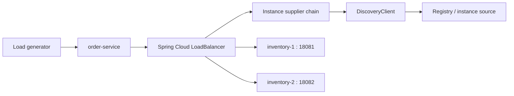
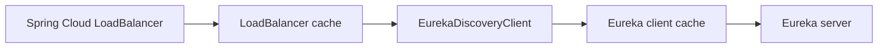

# Scenario for Measuring Lookup Counts Before and After Enabling Caching

When `RestClient`, `WebClient`, or OpenFeign calls a service using a logical name like `inventory-service`, Spring Cloud LoadBalancer needs the `ServiceInstance` list before picking a host and port. That list is provided by `ServiceInstanceListSupplier`, potentially going through `DiscoveryClient` and several filtering layers. If every selection had to re-query the source, lookup counts would scale sharply with traffic. **Instance list caching** cuts down repeated source reads, at the risk of slower updates when instances are added, removed, or change state.

This lesson belongs to the **Instance Caching** chapter of the `SPRING_CLOUD_SERVICE_COMMUNICATION_LOAD_BALANCING` module. Its objective is to design a **repeatable experiment**: hold request count, service ID, instance set, and test duration constant; vary only the cache state; and compare source lookup counts before and after enabling the cache.

Questions to answer:

- Does one HTTP request equal one discovery call?
- Where should a counter be placed to measure how many times the supplier actually reads the source?
- How do cold cache, warm cache, and TTL expiration differ in results?
- Why does counting network requests to Eureka/Consul not always reflect LoadBalancer cache effectiveness?
- How do you verify caching reduces load while still detecting instance changes promptly?

## 1. Three Kinds of Counts to Distinguish

Suppose `order-service` sends 100 consecutive HTTP requests to `inventory-service`:

```text
100 requests from order-service
    ↓
100 client requests to select a ServiceInstance
    ↓
Spring Cloud LoadBalancer
    ↓
ServiceInstanceListSupplier chain
    ↓
[LoadBalancer cache, if enabled]
    ↓
DiscoveryClient / source supplier
    ↓
Discovery provider's internal cache or registry
```

There are **three distinct metrics**:

| Metric | Where Is It Measured? | Question Answered |
|---|---|---|
| `httpRequests` | Client issuing calls to the target service | How many business requests occurred? |
| `sourceLookups` | Source supplier or `DiscoveryClient.getInstances(serviceId)` | How many times did LoadBalancer have to re-fetch the list from the source layer? |
| `registryNetworkCalls` | Client SDK, discovery server, or network layer | How many actual network requests reached the registry? |

**The primary target of this experiment is `sourceLookups`.** It directly measures how effectively `CachingServiceInstanceListSupplier` avoids re-reading its delegate.

For example, `EurekaDiscoveryClient` can return data held in memory by the Eureka client. An application call to `getInstances()` does not necessarily trigger a new HTTP request to the Eureka server. Thus, reducing `getInstances()` from 100 calls to 1 **does not automatically mean** 99 fewer network requests to the registry.

### 1.1. Basic Formula

Let:

- `N`: number of instance-selection requests in a measurement window.
- `R_off`: number of source reads with LoadBalancer cache disabled.
- `R_on`: number of source reads with cache enabled.

Reduction ratio:

```text
reduction(%) = (1 - R_on / R_off) × 100
```

Example sequential model with 100 selections for the same service ID, a fixed instance set, and no TTL expiry:

```text
R_off = 100
R_on  =   1

reduction = (1 - 1/100) × 100 = 99%
```

This is an **expectation for a controlled test**, not real-world production numbers. In live systems, background refreshes, discovery caches, concurrent misses, multiple service IDs, and health checks can shift results.

## 2. Designing a Fair Measurement

Change only **one independent variable**: Spring Cloud LoadBalancer cache OFF vs. ON.

| Condition | Run A: cache OFF | Run B: cache ON |
|---|---|---|
| Service ID | `inventory-service` | `inventory-service` |
| Instance-selection requests | 100 | 100 |
| Instance set | Two fixed instances | Same two instances |
| Workload | Sequential, single client | Sequential, single client |
| Selection algorithm | Default round robin | Default round robin |
| Discovery / source supplier | Same implementation | Same implementation |
| Health/zone/hint filters | Disable unused ones or keep identical | Identical to Run A |
| TTL | Not applicable | Longer than test duration |
| Counter | Counts source reads | Counts source reads |
| Initial state | Fresh source/counter | Cold cache/fresh counter |

**Why measure sequentially?** If many concurrent requests hit a cold cache, several can suffer cache misses before one request populates the entry. Sequential measurement confirms the baseline "read source once, then reuse" behavior before testing concurrent load.

Do not compare a 100-request run taking 3 seconds against a run lasting 60 seconds when TTL is 35 seconds: the two windows undergo different numbers of cache expirations.

## 3. Configuring Caching in Spring Cloud LoadBalancer

Spring Cloud LoadBalancer supports `CachingServiceInstanceListSupplier`. Common cache implementations:

1. **Default cache** bundled with `spring-cloud-starter-loadbalancer` when Caffeine is absent from the classpath.
2. **Caffeine-backed cache** when `com.github.ben-manes.caffeine:caffeine` and matching auto-configuration are present.

Properties in the Spring Cloud Commons documentation:

| Property | Role | Default in Reference Docs |
|---|---|---|
| `spring.cloud.loadbalancer.cache.enabled` | Enables/disables LoadBalancer cache | `true` |
| `spring.cloud.loadbalancer.cache.ttl` | Lifetime from entry write time | `35s` |
| `spring.cloud.loadbalancer.cache.capacity` | Initial capacity | `256` |
| `spring.cloud.loadbalancer.cache.caffeine.spec` | Configuration via Caffeine spec | Application-specific |

Note that `capacity` is **initial capacity** and does not automatically cap maximum entry count. When applying these settings, cross-check against your active Spring Cloud release train.

### 3.1. Run A — Cache Disabled

Configure in the experiment profile:

```yaml
spring:
  cloud:
    loadbalancer:
      cache:
        enabled: false
```

Run in a separate application process. Do not change the property at runtime expecting an already-initialized cache manager or supplier to reconfigure itself.

### 3.2. Run B — Cache Enabled

Keep everything else identical to Run A and switch configuration:

```yaml
spring:
  cloud:
    loadbalancer:
      cache:
        enabled: true
        ttl: 30s
        capacity: 256
```

Send 100 requests within **less than 30 seconds** to isolate cache hits from TTL expiration effects. If the application uses a custom supplier chain, verify that the chain actually includes the caching supplier rather than only checking `enabled: true`.

### 3.3. Cache Placement in the Supplier Chain

In custom configurations, place the caching supplier **right after the instance-fetching source**, before request-dependent filters.

```java
@Configuration(proxyBeanMethods = false)
public class InventorySupplierConfiguration {

    @Bean
    ServiceInstanceListSupplier inventorySupplier(
            ConfigurableApplicationContext context) {

        return ServiceInstanceListSupplier.builder()
                .withDiscoveryClient()
                .withCaching()
                .withZonePreference()
                .build(context);
    }
}
```

- `withDiscoveryClient()` supplies the list from the discovery source.
- `withCaching()` caches the source snapshot.
- `withZonePreference()` applies zone preference on top of the delegate list.

This illustrates chain configuration, not an assertion that every project needs both caching and zone preference. When using per-service `@LoadBalancerClient`, place the dedicated configuration class outside default component scan scope so it does not leak into other client contexts.

In particular, for suppliers routing by headers or hints, do not cache results **after per-request filtering** under a key containing only the service ID. A request with a different hint could mistakenly receive the previous request's instance set.

## 4. Unit Test Counting Source Reads Before and After Caching

Before measuring real HTTP calls, you can write a registry-independent test to verify the mechanism: a source supplier returns a fixed list and increments a counter every time a subscriber actually reads the source.

The test uses:

- Two `DefaultServiceInstance` objects sharing the same service ID.
- `CountingSupplier` returning a `Flux` via `Flux.defer` to count **subscriptions**.
- `CachingServiceInstanceListSupplier` for the cached branch.
- A fresh `CacheManager` for the cached branch to avoid stale-entry contamination.
- 100 **sequential** snapshot reads in each branch.

### 4.1. Illustrative JUnit Code

```java
import java.time.Duration;
import java.util.List;
import java.util.Objects;
import java.util.concurrent.atomic.AtomicInteger;

import org.junit.jupiter.api.Test;
import org.springframework.cache.concurrent.ConcurrentMapCacheManager;
import org.springframework.cloud.client.DefaultServiceInstance;
import org.springframework.cloud.client.ServiceInstance;
import org.springframework.cloud.loadbalancer.core.CachingServiceInstanceListSupplier;
import org.springframework.cloud.loadbalancer.core.ServiceInstanceListSupplier;

import reactor.core.publisher.Flux;

import static org.junit.jupiter.api.Assertions.assertEquals;

class InstanceCachingExperimentTest {

    private static final int REQUESTS = 100;

    @Test
    void countReadsWithAndWithoutCache() {
        List<ServiceInstance> instances = List.of(
                new DefaultServiceInstance(
                        "inventory-1", "inventory-service",
                        "127.0.0.1", 18081, false),
                new DefaultServiceInstance(
                        "inventory-2", "inventory-service",
                        "127.0.0.1", 18082, false));

        // A: Read directly from the source supplier.
        CountingSupplier withoutCache =
                new CountingSupplier("inventory-service", instances);

        repeatSnapshots(withoutCache, REQUESTS);
        assertEquals(REQUESTS, withoutCache.sourceReads());

        // B: Use a brand-new source and CacheManager.
        CountingSupplier sourceForCache =
                new CountingSupplier("inventory-service", instances);

        ConcurrentMapCacheManager manager =
                new ConcurrentMapCacheManager(
                        CachingServiceInstanceListSupplier
                                .SERVICE_INSTANCE_CACHE_NAME);

        ServiceInstanceListSupplier withCache =
                new CachingServiceInstanceListSupplier(
                        sourceForCache, manager);

        repeatSnapshots(withCache, REQUESTS);
        assertEquals(1, sourceForCache.sourceReads());
    }

    private static void repeatSnapshots(
            ServiceInstanceListSupplier supplier, int count) {

        for (int i = 0; i < count; i++) {
            List<ServiceInstance> result =
                    Objects.requireNonNull(
                            supplier.get()
                                    .next()
                                    .block(Duration.ofSeconds(2)));

            assertEquals(2, result.size());
        }
    }

    private static final class CountingSupplier
            implements ServiceInstanceListSupplier {

        private final String serviceId;
        private final List<ServiceInstance> instances;
        private final AtomicInteger counter = new AtomicInteger();

        private CountingSupplier(
                String serviceId, List<ServiceInstance> instances) {

            this.serviceId = serviceId;
            this.instances = List.copyOf(instances);
        }

        @Override
        public String getServiceId() {
            return serviceId;
        }

        @Override
        public Flux<List<ServiceInstance>> get() {
            return Flux.defer(() -> {
                counter.incrementAndGet();
                return Flux.just(instances);
            });
        }

        int sourceReads() {
            return counter.get();
        }
    }
}
```

Key points to note:

1. The counter sits **inside `Flux.defer`**. Incrementing the counter when constructing the publisher would count chain builds rather than source reads on subscription.
2. Run A uses the source directly; every subscription invokes the source and increments the counter.
3. Run B uses the caching decorator. With one service ID, unchanging data, no cache eviction, and sequential requests, the first call reads the source and subsequent calls reuse the cached entry.
4. `ConcurrentMapCacheManager` only tests **cache hits on stable data**. It does not enforce LoadBalancer auto-configuration's `ttl`; this test **does not prove TTL expiry**.
5. No registry or HTTP server is needed, as the goal is solely measuring subscriptions on the underlying supplier.

This example targets Spring Cloud versions with matching constructors and APIs. When adding it to a project, verify JUnit/Spring Cloud LoadBalancer/Reactor dependencies against your Spring Boot-compatible Spring Cloud BOM.

### 4.2. Expected Results Table from the Unit Test

| Measurement | Without Cache | With Cache |
|---|---:|---:|
| Outer snapshot reads | 100 | 100 |
| Subscriptions to `CountingSupplier` source | 100 | 1 |
| Instances per snapshot | 2 | 2 |
| Source read reduction | — | 99% |

These are **expected results for a simplified model**, not a production benchmark. They demonstrate the difference between *how many times the outer supplier is queried* and *how many times the underlying source supplier actually executes*.

## 5. Integration Scenario: Same HTTP Flow with Cache OFF/ON

The unit test proves the mechanism at the supplier level. The next test must verify that the real application traverses the intended chain.

### 5.1. Setting Up the Environment



The test environment includes:

- An `order-service` using a `@LoadBalanced` client and a test endpoint `/probe/inventory`. Each call to this endpoint triggers **one instance selection** to call `inventory-service`.
- Two `inventory-service` instances with a simple endpoint returning and printing the instance ID.
- A discovery provider or static instance source that stays unchanged during the measurement window.
- A counter on `DiscoveryClient.getInstances("inventory-service")` calls or source supplier queries.
- Logs/metrics for successful requests, errors, instance selections, and retries.

`/probe/inventory` is a **hypothetical endpoint you create for the exercise**, not an endpoint provided out of the box by Spring Cloud.

### 5.2. Placing a Counter at the Source

You can wrap `DiscoveryClient` in a test environment:

```java
import java.util.List;
import java.util.concurrent.atomic.AtomicLong;

import org.springframework.cloud.client.ServiceInstance;
import org.springframework.cloud.client.discovery.DiscoveryClient;

final class CountingDiscoveryClient implements DiscoveryClient {

    private final DiscoveryClient delegate;
    private final AtomicLong counter = new AtomicLong();

    CountingDiscoveryClient(DiscoveryClient delegate) {
        this.delegate = delegate;
    }

    @Override
    public List<ServiceInstance> getInstances(String serviceId) {
        counter.incrementAndGet();
        return delegate.getInstances(serviceId);
    }

    @Override
    public List<String> getServices() {
        return delegate.getServices();
    }

    @Override
    public String description() {
        return delegate.description();
    }

    long lookupCount() {
        return counter.get();
    }
}
```

The wrapper above is **test-only instrumentation**. Do not blindly register it as a competing `@Primary` bean or let it wrap itself, as that can cause circular dependencies. Wire the wrapper at a well-defined point in the test context and ensure all measured source lookups flow through it. When using `ReactiveDiscoveryClient`, counting must hook into subscription timing on the reactive stream.

This counter measures calls to the **client-side discovery API**, not necessarily HTTP calls to the registry. To measure actual network calls, inspect the discovery SDK or registry server separately.

### 5.3. Two Independent Runs

**Run A — cache OFF**

1. Start the application with `spring.cloud.loadbalancer.cache.enabled=false`.
2. Confirm the `inventory-service` context has no active caching decorator.
3. Record or reset the starting counter at the beginning of the run.
4. Send 100 **sequential** requests.
5. Record total requests, source lookups, HTTP errors, and measurement window duration.
6. Stop the process before Run B.

**Run B — cache ON**

1. Start a fresh process with `cache.enabled=true` and `ttl=30s`, keeping all other settings identical.
2. Confirm the supplier chain includes the caching decorator and starts with a cold cache.
3. Record the starting counter.
4. Send 100 sequential requests within **less than the TTL**.
5. Record the exact same metrics.
6. Compare `R_off` and `R_on`.

Example sending requests via Windows PowerShell:

```powershell
1..100 | ForEach-Object {
    Invoke-WebRequest -Uri "http://localhost:8080/probe/inventory" -UseBasicParsing | Out-Null
}
```

This command is only an example for a test environment that already exposes `/probe/inventory`; it does not create the endpoint or the counter.

**Note:** if the client is instantiated directly without Spring Cloud LoadBalancer integration, results will not test the expected caching behavior.

## 6. Sample Results Table and Interpretation

A post-measurement summary table might look like:

| Metric | Cache OFF | Cache ON | Notes |
|---|---:|---:|---|
| HTTP requests to test endpoint | 100 | 100 | Same request count |
| Instance selections | 100 | 100 | One selection per request |
| Source lookups or `getInstances` | 100 | 1 | Sequential model, TTL unexpired |
| Actual HTTP requests to registry | Not measured | Not measured | Measured separately at SDK/server |
| Successful HTTP responses | 100 | 100 | Both instances healthy |
| Instances in list | 2 | 2 | Fixed source data |
| Source lookup reduction | — | 99% | Per formula in Section 1 |

**These numbers are illustrative**, not data gathered from a specific live application.

How to interpret results that differ from expectations:

- `R_off≈100` and `R_on≈1`: caching cut down supplier source reads.
- `R_on≈R_off`: check whether the cache is in the chain, whether TTL is too short, whether service ID varies, or whether entries are getting evicted.
- Both `R_off` and `R_on` are low: you may be counting at the registry network layer while the SDK caches, or the endpoint does not go through LoadBalancer.
- `R_on` is higher than 1 yet lower than `R_off`: consider TTL expiry, concurrent misses, background refreshes, and multiple cache keys.
- Cache ON reduces lookups yet increases connection errors: check instance list freshness and health/refresh mechanisms.

Fewer lookups do not guarantee HTTP latency drops proportionally. Response time also depends on networking, target application processing, connection pools, serialization, and retries.

## 7. Cold Cache vs. Warm Cache

- **Cold cache:** no valid entry exists yet for `inventory-service`; the first read must call the source.
- **Warm cache:** an unexpired entry exists; subsequent selections can reuse the snapshot.

Example:

```text
Cache OFF:
  request #1    -> source lookup #1
  request #2    -> source lookup #2
  ...
  request #100  -> source lookup #100

Cache ON, cold start:
  request #1    -> cache miss -> source lookup #1
  request #2    -> cache hit
  ...
  request #100  -> cache hit
```

To measure a **warm window**, send one warm-up request so the cache holds an entry, then record the starting counter and send 100 new requests. In a stable model, the cache-ON branch can show **0 source lookups** during the warm window, even though the source was read once prior to the window.

Do not count an initial cold-start cache miss inside a run and still label that window a warm run. Document the warm-up procedure clearly to avoid misleading conclusions.

## 8. Measuring Additional TTL Effects

TTL defines how long after an entry is written the cache treats it as expired. Per reference documentation, `spring.cloud.loadbalancer.cache.ttl` defaults to `35s`; other values can be configured.

Dedicated experiment with a short TTL:

```yaml
spring:
  cloud:
    loadbalancer:
      cache:
        enabled: true
        ttl: 5s
```

On an application or cache manager **that genuinely supports TTL**:

1. Start with a cold cache and send the first request; expect a source lookup.
2. Within the next two seconds, send 19 sequential requests; most/all should be cache hits.
3. Wait at least six seconds from when the entry was written.
4. Send request 21; the cache has expired, so it reads the source again.
5. Inspect the counter and entry update timestamps.

| Milestone | Total Requests | Expected Source Lookups |
|---|---:|---:|
| After request 1 | 1 | 1 |
| After request 20, within TTL | 20 | 1 |
| After waiting past TTL and request 21 | 21 | 2 |

TTL expiration does not necessarily cause the cache to **proactively send a network request right at expiration**. Normally the next access after expiry triggers a cache miss and source read, unless a separate refresh mechanism exists.

The test using `ConcurrentMapCacheManager` in Section 4 does not test TTL; do not use its results to claim `ttl: 5s` works.

## 9. Caffeine Cache and Impact on Measurements

When Caffeine is on the classpath, Spring Cloud LoadBalancer can use a Caffeine-backed cache.

Example:

```yaml
spring:
  cloud:
    loadbalancer:
      cache:
        enabled: true
        caffeine:
          spec: maximumSize=500,expireAfterWrite=30s
```

**Warning:** `spring.cloud.loadbalancer.cache.caffeine.spec` can **override general cache settings** such as `ttl` and `capacity`. Do not set `ttl: 10s` expecting it to win over `expireAfterWrite=30s` inside the spec.

When testing, verify:

- The `com.github.ben-manes.caffeine:caffeine` dependency is genuinely present.
- The cache manager is auto-configured as expected.
- The Caffeine spec parses cleanly.
- Cache entries can be evicted before TTL if capacity limits are reached.
- Source read counts are taken at the right boundary, not confused with another provider's cache.

You do not need to add Caffeine solely to demonstrate source-read reduction; the default cache or unit tests suffice for the core principle.

## 10. Testing Multiple Service IDs

Add `catalog-service` alongside `inventory-service`:

```text
10 requests to inventory-service
10 requests to catalog-service
10 more requests to inventory-service
10 more requests to catalog-service
```

In a stable model, the two services maintain two separate cache entries:

| Configuration | Total Selections | Expected Source Reads |
|---|---|---:|
| Without cache | 40 | 40 |
| With cache | 40 | 2 |

Reason: one initial source read per service ID; subsequent requests can reuse the corresponding snapshot.

If the application runs multiple `order-service` instances, client-side caches typically reside **inside each JVM**. Never assume one instance shares entries with another unless the project explicitly implements a shared caching mechanism.

## 11. Measuring Freshness When Instance Lists Change

Cutting lookups can cause clients to pick a stopped instance due to a stale snapshot.

Example:

```text
t0:
  inventory-service -> [inventory-1, inventory-2]

t1:
  inventory-2 stops
  inventory-3 registers

Current registry:
  inventory-service -> [inventory-1, inventory-3]

Client's stale cache may still be:
  inventory-service -> [inventory-1, inventory-2]
```

A request selecting `inventory-2` from the stale cache can fail with connection refused or a timeout. When the cache refreshes, the client can read the fresh list, though actual update lag also depends on the discovery SDK cache, registry, and health checks.

Additional metrics worth measuring:

| Metric | Goal |
|---|---|
| `sourceLookupCount` | Source read cost |
| `instanceChangeDetectedAt` | Timestamp when the client sees a new replica |
| `staleSelectionCount` | Count of selections of stopped replicas |
| `clientErrorRate` | Connection/timeout error rate |
| `timeToConverge` | Elapsed time from registry update until the client has the updated list |

An additional experiment:

1. Register two instances and warm up the cache.
2. Register a third instance; record when the registry confirms it.
3. Send requests steadily and record the first time the client sees the new instance.
4. Remove the second instance; observe when the client stops selecting it.
5. Repeat with cache OFF, keeping the same discovery provider and workload.

Never pick a TTL based solely on cache hit rate. A long TTL can raise hit rates while extending visibility delays on scale-up/scale-down, especially when the discovery provider also caches.

## 12. Double Caching with Discovery Providers

Some discovery clients already retain instance lists in memory. For example, the Eureka client has its own cache and sync cycle; Spring Cloud documentation recommends disabling the LoadBalancer cache when the discovery client already caches to avoid **double caching**.



When both layers are active, the benefit of fewer source reads must be balanced against list-update lag. You cannot simply add two TTLs together as an exact stale duration: refresh timing, event propagation, and access patterns all differ. Yet multiple cache layers make it harder to tell when data truly updated.

Questions to answer:

- Does the discovery client maintain a local cache?
- Does that cache refresh on a schedule or per request?
- Does calling `getInstances` trigger a network call?
- Does adding LoadBalancer caching meaningfully reduce CPU or source reads?
- During rolling deployments, how many extra errors do stale snapshots cause?

If the discovery provider caches effectively on its own, adding a LoadBalancer cache may deliver minimal benefit. In that case, prioritize measuring freshness, latency, and provider recommendations.

## 13. Effects of Health Checks, Zones, Hints, and Retries

When a supplier chain includes multiple decorators, measurement outcomes can change:

- **Health checks:** may run on a schedule independent of requests; separate request-driven lookups from background probes.
- **Zone preference:** filters the input list; changes the final candidate count without implying a cache miss.
- **Header-based hints:** if caching sits after a per-request filter, a `canary` request's filtered data can be reused for `stable`. Cache source data before request-aware filters.
- **Retries:** a single HTTP request can trigger multiple instance selections. Then `httpRequests` no longer equals `selectionCount`.
- **Timeouts:** a request timeout does not prove no source lookup occurred; measure directly at the source.

To verify the caching mechanism first, keep the chain minimal and turn off automatic retries. Then add each condition one by one to measure its real impact.

## 14. Commonly Misinterpreted Measurements

| Observation | Hasty Conclusion | How to Verify |
|---|---|---|
| 100 HTTP requests, 0 registry network calls | LoadBalancer caching is unneeded | SDK may cache internally; also measure `getInstances`/source publisher |
| Cache ON still reads source 100 times | Cache is broken | Check supplier chain, TTL, service ID, eviction |
| Cache ON reads source 2–3 times | Cache is ineffective | Could be TTL expiry, concurrent misses, or background refresh |
| One app gets cache hits, another gets misses | Misconfiguration | Each process/JVM typically has its own cache |
| Requests still hit old instances after scale-down | Selection algorithm is buggy | Check list freshness and health checks |
| P95 drops after enabling cache | Latency drops proportionally to lookups | Measure discovery latency, selection latency, and backend HTTP separately |
| Source count is 0 after warm-up | App is not using LoadBalancer | LoadBalancer is selecting from cache; measure selection count separately |
| Caffeine spec TTL differs from property | TTL was randomly ignored | Verify whether spec overrides general settings |

Collect **instance selection counts** and **source read counts** separately. The gap between them reflects snapshot reuse in a controlled model, though you should not call it an "official cache hit rate" unless measured directly from the cache manager.

## 15. Logging and Metrics

Example summary log for one measurement window:

```text
experiment=lb-instance-cache
serviceId=inventory-service
cacheEnabled=true
requestMode=sequential
selectionCount=100
sourceLookupCount=1
sourceReadFailures=0
selectedInstanceCount=2
windowDurationMs=3200
```

Example TTL measurement log:

```text
experiment=lb-instance-cache-ttl
serviceId=inventory-service
cacheEnabled=true
cacheTtl=5s
selectionCount=21
sourceLookupCount=2
expiredEntryObserved=true
```

These fields are **application-designed instrumentation conventions**, not metrics automatically emitted by LoadBalancer. In production, Micrometer can count at the source-read boundary using a `serviceId` tag drawn from a controlled set of service names.

Avoid using instance IDs, raw URIs, or request IDs as metric tags when cardinality is large. Such details belong in controlled traces/logs subject to your data policy.

When recording experiment results, capture Spring Boot/Spring Cloud versions, TTL and Caffeine settings, service ID count, instance count, duration, warm-up method, selection count, source lookups, network calls to registry (if measured), errors, and retries.

## 16. Scenario Completion Criteria

The scenario is well executed when you have evidence for these steps:

1. Two runs share the same request count, same service ID, and same instance source.
2. The HTTP client actually passes through Spring Cloud LoadBalancer.
3. The counter sits at the right source boundary and counts actual source executions.
4. Cache ON cuts source lookups in a stable, sequential window.
5. Cold cache and warm cache are clearly distinguished.
6. TTL expiration is verified on a TTL-supporting cache manager.
7. At least one instance change is tested to evaluate freshness.
8. You determined whether the discovery provider caches on its own.
9. Connection/timeout errors and success rates are tracked alongside lookups.
10. Configurations and test timings are documented for repeatability.

Reporting only "cache OFF: 100, cache ON: 1" without specifying where the counter sat is insufficient to draw conclusions about registry network requests or end-to-end latency.

## 17. Conclusion

When measuring Spring Cloud LoadBalancer caching, separate **business request count**, **`ServiceInstance` selection count**, and **source supplier invocation count**. With a single service ID, fixed instance list, sequential requests, and an unexpired TTL, source reads can drop from `N` down to nearly one in a cold-start window and nearly zero in a warm-cache window.

To turn expectations into reliable conclusions, verify the supplier chain, place counters close to the source, run two independent configurations, test TTL expiry, and observe freshness when instances change. Cache effectiveness is not just fewer lookups—it is balancing **reduced discovery load**, **list freshness**, and **service-call stability**.

### References

- [Spring Cloud Commons — Spring Cloud LoadBalancer: Caching](https://docs.spring.io/spring-cloud-commons/reference/spring-cloud-commons/loadbalancer.html) — default/Caffeine caches, TTL, capacity, caching supplier placement, and double-caching warnings.
- [Spring Cloud Commons — Configuration Properties](https://docs.spring.io/spring-cloud-commons/reference/configprops.html) — `spring.cloud.loadbalancer.cache.enabled`, `ttl`, `capacity`, and `caffeine.spec`.
