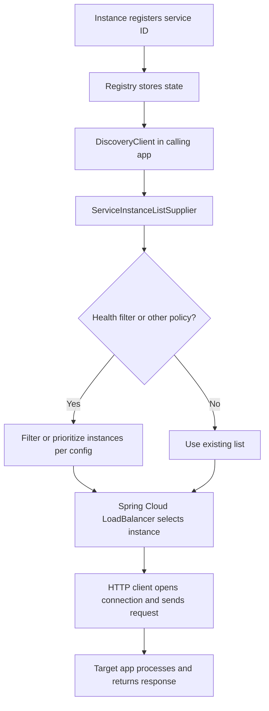
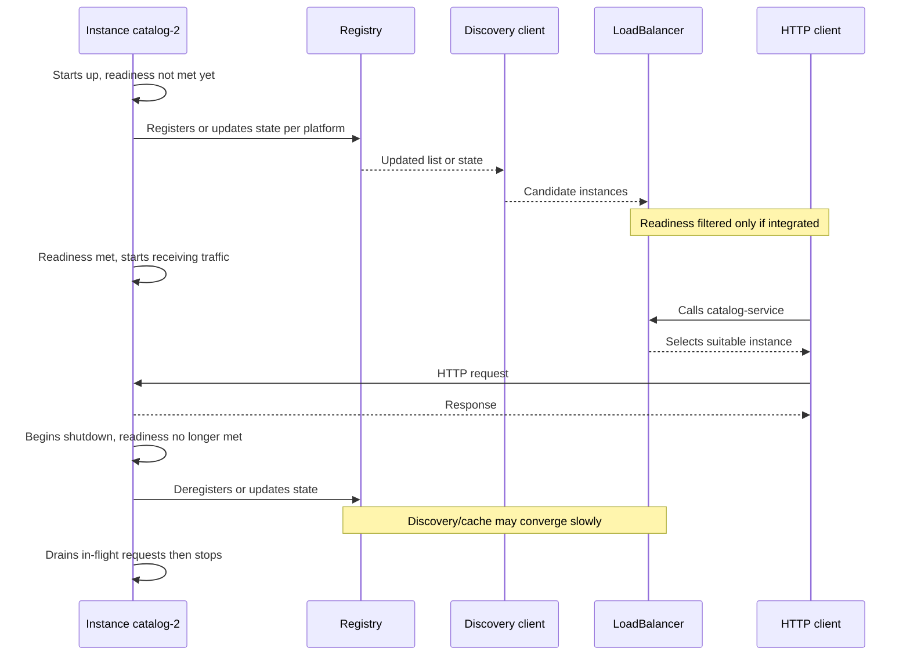

# Distinguishing Registration Status from Actual Serving Capability

In a microservices system, an instance appearing in service discovery **does not prove that it is processing requests successfully**. An instance may still be registered under the service ID `catalog-service` while not having finished initializing, temporarily pausing traffic intake, failing to connect to the database, or having an HTTP port unreachable from the calling application. Conversely, an active instance may have already been removed from the registry in preparation for shutdown and should not receive new requests.

For Spring Cloud LoadBalancer, this distinction is critical: the load balancer chooses from the list of `ServiceInstance` objects provided by `ServiceInstanceListSupplier`. If that list includes unready instances, requests through `RestClient`, `WebClient`, or OpenFeign can still fail even though service discovery and instance selection worked properly. This lesson explains how to evaluate **registration status**, **liveness**, **readiness**, **actual reachability**, and **HTTP processing results** as separate signals.

## 1. Five Different Questions About an Instance

When inspecting `catalog-2`, distinguish between the following questions:

| Signal | Question answered | Example | Limitation |
|---|---|---|---|
| **Registration / membership** | Does the registry or discovery client know that `catalog-2` belongs to `catalog-service`? | `DiscoveryClient.getInstances("catalog-service")` contains `catalog-2` | Does not by itself prove the instance is ready |
| **Liveness** | Is the process still alive and able to continue running? | `/actuator/health/liveness` returns `UP` | The process may be alive yet still unable to serve |
| **Readiness** | Is the application accepting new traffic? | `/actuator/health/readiness` returns `UP` | Readiness only reflects configured conditions |
| **Reachability** | From the client itself, can a connection reach the advertised address and port? | TCP/TLS and HTTP to `10.0.1.12:8080` succeed | Being reachable does not guarantee the business endpoint is healthy |
| **Application response** | Does the specific endpoint process the request properly within the required time threshold? | `GET /api/products/42` returns `200` and valid data | One successful request does not guarantee the next request will succeed |

For example, the registry still holds information for `catalog-2` and heartbeats arrive regularly, yet `/api/products/42` returns `503` because a required dependency is experiencing an outage. This is a **registered instance that cannot currently serve the task**. Looking only at the registry can lead to the false conclusion that the system has enough healthy replicas.

“Healthy” status always depends on **timing, network path, endpoint, and the checked conditions**. No single boolean flag fully answers all of those questions.

## 2. What Does Service Registration Tell You?

An instance typically advertises `serviceId`, `instanceId`, `host`, `port`, `scheme`, and optionally metadata. Service discovery helps clients retrieve the list of published addresses. In Spring Cloud, the `DiscoveryClient` abstraction can query this list by service ID:

```java
List<ServiceInstance> instances =
        discoveryClient.getInstances("catalog-service");

for (ServiceInstance instance : instances) {
    System.out.printf("%s %s:%d%n",
            instance.getInstanceId(),
            instance.getHost(),
            instance.getPort());
}
```

The snippet assumes a variable `discoveryClient` of type `DiscoveryClient`. The result represents **the list currently seen by the discovery implementation in the calling application**, which may differ from the latest state in the registry due to caching, polling, watch mechanisms, or lease expiration times.

Registration mechanisms depend on the platform: some registries rely on heartbeats/leases, while other systems manage endpoints and readiness under their own models. Therefore, do not equate *having a heartbeat* with *the health endpoint having been checked*, or assume every registry actively sends HTTP requests to each instance.

Three common situations:

1. **Not ready yet but already visible:** the instance registers early during startup; dependencies or internal caches have not warmed up yet.
2. **Already dead but still visible:** the process stops abruptly; the registry has not yet expired the heartbeat/lease, or the discovery client or LoadBalancer cache has not refreshed yet.
3. **Deregistered but still running:** the instance enters a drain phase during deployment; the registry stops advertising it for new requests while the process finishes handling in-flight requests.

In all three cases, “present/absent in the registry” and “able/unable to serve requests” are two different dimensions of information.

## 3. Liveness and Readiness Are Not Synonymous

Spring Boot Actuator supports health groups used to reflect the **liveness** and **readiness** of an application. Probe endpoints can be enabled in development environments or when the deployment environment does not enable them automatically:

```yaml
management:
  endpoint:
    health:
      probes:
        enabled: true
```

With Spring Boot Actuator added to the application and the endpoints accessible according to security configuration, the commonly used paths are:

```text
GET /actuator/health/liveness
GET /actuator/health/readiness
```

- **Liveness** determines whether the application can keep running or must be restarted. Avoid carelessly including the status of a shared dependency, such as a cluster-wide database, in liveness: doing so can cause multiple instances to restart simultaneously when a dependency experiences a transient error.
- **Readiness** indicates whether the application accepts new requests. During startup or shutdown, an application can reject traffic even while the process is still alive. When a dependency is a mandatory prerequisite for serving requests, that check can be intentionally included in the readiness group.

Example of a process that has started but is still loading data:

| Situation | Liveness | Readiness | Should new requests be routed here? |
|---|---|---|---|
| Just started, initialization incomplete | May be `UP` once probes are ready | Not ready yet | Not yet |
| Normal operation | `UP` | `UP` | Yes, if network path and API respond |
| Graceful shutdown / draining | May still be `UP` | Not accepting new traffic | No |
| Process deadlocked or unrecoverable | May be unresponsive | May be unresponsive | No |

**Note:** default readiness does not automatically check every dependency or every business endpoint. You must explicitly define which conditions are truly required for traffic and which health indicators are included in the group. If Actuator runs on a separate management port, a healthy probe on that port **does not necessarily** prove the main application port is reachable; consider configuring probes to match the actual traffic path.

## 4. Which Layers Does a Request Pass Through?

When a client calls `http://catalog-service/api/products/42`, the selected list does not necessarily reflect real-time health:



In this flow:

- The registry and discovery determine **which instances are known**.
- `ServiceInstanceListSupplier` decides **which instances belong in the candidate list**, potentially based on cache, metadata, zone, or health checks if configured.
- LoadBalancer selects an instance from the candidate list using a policy such as round-robin or random.
- The HTTP client must be able to connect to the target address and receive a valid response within the timeout.

If the registry returns three instances, LoadBalancer chooses `catalog-2`, and then the HTTP request times out, **you cannot conclude LoadBalancer picked the wrong algorithm**. The cause could be stale registry data, an unreachable port, an unready instance, an overly short timeout, or a hanging business endpoint.

## 5. Health Checks in Spring Cloud LoadBalancer

Spring Cloud LoadBalancer provides `HealthCheckServiceInstanceListSupplier` to check candidate health on the **client side** and supply a vetted list to the instance chooser. This is a capability **configured on demand**; having data in `DiscoveryClient` does not mean active LoadBalancer health checks are enabled.

An illustrative way to declare the supplier chain (depending on the Spring Cloud version in use) is:

```java
import org.springframework.cloud.loadbalancer.core.ServiceInstanceListSupplier;
import org.springframework.context.ConfigurableApplicationContext;
import org.springframework.context.annotation.Bean;

@Bean
ServiceInstanceListSupplier healthAwareSupplier(
        ConfigurableApplicationContext context) {
    return ServiceInstanceListSupplier.builder()
            .withDiscoveryClient()
            .withHealthChecks()
            .build(context);
}
```

The example above is placed inside a **LoadBalancer configuration dedicated to a service ID** if you only want to filter instances of a single service, for instance via `@LoadBalancerClient(name = "catalog-service", configuration = ...)`. Per-service configuration classes should live outside the main context's component scan to avoid applying the supplier bean to unintended service IDs.

When configuring health checks, you need to know:

1. **What is the check endpoint?** `/actuator/health` and `/actuator/health/readiness` can carry different meanings. Pick the endpoint that accurately reflects traffic-handling readiness and verify the path per service ID if different services use different health endpoints.
2. **How do check frequency and refetching work?** Health results do not update instantaneously at the moment an instance breaks. Interval, timeout, and how the instance list is refetched affect detection latency.
3. **How are caching and the supplier chain configured?** If the discovery client or supplier holds a stale list, health checks may evaluate an outdated set of instances. The ordering of caching, health checks, and request-dependent filters should be reviewed.
4. **What signal marks an instance unhealthy?** A failed probe may stem from client-side networking, endpoint security, timeouts, or application errors. It does not by itself prove the entire instance is dead for every other client.

Depending on the discovery platform, you can rely on readiness status reflected by the orchestrator/registry without a separate client-side health check, or combine both layers. Avoid configuring redundant overlapping health probe loops without a clear goal, as they can generate unnecessary load and inconsistent state.

**An important limitation:** a health-filtering supplier only alters the LoadBalancer candidate list in the client using that supplier. It does not deregister the instance from the registry or fix the state seen by other clients. A single HTTP `5xx` also does not automatically cause LoadBalancer to permanently evict an instance unless a corresponding detection and eviction policy is in place.

## 6. Example of One Service with Multiple States

Suppose `catalog-service` has three instances:

| Instance | Seen in registry? | Readiness | Reachable from order-service | Endpoint `/api/products/42` | Interpretation |
|---|---|---|---|---|---|
| `catalog-1` | Yes | `UP` | Succeeds | `200` | Sufficient signals to use for the sample request |
| `catalog-2` | Yes | `DOWN` | Reachable | `503` | Registered, but should not be selected when readiness fails |
| `catalog-3` | Yes | `UP` | Timeout | No response | Possible network or port issue; probes from elsewhere do not reflect the client's path |

If only the discovery list and round-robin are used, all three may remain candidates. With an appropriate health/readiness filter, `catalog-2` can be excluded; for `catalog-3`, the outcome still depends on where the probe runs, the network path, and timeouts. You cannot assume by default that `catalog-3` will be excluded in every deployment.

This example also shows that **having readiness `UP` does not guarantee every business operation returns `200`**. Some requests may return `400` due to input data or `404` because a resource does not exist, even though the instance is healthy. HTTP status codes must be interpreted according to the API contract rather than treating every `4xx` as a health failure.

## 7. Behavior During Startup, Deployment, and Shutdown

The state transition flow can be visualized as follows:



During scale-out, completing registration **does not mean** the new instance is ready to take traffic. During scale-in, mark the instance as not accepting new requests or deregister per platform conventions, wait for clients to converge, and allow in-flight requests to complete before stopping completely. If an instance is killed abruptly, the registry may continue advertising it until the lease expires, widening the window for picking a stale address.

In addition, the same service ID can have multiple client applications, each holding a different cache or using a different health supplier; therefore **client A and client B may see different instance lists at the same time**. When troubleshooting incidents, inspect from the exact calling application, not only the registry dashboard.

## 8. Common Mistakes When Assessing Instance Health

| Hasty assumption | Why it is wrong | Proper check |
|---|---|---|
| “Present in Eureka/Consul means able to serve” | Registration or heartbeats may not reflect actual readiness/API state | Cross-check registry status with readiness and a meaningful request |
| “Liveness `UP` means include in load balancing” | Liveness evaluates the process, not readiness to accept requests | Use readiness or an appropriate instance exclusion policy |
| “Readiness `UP` means all APIs succeed” | The health group may not check an API's dependency; contract errors can still happen | Monitor actual endpoint responses and critical dependencies |
| “Ping/HTTP health from an ops machine succeeds, so the client can definitely call it” | The client's network path, DNS, TLS, or port may differ | Probe from the calling service's own environment |
| “Having a health endpoint means LoadBalancer automatically filters bad instances” | The health supplier only works when configured; the registry has its own policy | Check the supplier chain and log the candidate list |
| “Once removed from the registry, requests can no longer hit it” | Discovery client/cache may still use an old snapshot, or in-flight requests have not finished | Check convergence latency, connections, and shutdown/drain behavior |
| “One HTTP 500 means the instance is dead” | The error may be specific to one request or a transient dependency | Distinguish business errors, infrastructure errors, time patterns, and retry policies |

## 9. Diagnostic Procedure When Requests Fail

When `order-service` reports errors calling `catalog-service`, collect data in order from the list down to HTTP:

1. **Service ID:** confirm the name `catalog-service` in the URL or Feign client matches the registered name.
2. **Registry:** check which instances are being advertised and their status/heartbeat or corresponding lease mechanism.
3. **Client-side discovery:** inspect `DiscoveryClient.getInstances("catalog-service")` inside `order-service` itself; record the timestamp, instance IDs, hosts, and ports.
4. **Supplier chain:** determine whether caching, health checks, zone filters, or request-based filters are enabled; compare the list before and after each step, especially if the list is empty.
5. **LoadBalancer selection:** log the chosen instance, selection policy, and request/trace details. If no instances remain, check why the supplier returned no candidates.
6. **Reachability:** from the client environment, test TCP/TLS/HTTP to the selected host and port, comparing against health/readiness on the proper port and path.
7. **HTTP outcome:** inspect status code, timeout, connection error, duration, and business logs on the target instance. Check whether retries are enabled and whether attempts go to the same instance.

For example, in an environment that allows direct access to an instance, you can run:

```bash
curl -i http://10.0.1.12:8080/actuator/health/readiness
curl -i http://10.0.1.12:8080/api/products/42
```

These commands are only meaningful when that address/port is reachable from where the test is run. If Actuator endpoints are secured, use proper authentication; do not expose health endpoints or detailed info to the public Internet merely for diagnostics.

When recording long-term metrics, track discovery instance count, instances passing the health filter, empty-list rate, connection failure rate, and HTTP latency per service ID. Avoid putting individual `instanceId` or `traceId` values into high-cardinality metric labels; detailed information belongs in controlled logs/traces.

## 10. Hands-on Practice: Testing Gaps Between Registration and Readiness

You can run `catalog-service` with two or three instances, Spring Boot Actuator, and an `order-service` application using Spring Cloud LoadBalancer:

1. **Baseline:** start all instances, confirm the registry and `DiscoveryClient` display the expected list; call a real API and record the selected instance and HTTP status.
2. **Slow startup:** intentionally delay an instance's readiness condition in a test environment. Observe whether the instance already appears in the registry before becoming ready and whether it gets selected during this window.
3. **Readiness failure:** toggle a readiness condition in a controlled way while keeping the process running. Compare liveness, readiness, and API call results through LoadBalancer.
4. **Enable health filter:** if supported and appropriate in your setup, configure a health-aware supplier for `catalog-service` and compare the candidate list before/after readiness changes. Record which health endpoint is probed.
5. **Network loss:** cut off reachability from `order-service` to an instance that the registry still advertises. Compare client-side health probes against request results to avoid mistaking a network fault for a registration fault.
6. **Graceful shutdown:** transition an instance to stop accepting new traffic, deregister/drain it, and observe when it stops being selected; verify whether in-flight requests complete.
7. **Test timeouts/retries:** induce a controlled timeout and observe which instance is selected on each attempt and the retry count. For write operations, evaluate idempotency before enabling retries.

A sample observation table:

| Time | Registry | Readiness | List after health filter | Selected instance | Result |
|---|---|---|---|---|---|
| `t1` | `1,2,3` | `1,2,3 UP` | `1,2,3` | `2` | `200` |
| `t2` | `1,2,3` | `2 DOWN` | May still be `1,2,3` during probe window | `2` | May fail |
| `t3` | `1,2,3` | `2 DOWN` | `1,3` after filter updates | `3` | `200` |
| `t4` | `1,3` | `1,3 UP` | `1,3` | `1` | `200` |

The numbers in the table are shorthand for `catalog-1`, `catalog-2`, `catalog-3`; the data merely illustrates a setup with a health filter configured. The key takeaway is that **the moment readiness changes, the moment the registry updates, and the moment the list used by LoadBalancer changes can all differ**.

## 11. Design Principles to Reduce Routing Errors

- Use readiness to decide whether to accept new traffic; avoid putting external dependencies into liveness when doing so could trigger simultaneous restarts across many instances.
- Ensure advertised host, port, scheme, and health path match the caller's network path; also verify the application port if health probes run on a separate management port.
- Choose a health mechanism suited to your registry, orchestrator, and client needs; do not assume `HealthCheckServiceInstanceListSupplier` is always enabled.
- Tune refresh intervals, cache TTLs, timeouts, graceful shutdown, and drain periods based on real measurements; avoid assuming that lowering LoadBalancer's TTL also makes the registry update faster.
- Track **three separate pieces of data**: the registered list, the candidate list after health/policy filtering, and the HTTP outcome on the chosen instance.
- For transient errors, use bounded retries appropriate to the request semantics; retries do not replace evicting unhealthy instances or fixing readiness bugs.

## 12. Key Takeaways

**Registration** answers “is this instance published under this service ID?”. **Liveness** answers “is the process still operational?”. **Readiness** answers “is the application accepting new traffic?”. **Reachability and HTTP response** answer “can the calling application actually connect and complete this request?”. Spring Cloud LoadBalancer selects from the list supplied by discovery and `ServiceInstanceListSupplier`; to avoid picking instances that only exist by name in the registry, coordinate health/readiness, caching, deregistration, and real request observability properly. Clearly separating these layers helps pinpoint root causes when `RestClient`, `WebClient`, or OpenFeign encounters errors during scaling, deployments, or service disruptions.
